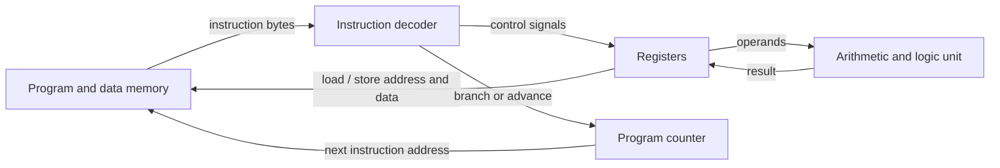

# From a Bit to a Running CPU

The preceding chapter explained how bytes acquire meanings. A computer must also transform those bits, remember intermediate values and decide what to do next. This short machine-building bridge gives the missing physical-to-instruction connection before the book moves deeply into C++ objects. It describes a **teaching architecture**, not a claim that every commercial CPU is implemented in this way.

## Combinational logic produces an answer from current inputs

A logical AND outputs one only when both inputs are one. An XOR outputs one when exactly one of its two input bits is one. For two binary digits, adding them produces both a sum bit and a carry bit. These are different outputs: the numeric sum may require an extra position.

| Input a | Input b | Sum a XOR b | Carry a AND b |
|---:|---:|---:|---:|
| 0 | 0 | 0 | 0 |
| 0 | 1 | 1 | 0 |
| 1 | 0 | 1 | 0 |
| 1 | 1 | 0 | 1 |

A **half adder** implements those two formulas. It is only half the story, because a multi-bit addition must also accept a carry from the less-significant position. Let that incoming carry be c. A **full adder** computes

$$
s=a\oplus b\oplus c,\qquad
c_{out}=(a\land b)\lor(c\land(a\oplus b)).
$$

A multi-bit adder connects carry outputs to the next input position. The name *ripple carry* describes this dependence: the highest sum bit cannot be established until its incoming carry is known. Other adders reorganize the logic to shorten that critical path. This is the first example of a general systems lesson: mathematically equivalent operations can have very different dependency graphs and execution costs.

## State turns a circuit into a machine

Combinational circuits transform their present inputs. They do not remember the previous result. A register retains an encoded value across selected clock boundaries. A register bank, an arithmetic and logic unit (ALU), and control state let a machine execute a sequence of operations rather than one fixed computation.



The program counter is a register holding the location of the next instruction in our teaching machine. The decoder interprets the instruction's opcode and any operands. The ALU performs a specified arithmetic or logical operation. A load moves data into a register; a store moves a result to memory. This is a *fetch–decode–execute* model. Real processors may overlap these stages, predict branches, rename registers, reorder micro-operations, or execute multiple instructions simultaneously. Those features change performance mechanisms without abolishing the architectural contract.

A clock is not the same thing as program time. Neither is one source statement necessarily one instruction. A C++ compiler may produce several instructions, no instructions, or an entirely different sequence that preserves the permitted observable behavior.

## A small instruction set makes the contract observable

Our model deliberately has one eight-bit accumulator and 256 addressable bytes. Instructions have the following encodings:

| Opcode | Meaning | Size |
|---|---|---:|
| `0x10 addr` | Load accumulator from byte at `addr` | 2 bytes |
| `0x20 addr` | Add byte at `addr` modulo 256 | 2 bytes |
| `0x30 addr` | Store accumulator into byte at `addr` | 2 bytes |
| `0xFF` | Halt | 1 byte |

The byte following each non-HALT opcode is **an address**, not the arithmetic operand itself. This distinction is fundamental. The program `10 F0 20 F1 30 F2 FF` means “load from F0, add the byte at F1, store at F2, stop.” It does not mean “add F1 to F0.”

The machine must reject a truncated instruction, an unknown opcode and runaway execution. An invalid input is not a license to read outside the program's array. The following is a complete, deliberately small C++23 reference program.

```cpp
// tiny_cpu.cpp — one-accumulator teaching ISA, not a real hardware emulator
#include <array>
#include <cstddef>
#include <cstdint>
#include <iostream>
#include <stdexcept>

struct TinyCPU {
    std::array<std::uint8_t, 256> bytes{};
    std::size_t pc = 0;
    std::uint8_t accumulator = 0;
    bool halted = false;

    std::uint8_t fetch() {
        if (pc >= bytes.size()) {
            throw std::runtime_error("program counter out of range");
        }
        return bytes[pc++];
    }

    void step() {
        if (halted) return;
        const auto opcode = fetch();
        switch (opcode) {
            case 0x10: {
                const auto address = fetch();
                accumulator = bytes[address];
                break;
            }
            case 0x20: {
                const auto address = fetch();
                // The ISA defines modulo-256 addition explicitly.
                const unsigned wide =
                    static_cast<unsigned>(accumulator) + bytes[address];
                accumulator = static_cast<std::uint8_t>(wide & 0xFFu);
                break;
            }
            case 0x30: {
                const auto address = fetch();
                bytes[address] = accumulator;
                break;
            }
            case 0xFF:
                halted = true;
                break;
            default:
                throw std::runtime_error("invalid opcode");
        }
    }
};

int main() {
    TinyCPU cpu;
    cpu.bytes[0] = 0x10; cpu.bytes[1] = 0xF0;
    cpu.bytes[2] = 0x20; cpu.bytes[3] = 0xF1;
    cpu.bytes[4] = 0x30; cpu.bytes[5] = 0xF2;
    cpu.bytes[6] = 0xFF;
    cpu.bytes[0xF0] = 250;
    cpu.bytes[0xF1] = 10;

    for (int instructions = 0; !cpu.halted && instructions < 32;
         ++instructions) {
        cpu.step();
    }
    if (!cpu.halted) throw std::runtime_error("execution limit reached");
    std::cout << static_cast<unsigned>(cpu.bytes[0xF2]) << '\n';
}
```

Compile with a C++23-capable compiler:

```sh
c++ -std=c++23 -Wall -Wextra -Wpedantic -Werror tiny_cpu.cpp -o tiny_cpu
./tiny_cpu
```

The expected output is `4`: adding 250 and 10 yields 260 mathematically, and the specified eight-bit accumulator retains `260 mod 256 = 4`. The test establishes the implementation of this particular ISA on the checked input. The reason modulo arithmetic applies is the specification we just wrote, not an assumption that all signed machine integers wrap.

## Trace the instruction boundary

| Before PC | Fetched opcode | Operand | Accumulator afterward | Observable effect |
|---:|---|---:|---:|---|
| 0 | LOAD | F0 | 250 | State read from byte F0 |
| 2 | ADD | F1 | 4 | Modular sum |
| 4 | STORE | F2 | 4 | Result committed at F2 |
| 6 | HALT | — | 4 | No further steps |

Now change the byte at address 2 to `0x99`. The next `step()` must reject the opcode. Change the first opcode to LOAD but put the instruction at byte 255: this small CPU must reject a missing address operand rather than read beyond the array. Separately test a deliberately bounded instruction budget so malformed control flow cannot run forever. These tests are stronger than merely checking that the first program prints four.

## From an instruction-set contract to actual processors

The table and simulator define an **ISA**. A pipelined machine may fetch one instruction while another is decoded, another computes, and another writes a result. A cache may avoid accessing external memory for some loads. A branch predictor may speculatively fetch a path that is later discarded. These are aspects of **microarchitecture**, not extra promises silently added to the ISA.

A modern operating system adds virtual address translation, protection and resource scheduling. A compiled C++ program further brings an abstract machine: whether an object is alive and whether a read is defined are questions the C++ language answers, not facts recoverable from a CPU register dump alone. A byte array in the simulator stands for storage in a model; using a real pointer does not bypass language lifetime rules.

This distinction will matter when we move from ordinary CPU threads to GPU invocations. The GPU also has registers, execution units and memory, but its exposed workgroup and visibility rules differ. A correct port begins by translating the **algorithm's data dependencies and ownership**, not by copying instruction syntax.

## Reconstruct without looking

Derive the full-adder carry equation. Trace a program that adds 255 and 2. Explain why the two-byte LOAD is not the same as a one-byte immediate-load instruction. Show the state that must be retained between two calls to `step()`. Finally, state which facts in this experiment are part of the invented ISA, which are C++ rules, and which would depend on a physical CPU implementation. The ability to keep those layers distinct is the purpose of this bridge.
