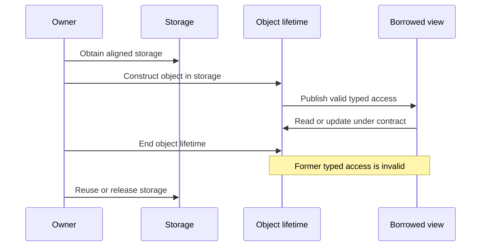

# Storage, Objects, and Aliases: Three Different Claims

A machine address identifies a location within an address space; a C++ pointer expression also has type and provenance constraints under the language's object model. The fact that a debugger continues to show the same numerical address is not proof that the object at that address is still alive. The distinction is essential when reading serialized bytes, creating objects in allocated storage, extending a vector, or passing a mapped GPU buffer to a device.

## An object has a validity interval

The storage interval can begin before construction and end after destruction. A borrowed view may describe only a portion of the object's usable lifetime. When a container reallocates, it can invalidate element pointers even though the container object is alive and its values have been transferred to a different allocation. This matters even on a platform where every pointer has the same apparent byte width.

## A test that must never dereference the invalid reference

A simple test starts with `std::vector<int> values{1,2,3};`, records the original `data()` address, and deliberately grows the vector beyond its capacity. Compare the *permitted container observations* and the values after growth; do **not** dereference or compare a potentially invalid pointer as a way of proving it is still usable. The vector's size, capacity and iterator invalidation rules are the relevant contract. An unsafe access that appears to work on one run is not a counterexample to the lifetime rule.

For a byte decoder, the safest first operation is to verify that enough input bytes exist before constructing a typed result. Parsing individual fields under explicit widths and endianness is often more portable than treating arbitrary file bytes as a live C++ object. A standard-layout C++ type does not by itself establish a stable cross-platform file representation: padding, endianness, object lifetime and version rules still matter.

## Trace the difference with one value

Suppose a scene resource uses a stable numeric ID, a CPU cache uses a generational handle, and a GPU descriptor refers to a bound allocation. Those are three separate forms of identity. The persistent ID can survive a process restart while a pointer cannot. The generational handle can reject stale slot reuse under its wrap policy. The GPU descriptor is governed by its update and device-execution rules. None of these abstractions makes an invalid physical allocation safe.

**Reconstruct:** Draw the separate lifetimes of storage, C++ object, borrowed view, GPU resource and device consumer. Label the events that end each obligation. **Test:** Run the companion registry example and explain why a stale handle is rejected without invoking undefined behavior. **Transfer:** Show how these distinctions apply to an image importer and an asynchronous upload path.
