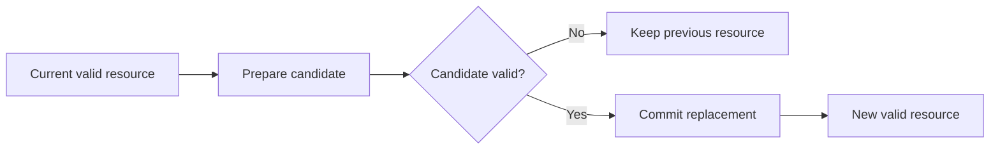

# Replace a Resource Without Destroying the Previous Success

Resource-owning code becomes difficult when a new value is only partly constructed. Imagine loading a texture: the application has a valid old texture, but importing a replacement can fail because of a malformed header, unsupported format, memory exhaustion, or a failed upload. A reliable interface needs to say what remains true when replacement fails.

The strong exception guarantee is a useful model: when an operation fails through an exception, the externally visible state remains as it was before the operation. Not every operation can or should offer this guarantee, but a transaction-shaped implementation makes the desired policy explicit.

## Prepare, validate, then publish



The candidate is private until all checks that can reject it have completed. Publication is ideally a small operation whose failure behavior is known. A commit that can throw after destroying the old state has not established the strong guarantee merely because it was named `commit`.

## A complete, independently runnable example

```cpp
// transactional_replace.cpp — C++23 standard library only
#include <iostream>
#include <vector>

bool replace_if_valid(std::vector<int>& active,
                      const std::vector<int>& requested) {
    std::vector<int> candidate = requested;  // May throw; active is intact.
    for (int value : candidate) {
        if (value < 0) return false;          // Reject without publication.
    }
    active.swap(candidate);                   // No-throw with default allocators.
    return true;
}

int main() {
    std::vector<int> active{3, 4};
    if (replace_if_valid(active, {5, -1})) return 1;
    if (active != std::vector<int>{3, 4}) return 2;
    if (!replace_if_valid(active, {7, 8})) return 3;
    if (active != std::vector<int>{7, 8}) return 4;
    std::cout << "Transactional replacement preserved old state\n";
}
```

This example uses the default allocator, whose vector swap guarantees are appropriate for this demonstration. In a more general allocator-aware container or a GPU resource manager, the commit's preconditions and failure guarantees must be checked rather than assumed. In a GPU application, an old resource might also have pending device consumers, so swapping the CPU handle is not sufficient proof that the old allocation may be destroyed immediately.

## Failure injection is part of the design

Test three categories separately: malformed data that a validator rejects; a simulated allocation or construction failure; and delayed device work that has not yet finished. The first two test the host's update guarantee. The third tests asynchronous lifetime, which may require pending-use tracking and a completion witness even after the new resource has been published.

**Reconstruction:** Identify exactly when the new resource becomes observable. **Falsification:** Modify a naïve implementation to overwrite the old value before validation, and show the failed test. **Transfer:** Explain how the same transaction pattern appears in configuration reloads, asset databases, code generation caches and GPU frame slots.
