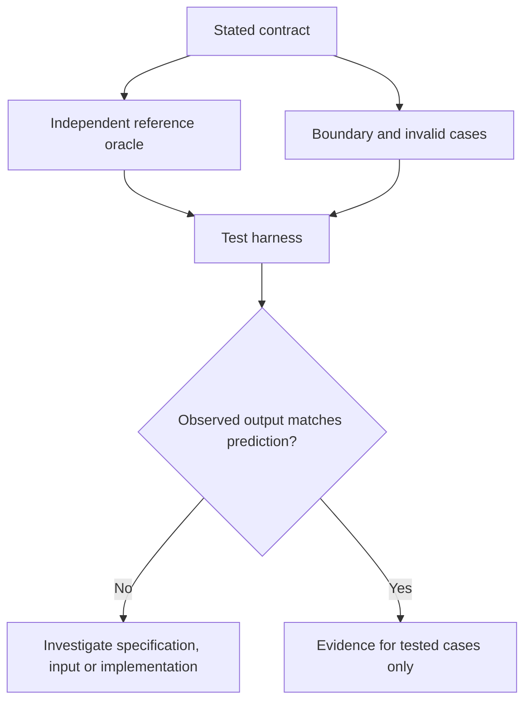

# A Correctness Test Needs an Independent Reason to Expect the Answer

A test suite should not merely run the implementation twice and compare its two outputs. If both executions share the same bug, their agreement proves little. A strong laboratory starts by stating the contract independently of the code, choosing boundary inputs and writing down the result before executing the implementation.

## Separate four kinds of evidence

For a versioned record with a one-byte version followed by a one-byte value, the minimum valid length is two. A one-byte input must be rejected before the implementation indexes its second element. A valid version with a zero payload is still a success, not an absent result. A record using an unknown version must produce a distinct error. An oversized record may be accepted, rejected or parsed with trailing bytes depending on the explicitly documented format; the test must not quietly choose that policy on the implementation's behalf.

| Test input | Contract question | Expected outcome |
|---|---|---|
| Empty buffer | Can the decoder safely access any header field? | Explicit too-short failure |
| One byte | Is version enough without payload? | Explicit too-short failure |
| Version 1, value 0 | Can valid zero be distinguished from no result? | Success with value zero |
| Unsupported version | Does format version enforcement work? | Explicit unsupported-version failure |
| Maximum byte value | Is the entire eight-bit domain supported? | Success with 255 under a format that permits it |

## The negative test must be meaningful

If a function rejects a bad input before touching memory, that is evidence of correct validation for that input. If a sanitizer does not complain, it does not follow that every possible execution is defined. A crash is also not automatically evidence that the predicted contract has been enforced: a controlled error result and a memory-safety violation are not interchangeable.

When adding an optimization, preserve a separately maintained reference oracle. For a parallel scan, the reference might be a simple serial prefix loop. For a file decoder, it might be a very small specification-driven parser or hand-written traces. For a GPU kernel, verify results before recording performance numbers.

## Turn tests into a research record

Record the toolchain, platform, flags, inputs, seeds and actual outputs. Mark unexpected failures instead of silently excluding them from analysis. If the behavior is nondeterministic, distinguish whether it comes from randomized test data, scheduling, memory-race bugs or measurement noise. Each cause requires a different investigation.

**Reconstruction:** Explain why exact agreement between two optimized implementations can conceal a shared mistake. **Falsification:** Create an invalid-input case that fails before any unguarded index access. **Transfer:** Apply the same approach to a Vulkan descriptor update or a Metal frame-resource lifetime test, where a particular driver may happen to hide a bug.
