# Stable Identity Requires More Than a Memory Address

An editor may store an entity reference across several sessions, while a runtime resource manager uses compact slots and may reuse a freed slot for a different object. If an old reference contains only the slot number, it can accidentally name the new object. A generational handle separates *where a value currently lives* from *which occupant the reference was issued for*.

## A handle is a claim that must be validated

A handle contains a slot index and a generation number. A lookup succeeds only if the slot is in range, alive and carrying the handle's generation. Deleting an occupant invalidates its old generation; reusing the slot issues a different one. This is a contract between all producers and consumers of handles, not merely a trick for hiding raw pointers.

```mermaid
stateDiagram-v2
    [*] --> Empty
    Empty --> LiveG1: Create object, issue handle (slot,1)
    LiveG1 --> FreeG2: Erase; increment generation
    FreeG2 --> LiveG2: Reuse slot, issue handle (slot,2)
    LiveG2 --> FreeG3: Erase; increment generation
    note right of LiveG2
      A handle carrying generation 1
      must be rejected here.
    end note
```

The diagram omits concurrency on purpose. If threads can simultaneously erase, resolve and reuse slots, additional synchronization and publication rules are necessary. A finite generation counter can also wrap. One defensible simple policy is to retire a slot permanently before the counter would wrap; another design may choose a larger generation space and document a bounded lifetime guarantee.

## A short rejection proof

Suppose slot 4 holds generation 8 and an object named A. An old handle is `(4,8)`. Deleting A increments the stored generation to 9, then permits slot 4 to be reused. The new object B is referred to by `(4,9)`. Validation of the old handle compares 8 with 9 and rejects it even though the slot index is still within range. This proof relies on the generation not wrapping to an issued value and on readers observing coherent slot state.

The companion program `src/generational_handles.cpp` demonstrates this bounded single-threaded policy, including rejection of a duplicate erase and a stale handle after reuse. Its tests should be treated as examples of contract verification, not as a thread-safe ECS implementation.

## Persistent identity versus runtime resolution

An asset saved to disk should normally use a persistent identity appropriate to the storage system, such as an application-controlled stable identifier. At runtime, that identity may resolve to a cache entry with a generational handle. The final GPU resource may have an API handle and additional lifetime requirements. Persisting a C++ pointer in a scene file is not a general substitute for any of these identities.

**Reconstruction:** Given a series of creations and deletions, write out the slot table and generations after every operation. **Falsification:** Remove the generation check and demonstrate the stale-handle error; then restore it. **Transfer:** Model an asynchronous GPU resource whose CPU-side handle is valid but whose last device consumer has not finished, and explain why generational identity alone does not authorize destruction.
