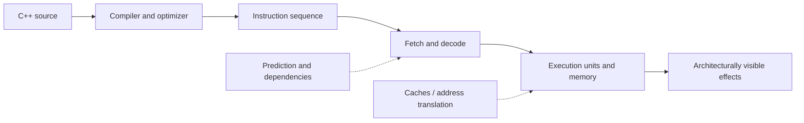
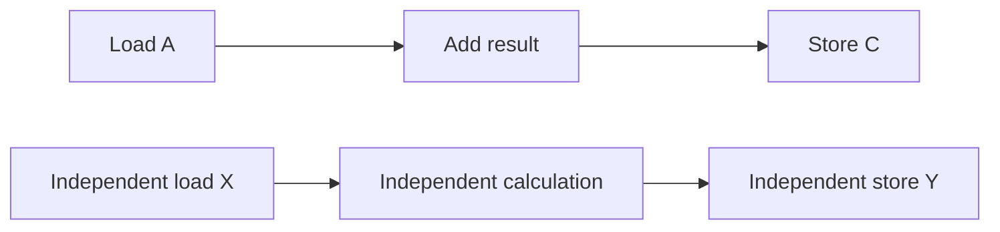

# Follow One Instruction Through the Machine

Computer architecture matters to software because a C++ statement does not execute directly. A compiler produces instructions according to an instruction-set contract, and a processor implements those instructions with microarchitectural mechanisms that may overlap, buffer or reorder work. The resulting observable behavior must remain compatible with the language and architecture, but the cost of a given instruction sequence depends on the machine and workload.

## Architectural state and microarchitectural machinery are different

An instruction can name registers, memory addresses and conditions. Its *architectural* semantics specify the logical state transition. A teaching implementation may have a fetch/decode/execute cycle; a contemporary processor may predict branches, rename registers, execute instructions out of order and retire them in program order. Neither story implies that a C++ compiler must emit one instruction per statement.

The arrows in this diagram indicate conceptual responsibilities, not fixed hardware latencies. A register in the ISA can be implemented by a different physical register during execution. A source-level loop can disappear or be vectorized when the transformation preserves required observable behavior.

## Follow a load and an addition

Imagine the instruction sequence: load byte from address A, add byte from address B modulo 256, store the result at C. If A contains 250 and B contains 17, the eight-bit result is 11 because 267 modulo 256 equals 11. That describes unsigned arithmetic in the teaching machine. In a real C++ program, the usual arithmetic conversions and type widths decide which intermediate computation occurs before a narrowing assignment.

The memory address is not a promise of low latency. The core may translate a virtual address, consult data caches, fill a cache line or wait for a dependent operation. A sequential dependency chain has a different performance limit than independent arithmetic on many values.

## Latency, throughput and the critical path

Suppose operation B requires A's result, and C requires B's. Even if a functional unit can start a new independent operation every cycle, the dependent chain cannot execute faster than its data become available. Parallelism is possible when the graph contains independent work. This is the same dependency argument later used in GPU kernels and command graphs.

## Build a falsifiable experiment

Write a small program with a fixed seed and two workloads: one traverses an array sequentially, another follows a seeded permutation of indices. Keep the logical sum and number of visited elements identical. Warm up deliberately, report whether the compiled program includes vectorization, and measure repeated times with confidence intervals. A faster sequential workload is evidence of a locality effect only after controlling for the amount of work and correctness.

Do **not** infer cache-line size or hardware prefetch policy from one timing result. Use available performance counters where permitted; explain their meaning on that platform. Distinguish CPU timer overhead from target-kernel execution time.

**Reconstruction check:** Explain the difference among ISA semantics, physical execution, cache behavior, compiler optimization, dependent latency and independent throughput. Then connect the proof of correct unsigned arithmetic to the separate question of measured performance.
