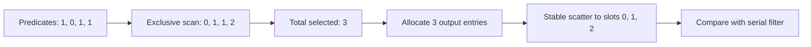

# A Parallel Algorithm Is a Proof of Who May Write Where

A parallel implementation often fails not because its arithmetic formula is wrong but because two workers can claim the same output or read data before it is produced. Prefix scan is a constructive solution to a common ownership problem: selected items must be packed into a dense output without conflicting writes.

## Derive the exclusive scan by hand

Take four items, with predicates `[1,0,1,1]`. The exclusive prefix count for each item is the number of selected items *before* that item. The offsets are `[0,1,1,2]`; the total number selected is three. Only the three selected items write, and their destinations are `[0,1,2]`.

| Item index | Predicate | Selected before item | Action |
|---:|---:|---:|---|
| 0 | 1 | 0 | Write item 0 at output 0 |
| 1 | 0 | 1 | No write |
| 2 | 1 | 1 | Write item 2 at output 1 |
| 3 | 1 | 2 | Write item 3 at output 2 |

The mathematical claim is

$$
o_i=\sum_{j=0}^{i-1}p_j,\qquad p_j\in\{0,1\}.
$$

For any two selected indices `i < k`, we have `o_i < o_k` because the selected element at `i` contributes at least one to the count before `k`. Thus no two selected items write the same output slot. Capacity must still be at least the total count, and the scan itself must be computed correctly.

## Block-local work is not a global scan

A GPU typically divides a large input among many workgroups. A local prefix scan computes offsets relative to the workgroup, but cannot by itself determine a global output offset. One practical design computes each group's local scan and total, scans the group totals, then adds the preceding-group offset to each local result. Alternative algorithms can coordinate work differently; correctness always depends on ensuring every output owner receives the right global prefix.

A workgroup barrier only synchronizes the work it is specified to cover. It is not automatically a cross-workgroup global synchronization point. If the algorithm requires coordination across groups, that dependency must be implemented through a supported device mechanism, separate dispatches, or another proven protocol.

## Compare to an independent oracle

The companion `src/parallel_scan.cpp` computes count, exclusive offsets and stable scatter serially, then compares its output against an independently written filter for 200 deterministic input trials. This establishes an accessible reference answer before any GPU optimization. When translating to a GPU, record subgroup width assumptions, workgroup size, alignment, output capacity, synchronization and device features. Vary input distribution and group size rather than treating a popular dispatch size as universally optimal.

**Reconstruction:** Prove injectivity of output positions for selected items. **Falsification:** Remove the preceding-block offset and show duplicate or misplaced writes on a multi-block input. **Transfer:** Use the same proof for a compact visibility list, a sparse matrix construction or Gaussian tile scheduling.
