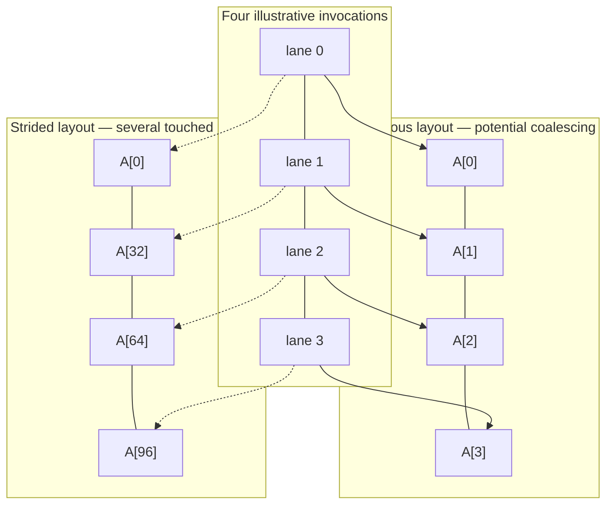
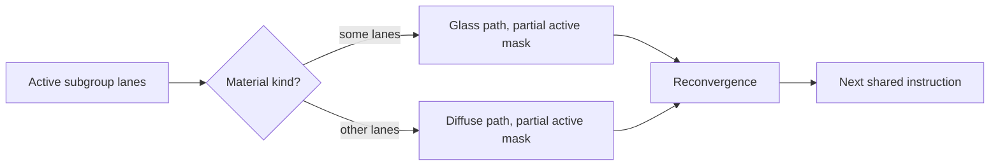
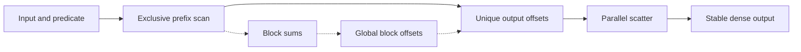

# See the Memory Traffic Before Optimizing a GPU Kernel

A compute shader does not need vertices, triangles or rasterization. It identifies an executable program and a logical grid of invocations. Correctness comes from each invocation's mapping to inputs and outputs and from the synchronization assumptions connecting invocations. Performance comes from additional facts: how the hardware groups accesses, where data can be reused, how many invocations can be resident and what must wait for what.

## Adjacent lanes and the cost of addresses

Suppose a subgroup has four illustrative lanes and each lane reads a four-byte value. Let the start of the input be aligned so that four consecutive values occupy one conceptual 16-byte region. This is a *model* for understanding coalescing; it does not declare the actual transaction width of a Metal or Vulkan device.

The same total number of arithmetic operations may produce different memory traffic. A four-byte access does not automatically cost four bytes at the physical memory interface. Cache-line occupancy, transaction granularity, alignment, reuse, and the other invocations' addresses matter.

To test an optimization, hold the mathematical computation and input values constant while changing data layout. Measure correctness separately, record the device and API, warm the pipeline appropriately and compare many repetitions. An apparent win on one input size does not imply a universal speedup.

## Layout choice is a hypothesis about future reads

An array of structures is natural when each invocation consumes the entire record. A structure of arrays is natural when the kernels operate on one component of many records. Neither is always superior. A transformation is justified when it reduces total measured work without invalidating identity, ownership, or the rest of the pipeline.

A Gaussian-splatting preparation pipeline illustrates this. If each splat refers to an unpredictable set of image tiles, later compositing may perform irregular gathers. Building stable tile-sorted entries costs time, yet it may transform later reads into coherent ranges. The correct metric is end-to-end time and accuracy, not just the speed of one sorting stage.

## Divergence is not the same as a branch

Consider a subgroup whose invocations take different paths.

If every lane takes the same branch, the branch may have little divergence cost. If different lanes need long distinct paths, the execution resources may work through more than one active mask. A source-level conditional is not enough evidence to predict timing; input distribution and compiled control flow matter.

## A scan is a constructive ownership proof

Suppose four invocations decide whether their item should be emitted. Let the predicates be `[1,0,1,1]`. The exclusive prefix sum is `[0,1,1,2]`. The number of selected items is three. Lanes with predicate one write to offsets 0, 1 and 2 respectively. No two selected lanes claim the same destination.

$$
p_i\in\{0,1\},\qquad
o_i=\sum_{j=0}^{i-1}p_j,\qquad
N_{out}=\sum_{i=0}^{n-1}p_i.
$$

This argument requires a correctly computed scan and valid destination capacity. When an implementation partitions work into blocks, each block's local scan must be combined with the exclusive offset of previous blocks. A threadgroup-local barrier alone cannot complete an arbitrary cross-group scan; that typically requires separate dispatch phases or an algorithm with some other valid global ordering scheme.

The same count–scan–scatter pattern appears in stream compaction, visible-object lists, sparse structures, particle spawning and tile entry generation. This is a connection between algorithmic proof and hardware-aware implementation, not merely a particular shader trick.

## Workgroup size is a decision, not a ritual

The value 256 is not a universal best workgroup size. A workgroup consumes registers, on-chip memory, threadgroup scheduling resources and synchronization opportunities. A larger group can expose more within-group cooperation while reducing the number of groups that can reside simultaneously. Some kernels benefit from small groups because they have irregular work or low per-group reuse.

A principled experiment selects several legal sizes, keeps the algorithm and input fixed, verifies every result, compares kernel time and end-to-end time, and inspects whether occupancy, memory throughput, register pressure or synchronization best explain the change. Report the device family and the conditions under which the chosen size won.

## What the reader should be able to reconstruct

For a sequential scan, show the invariant after processing the first k elements. For a parallel scan, explain how local results obtain global offsets. State why a one-kernel algorithm cannot generally insert an ordinary workgroup barrier and thereby synchronize *every* workgroup in the grid. Finally explain why improving memory coalescing can matter even on a machine where CPU and GPU share physical DRAM.
