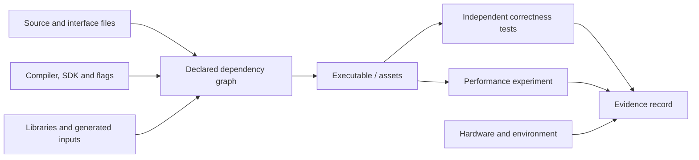

# Reproducibility Begins With a Dependency Graph

An executable is not determined by its primary source file alone. A build also depends on headers, generated code, compile options, standard-library implementation, external dependencies and the target platform. If those inputs are missing from the declared graph, an incremental build can silently reuse the wrong artifact. A reproducible result needs both a build contract and a separate test oracle.

## The complete chain to examine



A hash of the final executable may identify an output, but it does not by itself prove which sources or environment produced it. Likewise, two executables with different hashes can still implement the same required behavior. For a research artifact, capture both the derivation path and tests with explicit inputs and expected results.

## A minimal CMake/CTest laboratory

The Book 1 companion is a small, self-contained system. Its four C++23 source files are registered as separate CMake targets and CTest cases. It is intentionally possible to build all four without cloning the named private renderer or the simulation research workspaces.

```sh
cmake -S "Book Production/Seven-Book Curriculum/Book01/Companion" -B build/book01-companion -DCMAKE_BUILD_TYPE=Debug
cmake --build build/book01-companion --parallel
ctest --test-dir build/book01-companion --output-on-failure
```

Now change only one file—for example, the bounded CPU test's expected result—and observe which target rebuilds. Restore the correct expected result, perform a clean build in a separate build directory, and compare the test results. Reproducibility means the essential dependencies are declared, not simply that a developer happened to invoke the same shell command twice.

## Separate four reproducibility claims

A clean build establishes that the source can be transformed into an artifact in the recorded environment. A passing test establishes behavior for the tested inputs. A benchmark establishes a measurement under stated timing conditions. A source hash establishes identity of a byte sequence. None of these is logically interchangeable with the others.

A professional experiment record includes the compiler version and implementation, CMake version, operating system, SDK/driver version where relevant, command-line options, inputs, seeds, correctness oracle, wall-clock and device timings if measured, and the corresponding source revision. Measurements should include repeated trials and at least one negative control where practical.

**Reconstruction:** Follow a change to a public header through all downstream build targets that consume it. **Falsification:** Remove a declared dependency and find a stale incremental-build outcome; then correct the dependency and rerun. **Transfer:** Describe how an asset import pipeline or Vulkan shader compiler introduces analogous generated artifacts and version dependencies.
