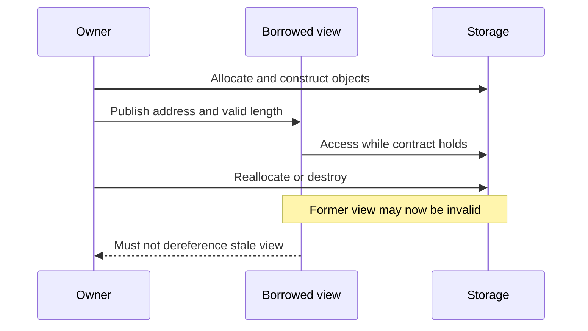
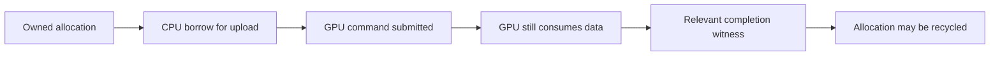

# Borrowed Memory Is a Time-Bounded Promise

A pointer, reference, iterator or span can describe memory without owning it. Such a view is useful only while a suitable object is alive and the operation is permitted by the relevant access and synchronization rules. The distinction is visible even in a single-threaded program; asynchronous device execution makes the validity interval much longer and harder to see.

## An allocation is not the lifetime of an object

Allocated storage may exist before an object is constructed in it, and may remain available after an object's lifetime has ended. An address read from a debugger does not tell us whether an access through a particular type is currently valid. A container may also relocate elements when its capacity changes, invalidating references and iterators even though the container itself remains alive.



## A complete C++23 example with an explicit owner

```cpp
// owned_span.cpp — compile with a library supporting std::span
#include <cstddef>
#include <iostream>
#include <span>
#include <vector>

int sum(std::span<const int> values) {
    int result = 0;
    for (int v : values) result += v;
    return result;
}

int main() {
    std::vector<int> owner{4, 6, 8};
    const std::span<const int> borrowed{owner};
    std::cout << sum(borrowed) << '\n';
    // Do not mutate or destroy owner while borrowed is being used.
    // No previously obtained element pointer is reused after relocation.
}
```

Expected output: `18`. A span is appropriate here because the owner outlives the call and the view has a known extent. Returning the same span from a function that created a local vector would be invalid; the view would outlive the elements. A class storing a span must document what external object retains ownership and which mutations invalidate the view.

## GPU resources require a second lifetime witness

A CPU-side view can cease being used at the end of a host function, yet an encoded device command may still require the corresponding buffer. A submission completion signal, not the host call's return, determines when an allocation can be reused. For mapped storage, API-specific visibility/coherency obligations are additional to object lifetime.



**Laboratory.** Create a small owner/view type with a debug generation counter. Invalidate a view when its owner replaces storage. Test stale-view rejection before dereference. Extend the model with a pending-device-use counter so that memory retirement requires both no active CPU borrow and no pending GPU consumer. This debug model makes the contract observable; it does not replace a correct C++ lifetime proof or the GPU API's required completion mechanism.

**Reconstruction check:** Explain how allocation lifetime, object lifetime, container iterator validity, view extent and asynchronous resource retirement differ. Give one counterexample for each assumption that an address remaining numerically equal implies an access is valid.
