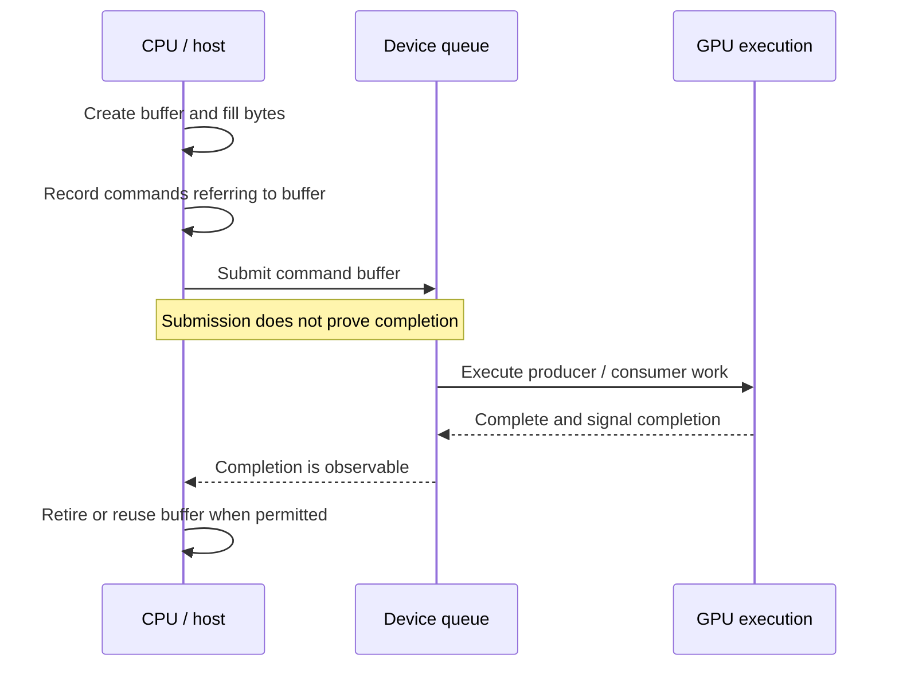
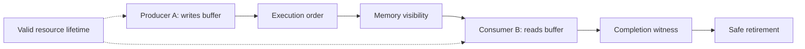

# A Resource Must Outlive Its Last Consumer

A CPU call that submits a GPU command has not necessarily executed the command. This sounds simple, but it is the reason that code which is locally correct under ordinary C++ object lifetime rules can still misuse a graphics resource. The CPU's function has returned; the device may not yet have begun reading the data.

## Separate five events

A complete resource lifecycle distinguishes **creation**, **recording**, **submission**, **execution**, and **completion**. *Retirement* occurs only after all consumers have finished and any associated API-side ownership rules permit release. There may be multiple queues, multiple frames and multiple consumers. The lifetime argument must account for all of them.

Now draw the invalid version. The host submits a command and immediately reuses the same buffer for a different frame. If the device has not finished consuming the old contents, the original command may observe overwritten data. A successful test on a fast device is not proof that the race is absent.

## Ordering and visibility are distinct

Suppose kernel A writes an output buffer and kernel B reads it. Three conditions must be established: B should not consume the data before A produced it; A's writes must be visible to B in the required memory domain; and the resource must remain valid throughout both operations. Depending on the API and scope, one mechanism may establish multiple conditions, but the names of synchronization primitives are not substitutes for a semantic argument.

This graph does not assert that a C++ release/acquire operation is equivalent to a Vulkan barrier or a Metal event. It describes the questions that each API-specific implementation must answer.

## Why Vulkan and Metal are not interchangeable

Vulkan makes stage scopes, access scopes and resource layout transitions explicit through its synchronization mechanisms. A correct dependency describes who produced data, who consumes it, and which memory operations must be made available and visible. Separate queues may introduce ownership and semaphore obligations.

Metal offers different ordering guarantees within and across passes, encoders and queues. Metal 3 and Metal 4 have distinct APIs and supported barrier forms. On some configurations of an Apple GPU, CPU and device share physical memory, but that sharing does not by itself solve temporal ordering. Use the API version and device capabilities as part of the contract.

Two source passages might both say “barrier” while requesting different operations. Translate *the hazard and required guarantee*, not the spelling of the method call. Follow the relevant specification rather than an analogy based only on the diagram.

## A deterministic simulation of an asynchronous lifetime

A good laboratory does not need a physical GPU to establish the underlying logical error. Model a producer that writes version `v`, a consumer that promises to read that same version, and a host that requests reuse of the storage. Record four milestones: version publication, command submission, consumer completion and resource retirement.

Write a state machine whose `retire()` operation is allowed only when its completion witness is set. Attempt retirement before the witness: the function must reject it, even if an accidental read of the old memory would still produce the expected value. Repeat with two outstanding consumers and demand completion of both. Then implement the corresponding API-specific mechanism with validation layers or Metal debugging enabled.

The state-machine oracle is independent of actual GPU scheduling. The API test supplies additional evidence about the implementation, but cannot invalidate the lifetime invariant merely because a particular driver happens to finish quickly.

## A timeline that can be defended

For every frame-in-flight implementation, answer:

1. Which CPU-side object owns the allocation?
2. What event publishes data to the device, and to which consumers?
3. At what point is the command merely encoded, and when is it submitted?
4. What proves completion, and which exact accesses does it cover?
5. Who is permitted to reuse, map, resize or destroy the resource?
6. What happens if submission fails, the device is lost, or a frame is cancelled?

The answers should appear directly in the resource wrapper's interface and its tests. This is the bridge from C++ lifetime reasoning to reliable GPU command execution.
