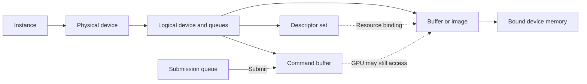
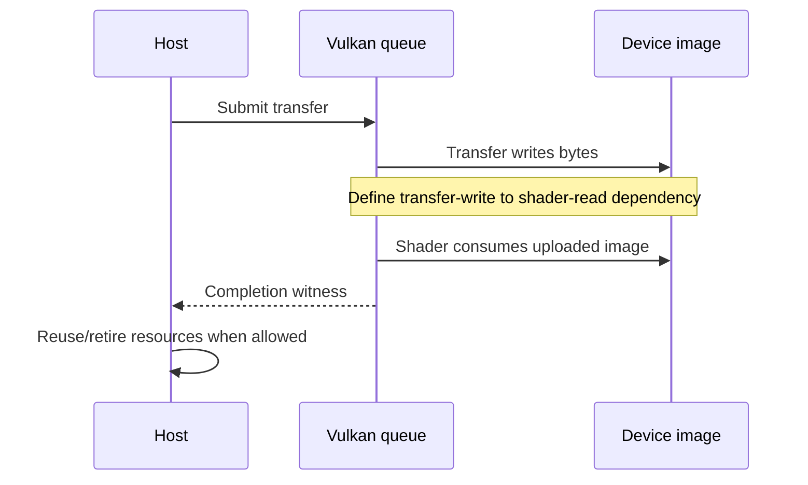

# Vulkan Resources as a Graph of Ownership and Use

A Vulkan API call returning successfully is not evidence that submitted GPU work has completed. An instance discovers implementation capabilities; a physical device describes available hardware and features; a logical device creates queues and resources. Buffers, bound memory, descriptors, command buffers and pending executions have distinct lifetimes. Learn them as a graph of obligations rather than a single hierarchy of pointers.

## The resource graph

A descriptor does not automatically own the resource it describes. Recording a command is not executing it. A buffer must remain valid as required by its pending consumers, including any destruction-order rules for its parent objects. Descriptor updates have their own restrictions; flags and layout policies can change when and how bindings may be updated.

## An upload is a sequence, not a copy-shaped arrow

An explicit upload normally involves staging storage, writing valid bytes, non-coherent memory handling where required, transfer recording, a transfer-write to consumer dependency, queue submission, and eventual retirement of the staging resource. A host mapping is not a device completion event. Queue-family ownership transfers, where applicable, must follow the API's release/acquire requirements.

## The resource lifetime table

| Object | Obligation | Evidence needed |
|---|---|---|
| Staging allocation | Stays readable until last device transfer read | Completion of transfers using it |
| Device buffer | Has correct binding and pending-use lifetime | Completion of last dependent access |
| Descriptor set | Preserves valid bindings under its layout/update rules | No pending use requiring old contents |
| Command buffer | Is not prematurely reset or re-recorded | Completion of the submission that used it |
| Swapchain image | Follows acquire, render, and present protocol | Appropriate acquire/present synchronization |

## Worked hazard and test

Suppose transfer command A uploads an image and shader command B samples it. We need B to execute after A's write and to observe the data in an appropriate image layout. A synchronization2 barrier must identify compatible pipeline stages, access types, subresources and old/new image layouts. A barrier cannot compensate for an invalid descriptor, insufficient capacity or an object destroyed too early.

**Reconstruction laboratory.** Draw the analogous graph for a compute shader writing a storage buffer that is later copied to a readback buffer. For each dependency name its last writer, next reader, stages, access masks, queue relationship and completion witness. Build a correct path and a deliberately broken path; inspect validation output and compare the observed data against a CPU oracle. One clean GPU execution is not proof of a universally valid synchronization contract.

Vulkan-specific rules should be verified against the current versioned specification listed in the reference appendix. Measurements on one driver are not language-level or API-level guarantees.
