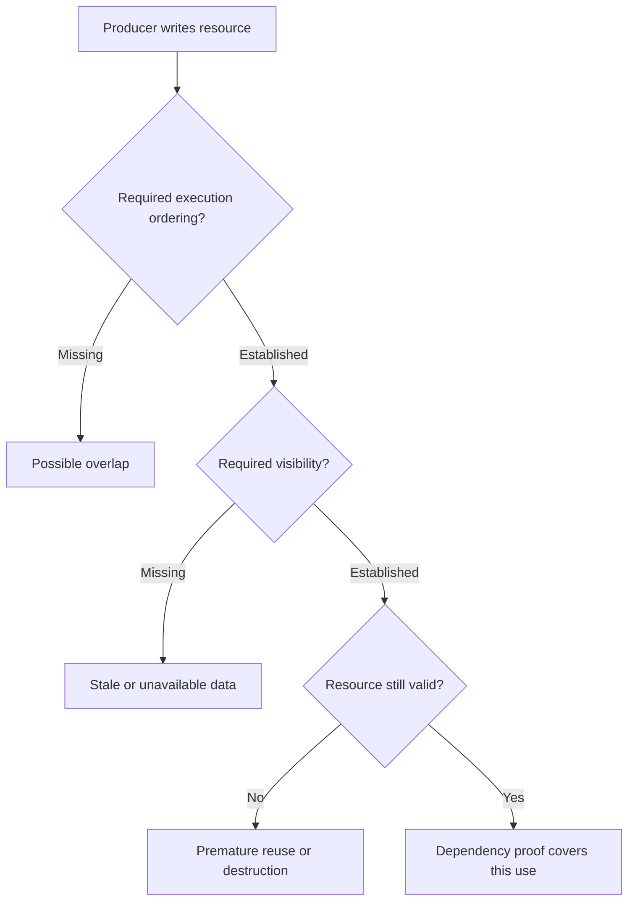
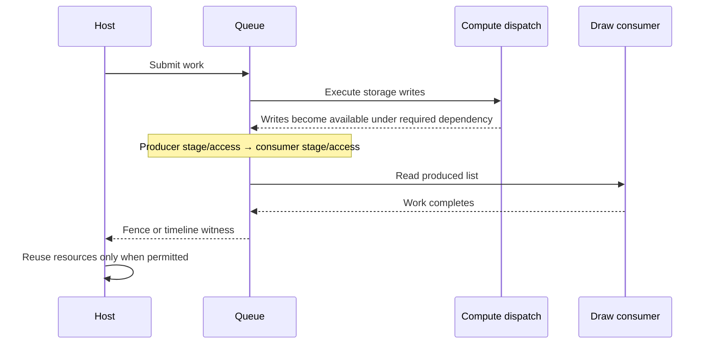

# A Synchronization Barrier Is a Proof Obligation

A Vulkan barrier is not a generic pause. It establishes specified execution and memory dependencies between *named producers and consumers*. To reason about one, describe the resource and subresource, stages, access types, queues and validity interval. An access mask without a compatible stage scope cannot prove correctness. An image transition must identify the appropriate layouts and subresource range.

## Find the actual hazard

This flow separates three mistakes that code often hides. The first is a missing execution dependency. The second is an incorrect visibility/access dependency. The third is a C++ or API resource-lifetime violation. Adding a barrier cannot repair a buffer whose capacity is too small, a descriptor updated illegally or a producer writing the same destination from several lanes without an ownership rule.

## Two submissions, one produced list

A compute pass generates visible-object indices into a storage buffer, and a later draw consumes those indices. The consumer's stage and access depend on its actual use: indirect command fetch is not the same as shader storage-buffer reading. The correct synchronization scope must describe the real read.

## A hazard register

For every cross-pass edge, record: resource identity and range; last writer; next reader/writer; source/destination stage; source/destination access; image layout, if any; queue-family ownership, if applicable; and the event allowing destruction or reuse. Then use this record to write the actual synchronization commands.

**Experiment.** First implement the correct behavior with a CPU correctness oracle. Then remove one dependency intentionally and compare behavior with validation enabled. State what validation can and cannot prove. Measure an intentionally broad but legal synchronization scope against a correctly narrowed scope; use repetitions and report variance. If the results are indistinguishable, report that instead of asserting an optimization.

**Reconstruction question.** Explain in your own words the distinctions among availability, visibility, execution ordering, submission, completion and retirement. Give one concrete example of a bug for each distinction.
