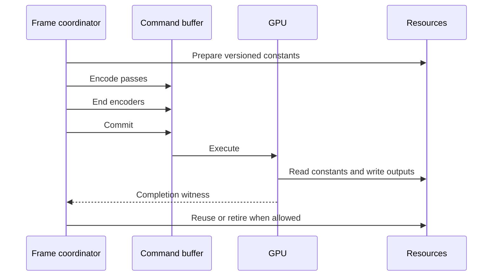
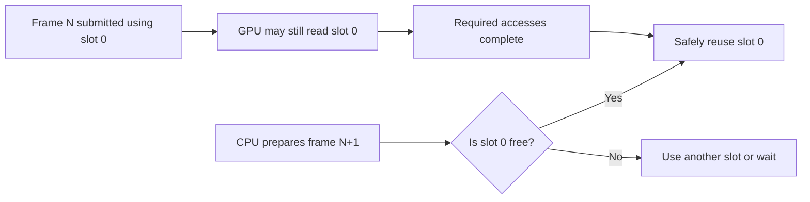

# Metal Command Execution and Resource Reuse

Metal command encoding, submission and completion are different events. An encoder describes operations to record; ending the encoder does not imply that GPU reads and writes have finished. Committing a command buffer initiates asynchronous work under the relevant queue/API rules. The host must keep the required resources valid until their final permitted use completes.

## A frame's real timeline

Multiple pending command buffers require a resource-reuse policy that counts *actual outstanding work*. Reusing a frame slot just because the CPU advanced its frame index is not sufficient. In-flight fences, completion handlers and shared-event mechanisms have different semantics and availability; choose an appropriate completion witness for the API generation and the resource uses in question.

## Shared memory does not mean instantaneous visibility

Apple silicon platforms often have shared physical memory between CPU and GPU, but still have cache behavior, bandwidth costs and synchronization obligations. Storage modes such as shared, private and (where supported) managed make different promises about access patterns and synchronization. The modes supported and recommended differ by platform. Do not borrow Vulkan stage-mask terminology and assume there is a direct one-to-one Metal method; compare each API's specified obligations.

A host-side update that overwrites a buffer still being read by frame N may create a correctness bug even if the allocation itself remains alive. The problem is not that the pointer is null; the problem is that the reader and writer are active at incompatible times.

## A laboratory that can falsify an unsafe assumption

Create one versioned constant buffer per outstanding frame slot. A compute kernel copies its input version into a readback result. Submit several commands with distinct versions. Deliberately attempt to reuse a slot before completing its pending device read; your lifetime manager should *refuse* this operation even if a particular short test happens to return the expected values.

Then compare two correct designs: a serialized single-buffer version and a per-frame ring-buffer version with completion-controlled reuse. Record the Metal feature set, OS version, device, storage mode, command sequence, input versions, completion signals and measurement method. Correctness and throughput are separate axes of evidence.

## Connect the lesson to a renderer

A real Gaussian compositor might depend on tile lists, argument bindings, frame constants, intermediate textures and drawables. The resource graph should identify which command buffer uses each object, which producer last wrote it and when the object becomes reusable. Only after that graph is correct should profiling determine which uploads, encoders, allocations and passes dominate the frame.

**Explain from memory:** What does command-buffer commitment guarantee? What proves a resource is safe to reuse? Why can unified physical memory still require ordering discipline? Why might two correct resource strategies differ in throughput?
