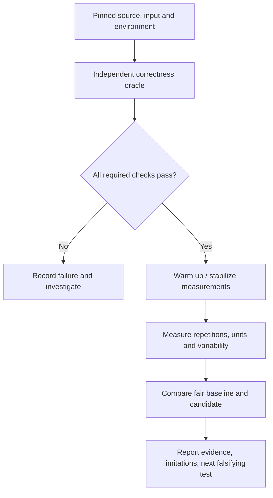

# Performance Claims Need an Independent Witness

Graphics and parallel-systems experiments often fail in ways that leave plausible numbers behind. A faster shader may be skipping work. A faster broad phase may be reporting fewer candidate pairs because it silently omitted actual overlaps. A new frame scheduler may reduce host time while increasing device latency. Performance reasoning begins with a correct answer, a measurement boundary and a fair baseline.

## A two-gate experiment

The first gate answers whether the new implementation computes the required result. The oracle must be independent wherever practical. A CPU reference, exact-pair test, known mathematical property, or deliberately exhaustive small case can help. The second gate measures performance only on configurations that passed the first. This prevents a speedup from becoming a reward for doing less than specified.

## Measure what the claim actually names

If the claim concerns kernel throughput, isolate the kernel without claiming that launch, upload and readback costs vanish from the application. If the claim concerns interactive rendering, also measure end-to-end frame time and relevant quality metrics. If the claim concerns algorithmic scaling, vary input dimensions and distributions, not only the number of threads.

On a GPU, distinguish CPU command-encoding time, queue submission, device execution, queue delay and presentation where feasible. A CPU timer around an asynchronous submit mostly measures the host operation. It must not be relabeled as GPU execution time.

## Ratios must have a defined direction

Suppose a baseline takes 8 milliseconds and a candidate takes 5 milliseconds for the same correct output. The speedup of the baseline time over candidate time is

$$
S=\frac{T_{baseline}}{T_{candidate}}
 =\frac{8\,\mathrm{ms}}{5\,\mathrm{ms}}
 =1.6.
$$

The candidate reduces time by `(8-5)/8 = 37.5%`. These are different numerical statements. For several scenes, aggregate in a way that reflects the intended decision. A geometric mean of per-scene speedups gives each scene equal multiplicative weight; a ratio of total times weights long-running scenes more. Either can be justified, but the report must say which was used.

For example, suppose two scenes have baseline times 10 and 90 milliseconds and candidate times 5 and 100 milliseconds. The per-scene speedups are 2.0 and 0.9. Their geometric mean is about 1.342, suggesting a typical multiplicative improvement, while total baseline/candidate time is 100/105, about 0.952, showing overall time increased. Both statements are true about different objectives. Hiding the difference makes a misleading performance claim.

## Variation is part of the result

Record multiple repetitions, relevant percentiles or uncertainty, and the reason for choosing the aggregation. Distinguish a deterministic correctness failure from timing noise. For multithreaded systems, include contention, initialization and scheduling variation rather than treating one run as the universal outcome.

A useful report records failures and counterexamples alongside wins. Inputs where an optimization regresses provide information about its underlying cost model. That is especially important when comparing a general broad-phase method with a tuned baseline, or a new GPU data layout with the platform's native cache behavior.

## Visual quality belongs inside the oracle

A rendering benchmark that produces a visibly different image may be solving a different problem. Define acceptable numerical or perceptual differences before comparing time. Examples include finite depth values, correctly ordered compositing, stable IDs, absence of missed intersections, image-space error thresholds and representative failure scenes. Do not claim that two pipelines are equivalent because they share a frame count or the output looks roughly similar to one observer.

For time-varying simulations, compare traces or invariant violations in addition to screenshots. A continuous animation is useful evidence of behavior, but frame-by-frame numerical checks are still necessary for claims about exact collision pairs or conservative bounds.

## Release checklist for a performance claim

A reader should be able to reproduce the source revision, build configuration, input identity, correctness gate, baseline configuration, timed region, repetitions, aggregation formula, measured values, uncertainty and known failure cases. An experiment lacking any of these may be a useful exploratory observation, but it should not be presented as a rigorous demonstrated speedup.

This discipline is intentionally independent of whether a particular implementation is called Kairo, Maveb, Vulkan, Metal or something else. The evidence contract transfers across applications.
