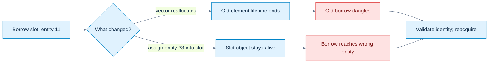
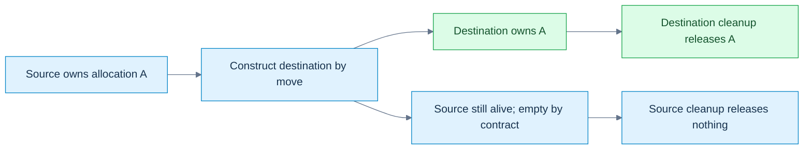

# 03 — Records as Resource Transactions

[[Chapter Edition/01 - Computing Foundations/00 - Reading Map|Reading map]] · [[Chapter Edition/01 - Computing Foundations/02 - Values at Addresses Layout, Lifetimes, and Representation|Previous chapter]] · [[Chapter Edition/01 - Computing Foundations/04 - Prove C++ Ownership with Runnable Experiments|Next chapter]]

Simple records and C++ initialization rules lead into ownership transfer, copying, moving, and exception safety. The through-line is how to preserve a resource’s invariants when construction or assignment succeeds, fails, or transfers ownership.

**By the end:** Distinguish aggregate and constructor initialization, then design copy/move operations as state transitions with explicit failure guarantees.

**Recall question:** During copy assignment, what must remain true if allocation fails before the new state can be committed?

<!-- Derived from Continuous Notes/Computing Foundations - From Bits to C++ and Systems APIs.md; source lines 3651–5523; source-span SHA256 cc8dd2b6e2dd37ca3f682995a3b3be637be3eec1caf0473a8d88aedb74745611. -->

<!-- CHAPTER-SOURCE-BEGIN -->
## Records acquire their initial state

This becomes crucial in engine code because many types are deliberately simple records. Consider:

```cpp
struct Vertex
{
    float x;
    float y;
    float z;
    std::uint32_t color;
};
```

No custom constructor is required to initialize it. You can write:

```cpp
Vertex v{
    1.0f,
    2.0f,
    3.0f,
    0xFFFFFFFFu
};
```

This is **[[Aggregate initialization|aggregate initialization]]**. The language knows how to initialize the constituent elements directly.

### What counts as an aggregate?

For modern C++20/23 class types, the practical rules include no user-declared or inherited constructors, no private/protected direct non-static data members, no virtual functions, and no prohibited virtual/private/protected base-class structure. Instead of memorizing every standard-revision wording change, test actual intent:

```cpp
#include <type_traits>

static_assert(std::is_aggregate_v<Vertex>);
```

That is the professional approach. The precise aggregate definition evolved across C++ versions.

## Similar braces can invoke different mechanisms

A record with public members, default member initializers and member functions can still be an [[Aggregate initialization|aggregate]]. For example, the laboratory's `ResourceHandle` has no user-declared constructor, and its `{42,7}` initialization initializes its two non-static fields. A static constant does not become a per-object aggregate element. Contrast `struct Vec { float x,y,z; Vec(float a,float b,float c):x(a),y(b),z(c){} };`. Its user-declared constructor makes it non-aggregate in C++20/23. `Vec{1,2,3}` selects that constructor. Even a constructor explicitly defaulted on its first declaration is user-declared; do not substitute the older 'no user-provided constructor' criterion for the modern rule. Ordinary methods do not by themselves disqualify an aggregate. Arrays are aggregates too, and aggregate bases precede direct members in element order.

Use `std::is_aggregate_v<T>` when aggregate initialization is an intentional API property. A later added constructor can break designated initialization without changing any field names. Source-reported Entity/Vector contrasts remain examples to verify in the actual project.

### Initialization order

Aggregate elements are initialized in their declaration/order rules, not in arbitrary conceptual order. For:

```cpp
struct Particle
{
    float x;
    float y;
    int lifetime;
};
```

this maps naturally:

```cpp
Particle p{
    10.0f,
    20.0f,
    60
};
```

But positional initialization can become difficult to read:

```cpp
PipelineDesc desc{
    1,
    0,
    true,
    false,
    4,
    1
};
```

What is `4`? What is `1`? Hence C++20 designated initialization.

### Designated initializers

```cpp
Particle p{
    .x = 10.0f,
    .y = 20.0f,
    .lifetime = 60
};
```

Unlike C, C++ requires the designators to respect declaration order. If declaration is:

```cpp
struct Particle
{
    float x;
    float y;
    int lifetime;
};
```

then this is not portable-valid C++ designated initialization:

```cpp
Particle p{
    .lifetime = 60,
    .x = 10.0f
};
```

The order must follow:

```text
x → y → lifetime
```

Also, C++ designators name direct data members rather than supporting all of C's more permissive designated-initialization forms.

### Missing members

Suppose:

```cpp
struct Material
{
    float roughness = 0.5f;
    float metallic  = 0.0f;
    bool doubleSided{};
};
```

Then:

```cpp
Material m{
    .roughness = 0.8f
};
```

leaves the other members to their default member initialization rules. This can make data descriptors very expressive.

### Aggregate initialization and API evolution

Here is a real engineering trap. Version 1:

```cpp
struct Dispatch
{
    std::uint32_t x;
    std::uint32_t y;
    std::uint32_t z;
};
```

Client:

```cpp
Dispatch d{8, 8, 1};
```

Then someone changes the structure:

```cpp
struct Dispatch
{
    std::uint32_t queue;
    std::uint32_t x;
    std::uint32_t y;
    std::uint32_t z;
};
```

Now positional initialization has a changed meaning or fails. Designators make intent clearer:

```cpp
Dispatch d{
    .x = 8,
    .y = 8,
    .z = 1
};
```

But adding/reordering members can still have ABI/layout consequences. Source-level convenience does not imply binary compatibility.

### Braces do more than aggregates

Effective Modern C++ spends substantial attention on this because:

```cpp
T{...}
```

does **not always mean aggregate initialization**. For example:

```cpp
std::vector<int> a(10, 20);
```

means approximately:

```text
10 elements, each value 20
```

while:

```cpp
std::vector<int> b{10, 20};
```

means:

```text
two elements: 10 and 20
```

because `std::initializer_list` overloads receive special preference during braced constructor overload resolution. So braces offer:

```text
narrowing protection
clear default construction
aggregate initialization
initializer-list construction
ordinary constructor calls
```

depending on the type. Never determine semantics from punctuation alone. Ask:

> What initialization mechanism and overload resolution rules apply to this type?

## Public records and protected invariants

This one is simpler syntactically but culturally important. The classic separate-compilation model lets clients compile against an interface while implementations are compiled separately. These:

```cpp
struct A
{
    int x;
};
```

and:

```cpp
class A
{
public:
    int x;
};
```

have the same access semantics. A `struct` can have:

```text
constructors
destructors
virtual functions
private members
inheritance
templates
operators
static members
friends
```

A `class` can be a simple aggregate. There is no language rule saying:

```text
struct = dumb C data
class = real object-oriented object
```

### The other difference: base-class access

With:

```cpp
struct Derived : Base
{
};
```

inheritance is public by default. With:

```cpp
class Derived : Base
{
};
```

inheritance is private by default. Equivalent explicit forms:

```cpp
struct Derived : public Base {};
```

and:

```cpp
class Derived : private Base {};
```

This is the second language-level default difference.

## A convention about promises

Use a struct for an intentionally transparent record; use a class when a public API maintains an **invariant**, a condition that must remain true after each allowed operation. A record with unrestricted public fields cannot promise an invariant that callers can freely violate. These are design choices, not language restrictions: structs can hide members and classes can expose them. Neither keyword alone determines copying, lifetime, allocation, virtual dispatch, or thread safety.

## Bringing the object model back to bytes

An **ABI** (application binary interface) is the target agreement about data layout, symbols and calls. A **stride** is the byte distance between successive records. An **offset** is a member's displacement from a chosen record origin. Internal padding separates members; tail padding completes the record's stride. In C++23, nonzero-size non-variant data members follow declaration order even across access labels; this does not imply no gaps, and it is stronger than some earlier language versions.

Now we finally connect C++ source declarations to actual bytes. Take:

```cpp
struct Example
{
    char a;
    double b;
    char c;
};
```

A beginner imagines:

```text
a : 1 byte
b : 8 bytes
c : 1 byte
--------------
total 10
```

But processors and ABIs have alignment requirements. Assume:

```text
alignof(char)   = 1
alignof(double) = 8
```

A typical ABI may lay it out as:

```text
offset
0       a
1-7     padding
8-15    b
16      c
17-23   tail padding
```

So:

```cpp
sizeof(Example)
```

could be:

```text
24
```

not 10. Why tail padding? Because if you have:

```cpp
Example array[2];
```

then:

```text
array[1]
```

must begin at an address suitably aligned for `double`. If object size were 17:

```text
first object starts 0
next starts 17
```

which would misalign its `double`. Rounding total size to the class alignment allows:

```text
object 0: [0,23]
object 1: [24,47]
```

with proper repeated alignment.

### Typical alignment calculation

For a conventional ABI, a useful mental algorithm is:

```text
offset = 0

for each member:     offset = round_up(offset, alignof(member))     member.offset = offset     offset += sizeof(member)

class_alignment = ABI-selected alignment, often max(member alignments)
sizeof(class) = round_up(offset, class_alignment)
```

This is not the complete C++ standard's universal class-layout algorithm. Bases, empty subobjects, `[[no_unique_address]]`, virtual mechanisms, packing pragmas, bit-fields and ABI choices complicate it. But it correctly explains ordinary POD-like engine structs on mainstream ABIs.

### Reordering members can reduce padding

Assume:

```cpp
struct Bad
{
    char a;
    double b;
    char c;
};
```

Typical result:

```text
24 bytes
```

Reorder:

```cpp
struct Better
{
    double b;
    char a;
    char c;
};
```

Typical:

```text
offset 0-7 : b
offset 8   : a
offset 9   : c
offset10-15: tail padding

size = 16
```

For one object:

```text
8 bytes saved
```

For one million:

```text
~8 MB saved
```

But don't mindlessly reorder public binary formats. Changing member order can alter:

```text
ABI
serialized layout
shader layout
network packet layout
cache packing
debug tooling assumptions
```

Optimization and compatibility can conflict.

### `alignof` and `alignas`

Query alignment:

```cpp
std::cout << alignof(float);
std::cout << alignof(Vec3f);
```

Request stronger alignment:

```cpp
struct alignas(16) SIMDVec4
{
    float x;
    float y;
    float z;
    float w;
};
```

Now:

```cpp
alignof(SIMDVec4) >= 16
```

subject to implementation support. Why do this? Possible reasons:

```text
SIMD load requirements/preference
cache-line separation
GPU-facing ABI structure
atomic/hardware constraint
false-sharing control
```

But over-alignment can increase memory footprint.

### `standard-layout` does NOT mean “packed C struct”

This distinction matters enormously. Check:

```cpp
std::is_standard_layout_v<T>
```

A [[Standard-layout and trivial copyability|standard-layout]] type satisfies a set of structural restrictions intended to preserve useful low-level layout properties. It does **not** mean:

```text
no padding
cross-platform binary stable
same layout on every compiler
GPU-compatible
safe to memcpy into any foreign API
network-serializable
endianness-independent
```

Those are separate properties. The exact formal standard-layout eligibility rules involving base classes have evolved and are complicated enough that production code should query:

```cpp
std::is_standard_layout_v<T>
```

rather than attempting to duplicate the language definition in an illustrative metaprogram.

### `trivially_copyable` is another distinct concept

You can test:

```cpp
std::is_trivially_copyable_v<T>
```

This has to do with whether byte-wise copying can legitimately reproduce object representations under the language's permitted operations. It is not the same as:

```text
standard-layout
aggregate
trivial
```

Think of four independent questions:

| Property | Main question |
|---|---|
| aggregate | Can it use aggregate initialization semantics? |
| standard-layout | Does it satisfy C-like structural layout constraints? |
| trivially copyable | Can object representations be copied bytewise under defined rules? |
| trivial | Are relevant construction/copy/destruction operations trivial? |

Old C++ literature often bundled properties into “POD.” Modern C++ reasoning should use the actual traits you need.

## Adjacent members are not an array

Consider an independent record `struct NamedVector { float x,y,z; };`. Even if size is twelve bytes, every member is a separate subobject. A **subobject** is an object inside another object, such as a member or array element; it has its own type and lifetime constraints.

`(&v.x)[1]` is not valid access to `v.y`. A non-array object is treated as a one-element array for pointer arithmetic: forming `&v.x + 1` can produce its one-past pointer, but dereferencing it as the next float is not permitted. Adding two already leaves that one-element bound. Physical adjacency and standard-layout do not create a float array. This is the source attachment's central project-shaped finding, but here it is a language analysis of an independent representation, not a freshly verified Kairo defect.

A span is a non-owning view over an existing valid range. `std::span<float,3>{&v.x,3}` does not manufacture the missing array. A cast likewise does not create it. Byte inspection, valid array traversal and named-member access are different operations.

### Correct alternatives

If `.x`, `.y`, `.z` syntax is important, retain separate fields and write indexing explicitly:

```cpp
constexpr T& operator[](std::size_t index) noexcept
{
    assert(index < 3);

    switch (index)
    {
        case 0: return x;
        case 1: return y;
        default: return z;
    }
}

constexpr const T& operator[](std::size_t index) const noexcept
{
    assert(index < 3);

    switch (index)
    {
        case 0: return x;
        case 1: return y;
        default: return z;
    }
}
```

For explicit contiguous export:

```cpp
[[nodiscard]]
constexpr std::array<T, 3> ToArray() const noexcept
{
    return {x, y, z};
}
```

If true array semantics are the fundamental representation, instead store:

```cpp
template<typename T>
struct Vector3
{
    std::array<T, 3> values{};

    constexpr T& x() noexcept { return values[0]; }
    constexpr T& y() noexcept { return values[1]; }
    constexpr T& z() noexcept { return values[2]; }

    constexpr T* Data() noexcept
    {
        return values.data();
    }
};
```

Now:

```cpp
Data()[1]
```

really traverses an array. Do **not** “fix” the existing representation by creating:

```cpp
std::span<T, 3>{&x, 3}
```

because the underlying problem remains: `&x` does not designate element zero of a three-element `T` array. A project audit should first establish the current representation, callers and revision before proposing a production change.

### Why the bug often appears to work forever

The ABI probably lays:

```text
x: offset 0
y: offset 4
z: offset 8
```

for `float`. Machine code for:

```cpp
(&x)[1]
```

will calculate:

```text
address(x) + sizeof(float)
```

which numerically lands on `y`. So:

```text
debug: works
release: works
Clang: works
GCC: works
10 million frames: works
```

does not prove defined C++ behavior. Undefined behavior means:

> The C++ language no longer constrains the implementation to the semantics you intended.

That is why language-level validity matters even when the hardware arithmetic “obviously works.” This becomes much more serious when optimizers use alias/lifetime rules to transform code.

### CPU layout is not GPU layout

Your code asserts:

```cpp
sizeof(Vec3f) == 3 * sizeof(float)
```

On mainstream hardware:

```text
Vec3f = 12 bytes
```

Do not conclude:

```text
therefore GPU float3 is always 12-byte stride/alignment compatible
```

GPU-side layout depends on:

```text
API
shader language
buffer category
selected layout rules
alignment rules
packing rules
vertex input declarations
```

For example, a graphics API may let you explicitly describe a vertex attribute:

```text
position:
    format = three 32-bit floats
    offset = 0
stride = whatever CPU vertex stride is
```

while uniform/storage buffer layout may apply different alignment rules. Metal also distinguishes vector packing situations and provides packed representations for cases where you need a tight external layout. So your correct engineering pipeline is:

```text
C++ logical type
      ↓
CPU representation
      ↓
explicit backend upload representation
      ↓
API-described offsets/stride/alignment
      ↓
shader representation
```

not:

```text
standard-layout C++ type
      ⇒ automatically GPU-compatible
```

This matters directly in Vulkan, Metal, Gaussian splatting, mesh upload, skinning and shader parameter code.

### `offsetof`

For standard-layout types:

```cpp
#include <cstddef>

struct Vertex
{
    float px;
    float py;
    float pz;
    std::uint32_t color;
};

static_assert(std::is_standard_layout_v<Vertex>);

static_assert(offsetof(Vertex, px) == 0);
```

You can use offset checks to enforce a binary/API contract. If a shader/upload ABI expects:

```text
position offset 0
color    offset 12
stride   16
```

make those expectations executable:

```cpp
static_assert(offsetof(Vertex, color) == 12);
static_assert(sizeof(Vertex) == 16);
```

Then a layout-breaking code change fails at compile time rather than rendering corrupted triangles. That is exactly how language knowledge becomes engine reliability.

### `#pragma pack` is not a magic optimization

You will sometimes see:

```cpp
#pragma pack(push, 1)

struct Header
{
    std::uint8_t type;
    std::uint32_t length;
};

#pragma pack(pop)
```

This can remove normal padding on supporting compilers. But it is non-standard and can produce misaligned members. Then:

```cpp
header.length
```

may require slower unaligned access or, on some architectures/instruction choices, require special handling. For external binary formats, a better design is often:

```text
read individual fields from bytes
decode endian explicitly
validate values
construct normal aligned C++ object
```

rather than forcing runtime objects to impersonate disk packets.

### Bit-fields

Similarly:

```cpp
struct Flags
{
    unsigned visible : 1;
    unsigned shadow  : 1;
    unsigned dynamic : 1;
};
```

does not give you a portable three-bit file format. Bit-field allocation order and packing details are implementation-defined. They can be useful internally, but for stable formats use explicit masks:

```cpp
std::uint32_t flags;

constexpr std::uint32_t Visible = 1u << 0;
constexpr std::uint32_t Shadow  = 1u << 1;
constexpr std::uint32_t Dynamic = 1u << 2;
```

Now serialization representation is under your control.

## Following an escaped address through time

For this independent trace, use `struct Entity { std::uint32_t Index; std::uint32_t Generation; };` with `<cstdint>`. It is a teaching record, not an import of the Kairo module. The stale dereference shown later is an invalid example to analyze, not to execute.

Take:

```cpp
Entity* escaped = nullptr;

void update()
{
    Entity local{
        .Index = 42,
        .Generation = 7
    };

    escaped = &local;
}
```

Before calling `update`:

```text
escaped object:
    static storage duration
    value = nullptr
```

Enter `update`. Storage for `local` becomes available:

```text
automatic storage
address hypothetically 0x7FF0
```

Initialization completes:

```text
Entity object lifetime begins
identity = Entity object A
address  = 0x7FF0
value:
    Index      42
    Generation 7
```

Then:

```cpp
escaped = &local;
```

Now:

```text
escaped value = 0x7FF0
```

Exit the function. `local`'s lifetime ends. Its automatic storage is no longer reserved for that object. But `escaped` still contains:

```text
0x7FF0
```

That numerical address has not magically become `nullptr`. So:

```cpp
escaped->Index
```

attempts to use an object after its lifetime ended. This is undefined behavior. Later:

```cpp
void somethingElse()
{
    Entity another{
        .Index = 99,
        .Generation = 5
    };
}
```

The implementation might reuse address:

```text
0x7FF0
```

Now the same address may contain a **different object**. That is why:

```text
same address ≠ same lifetime
same address ≠ same identity
```

And it is conceptually the same reason ECS generation counters exist.

## Following one call through the build

Assume:

```cpp
// Math.cppm
export module Math;

export int twice(int);
```

and:

```cpp
// MathImpl.cpp
module Math;

int twice(int x)
{
    return x * 2;
}
```

and:

```cpp
// App.cpp
import Math;

int main()
{
    return twice(21) == 42 ? 0 : 1;
}
```

Conceptually the module interface establishes an exported declaration:

```text
name: twice
type: int(int)
module ownership/reachability: Math
```

`App.cpp` performs lookup and sees the exported declaration. The compiler therefore knows the call is valid and emits code referencing the appropriate function entity. `MathImpl.cpp` provides the definition. At link time:

```text
App object:
    requires twice(int)

Math implementation object:
    defines twice(int)

linker:
    resolve
```

If the definition disappears:

```text
source syntax valid
name lookup valid
type checking valid
compilation valid

link:
    unresolved function definition
```

If two illegal non-inline definitions appear:

```text
meaning itself violates ODR
```

and the linker may catch a duplicate symbol—although not all ODR violations are guaranteed to be diagnosed. The distinction between:

```text
lookup failure
compile failure
link failure
ODR violation
```

is now precise.

## Giving another name to a live object

We now have objects with lifetimes and identities. How can another piece of code work with one without creating a second object? A [[References and aliases|reference]] supplies an **alias**: another way to designate an existing referent. The **referent** is the thing designated; the name of a reference is not the referent's owner.

```cpp
int a = 2;
int b = 9;
int& alias = a;
alias = b;
b = 20;
// a == 9, b == 20; alias still designates a.
```

Read `int& alias = a` as binding, not as a box containing a replaceable address. Read `alias = b` as assignment to the already-bound `a`, not rebinding. The three visible states are `(a,b)=(2,9)`, then `(9,9)`, then `(9,20)`. That trace is more useful than memorizing that references “cannot be reseated.” A pointer, in contrast, is an object storing a pointer value: `int* p = &a; p = &b;` changes which object `p` designates without assigning either integer.

A reference definition normally needs an initializer. `extern int& shared;` is a declaration, not an exception permitting an unbound reference object. Reference members obtain bindings through their containing object's initialization. No well-defined ordinary reference represents an optional null state; obtaining one by dereferencing a null pointer does not manufacture a legitimate “null reference.” Yet references can dangle after their referents die. Required access is not permanent access.

References are not objects. They do not form arrays of references, and there are no pointers to references. `sizeof(alias)` describes the referred-to integer; `&alias` obtains its address. Functions can also be referents. A reference to a pointer, `int*& selected = p`, aliases the pointer object: assigning `selected = &a` reseats `p`. This is different from `int*` pointing at an integer and different again from a reference to that integer.

`std::reference_wrapper<T>` from `<functional>` is a copyable object wrapping a reference-like association, useful in containers. Copying the wrapper does not copy or own the referent. `std::addressof(object)` from `<memory>` gets an actual object address even when a user-defined `operator&` changes the meaning of ordinary `&object`. None of these mechanisms prevents the referent from dying.

Teaching checkpoint: draw the integer objects first, then arrows for the access paths. Which statement changes a value, which changes an arrow, and which creates a new object? That question will also untangle `const` later.

## An expression has a type and a category

A type answers what operations and values an expression supports. A [[Value categories and materialization|value category]] answers how that expression relates to identity and value production. Category belongs to an expression, not permanently to a variable. **lvalue** means an expression identifying a function or object without the expiring-object designation. **xvalue** identifies an object whose resources may be reused. **prvalue** computes a value to initialize an object or supply an operand. The broader family **glvalue** contains lvalues and xvalues; **rvalue** contains prvalues and xvalues. These are overlapping families, not five disjoint boxes.

| Expression, assuming `int x=4; int&& rr=7;` | Category | What to notice |
|---|---|---|
| `x`, `rr`, `*p` when valid | lvalue | Naming `rr` does not automatically consume its referent. |
| `std::move(x)` | xvalue | Still designates `x`; no new integer is created by the cast. |
| `4`, `x+1`, `x++` | prvalue | Produces a value; postfix increment's old value is not the updated object. |
| `++x` | lvalue | The built-in prefix operation designates the updated `x`. |
| call returning `T&` | lvalue | The returned access path has identity. |
| call returning `T&&` | xvalue | Expiring designation does not itself prove lifetime safety. |
| ordinary call returning `T` | prvalue | Produces the result object/value. |

“lvalue means left side of assignment” fails immediately: a const lvalue is not assignable. “rvalue means temporary” fails for `std::move(x)`, which designates an existing object. String literals are lvalue arrays: `"hello"` has type `const char[6]`, including its terminating zero, not a temporary `std::string`.

**Materialization** is the conversion that supplies a temporary object when a prvalue needs an identity-bearing result, for example to bind a reference. Do not teach that every class prvalue must first live in a separate temporary and then be copied: modern C++ can initialize the final result directly. The result-construction story below develops direct construction and optional NRVO.

[[Auto decltype and reference collapsing|decltype]] can expose category without evaluating its operand. For an unparenthesized name it reports the declared type; for a general expression it yields `T&` for an lvalue, `T&&` for an xvalue, and `T` for a prvalue. Thus `decltype(rr)` is `int&&`, but `decltype((rr))` is `int&`. The parentheses remove the special name rule. That distinction is checked against the [draft's decltype rules](https://eel.is/c++draft/dcl.type.decltype).

```cpp
const int n = 3;
auto value = n;          // int: a new object, top-level const dropped
auto& path = n;          // const int&: preserve the referent's constness
decltype(auto) copy = n; // const int: name rule
decltype(auto) borrow = (n); // const int&: expression rule
```

`decltype(auto)` is therefore not “a more precise auto that is always better.” Adding parentheses in a returning function can change a returned value into a dangling reference. An **unevaluated operand** is inspected for language properties rather than executed: `decltype(++n)` still must be well-formed, but a valid `decltype(++x)` does not increment `x`.

Named rvalue-reference variables are lvalues in ordinary use. There is a specific C++23 exception for move-eligible expressions in return contexts; do not extend that special rule to an arbitrary use of `rr`. Later return/copy-elision material will develop it.

## Binding chooses a referent, not always the one you imagined

[[Reference binding and converted temporaries|Binding]] establishes the initial association. For ordinary same-type integers without volatile complications, this is the useful opening matrix:

| Initializer | `int&` | `const int&` | `int&&` |
|---|---|---|---|
| non-const integer lvalue | binds original | binds original read-only | rejected |
| const integer lvalue | rejected | binds original | rejected |
| integer prvalue or non-const xvalue | rejected | binds temporary/original respectively | binds temporary/original respectively |

An rvalue reference to const, `const int&&`, can bind const rvalues too, but is not a general forwarding reference. These rules describe binding; they do not prove that a bound object will survive later use.

```cpp
int count = 10;
const int& live = count;
const double& snapshot = count;
count = 50;
// live sees 50; snapshot still sees 10.0.
```

The second reference needs a `double`, so conversion produces a temporary `double` initialized from the old integer. The temporary, not `count`, is its referent. Conversely, a `Base&` bound to a compatible `Derived` lvalue can designate the original object's base subobject rather than copy it. A **subobject** is an object nested within another, such as a member, base, or array element.

Bit-fields need another distinction. They are members occupying a specified number of bits, not independently addressable ordinary integers. `int&` cannot bind directly to an integer bit-field; a suitable const reference can bind to a temporary holding its value. Updating the original field does not update that copied value. This is conversion/snapshot behavior, not mysterious aliasing.

References also preserve array extent where pointer conversion would lose it:

```cpp
int samples[3]{10, 20, 30};
int (&whole)[3] = samples;
const char (&word)[6] = "hello";
// whole identifies the entire array; word includes the terminating zero.
```

**Array-to-pointer conversion**, often called decay, produces a pointer to the first element in many expression contexts. A reference to an array binds the array instead. Decay is not the assertion that arrays “are pointers.” Their sizes, types, and valid operations differ.

Ask four questions when reading any binding: what type is required, what category is supplied, was a conversion needed, and which actual object became the referent? Then ask how long that object lives.

## A temporary needs an explicit lifetime story

A **full-expression** is an expression not nested inside another expression for the relevant language rules. In these simple statements, its end is the semicolon. Ordinary temporaries are destroyed at that end, after the statement's work. [[Temporary lifetime extension|Lifetime extension]] has specific syntactic rules; it is not an ownership service that follows every alias.

First define this function at namespace scope:

```cpp
const std::string& pass(const std::string& s) { return s; }
```

Then compare these local declarations inside a caller:

```cpp
const std::string& direct = std::string{"kept"};
// The directly bound temporary lives for direct's local lifetime.
const std::string& escaped = pass(std::string{"gone"});
// The temporary dies at this semicolon. Never read escaped afterwards.
```

The call temporarily binds its parameter for the calling full-expression. Returning that reference does not start a second extension. The calling reference is still a path to the same object, whose deadline was already set. Splitting the timeline makes the danger visible:

| Event | Temporary alive? | Access consequence |
|---|---|---|
| construct `"gone"` temporary | yes | parameter may read it |
| return reference from `pass` | yes | result still designates it |
| initialize `escaped` | yes | no transitive extension |
| finish initializer full-expression | no | `escaped` dangles |

Directly binding through permitted built-in member access can extend the containing temporary, as in `const auto& name = Record{"Ada"}.name;` for a suitable public `name` member. Calling a getter that returns `const std::string&` is different: the call result is not that permitted member-access expression. This is why a getter on a temporary needs its own contract.

Aggregate initialization supplies a deliberately sharp laboratory case:

```cpp
struct Holder { const int& value; };
Holder kept{7};  // braces extend the directly bound temporary to kept's lifetime
Holder lost(7);  // C++20+: temporary dies at this statement's end
// Do not read lost.value after its declaration.
auto* heap = new Holder{7}; // temporary dies at this statement's end too
delete heap;              // do not read heap->value; deletion cannot rescue it
```

The `new` expression can keep the holder object alive while its reference member dangles. Allocating the borrower does not allocate ownership of the borrowed object. The brace/parenthesis exception and parameter/new exceptions are specified in [temporary object lifetime](https://eel.is/c++draft/class.temporary).

Never return a reference to a local automatic object. A C++23 function returning a reference directly bound to a temporary also leaves a dangling result; current draft/C++26 rules reject that direct return binding. Do not confuse a newly mandated diagnostic with a newly introduced safety problem. Nor should a compiler warning be treated as a universal lifetime proof.

Lifetime extension is narrowly useful for local work. For transfer across a function boundary, a returned owning value is usually the clearer starting contract. The cleanup and composition story below develops RAII; owning smart-pointer policies remain later depth, not implied by the word “reference.”

<!-- Bible-final-pass: C++ temporary lifetime -->
#### Turn the lifetime rule into a scope trace

The preceding example showed that binding a local const reference can extend a temporary, while returning the same reference through a function does not extend it again. The distinction is visible if we count the object while the local binding is active, then watch a non-owning string view observe storage whose owner remains alive. That is a deliberately small witness: it makes the valid timeline executable without dereferencing a dangling observer.

Its comments identify the owner and the exact scope boundary. A pointer, span, iterator, callback capture, or coroutine reference follows the same review question: which object owns the storage, and which event ends its validity?


~~~cpp
#include <iostream>
#include <stdexcept>
#include <string>
#include <string_view>

struct Tracked {
    // Count live instances so the program can observe the scope in which the
    // temporary exists; this is test instrumentation, not ownership logic.
    int value{};
    inline static int alive = 0;

    explicit Tracked(int v) : value(v) { ++alive; }
    // A copy creates another object and therefore another live instance.
    Tracked(const Tracked& other) : value(other.value) { ++alive; }
    // Destruction marks the end of this object's lifetime.
    ~Tracked() { --alive; }
};

Tracked make_tracked(int v) {
    // Return an owned value. Copy elision may remove a move, not the object.
    return Tracked{v};
}

void require(bool condition, const char* message) {
    // Keep witness checks active when compiled with NDEBUG.
    if (!condition) throw std::runtime_error(message);
}

int main() {
    require(Tracked::alive == 0, "no tracked object exists before the scope");

    {
        // Binding a temporary object to this local const reference extends
        // that temporary's lifetime to the reference's lifetime.
        const Tracked& ref = make_tracked(42);
        // Direct local binding extends this temporary to the end of the block.
        require(ref.value == 42, "bound temporary retains its value");
        require(Tracked::alive == 1, "one bound temporary is alive");
    }
    // The temporary is destroyed when its extending reference leaves scope.
    require(Tracked::alive == 0, "bound temporary dies at the block boundary");

    {
        // A string_view is only an observer.  Keeping the owner alive is the
        // contract that makes this view valid.
        std::string owner = "render_graph";
        // The view stores an address and length; owner supplies the storage.
        std::string_view view = owner;
        require(view == "render_graph", "view initially observes owner bytes");
        // Character replacement preserves this string's storage allocation.
        owner[0] = 'R';
        require(view == "Render_graph", "view observes the owner's update");
    }

#if 0
    // Intentionally NOT executed: returning a reference to a local object
    // would create a dangling reference.  The source can look plausible while
    // the lifetime contract is already broken.
    const Tracked& bad() {
        Tracked local{7};
        return local;
    }
#endif

    // The dangling example above is disabled: reading it would be undefined.
    std::cout << "temporary lifetime: 2 executable suites PASS (dangling case is excluded)\n";
}
~~~

## Move permission is not resource transfer

[[Move casts and forwarding references|std::move]] from `<utility>` casts an expression to an xvalue while preserving constness. It does not transfer a resource by itself. `std::move(text);` alone neither clears a string nor creates a destination. A subsequent constructor or assignment chooses an overload and performs whatever operation that type defines.

```cpp
std::string original = "frame";
std::string&& alias = std::move(original); // binding only; original still "frame"
std::string destination = std::move(original); // construction may use a move
// Don't assume original is empty: consult the moved-from contract.
const std::string fixed = "label";
std::string copied = std::move(fixed); // const preserved; usual string copy selected
```

An ordinary `std::string` move constructor requires a non-const rvalue reference; it cannot generally detach the storage of a const source. “Moved-from” does not mean destroyed, universally empty, or universally reusable for every operation. The value-transfer story below develops consumer operations and their contracts. This distinction and the terminology update from older “universal reference” to **forwarding reference** were cross-checked against selected passages in Meyers; see [[Supplementary/Sources and Code Anchors#M008 - Borrowing, categories and const access|Reading record]].

A deduced, cv-unqualified template parameter in `T&&` is a forwarding reference:

```cpp
void inspect(int&) { /* lvalue access */ }
void inspect(int&&) { /* expiring access */ }
template<class T>
void relay(T&& item) {
    inspect(std::forward<T>(item));
}
```

`relay(x)` with an integer lvalue deduces `T=int&`; `relay(4)` deduces `T=int`. The parameter name `item` is an lvalue in the body in either case. `std::forward<T>` restores the category represented by the deduction. Replacing it with unconditional `std::move` would treat even the caller's lvalue as expiring.

**Reference collapsing** removes reference-to-reference combinations formed through deduction or aliases: `&` combined with either `&` or `&&` yields `&`; only `&&` combined with `&&` yields `&&`. It is not permission to write a direct `int& &` declaration. `const T&&`, `std::vector<T>&&`, or `T&&` where the class template already fixed `T` are not this forwarding pattern. `auto&&` often uses similar deduction, but deduction from a braced initializer list is a notable exception, not a generic forwarding argument.

This is a mechanism lesson, not a rule to forward every expression everywhere. An ordinary function taking `Widget&&` has a fixed parameter type. Whether it may consume that object is an API decision; the declaration alone does not perform the consumption.

## A pointer carries an access contract

References gave us required aliases; [[Null pointers and optional access|pointers]] give us stored, reseatable, potentially absent access paths. A **null pointer value** designates no object or function. `nullptr` has type `std::nullptr_t` and converts to null pointer values without pretending to be an integer argument. Overloads `choose(int)` and `choose(int*)` select the integer overload for `0`, the pointer overload for `nullptr`.

```cpp
int* absent = nullptr;
delete absent; // valid: no pointed-to object is destroyed
// delete nullptr; // ill-formed: nullptr_t is not a pointer-to-object type
```

The supplied source's bare `delete nullptr;` was corrected to the typed-pointer form. The [delete-expression rules](https://eel.is/c++draft/expr.delete) distinguish operand type from a valid null operand value. Null's object representation need not be all zero bits. A successful null check proves only absence was excluded; it says nothing about lifetime, bounds, or current ownership.

Ordinary throwing `new T` reports allocation failure with `std::bad_alloc`. A nothrow allocation form can return null for allocation failure, but an exception thrown by `T`'s constructor is a separate matter and can still propagate. `std::optional<T*>` can represent both no stored pointer and a stored null pointer; use two levels of absence only when both have a defined meaning.

`*p` forms an lvalue designating the pointee when permitted. The expression does not itself mean “read its bytes into a value”; a subsequent value conversion can do that. Valid access requires an appropriate live object, type accessibility, alignment, permissions, and an in-range position. A **one-past pointer** marks the end of an array and can participate in allowed traversal/comparison; it is not a dereferenceable element.

For `int values[3]`, the permitted positions formed relative to `values` are offsets zero through three inclusive. `values+3` may be an end marker. `values+4` is already outside permitted pointer formation; the rule does not wait for dereference. Subtraction requires pointers into the same array (including its end) and a result representable in `std::ptrdiff_t`. A non-array object is treated as a one-element array for this arithmetic, not as a license to walk adjacent members.

```cpp
struct Pair { int x, y; };
Pair pair{1, 2};
int* first = &pair.x;
// first + 1 is one-past x, not an authorized pointer to y.
// first[1] is invalid even if a layout report shows adjacent members.
int real[2]{1, 2};
int* end = real + 2; // valid end marker, never dereference it
```

[[Pointer arithmetic and provenance|Provenance]] names the relationship between a pointer value, storage, and the object/path from which it was obtained. Do not replace that relationship with “an integer address that seems plausible.” An available `std::uintptr_t` supports the specified pointer-to-integer-and-back round trip; it does not authorize arbitrary arithmetic, revive a destroyed occupant, or confer access to unrelated storage. WG21's [P3407R1](https://www.open-std.org/jtc1/sc22/wg21/docs/papers/2025/p3407r1.html) is research discussion, not an adopted C++23 rulebook.

`void*` can carry certain object pointers but cannot be dereferenced as an object of unknown type in ordinary C++. A cast supplies a type expression, not a construction or validity proof. Character/byte inspection through `char`, `unsigned char`, or `std::byte` is different from arbitrary typed access; `signed char` is not listed as the general C++ byte-aliasing exception. Inspecting representation does not make an arbitrary byte buffer a live valid `Widget`. Function pointers and member pointers have their own rules; do not assume they share object-pointer representations. A GPU device address is meaningful only under the relevant backend/address-space contract, not automatically dereferenceable by CPU C++.

At the teaching desk, write “non-null,” “mapped,” “aligned,” “in bounds,” “live,” and “correct entity” separately. None is a substitute for the others.

## When a valid borrow stops naming the intended thing

### Figure CPP-02 - A borrow can fail in two different ways



**Read the picture:** a reallocation breaks access to the former element, while swap-and-pop assignment can preserve a slot's C++ lifetime but change its application identity. The examples below show both mechanisms. **Limit:** reacquisition must occur through a currently valid owner/registry under its mutation and synchronization contract; an old pointer cannot validate itself, and a generation check alone does not stabilize a component address. [[Visual Recall/02 - C++ - Objects, Ownership and Lifetime - Visual Recall#Four figure briefs|Recall this figure]].

A **borrow** is a non-owning access path used under an external lifetime and mutation contract. A **dangling** pointer/reference outlives the object it once designated. [[Borrow invalidation and logical identity|Invalidation]] can arise when a container reallocates, removes elements, or changes the association the application intended.

A vector has a control object, a capacity (allocated element slots), and a size (live elements). Exceeding capacity during growth can replace the element buffer. Reallocation invalidates element references, pointers, and iterators; reserving capacity before taking a borrow can avoid reallocation up to that capacity, not forever. The distinction between size and capacity and the reserve guarantee is checked against [vector capacity](https://eel.is/c++draft/vector.capacity).

```cpp
std::vector<int> numbers{10};
int& old = numbers[0];
numbers.reserve(numbers.capacity() + 1); // forces reallocation if successful
// old must not be used. Reacquire through numbers[0].
```

`reserve` protects against a particular growth mechanism, not every erase or structural change. Erasing a vector element invalidates references/iterators at or after the erased position. A swap-and-pop pool can exhibit a different failure: move-assigning the last component into an earlier existing slot can leave that slot object alive while changing which entity its state represents.

```cpp
struct Slot { int entity; int value; };
std::vector<Slot> pool{{11, 100}, {22, 200}, {33, 300}};
Slot* cached = &pool[0];       // intended entity 11
pool[0] = std::move(pool.back());
pool.pop_back();
// cached still reaches the live first Slot, now representing entity 33.
```

| Stage | Slot zero's C++ lifetime | Logical owner | What the old path guarantees |
|---|---|---|---|
| borrow first slot | live | 11 | current access to 11 under present contract |
| assign last slot into first | continues | 33 | access to a live Slot, not the original entity |
| destroy last element | first still live | 33 | no recovery of entity 11's association |

This is **semantic invalidation**, not necessarily a dangling pointer. The last element's old borrow does dangle after its destruction. Reallocation creates yet another failure. Do not label all three “the address changed.” AddressSanitizer can miss the semantic case completely, and allocated vector capacity need not be poisoned when a popped object dies.

[[Object identity and generation handles|Generation handles]] validate logical entity identity through a registry. Two copied handles are two separate C++ objects with equal handle values, potentially identifying the same application entity. A currently valid handle does not prove that an earlier `Component&` survived the pool's subsequent mutations. Entity generation and pool location are separate dimensions.

The source reports KairoECS `Get`, `TryGet`, and `Emplace` borrows into dense vector storage, plus swap-and-pop removal. Those are useful hypotheses for an audit, not independently confirmed repository facts here. The local `Slot` example establishes the mechanism without depending on that project.

For a conservative [[Borrow contracts and pool epochs|pool-epoch contract]], increment a mutation counter on every operation declared to invalidate borrows. A checked borrow records that counter and checks it before accessing the cached element. An **epoch** is a version identifying a permitted observation interval. The pool/epoch object must itself outlive every checked borrow; otherwise even reading the counter is unsafe. Counter wrap, bypassed mutations, concurrent access, and check-then-use races remain policy obligations. An epoch is a debug witness, not an owning pointer or automatic synchronization.

An efficient starting discipline is: acquire the component, perform a narrow operation without structural mutation, discard the borrow, mutate, validate the handle again, and reacquire. Longer-lived component access needs an explicitly stronger storage/ownership contract. “Stable entity IDs” is not that contract.

## Borrowed views and deferred work need an owner story

[[Deferred captures and borrowed views|std::span<T>]] describes a contiguous range with an extent; `std::string_view` describes characters without owning them. A **view** is a descriptor of existing data, not a copy of the data. A span can improve length-aware code, but it does not establish the underlying range's validity or extend lifetime. A view into a local string returned by a function dangles. A reference member in a renderer likewise requires its device to outlive that renderer's use of the device.

```cpp
// Invalid contract: do not call this and use the result.
std::string_view bad_name() {
    std::string local = "Ada";
    return local;
}
// Owning result: the caller receives its own string object.
std::string good_name() { return "Ada"; }
```

A lambda's **closure** is the object storing its captures. `[&]` stores reference-like access to locals; `[this]` captures the pointer to the current object, not ownership of that object. If queued work runs later, returning from the creator or destroying the owner can invalidate those paths. Capturing a `string_view` by value still copies only its descriptor. Capturing an owning string by value supplies a different contract.

```cpp
std::string label = "frame";
auto snapshot_job = [saved = label] { return saved.size(); };
label.clear();
// snapshot_job still owns its independent saved string.
```

Ownership of the closure and scheduling still matter: the callable must itself remain alive when invoked. Capturing a resource handle by value preserves the handle bits, not necessarily resource existence; deferred work may need validation or a lifetime-pinning policy. Smart-pointer ownership and complete scheduling contracts remain future depth.

## Read-only is a path, not an ownership or synchronization promise

[[Const qualification and shallow constness|const]] constrains modification through a type/access path. A const object and a const path to a mutable object are not interchangeable. `const int& view = mutable_int;` prohibits assignment through `view`, but the original mutable access can still update the same integer. Conversely, modifying an actually const object through `const_cast` is undefined behavior. Removing a qualifier is not permission to write.

**Top-level const** qualifies the immediate object described by a type; **low-level const** qualifies an object accessed through a pointer/reference. **Shallow constness** means a const owner containing a pointer does not automatically make the pointee const. `const` does not imply compile-time evaluation: runtime input can initialize a const local. `constexpr` and `constinit` answer different initialization questions.

| Declaration | Reseat pointer? | Modify `T` through pointer? |
|---|---|---|
| `T* p` | yes | yes, if actually mutable and valid |
| `const T* p` / `T const* p` | yes | no |
| `T* const p` | no | yes, if actually mutable and valid |
| `const T* const p` | no | no |

The same principle applies to ranges. `const std::span<int>` makes the descriptor const but still permits modifying its integer elements. `std::span<const int>` gives read-only element access, but mutable aliases elsewhere may still write. Neither owns the integers. A public `const int*` parameter promises a read-only path, not global immutability.

For ordinary by-value parameters, top-level const does not distinguish function signatures: `void f(int)` and `void f(const int)` declare the same function. Pointer-to-const and pointer-to-mutable parameters can distinguish overloads because the pointed-to qualification differs. A reference itself cannot be reseated; a const qualification applied to a reference through an alias does not turn it into a new “const reference object.” Describe constness of its referent instead.

[[Multilevel pointer qualification|Qualification conversions]] are safety rules, not a general permission to sprinkle const into any nesting level:

```cpp
int* p = nullptr;
int** pp = &p;
// const int** unsafe = pp; // rejected
const int* const* safe = pp; // permitted: the intermediate pointer is read-only
```

If the rejected conversion existed, `*unsafe = &actually_const_int` could put a pointer to a const integer into the original mutable `int* p`. Then `*p = 9` would write to a const object through an apparently mutable type. The intermediate const in the permitted conversion blocks precisely that injection. This is why `int*` to `const int*` is safe but `int**` to `const int**` is not. See the [qualification-conversion rule](https://eel.is/c++draft/conv.qual) and [[Chapter Edition/01 - Computing Foundations/11 - C++ Const, Borrowing, and CPU–GPU Buffering#C++ - Qualification safety and borrow intervals|full counterexample]].

`volatile` is not a replacement for a mutex or atomic access. It has specialized observable-access uses; it does not provide a general happens-before relationship or prevent data races. Neither pointer constness nor a const member function proves thread safety.

## An accessor must respect the caller's lifetime

A const non-static member function restricts access to ordinary non-mutable members through its implicit object path. It does not freeze unrelated global state, static members, mutable members, or objects reached by stored pointers. The [non-static member-function rules](https://eel.is/c++draft/class.mfct.non.static) distinguish the object's access qualification from global immutability.

[[Ref-qualified accessors|Ref qualifiers]] constrain the caller's object category: `&` selects persistent lvalue-object access; `&&` selects rvalue-object access. A getter returning a borrow from a temporary is often an avoidable design error. Give a persistent owner a borrowed member path and an expiring owner an owning result:

```cpp
class Named {
    std::string name_;
public:
    explicit Named(std::string name) : name_(std::move(name)) {}
    std::string& Name() & { return name_; }
    const std::string& Name() const & { return name_; }
    std::string Name() && { return std::move(name_); }
    std::string Name() const && { return name_; } // copy from const temporary
};
```

The fourth overload is important. A const temporary cannot use the non-const `&&` overload; without a const-rvalue policy, a `const &` member overload may still give it a dangling borrowed result. Returning a value for both rvalue paths closes that hole. Alternatively delete both rvalue getter overloads and reject such calls. A value-returning getter may still copy a persistent object if that is the desired API; this four-way design is an illustration, not a universal performance rule.

```cpp
Named owner{"persistent"};
const std::string& borrowed = owner.Name(); // owner must survive the use
std::string owned = Named{"temporary"}.Name(); // survives temporary destruction
```

Inside an `&&` member function, the expression `*this` is still an lvalue; `name_` is not automatically moved just because the caller was an rvalue. Explicit `std::move(name_)` makes the consuming intent visible. `std::as_const(owner)` creates a const lvalue path; its rvalue overload is deleted rather than accepting a temporary. An `override` specifier also catches accidental const-signature mismatches in virtual interfaces.

## A cache may change bits without changing meaning

[[Logical constness and mutable caches|Logical constness]] preserves what the object means to its users, not necessarily every private bit. A lazily computed cache may change internally while the represented mesh or polynomial remains the same. `mutable` permits a non-static member to be modified through a const object path; it does not erase its synchronization or invalidation obligations.

**Lazy computation** delays work until a result is requested. **Cache invalidation** removes or versions a cached result when its source changes. An **invariant** is a condition required at the boundaries of the public operations. Here the invariant is that a populated cache agrees with the current source. Protecting only the cache while reading a concurrently changing source does not preserve it.

```cpp
class CachedSquare {
    mutable std::mutex mutex_;
    int source_ = 3;
    mutable std::optional<int> square_;
public:
    void Set(int value) {
        std::scoped_lock lock(mutex_);
        source_ = value;       // caller must keep squaring within int range
        square_.reset();
    }
    int Get() const {
        std::scoped_lock lock(mutex_);
        if (!square_) square_ = source_ * source_;
        return *square_;      // copy result while still protected
    }
};
```

For this small illustration all reads/writes of source and cache share one mutex. A **mutex** excludes overlapping critical sections; **scoped locking** releases it on scope exit, including exceptions. The returned integer is a snapshot, not a reference into a cache that might be reset after unlocking. Expensive computation may require a versioned compute-outside-lock protocol, but that needs validation of the source version before publishing the result. Simply returning `const Result&` under a lock would not make later unlocked reads safe.

`mutable` applies to eligible non-static data members, not reference members or a top-level const member. `mutable const T* pointer` can be valid because the pointer itself is mutable while its pointee path is const. A mutex is not copyable; adding it changes the containing type's default copy/move possibilities. Decide those operations deliberately rather than assuming a cached type remains an ordinary copyable record.

A mutable lambda addresses a different problem: it permits modification of the closure's by-value captures through its call operator. `auto counter = [n=0]() mutable { return ++n; };` increments that closure's private counter, not an external original integer. It gives no automatic thread safety when several threads invoke the same closure.

## Choose the access contract before the parameter syntax

We have enough vocabulary to ask the right next questions. Is this argument a small value to copy, required borrowed access, optional access, a bounded range, or a resource to consume? Does the function return an owning result or a path into someone else's lifetime? These questions precede whether a signature uses `T`, `T&`, `const T&`, `T*`, or `T&&`.

Passing an integer by const reference is not automatically faster than passing its value. Indirection, aliasing restrictions, ABI behavior, and inlining affect generated work. **Aliasing** means several access paths can designate the same object: `update(x,x)` can make two reference parameters interact in a way independent value parameters do not. The [Core Guidelines' input-parameter guidance](https://isocpp.github.io/CppCoreGuidelines/CppCoreGuidelines#f16-for-in-parameters-pass-cheaply-copied-types-by-value-and-others-by-reference-to-const) is design guidance, not a benchmark result. Now we can develop these interface choices into construction, transfer and cleanup policies.

At the board, connect the story: declarations identify entities; storage hosts live objects; expression categories describe uses; binding chooses a referent; lifetime limits the path; mutation may invalidate its physical or logical target; const restricts access; ownership and synchronization remain separate obligations. That is the foundation for reliable interfaces.

### Worked API choice: borrow, consume, retain, or copy a value

A function signature should say whether it borrows access, consumes one owner, or retains shared lifetime. Copying a value is a separate decision from extending an object's lifetime. This self-contained C++20 example demonstrates those choices and a matching deleter for a C file handle.

```cpp
#include <cstdio>
#include <iostream>
#include <memory>
#include <string>
#include <utility>

struct FileCloser {
    void operator()(std::FILE* file) const noexcept {
        if (file) std::fclose(file);
    }
};
using TempFile = std::unique_ptr<std::FILE, FileCloser>;

void inspect_file(std::FILE& file) {
    (void)file; // Borrowed access; this function does not close it.
    std::cout << "inspect: caller still owns file\n";
}

void consume_file(TempFile file) {
    (void)file; // Sink: ownership arrived by value and ends at function exit.
    std::cout << "consume: callee owns file until return\n";
}

void inspect_shared(const std::shared_ptr<const std::string>& text) {
    std::cout << "observe: " << *text << '\n';
    // Borrow the existing handle for this call; do not store a copy.
}

struct Cache {
    std::shared_ptr<const std::string> retained;

    void retain_shared(std::shared_ptr<const std::string> text) {
        retained = std::move(text); // Sink: keep a shared owner after return.
    }
};

int main() {
    // Same value at the start, independent owned strings after copying.
    std::string title = "North";
    std::string copy = title;
    copy[0] = 'M';
    std::cout << "values: " << title << " / " << copy << '\n';

    auto file = TempFile{std::tmpfile()}; // Custom deleter calls fclose.
    if (!file) return 1;
    inspect_file(*file);                   // Borrow FILE&, no ownership transfer.
    consume_file(std::move(file));          // Transfer unique ownership by value.
    std::cout << "caller handle after sink: " << (file ? "full" : "empty") << '\n';

    Cache cache;
    auto shared = std::make_shared<const std::string>("shared lifetime");
    inspect_shared(shared);                 // Borrow the shared_ptr handle by const ref.
    cache.retain_shared(shared);             // Copy into sink, then retain in Cache.
    shared.reset();                          // Cache keeps the object alive.
    std::cout << "cache after caller reset: " << *cache.retained << '\n';
}
```

## The call-site decision

| Need at the boundary | Parameter shape | What the signature communicates |
|---|---|---|
| Read or mutate a live object only during this call | `T&` / `const T&` | Borrow. The caller maintains lifetime and obeys invalidation rules. |
| Consume one exclusive owner | `std::unique_ptr<T>` by value | Sink. The caller passes `std::move(owner)`; the callee owns the cleanup duty. |
| Keep shared lifetime | `std::shared_ptr<T>` by value | Join/retain the ownership group. A copy extends lifetime beyond the call if stored. |
| Temporarily inspect an already shared handle | `const std::shared_ptr<T>&` | Borrow the handle without incrementing the owner count just for parameter passing. Do not store the reference. |
| Release a non-memory resource | Owner plus matching deleter/RAII wrapper | Cleanup follows that resource's protocol; `std::FILE` uses `fclose`, not `delete`. |

An API that only observes data generally should take `T&` or `const T&`, even if some caller happens to own it through a `shared_ptr`. Use a shared-pointer parameter when the function's contract actually depends on shared ownership or transfers/retains that handle. By-value strings illustrate value semantics: the copy owns a separate string value. Two shared pointers, by contrast, can refer into one shared object; copying the handle is not a deep copy of the pointee.

Standard wording matters for edge cases. Standard-library objects are generally valid but unspecified after a move unless the type specification guarantees more; use only operations whose preconditions hold. A user-defined type must preserve its own documented invariant. [C++ draft: moved-from library types](https://eel.is/c++draft/lib.types.movedfrom). Operations on distinct shared-pointer objects may share a control block under specified library guarantees, but this does not synchronize the pointed-to object; mutable access still needs synchronization or immutability. [C++ draft: shared_ptr general requirements](https://eel.is/c++draft/util.smartptr.shared). These corrections address overbroad statements in selected CppCon talks and Q&A; the example is original. The selected full-caption sources were Inbal Levi on smart pointers and RAII, Dave Abrahams on value semantics, Ben Saks on move semantics, and Phil Nash on lifetime management: [Levi](https://www.youtube.com/watch?v=07rJOzFRs6M), [Abrahams](https://www.youtube.com/watch?v=QthAU-t3PQ4), [Saks](https://www.youtube.com/watch?v=szU5b972F7E), and [Nash](https://www.youtube.com/watch?v=aMvIv6blzBs).

## A value crosses the function boundary

Borrowing solves access without duplication. It does not solve ownership of a result that must survive the caller, or independence when one function transforms data. [[Parameter passing and sink contracts|By-value parameters]] supply a separate object initialized from the argument expression. The **argument** is what the caller supplies; the **parameter** is the callee's declared input. Do not replace that distinction with “all calls mechanically copy bytes.” The source's category and the destination type choose how initialization works.

Use an engine-shaped teaching model with no engine dependencies:

```cpp
struct Extent2D { std::uint32_t width=0, height=0; };
struct TexturePayload {
    std::string debugName;
    Extent2D extent{};
    std::uint32_t mipCount=1;
    std::vector<std::byte> pixels;
};
```

An extent is a pair of dimensions; a mip level is a progressively lower-resolution texture level. This record describes CPU data, not a live GPU allocation. `std::string` and `std::vector` own their own storage according to their library contracts. The record itself need not implement manual release. Image format validation is deliberately not implemented by these four fields alone.

For `void receive(TexturePayload payload)`, `receive(existing)` ordinarily copy-constructs the parameter from an lvalue. `receive(std::move(existing))` can move-construct it from an xvalue. `receive(TexturePayload{})` directly constructs the parameter from a same-type prvalue. Changing `payload.debugName` does not change the caller's original string after an ordinary copy. However, a by-value record containing a raw pointer can still designate shared external data: separate outer objects do not prove separate reachable resources.

| Signature shape | Callee gets | Contract to state |
|---|---|---|
| `T value` | separate T object | value semantics; may store/transform its own value |
| `const T& value` | required borrowed path | read-only through this path; no retention beyond validity |
| `T& value` | required mutable borrowed path | in-out operation; aliasing may occur |
| `const T* value` | a copied pointer object | document whether null means absence; otherwise validity required |
| `T&& value` | rvalue-bound borrowed path | permission to consume when the API promises that; not an automatic transfer |
| `std::span<const T>` | copied range descriptor | valid live sequence; no owning lifetime extension |

A **sink** is an operation intended to retain or consume a supplied value. A by-value sink allows the caller to preserve an lvalue by copying or surrender an expiring value by moving:

```cpp
class TextureCache {
    std::vector<TexturePayload> records_;
public:
    void Insert(TexturePayload payload) {
        records_.push_back(std::move(payload));
    }
};
```

If capacity is already sufficient, insertion from an lvalue ordinarily means one copy into the parameter and one move into the element. A directly produced value can initialize the parameter without an intermediate transfer, then move into the element. Growth adds transfer work for old elements; do not omit it from a performance claim. Two overloads, `Insert(const T&)` and `Insert(T&&)`, can avoid the extra parameter-to-destination step but add interface/implementation work. Reusing destination capacity during assignment can favor yet another design. Choose based on semantics and measured workload, not a slogan.

Pointer parameters are themselves passed by value unless the signature says otherwise. `void reset(T* p){p=nullptr;}` resets only that local pointer. `void reset(T*& p){p=nullptr;}` can reseat the caller's pointer. Optional access must say what null does. A declaration `void process(float values[16])` adjusts to a pointer parameter; it does not enforce sixteen elements. A span packages pointer and count but still relies on a valid range. At C/driver boundaries, wrap the documented pointer protocol rather than inventing an ownership guarantee. Portable C++23 has no standard `restrict` keyword; compiler extensions require a real non-aliasing promise.

An alias trace makes the difference concrete. Given `destination += source; source *= 0.5f;`, passing distinct values source4/destination4 yields source2/destination8. Passing the same object to both reference parameters gives 4→8→4. The signature admits this association unless its contract explicitly excludes it; an optimizer cannot assume distinct referents merely because the parameter names differ.

## Return a result without handing out a lifetime problem

[[Return values and copy elision|Return by value]] establishes a result object rather than borrowing a local's expired storage. A **result object** is the object initialized by the value-producing call in the relevant context. Many ABIs let a caller provide destination storage through a hidden address for a large result; that implementation technique is not a mandated layout or calling convention.

```cpp
TexturePayload fallback() {
    return TexturePayload{.debugName="fallback", .extent={1,1},
                          .mipCount=1, .pixels={}};
}
TexturePayload built() {
    TexturePayload result;
    result.debugName="built";
    return result;
}
```

The two returns have different guarantees. Since C++17, an appropriate same-type prvalue directly initializes its destination; there need not be an intermediate object that requires copying or moving. **NRVO**, named return value optimization, is permitted for an eligible non-volatile local object, excluding a function parameter or handler parameter. It can make the named local and result the same object, but is optional in C++23. The optional case still requires a valid fallback. See [copy-elision conditions](https://eel.is/c++draft/class.copy.elision).

```cpp
struct Token {
    Token()=default;
    Token(const Token&)=delete;
    Token(Token&&)=delete;
};
Token direct() { return Token{}; } // valid C++17+: no transfer constructor needed
// Token named() { Token token; return token; } // rejected: unavailable fallback
```

The destructor must still be accessible and usable where required; the result ultimately dies. “No copy required” does not mean “no destruction requirements.” Direct construction also has context limits, such as potentially overlapping subobjects; do not generalize a complete-object example to every base-subobject initialization.

For an eligible local or by-value parameter returned in C++23, implicit-move rules treat the return expression as an xvalue. In ordinary uses a named rvalue-reference variable is still an lvalue; this return context is the special rule already previewed. [P2266R3](https://www.open-std.org/jtc1/sc22/wg21/docs/papers/2022/p2266r3.html) documents that change. Returning a parameter is not NRVO, although it can move. `return std::move(local);` removes the simple named-local NRVO form; prefer `return local;` when applicable. Const on a returned local can prevent destructive moving in the fallback, even if NRVO hides the cost on one compiler.

A reference return answers a different question: where is an existing object? Returning a local automatic object by reference or pointer does not keep it alive. Returning a static object can supply persistent shared access, not a caller-owned independent value; returning a container element inherits container invalidation. Views carry the same underlying-storage obligation. The existing four-way ref-qualified getter handles both mutable and const temporary callers, closing the const-rvalue hole in the attachment's shorter getter example. Likewise, `decltype(auto)` returning `(member)` can preserve a borrowed reference, not an owning result.

Instrumenting transfer constructors can help explain selection, but optional elision can omit observable copy/move side effects. Under direct prvalue semantics there is no hidden transfer to count. Therefore never make required business logic depend on a copy constructor running. Tests below distinguish mandatory assertions from compiler-dependent NRVO observations.

## Construction establishes a usable state

A [[Constructors and invariant establishment|constructor]] initializes the object and establishes its invariant; it is not merely an ordinary method run after a complete object already exists. Before its body, base and member initialization has taken place. A **member-initializer list** is the syntax after the constructor's colon, such as `: name_(std::move(name))`. It is not a `std::initializer_list` container of values.

```cpp
class TextureRecord {
    std::string name_;
    Extent2D extent_;
    std::vector<std::byte> pixels_;
public:
    TextureRecord(std::string name, Extent2D extent,
                  std::vector<std::byte> pixels)
        : name_(std::move(name)), extent_(extent), pixels_(std::move(pixels)) {
        if (!extent_.width || !extent_.height)
            throw std::invalid_argument("zero extent");
    }
};
```

The check establishes only nonzero dimensions, not a complete image schema. A production invariant might additionally relate byte count, format, extent, mip layout, and resource limits using checked arithmetic. This is where values become usable domain objects rather than arbitrary collections of bits.

Assigning `name_` in the body would first initialize the member by some other rule and then assign it. For a class member that can mean default construction followed by replacement; for a reference or const member, body assignment cannot provide the initial binding/value. Prefer direct member initialization for initial state. Allocation supplies storage; construction establishes an occupant, whether in automatic storage, dynamically allocated storage, or an explicitly managed buffer.

A constructor cannot return an error value. It can throw, or creation can be mediated by a factory returning an error-bearing result such as C++23 `std::expected<T,E>` where appropriate. That is an interface choice; `expected` does not make underlying allocations incapable of throwing. Do not register `this` with callbacks or jobs before the intended invariant exists. Other code could observe unfinished state, and construction failure might leave the registration dangling.

Use `explicit` for a single-argument constructor when automatic conversion is undesirable: `explicit Index(std::uint32_t)` supports `Index{3}` but not an accidental integer argument where an Index is required. The complete conversion-overload story remains later depth.

## Empty syntax does not promise initialized members

[[Default and value initialization|Default initialization]] and **value initialization** name language mechanisms, not interchangeable spellings. A default constructor is callable with no arguments; it may have parameters with defaults. An implicitly declared constructor, a first-declaration `=default`, and an empty user-written body need not have identical properties.

| Type and declaration | Mechanism/current state |
|---|---|
| automatic `int n;` | default initialization performs no scalar initialization; do not read before setting |
| `int n{};` | initializes integer to zero |
| aggregate `struct Stats{int uploads;}; Stats s{};` | aggregate initialization gives uploads zero |
| `struct A{int n; A()=default;}; A a{};` | selected constructor is not user-provided; value initialization supplies zero initialization first |
| `struct B{int n; B(){}}; B b{};` | user-provided empty constructor does not initialize n; do not read it |
| `struct C{int n=0; C(){}}; C c{};` | default member initializer supplies zero even with that body |

**Zero initialization** supplies zero/null values according to type; it is not a generic claim that every object's full byte representation is memset-zero. **User-declared** means a declaration was written by the programmer. **User-provided** excludes a function explicitly defaulted or deleted on its first declaration. Thus `A()=default` inside the class is user-declared but not user-provided; declaring `A();` then defining `A::A()=default;` outside counts as user-provided. These terms affect initialization and triviality; they are not decorative vocabulary. The [initialization rules](https://eel.is/c++draft/dcl.init) supply the mechanisms behind the table.

In C++23 an ordinary read of an uninitialized automatic int has undefined behavior. Later language-version distinctions must not be used to justify such a read in this laboratory. Write defaults beside members where they describe an intended state. This does not force every type to have a valid empty domain state: a device-backed object may intentionally require arguments.

`Stats stats();` declares a function returning Stats, not an object. The **most vexing parse** is the family of declaration ambiguities where an intended object declaration is parsed as a function declaration. `Stats stats{};` avoids this case. Likewise `new int` leaves the scalar uninitialized, while `new int()` value-initializes it to zero; neither is a recommendation for manual allocation in ordinary application code.

Braces may choose aggregate initialization or a constructor/initializer-list route; parentheses and braces are not universal substitutes. The earlier reference-member temporary example already demonstrated a lifetime difference. Ask which mechanism the exact declaration selects rather than memorizing that braces make everything zero.

## Construction order records lifetime dependencies

[[Member order and delegating constructors|Initialization order]] is structural: virtual bases when applicable, direct bases in their specified order, non-static data members in declaration order, then the constructor body. Reordering entries after the colon does not reorder construction. The fixed order lets all constructor overloads share a coherent reverse cleanup order.

```cpp
class MeasuredPixels {
    std::vector<std::byte> pixels_; // provider must be declared first
    std::size_t byteCount_;
public:
    explicit MeasuredPixels(std::vector<std::byte> pixels)
        : pixels_(std::move(pixels)), byteCount_(pixels_.size()) {}
};
```

Declaring `byteCount_` first and computing it from `pixels_.size()` would inspect a member before its construction, regardless of the visually reassuring initializer list. Write both declarations and initializers in dependency order; use compiler reorder warnings. A constructor's explicit member initializer overrides that member's default initializer rather than assigning after it.

The same idea handles a staging buffer needing its device during cleanup: declare `Device device_; Buffer buffer_;` so the buffer is constructed after and destroyed before the device. This is a lifetime dependency, not merely an ABI/layout preference. An externally borrowed device still needs its own outliving guarantee.

A **delegating constructor** names another constructor of the same class as its sole member initializer. The target performs base/member initialization and its body, then the delegating body executes. This centralizes validation and prevents defaults drifting between overloads:

```cpp
struct NamedCount {
    std::string name;
    int count;
    NamedCount(std::string n, int c):name(std::move(n)),count(c) {
        if (count<0) throw std::invalid_argument("negative count");
    }
    explicit NamedCount(int c):NamedCount("unnamed",c) {}
};
```

A delegating initializer cannot also initialize selected members. Delegation cycles are ill-formed; the chain must terminate at a constructor that actually initializes the subobjects. These are specified construction rules, not an optimization tactic. See [base and member initialization](https://eel.is/c++draft/class.base.init).

## Destruction closes the ownership interval

A [[Destruction and partial construction|destructor]] performs an object's cleanup. For a fully constructed ordinary automatic class object, leaving its scope triggers destruction, including when an exception unwinds the scope. **Stack unwinding** is that cleanup of active scopes while an exception propagates. Deterministic means tied to a defined lifetime boundary, not a promise that the OS will execute cleanup after abrupt termination or process kill.

The destructor body runs before the member/base destructors. Members are then destroyed in reverse construction order, followed by bases under their rules. If a non-delegating constructor throws, already-completed bases/members are destroyed in reverse order; the complete object's destructor is not invoked. A member whose constructor did not complete is not treated as a fully constructed member either. By contrast, if a delegating target has completed and the later delegating body throws, cleanup can invoke the object's destructor. State which case is being traced rather than asserting “a throwing constructor never invokes its destructor” without qualification. See [constructor exception cleanup](https://eel.is/c++draft/except.ctor).

RAII—resource acquisition is initialization—uses an owning object's lifetime to control a resource's release. Owning vector/string members already demonstrate the principle. A raw pointer data member alone does not run delete automatically: destruction of the pointer object only ends that pointer's lifetime. Explicitly destroying an ordinary automatic object and then allowing its normal destruction without valid lifetime restoration is not a routine cleanup technique.

Cleanup should normally not throw. If an exception escapes a non-throwing destructor, termination follows; a second escaping destructor exception during active exception unwinding also leads to termination. Error-reporting close/flush operations may therefore be separate explicit functions, with the destructor retaining a safe non-throwing fallback. A trivial destructor may require no runtime cleanup, but the object still has a lifetime end.

The inline construction-failure trace below records member1 construction, member2 construction, entry to body, then destruction of member2 and member1. The absent complete-object destructor is the observable distinction. It also records the successful path where the destructor body runs first.

## Copy a meaning rather than just its bytes

[[Copy semantics and resource identity|Copy construction]] creates a new object from an existing same-type object under the selected copy operation. `T b=a;` is initialization despite its equals sign. Generated copying of an ordinary non-union class is memberwise: strings copy strings, vectors copy their elements into destination-owned storage, scalars copy values, pointers copy pointer values, and reference members bind the same referent. It is not a universal memcpy or recursively deep clone.

**Shallow copy** preserves associations to existing resources; **deep copy** duplicates the resources defined by the type's copy contract. Neither is universally correct. Copying an integer texture ID should not clone a GPU texture. Copying an owning CPU pixel value may intentionally produce independent pixel storage. Copying a reference-bearing binding should preserve its alias association. A scene clone may need an old-ID→new-ID mapping so internal relationships and intended sharing survive; blindly recursing through pointers can duplicate shared resources or loop through cycles.

```cpp
TexturePayload original;
original.pixels.resize(4);
TexturePayload independent=original;
independent.pixels[0]=std::byte{7};
// original.pixels[0] is unchanged by this write.
struct Borrowed { TexturePayload* payload; };
Borrowed first{&original};
Borrowed second=first; // two descriptors, one external payload
```

For a raw-memory owner with a destructor calling `delete[] data_`, an implicit pointer copy can create two alleged owners of one allocation and double deletion at destruction. The repair is not simply “write a copy constructor”: decide whether the semantic operation is deep copying, shared ownership with an appropriate owner type, or deleted copying. A type representing unique GPU/OS state may reject copying. Copy-on-write, where sharing persists until a mutation duplicates data, adds hidden allocation, alias invalidation and synchronization costs; it is a deliberate design, not a free deep-copy optimization.

Cross-member invariants need particular care. A generated move of `{extent,pixels}` moves each member appropriately but can leave nonzero source dimensions with a moved-from pixel container. If the class promises a relationship between dimensions and populated bytes for every live state, “the members are individually valid” is insufficient. Either allow/document an empty moved-from domain state, implement coordinated semantics in the responsible owner abstraction, or redesign the invariant. Rule Zero removes boilerplate; it does not prove arbitrary domain relationships.

## Replacing a value is not creating an object

[[Assignment and exception guarantees|Assignment]] changes an already-live target through an assignment operator. Copy assignment normally preserves the source's semantic value while replacing the destination's. Generated assignment uses member assignments rather than constructing a second complete target. Existing vector/string capacity can sometimes be reused, so its cost need not equal new-object copy construction.

```cpp
TexturePayload made=original; // construction
made=independent;             // assignment to an existing object
```

The conventional signature `T& operator=(const T&)` returns `*this`, allowing `a=b=c`. Language copy-assignment forms are broader, but that common shape expresses a reference to the assigned target. Reference members and const scalar members can make generated assignment deleted, even when copying into a new object is valid. A custom assignment through a reference referent is possible only as an explicitly chosen different contract; it does not reseat that reference.

Self-assignment is a real alias case: `x=x`. In a naive raw owner, deleting the destination's old resource before making a replacement loses the original data and rollback state. If the source aliases the destination, later updates to destination metadata also change what `other` sees; an exact implementation might copy from a saved freed address or from its new uninitialized allocation. Neither should be taught as a safe algorithm, but don't claim every ordering gives the same use-after-free trace.

The safer transaction is **prepare → commit → cleanup**. Allocate and copy a replacement while the old value remains intact; only after success replace the owning metadata and release the old allocation. **Copy-and-swap** implements that with a complete temporary copy, a non-throwing swap, and the temporary's destructor releasing the former destination. It handles self-copy and can provide the strong guarantee, but often sacrifices destination-capacity reuse. The byte-owner lab implements this policy and deliberately injects allocation failure before commit.

A **strong exception guarantee** means failure leaves the operation's promised observable state unchanged. A **basic guarantee** preserves valid invariants/no resource leaks while allowing values to change. A **non-throwing guarantee** means the operation cannot report failure by escaping an exception. These are contracts to establish, not decorations added by syntax. Memberwise assignment of several individually safe members does not automatically give an all-or-nothing guarantee for the entire enclosing object.

## A move transfers responsibility while the source survives

### Figure CPP-03 - Move the duty, keep both object lifetimes



**Read the picture:** this is the manual byte-block contract below: construction creates the destination; ownership moves; the source remains a live, safely destructible empty object. **Limit:** `std::move` alone is a cast, not this transfer. Other types may copy, move inline data, or leave a valid but unspecified source state; move assignment also has an existing destination resource to handle. [[Visual Recall/02 - C++ - Objects, Ownership and Lifetime - Visual Recall#Four figure briefs|Recall this figure]].

[[Move operations and moved-from states|Move construction]] creates a new destination from an expiring source; **move assignment** replaces an existing destination, which may already own a resource needing release. For a pointer-owning byte block, a move can transfer the allocation pointer and size, then set the source to a documented empty state. `std::exchange(source.pointer,nullptr)` returns the old pointer while installing the new source state. That differs from merely copying the pointer and leaving two owners.

| Before/operation | Destination | Source | Lifetime consequence |
|---|---|---|---|
| move construction | new owner takes allocation A | becomes empty under this block's contract | source object remains alive |
| move assignment into owner B | releases B, takes A | becomes empty | both outer object lifetimes continue |
| destruction after move | releases only its current owned resource | empty source safely releases nothing | lifetime ends at normal destruction |

Inside `T(T&& other)`, the named expression `other` is an lvalue in ordinary member-initializer/body use. Move class-type members with explicit intent where needed; copying a scalar size is already cheap. `std::move` preserves const: an ordinary `T(T&&)` cannot bind a const source, so an available `T(const T&)` may be selected instead. A cast without a consumer performs no ownership transfer.

Self-move, `x=std::move(x)`, also needs a documented policy. Our manual block uses an identity guard and preserves its value. Do not demand that every standard-library type preserve its exact old value under self-move; consult its valid-state contract and operation preconditions. A moved-from object is still alive. Standard-library types generally specify valid-but-unspecified states unless they give a stronger guarantee; a user-defined type must implement its own promised invariant. **Unspecified** is not uninitialized or undefined: the value is not promised, but permitted operations still have defined requirements. `empty()` may be a valid query even though you cannot assume its answer; `front()` still requires a nonempty sequence.

For our block, the stronger contract is size0/null after a distinct-object move, plus safe destruction, copying of that empty state and assignment of a fresh value. It avoids traversing a nonexistent range when size is zero. For the earlier texture payload, consult member contracts without asserting the entire source vector/string must have a particular printed value.

Moving is not necessarily constant-time. An inline `std::array<float,N>` still transfers N inline values. Small-string storage may live inside the string object and be copied rather than pointer-stolen. Allocator-aware move assignment may require elementwise work when storage cannot be adopted by the destination allocator. A user-written move can do arbitrary work. Measure bytes, allocations, time and workload—not merely the occurrence of an ampersand.

## Failure guarantees shape the transfer algorithm

[[Noexcept and transfer selection|noexcept]] declares a non-throwing exception contract, not that the function contains no throw-capable instructions. If an exception escapes such a function, termination follows. Mark a move non-throwing only when its actual members/resource policy support that promise.

Container growth must balance transfer cost with rollback. A throwing move might mutate the first source element, then fail on a later one; restoring the original sequence may be impossible. If non-mutating copying is available, an implementation can use it to preserve the required guarantee. `std::move_if_noexcept(x)` selects an access category: it yields a const-reference path when move construction may throw and copying is possible, otherwise an rvalue-reference path. It does not itself transfer anything. See [forward/move helpers](https://eel.is/c++draft/forward).

The spelling is therefore a policy bridge from type properties to an operation's failure guarantee. If copying is impossible, a throwing move remains the available choice and a particular container operation can have weaker exceptional-effect guarantees. Do not teach “vector always gives strong rollback” regardless of type and operation. Neither should a trait-controlled algorithm assume every library implementation must use exactly one named helper internally.

Defaulted moves can derive exception properties from their selected member/base operations when left to the language. Forcing `noexcept` on a defaulted move without checking its subobjects is not automatically an improvement: a throw can terminate. Member composition often lets the compiler propagate the correct behavior. The inline probe checks the helper's return type directly rather than inferring a portable vector strategy from a constructor log.

## Let the compiler compose the operations

[[Special member generation and traits|Special members]] are the default constructor, copy/move constructors, copy/move assignment operators, and destructor. Whether the compiler declares one, whether it is deleted, and whether an expression can use it are three different questions.

| Programmer declaration in an ordinary class | Consequence to check in C++23 |
|---|---|
| no constructor declarations | default constructor can be implicitly declared |
| ordinary/default constructor | does not alone suppress implicit copy/move operations |
| copy constructor or copy assignment | suppresses implicit move generation |
| destructor, including first-declaration `=default` | suppresses implicit move generation |
| move constructor or move assignment | implicitly declared copy operations are defined as deleted unless usable copy operations are supplied explicitly |
| defaulted operation | may itself be deleted because a selected member/base operation is unusable |

This is a practical map, not the complete union/inheritance/constraint rulebook. A reference member can copy-bind, yet generated assignment is deleted. A non-copyable owner member can make the containing object non-copyable. A named constructor being available does not imply all required operations are available. The [copy/move constructor](https://eel.is/c++draft/class.copy.ctor) and [assignment](https://eel.is/c++draft/class.copy.assign) rules govern those details.

`std::is_move_constructible_v<T>` asks whether construction from a `T&&` expression is valid. It does not ask whether the selected constructor's parameter is exactly `T&&`. A class with a user-declared destructor can have no generated dedicated move constructor but still accept an rvalue through `const T&` copying. The trait may be true—and copying may be expensive. Likewise a nothrow trait classifies the valid expression, which could be a non-throwing copy.

An explicitly deleted move constructor can remain the best overload and reject an rvalue even when a copy constructor exists. A defaulted move that becomes deleted has specified ignore rules permitting fallback in relevant cases. “Unavailable move always falls back to copying” is therefore too broad. The diagnostic exercise demonstrates the explicitly deleted case.

First-declaration defaulting can retain triviality and inferred properties that a hand-written equivalent body loses. A **trivial** operation has the specified simple language properties; it is not synonymous with “fast enough in my benchmark.” Trivially copyable, standard-layout, aggregate, and nothrow-movable remain distinct traits. Rule-Zero composition containing vectors does not magically become trivially copyable or serialization-ready.

## From three repairs to five decisions to zero boilerplate

[[Rules of Three Five and Zero|The Rule of Three]] is a design heuristic: if raw-resource semantics require a custom destructor, copy constructor, or copy assignment, consider all three together. It is not a compiler requirement to support copying; explicitly deleting copying can be correct. The Rule of Five adds move construction and move assignment as coordinated decisions after C++11.

The **Rule of Zero** moves ownership responsibility into members whose own operations already match the intended semantics, so the containing class usually needs no custom copy/move/destruction operations. It does not mean “never write a constructor”: ordinary validation or default construction can coexist with composed transfer/cleanup. The texture payload's owning string/vector members and a scalar math record illustrate the approach without requiring a hand-maintained five-function protocol.

The raw owner below is educational infrastructure: its five operations expose the ownership invariant, failure transaction and source-reset contract. Prefer a vector-backed byte value for ordinary application code. A low-level unique resource wrapper may still need custom/deleted operations; then application-level records compose that tested owner instead of repeating resource logic.

[[Relocation versus move|Relocation]] distinguishes transfer plus an ended source lifetime from a move that leaves its source alive until normal later destruction. Container growth often uses move-construction followed by destruction; that pair must not be conflated with a universally legal memcpy of arbitrary nontrivial objects. The attachment discusses proposal-era trivial relocation. Here it is a future/toolchain-dependent research bridge, not a portable C++23 facility or an adopted-language-status claim. Self-references, external registrations and lifetime rules can make a bitwise relocation invalid even when a type's source code looks small.

The design progression is responsibility, not fashion: define the meaning of a copy, define who releases a resource, make failure and self-alias cases safe, supply moves where meaningful, then remove redundant custom code when composition already satisfies those contracts.

## Trace one payload from decode to cache

Assume the cache has reserved enough capacity for the next insertion; otherwise growth adds old-element transfer and invalidation. Assume TexturePayload retains ordinary composed string/vector semantics.

| Stage | Mechanism | Which object/resource is owned where? |
|---|---|---|
| `wall=built()` | optional NRVO or implicit-move fallback | caller receives an owning payload value |
| `cache.Insert(wall)` begins | copy construction of value parameter | wall preserved; parameter gets independent vector storage |
| parameter enters `push_back(std::move(payload))` | move construction of new cache element | cache element takes member state; parameter remains alive moved-from |
| Insert returns | parameter destruction | releases whatever members still own, without invalidating the cache's independent owner |
| `cache.Insert(fallback())` | direct result/parameter initialization, then element move | no mandatory intermediate parameter-transfer copy/move |
| cache grows later | member/type-dependent transfer to new backing | old borrows may be invalidated even if handles persist |
| cache dies | reverse destruction of contained ownership | CPU allocations released; no implied GPU destruction from a numeric handle |

This does not implement a decoder or uploader. It establishes the value-transfer backbone those systems would use. A 4096×4096 RGBA8 pixel image alone contains 67,108,864 bytes, or64 MiB, before mip levels/metadata. Copying that vector and copying a64-bit handle are radically different operations despite both using `=` syntax.

For teaching, ask the listener at every arrow: is a new object created, is an existing value assigned, is an access path merely bound, does source lifetime continue, what allocation is owned, and what happens if the operation fails? Those questions connect the entire build/object/borrow/value story.

<!-- CHAPTER-SOURCE-END -->

---

[[Chapter Edition/01 - Computing Foundations/00 - Reading Map|Reading map]] · [[Chapter Edition/01 - Computing Foundations/02 - Values at Addresses Layout, Lifetimes, and Representation|Previous chapter]] · [[Chapter Edition/01 - Computing Foundations/04 - Prove C++ Ownership with Runnable Experiments|Next chapter]]
