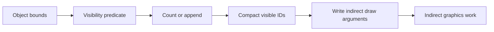
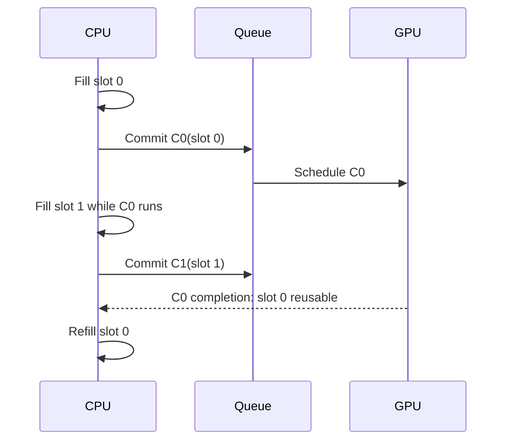
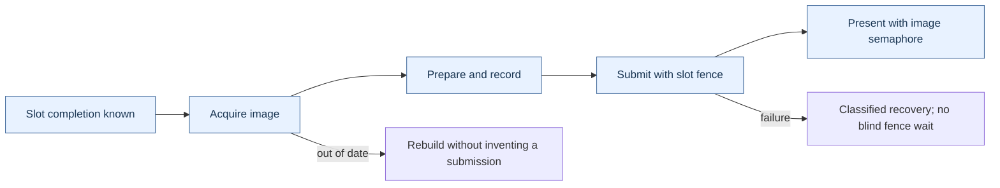

# 11 — C++ Const, Borrowing, and CPU–GPU Buffering

[[Chapter Edition/01 - Computing Foundations/00 - Reading Map|Reading map]] · [[Chapter Edition/01 - Computing Foundations/10 - Reproducible Builds, Profiling, and Repository Contracts|Previous chapter]] · [[Chapter Edition/01 - Computing Foundations/12 - Commands, Async Work, and Resource Lifetimes|Next chapter]]

C++ qualifiers and borrow intervals determine which accesses are legal, while graphics buffers add synchronization and reuse constraints across CPU and GPU work. This chapter follows those ideas into double and triple buffering and makes ownership timing explicit.

**By the end:** Reason about qualification, lifetime-bounded views, and buffer reuse when CPU and GPU operations overlap.

**Recall question:** What completion event must be observed before a buffer can be safely reused or released?

<!-- Derived from Continuous Notes/Computing Foundations - From Bits to C++ and Systems APIs.md; source lines 20193–22551; source-span SHA256 eac5e1899267f2d0892cdeb7c185ae1cc8020578dec46e56aec17b4d18a322da. -->

<!-- CHAPTER-SOURCE-BEGIN -->
## C++ - Qualification safety and borrow intervals

### Why nested const needs an intermediate guard

This is a hypothetical proof by contradiction, not legal code to run. Suppose `int**` could convert to `const int**`:

```cpp
const int immutable = 7;
int* mutable_path = nullptr;
int** outer = &mutable_path;
// const int** injected = outer; // actual C++ rejects this
// *injected = &immutable;       // hypothetical mutation of mutable_path
// *mutable_path = 9;            // would write an actually const object
```

Step one establishes a const object. Step two gives the mutable pointer a mutable type. The hypothetical conversion lets a const-object address enter that mutable pointer through an alias. The final write would violate the first promise without an explicit cast. Therefore adding const only at the deepest level is not safe. `const int* const*` makes the intermediate pointer read-only through that path, rejecting the injection assignment. This explains the safety requirement; the general language rule is qualification decomposition, not a special ban against double pointers. See [[Multilevel pointer qualification]].

### A borrow's access interval is an intersection

Let $L_o$ denote times at which the referent is live, $L_s$ times at which its storage/access relationship is valid, and $L_i$ times at which the path still names the intended logical entity. Under the API's mutation and synchronization contract, the admissible access times satisfy:

$$
L_{\mathrm{access}}\subseteq L_o\cap L_s\cap L_i.
$$

These are sets of times, not byte counts or durations to add. Const/type/bounds/permissions still add independent obligations. Reallocation can end the old storage relationship; destruction ends the old object's live interval; slot assignment can preserve the live object while ending its association with a logical entity. A non-null bit pattern establishes none of those intervals.

For an epoch witness, save $e_b$ when borrowing and compare with the live pool epoch $e_p$ before access. Acceptance requires $e_b=e_p$, but that test is meaningful only if the epoch owner remains live, every invalidating mutation advances the counter, equality cannot falsely recur through wrap, and mutation cannot race between check and use. A single-threaded epoch implements a conservative API contract, not a proof of ownership or lock-free safety. See [[Borrow contracts and pool epochs]] and the inline [[Chapter Edition/01 - Computing Foundations/03 - Records as Resource Transactions#When a valid borrow stops naming the intended thing|slot trace]].

### Forwarding reconstructed from collapsing

For an lvalue argument of type int to deduced `T&&`, deduction chooses `T=int&`; applying `&&` to that substituted reference collapses to `int&`. For an int prvalue, deduction chooses `T=int`; the parameter is `int&&`. In the body the parameter's name is an lvalue in both cases. `std::forward<T>` uses the deduced T to restore the original category; unconditional move discards that distinction. This derivation requires the forwarding pattern, not merely any spelling containing two ampersands.

## C++ - Conventional record layout and identity horizon

This proof extends [[Chapter Edition/01 - Computing Foundations/03 - Records as Resource Transactions#Bringing the object model back to bytes|the inline layout explanation]], not a universal class-layout algorithm. Assume an ordinary ABI with member size/alignment pairs, no bases, virtual machinery, overlap, packing or stronger requested alignment. For nonnegative offset x and positive required alignment a:

$$
\operatorname{roundUp}(x,a)=a\left\lceil\frac{x}{a}\right\rceil.
$$

Place each member at its rounded-up offset, advance by its size, then round the complete extent to the ABI's class alignment. For char/double/char with sizes 1/8/1 and alignments 1/8/1: first offset0; double roundUp(1,8)=8; final char offset16; extent17; size roundUp(17,8)=24. Reordering double/char/char gives offsets0/8/9, extent10 and size16. Adjacent array elements then begin at aligned multiples of the complete size. This is a target model to measure, not the meaning of standard-layout.

A generation counter of G bits has 2^G possible bit patterns. If one slot is reused r times per second, a wrap horizon under steady reuse is:

$$
T=\frac{2^G}{r}.
$$

T is in seconds when r is reuses/second. This predicts counter wrap, not guaranteed collision freedom: a retained old handle may match again after wrap, and a handle from another registry can match sooner. Reserve invalid states, width choice and reuse/quarantine policy can change the horizon. A validity check must include the owning registry and live slot state.

Neither proof makes a C++ object's physical address its semantic identity. Neither grants pointer arithmetic across adjacent non-array members.

Extended mathematical and logical derivations live here under durable concept headings. Update an existing derivation when a later chunk adds assumptions, a more general form, limiting cases, or corrections.

Each derivation records:

- the main-note chunk that first requires it;
- definitions, domains, units, conventions, and assumptions;
- every non-obvious step;
- dimensional, sign, boundary, and limiting-case checks;
- links to later chunks that deepen or reuse it.

## M001 - Positional value, masks, fields, and De Morgan

**Introduced by:** [[Chapter Edition/01 - Computing Foundations/01 - From Bits to Running Systems#From a signal to an interpretation|C001 / M001]]

### Unsigned positional value and base conversion

For bits $b_i\in\{0,1\}$, an unsigned $N$-bit pattern means

$$
V=\sum_{i=0}^{N-1}b_i2^i.
$$

Euclidean division gives $n=2q+r$, with $r\in\{0,1\}$. Therefore $r=b_0$; repeating on $q$ exposes $b_1,b_2,\ldots$, so remainders arrive LSB-first. Decoding left-to-right uses the Horner recurrence $v\leftarrow2v+b$.

Check for `10101101`: $128+32+8+4+1=173$. Repeated division of 173 returns remainders `1,0,1,1,0,1,0,1`, whose reverse is `10101101`.

### Contiguous masks, extraction, and insertion

A width-$w$ low mask is

$$
L_w=2^w-1
$$

because $2^w$ is `1` followed by $w$ zeros and subtracting one borrows through them to produce $w$ ones. Moving the field to offset $s$ gives $M=L_w\ll s$.

Extraction first normalizes, then isolates:

$$
extract(x,s,w)=(x\gg s)\land L_w.
$$

Insertion must preserve every position outside $M$. The term $x\land\neg M$ clears exactly the destination; $(v\land L_w)\ll s$ encodes only values representable by the field. Since their 1-bits cannot overlap outside the destination,

$$
insert(x,v,s,w)=(x\land\neg M)\lor((v\land L_w)\ll s).
$$

Implementation checks: $w>0$, $s+w\le N$, shifts are smaller than the carrier width, and complement is evaluated at carrier width. A semantic API must choose whether an oversized $v$ is rejected or truncated.

### De Morgan by exhaustive truth assignment

For two Boolean inputs there are only four assignments. Evaluating both sides on `(0,0)`, `(0,1)`, `(1,0)`, and `(1,1)` yields identical result columns:

| A | B | not (A and B) | (not A) or (not B) | not (A or B) | (not A) and (not B) |
|---:|---:|---:|---:|---:|---:|
| 0 | 0 | 1 | 1 | 1 | 1 |
| 0 | 1 | 1 | 1 | 0 | 0 |
| 1 | 0 | 1 | 1 | 0 | 0 |
| 1 | 1 | 0 | 0 | 0 | 0 |

Thus

$$
\neg(A\land B)=\neg A\lor\neg B,
\qquad
\neg(A\lor B)=\neg A\land\neg B.
$$

The same identities apply lane-by-lane to fixed-width bit vectors, provided the complement width is fixed.

## M002 - Signed representations, adders, and arithmetic policies

**Introduced by:** [[Chapter Edition/01 - Computing Foundations/01 - From Bits to Running Systems#Arithmetic becomes a policy|C002 / M002]]

### Finite ranges and signed encodings

An $N$-bit carrier has $2^N$ patterns. Unsigned positional interpretation maps them bijectively to $[0,2^N-1]$. Signed magnitude and one's complement each reserve separate positive and negative zero patterns, leaving range

$$
-(2^{N-1}-1)\le x\le2^{N-1}-1.
$$

Two's complement instead interprets the high bit with weight $-2^{N-1}$, producing

$$
-2^{N-1}\le x\le2^{N-1}-1.
$$

Zero occupies one pattern, so the recovered pattern becomes the extra negative endpoint. Consequently, the positive counterpart of $-2^{N-1}$ cannot fit in the same signed type.

### Two's-complement negation and subtraction

In the residue ring modulo $2^N$, $-x$ is represented by $2^N-x$. Since the all-ones word is $2^N-1$,

$$
2^N-x=(2^N-1-x)+1=\sim x+1.
$$

Therefore

$$
A-B=A+(-B)=A+\sim B+1.
$$

The low $N$ result bits are identical whether interpreted as the unsigned residue or an in-range signed result; flags and the chosen type supply the interpretation.

### Full adder, carry, and signed overflow

For inputs $A,B,C_{in}$, the sum bit is

$$
S=A\oplus B\oplus C_{in}.
$$

Carry occurs when at least two inputs are 1:

$$
C_{out}=(A\land B)\lor(C_{in}\land(A\oplus B)).
$$

For bit position $i$, define generate $G_i=A_i\land B_i$ and propagate $P_i=A_i\oplus B_i$. Then

$$
C_{i+1}=G_i\lor(P_i\land C_i).
$$

Ripple carry evaluates this recurrence sequentially across positions; carry-lookahead or prefix networks expand and combine the terms in parallel.

Signed addition overflows precisely when operand signs match and the result sign differs:

$$
V=\neg(A\oplus B)\land(A\oplus R)\land signBit.
$$

Carry and overflow may disagree because they answer unsigned and signed representability questions about the same result bits.

### Multiplication, division, and policy choices

Binary multiplication decomposes into selected partial products:

$$
A\times B=\sum_i B_i(A\ll i).
$$

Unsigned long division maintains

$$
D=Qd+R,\qquad 0\le R<d,
$$

by shifting each dividend bit into $R$, subtracting $d$ when possible, and setting the corresponding quotient bit.

When a result cannot fit, the correct response is a semantic choice: modulo residue, explicit checked failure, wider intermediate, boundary saturation, or arbitrary precision. Saturation is not generally associative, so parallel reordering can change results.

## Definitions and proof steps behind the compact equations

### Why an N-bit complement subtracts from all ones

Each bit of x contributes either 0 or its weight $2^i$. Complementing replaces that contribution by $2^i-b_i2^i$. Summing over all positions gives:

$$
\operatorname{NOT}_N(x)=\sum_{i=0}^{N-1}(1-b_i)2^i
=\left(\sum_{i=0}^{N-1}2^i\right)-x=(2^N-1)-x.
$$

Adding one produces the residue representing negation. For x=0, the intermediate is $2^N$, so reducing modulo $2^N$ returns zero. This is why the equality for negation must specify modular width instead of pretending every signed positive counterpart fits.

### Why insertion preserves all other bits

Consider one position i. If mask bit $M_i=0$, then $(x\land\operatorname{NOT}_N(M))_i=x_i$ and the encoded new field contributes zero there. The output is therefore $x_i$. If $M_i=1$, clearing contributes zero and the encoded new field supplies its bit. These two cases cover every position, proving preservation outside the field and replacement inside it.

### How two half adders make a full adder

First compute $t=A\oplus B$ and $g=A\land B$. Then add incoming carry c to t: $S=t\oplus c$ and $h=t\land c$. The outgoing carry is $g\lor h$, so:

$$
S=A\oplus B\oplus c,\qquad c'=(A\land B)\lor(c\land(A\oplus B)).
$$

If A and B are both 1, g already supplies carry. If exactly one is 1, c determines whether the total reaches two. If both are 0, a single c cannot create carry. This explains the majority rule without treating the formula as a memorized symbol string.

### C++ common-type decision after promotion

For signed type S and unsigned type U: if U has at least S's rank, use U; otherwise use S only if S represents every U value; otherwise use the unsigned counterpart of S. Integer rank orders conversion preference; it is not merely a count of storage bytes. Consequently, int −1 versus unsigned int 1 usually converts −1 to unsigned, while a sufficiently wide signed long long can retain −1 when compared with unsigned int.

These decisions occur before arithmetic or comparison. They also explain why casting the final result cannot repair an earlier signed overflow. A wider destination is useful only if the operation itself was performed safely.

## M003 - Byte order, layout, and translation

**Introduced by:** [[Chapter Edition/01 - Computing Foundations/02 - Values at Addresses Layout, Lifetimes, and Representation#Where the bytes live|C003 / M003]].

### Base-256 decomposition and codec inverse

Assume n octets, unsigned $0\le x<256^n$, and digits $0\le d_i<256$. Euclidean division by 256 yields a low digit and quotient. Repeating produces:

$$
d_i=\left\lfloor x/256^i\right\rfloor\bmod256,\qquad
x=\sum_{i=0}^{n-1}d_i256^i.
$$

Little-endian stream element i is $d_i$; big-endian element i is $d_{n-1-i}$. Decoding LE attaches weight $256^i$ to byte i. Decoding BE starts at zero and applies $v_{j+1}=256v_j+b_j$; after j bytes it equals the weighted sum of the prefix. After n bytes, both recover x under their matching order. Fixed n preserves leading zero bytes.

For four octets, swapping sends digit i to position 3−i:

$$
\operatorname{swap}_{32}(x)=\sum_{i=0}^{3}d_i256^{3-i},\qquad
\operatorname{swap}_{32}(\operatorname{swap}_{32}(x))=x.
$$

This is a byte permutation, not intra-byte bit reversal. Host-to-wire conversion is conditional on the format contract.

### Alignment rounding without hiding overflow

Let p be a nonnegative byte offset and A a positive alignment. Write $p=qA+r$, $0\le r<A$. If r=0, p is aligned; otherwise the minimal larger multiple is $(q+1)A$. Define padding $\delta$:

$$
\delta=(A-(p\bmod A))\bmod A,\qquad
\operatorname{alignUp}(p,A)=p+\delta,\qquad 0\le\delta<A.
$$

This proves minimality and idempotence. At finite unsigned maximum M, require $\delta\le M-p$ before adding. For $A=2^k$, the bottom k bits encode r. Adding A−1 and clearing those bits gives:

$$
\operatorname{alignUp}(p,A)=(p+A-1)\mathbin{\&}\operatorname{NOT}_N(A-1).
$$

The mask formula requires nonzero power-of-two A and an addition fitting the N-bit carrier. The delta method can accept a highest aligned p even when p+A−1 would overflow. An aligned numeric offset neither allocates storage nor establishes pointer validity.

### Member offsets and tail padding

For an illustrative record with member sizes $s_j$, alignments $a_j$, no special overlap/base rules, and stated ABI placement convention, let $e_0=0$ be the first unused offset:

$$
o_j=\operatorname{alignUp}(e_j,a_j),\qquad
e_{j+1}=o_j+s_j,\qquad
\text{internal padding}_j=o_j-e_j.
$$

For complete-record alignment A and final member end E:

$$
S=\operatorname{alignUp}(E,A),\qquad
\text{tail padding}=S-E.
$$

Sizes/alignments 1/4/1 give offsets 0/4/8, E=9, A=4, S=12. Array element i starts at base+iS; if base and S are multiples of A, every element remains aligned. This models specified ABI assumptions, not a rule overriding compiler layout. Observe standard-layout records with sizeof, alignof, and offsetof.

### Page decomposition and offset preservation

For page size $P=2^k$, Euclidean division gives a unique quotient VPN and remainder o:

$$
VA=VPN\,P+o,\qquad VPN=\lfloor VA/P\rfloor,\qquad 0\le o<P.
$$

A process-specific valid mapping supplies physical frame PFN and permissions:

$$
PA=PFN\,P+o.
$$

PFN×P has zero low k bits, so addition is equivalently OR after shifting. Offset is unchanged; only page identity changes. Mapping need not be invertible: several virtual pages can share one frame. Width, permissions, residence, and legality require separate checks.

For positive access length L, bytes starting at VA cross the page boundary iff $L>P-o$, assuming a representable address range. At o=4094 and L=4 with P=4096, two bytes occupy each page. Both mappings must permit access.

### Translation reach and record footprint

T TLB entries for page size P have illustrative reach T×P bytes; real hierarchy, associativity, and mixed page sizes complicate that bound. One GiB requires $2^{30}/2^{12}=262144$ pages at 4 KiB, or $2^{30}/2^{21}=512$ at 2 MiB.

Shrinking N records saves $N(S_{\mathrm{old}}-S_{\mathrm{new}})$ bytes. A 24→16 byte change saves eight million bytes for one million records. This is footprint arithmetic, not measured throughput: hot fields, cache boundaries, prefetching, and access patterns still matter.

[[Alignment and padding]] · [[Pages and page offsets]] · [[TLB]] · [[Serialization]]

## M004 - Floating-point fields, spacing, and rounding

**Introduced by:** [[Chapter Edition/01 - Computing Foundations/01 - From Bits to Running Systems#A stretching ruler for real-valued quantities|M004, Parts 61–76]].

### Normal value from fraction positions

Let $t$ be the stored fraction width, $f_j$ the digit at fractional position $j$ (weight $2^{-j}$), and $F$ the unsigned integer represented by those digits. Multiplying their fractional sum by $2^t$ gives the integer field:

$$
\sum_{j=1}^{t}f_j2^{-j}=\frac{F}{2^t}.
$$

Normalization contributes the implicit leading one. Stored exponent $E$ and bias $B$ give $e=E-B$. Thus $x=(-1)^S(1+F/2^t)2^e$. For binary32, $t=23,B=127$, valid normal fields $1\le E\le254$ imply $-126\le e\le127$. For binary64, $t=52,B=1023$ and $1\le E\le2046$ imply $-1022\le e\le1023$.

Minimum normal uses $F=0,e=e_{\min}$; maximum finite uses $F=2^t-1,e=e_{\max}$:

$$
x_{\min,\mathrm{normal}}=2^{e_{\min}},\qquad
x_{\max}=(2-2^{-t})2^{e_{\max}}.
$$

These are mathematical format values, not a promise about every C++ floating type.

### Subnormal lattice and boundary continuity

For $E=0$, use effective exponent $e_{\min}$ and leading zero, not one:

$$
x=(-1)^S(F/2^t)2^{e_{\min}}=(-1)^S F\,2^{e_{\min}-t}.
$$

A lattice here means values occur at integer multiples of a common step. Binary32 step is $2^{-126-23}=2^{-149}$; binary64 step is $2^{-1022-52}=2^{-1074}$.

At $F=2^t-1$, the largest positive subnormal is $2^{e_{\min}}-2^{e_{\min}-t}$. The next value is the smallest normal $2^{e_{\min}}$. Their gap is exactly the same subnormal step. The next normal also increments its $F$ by one, so its gap is the same. This proves boundary continuity without calling every tiny result an underflow exception.

### Spacing, epsilon, and nearest-rounding error

In normal binade $[2^e,2^{e+1})$, consecutive values differ only by $F\to F+1$ (except the last transition to the next binade). Subtract their formulas:

$$
\Delta(e)=\left(\frac{F+1-F}{2^t}\right)2^e=2^{e-t}.
$$

Since $p=t+1$, $\Delta(e)=2^{e-(p-1)}$. At $e=0$ this is epsilon $2^{-t}$. At an ordinary power-of-two boundary above the minimum-normal edge, the lower gap belongs to exponent $e-1$ and is half the upper gap.

For an exact positive value $z$ in a normal binade, nearest rounding has absolute error at most $\Delta(e)/2$. Since $z\ge2^e$:

$$
\frac{|\operatorname{fl}(z)-z|}{|z|}
\le\frac{2^{e-t-1}}{2^e}=2^{-p}=u.
$$

Here $\operatorname{fl}$ denotes rounding to the destination format. Scope: no overflow, normal-range nearest rounding; subnormal relative precision needs separate treatment. “Machine epsilon” in this vault means upward spacing at 1, while unit roundoff $u$ is its half. Literature sometimes uses different epsilon conventions, so name the definition.

### Guard, round, sticky and even ties

Let retained significand integer be $q$. Guard $G$ is first discarded bit, round $R$ second, sticky $T$ ORs all later bits, and $L=q\bmod2$. If $G=0$, the discarded tail is below half a retained step. If $G=1$ and $R$ or $T$ is 1, it is above half. If $G=1,R=T=0$, it is exactly half: increment odd $q$, retain even $q$.

$$
\operatorname{increment}=G\land(R\lor T\lor L).
$$

The increment is on retained magnitude; sign/direction logic is additionally required for directed rounding. A carry can renormalize the significand and increase exponent. The toy midpoint 1.875 at three significant bits rounds to 2, not to an unnormalized stored significand.

### A zero-collapsed representation key

For a finite binary32 raw word $b$, let $m=b\mathbin{\&}\texttt{0x7FFFFFFF}$ and $C=2^{31}$. Define key $K=C-m$ for negative patterns, $K=C+m$ otherwise. Both zeros map to $C$. Larger magnitudes on the negative side decrease the key; larger positive values increase it. Distance is the unsigned absolute key difference.

Check: negative minimum subnormal has key $C-1$, zero $C$, positive minimum subnormal $C+1$: distance across the two nonzero neighbors is 2. Reject NaNs/infinities rather than assigning a misleading numerical metric. This is a defined testing convention, not the only possible ULP convention.

### Scaling a norm and a determinant

For finite vector components with $m=\max(|x|,|y|)>0$, factor $m^2$ before squaring:

$$
\sqrt{x^2+y^2}=m\sqrt{(x/m)^2+(y/m)^2}.
$$

The ratios have magnitude at most one. Intermediate overflow from $x^2$ is avoided; final overflow and other accuracy issues remain possible. Zero and non-finite inputs require explicit branches. Do not treat a teaching identity as a fully specified library implementation.

For an invertible 2×2 matrix $A$, $\det(cA)=c^2\det(A)$. For a consistent induced norm, $\kappa(A)=\|A\|\|A^{-1}\|$, and nonzero scalar $c$ gives $\kappa(cA)=|c|\|A\|\cdot|c|^{-1}\|A^{-1}\|=\kappa(A)$. An absolute determinant cutoff changes with scale even though this conditioning measure does not. General singularity/conditioning methods await later mathematics.

### Representation equality versus numerical equality

Binary32 zeros differ only by sign, but numerical equality identifies them. NaN ordinary equality identifies neither itself nor another NaN, even when raw words are equal. A raw-bit serializer, a numeric comparison, a hash policy, and a canonical format must therefore state separate contracts. Mapping every NaN to one quiet pattern loses payload/signaling information deliberately; it is not a lossless representation conversion.

## M005 - Representation error, cancellation, and rounding graphs

**Introduced by:** [[Chapter Edition/01 - Computing Foundations/01 - From Bits to Running Systems#When arithmetic meets uncertainty|M005]].

### Termination in a base and exact one-tenth error

A finite fractional base-$B$ expansion has value $m/B^k$. Reducing $p/q$ means $q$ must divide $B^k$. Conversely, if every prime in $q$ divides $B$, choose $k$ large enough that $q$ divides $B^k$; multiply numerator and denominator to get a finite expansion. In binary this means $q=2^j$.

For binary32 word 3DCCCCCD: stored exponent 123 gives $e=-4$; fraction is 4CCCCD, and the hidden-one integer is $2^{23}+F=13421773$. Thus value is $13421773\,2^{-27}$. Subtract exact one tenth with a common denominator:

$$
\frac{13421773}{134217728}-\frac1{10}
=\frac{10(13421773)-134217728}{10(134217728)}
=\frac{2}{1342177280}=\frac1{671088640}.
$$

This is an exact rational calculation; computing both sides with rounded 0.1 is not the same reference.

### Cancellation bound and exact subtraction

For intended values $a,b$ and relative operand errors bounded by $\eta$, expansion gives perturbed difference $a-b+a\delta_a-b\delta_b$. Triangle inequality gives absolute error at most $\eta(|a|+|b|)$. Divide by $|a-b|$ only when nonzero. Additional final subtraction rounding must be analyzed separately.

Sterbenz's exact-difference lemma concerns nearby stored values in a suitable radix format with gradual underflow. For nonnegative $x,y$ with $x/2\le y\le2x$, the difference is representable. The appropriate common-exponent integer significands have enough trailing-zero/range structure after cancellation to fit the smaller result. It says nothing about the unknown real operands' initial rounding errors; changing subnormal semantics can remove its assumptions.

The attachment's binary pair is 1753/1024 and 1751/1024, hence difference $2^{-9}$, not its stated longer pattern. For desired decimal 1.00000006, the nearest binary32 word is 3F800001, so subtracting stored 1 is exactly $2^{-23}$ although the desired difference is $6\times10^{-8}$.

### Rounding products and summation bounds

Let local factors satisfy $|\delta_i|\le u$, with $nu<1$. The standard product-of-factors bound writes a relevant product (and supported inverse-factor variant) as $1+\theta_n$, $|\theta_n|\le\gamma_n=nu/(1-nu)$. The denominator accounts for interaction terms; for small $nu$ it approximates $nu$. It is a tool applied to dependency paths, not a universal bound obtained solely by counting source operators.

For sequential sum $s=\sum_i x_i$, each input travels through at most $n-1$ rounded additions. Expanding the computed expression attaches factors to terms; triangle inequality yields:

$$
|\widehat s-s|\le\gamma_{n-1}\sum_i|x_i|.
$$

Assume nearest normal-range arithmetic and no range failure. The ratio $\sum_i|x_i|/|s|$ exposes sensitivity when terms cancel. Balanced trees reduce maximum path length; they do not eliminate input uncertainty or promise the smallest error on every example.

### FMA witness and distributive witness

Put $p=2^{-23}$, $a=b=1+p$, $c=-(1+2p)$. The exact product is $1+2p+p^2$. Separate binary32 product rounding removes $p^2$, so the next addition gives zero. A fused operation subtracts before that rounding and produces representable $p^2=2^{-46}$.

For $a=10^{10},b=1+2^{-23},c=-1$, $b+c=2^{-23}$ exactly. The factored path gives representable $10^{10}2^{-23}=1192.0928955078125$. The separately rounded product $ab$ lies on a 1024-spaced grid and rounds to $10^{10}+1024$; $ac=-10^{10}$, leaving 1024. Compiler contraction changes the graph and must be controlled.

### Capped history is mathematically order-dependent

For positive cap $M$ and observation weight $w>0$, define $W'=\min(M,W+w)$, $c=\min(w,W')$, $r=W'-c$. Then $D'=(Dr+dc)/W'$. Without the cap and with exact totals, induction recovers $D=\sum_iw_id_i/\sum_iw_i$.

With $M=2,w=1$, ordering 0,1,−1 gives after three observations $D=-1/4$; ordering 0,−1,1 gives $D=+1/4$. All values are dyadic and exact. Thus a cap changes history influence even without roundoff. Batch exact averaging is not an equivalent replacement.

### Tolerance is not an equivalence relation

Absolute closeness at threshold 1 links 0 to 0.75 and 0.75 to 1.5, but not 0 to 1.5. Nontransitivity prevents treating this predicate as mathematical equality for arbitrary grouping/hashing. Numeric equality and bit identity also differ at signed zero/NaNs. Choose contracts independently.

## Representation choice - Fixed grids, codebooks and low-precision fields

[[Chapter Edition/01 - Computing Foundations/01 - From Bits to Running Systems#Choosing what information to keep|Continuous explanation]] supplies the motivation and examples. This companion reconstructs the constraints.

### A scale is an interpretation, not an integer operation

Let signed N-bit raw I range from -2^(N-1) through 2^(N-1)-1, and choose positive S=2^F. Dividing both endpoints by S gives the exact decoded interval. Adjacent raw integers differ by one, hence decoded step is 1/S.

Nearest rounding selects q with |xS-q|≤1/2 when no clipping occurs. Divide by positive S:

$$
\left|x-\frac qS\right|\le\frac1{2S}.
$$

The symmetric range requirement M must fit the positive endpoint, which is one raw unit smaller in magnitude than the negative endpoint. Thus require M·2^F≤2^(N-1)-1. Taking base-two logarithms yields the scale feasibility interval in the story, with integer floor/ceiling and F≥0. A requested maximum error e can instead require 1/(2S)≤e; a requested step and a requested error are not the same condition.

At F=16, raw minimum −2147483648 decodes to −32768; maximum2147483647 decodes to32768−2^-16. Using an approximate endpoint32768 in a conversion check incorrectly accepts a value whose raw code cannot fit.

### Different operand scales require an explicit output scale

For decoded a=A/S_a and b=B/S_b, desired output scale S_o gives:

$$
I_{\mathrm{mul}}=\operatorname{roundPolicy}
  \left(\frac{AB\,S_o}{S_aS_b}\right),
\qquad
I_{\mathrm{div}}=\operatorname{roundPolicy}
  \left(\frac{A\,S_bS_o}{B\,S_a}\right),\quad B\ne0.
$$

With all scales equal S, these reduce to AB/S and AS/B. Intermediate products in the general formula can overflow even when the simplified answer fits; simplify factors carefully or use a proved wider domain. The lab implements only the bounded same-scale case.

For signed nearest-even division, separate sign from unsigned magnitude. Write n=qd+r with 0≤r<d, d>0. Increment q if r>d−r, or if r=d−r and q is odd. Comparing with d−r avoids overflowing 2r. Apply the sign after checking the destination magnitude, including the asymmetric signed minimum. For −5/2, q=2,r=1: tie keeps even2, then sign gives−2. For−7/2, q=3,r=1: tie increments to4, then sign gives−4.

### Affine codebook error and endpoint constraints

Let s>0 and integer zero point z define reconstruction s(q−z). Without clipping, q−z=round(x/s), so multiplication of the nearest-code bound by s gives:

$$
\left|x-s(q-z)\right|\le s/2.
$$

This derivation assumes an ideal scale and rounding operation. Finite scale storage and evaluation add error; clipping invalidates the half-step bound.

An 8-bit unsigned endpoint fit from−1 to1 has s=2/255 and ideal zero point127.5. An integer zero point cannot equal127.5. Choosing128 makes zero exact but reconstructs endpoints−256/255 and254/255. Choosing127 shifts the interval oppositely. Rounding an affine zero point changes endpoint fit; one cannot declare all three targets exact under this uniform grid.

### Metadata changes the compression ratio

For N>0 samples and G>0, code bytes are ceil(N/2), and float32 scales cost4·ceil(N/G). For full groups and even N, divide payload bits by N to get4+32/G bits/sample. Partial groups and odd code counts require the ceiling form.

At N=5,G=32, payload is3+4=7 bytes, versus20 FP32 bytes: approximately2.86× reduction, not6.4×. At large divisible N andG=32, payload approaches0.625 bytes/sample, giving4/0.625=6.4×. Neither figure includes the header.

For a one-bit row with C samples and two binary32 centroids, a separately packed row costs ceil(C/8)+8 bytes before its other metadata. The approximation1+64/C bits/sample ignores final-byte padding.

### Low precision changes the grid, not the decoding principle

A normal binary format with t fraction bits has p=t+1 precision and binade spacing2^(e−t). Binary16 uses t=10,e_min=−14, giving minimum subnormal2^(−14−10)=2^-24. BF16 uses t=7,e_min=−126, giving2^-133 in the ideal interchange format.

Maximum finite uses the largest finite exponent and fraction1−2^-t, so (2−2^-t)2^e_max. This derives65504 for binary16 and(2−2^-7)2^127 for BF16.

In binary32→BF16 nearest-even conversion, the discarded low word d is compared with halfway0x8000. If d is above halfway, increment the high word; at equality, increment only if its low bit is odd. The finite-word bias0x7FFF+L expresses this decision. Classify NaNs first, or a payload only in discarded bits can turn into an infinity encoding.

## External bytes - Bounds, identity and error detection

### Bounds belong to the arithmetic domain of the parser

For unsigned maximum U, a nonzero factor a permits multiplication a·b only when b≤floor(U/a). Do this before evaluating the product. For a span length L and read length n at offset o, require o≤L and n≤L−o; the first comparison protects subtraction.

After a validated header length H, exact payload length P requires P=L−H. This avoids computing H+P before proving it fits. File-schema uint64 values also need representation/resource checks before converting to host size_t or allocating.

### CRC polynomial toy trace

This is a toy unreflected CRC with zero initialization and no final XOR, not the laboratory's CRC-32 parameters. Let message bits1101 mean polynomial x³+x²+1 and generator1011 mean x³+x+1. Append three zero positions and divide with XOR:

```text
1101000 xor 1011000 = 0110000
0110000 xor 0101100 = 0011100
0011100 xor 0010110 = 0001010
0001010 xor 0001011 = 0000001
```

Remainder001 is appended to the original message, giving1101001. Dividing that codeword by1011 yields remainder zero. This works because coefficients lie in GF(2): subtracting a polynomial is XOR, with no borrow. Real named CRC parameters must additionally declare reflection, initialization, final XOR and the message coverage.

### A digest cannot be injective on unrestricted messages

An h-bit digest has2^h outputs. Choose2^h+1 distinct messages. At least two must share an output by the pigeonhole principle. Cryptographic strength concerns difficulty of finding certain collisions/preimages, not mathematical nonexistence.

A changed file and a recomputed untrusted digest can agree. Authentication needs a trusted reference or keyed/signature mechanism; a polynomial remainder alone provides neither identity nor authorization.

[[Supplementary/Code Snippets#Representation codecs and bounded file laboratory|Executable bounded codecs]] · [[Supplementary/Sources and Code Anchors|Verification scope]]


## Source trail for the combined foundations

The original bits and C++ notes are retained as recovery sources. This combined reading volume also includes general API contracts, build/tooling material and recovered inline proofs. See [[Supplementary/Manual Integration - Sources and Verification]] for source boundaries and verification.


---

## From generated GPU work to safe explicit execution

The following extension follows data from GPU work generation through explicit API execution, renderer planning, Gaussian images, lighting, and animated surfaces. Definitions and worked examples precede the retained detailed lessons. Source-project observations about Kairo, Maveb and Vulkax are supplied draft claims; they have not been independently certified against a current repository revision. API examples retained below include fragments and pseudocode. Their presence is not a claim that every snippet was compiled or every device path tested.
# From GPU-generated work to a Metal frame that can be reused safely

A useful way to learn a graphics backend is to follow one object from a decision made on the GPU to the moment its pixels become visible. Along that route, several topics that can look like separate API trivia turn out to be one system: GPU work generation, command scheduling, temporary memory, frame overlap, resource ownership, and the arithmetic that decides whether a kernel is limited by computation or data movement.

The examples below are teaching examples, not measurements of a particular Apple GPU. API facts are linked to Apple’s documentation. The supplied source notes include observations about Kairo and Maveb code, but this supplement did not independently check out or inspect those repositories. Treat those observations as dated source claims rather than current repository facts. The snippets are pseudocode unless explicitly identified as Apple documentation examples; none here has been compiled.

## The list that the CPU used to build

Imagine a scene with 10,000 objects. A serial CPU renderer loops over them, tests whether each object can affect the view, and pushes visible identifiers into a list. It then tells the graphics API to draw the list. This design is easy to reason about, but it requires the CPU to learn a result that the GPU can calculate more cheaply and then send a command description back to the GPU. On a discrete GPU that round trip may involve a readback. On unified memory it still requires a synchronization point and CPU scheduling. The important cost is not merely copying bytes: it is making a CPU decision depend on work that only the GPU can finish.

The GPU-oriented pipeline keeps the predicate, compacted list, and draw count resident on the GPU:



A **predicate** is a true/false condition, here “does this object survive the culling test?” A **compaction** packs the surviving items into a dense output range. A **dispatch** is one launch of a compute grid. An **indirect command** is a command whose count or dimensions are read by the GPU from a buffer, so the CPU does not need to know the result before submission.

Two common compaction strategies expose a fundamental GPU design choice. In an atomic append, each passing thread increments a shared counter and writes its ID to the returned slot:

```text
if visible[i]:
    slot = atomic_fetch_add(count, 1)
    visibleIDs[slot] = i
```

For 3,700 visible items, the final count is 3,700 and every output slot from 0 through 3,699 is filled. The order is generally scheduling-dependent: object 814 might obtain slot 0 in one run and slot 12 in another. If the consumer treats the result as a set, that is fine. If stable ordering matters, it is not. A hot counter can serialize many lanes, and a single global atomic may become a bottleneck.

A scan-based method does more phases but gives each item a unique deterministic destination. Let $p_i$ be 1 when item $i$ passes and 0 otherwise. The exclusive prefix sum is

$$
o_i=\sum_{j=0}^{i-1}p_j.
$$

Each passing item writes to `visibleIDs[o_i]`. If item 0, 2, and 4 pass, their offsets are 0, 1, and 2. In a large GPU, the prefix sum itself is built hierarchically: each workgroup scans a local segment, a later phase scans workgroup totals, and a final phase adds each segment’s base offset. A workgroup barrier coordinates threads in one workgroup; it is not a global barrier that safely coordinates every workgroup in an arbitrarily large dispatch. Dispatch boundaries, with appropriate resource dependencies, become global phase boundaries.

Then a final one-thread or small compute operation writes an indirect argument structure such as a draw count or dispatch grid. The CPU records that a later operation will consume the argument buffer, but the GPU determines its contents. This changes the CPU’s role from “calculate all visible work” to “submit a valid dependency chain.” A direct draw is still better for tiny fixed work; GPU-generated commands are valuable when they remove CPU readback, reduce submission count, or keep a large variable workload on the device. They are not automatically faster: scan has multiple launches and temporary storage, while atomic append has contention and unstable ordering.

## Keep separate kinds of ping-pong separate

Suppose a particle update reads positions $x_t$ and velocities $v_t$, computes a new state, and writes $x_{t+1},v_{t+1}$. If each thread reads and writes the same arrays without a carefully proven in-place scheme, one particle may observe another particle’s partially updated state. Two state buffers solve that problem: read from A, write to B, then swap roles. That is **algorithmic ping-pong**; it separates old simulation state from new simulation state.

A frame ring solves another problem. While frame 0 is still executing, the CPU may prepare frame 1. If both frames write the same upload bytes, frame 1 can overwrite data frame 0 has not read yet. A **frame slot** is a set of per-frame temporary resources that can be reused only after the submission using them has completed. Two or three slots can let CPU and GPU overlap. A slot count does not by itself prove safety: code must associate each slot with the command buffer that last used it and wait, poll, or receive a completion signal before recycling it.

Consider three slots, S0, S1, and S2. At time $t=0$, CPU prepares S0 and submits command buffer C0. At $t=1$, while C0 executes, CPU fills S1 and submits C1. At $t=2$, CPU fills S2 and submits C2. At $t=3$, CPU wants S0 again. It may reuse S0 only if C0 has completed; “three loop iterations elapsed” is not a completion proof. If the GPU stalls, C0 may still be reading S0. If completion arrives, S0 is retired and can be filled with a later frame. More slots may improve throughput under some loads, while increasing memory use and input-to-display latency.



The source material describes a per-frame bump arena and ring buffers. A **bump arena** allocates by advancing a cursor through a larger allocation; reclaiming the whole arena at once is cheap. A **ring buffer** reserves a contiguous logical stream whose physical allocation wraps around. Both need a retirement rule: the CPU may not reclaim a range while the GPU still refers to it. A fixed 256-byte alignment often appears as a project policy for uniform or argument records, but it is not a universal rule for every Metal binding. The correct alignment depends on resource type, binding path, platform capability, and documented API requirements. Store the chosen alignment beside the allocator contract rather than teaching a magic number as a law.

## Dependency graphs are the real meaning of asynchrony

An asynchronous command submission lets the CPU continue without waiting for GPU completion. It does not mean the GPU work is independent. If a culling compute pass writes visible IDs and an indirect draw reads them, the draw depends on the compute pass. If a copy engine uploads a texture and a render pass samples it, rendering depends on the copy. If a readback buffer is consumed by the CPU, CPU access depends on the GPU finishing and on any required visibility/coherency operation.

Represent each operation as a node and each “must happen before and be visible to” relation as an edge. For example, `upload → cull → compact → indirect draw → present` is one path. A second independent shadow-map pass might overlap part of it, but only if it does not contend for the same constrained resources and has no data dependency. Two queues or command streams do not guarantee overlap. If both saturate memory bandwidth, or one waits on the other’s output, additional scheduling machinery can increase overhead without shortening the critical path.

Apple’s command-structure guidance says command buffers on a queue are scheduled after earlier committed buffers waiting in that queue; the perceived order is preserved, though implementation reordering is possible when it does not change observable behavior. A committed command buffer cannot be reused. Its scheduled callback marks scheduling, not completion; `addCompletedHandler` runs when the GPU has finished the commands. A blocking `waitUntilCompleted` stalls the calling CPU thread and is usually inappropriate in an interactive frame loop. See Apple’s [command structure guide](https://developer.apple.com/documentation/Metal/setting-up-a-command-structure) and [MTLCommandBuffer reference](https://developer.apple.com/documentation/metal/mtlcommandbuffer).

Metal hazard tracking and explicit synchronization must be understood at the resource-access level. In classic `MTLCommandQueue` paths, Metal can automatically synchronize conflicts for directly bound resources using tracked hazard mode; heap-created resources default to untracked, and newer Metal 4 queue paths require explicit resource synchronization regardless of the resource hazard-tracking property. Check the exact queue/API generation and resource provenance. A fence, event, or barrier is not a universal “flush everything” switch. `MTLFence` orders GPU memory operations between passes; Apple documents its supported scopes and encoding rules. Events coordinate workloads across queues, and shared events extend synchronization to CPU code and, where supported, other devices. Do not transplant Vulkan’s host fence meaning onto `MTLFence`; the word “fence” is reused by APIs for different synchronization layers. When correctness depends on a cross-queue producer-consumer edge, state which resource is written, which operation consumes it, and which Metal mechanism establishes ordering and visibility.

There is a subtle but important distinction between a **lifetime edge** and a **data dependency edge**. A resource can stay alive for the entire frame and still be read before its producer’s writes are visible. Conversely, a dependency may be correct while the CPU frees an object or recycles its memory too early. For every transient resource, write down: who allocates it, who writes it, who reads it, what event makes the write available, and what completion permits reuse. This five-question habit catches many “works on my GPU” failures.

## Arithmetic intensity tells you what to measure next

A kernel’s **arithmetic intensity** is the number of floating-point operations performed per byte transferred at a chosen level of the memory hierarchy. “Chosen level” matters: data can be fetched from external memory once and reused many times from a cache or threadgroup memory. A byte count that ignores reuse can misclassify the bottleneck.

For a vector multiply $y_i=a_i b_i$ with 32-bit floats, each element performs one multiplication and, in an ideal streaming pass, reads 4 bytes from $a$, reads 4 from $b$, and writes 4 to $y$. Thus

$$
I=\frac{1\text{ FLOP}}{12\text{ bytes}}\approx0.0833\text{ FLOP/byte}.
$$

This low intensity suggests that memory bandwidth may dominate on a device capable of far more floating-point work per second than this stream can feed. But the conclusion must be tested: cache behavior, launch overhead, CPU synchronization, and the actual memory traffic may dominate a small benchmark. A benchmark that calls `waitUntilCompleted` after every dispatch measures an intentionally serialized path, not necessarily the throughput of a pipelined application.

For matrix multiplication, $C_{ij}=\sum_k A_{ik}B_{kj}$, a naïve output-at-a-time implementation reloads many values. A tiled kernel loads a tile of A and B into fast local storage and reuses each value across multiple multiply-adds. For square tile width $T$, one tile step performs about $2T^3$ floating operations (counting multiply and add separately) and moves about $8T^2$ bytes of 32-bit A/B inputs, before output traffic and cache effects. So the simplified intensity is

$$
I\approx\frac{2T^3}{8T^2}=\frac{T}{4}\text{ FLOP/byte}.
$$

At $T=16$, that model gives about 4 FLOP/byte. This is an idealized comparison, not a benchmark prediction: it omits output stores, padding, edge tiles, synchronization, register spills, and whether the cache already retains data.

The roofline model bounds attainable performance by

$$
P\le \min(P_{\max}, B_{\max} I),
$$

where $P_{\max}$ is peak compute throughput, $B_{\max}$ is sustainable bandwidth at the memory level under study, and $I$ is arithmetic intensity at that level. If an illustrative GPU sustains 10 TFLOP/s and 500 GB/s, its “ridge point” is $10{,}000/500=20$ FLOP/byte. A vector multiply at 0.083 FLOP/byte lies far to the bandwidth side of this simplified roof. A tiled matrix operation at 4 FLOP/byte is improved, but still below the example ridge. The values are hypothetical and should never be reported as a device measurement.

The model suggests choices, not guarantees. Fusion can remove an intermediate write/read and increase useful operations per byte, but may extend register lifetimes or reduce occupancy. Fission can add memory traffic but make each kernel simpler, increase parallelism, or lower register pressure. Reducing registers per thread may permit more resident workgroups, yet additional spills can make the kernel slower. Measure GPU time separately from CPU submission time, warm-up, allocation, and synchronization. Inspect a representative workload and a profiler capture before deciding which roof is relevant.

## Metal is a chain of objects with distinct jobs

Metal’s core object model is easier to remember if each object answers one question. `MTLDevice` represents a GPU and creates resources or pipeline states. `MTLCommandQueue` accepts command buffers for that device. `MTLCommandBuffer` records a sequence of work to submit. A **command encoder** writes one kind of work into it: render commands, compute commands, or blits (resource copies and related transfer operations). A render pipeline state packages compiled vertex/fragment stages and fixed configuration such as attachment formats. A compute pipeline state represents a compiled kernel and exposes device/pipeline properties relevant to dispatch.

An encoder is not a reusable global command stream; it is the scoped place where commands of that type are encoded into a command buffer. End the encoder before starting another encoder on the same command buffer. The sequence might be: create command buffer, encode compute culling, end compute encoder, encode a blit or another compute stage if needed, end it, encode render, end render, register presentation, commit. The command buffer owns the ordered command recording; the encoder configures and emits one segment. Pipeline state is reusable across frames; command buffer and encoder are per-submission work objects. Mixing these lifetimes obscures bugs.

A drawable is a scarce presentation image supplied through a view or layer. Apple recommends obtaining it as late as practical—ideally just before encoding the onscreen pass—and holding it as briefly as possible. `MTKView.currentRenderPassDescriptor` implicitly obtains the current drawable; `currentDrawable` may be nil if all drawable objects are in use. Encode into that drawable’s texture, register its presentation on the command buffer, then commit. See [MTKView](https://developer.apple.com/documentation/metalkit/mtkview/) and [currentDrawable](https://developer.apple.com/documentation/MetalKit/MTKView/currentDrawable). This is why expensive CPU scene preparation should generally happen before acquiring the drawable.

Render attachments also have a begin/end contract. A load action says whether an attachment’s previous contents are needed, should be cleared, or need not be preserved. A store action says whether the result must survive the pass. If depth is only used during one pass and discarded afterward, storing it to external memory is unnecessary. Apple-family tile rendering can keep eligible temporary attachment data in tile memory, and Metal memoryless resources are explicitly temporary pass-local resources; they cannot be loaded from or stored to. This is a useful optimization when its constraints match the render graph, not a universal promise that a pass will run faster. Resource type, GPU family, attachment action, format, and later consumers matter. See Apple’s [storage-mode guide](https://developer.apple.com/documentation/metal/setting-resource-storage-modes) and [`storageModeMemoryless`](https://developer.apple.com/documentation/metal/mtlresourceoptions/storagemodememoryless).

Metal storage modes describe where a resource lives and who can access it. Shared storage gives CPU and GPU access to system memory; private storage is GPU-only; managed storage can represent separate CPU/GPU copies on platforms that support it; memoryless storage is temporary render-pass memory on supported Apple GPUs. Defaults vary by architecture. Apple advises using the system default when suitable and checking feature support rather than assuming a particular machine from a product label. “Unified memory” removes a separate-copy topology for many resources; it does not remove the need to avoid CPU/GPU races or to observe completion before changing data that GPU work still uses.

## C++, Objective-C++, and Swift have different ownership rules

A renderer commonly has a C++ engine core and an Objective-C/Swift presentation shell. Objective-C++ (`.mm`) lets one translation unit speak both C++ and Objective-C, making it a practical narrow bridge: C++ contracts and data structures remain on one side, Metal objects and Cocoa view types on the other. Keep that boundary deliberate. A generic renderer should not expose `id<MTLDevice>` through every public engine interface if a small backend-specific implementation can own the handle.

Objective-C ARC (Automatic Reference Counting) manages strong and weak object references inserted by the compiler. It is not C++ RAII (resource acquisition is initialization): C++ destructors govern C++ object lifetime, while Objective-C objects follow ARC ownership. `__bridge`, `__bridge_retained`, and `__bridge_transfer` express different transfer behavior between Objective-C object pointers and opaque C pointers. A bridge cast does not, by itself, prove that a GPU submission has stopped using a resource. The CPU object’s retain lifetime and the allocation’s safe-to-reuse lifetime are related but distinct questions.

A completion handler is an asynchronous callback. It should capture only what it needs, avoid unprotected mutation of renderer state, and move UI changes onto the main queue when required by the UI framework. A safe pattern is often: completion signals a slot-retirement mechanism or publishes a small immutable result; the main thread consumes it at an appropriate point. Do not block the render/UI thread waiting for every command buffer unless the operation inherently requires an immediate answer, such as a deliberately synchronous picking path. For ordinary rendering, asynchronous submission plus per-slot completion tracking is the shape that allows overlap.

For a C++/Swift boundary, prefer a narrow C-compatible interface or Objective-C++ wrapper with explicit ownership and error semantics. A Swift closure retained by C++ needs a clear release path; a raw pointer must state whether it is borrowed, retained, or owned. An `NSError` should preserve a meaningful domain, code, and description rather than being flattened into a generic failure. These are interface design principles; they do not certify any particular Kairo or Maveb bridge implementation, which was not checked against source code here.

## A repeatable design and debugging walk-through

Take GPU culling as a concrete exercise. First write the CPU baseline and measure separately: scene traversal, culling, list construction, command submission, and GPU rendering. Next define the output contract: visible object IDs, exact count, allowed ordering, and capacity. If order does not matter and the count is modest, start with atomic append. If stable order or per-item offsets matter, build a scan pipeline and account for all intermediate arrays and dispatch boundaries. Then keep the count on the GPU and produce indirect work rather than reading it back only to issue a draw.

Now draw the dependency graph: bounds upload must be complete before culling reads; culling writes predicates; scan reads predicates; scatter writes the compact list; indirect-argument generation writes count fields; render consumes list and arguments. Mark every producer-to-consumer edge and every lifetime end. Assign temporary memory to a frame slot or a transient pass, and refuse to recycle it until the last consumer’s command buffer completes. If resources cross queues, encode the exact synchronization relationship. If they stay on one queue, rely only on documented queue and hazard rules, not an intuition that “GPU commands happen in order.”

Then inspect the cost model. Estimate arithmetic intensity for the kernel’s data movement. Estimate bytes uploaded and whether persistent/ring allocation can reduce CPU allocation overhead. Measure GPU timestamps around the actual stages and CPU wall time around preparation and submission. An optimization that shortens culling but adds two dispatches may lose for 100 objects and win for 100,000. A change that cuts average frame time may increase worst-case latency if it adds queued frames. Report workload size, device, configuration, warm-up, and whether the measurement waited for completion.

Finally construct a failure trace deliberately. For a frame-slot overwrite: CPU writes slot 0 for C0; GPU starts C0; CPU wraps and writes slot 0 for C3 before C0 completes; C0 now reads some old and some new values. The symptom may be intermittent geometry corruption. For a missing dependency: compute writes an indirect count; render consumes it without an ordering/visibility edge; GPU may see stale or partial arguments. For wrong scan math: exclusive offset uses an inclusive sum; first passing item writes to slot 1, leaving a hole and potentially exceeding capacity. For the wrong roofline diagnosis: benchmark blocks after every tiny kernel, reporting CPU launch/sync overhead as if it were shader throughput. Each trace begins with a violated contract, not with a mysterious graphics driver.

The reliable mental model is compact: a GPU algorithm produces data; a dependency graph makes that data ready for its consumer; a frame-slot lifetime makes its storage safe to reuse; a command buffer carries the ordered work to a Metal queue; a completion signal retires work that has truly finished; a performance model tells you which measurement to improve. Keep these contracts explicit and API details become easier to place.

## Give one image an explicit path through the machine

Imagine the workshop scene is ready: meshes, materials, a camera and an editor panel waiting for the next image. The rendering mathematics tells us which values to calculate. An explicit graphics API asks a different set of questions: where will those values live, which operations will read them, and what proves the previous user has finished? Vulkan exposes those contracts through resource objects, recorded commands and dependencies. Its handles are names for parts of this agreement, not a sequence of unrelated incantations.

### Start by separating discovery from permission

An instance connects the application to a Vulkan implementation. A physical-device handle identifies an enumerated adapter; a logical device opens the selected features and queues of that adapter for the application. A surface represents a particular window-system presentation target. Presentation support must therefore be checked for the chosen surface and queue family. A queue family describes compatible operation capabilities and command allocation; a queue is a submission channel, not a CPU thread or proof of an independent hardware engine.

A property reports a limit or characteristic, such as an alignment or maximum image size. A feature reports a capability that may need enabling. An extension adds an API capability beyond a declared baseline. Support, enablement and actual use are three separate facts. Record the capability that each renderer path requires and what happens when it is unavailable. This is more useful than ranking adapters only by a familiar vendor or assuming the first enumerated adapter works.

On a portability implementation, instance enumeration policy and the device's portability-subset contract are separate steps. A loader can hide portability adapters unless the appropriate enumeration extension and creation flag are used; a device advertising the portability-subset extension brings additional device requirements. Validation and diagnostic extensions likewise need discovery. An example that requests a recent command or feature cannot quietly assume it is part of a Vulkan 1.1 baseline.

### Create storage and then describe how to interpret it

A buffer describes a linear byte resource. An image describes structured storage with a format, extent, mips, layers, sample count and usage. Device memory supplies backing allocation. A view selects an interpretation and subresource range; a sampler supplies filtering and addressing behavior. A descriptor connects a shader binding to the intended buffer or image view and sampler. A descriptor's layout field describes the image layout expected during access; writing that field does not transition the image.

Before binding ordinary resource memory, query its size, alignment and compatible memory-type mask. A type is usable only if the resource permits its index and its property flags meet the required properties. A preference is different from a requirement. Device-local and host-visible can coexist in one type; therefore “device-local means the CPU cannot map it” is false in general. Mapping an optimal-tiled image allocation also does not by itself provide a simple tightly packed pixel layout. A staging copy is one explicit upload design, not a synonym for every possible device-local allocation.

Suppose a suballocator has cursor $c=300$, required alignment $a=256$, and resource size $s=160$. The next start is $o=\lceil c/a\rceil a=512$, and the occupied interval is $[512,672)$. The 212-byte gap is alignment padding. A checked implementation must reject zero alignment and detect arithmetic overflow before applying a bit-mask shortcut. Mixed buffers and images can add granularity and dedicated-allocation constraints; satisfying one offset equation does not establish complete Vulkan allocation compatibility.

A pipeline layout declares the resource interface: descriptor-set layouts and push-constant ranges. The pipeline combines that interface with shader stages and rendering state. A shader module contains intermediate code, not a guarantee that every final pipeline using it has been compiled. Pipeline caches are implementation-specific acceleration data; retain enough identity and failure handling to rebuild rather than treating an arbitrary cache blob as portable executable code.

### Follow a frame slot and a presentation image separately

Let the renderer use two frame slots and a swapchain with three images. For frame number $n$, the CPU may choose slot $n\bmod2$. Acquisition returns an image index independently. A possible sequence is:

| Frame | Reusable CPU/GPU slot | Acquired image |
|---:|---:|---:|
| 0 | 0 | 2 |
| 1 | 1 | 0 |
| 2 | 0 | 1 |
| 3 | 1 | 2 |

Slot 0's fence proves when slot 0's command storage and mutable uniform region may be reused. It does not say which swapchain image will be acquired next. Keep slot-indexed command pools, descriptors and upload regions separate from image-indexed image views and presentation state. A readback also needs its frame, camera and resource generation so a delayed result is interpreted against the state that produced it.

Use an acquire semaphore associated with the frame slot, after its previous wait is known to have completed. For present-wait semaphores, a robust basic pattern associates one with each swapchain image. Waiting for graphics completion alone does not prove that presentation has finished consuming a semaphore. Reacquiring the same image and establishing the acquire wait provides the relevant reuse ordering. This is the specific distinction documented in the [Khronos swapchain semaphore guide](https://docs.vulkan.org/guide/latest/swapchain_semaphore_reuse.html).

The safe frame loop is a small transaction. First wait for the chosen slot's previous work, collect eligible retired payloads, and handle completed readbacks. Then acquire an image. An out-of-date result before a usable acquisition must not leave a reset fence that no submission will signal. Prepare and record the new work; reset its completion fence only when entering a path that will submit, with an explicit failure policy. Submit waits on acquisition at a stage covering the first relevant image use. Presentation waits on rendering's signal.

After successful acquisition, an arbitrary exception cannot simply abandon both the image and a signaled binary semaphore and then repeat the ordinary loop. The recovery policy must resolve that acquired-image/semaphore state, for example by completing a defined fallback frame or performing controlled presentation-resource recovery. A supported maintenance API may offer more explicit operations, but it requires its own feature and synchronization handling. Likewise, submission failure is not a successful frame: device loss stops normal work, and other failures require a documented recovery path before waiting on a fence that has no pending signal.



This diagram shows control obligations. Its arrows do not mean the CPU waits between every box: semaphores carry device-side dependencies while the CPU continues preparing independent work.

### A command buffer is reusable only under its actual state contract

Recording turns commands into an executable stream. Submission makes that stream pending. It cannot be reset while pending. After completion, an ordinary reusable command buffer can become executable again; one recorded with one-time-submit usage instead becomes invalid and must be reset before another recording. Destroyed referenced resources or invalidated secondary recordings can also invalidate a previously recorded stream. “The fence signaled” establishes a completion fact, not permanent validity of everything ever referenced.

A command pool is externally synchronized allocation state. Recording a buffer allocated from a pool participates in that synchronization contract; having one command-buffer handle per worker does not automatically make a shared pool safe. A common organization is one pool for each recording worker, queue family and reusable lifetime class. Reset only when every submission using the relevant buffers is finished. The [command-buffer specification](https://docs.vulkan.org/spec/latest/chapters/cmdbuffers.html) defines these state and synchronization obligations.

### Derive a dependency from the real producer and consumer

Suppose compute culling writes indirect arguments. The consumer is the draw-indirect stage reading commands, not a vertex shader reading ordinary data. If the same compute pass also produces instance attributes consumed by vertex fetch, that second resource use requires the corresponding vertex-input read scope. One dependency tuple does not automatically cover all other outputs of the dispatch.

Distinguish read-after-write, write-after-read and write-after-write. A later reader must observe the producer's values. A later writer must wait until earlier readers no longer need the overwritten contents. A later writer must be ordered against an earlier writer when the result depends on their order. An execution-only dependency can suffice for a pure write-after-read hazard; visibility operations are needed when values must be carried from a write to a later access. This distinction is illustrated by the [Khronos synchronization examples](https://docs.vulkan.org/guide/latest/synchronization_examples.html).

For a shadow map, include every stage in which the actual depth writes can occur. Early and late fragment tests are distinct possibilities; naming only late tests is not a universal shadow barrier. For an image, also identify the aspect, mip and layer range, old and new layouts, and any required queue-family ownership transfer. Layout, access, ownership and completion are related contracts, not alternative spellings for the same thing.

Readback completes a longer path. Make the GPU's writes available to the host through the required memory dependency, establish completion, and invalidate a noncoherent mapped range before CPU reads where required. Host-coherent memory removes explicit cache-maintenance operations; it does not replace producer/consumer dependencies or authorize a CPU read before the copy finishes. The retained source's fence-plus-coherency description assumes the rest of that path is correctly established; it is not a complete readback proof by itself.

### Retire a resource after every user, not after one convenient clock

The C++ owner answers who will eventually destroy a payload. The GPU dependency system answers when destruction is legal. Releasing a logical texture handle can remove it from future scene use while an owning retirement record keeps its old native image, view and memory alive. Capture that payload by ownership; a callback that refers to an already destroyed wrapper does not preserve it.

For a resource used on graphics, compute and transfer queues, write a completion stamp $r=(r_g,r_c,r_t)$. If the observed completion values are $d=(d_g,d_c,d_t)$, the payload is ready only when

$$
d_g\ge r_g\quad\land\quad d_c\ge r_c\quad\land\quad d_t\ge r_t.
$$

The example $r=(9,5,3)$ is not ready at $d=(10,4,100)$: compute is still using it. Values from separate timeline semaphores cannot be compared as if they were one global timestamp. A single joined completion token can be sufficient if a dependency chain proves that its signal follows every relevant use. A host counter that merely assigns increasing numbers to independent queues does not prove that order.

A FIFO retirement queue also has a data-structure assumption. If entries arrive with retirement values 100 and then 3, a collector that checks only the front will keep the second entry even when completion reaches 5. It remains safe but delays reclamation. Enforce ordered insertion, use a structure appropriate to the ordering, or scan ready entries independently. With multiple queue stamps there may be no single scalar order at all.

The complete CPU model below tests ownership and the completion predicate. It deliberately does not call Vulkan: passing the model tests establishes those bookkeeping rules, not correct native API barriers, device lifetime, presentation or GPU execution.

```cpp
#include <algorithm>
#include <array>
#include <cassert>
#include <cstdint>
#include <memory>
#include <stdexcept>
#include <utility>
#include <vector>

// CPU bookkeeping model. These values are not native GPU handles.
using Stamp = std::array<std::uint64_t, 3>; // graphics, compute, transfer

struct Payload {
    int id;
    std::vector<int>* destructionLog;
    Payload(int value, std::vector<int>& log) : id(value), destructionLog(&log) {}
    Payload(const Payload&) = delete;
    Payload& operator=(const Payload&) = delete;
    ~Payload() { destructionLog->push_back(id); }
};

class RetirementQueue {
    struct Entry {
        Stamp required;
        std::unique_ptr<Payload> payload;
    };
    std::vector<Entry> entries;
    Stamp observed{};

    static bool covers(const Stamp& completed, const Stamp& required) {
        for (std::size_t i = 0; i < completed.size(); ++i)
            if (completed[i] < required[i]) return false;
        return true;
    }

public:
    void retire(Stamp required, std::unique_ptr<Payload> payload) {
        if (!payload) throw std::invalid_argument("missing payload");
        entries.push_back({required, std::move(payload)});
    }

    std::size_t collect(Stamp completed) {
        if (!covers(completed, observed))
            throw std::invalid_argument("completion counters regressed");
        observed = completed;
        const auto before = entries.size();
        std::erase_if(entries, [&](const Entry& entry) {
            return covers(completed, entry.required);
        });
        return before - entries.size();
    }

    std::size_t size() const { return entries.size(); }
};

int main() {
    std::vector<int> destroyed; // outlives every Payload in this test
    RetirementQueue queue;

    queue.retire({100, 0, 0}, std::make_unique<Payload>(1, destroyed));
    auto payload = std::make_unique<Payload>(2, destroyed);
    queue.retire({3, 0, 0}, std::move(payload));
    assert(!payload); // retirement queue now owns it
    queue.retire({9, 5, 3}, std::make_unique<Payload>(3, destroyed));
    assert(destroyed.empty());

    // Unordered insertion must not block a ready entry behind value 100.
    assert(queue.collect({5, 0, 0}) == 1);
    assert((destroyed == std::vector<int>{2}));

    // A large transfer completion cannot replace unfinished compute work.
    assert(queue.collect({10, 4, 100}) == 0);
    assert(queue.size() == 2);
    assert(queue.collect({10, 5, 100}) == 1);
    assert((destroyed == std::vector<int>{2, 3}));
    assert(queue.collect({100, 5, 100}) == 1);
    assert(queue.size() == 0);
    assert((destroyed == std::vector<int>{2, 3, 1}));

    bool rejected = false;
    try { queue.collect({99, 5, 100}); }
    catch (const std::invalid_argument&) { rejected = true; }
    assert(rejected);

    rejected = false;
    try { queue.retire({0, 0, 0}, nullptr); }
    catch (const std::invalid_argument&) { rejected = true; }
    assert(rejected);
    // A real renderer must likewise drain/resolve all payload uses at shutdown.
}
```

The test drains every payload before the queue dies. A real shutdown must first resolve all relevant device uses and keep the device, allocation machinery, and destruction dependencies alive until retirement finishes. A default C++ container destructor is not a substitute for that shutdown protocol. This CPU model was compiled and run with address and undefined-behavior sanitizers; no native Vulkan execution is claimed.


## Build variable GPU workloads without a CPU round trip

### + M132

Pass 10 completes **Phase 22: GPU Architecture, SIMT Execution, Memory Hierarchy, Compute, and Parallel GPU Algorithms**.


The mastery cards make the intent explicit: M130 is the shift into **GPU-resident scheduling and GPU-driven pipelines**, M131 is about keeping CPU, GPU and memory systems overlapped without accidental stalls, and M132 asks you to predict performance from resource usage and data movement instead of treating GPU optimization as trial-and-error.

---

### GPU-RESIDENT DATA STRUCTURES & GPU-DRIVEN WORK

**The next GPU transition: from parallel computation to parallel scheduling**

Pass 9 taught:

$$
\text{map},
\quad
\text{reduce},
\quad
\text{scan},
\quad
\text{compact},
\quad
\text{sort}.
$$

Those operations become far more powerful once the GPU stops merely processing work selected by the CPU and begins deciding:

$$
\boxed{
\text{what work should exist at all}.
}
$$

A traditional renderer might do:

```text id="p10-cpu-driven"
CPU:
    inspect every object
    determine visibility
    choose LOD
    build draw list
    upload commands
    submit draws

GPU:
    execute them
```

A GPU-driven renderer tries to move toward:

```text id="p10-gpu-driven"
GPU:
    inspect object data
    determine visibility
    select LOD
    compact visible objects
    produce command arguments
    consume those arguments
```

The CPU submits the **algorithm**, not necessarily every individual piece of work.

---

**GPU hash tables**

A hash table maps:

$$
key\rightarrow value.
$$

Hash function:

$$
h(k)\in[0,M).
$$

On a CPU we might use linked buckets, trees or dynamically allocated nodes.

Those are usually poor GPU representations because they introduce:

- pointer chasing,
- random memory,
- dynamic allocation,
- divergent traversal.

A more GPU-friendly representation is frequently a flat array with open addressing.

---

**Open-addressed hash table**

Suppose table capacity is:

$$
M.
$$

Initial position:

$$
i_0=h(k)\bmod M.
$$

If occupied by another key, probe:

$$
i_j=
(i_0+j)\bmod M
$$

for linear probing.

Insertion needs an atomic compare-and-swap.

Conceptually:

```cpp id="p10-hash-insert"
constexpr uint32_t Empty =
    0xffffffffu;

void Insert(
    uint32_t key,
    uint32_t value)
{
    uint32_t slot =
        Hash(key) & (TableSize - 1);

    for (uint32_t probe = 0;
         probe < MaxProbe;
         ++probe)
    {
        uint32_t previous =
            atomic_compare_exchange(
                table[slot].key,
                Empty,
                key);

        if (previous == Empty ||
            previous == key)
        {
            table[slot].value =
                value;

            return;
        }

        slot =
            (slot + 1) &
            (TableSize - 1);
    }

    // Overflow/failure must be tracked.
}
```

The atomic ensures two lanes cannot both claim the same empty slot.

---

**Hash-table load factor matters enormously on GPUs**

Define:

$$
\boxed{
\alpha=
\frac{
N_{\text{occupied}}
}{
M_{\text{capacity}}
}.
}
$$

At low:

$$
\alpha,
$$

most lookups resolve quickly.

As:

$$
\alpha\rightarrow1,
$$

probe lengths grow dramatically.

That creates:

- more random memory traffic,
- longer divergent loops,
- greater atomic contention.

A CPU might tolerate moderate extra probing.

On SIMT hardware, one lane performing 30 probes can hold up a subgroup whose other lanes finished after two.

Thus hash-table performance is not just average lookup count.

It is also:

$$
\boxed{
\text{distribution of probe lengths across lanes in the same subgroup}.
}
$$

---

**Spatial hashing**

For spatial data, convert position:

$$
P=(x,y,z)
$$

into integer cell coordinate:

$$
c_x=
\left\lfloor
\frac{x}{s}
\right\rfloor,
$$

$$
c_y=
\left\lfloor
\frac{y}{s}
\right\rfloor,
$$

$$
c_z=
\left\lfloor
\frac{z}{s}
\right\rfloor
$$

where:

$$
s=\text{cell size}.
$$

Then hash:

$$
H(c_x,c_y,c_z).
$$

A simple conceptual mixer is:

$$
H=
(c_xp_1)
\oplus
(c_yp_2)
\oplus
(c_zp_3).
$$

Spatial hashing is useful when the conceptual grid is enormous or sparse.

A dense $1000^3$ grid contains:

$$
10^9
$$

cells.

If only 10,000 are occupied, dense storage is absurd.

Hash only occupied cells.

---

**Dense spatial binning versus spatial hashing**

Do not confuse them.

For a screen divided into:

$$
120\times68
$$

tiles, the total tile count is only:

$$
8160.
$$

A dense array of 8160 counters/offsets is cheap.

Hashing would add unnecessary collisions and indirection.

For an effectively unbounded sparse 3D world, hashing becomes attractive.

Your Gaussian renderer correctly uses **dense tile binning**, not a hash table.

That is the better data structure for its domain.

---

**Spatial binning**

Suppose object $i$ belongs to bin:

$$
b_i.
$$

We need data structure:

```text id="p10-csr-bins"
bin 0 → object indices...
bin 1 → object indices...
bin 2 → object indices...
```

The canonical GPU representation is CSR-like:

$$
counts[b],
$$

$$
offsets[b],
$$

$$
references[].
$$

For bin $b$:

$$
references[
offset_b
:
offset_{b+1}
]
$$

are that bin's objects.

Your Vulkax Gaussian scheduler's comments explicitly describe this structure: tile counts, prefix offsets and references, with a CPU oracle validating CSR shape, bounds, tile membership and deterministic ordering.

---

**Atomic append construction**

The simplest GPU builder:

```cpp id="p10-atomic-bin"
uint32_t local =
    atomic_fetch_add(
        binCounts[bin],
        1);

binEntries[
    bin * MaxEntriesPerBin +
    local
] = objectID;
```

Or one global append:

```cpp id="p10-global-append"
uint32_t dst =
    atomic_fetch_add(
        globalCount,
        1);

output[dst] =
    objectID;
```

This is extremely easy.

And often perfectly good.

---

**Atomic append problems**

Imagine every projected Gaussian overlaps the same central screen tile.

Thousands of threads execute:

$$
atomicAdd(
count[\text{center}],
1
).
$$

That one counter becomes a serialization hotspot.

Other issues include capacity management and nondeterministic ordering.

If threads race for append positions, the output order depends on execution timing.

If deterministic order matters, atomic append alone may be insufficient.

---

**Count → scan → scatter construction**

The more scalable construction from Pass 9:

First calculate each producer's output count:

$$
c_i.
$$

Then exclusive scan:

$$
o_i=
\sum_{j<i}c_j.
$$

Now producer $i$ owns:

$$
[o_i,o_i+c_i).
$$

It writes without atomics.

This is exactly how Maveb's Gaussian tile expansion works.

Projected Gaussian $i$:

$$
c_i=
\text{number of overlapping tiles}.
$$

Scan gives its base destination.

Then it writes all tile references to its private region.

---

**Atomic append versus scan is not ideological**

Atomic append costs roughly:

$$
\text{one atomic per output}
$$

and often one dispatch.

Scan construction costs multiple phases:

$$
\text{count}
\rightarrow
\text{scan}
\rightarrow
\text{scatter}.
$$

For small or sparse output:

$$
\boxed{
\text{atomic append may be faster}.
}
$$

For huge output with contention or deterministic-layout requirements:

$$
\boxed{
\text{scan construction often scales better}.
}
$$

This is a recurring engine design decision.

---

**Indirect argument buffers**

Now suppose the GPU computes that only:

$$
K
$$

items remain.

The naive route is:

```text id="p10-bad-readback"
GPU computes K
↓
CPU reads K
↓
CPU submits dispatch(K)
```

That requires a GPU→CPU synchronization/readback.

Terrible.

Instead GPU writes a buffer containing command arguments.

Later the GPU command processor consumes that buffer.

That is **indirect dispatch/draw**.

---

**Current Maveb indirect dispatch is already real**

Maveb allocates:

```text id="p10-indirect-buffer"
Gaussian Radix Indirect Dispatch
```

as a GPU-private buffer containing three `uint32_t`s.

Its scan stage writes:

$$
dispatch_x
=
\left\lceil
\frac{
N_{\text{generated entries}}
}{
256
}
\right\rceil,
$$

$$
dispatch_y=1,
\qquad
dispatch_z=1.
$$

Then later Metal executes:

```cpp id="p10-indirect-dispatch"
histogram->
    dispatchThreadgroups(
        indirectDispatchBuffer,
        0,
        {256,1,1});
```

and does the same for radix scatter.

The CPU never needs to know the dynamic entry count before launching those stages.

That is exactly Part 2161.

---

**Why indirect execution matters**

Without it:

$$
GPU\rightarrow CPU\rightarrow GPU
$$

forms a round trip.

With indirect arguments:

$$
GPU_A
\rightarrow
\text{argument buffer}
\rightarrow
GPU_B.
$$

No CPU stall.

This is a foundational primitive of GPU-driven rendering.

---

**GPU-driven culling pipeline**

Suppose there are:

$$
N=1,000,000
$$

renderable instances.

A scalable pipeline can do:

```text id="p10-cull-pipeline"
instance bounds
    ↓
frustum test
    ↓
optional occlusion test
    ↓
LOD selection
    ↓
visibility predicate/count
    ↓
compaction
    ↓
draw/dispatch arguments
    ↓
indirect rendering
```

The CPU submits a small number of passes rather than inspecting one million objects every frame.

---

**Frustum culling in compute**

A perspective frustum can be represented by six planes:

$$
P_j=(n_j,d_j)
$$

with signed distance:

$$
s_j(x)
=
n_j\cdot x+d_j.
$$

For bounding sphere center $C$, radius $r$, if:

$$
n_j\cdot C+d_j<-r
$$

for any plane $j$, sphere is entirely outside.

Therefore:

$$
\boxed{
visible_{\text{frustum}}
=
\bigwedge_j
[
n_j\cdot C+d_j\ge-r
].
}
$$

One invocation per object.

Very parallel.

---

**AABB frustum test**

For an AABB you can use the positive vertex relative to each plane normal.

For plane normal:

$$
n=(n_x,n_y,n_z),
$$

choose box corner:

$$
p_x=
\begin{cases}
x_{\max},&n_x\ge0\\
x_{\min},&n_x<0
\end{cases}
$$

and similarly for $y,z$.

If even the most positive point satisfies:

$$
n\cdot p+d<0,
$$

box is completely outside.

This avoids testing all eight corners.

---

**Visibility predicate into compaction**

Each object writes:

$$
p_i=
\begin{cases}
1,&\text{visible}\\
0,&\text{culled}.
\end{cases}
$$

Exclusive scan:

$$
o_i=
\sum_{j<i}p_j.
$$

Then:

$$
p_i=1
\Rightarrow
visible[o_i]=i.
$$

Number of visible objects:

$$
N_v=
o_{N-1}+p_{N-1}.
$$

GPU can then write indirect arguments:

$$
instanceCount=N_v.
$$

No CPU visibility list.

---

**Hi-Z occlusion culling**

Frustum culling answers:

> Could this object project onto the image?

It does not answer:

> Is it hidden behind already visible geometry?

For that we use a hierarchical depth pyramid, often called Hi-Z.

Mip 0 contains full-resolution depth.

Each higher mip summarizes a larger region.

---

**What depth should a Hi-Z level store?**

This depends on depth convention.

For conventional depth:

$$
near=0,
\qquad
far=1,
$$

a conservative occlusion hierarchy commonly stores:

$$
\boxed{
\max(\text{depths})
}
$$

for a region.

Why?

To prove an object is behind **every** occluder in that region, its nearest possible depth must be farther than the farthest stored occluder depth.

With reversed-Z:

$$
near=1,
\qquad
far=0,
$$

the relationship reverses and the conservative hierarchy stores:

$$
\boxed{
\min(\text{depths})
}.
$$

Your earlier reversed-Z work therefore changes Hi-Z reduction semantics too.

---

**Building the depth pyramid**

For conventional Z:

$$
H_{l+1}(x,y)
=
\max
\begin{cases}
H_l(2x,2y),\\
H_l(2x+1,2y),\\
H_l(2x,2y+1),\\
H_l(2x+1,2y+1).
\end{cases}
$$

For reversed Z, substitute `min`.

Each mip covers twice the linear screen extent.

This lets one coarse sample conservatively represent many full-resolution pixels.

---

**Testing an object's screen rectangle**

Project the object's bounds into screen space.

Suppose projected rectangle dimensions are approximately:

$$
w\times h.
$$

Choose a mip where one/few texels cover that rectangle:

$$
\boxed{
m
\approx
\left\lfloor
\log_2
\max(w,h)
\right\rfloor.
}
$$

Sample Hi-Z around the rectangle.

Compare object's nearest possible depth against the conservative depth value.

If object is definitely behind all represented depth, cull.

---

**Hi-Z must be conservative**

A false negative:

> object considered visible even though hidden

costs performance.

A false positive:

> visible object incorrectly culled

produces missing geometry.

Therefore culling algorithms deliberately err toward:

$$
\boxed{
\text{visible}.
}
$$

Numerical margins, previous-frame depth and fast-moving cameras make conservative bias essential.

---

**Previous-frame Hi-Z**

One practical GPU-driven renderer often culls frame $N$ using depth from frame $N-1$.

That avoids needing a complete depth prepass before all culling.

But camera/object movement can expose previously hidden geometry.

Hence conservative expansion, temporal hysteresis or a two-phase renderer may be necessary.

Occlusion culling is not merely a depth comparison; it is also a temporal correctness problem.

---

**GPU LOD selection**

An object's projected size determines how much detail is useful.

For bounding sphere radius:

$$
r
$$

at view-space depth:

$$
z,
$$

projected screen radius is approximately:

$$
\boxed{
r_{\text{px}}
\propto
\frac{
f_{\text{px}}r
}{
z
}.
}
$$

As $z$ increases, projected size falls.

LOD thresholds can then be:

$$
r_{\text{px}}>T_0
\Rightarrow
LOD_0,
$$

$$
T_1<r_{\text{px}}\le T_0
\Rightarrow
LOD_1
$$

and so forth.

---

**LOD hysteresis**

Without hysteresis, an object near a threshold can alternate:

```text id="p10-lod-flicker"
LOD 1
LOD 2
LOD 1
LOD 2
```

due to camera jitter.

Use different enter/leave thresholds.

For example:

$$
LOD_1\rightarrow LOD_2
$$

at:

$$
r_{\text{px}}<90
$$

but return:

$$
LOD_2\rightarrow LOD_1
$$

only at:

$$
r_{\text{px}}>110.
$$

State reduces temporal popping.

---

**GPU-driven command generation**

The culling/LOD kernel can output records such as:

```cpp id="p10-draw-command"
struct DrawCommand
{
    uint indexCount;
    uint instanceCount;

    uint firstIndex;
    int  vertexOffset;
    uint firstInstance;
};
```

or the equivalent command format for the backend.

Then an indirect renderer consumes those commands.

Potential CPU workload becomes:

```text id="p10-cpu-small"
update camera
submit culling
submit indirect rendering
```

instead of thousands of individual draw decisions.

---

**GPU particle simulation**

Particles are almost ideal compute workload.

Each particle might store:

$$
P,
V,
age,
lifetime,
color,
size.
$$

Simple integration:

$$
V_{t+\Delta t}
=
V_t+
a\Delta t,
$$

$$
P_{t+\Delta t}
=
P_t+
V_{t+\Delta t}\Delta t,
$$

$$
age\leftarrow age+\Delta t.
$$

One invocation per particle.

---

**Structure of arrays for particles**

Instead of:

```cpp id="p10-particle-aos"
struct Particle
{
    float3 position;
    float3 velocity;
    float age;
    float lifetime;
};
```

a compute-heavy particle system may prefer:

```text id="p10-particle-soa"
positions[]
velocities[]
ages[]
lifetimes[]
```

if different kernels touch different fields.

Simulation might need position/velocity/age.

Rendering might only need position/color/size.

SoA reduces irrelevant memory traffic.

---

**Particle spawning**

You need a dead particle slot.

One design maintains a free-index stack:

```text id="p10-free-list"
freeIndices[]
freeCount
```

Spawn:

$$
slot=
atomicSub(freeCount,1)-1.
$$

Index:

$$
particleID=
freeIndices[slot].
$$

Initialize particle.

When particle dies, return ID:

$$
slot=
atomicAdd(freeCount,1),
$$

$$
freeIndices[slot]=particleID.
$$

This works well when spawn/death volume is moderate.

---

**Free-list hazards**

You must establish ownership.

A slot must not simultaneously be:

- alive,
- in the free list,
- allocated twice.

Phase boundaries help.

For example:

```text id="p10-particle-phases"
simulate/mark dead
    ↓
collect dead IDs
    ↓
spawn using updated free list
```

is easier to reason about than arbitrary simultaneous mutation of everything.

GPU algorithms become tractable when ownership is phase-structured.

---

**Particle compaction**

Another model stores a dense alive-particle list every frame.

Predicate:

$$
alive_i=
(age_i<lifetime_i).
$$

Scan:

$$
offset_i=
\operatorname{exclusiveScan}(alive).
$$

If alive:

$$
nextParticles[offset_i]
=
particles[i].
$$

Now:

$$
N_{\text{next}}
=
\sum alive_i.
$$

Next simulation only processes live particles.

That can be far better when many particles die.

---

**Free-list versus compaction**

A free list maintains stable particle slots but leaves holes.

Compaction produces dense arrays but moves particles.

Stable IDs may require separate identity fields.

Again, no universal winner.

If rendering/simulation benefits strongly from contiguous alive data, compaction is attractive.

If stable slots and incremental spawning matter, free lists may win.

Hybrid systems are common.

---

**Particle sorting**

Transparent particles often need approximate back-to-front rendering.

Generate:

$$
key_i=
\text{depth}.
$$

Value:

$$
particleID_i.
$$

Then key-value sort.

Your Maveb Gaussian system is effectively solving a closely related problem: depth ordering translucent splats within screen tiles.

The radix infrastructure from Pass 9 transfers naturally.

---

**Ping-pong buffers**

Suppose simulation update reads old state and writes new state:

$$
S_{t+1}=F(S_t).
$$

If every thread reads and writes the same array, invocation $i$ may observe already-updated neighbor state.

Instead:

```text id="p10-pingpong"
Frame/iteration n:
    read A
    write B

Frame/iteration n+1:
    read B
    write A
```

This is ping-ponging.

It solves a **data dependency**.

---

**Ping-pong is not the same as double buffering**

They often both use two buffers, but their purposes differ.

Ping-pong:

$$
\boxed{
\text{algorithmic old state versus new state}
}
$$

Double buffering:

$$
\boxed{
\text{one frame/resource can be consumed while another is produced}
}
$$

A particle simulation may use two state buffers for ping-pong **and** three copies of other per-frame resources for frames in flight.

Keep those concepts separate.

---

**Maveb radix uses ping-pong**

You already have:

```text id="p10-radix-ping"
keysA
keysB

valuesA
valuesB
```

Pass 0:

$$
A\rightarrow B.
$$

Pass 1:

$$
B\rightarrow A.
$$

That is algorithmic ping-pong.

The same principle appears in iterative fluid solvers, temporal buffers and image processing.

---

**Double buffering**

CPU produces frame $N+1$ resource while GPU consumes frame $N$.

Two copies prevent overwrite.

Timeline:

```text id="p10-double"
time →
CPU: [prepare A] [prepare B] [wait?]
GPU:             [use A   ] [use B]
```

If GPU occasionally lags by more than one frame, CPU may catch up and stall.

Triple buffering increases slack.

---

**Triple buffering**

With three frame contexts:

```text id="p10-triple"
frame 0 → slot A
frame 1 → slot B
frame 2 → slot C
frame 3 → slot A again
```

Slot A may only be reused after GPU has finished frame 0.

Advantages:

- more overlap,
- fewer CPU waits.

Costs:

- more memory,
- potentially more frame latency.

---

**Maveb is genuinely triple buffered**

Current renderer creates three frame contexts and initializes:

```cpp id="p10-maveb-semaphore"
frameSemaphore =
    dispatch_semaphore_create(3);
```

Frame slot:

$$
\boxed{
slot=
frameNumber\bmod3.
}
$$

Before creating new GPU work the CPU waits for an available frame slot.

When the command buffer completes, its completion handler signals the semaphore.

This is a real three-frames-in-flight system, not merely a theoretical `frameIndex % 3` variable.

---

**CPU–GPU pipelining**

Without pipelining:

```text id="p10-serialized"
CPU prepare frame
GPU execute frame
CPU prepare next
GPU execute next
```

one processor is idle almost constantly.

Desired:

```text id="p10-pipeline"
time →
CPU: F0 prepare | F1 prepare | F2 prepare
GPU:            | F0 GPU     | F1 GPU     | F2 GPU
```

Total frame latency may span multiple stages, but throughput can approach the slower stage:

$$
T_{\text{frame throughput}}
\approx
\max(
T_{\text{CPU}},
T_{\text{GPU}}
).
$$

Not:

$$
T_{\text{CPU}}+T_{\text{GPU}}.
$$

That is the point of frames in flight.

---

<!-- CHAPTER-SOURCE-END -->

---

[[Chapter Edition/01 - Computing Foundations/00 - Reading Map|Reading map]] · [[Chapter Edition/01 - Computing Foundations/10 - Reproducible Builds, Profiling, and Repository Contracts|Previous chapter]] · [[Chapter Edition/01 - Computing Foundations/12 - Commands, Async Work, and Resource Lifetimes|Next chapter]]
