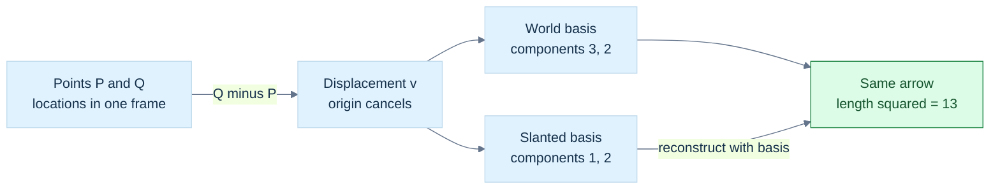
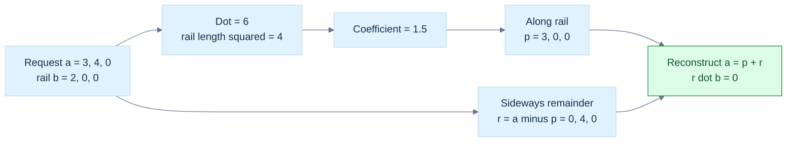

# 17 — Python and Numerical Tools for Graphics Systems

[[Chapter Edition/01 - Computing Foundations/00 - Reading Map|Reading map]] · [[Chapter Edition/01 - Computing Foundations/16 - Profile GPUs and Respect Apple Ownership Boundaries|Previous chapter]] · [[Chapter Edition/01 - Computing Foundations/18 - Vectors for Light and Frames|Next chapter]]

Python can coordinate experiments and asset workflows, but its abstractions still have memory and execution costs. The chapter moves from zero-copy interfaces and vectorization through scientific computation to geometric frames used in reconstruction.

**By the end:** Choose where Python is an effective control plane and how to keep data movement, profiling, and numerical assumptions visible.

**Recall question:** When does passing a buffer between Python and native code remain zero-copy, and what evidence would verify that claim?

<!-- Derived from Continuous Notes/Computing Foundations - From Bits to C++ and Systems APIs.md; source lines 40137–41803; source-span SHA256 77139658a2f6c7221ff754731baf7d941689b3669560bacd75a26afa609c5ccd. -->

<!-- CHAPTER-SOURCE-BEGIN -->
# Python, scientific computing and data analysis as graphics-systems infrastructure

Python is a high-productivity control plane around performance-critical systems: experiments, asset tooling, numerical prototypes, dataset analysis, neural training, validation and publication.

## Python abstractions still have machine cost

Fluent Python's data-model perspective matters because sequences, mappings, iterators, generators, protocols and async objects have precise behavior.

A Python list stores references to Python objects. A NumPy array is a dense typed memory view described by data, shape, strides and dtype. For graphics-style numeric work that distinction dominates locality and bandwidth.

For a C-contiguous array of shape \((H,W,C)\) and element size \(s\),

\[
offset=s(iWC+jC+k).
\]

A slice may share storage with different strides. A downstream API that requires contiguous storage can silently introduce a copy. Log shape, dtype and strides when debugging data movement.

## Buffer interfaces help only when the entire path stays zero-copy

memoryview and the buffer protocol can expose raw array storage without per-element Python conversion. But zero-copy is end-to-end. If the next library changes dtype/layout or stages through another buffer, the whole path is not zero-copy.

Always ask who owns the bytes, whether they are writable, their dtype/stride, validity lifetime and which thread/process may access them.

## Profile before optimizing

High Performance Python's durable workflow is measure total time, locate hot functions, measure hot lines/kernels, inspect memory, change one hypothesis, rerun correctness tests and compare distributions.

Amdahl's law gives the upper bound when only fraction \(p\) is accelerated by factor \(s\):

\[
S=\frac{1}{(1-p)+p/s}.
\]

Speeding up a tiny fraction cannot transform the whole application.

## Vectorization moves loops out of the interpreter

NumPy executes regular typed loops in compiled code. This reduces interpreter overhead, but temporary arrays still cost bandwidth and memory.

For

\[
C=A+B\cdot D,
\]

an implementation may allocate an intermediate product. In-place or fused operations can reduce traffic when aliasing allows it. Image buffers, dense grids and point clouds are often bandwidth-limited.

## Broadcasting is shape algebra

For point cloud \(P\in\mathbb R^{N\times3}\) and translation \(t\in\mathbb R^3\),

\[
P'=P+t.
\]

The translation is logically expanded across rows. Broadcasting avoids storing repeated \(t\), but later operations can still create large temporaries. Treat ndim, shape, dtype and finite-value checks as runtime contracts.

## The GIL separates concurrency from CPU parallelism

Threads overlap I/O and can benefit when native extensions release the GIL, but ordinary Python bytecode does not become CPU-parallel merely by spawning threads.

Use asyncio for structured I/O, threads for I/O/native libraries that release the GIL, processes for independent CPU-bound Python work, and native/Numba/Cython/GPU kernels for tight numerics.

Process parallelism has serialization and memory cost. Copying a multi-gigabyte point cloud to every worker can erase the benefit.

## Native acceleration is a boundary-design problem

Numba JIT-compiles supported numeric code. Cython adds static/native compilation. CFFI, pybind11, PyO3 and extension APIs connect Python to compiled libraries.

The total cost is

\[
T_{total}=T_{marshal}+T_{copy}+T_{kernel}+T_{sync}.
\]

A fast kernel called once on a large array is often better than millions of tiny cross-language calls.

## Scientific computing begins with conditioning and stability

Michael Heath's framework is essential for graphics. Error can come from uncertain input data, an ill-conditioned problem, an unstable algorithm, discretization/truncation, floating-point rounding or a poor stopping rule.

Forward error measures error in the answer. Backward error asks what nearby input would make the computed answer exact. Stable algorithms often solve a nearby problem accurately.

For scalar \(y=f(x)\), a local relative condition number is approximately

\[
\kappa_f(x)=\left|\frac{x f'(x)}{f(x)}\right|.
\]

Large \(\kappa\) means small relative input errors can become large output errors even with a stable implementation.

## Floating point changes algebra

Floating-point addition is not associative:

\[
(a+b)+c\neq a+(b+c)
\]

in general.

This affects parallel reductions, path-tracing accumulation, covariance estimates and large point-cloud sums. Reproducibility must state whether bitwise identity or tolerance-based agreement is required.

Prefer stable formulations: avoid catastrophic subtraction, scale problems, use structured solvers rather than explicit inverses, and inspect conditioning.

## Linear algebra has structure-specific algorithms

Do not compute \(A^{-1}\) merely to solve \(Ax=b\).

LU is general; Cholesky exploits SPD structure; QR is robust for least squares; SVD exposes rank and singular directions; iterative methods matter for sparse systems.

Graphics uses these in calibration, fitting, PCA, bundle adjustment, FEM and inverse rendering.

## Optimization needs a model, derivatives and a stopping rule

For

\[
\min_\theta L(\theta),
\]

gradient descent is

\[
\theta_{k+1}=\theta_k-\eta_k\nabla L(\theta_k).
\]

The hard questions are parameterization, scale, local minima, derivative quality and identifiability. Automatic differentiation differentiates the implementation; it does not prove the implementation is the intended physical model.

Neural rendering is especially vulnerable because camera pose, geometry, appearance and exposure can compensate for one another.

## ODE/PDE numerics connect to simulation and reconstruction

For

\[
\dot y=f(t,y),\qquad y(t_0)=y_0,
\]

explicit Euler gives

\[
y_{n+1}=y_n+h f(t_n,y_n).
\]

It is simple but can be unstable for stiff systems. Higher-order explicit methods improve local accuracy; implicit methods can improve stability at solve cost.

PDE discretization turns continuous models into algebraic systems. Grid spacing and time step control truncation error and stability. A smooth-looking result is not evidence of convergence.

## FFT is an algorithmic change

A direct DFT costs \(O(N^2)\); FFT algorithms reduce common cases to \(O(N\log N)\). This matters in convolution, spectral simulation, filtering and signal analysis. FFT convolution still needs explicit padding and boundary semantics because circular and linear convolution differ.

## pandas is a relational layer for experiments

Python for Data Analysis contributes disciplined loading, cleaning, joining, grouping, reshaping and time-series analysis.

A graphics result table might use keys such as run, scene, device, method, seed and frame. Every join should have an intended cardinality. Duplicate keys can multiply rows and silently bias averages.

For latency, retain raw samples and report distributions, P95/P99 and deadline misses rather than only means.

## Jupyter is exploratory; the repository is authoritative

A notebook is useful for inspecting a cloud or testing an equation, but hidden cell execution state is weak provenance. Move stable logic into modules/CLIs. Record environment versions, random seeds, dataset hashes, config files and output manifests.

## SICP contributes architecture beneath syntax

Structure and Interpretation of Computer Programs is not a Python book, but its durable ideas apply directly: procedural abstraction, data abstraction, higher-order operations, state and identity, streams, metalinguistic abstraction, register-machine models and compilation.

In a graphics engine these ideas become render graphs, ECS queries, shader/material languages, asset pipelines and command buffers. Choose abstractions whose semantics match the domain, then understand their machine cost.

## A reproducible graphics-research stack

A strong project has:

1. immutable/raw input manifests with hashes;
2. configuration containing every experimental parameter;
3. explicit seed policy;
4. locked environment or container description;
5. preprocessing that writes versioned intermediates;
6. native/GPU executables behind stable CLI or FFI;
7. result tables with run IDs and timestamps;
8. validation scripts that check invariants before plotting;
9. report generation that consumes result artifacts;
10. provenance linking commit, hardware, driver/runtime and dataset version.

Python then becomes a trustworthy scientific control plane rather than disposable glue.


## The deterministic system capstone and its evidence boundary

The conceptual capstone is a single pipeline: a validated cartridge file enters a deterministic CPU interpreter; a complete versioned state snapshot is constructed; a temporary filesystem object is atomically published with an explicitly chosen crash-durability contract; the state is length-framed for transport; received bytes are authenticated and authorized; a trusted snapshot is restored; and time-stamped input is replayed to reproduce the same program behavior. Any stage can fail, and the complete application must preserve the previous valid state or report a safe, diagnosable error.

The evidence layer is now broader than the original CPU/iNES witness. `tools/labs/posix_vm_file_lab.cpp` executes real POSIX descriptor sharing, unlink lifetime and file-backed `MAP_SHARED` behavior; `tools/labs/network_loopback_lab.cpp` executes real loopback TCP framing across arbitrary write/read splits and contrasts it with UDP datagram boundaries; and `tools/labs/crypto_primitives_lab.cpp` checks SHA-256, HMAC-SHA256 and HKDF-SHA256 against known-answer vectors while separately exercising a domain-separated Merkle tree and finite-field Shamir reconstruction. Those programs raise the evidence level without pretending to prove crash durability, Internet loss/reordering, side-channel resistance, secure key storage, nonce persistence, Windows parity, or a complete secure protocol. Real NESEmulator, ReliQuary and Memory Retrieval Cue production code still require separate current-revision inspection.

The relevant primary-source routes are the platform's POSIX/Windows syscall specifications for file durability, TCP/UDP and IP RFCs for transport semantics, RFC 5869 for HKDF, and NIST SP 800-38D for authenticated GCM. This narrative is original teaching informed by those standards; no claim is made to have implemented a secure network/cryptographic stack. The source/coverage ledger explicitly separates these narrative entries from the running emulator oracle.

---

## From model bytes to a validated compressed-inference runtime

The same representation discipline used for cartridges, assets and GPU records applies to machine-learning runtimes. A tensor is not “an array of numbers” until shape, element type, strides, storage ownership and view rules agree on which byte each logical index means. A model container is not “loaded” until its header, metadata, tensor descriptors, alignment, ranges and architecture contract have been validated. An imported graph is not executable merely because it parsed: value names, SSA ownership, topological order, shapes, operator semantics and backend capabilities still have to be lowered into one internal contract.

The reconstruction path is deliberately continuous:

$
\text{GGUF / ONNX bytes}
\rightarrow
\text{validated metadata and graph}
\rightarrow
\text{tensor shape + stride map}
\rightarrow
\text{quantized or floating kernel}
\rightarrow
\text{stable softmax / attention}
\rightarrow
\text{KV-cache state}
\rightarrow
\text{measured backend execution}.
$

The new reference witness at `tools/labs/phase29_ml_runtime_lab.cpp` owns the first executable slice of that path. It checks contiguous row-major strides, multi-index addressing and trailing-axis broadcasting; compares a simple symmetric Q8 dot product with its floating-point reference under an explicit error budget; evaluates max-subtracted stable softmax; executes incremental causal attention over a KV cache; validates the fixed GGUF prefix boundary; and validates a backend-neutral post-decode graph for use-before-definition and SSA output collisions.

This is **not** labeled “full GGUF” or “ONNX support.” The GGUF witness stops before the complete metadata and block-quantization catalog. The ONNX witness starts *after* protobuf decoding and therefore does not claim opset/operator coverage or shape-inference parity. The attention witness is one-head instructional execution, not rotary embeddings, grouped-query attention, paged KV caches or a production transformer. Those boundaries are part of the lesson: parsing, semantic lowering, numerical kernels, scheduling and native backend parity are distinct proof obligations.

Use the connected derivations when reconstructing this runtime: [[Tensor runtime layout and views]], [[GGUF binary model loading]], [[ONNX graph import and lowering]], [[Quantized matvec and dequantization]], and [[Transformer attention and KV cache runtime]]. The next evidence level is an independent full-format loader plus SIMD/Metal kernels compared against the scalar reference and then against an external trusted model runtime.

---

## Mathematical Foundations for Visual Computing — From Vectors to Images

The mathematics note is now part of the same foundations volume because the systems and graphics material repeatedly depends on vectors, transforms, calculus, probability, numerical methods, geometry, optimization, and signal reasoning. The former standalone mathematical narrative is preserved below as a full integrated foundation rather than reduced to a summary.

This is the new integrated teaching edition of continuous volumes 06–11. Every source section, equation, code/trace block, figure and evidence record is retained. The six source books are preserved in the verified archive; this is the active continuous mathematics volume. The order follows what a concept needs: geometry and maps, constraints and solvers, change and probability, singular directions, numerical computation, sampling, and cameras. Original numbered-source coverage and reconstructed/source-reported distinctions remain visible in the retained records.

New worked bridges and first-use explanations give the meaning of a term before it is needed. Internal lesson links jump directly within this book. Concept graph links and original-volume provenance are collected at the end. A repeated explanation is retained deliberately when it carries a different example, derivation, condition or failure case; no deduplication deletes source content.

**Convention passport.** Each example declares its coordinate system, units and domain. A graphics camera looking along −Z and a computer-vision camera with positive optical Z are different local conventions; do not copy a sign or projection matrix between them without the stated conversion. Matrix row/column indexing, storage order, and vector convention are separate choices. Complete C++ programs with separate main functions are independent laboratories.

## Reading route

- [[Chapter Edition/01 - Computing Foundations/17 - Python and Numerical Tools for Graphics Systems#Movement becomes geometry|Movement becomes geometry]]
- [[Chapter Edition/01 - Computing Foundations/18 - Vectors for Light and Frames#A matrix is a rule acting on geometry|A matrix is a rule acting on geometry]]
- [[Chapter Edition/01 - Computing Foundations/19 - Coordinate Frames and Linear Systems#Measurements become constraints and computable answers|Measurements become constraints and computable answers]]
- [[Chapter Edition/01 - Computing Foundations/20 - Choose Matrix Factorizations from Structure#Change and uncertainty acquire a mathematical language|Change and uncertainty acquire a mathematical language]]
- [[Chapter Edition/01 - Computing Foundations/24 - Waiting Times, Covariance, and Matrix Decomposition#Singular directions explain reconstruction and variation|Singular directions explain reconstruction and variation]]
- [[Chapter Edition/01 - Computing Foundations/25 - Continuous Models and Numerical Error#Continuous models meet numerical computation|Continuous models meet numerical computation]]
- [[Chapter Edition/01 - Computing Foundations/29 - Discretization, Convergence, and Experimental Design#Samples become estimates with defensible uncertainty|Samples become estimates with defensible uncertainty]]
- [[Chapter Edition/01 - Computing Foundations/32 - Geometry Becomes an Image and an Inverse Problem#Geometry becomes an image and an inverse problem|Geometry becomes an image and an inverse problem]]
- [[Chapter Edition/01 - Computing Foundations/37 - Camera Contracts and Transform-Chain Debugging#The mathematics becomes a reliable implementation|The mathematics becomes a reliable implementation]]
- [[Chapter Edition/01 - Computing Foundations/39 - Research Navigation and Source Boundaries#Teaching reconstruction, source records, and research navigation|Teaching reconstruction, source records, and research navigation]]


# Movement becomes geometry

Start with what a number measures, how a displacement differs from a point, and how dot products, projections and orientation answer geometric questions. The initial Euclidean projection formulas assume an orthonormal coordinate basis; the later Gram-matrix section makes the metric explicit for a slanted basis.

## From Movement to Meaning: Vectors, Geometry, and Reliable Code

Phase 6 asks one large question: **how do we turn a physical relationship into a calculation whose meaning survives a change of coordinates, a floating-point computation, and an engine API?**

We will answer it by building a small robot workcell. A robot must inspect a triangular metal panel, move a sensor over it, illuminate it, and avoid nearby obstacles. The same panel gives us a reason to learn numbers, vectors, lengths, projections, orientations, surface frames, interpolation, collision geometry, and reliable C++.

The robot's inspection task is the organizing principle of this chapter. Rather than meeting the definitions of fields, matrices, determinants, inner products, covectors and adjoints as an entrance examination, we will derive each of them when a concrete calculation first demands it. The original compact definitions have been preserved as an optional [[Chapter Edition/01 - Computing Foundations/18 - Vectors for Light and Frames#Reference recap — definitions after the workcell|reference recap]] after this physical investigation; they are not prerequisites to memorize before starting.

## The panel gives us a reason to learn

### Figure G0 - The robot and its inspection panel

![[Visual Recall/geometry_robot_panel.png]]

**Figure G0.** This original AI-generated scene gives the robot, triangular panel and sensor task a physical setting. It is a qualitative illustration, not calibrated geometry: use the coordinates and equations below for measurements, axes, corner identities and numerical work. The cyan cone schematically indicates the camera's field of view; it does not represent a measured beam or active emitted light. The following figures turn this scene into explicit mathematical relationships.

Place the panel's corners at

$$
A=(0,0,0),\qquad B=(4,0,0),\qquad C=(0,3,0).
$$

Coordinates are in metres in the workcell frame. A sensor touches the panel at

$$
P=(1,1,0).
$$

We deliberately choose simple numbers first. They make intermediate steps visible. Later we will tilt the panel, change its coordinate frame, stretch it, and move the workcell far from the origin. Those changes reveal assumptions that a tidy first example can hide.

At the beginning, the robot knows only three coordinate tuples. That is not enough. Which tuple is a location? Which is a movement? Which direction is the front face? Do the coordinates refer to the robot, panel, or camera? Is a number a metre, a second, or a dimensionless ratio?

Our central habit is to ask four questions before using a formula:

1. What does each input mean?
2. Which coordinates and units describe it?
3. What must be true for the operation to exist?
4. What can the machine lose while computing it?

You do not need a matrix course before reading this chapter. When matrices appear, read a matrix as a compact arrangement of coefficients that reconstructs or measures vectors. We explain the necessary rows, columns, transpose, determinant, and inverse at their first use.

## Numbers become a system of permitted operations

The robot moves a distance, waits a time, and adjusts a speed. Each quantity has a numeric amount. In vector algebra, a number used to scale a vector is called a [[Chapter Edition/01 - Computing Foundations/17 - Python and Numerical Tools for Graphics Systems#Numbers become a system of permitted operations|scalar]]. Scalar describes a role. It does not mean “a `float`,” “dimensionless,” or “exactly one machine word.” A complex number can be a scalar in a complex vector space.

### Why ordinary algebra needs a field

A **set** is a collection of elements. The integers form $\mathbb Z$, rational numbers form $\mathbb Q$, real numbers form $\mathbb R$, and complex numbers form $\mathbb C$. Rational means a ratio of integers with a nonzero denominator.

A **field** is a set with addition and multiplication that support consistent ordinary algebra. The rules are worth understanding, not merely reciting:

| Rule | What it allows us to do |
|---|---|
| Closure | Adding or multiplying two allowed scalars produces another allowed scalar. |
| Associativity | Parentheses may move in a sum or product without changing the exact mathematical result. |
| Commutativity | The order of two scalar addends or factors may be exchanged. |
| Identities | Adding $0$ and multiplying by $1$ preserve the value. |
| Inverses | Every value has an additive opposite; every nonzero value has a multiplicative reciprocal. |
| Distributivity | Multiplication can expand across addition. |

For scalars $a,b,c$ these last relationships include

$$
a+(-a)=0,\qquad aa^{-1}=1\quad(a\ne0),\qquad a(b+c)=ab+ac.
$$

The reciprocal rule explains the familiar solution of $ax=b$: multiply by $a^{-1}$ to obtain $x=b/a$, provided $a\ne0$.

Why exclude zero? Distributivity implies

$$
0a=(0+0)a=0a+0a.
$$

Subtract $0a$ from both sides to obtain $0a=0$. No number can therefore multiply zero into $1$.

The integers are not a field: $2$ has no integer reciprocal. Integer-coordinate objects still have useful addition and scaling, but they are not vector spaces over the integers in the field-based sense used here. The corresponding algebraic structure is called a **module**; we do not need its further theory yet.

### Why graphics uses real-number models

The reals form an **ordered field**. The order agrees with arithmetic: adding the same value preserves an inequality, and multiplying by a positive number preserves its direction. Multiplication by a negative number reverses it. This supports interval checks, positive distances, and bounds.

The reals also have **completeness**: every nonempty set of real numbers that has an upper bound has a least upper bound. An upper bound lies at or above every member; the least upper bound is the smallest such bound. It need not be a member of the set.

For example, positive rational numbers whose squares are below $2$ have no rational least upper bound, but have the real least upper bound $\sqrt2$. To see why $\sqrt2$ is not rational, suppose it equals $p/q$ in lowest terms. Then $p^2=2q^2$, so $p$ is even. Write $p=2r$; then $q^2=2r^2$, so $q$ is even too. This contradicts lowest terms.

This is not a demand to construct real numbers inside an engine. It explains why our ideal geometry can describe roots, continuous movement, and limiting processes without holes in its number line.

For a real scalar $x$, **absolute value** $|x|$ is its nonnegative distance from zero. An **interval** selects values between endpoints: $[a,b]$ includes both endpoints, while $(a,b)$ excludes them. A function assigns an output to each allowed input; its **domain** is the set of allowed inputs. A square-root function on the reals needs a nonnegative input. A reciprocal needs a nonzero input. These domain restrictions will reappear as API contracts.

Complex numbers cannot be ordered like an ordered field. In any ordered field a nonzero square is positive. But $i^2=-1$ for the imaginary unit $i$, which would force a negative number to be positive.

### The machine is a model of the field, not the field

Finite floating-point values do not obey all field laws. Their range is bounded, division can produce non-finite results, and addition is not associative. An illustrative binary32 calculation is

$$
\operatorname{fl}\!\left(\operatorname{fl}(10^8+(-10^8))+1\right)=1,
$$

while the other grouping can produce

$$
\operatorname{fl}\!\left(10^8+\operatorname{fl}(-10^8+1)\right)=0.
$$

$\operatorname{fl}$ means rounding an operation to the chosen floating-point format. The small $1$ disappears in the second grouping before the final addition. The ideal law is useful for derivation; it does not authorize arbitrary compiler reassociation when result reproducibility matters. See [[Floating-point reassociation]] and [[Dot and cross-product rounding]].

A scalar may carry units. Multiplying velocity in metres per second by time in seconds gives a displacement in metres:

$$
\left(\frac{\mathrm m}{\mathrm s}\right)\mathrm s=\mathrm m.
$$

Type, units, finite-state policy, and mathematical role are four different pieces of information. A `double` alone tells us only one of them.

## An arrow is not the address written beside it

The robot moves from $A$ to $B$. The location $A$ is a **point**. The movement is a [[Chapter Edition/01 - Computing Foundations/17 - Python and Numerical Tools for Graphics Systems#An arrow is not the address written beside it|displacement vector]]:

$$
\mathbf e_1=B-A=(4,0,0).
$$

Similarly $\mathbf e_2=C-A=(0,3,0)$. Bold letters denote vectors; ordinary uppercase letters denote points when the context is geometric. This notation helps, but meaning still comes from the declared role.

A **free vector** represents magnitude and direction without a fixed starting point. Move its drawing elsewhere without rotating or stretching it and it still represents the same vector. A displacement therefore survives a translation of the coordinate origin. A point does not.

### First movement, then coordinate arithmetic

Walk along $\mathbf a$, then along $\mathbf b$. The complete movement is $\mathbf a+\mathbf b$. Drawing both from the same starting point makes a parallelogram; its diagonal is the same result. Scaling $\mathbf a$ by a positive scalar stretches or shrinks it; a negative scalar also reverses its direction. Scaling by zero produces the zero movement.

Once a common basis has been chosen, these operations become componentwise:

$$
(a_x,a_y,a_z)+(b_x,b_y,b_z)
=(a_x+b_x,a_y+b_y,a_z+b_z),
$$

$$
s(a_x,a_y,a_z)=(sa_x,sa_y,sa_z).
$$

A **tuple** is an ordered list. A **component** is one entry of that list. Order matters: $(4,3)$ and $(3,4)$ are generally different coordinate descriptions. A tuple may describe a displacement, color, texture coordinate, or arbitrary measurements. Its storage shape does not choose its meaning.

Subtraction means adding the opposite movement. For two points, $Q-P$ is the displacement from $P$ to $Q$. Swapping them reverses the direction:

$$
P-Q=-(Q-P).
$$

The robot's velocity is $\mathbf v=(2,0,0)\,\mathrm{m/s}$. After $\Delta t=0.5\,\mathrm s$, its displacement is $(1,0,0)\,\mathrm m$. Its new location is old point plus displacement. We do not add a velocity directly to a position; the units would not match.

### Affine points do not have an intrinsic zero

An **affine space** has points and displacement vectors but no preferred origin. We may subtract two points, or translate a point by a vector. The natural operations are

$$
Q-P=\mathbf d,\qquad P+\mathbf d=Q,\qquad P-\mathbf d=\text{another point}.
$$

Point plus point is not an intrinsic affine operation. If we choose an origin $O$, the **position vector** of $P$ is $P-O$. Changing the origin changes this vector's coordinates. But a difference cancels the origin:

$$
(Q-O)-(P-O)=Q-P.
$$

This is the first safety lesson for C++: `Point3` and `Vec3` may both contain three floating-point values, yet deserve different operations. Do not turn a storage coincidence into a semantic promise.

A **direction** answers “which way?” A nonzero displacement also contains “how far?” A zero displacement is valid; a zero direction cannot specify a way to travel. A **unit vector** has length one, so it keeps direction while removing the original length. We will earn normalization rather than assume it is always possible.

## A basis is a measuring arrangement, not the vector itself

The panel has its own coordinate frame. The workcell has another. A vector does not change merely because we describe it in a different frame.

An ordered **basis** is a set of independent vectors that can reconstruct every vector in the space. **Ordered** matters: the first coordinate multiplies the first basis vector. In the familiar standard basis,

$$
\mathbf e_x=(1,0,0),\quad
\mathbf e_y=(0,1,0),\quad
\mathbf e_z=(0,0,1),
$$

we reconstruct $\mathbf v=(x,y,z)$ as $x\mathbf e_x+y\mathbf e_y+z\mathbf e_z$.

These symbols mean coordinate axes, not universal physical directions. A screen may use increasing vertical coordinates downward. A camera may look along either sign of its depth axis. “Standard basis” alone does not mean “up,” “forward,” or a particular API convention.

### The same arrow can have different coordinates

Use a two-dimensional slanted basis

$$
\mathbf b_1=(1,0),\qquad \mathbf b_2=(1,1).
$$

The world-coordinate vector $\mathbf v=(3,2)$ has coordinates $(1,2)$ in this basis, because

$$
1\mathbf b_1+2\mathbf b_2=(1,0)+(2,2)=(3,2).
$$

The vector is the same arrow. $(3,2)$ and $(1,2)$ are two descriptions. Conversely, the tuple $(1,2)$ in the world basis describes a different arrow from $(1,2)$ in the slanted basis.

We write $[\mathbf v]_B$ for the coordinate column in basis $B$. Place basis vectors into the columns of a matrix $B$:

$$
B=\begin{pmatrix}1&1\\0&1\end{pmatrix},\qquad
\mathbf v=B[\mathbf v]_B.
$$

Here matrix multiplication is simply weighted column addition. To change to another basis $C$, solve

$$
C[\mathbf v]_C=B[\mathbf v]_B.
$$

If $C$ is an invertible square basis matrix, this becomes

$$
[\mathbf v]_C=C^{-1}B[\mathbf v]_B.
$$

An **inverse** undoes a mapping. We display it to explain the relationship, not to recommend explicitly forming inverses for every numerical solve.

A **passive change** changes the description while preserving the physical vector. An **active transform** moves or changes the physical object while keeping the describing frame fixed. They may use related matrices but answer different questions.

### Recover a component with the right measuring rule

Our slanted basis reconstructs the panel movement correctly, but it leaves a practical question: how do we recover its coordinates from an arrow measured in world space? Dotting with each basis vector works only for an orthonormal basis. In the example $b_1=(1,0)$, $b_2=(1,1)$ and $v=(3,2)$, those two dot products are $(3,5)$, whereas the actual coefficients are $(1,2)$.

The solution is a [[Concepts/Reciprocal bases and coordinate measurements|reciprocal basis]]: measuring vectors $b^1,b^2$ satisfying $b^i\cdot b_j=\delta^i_j$. The symbol $\delta^i_j$ is one when the indices match and zero otherwise. Each reciprocal vector accepts its own basis direction and rejects the other. Here choose

$$
b^1=(1,-1),\qquad b^2=(0,1).
$$

Now $b^1\cdot v=1$ and $b^2\cdot v=2$. Reconstruction and measurement are different jobs, performed by two related bases. In matrix form, with basis directions as columns of $B$, the rows of $B^{-1}$ recover coordinates. In Euclidean world coordinates the reciprocal vectors are the columns of $B^{-\mathsf T}$. The superscript $\mathsf T$ means transpose; the inverse transpose means invert and then transpose. In code, solve a system rather than repeatedly constructing an inverse.

A **covector** is a linear scalar measurement: a rule $\ell$ satisfying $\ell(au+bv)=a\ell(u)+b\ell(v)$. A reciprocal coordinate measurement is one example. The rule is the primary object. Drawing a reciprocal vector is possible because our Euclidean inner product identifies a covector with an arrow. A different inner product gives a different representing arrow for the same measurement rule. This distinction will explain normal transformation and gradients without memorizing unrelated exceptions.

**Teaching trace.** Ask what $(3,5)$ means before calling it wrong: it is the list of dot measurements against the original basis, not the coefficient list. The Gram matrix $G=B^{\mathsf T}B$ relates the two by $Gc=B^{\mathsf T}v$. It stores the geometry needed to convert measurements into coefficients. For our movement, $c=(1,2)$, $Gc=(3,5)$ and $c^{\mathsf T}Gc=13$. Thus the same numbers have different meanings depending on the operation that produced them.

#### First-use completion — how coordinate measurements become normals, gradients, and reliable code

We can now derive rather than memorize the inverse-transpose rule. Write the physical displacement as $v=Bc$, with the two columns of $B$ holding the basis directions and $c$ holding their coefficients. A coordinate measurement is a *row* $\ell$ acting on $v$. If we want the number it reports to remain unchanged, then
$$
\ell(v)=\ell(Bc)=(\ell B)c.
$$
Thus the same measurement is represented by the row $\ell B$ in the new coordinate system; conversely, a row specified on $c$ becomes $\ell_c B^{-1}$ when we express it in the world coordinates $v$. This is not a special normal-vector trick: it follows from demanding that measuring the same displacement gives the same scalar. A vector's coordinates and the coordinates of a linear measurement cannot generally obey the same conversion rule.

In the slanted example, the world-to-rail matrix is
$$
B^{-1}=\begin{bmatrix}1&-1\\0&1\end{bmatrix}.
$$
Its rows are exactly the coordinate measurements $b^1=(1,-1)$ and $b^2=(0,1)$ introduced above. Their dot products with $v=(3,2)$ are $1$ and $2$. Equivalently the **reciprocal vectors**, written as *columns*, form $B^{-T}$. They are dual to the original basis, not new directions of robot motion. A different Gram matrix would change which arrows represent these measurements, but not what the measurements mean.

A normal makes the distinction unavoidable. Consider the line $x+y=1$ in a world plane; a tangent displacement is $t=(1,-1)$ and the normal covector is $n^T=(1,1)$, so $n^Tt=0$. Apply the nonuniform geometric transformation $x'=2x,\ y'=y$, whose matrix is $A=\operatorname{diag}(2,1)$. The transformed tangent is $At=(2,-1)$. The transformed line is $x'/2+y'=1$, so its measuring row is $n'^T=(1/2,1)=n^TA^{-1}$. Verify the required invariant:
$$
n'^T(At)=\tfrac12(2)+1(-1)=0.
$$
If we incorrectly transform the normal as an ordinary direction $An=(2,1)$, its dot product with $At$ becomes $3$, so it no longer annihilates the surface tangent. In Euclidean column-vector notation the correct normal transform is therefore $n'=A^{-T}n$; normalize its *direction* after transformation if the consumer needs a unit normal. The inverse transpose requires an invertible linear part. When the surface is collapsed by a singular map, the original normal cannot generally be transported this way; reconstruct the normal from the surviving geometry or define a different policy.

The same calculation explains **gradients** at the moment they become necessary. For a scalar field $f(x)$, its differential $df$ is the covector that converts a small displacement $dx$ into a first-order value change $df(dx)$. If $x'=Ax$, then $f'(x')=f(A^{-1}x')$ and the chain rule gives $df'=df\,A^{-1}$. With the standard Euclidean metric, writing that covector as a gradient *arrow* yields $\nabla_{x'}f'=A^{-T}\nabla_x f$. With a general metric matrix $G$, the gradient arrow satisfies $G\,\operatorname{grad}f=(df)^T$, so its coordinates are $G^{-1}(df)^T$. Calling every derivative row a gradient vector would hide this metric choice.

There is also an implementation obligation. If a sensor reports a world displacement and our controller needs rail coefficients, solve $Bc=v$, and verify the *reconstructed world displacement* rather than checking only the returned coefficients. For the two-dimensional case, partial-pivot Gaussian elimination stores an augmented $2\times3$ table: two coefficient columns plus the measured displacement. At each column it chooses a larger remaining pivot, eliminates the lower coefficient, and then back-substitutes. A nearly dependent basis makes those steps sensitive to small errors; rejecting a tiny pivot relative to the input matrix scale is a policy for this teaching laboratory, not a universal proof that a physical basis is unusable.

```cpp
#include <algorithm>
#include <array>
#include <cmath>
#include <limits>
#include <optional>

struct Point2 { double x, y; };

std::optional<std::array<double, 2>> rail_coordinates(
    Point2 first_axis, Point2 second_axis, Point2 displacement)
{
    // Rows are the world X and Y equations; the third column is their RHS.
    double a[2][3] = {{first_axis.x, second_axis.x, displacement.x},
                      {first_axis.y, second_axis.y, displacement.y}};

    const double scale = std::max({std::abs(first_axis.x),
                                   std::abs(first_axis.y),
                                   std::abs(second_axis.x),
                                   std::abs(second_axis.y)});
    if (!(scale > 0) || !std::isfinite(scale) ||
        !std::isfinite(displacement.x) || !std::isfinite(displacement.y))
        return std::nullopt;

    // Choose the strongest X-equation pivot rather than assuming row 0 is safe.
    if (std::abs(a[1][0]) > std::abs(a[0][0]))
        for (int j = 0; j != 3; ++j) std::swap(a[0][j], a[1][j]);

    const double tolerance = 32 * std::numeric_limits<double>::epsilon() * scale;
    if (!(std::abs(a[0][0]) > tolerance)) return std::nullopt;

    const double factor = a[1][0] / a[0][0];
    a[1][1] -= factor * a[0][1];
    a[1][2] -= factor * a[0][2];
    if (!(std::abs(a[1][1]) > tolerance)) return std::nullopt;

    const double c2 = a[1][2] / a[1][1]; // Last equation contains only c2.
    const double c1 = (a[0][2] - a[0][1] * c2) / a[0][0];
    if (!std::isfinite(c1) || !std::isfinite(c2)) return std::nullopt;

    // A production caller should also evaluate a scaled residual and condition.
    return std::array<double, 2>{c1, c2};
}
```

For axes $(1,0)$, $(1,1)$ and world displacement $(3,2)$, this returns $(1,2)$. Feeding identical axes rejects the second zero pivot instead of dividing by zero. The accompanying executable [[Chapter Edition/01 - Computing Foundations/37 - Camera Contracts and Transform-Chain Debugging#A complete scalar laboratory makes the story executable|laboratory]] and the additional [first-use C++ witness](../../tools/labs/first_use_contract_lab.cpp) test coordinate reconstruction and a singular basis. The function above is a deliberately compact double-precision reference, not a replacement for a scale-aware QR or SVD solver when solving noisy or high-dimensional calibration problems. Test residuals, coordinate scaling and conditioning before treating success as a reliable physical measurement.

The important conceptual consequence is immediate: **vectors answer what motion is being described; covectors answer what a measurement reports about that motion**. The requirement that those answers remain compatible under a changed coordinate system has already given us reciprocal coordinates, normal transformation and the gradient's transformation rule.


This development uses the reciprocal-vector treatment in *Mathematical Methods for Physics and Engineering*, physical PDF page 264, together with the inner-product discussion on pages 250–251. The numerical example and teaching sequence above are original reconstructions.

### A coordinate frame becomes an implementable service: reconstruct, invert, reject, and measure

Our sheared panel has already shown that a vector is not its coordinate list. To implement that statement in an engine, we need two distinct operations. **Construction** takes local coordinates and produces a world-space position. **Recovery** starts with a measured world point and determines its local coordinates. If these are confused, imported mesh vertices, UV frames, hit locations and moving-object attachments drift or point to the wrong feature even when every multiplication has the right dimensions.

Fix a two-dimensional affine frame consisting of an origin \(o\) and two ordered world-space displacement axes \(a,b\), each measured in metres. Local coefficients \(u,v\) count how many steps to take along each axis; they are dimensionless if each axis represents a world displacement per unit local coordinate. The geometric definition is

\[
p=o+ua+vb,\qquad d=p-o,\qquad
B=\begin{bmatrix}a_x&b_x\\a_y&b_y\end{bmatrix},\qquad
B\begin{bmatrix}u\\v\end{bmatrix}=d.
\]

The expression \(p-o\) is legitimate point subtraction and produces a displacement. Adding \(a\) and \(b\) to the origin produces another point. Changing the origin alone is translation; changing the axes changes both the basis and the metric seen by coordinate lists. This distinction is why transforming a *direction* must not add translation, while transforming a *point* does.

Recovery is a linear solve. Cross the equation \(d=ua+vb\) with \(b\): because \(b\times b=0\), we obtain \(d\times b=u(a\times b)\). Similarly \(a\times d=v(a\times b)\). Thus

\[
u=\frac{d_xb_y-d_yb_x}{a_xb_y-a_yb_x},
\qquad
v=\frac{a_xd_y-a_yd_x}{a_xb_y-a_yb_x}.
\]

Here the 2D cross product returns a signed **area**, not a 3D direction. The common denominator is \(\det B\). If it vanishes, the axes are linearly dependent and infinitely many or no coordinate pairs may explain the observation. A small *relative* determinant is more subtle: the frame is technically invertible but tiny measurement errors can cause large coefficient errors. The signed quantity \(\det B/(\|a\|\|b\|)=\sin\theta\) measures the angle between the axes independently of their lengths. A numerical implementation should reject an axis of zero length, reject nonfinite data, and define a documented conditioning policy. The threshold below is **an application policy**, not the mathematical definition of singularity.

Our panel frame uses \(o=(5,-1)\,\mathrm m\), \(a=(2,0)\,\mathrm m\), and \(b=(1,3)\,\mathrm m\). A local point \(q=(2,-1)\) becomes \(p=(5,-1)+2(2,0)-(1,3)=(8,-4)\,\mathrm m\). Starting instead with \(p\), the displacement \(d=(3,-3)\) gives \(\det B=6\), \(u=12/6=2\), and \(v=-6/6=-1\). Both directions agree, and the intermediate values let us distinguish a basis-order bug from a rounding bug.

A coordinate list is **not** automatically a Euclidean ruler. For our axes, \(G=B^\mathsf{T}B=\left[\begin{smallmatrix}4&2\\2&10\end{smallmatrix}\right]\). The world squared distance of a local difference \(q\) is \(q^\mathsf{T}Gq\), giving \(16-8+10=18\,\mathrm m^2\) for \(q=(2,-1)\). Its ordinary coordinate sum of squares is only \(5\), which has no claim to be the physical squared distance. This same metric issue reappears in collision margins, gradient descent with nonorthogonal coordinates, texel footprints and surface parameterization.

The following **complete C++20 laboratory** implements both operations and makes the failure contract visible. It uses \(\mathrm{hypot}\) to compute axis lengths, divides each axis by its own norm before forming the determinant, and checks nonfinite input and output. These scaling steps reduce some intermediate overflow hazards; they do not guarantee accuracy for all floating-point exponents or for extremely ill-conditioned frames. Production code should expose error diagnostics, coordinate-space types and domain-specific tolerances. A \(\texttt{Vec2}\) of two doubles is a host-side mathematical record, **not** a portable shader ABI contract.

```cpp
#include <algorithm>
#include <stdexcept>
#include <cmath>
#include <limits>
#include <optional>

// World-space positions and basis axes are measured in metres.
// Local coefficients are dimensionless multiples of the chosen axes.
struct Vec2 {
    double x{};
    double y{};
};

struct Frame2 {
    Vec2 origin; // World-space location of local (0,0).
    Vec2 axis0;  // World displacement made by one local-X step.
    Vec2 axis1;  // World displacement made by one local-Y step.
};

constexpr Vec2 operator+(Vec2 a, Vec2 b) { return {a.x+b.x, a.y+b.y}; }
constexpr Vec2 operator-(Vec2 a, Vec2 b) { return {a.x-b.x, a.y-b.y}; }
constexpr Vec2 operator/(Vec2 a, double s) { return {a.x/s, a.y/s}; }
constexpr double cross(Vec2 a, Vec2 b) { return a.x*b.y - a.y*b.x; }
bool finite(Vec2 p) { return std::isfinite(p.x) && std::isfinite(p.y); }

// Active construction: build a world point from an origin and two basis axes.
Vec2 to_world(const Frame2& f, Vec2 local) {
    return {
        std::fma(local.y, f.axis1.x, std::fma(local.x, f.axis0.x, f.origin.x)),
        std::fma(local.y, f.axis1.y, std::fma(local.x, f.axis0.y, f.origin.y))
    };
}

// Passive coordinate recovery. No inverse matrix is constructed in memory;
// the two signed-area ratios are Cramer's rule applied to a 2x2 system.
std::optional<Vec2> to_local(const Frame2& f, Vec2 world) {
    if (!finite(world) || !finite(f.origin) ||
        !finite(f.axis0) || !finite(f.axis1)) return std::nullopt;

    const double n0 = std::hypot(f.axis0.x, f.axis0.y);
    const double n1 = std::hypot(f.axis1.x, f.axis1.y);
    if (!(std::isfinite(n0) && std::isfinite(n1)) || n0 == 0 || n1 == 0)
        return std::nullopt;

    // Sine of the signed angle between unit basis axes; independent of scale.
    const Vec2 a = f.axis0 / n0;
    const Vec2 b = f.axis1 / n1;
    const double signed_sin = cross(a, b);
    constexpr double min_sin = 64 * std::numeric_limits<double>::epsilon();
    if (!std::isfinite(signed_sin) || std::abs(signed_sin) <= min_sin)
        return std::nullopt; // Exact or numerically ill-conditioned basis.

    const Vec2 displacement = world - f.origin;
    if (!finite(displacement)) return std::nullopt;

    // Coordinate i is the oriented area ratio. Scale BEFORE multiplying
    // to avoid an avoidable overflow in cross(axis0, axis1).
    const Vec2 local{
        cross(displacement / n0, b) / signed_sin,
        cross(a, displacement / n1) / signed_sin
    };
    if (!finite(local)) return std::nullopt;
    return local;
}

bool near(double a, double b, double tol = 1e-12) {
    return std::abs(a-b) <= tol * std::max({1.0, std::abs(a), std::abs(b)});
}

void require(bool condition, const char* message) {
    if (!condition) throw std::runtime_error(message);
}

int main() {
    const Frame2 panel{{5,-1}, {2,0}, {1,3}};
    const Vec2 target{2,-1};
    const Vec2 measured = to_world(panel, target);
    require(near(measured.x, 8) && near(measured.y, -4), "World coordinate mapping failed");

    const auto recovered = to_local(panel, measured);
    require(recovered && near(recovered->x, 2) && near(recovered->y, -1), "Coordinate recovery failed");

    // The basis Gram metric measures actual world length in local coordinates.
    // G = [[4,2],[2,10]]; q = [2,-1] => q^T G q = 18 m^2.
    const double g00 = 4, g01 = 2, g11 = 10;
    const double squared_length =
        g00*target.x*target.x + 2*g01*target.x*target.y + g11*target.y*target.y;
    require(near(squared_length, 18), "Gram metric length mismatch");

    const Frame2 nearly_parallel{{0,0}, {1,0}, {1,1e-15}};
    require(!to_local(nearly_parallel, {1,2}), "Ill-conditioned basis not rejected");
    require(!to_local(panel, {std::numeric_limits<double>::infinity(),0}), "Nonfinite input not rejected");
}
```

**Execution and failure reconstruction.** Compile with `clang++ -std=c++20 -O1 -g -Wall -Wextra -Wpedantic -Werror -fsanitize=address,undefined tools/labs/basis_measurement_lab.cpp -o /tmp/basis_lab && /tmp/basis_lab`. The exact program was compiled and run with Clang 17 under AddressSanitizer and UndefinedBehaviorSanitizer in the local verification environment. Tests establish the round trip for one nonorthogonal frame, the Gram-metric calculation, rejection of one nearly parallel frame and rejection of nonfinite input. They do **not** prove general overflow immunity, perfect conditioning, GPU agreement, or the correctness of a 3D inverse. To reconstruct rather than memorize, derive the signed-area ratios, prove the metric identity by expanding \((Bq)\cdot(Bq)\), then change the basis to left-handed and verify the signs still recover the correct local point.

This example is an original implementation bridge informed by the reciprocal-basis, inner-product and matrix treatments in the supplied *Mathematical Methods for Physics and Engineering*. Its implementation and test claims refer to this stand-alone program, not to an uninspected production Kairo source file.


### G1 - One movement, two descriptions



**Figure G1.** The two coordinate lists encode the same movement because $\mathbf b_1=(1,0)$ and $\mathbf b_2=(1,1)$ give $\mathbf v=1\mathbf b_1+2\mathbf b_2=(3,2)$. Points carry locations; their difference carries movement. **Limit:** all inputs must refer to a common frame before subtraction. Squaring slanted-basis coefficients gives $5$, which is not the physical squared length; use $c^\mathsf TGc=13$. See [[Chapter Edition/01 - Computing Foundations/17 - Python and Numerical Tools for Graphics Systems#The same arrow can have different coordinates|the reconstruction]] and [[Chapter Edition/01 - Computing Foundations/18 - Vectors for Light and Frames#A Gram matrix remembers the geometry of a slanted basis|the metric calculation]].

### Why a basis can become unreliable

Suppose two basis directions are nearly parallel:

$$
\mathbf b_1=(1,0),\qquad \mathbf b_2=(1,\delta),\qquad 0<|\delta|\ll1.
$$

To represent $(0,1)$, coefficients must satisfy $c_2\delta=1$ and $c_1+c_2=0$. Therefore $c_2=1/\delta$ and $c_1=-1/\delta$. A modest vector requires huge cancelling coefficients. Small errors in $\delta$ can produce large coefficient errors.

This is [[Chapter Edition/01 - Computing Foundations/18 - Vectors for Light and Frames#An inverse can exist and still amplify uncertainty|conditioning]]: sensitivity of the answer to small changes in the input. When $\delta=0$, the directions are dependent and cannot form a two-dimensional basis. The mapping is **singular**, meaning it cannot be uniquely inverted.

A small determinant alone is not a scale-independent conditioning test. Uniformly shrinking a perfectly perpendicular basis shrinks its determinant but does not make its directions nearly parallel. Inspect relative geometry, residuals, and appropriate condition estimates.


## The reachable movements form a vector space

Why does the previous reasoning work? Because movements form a [[Chapter Edition/01 - Computing Foundations/17 - Python and Numerical Tools for Graphics Systems#The reachable movements form a vector space|vector space]] over a field. Such a space has vector addition and scalar multiplication. The rules make combined movement consistent:

$$
\mathbf u+\mathbf v=\mathbf v+\mathbf u,\qquad
(\mathbf u+\mathbf v)+\mathbf w=\mathbf u+(\mathbf v+\mathbf w),
$$

$$
\mathbf v+\mathbf0=\mathbf v,\qquad
\mathbf v+(-\mathbf v)=\mathbf0,
$$

$$
1\mathbf v=\mathbf v,\qquad
a(b\mathbf v)=(ab)\mathbf v,
$$

$$
a(\mathbf u+\mathbf v)=a\mathbf u+a\mathbf v,\qquad
(a+b)\mathbf v=a\mathbf v+b\mathbf v.
$$

Both operations must stay inside the space. These are exact mathematical laws. A machine representation approximates them.

The rules imply $0\mathbf v=\mathbf0$: expand $(0+0)\mathbf v$ and subtract one copy of $0\mathbf v$. Similarly $a\mathbf0=\mathbf0$ and $(-1)\mathbf v=-\mathbf v$. They are consequences, not extra magic rules.

Vectors need not be arrows. Polynomials of degree at most two form a real vector space with basis $1,x,x^2$. Matrices of a fixed shape form a vector space. Real-valued functions on a fixed domain also support pointwise addition and scaling. Complex numbers form a one-dimensional vector space over $\mathbb C$, but a two-dimensional one over $\mathbb R$. **Dimension depends on the field.**

Unit vectors do not form a vector space: adding two can change the length, and multiplying by zero leaves the set. Nonnegative light values are also not closed under arbitrary real scaling. Useful constrained sets should not be mislabeled vector spaces.

### A subspace is a complete movement system inside a larger one

The panel lies in the workcell's plane $z=0$. Movements restricted to this plane still support addition and arbitrary real scaling. This set is a **subspace** of $\mathbb R^3$.

The compact subspace test is: a nonempty set $W$ inside a vector space is a subspace if

$$
a\mathbf u+b\mathbf v\in W
\quad\text{for every }\mathbf u,\mathbf v\in W
\text{ and scalars }a,b.
$$

Choosing both scalars zero puts $\mathbf0$ in $W$. Choosing $a=-1$ gives additive inverses. The remaining addition rules are inherited from the larger space.

The plane $z=1$ is not a subspace. It lacks the zero vector, and adding two of its points gives depth $2$. It is an affine plane: a translated subspace. A quadrant fails closure under negative scaling. A circle boundary fails addition. Intersections of subspaces remain subspaces, but unions need not: the union of the two coordinate axes excludes $(1,1)$ even though it contains $(1,0)$ and $(0,1)$.

### Combinations describe what the robot can reach

A **linear combination** is a weighted sum of vectors:

$$
\mathbf v=\sum_{j=1}^{k}c_j\mathbf b_j.
$$

The weights $c_j$ may be negative and need not sum to one. If the robot can move along the panel edges, then

$$
\mathbf v=s(4,0,0)+t(0,3,0)=(4s,3t,0).
$$

Every in-plane movement is reachable, but no movement with nonzero depth is. The **span** of the generators is the set of all such combinations. It is the smallest subspace containing the generators: any subspace containing them must also contain their combinations. “Smallest” concerns set inclusion, not a finite count of vectors. The span normally contains infinitely many vectors.

Repeated or already-reachable generators do not enlarge the span. The span of only the zero vector is the zero subspace. By the empty-sum convention, the span of no generators is also the zero subspace.

### Independence removes redundant controls

Generators are [[Chapter Edition/01 - Computing Foundations/19 - Coordinate Frames and Linear Systems#Coordinates can change while the geometric object stays still|linearly independent]] if

$$
\sum_jc_j\mathbf b_j=\mathbf0
\quad\Longrightarrow\quad c_j=0\text{ for every }j.
$$

If a nonzero collection of coefficients produces zero, at least one generator can be expressed using the others. It is redundant. For example, $(2,0)=2(1,0)$ adds no new direction. Any generator set containing the zero vector is dependent.

Independence also proves coordinate uniqueness. If two coefficient lists reconstruct the same vector, subtract them. Their difference reconstructs zero; independence forces every coefficient difference to vanish.

A basis must both span and be independent. Independence alone may leave unreachable directions; spanning alone may allow multiple coefficient lists. The **dimension** of a finite-dimensional space is the number of vectors in a basis. The panel's movement plane has dimension two even though its coordinates are stored in three components. The zero subspace has dimension zero.

Before continuing, ask a learner to distinguish three things: a set of generators, the span they produce, and a basis extracted by removing redundancy. Confusing them makes later matrices look much more mysterious than they are.


### Immediate footing — norm

A norm measures vector size and obeys nonnegativity, vanishing only at zero, scaling, and the triangle inequality. The Euclidean norm is $\|x\|_2=\sqrt{\sum_i x_i^2}$; therefore $\|(3,4)\|_2=5$. Length depends on the coordinate metric, and normalization $x/\|x\|$ is undefined when $x=0$. A stable implementation scales components before squaring to reduce overflow or underflow risk. A residual norm measures equation error, whose meaning also depends on units and problem scale.

[[Chapter Edition/01 - Computing Foundations/17 - Python and Numerical Tools for Graphics Systems#A ruler needs more than coordinate components|Full explanation and worked examples in this book]]

### The same vector rules can describe a triangle's boundary

The word “vector” describes algebraic operations, not a requirement to draw a spatial arrow. A list of mesh-vertex temperatures is a vector: add temperatures componentwise and multiply the list by a scalar. A polynomial is another example: add its coefficients and scale them. The basis names tell us what each coefficient measures.

For a small mesh, choose three vertices $v_0,v_1,v_2$ and directed edges $e_{01},e_{12},e_{20}$. A **chain** is a formal weighted combination of mesh elements. A 1-chain weights edges, while a 0-chain weights vertices. “Formal” means that we initially manipulate the coefficients and named elements; adding two edges does not require geometrically joining them into a new straight edge.

Define the boundary of an edge by its endpoint difference:

$$
\partial e_{01}=v_1-v_0,\quad
\partial e_{12}=v_2-v_1,\quad
\partial e_{20}=v_0-v_2.
$$

Extend the operation linearly to combinations of edges. The oriented triangle boundary is $e_{01}+e_{12}+e_{20}$. Taking its boundary again gives zero because every vertex appears once with each sign. A **cycle** is a chain with zero boundary. A **boundary** is a chain obtained as the boundary of a higher-dimensional chain. Every boundary is a cycle, but a cycle need not be a boundary in the available mesh.

The distinction is tangible. Three edges without a filled face have a loop that does not bound an available face. Add the face and that same loop becomes its boundary. **Homology** identifies cycles that differ by available boundaries. Its dimensions, called **Betti numbers** when computed over a field, count independent surviving classes: connected components in dimension zero, loops in dimension one, enclosed shells in dimension two. “Independent” means one class cannot be built as a linear combination of the others. These counts do not completely classify every geometric or topological shape.

We can even change the coefficient system. Over the two-element field $\mathbb F_2$, coefficients are zero or one, with $1+1=0$. A mesh element present twice cancels. Signs disappear because $-1=1$. Over the real numbers we retain signed coefficients and orientation. The geometric mesh can stay the same while the algebraic question changes. Never apply real-valued elimination and a numerical rank tolerance to a modulo-two matrix and assume it computes the same homology.

The boundary map becomes an ordinary matrix once the elements are ordered. Rows represent output elements; columns describe each input element's boundary. The identity $\partial\partial=0$ becomes a matrix product equal to zero. This is a useful early example of what linear algebra will do: encode a meaningful operation by its action on a basis. It also supplies an exact implementation invariant, independent of how attractive the mesh looks.

The chain/cycle/boundary treatment follows the selected physical PDF pages 105–107 of Edelsbrunner and Harer's *Computational Topology*. The signed real-coefficient triangle and the comparison with $\mathbb F_2$ are explicit teaching reconstructions; the cited book develops the modulo-two setup in detail.

## A ruler needs more than coordinate components

The robot must measure how far the sensor travels. In perpendicular unit axes, the [[Chapter Edition/01 - Computing Foundations/17 - Python and Numerical Tools for Graphics Systems#A ruler needs more than coordinate components|Euclidean length]] of $\mathbf v=(x,y,z)$ is

$$
\|\mathbf v\|_2=\sqrt{x^2+y^2+z^2}.
$$

This follows by applying Pythagoras first to the horizontal components, then to the remaining depth component. The positive square root gives a nonnegative length. For $(3,4,12)$ the squared length is $9+16+144=169$, so the length is $13$.

The hidden assumption is important: these must be orthonormal Euclidean coordinates. In a slanted basis, blindly squaring coefficients measures the wrong geometry. We will restore the missing geometry with a Gram matrix.

### What makes a norm a norm?

A **norm** assigns a nonnegative size to a vector and satisfies

$$
\|\mathbf v\|=0\iff\mathbf v=\mathbf0,\qquad
\|a\mathbf v\|=|a|\|\mathbf v\|,
$$

$$
\|\mathbf u+\mathbf v\|\le\|\mathbf u\|+\|\mathbf v\|.
$$

The last rule is the **triangle inequality**: the direct combined movement cannot be longer than walking the two movements separately, according to that norm.

Common coordinate norms are

$$
\|\mathbf v\|_1=\sum_i|v_i|,\qquad
\|\mathbf v\|_2=\sqrt{\sum_iv_i^2},\qquad
\|\mathbf v\|_\infty=\max_i|v_i|.
$$

For $(3,-4)$ they give $7$, $5$, and $4$. The first is often called Manhattan length: travel along coordinate-aligned streets. The infinity norm counts the largest component movement, useful when one step may advance all coordinates at once.

In two dimensions their unit balls are a diamond, circle, and axis-aligned square. A **unit ball** contains vectors of norm at most one. Rotating Euclidean coordinates preserves the circle and Euclidean length. It generally changes the coordinate-defined Manhattan and infinity lengths.

To check the infinity triangle inequality, use $|u_i+v_i|\le|u_i|+|v_i|\le\|\mathbf u\|_\infty+\|\mathbf v\|_\infty$ for every component, then take the maximum. The first norm follows by summing the scalar inequalities. The Euclidean proof will follow from Cauchy–Schwarz below.

For a finite coordinate vector and $p\ge1$, $\|\mathbf v\|_p=(\sum_i|v_i|^p)^{1/p}$. If $M=\max_i|v_i|$, then $M\le\|\mathbf v\|_p\le n^{1/p}M$. As $p$ grows, $n^{1/p}$ approaches one. That explains the infinity notation without invoking an infinite component value.

### Distance compares points through a movement

A norm induces a **metric**, or distance rule:

$$
d(P,Q)=\|Q-P\|.
$$

It is nonnegative, vanishes only for equal points, is symmetric, and obeys a triangle inequality. These follow from the norm's rules. Translating both points equally leaves their difference unchanged.

The choice changes which object is nearest. From the origin, $(3,0)$ is closer than $(2,2)$ in the first norm because $3<4$, but farther in the Euclidean norm because $3>\sqrt8$. A spatial-query algorithm must know which distance it is optimizing.

**Squared length** is useful but is not a norm: doubling a vector quadruples its squared length. Squared Euclidean distance is not a metric either. On a line, the squared distance from $0$ to $2$ is $4$,apls larger than the sum $1+1$ through the intermediate point $1$.

For a nonnegative radius $r$, the mathematical comparison

$$
\|Q-P\|_2\le r
\iff\|Q-P\|_2^2\le r^2
$$

avoids a square root. It remains necessary to consider overflow and underflow in the squared quantities. Never compare a squared distance in square metres with an ordinary radius in metres.

### Choose what a length is meant to measure

A **norm** assigns a nonnegative size to a vector. It is zero only at the zero vector, scales by the absolute value of a scalar, and obeys the triangle inequality. A **distance** can then be defined by the norm of a difference: $d(x,y)=\|x-y\|$. Not every useful distance comes from a norm, and not every norm comes from an inner product. Those are progressively stronger structures.

For a displacement $(3,2)$, Euclidean length is $\sqrt{13}$, taxicab length is $|3|+|2|=5$, and maximum-component length is $\max(3,2)=3$. Taxicab length describes axis-aligned travel cost; maximum-component length describes the largest coordinate deviation. Their different answers do not contradict one another. They measure different questions. A **unit ball** is the set of vectors with norm at most one: a circle for Euclidean length, a diamond for the taxicab norm, and a square for the maximum norm in two dimensions.

An inner product supplies more structure: angles, perpendicularity and the usual orthogonal projection. A norm induced by an inner product satisfies the parallelogram identity

$$
\|u+v\|^2+\|u-v\|^2=2\|u\|^2+2\|v\|^2.
$$

For $u=(1,0)$ and $v=(0,1)$, the taxicab norm gives $8$ on the left and $4$ on the right. Therefore its geometry cannot be explained by quietly reusing the Euclidean dot product and angle formulas. The word “length” alone does not justify a particular projection algorithm.

A **metric matrix** $G$ can encode a chosen inner product in coordinates:

$$
\langle u,v\rangle_G=u^{\mathsf T}Gv,\qquad
\|u\|_G=\sqrt{u^{\mathsf T}Gu}.
$$

Require $G$ to be symmetric positive definite: $G^{\mathsf T}=G$, and $u^{\mathsf T}Gu>0$ whenever $u\ne0$. The first condition makes the two argument orders agree; the second prevents a nonzero movement from receiving zero or negative squared length. A positive semidefinite matrix allows zero-size nonzero directions and therefore defines only a seminorm unless the space is restricted appropriately. A **seminorm** obeys the norm rules except that zero size need not identify the zero vector.

If $G=\operatorname{diag}(1,4)$, a unit vertical displacement costs twice as much as a unit horizontal displacement. The unit ball is the ellipse $x^2+4y^2\le1$. This could encode an anisotropic movement penalty: “anisotropic” means direction-dependent. It is a modeling decision. By contrast, $G=B^{\mathsf T}B$ for a slanted basis describes the same old Euclidean ruler in new coordinates. Changing the ruler and changing coordinates are distinct operations even though both involve a matrix called $G$.

If coordinates change by $u=Bc$, the metric becomes $G_c=B^{\mathsf T}G_uB$. Check this by substitution into $u^{\mathsf T}G_uu$. The measured size stays the same. Units matter too: combining metres and radians in one coordinate vector requires a stated scaling or physical model. Adding their raw squares does not create a universal physical length.

### Bound a measurement using a dual norm

Suppose an error vector $e$ lies in a unit ball and a sensor reports the scalar $a^{\mathsf T}e$. How large can that reading become? The [[Concepts/Norms, dual norms and error budgets|dual norm]] answers precisely that question:

$$
\|a\|_* = \max_{\|e\|\le1} a^{\mathsf T}e,
\qquad |a^{\mathsf T}e|\le\|a\|_*\|e\|.
$$

The absolute-value bound follows because a norm ball is symmetric: if it contains $e$, it contains $-e$. A measurement is therefore bounded by its sensitivity norm times the allowed error size. For a Euclidean ball, Cauchy–Schwarz gives $\|a\|_* =\|a\|_2$. For a box $\|e\|_\infty\le1$, each component can align independently with its coefficient, so $\|a\|_* =\sum_i|a_i|=\|a\|_1$. For a taxicab ball, concentrating its budget in the largest coefficient gives the maximum-component dual norm.

For $a=(2,-3)$ and componentwise errors bounded by $0.1$, the worst magnitude is $0.1(2+3)=0.5$. Under a Euclidean radius-$0.1$ error model it is $0.1\sqrt{13}\approx0.360555$. State the error model before promising a tolerance.

For the positive-definite metric above, the dual measurement norm is $\sqrt{a^{\mathsf T}G^{-1}a}$. A practical implementation solves $Gz=a$ and evaluates $a^{\mathsf T}z$. This same expression will later control confidence widths and steepest descent. We have already established its meaning here: the largest possible scalar response over the allowed displacement ball.

The dual-norm and convex-geometry foundations are developed in Boyd and Vandenberghe, physical PDF pages 66–67 and Chapter 8. These error examples are original applications, not extracted performance guarantees.

## Reading the C++ laboratories

A `double` stores an approximation to a real number. An `int` stores an integer in a finite range. `std::array` has a fixed element count; `std::vector` owns a resizable sequence. A reference such as `T&` refers to an existing object, while a value normally represents an independent object. `const` restricts modification through that access path. A pointer or `std::span` can borrow storage without owning it; the owner must outlive every use of the borrowed view.

A `template` describes a family of types or functions. An overload lets the same function name accept different declared parameter types. `size_t` is an unsigned size/index type, so a negative sentinel is not an ordinary valid index. An `assert` checks a condition only when assertions are enabled; it is not a replacement for an explicit runtime input contract. `std::isfinite` rejects infinities and NaNs where a formula requires finite values.

Each complete program in this book is a separate laboratory with its own `main`. Compile it independently. Smaller snippets illustrate a particular operation and may depend on nearby declarations. Distinguish a mathematical assumption, a checked precondition, an asserted invariant, and a source-reported claim that has not been independently tested.

-----

### Immediate footing — unit roundoff

Unit roundoff describes the scale of relative rounding error in a floating-point operation. Under the usual model, $\operatorname{fl}(a\circ b)=(a\circ b)(1+\delta)$ with $|\delta|\le u$ for round-to-nearest when the exact result is finite and normal and no exceptional case occurs. Unit roundoff is not the smallest positive number and does not bound accumulated error by itself. Repeated operations, cancellation, overflow, underflow, and ill-conditioning matter. Use scale-aware tolerances and state assumptions rather than treating a tiny residual as exact zero.

[[Chapter Edition/01 - Computing Foundations/28 - Reliable Optimization and Root Finding#Floating-point answers: error, conditioning, stability, and stable arithmetic|Full explanation and worked examples in this book]]
## A direction can exist even when the naive length overflows

[[Chapter Edition/01 - Computing Foundations/17 - Python and Numerical Tools for Graphics Systems#A direction can exist even when the naive length overflows|Normalization]] asks for a unit vector pointing the same way as a nonzero vector:

$$
\widehat{\mathbf v}=\frac{\mathbf v}{\|\mathbf v\|_2}.
$$

For $(3,4,0)$ this is $(0.6,0.8,0)$. Its squared length is $0.36+0.64=1$. Normalization removes the original magnitude and its units. It is not linear: normalizing a sum is not the sum of normalized inputs.

Zero has no direction. Dividing its components by zero cannot invent one. A safe API should report failure, enforce a documented nonzero precondition, or apply a caller-chosen fallback. Silently returning zero under a “unit direction” promise is false.

### Scale first, then measure

Finite components can still produce overflowing squares. In binary32, components around $10^{20}$ have representable values, but their squares need not. Tiny values can have the opposite problem: their squares round to zero.

For a finite nonzero vector, set

$$
m=\max(|x|,|y|,|z|),\qquad
\mathbf s=\mathbf v/m.
$$

Each scaled component has magnitude at most one, and at least one has magnitude one. Therefore

$$
1\le\mathbf s\cdot\mathbf s\le3.
$$

Compute the unit direction as

$$
\widehat{\mathbf v}=\frac{\mathbf s}{\sqrt{\mathbf s\cdot\mathbf s}}.
$$

We never need to form the potentially unrepresentable original length. For $(10^{300},10^{300},0)$ in a suitable binary64 implementation, scaling gives $(1,1,0)$ and the direction $(1/\sqrt2,1/\sqrt2,0)$.

To compute an actual length, multiply the scaled length by $m$, or use `std::hypot`. The final length can genuinely exceed the result type's range; robust intermediates do not make an impossible final result representable. See [[Robust norm and intermediate range]].

There are two different rejection decisions:

- **Numerical existence:** is the vector finite and nonzero, so a direction can be computed?
- **Application meaning:** is its length large enough relative to measurement noise or scene scale to be trusted?

A mathematically nonzero displacement may be too small for a noisy sensor to define a stable direction. Specify that policy in metres or as a scale-relative threshold. Machine epsilon describes spacing near one, not a universal geometry tolerance.

Under flush-to-zero modes, very small components may already be erased or treated as zero by hardware. The scaled method cannot recover those inputs. Tests and documented assumptions must cover [[Flush-to-zero and denormals-are-zero]].

## The dot product turns two movements into a measurement

The robot needs to know how much a movement follows its guide rail. A [[Chapter Edition/01 - Computing Foundations/17 - Python and Numerical Tools for Graphics Systems#The dot product turns two movements into a measurement|dot product]] measures alignment, weighted by the magnitudes.

In orthonormal real coordinates,

$$
\mathbf a\cdot\mathbf b=\sum_i a_i b_i.
$$

It is symmetric and linear in each argument, and $\mathbf v\cdot\mathbf v$ is nonnegative, vanishing only at zero. These properties make it an **inner product**. A general vector space does not automatically arrive with one. Complex inner products require conjugation and convention choices; the real formulas here must not be copied unchanged into a complex library.

### Derive the angle relationship

Expand the squared length of a difference using component arithmetic:

$$
\|\mathbf a-\mathbf b\|^2
=\|\mathbf a\|^2+\|\mathbf b\|^2-2\mathbf a\cdot\mathbf b.
$$

For the triangle formed by the two arrows, the cosine rule gives

$$
\|\mathbf a-\mathbf b\|^2
=\|\mathbf a\|^2+\|\mathbf b\|^2
-2\|\mathbf a\|\|\mathbf b\|\cos\theta.
$$

Comparing them yields

$$
\mathbf a\cdot\mathbf b=\|\mathbf a\|\|\mathbf b\|\cos\theta.
$$

For nonzero vectors, a positive dot means an acute angle, zero means a right angle, and a negative dot means an obtuse angle. It equals the cosine only when both inputs are unit length.

For $\mathbf a=(3,4,0)$ and $\mathbf b=(2,0,0)$, the dot is $6$. The lengths are $5$ and $2$, so $\cos\theta=6/10=0.6$. The dot itself was not an angle and not a cosine.

**Orthogonal** means zero inner product. In Euclidean geometry, nonzero orthogonal vectors are perpendicular. The zero vector is algebraically orthogonal to every vector but has no direction, so “its angle is ninety degrees” is not meaningful.

### A useful inequality and the missing norm proof

For nonzero $\mathbf b$, the squared length of $\mathbf a-t\mathbf b$ cannot be negative. Choose $t=(\mathbf a\cdot\mathbf b)/(\mathbf b\cdot\mathbf b)$, expand, and obtain

$$
0\le\|\mathbf a\|^2-
\frac{(\mathbf a\cdot\mathbf b)^2}{\|\mathbf b\|^2}.
$$

Hence the **Cauchy–Schwarz inequality**:

$$
|\mathbf a\cdot\mathbf b|\le\|\mathbf a\|\|\mathbf b\|.
$$

It is also true when either vector is zero. Now expand a sum's squared length and bound its dot term:

$$
\|\mathbf a+\mathbf b\|^2
\le\|\mathbf a\|^2+2\|\mathbf a\|\|\mathbf b\|+\|\mathbf b\|^2
=(\|\mathbf a\|+\|\mathbf b\|)^2.
$$

Taking nonnegative square roots proves the Euclidean triangle inequality.

For an approximate orthogonality test, a dimensionless criterion is

$$
\frac{|\mathbf a\cdot\mathbf b|}{\|\mathbf a\|\|\mathbf b\|}
\le\varepsilon_\theta.
$$

Handle zero and non-finite inputs separately; scale or safely normalize before evaluating the ratio when ranges are large. An absolute threshold on the raw dot changes its meaning when vector lengths change.

### Immediate footing — least squares

Least squares chooses parameters that minimize the sum of squared residuals, where a residual is predicted minus measured value. For a matrix model it minimizes $\lVert Ax-b\rVert_2^2$. Fitting one constant $x$ to measurements $1$ and $3$ minimizes $(x-1)^2+(x-3)^2$, so the answer is $x=2$. A zero residual is possible only if the model can match every measurement. Rank deficiency can give multiple minimizing parameter vectors. Weights, measurement units, outliers and noise assumptions affect which squared-error problem is appropriate.

[[Chapter Edition/01 - Computing Foundations/20 - Choose Matrix Factorizations from Structure#QR turns least squares into a triangular solve plus an irreducible residual|Full explanation and worked examples in this book]]

## Projection separates useful movement from sideways movement

The rail follows a nonzero vector $\mathbf b$. The robot's requested movement is $\mathbf a$. We want the part along the rail and the part left over.

The along-rail part must have form $\alpha\mathbf b$. Require the remainder to be perpendicular:

$$
(\mathbf a-\alpha\mathbf b)\cdot\mathbf b=0.
$$

Distribute and solve:

$$
\alpha=\frac{\mathbf a\cdot\mathbf b}{\mathbf b\cdot\mathbf b},\qquad
\operatorname{proj}_{\mathbf b}\mathbf a=\alpha\mathbf b.
$$

This is [[Chapter Edition/01 - Computing Foundations/17 - Python and Numerical Tools for Graphics Systems#Projection separates useful movement from sideways movement|vector projection]]. The **rejection** is

$$
\mathbf r=\mathbf a-\operatorname{proj}_{\mathbf b}\mathbf a.
$$

The **signed scalar projection** is a different output:

$$
s=\frac{\mathbf a\cdot\mathbf b}{\|\mathbf b\|}.
$$

It measures signed length along the target direction. The coefficient $\alpha$ multiplies the target vector; the vector projection is a vector. These three quantities coincide only in special ways, not by definition.

### An execution trace you can teach at the board

Take $\mathbf a=(3,4,0)$ and rail vector $\mathbf b=(2,0,0)$:

| Step | Result |
|---|---|
| Dot with the rail | $\mathbf a\cdot\mathbf b=6$ |
| Rail squared length | $\mathbf b\cdot\mathbf b=4$ |
| Coefficient | $\alpha=6/4=1.5$ |
| Vector projection | $1.5(2,0,0)=(3,0,0)$ |
| Rejection | $(3,4,0)-(3,0,0)=(0,4,0)$ |
| Signed scalar projection | $s=6/2=3$ |

The remainder dotted with the rail is zero. The squared lengths satisfy $25=9+16$. Scaling the rail vector to $(20,0,0)$ changes the coefficient but not the vector projection: the geometric line is unchanged.

### G2 - Split the request into rail travel and sideways travel



**Figure G2.** Each box is a checkable stage, not a drawing to scale. The coefficient $1.5$ is dimensionless here; the signed along-rail length is $3$, and the projected vector is $(3,0,0)$. **Limit:** $\mathbf b\ne\mathbf0$ and Euclidean measurement are required. For a unit axis $\widehat{\mathbf b}$, use $\mathbf p=(\mathbf a\cdot\widehat{\mathbf b})\widehat{\mathbf b}$. Extreme arithmetic ranges and a tiny cancellation residual still need the policies explained below.

Projection onto zero is undefined because zero defines no line. Projecting zero onto a valid line is fine and gives zero.

Why is the projection the closest rail movement? Every candidate $t\mathbf b$ differs from $\mathbf a$ by

$$
\mathbf a-t\mathbf b=\mathbf r+(\alpha-t)\mathbf b.
$$

The two terms are perpendicular, so

$$
\|\mathbf a-t\mathbf b\|^2
=\|\mathbf r\|^2+(\alpha-t)^2\|\mathbf b\|^2.
$$

The smallest value occurs at $t=\alpha$. This is a **least-squares** problem: choose a parameter that minimizes the sum of squared coordinate errors.

Projection is **idempotent**: projecting an already-projected vector changes nothing. For a fixed target line it is linear in the input. Rejection is also linear and idempotent. Reflection will reverse the rejected or projected portion according to which geometric mirror we choose; rejection itself is not reflection.

On a unit normal $\mathbf n$, removing the normal component gives surface-sliding movement:

$$
\mathbf v_{\mathrm{slide}}=\mathbf v-(\mathbf v\cdot\mathbf n)\mathbf n.
$$

If the requested movement is almost entirely normal, the small tangential remainder can be sensitive to cancellation. Correct decomposition does not guarantee high relative accuracy in a tiny residual.

### A camera-framing trace uses the same angle

In camera-local coordinates with forward along $+z$, a point in front of the camera at $(x,y,z)$ has vertical angle $\theta=\operatorname{atan2}(y,z)$. Points $(0,3,4)$ and $(0,-1,5)$ have angles about $36.87^\circ$ and $-11.31^\circ$. A fixed axis needs a full vertical field of view of about $73.74^\circ$ to include both. A sphere of radius $r$ at center distance $d>r$ adds angular radius $\arcsin(r/d)$. Freya Holmér's trigonometry lesson develops the right-triangle camera-FOV relation; the selected interpolation lesson covers multiple-target camera fitting and the sphere angular radius. Behind-camera points and horizontal aspect constraints still need explicit treatment. [Freya Holmér, Trigonometry](https://www.youtube.com/watch?v=1NLekEd770w), [Freya Holmér, Interpolation & Velocity](https://www.youtube.com/watch?v=-Ii3MrJFBkQ)

### Immediate footing — radians

A radian measures angle as arc length divided by radius. One full circle is $2\pi$ radians, so a quarter-turn is $\pi/2$. The unit-circle point at angle $\theta$ is $(\cos\theta,\sin\theta)$; at $\theta=\pi/2$ it is $(0,1)$. Rotation formulas and calculus conventionally use radians. Convert degrees using $\theta_{\mathrm{rad}}=\theta_{\mathrm{deg}}\pi/180$. For a signed planar angle, $\operatorname{atan2}(y,x)$ retains quadrant information, while $\operatorname{atan}(y/x)$ does not and is undefined at $x=0$.

[[Chapter Edition/01 - Computing Foundations/17 - Python and Numerical Tools for Graphics Systems#Rotation first becomes understandable in a plane|Full explanation and worked examples in this book]]

### A rail, a wall, and a feasible region use the same nearest-point question

The rail projection minimizes distance to a line. We can ask the same question for a **feasible set** $C$, the collection of states that satisfy the current constraints:

$$
P_C(x)=\underset{y\in C}{\operatorname{argmin}}\;\frac12\|x-y\|_2^2.
$$

The notation $\operatorname{argmin}$ requests a minimizing point, whereas $\min$ requests the smallest objective value. For a nonempty closed convex set in finite-dimensional Euclidean space, this point exists and is unique. “Closed” includes the set's limit points. “Convex” means that the straight segment joining any two feasible points remains feasible.

Here is why uniqueness needs an argument. If two different points $p,q$ were equally nearest, convexity would make their midpoint feasible, while

$$
\left\|x-\frac{p+q}{2}\right\|^2
=\frac{\|x-p\|^2+\|x-q\|^2}{2}-\frac{\|p-q\|^2}{4}
$$

would make it strictly nearer. A nonconvex set can have several equally nearest points: the center of a circle has every point on the circumference as a Euclidean nearest point. The circumference and the filled disk have different projection behavior.

At a nearest point $p$, every feasible direction toward another point $y$ must initially fail to reduce distance. Differentiate along $p+t(y-p)$ at $t=0$ to obtain

$$
(x-p)^{\mathsf T}(y-p)\le0\qquad\text{for all }y\in C.
$$

For a whole line or plane, feasible directions occur with both signs, so this becomes perpendicularity. At a corner or boundary, only an inequality remains. This explains why the old rail derivation is one case of a broader rule.

A **halfspace** is one side of a plane, $C=\{y:a^{\mathsf T}y\le b\}$, with nonzero normal $a$. If $x$ is already inside, leave it alone. Otherwise

$$
P_C(x)=x-\frac{a^{\mathsf T}x-b}{a^{\mathsf T}a}a.
$$

For $a=(1,1)$, $b=1$ and $x=(2,2)$, the projection is $(1/2,1/2)$. The residual $(3/2,3/2)$ points outward. For every feasible $y$, its dot product with $y-p$ is nonpositive, exactly as the optimality condition requires.

An axis-aligned box permits independent coordinate clamping under Euclidean distance. A slanted intersection of constraints generally does not. Repeatedly projecting onto each halfspace is an iterative algorithm, and one pass need not produce the nearest point in the intersection. An **active constraint** is one satisfied at equality at the solution; it helps identify which boundary currently matters.

If our error ruler is $G$, the nearest point on the plane $a^{\mathsf T}y=b$ is instead

$$
p=x-\frac{a^{\mathsf T}x-b}{a^{\mathsf T}G^{-1}a}\,G^{-1}a.
$$

This follows by requiring the objective's change to vanish along every feasible tangent direction. The correction follows $G^{-1}a$, not generally the Euclidean normal $a$. With $G=\operatorname{diag}(1,4)$ and the same point and plane, $G^{-1}a=(1,1/4)$, the multiplier is $3/(5/4)=12/5$, and $p=(-2/5,7/5)$. It lies on the plane. Vertical error is expensive, so the solution changes the horizontal coordinate more strongly. Its squared $G$-distance is $36/5$, compared with $45/4$ for the Euclidean projection. The “closest” answer changes when the chosen cost changes.

Finally, the Euclidean residual $x-p$ provides a separating measurement when $x$ lies outside a closed convex set. Every point of the set is on one side of the supporting plane through $p$; a parallel plane midway between $x$ and $p$ strictly separates the point from the set. This connects projection to collision separation and constrained optimization without introducing a different mysterious mechanism.

This section develops the projection and separation treatment in *Convex Optimization*, physical PDF pages 411–414, using original rail/wall and weighted-distance examples.

### A line fit is projection in observation space

Three measurements at times $t=(0,1,2)$ have values $y=(1,1,3)$. Fit the model $\widehat y_i=c+mt_i$. Its possible predicted data vectors form the span of $(1,1,1)$ and $(0,1,2)$ in three-dimensional observation space. The closest prediction is therefore a projection onto that span, even though the fitted curve is a line in the original time-value plot.

Requiring residual $r=y-\widehat y$ to be perpendicular to both generating vectors gives $\sum_i r_i=0$ and $\sum_i t_ir_i=0$. Substitute the model to obtain $3c+3m=5$ and $3c+5m=7$. Subtraction gives $m=1$, then $c=2/3$. The prediction is $(2/3,5/3,8/3)$ and residual is $(1/3,-2/3,1/3)$. Its ordinary sum and time-weighted sum are both zero. These are direct witnesses of least-squares optimality, not a promise that the linear model is scientifically correct.

MIT's projection lesson emphasizes this connection between regression and linear projection. The numerical dataset here is an original example. The later matrix and QR chapters develop stable algorithms and rank-deficient cases. [MIT OCW: Projection Matrices and Least Squares](https://www.ocw.mit.edu/courses/18-06sc-linear-algebra-fall-2011/pages/least-squares-determinants-and-eigenvalues/projection-matrices-and-least-squares/)

## Rotation first becomes understandable in a plane

Before constructing the panel's three-dimensional frame, rotate its sensor sweep within a plane. [[Chapter Edition/01 - Computing Foundations/17 - Python and Numerical Tools for Graphics Systems#Rotation first becomes understandable in a plane|Complex numbers]] provide a compact explanation.

Write a complex number as $z=x+iy$, where $i^2=-1$. Its real and imaginary components locate a point in a two-dimensional diagram. Addition adds these components. Multiplication follows distributivity:

$$
(a+ib)(x+iy)=(ax-by)+i(ay+bx).
$$

Multiplication by $i$ sends $(x,y)$ to $(-y,x)$. Applying it twice sends the vector to $(-x,-y)$, because $i^2=-1$. In conventional upward-positive Cartesian coordinates, one application is a counterclockwise quarter-turn.


For an arbitrary angle, use the unit complex number

$$
r=\cos\theta+i\sin\theta.
$$

Multiplying a coordinate pair by $r$ gives

$$
x'=x\cos\theta-y\sin\theta,\qquad
y'=x\sin\theta+y\cos\theta.
$$

For $(1,0)$ and $\theta=\pi/2$, the result is $(0,1)$. For $(2,1)$, the same quarter-turn gives $(-1,2)$. Trigonometric functions in our code use radians: $\pi$ radians equal $180^\circ$.

The **conjugate** of $z=x+iy$ is $\overline z=x-iy$. It satisfies

$$
z\overline z=x^2+y^2=|z|^2.
$$

Therefore $z^{-1}=\overline z/|z|^2$ when $z\ne0$. For a unit rotation, the inverse is just the conjugate. Multiplying two unit rotations composes them; angle-addition identities show that their angles add.

A non-unit multiplier rotates and scales, rather than only rotating. Repeated floating-point composition can gradually change the stored magnitude. Re-normalize under an explicit drift policy when the representation promises a rotation. The complex zero is not a valid rotation: multiplication by it collapses every point.

There is a numerical warning in the inverse formula. Squaring very large components can overflow even when a useful reciprocal exists; squaring tiny ones can underflow. Use a range-aware complex division algorithm rather than treating the displayed derivation as a universally safe implementation.

```cpp
struct Complex2 {
    double real{}, imag{};
};
constexpr Complex2 multiply(Complex2 a, Complex2 b) noexcept {
    return {a.real * b.real - a.imag * b.imag,
            a.real * b.imag + a.imag * b.real};
}
```

This excerpt implements multiplication, not a validated rotation type. The later laboratory uses a separate unit-vector wrapper for the same reason: a representation and a validated promise are different things.

## Oriented area tells us which side of the panel is front

The panel needs a facing direction. Its edge vectors lie in its plane, so their dot product alone cannot provide an out-of-plane direction. We need [[Chapter Edition/01 - Computing Foundations/17 - Python and Numerical Tools for Graphics Systems#Oriented area tells us which side of the panel is front|oriented area]].

### The cross product and its definition

In an oriented three-dimensional Euclidean space, the **cross product** $\mathbf a\times\mathbf b$ is perpendicular to both inputs. Its magnitude is the parallelogram area, and its sign follows the chosen orientation. Parallel inputs produce zero.

For a positively oriented orthonormal basis, the component rule is

$$
\mathbf a\times\mathbf b=
\begin{pmatrix}
a_yb_z-a_zb_y\\
a_zb_x-a_xb_z\\
a_xb_y-a_yb_x
\end{pmatrix}.
$$

This explicitly supplies the Part 542 definition absent as a standalone source. We now derive rather than merely memorize its components.

The signed area spanned by two coordinate pairs in the first two axes is the $2\times2$ determinant

$$
\det\begin{pmatrix}a_x&b_x\\a_y&b_y\end{pmatrix}
=a_xb_y-a_yb_x.
$$

It is positive for the ordered pair of standard axes and changes sign when the arrows swap. Similar area measurements in the other coordinate planes give the three components above. The familiar symbolic determinant containing basis vectors is a mnemonic for these three signed minors, not a new unexplained arithmetic object.

Check perpendicularity directly: expand $\mathbf a\cdot(\mathbf a\times\mathbf b)$. Each product cancels a matching term of opposite sign, leaving zero. The same calculation with $\mathbf b$ also gives zero. The construction is linear in each input and changes sign under exchange:

$$
\mathbf a\times\mathbf b=-\mathbf b\times\mathbf a.
$$

### The panel's normal and area

For the panel edges,

$$
(B-A)\times(C-A)=(4,0,0)\times(0,3,0)=(0,0,12).
$$

The raw result has magnitude $12\,\mathrm{m}^2$, the parallelogram area. The triangular panel occupies half of that, so its area is $6\,\mathrm{m}^2$. Its unit front normal is $(0,0,1)$ under this vertex ordering.

The identity

$$
\|\mathbf a\times\mathbf b\|^2
=\|\mathbf a\|^2\|\mathbf b\|^2-(\mathbf a\cdot\mathbf b)^2
$$

follows by expanding both sides into products of components and cancelling matching terms. Insert the cosine relation to obtain

$$
\|\mathbf a\times\mathbf b\|=\|\mathbf a\|\|\mathbf b\|\sin\theta
\quad(0\le\theta\le\pi).
$$

This is base times perpendicular height. It connects cross products, Gram determinants, area, and angle rather than introducing unrelated facts.

The cross components of nearly parallel inputs subtract nearly equal products. Their small result may be sensitive to rounding. The area identity is not automatically a numerically safer alternative: its right side can suffer severe cancellation too. Scale-aware nonparallelness is expressed by

$$
\frac{\|\mathbf a\times\mathbf b\|}{\|\mathbf a\|\|\mathbf b\|}=\sin\theta,
$$

with nonzero inputs and range-safe evaluation. A tiny raw cross magnitude alone may mean tiny geometry rather than nearly parallel directions.

### Orientation is not storage order in memory

An ordered frame $(\mathbf x,\mathbf y,\mathbf z)$ is right-handed relative to our chosen positive orientation when

$$
(\mathbf x\times\mathbf y)\cdot\mathbf z>0.
$$

It is left-handed when the sign is negative; zero means a degenerate frame, not a third handedness. Swapping two axes reverses the sign. Cyclic permutation preserves it. An orientation-preserving rotation cannot turn a right-handed frame into a left-handed one; a reflection can.

[[Chapter Edition/01 - Computing Foundations/17 - Python and Numerical Tools for Graphics Systems#Oriented area tells us which side of the panel is front|Handedness]] does not specify which axis is up, whether a camera looks toward positive or negative depth, or whether a matrix is stored by rows or columns. Define all these conventions separately.

For an orthogonal transform $R$,

$$
(R\mathbf a)\times(R\mathbf b)
=\det(R)R(\mathbf a\times\mathbf b).
$$

A proper rotation has determinant $1$. A reflection has determinant $-1$, so the oriented-area vector gains an extra sign. This explains why blindly treating a cross-derived normal as an ordinary direction through a mirror can reverse mesh orientation.

The same component cross formula encodes a chosen positive orientation. When using a basis of opposite orientation, decide whether the code's algebraic convention or the external geometric orientation is authoritative and convert consistently. Calling a whole graphics API “left-handed” does not settle every stage of that pipeline.

### Why three dimensions are special, but not the whole story

In two dimensions an oriented area has one independent component; it is not an in-plane perpendicular vector. The often-named “2D cross” is the scalar signed area $a_xb_y-a_yb_x$.

In $n$ dimensions, oriented two-dimensional areas have $n(n-1)/2$ independent components. In three dimensions that count equals three, allowing area components to be identified with a vector after a metric and orientation are chosen. In four dimensions there are six area components, not four. Also, two independent vectors in four-dimensional space have a two-dimensional perpendicular space rather than one uniquely oriented perpendicular direction.

There is an exceptional seven-dimensional binary cross product with additional structure. Do not turn the introductory three-dimensional explanation into the false claim that no such operation exists anywhere else. The ordinary graphics cross product remains the three-dimensional one described here.

## Signed volume extends the same idea into space

Move a test point above the panel to $D=(0,0,2)$. The [[Chapter Edition/01 - Computing Foundations/17 - Python and Numerical Tools for Graphics Systems#Signed volume extends the same idea into space|scalar triple product]] is

$$
(B-A)\cdot\big((C-A)\times(D-A)\big)=24.
$$

Equivalently, dot the area normal $(B-A)\times(C-A)$ with $D-A$; cyclic rearrangement preserves the scalar value. The signed parallelepiped volume is $24\,\mathrm{m}^3$. The tetrahedron formed by four corners has one sixth of it, so its ordinary volume is $4\,\mathrm{m}^3$.

Why area times height? The cross product contributes an area vector. Dotting with the third movement selects the signed component perpendicular to the base. A third vector lying in the base plane contributes zero height. Swapping two inputs reverses orientation, while taking absolute value gives ordinary volume.

In coordinates the triple product is a $3\times3$ determinant. A **determinant** measures oriented area or volume scaling for a square linear map. A zero determinant indicates lost dimensions. It is not a universal conditioning score.

### Nested cross products are not associative

The **vector triple-product identity** is

$$
\mathbf a\times(\mathbf b\times\mathbf c)
=\mathbf b(\mathbf a\cdot\mathbf c)-\mathbf c(\mathbf a\cdot\mathbf b).
$$

For its first component, expand the left side:

$$
a_y(b_xc_y-b_yc_x)-a_z(b_zc_x-b_xc_z)
=b_x(a_yc_y+a_zc_z)-c_x(a_yb_y+a_zb_z).
$$

Add the cancelling pair $b_xa_xc_x-c_xa_xb_x$ and recover the first component of the right side. The other components follow by cycling indices.

For the other grouping,

$$
(\mathbf a\times\mathbf b)\times\mathbf c
=\mathbf b(\mathbf a\cdot\mathbf c)-\mathbf a(\mathbf b\cdot\mathbf c).
$$

These generally differ. Parentheses are part of the geometry, not optional punctuation. For example, $\mathbf e_x\times(\mathbf e_x\times\mathbf e_y)=-\mathbf e_y$, but $(\mathbf e_x\times\mathbf e_x)\times\mathbf e_y=\mathbf0$.

For unit $\mathbf n$, the related identity

$$
\mathbf n\times(\mathbf v\times\mathbf n)
=\mathbf v-\mathbf n(\mathbf v\cdot\mathbf n)
$$

is precisely tangent-plane rejection. A nested cross has now become a previously understood projection operation.

### Immediate footing — derivative

A derivative is the best linear prediction of how a function changes near an input. For $f(x)=x^2$, $f(x+h)-f(x)=2xh+h^2$, so near $x=3$ the leading change is $6h$ and $f'(3)=6$. The derivative is local: the omitted $h^2$ term matters for larger steps. Derivative units are output units divided by input units. At corners or discontinuities an ordinary derivative may not exist, so algorithms that rely on smoothness must state that assumption.
[[Chapter Edition/01 - Computing Foundations/20 - Choose Matrix Factorizations from Structure#Functions, limits, continuity, and scalar change|Full explanation and worked examples in this book]]

### A volume also constructs reciprocal measuring directions

In three dimensions, independent basis vectors $b_1,b_2,b_3$ have reciprocal directions

$$
b^1=\frac{b_2\times b_3}{b_1\cdot(b_2\times b_3)},\quad
b^2=\frac{b_3\times b_1}{b_1\cdot(b_2\times b_3)},\quad
b^3=\frac{b_1\times b_2}{b_1\cdot(b_2\times b_3)}.
$$

The denominator is signed volume. A cross product measures oriented area; a scalar triple product measures oriented volume. These formulas explain the geometry, but a nearly collapsed volume makes reciprocal measurements sensitive to error. They are not a recommendation to use cross-product inversion for every floating-point basis solve. The cross product and signed volume just derived supply every operation in this construction.

## An angle is a question with a domain

The [[Chapter Edition/01 - Computing Foundations/17 - Python and Numerical Tools for Graphics Systems#An angle is a question with a domain|unsigned angle]] between nonzero vectors lies in $[0,\pi]$. The familiar expression is

$$
\theta=\arccos\left(
\frac{\mathbf a\cdot\mathbf b}{\|\mathbf a\|\|\mathbf b\|}
\right).
$$

After checking finite, nonzero inputs, clamp a small numerical overshoot of the computed cosine to $[-1,1]$. Clamping is not a substitute for valid inputs. Near parallel or antiparallel directions, the derivative of inverse cosine is large, so small cosine errors can produce relatively large angle errors.

Dot and cross provide cosine-like and sine-like information together. Therefore a useful alternative is

$$
\theta=\operatorname{atan2}
\left(\|\mathbf a\times\mathbf b\|,\mathbf a\cdot\mathbf b\right).
$$

$\operatorname{atan2}(y,x)$ determines an angle from both components and their signs. Using the nonnegative cross length makes this an unsigned angle. Identical directions give zero; opposite directions give $\pi$; perpendicular directions give $\pi/2$.

Scale each input by its own largest absolute component before computing dot and cross. Both quantities then acquire the same positive scale factor relative to the originals, leaving the angle unchanged while reducing overflow risk. This does not make cancellation disappear or recover already-rounded inputs.

A signed angle needs an orientation reference. For two vectors lying in a plane with unit positive normal $\mathbf n$,

$$
\theta_{\mathrm{signed}}=
\operatorname{atan2}\big(\mathbf n\cdot(\mathbf a\times\mathbf b),
\mathbf a\cdot\mathbf b\big).
$$

For arbitrary non-coplanar inputs, first define which plane or projected directions the signed angle refers to. A reference normal cannot resolve an unstated geometric question.

Often no angle is needed. To test whether unit directions differ by at most $\theta_{\max}$ in $[0,\pi]$, compare their dot product with $\cos\theta_{\max}$. This saves inverse trigonometry and states the actual decision.

## Surface movement becomes a local frame

The robot needs a front-facing normal and two directions along the panel. A [[Chapter Edition/01 - Computing Foundations/17 - Python and Numerical Tools for Graphics Systems#Surface movement becomes a local frame|tangent]] lies in a surface's local tangent plane. A **normal** is perpendicular to that plane. A **bitangent** supplies a second tangent direction, often paired with increasing texture coordinates.

For a smooth parameterized surface $\mathbf p(u,v)$, the partial derivatives $\partial\mathbf p/\partial u$ and $\partial\mathbf p/\partial v$ are local tangent vectors when they are independent. “Partial derivative” means the rate of change while varying one parameter and holding the other fixed. On a triangle, edge vectors directly span the flat tangent plane.

For a sphere centered at $C$, the outward normal at a surface point $P$ follows $P-C$. For a plane through $A$ with normal $\mathbf n$, points obey

$$
\mathbf n\cdot(P-A)=0.
$$

A normal need not be unit length. If it is used as a signed distance ruler, it must be unit, otherwise the dot result contains an extra scale factor.

A **geometric normal** comes from the actual surface. A **shading normal** may be interpolated or modified to make lighting appear smooth. They can differ and have different responsibilities. Averaging unit normals usually yields a non-unit vector; re-normalize only after checking that the average has a usable direction. A collapsed triangle has no uniquely reliable face normal.

### Texture coordinates specify preferred tangents

Let the panel corners have texture coordinates $(0,0)$, $(1,0)$, and $(0,1)$. The panel's position changes by $(4,0,0)$ when its first texture parameter increases by one, and by $(0,3,0)$ when the second increases by one. The raw texture tangents therefore carry spatial stretch, not merely direction.

For general texture differences, write

$$
\mathbf e_1=\Delta u_1\mathbf t+\Delta v_1\mathbf b,
\qquad
\mathbf e_2=\Delta u_2\mathbf t+\Delta v_2\mathbf b.
$$

Eliminate one unknown at a time. With

$$
D=\Delta u_1\Delta v_2-\Delta u_2\Delta v_1,
$$

the result is

$$
\mathbf t=\frac{\Delta v_2\mathbf e_1-\Delta v_1\mathbf e_2}{D},
\qquad
\mathbf b=\frac{\Delta u_1\mathbf e_2-\Delta u_2\mathbf e_1}{D}.
$$

$D$ is the signed texture-area scale. Zero means the texture triangle has collapsed and cannot identify two distinct texture directions. Nearly zero can amplify input error. Spatial degeneracy and texture degeneracy are separate checks.

### Clean the frame without erasing its orientation

Given a unit normal $\mathbf n$ and raw tangent $\mathbf t$, remove normal contamination and normalize:

$$
\mathbf t'=\mathbf t-(\mathbf t\cdot\mathbf n)\mathbf n,
\qquad \widehat{\mathbf t}=\operatorname{normalize}(\mathbf t').
$$

To preserve a mirrored texture island, keep a handedness sign

$$
h=\operatorname{sign}\big((\mathbf n\times\widehat{\mathbf t})\cdot\mathbf b_{\mathrm{raw}}\big),
\qquad
\widehat{\mathbf b}=h(\mathbf n\times\widehat{\mathbf t}).
$$

When the sign test is zero or too uncertain, the input frame does not reliably determine handedness. Do not quietly invent a positive sign while claiming the original frame was valid.

The resulting **TBN frame** consists of tangent, bitangent, and normal. It converts a texture-local normal into the surface's frame through weighted column addition. Document whether $h$ is encoded with this convention or its opposite.

The distinction between geometric and shading frames is used in real rendering systems; PBRT's triangle implementation separately constructs these quantities and accounts for orientation reversal. That reference is an implementation anchor, not evidence that our simplified lab covers every seam and interpolation rule. [PBRT, Triangle Meshes](https://www.pbr-book.org/4ed/Shapes/Triangle_Meshes).

### Immediate footing — rank and nullspace

The rank of a map is the number of independent output directions it can produce. Its nullspace (kernel) contains inputs mapped to zero. For $A=\begin{bmatrix}1&1\\2&2\end{bmatrix}$, only one output direction is independent, so $\operatorname{rank}(A)=1$; every vector $(t,-t)$ lies in the nullspace. Rank plus nullity equals the input dimension: $\operatorname{rank}(A)+\dim\ker(A)=n$. In solving $Ax=b$, rank shows which constraints are independent and which input directions remain free. In floating-point work, numerical rank uses a tolerance because an exact zero may appear as a small computed singular value.

[[Chapter Edition/01 - Computing Foundations/19 - Coordinate Frames and Linear Systems#Rank, the four spaces, and the shape of the answer|Full explanation and worked examples in this book]]

## Orthonormal frames make reconstruction simple

A [[Chapter Edition/01 - Computing Foundations/17 - Python and Numerical Tools for Graphics Systems#Orthonormal frames make reconstruction simple|frame is orthonormal]] when all its axes have length one and are mutually perpendicular. Its Gram matrix is identity. Coordinates of a vector are simply its dot products with the axes:

$$
\mathbf v=\sum_i(\mathbf v\cdot\mathbf q_i)\mathbf q_i.
$$

Orthonormality is why local lighting directions can be measured without solving a slanted-basis system each time.

### Build a frame from one direction

A unit normal does not uniquely specify two tangent axes: they may rotate around it. We must choose a convention.

Choose a coordinate axis $\mathbf h$ least aligned with the normal. In practice, select the axis corresponding to the smallest absolute component of $\mathbf n$. Then compute

$$
\mathbf t=\operatorname{normalize}(\mathbf h\times\mathbf n),
\qquad \mathbf b=\mathbf n\times\mathbf t.
$$

Because one squared component of a unit normal is at most $1/3$, this helper has

$$
\|\mathbf h\times\mathbf n\|^2
=1-(\mathbf h\cdot\mathbf n)^2\ge\frac23.
$$

So this exact-arithmetic helper cannot become almost parallel to the normal. For $\mathbf n=(0,0,1)$ and helper $(1,0,0)$, tangent is $(0,-1,0)$ and bitangent $(1,0,0)$. These are valid axes even though they differ from a texture-preferred orientation.

This construction is easy to teach, but its selected helper can change abruptly at tie boundaries. That matters for animated or spatially coherent frames. Robustness against division by a small quantity does not guarantee continuity of the output convention.

Research on orthonormal-basis construction investigates such numerical behavior. Duff and colleagues' *Building an Orthonormal Basis, Revisited* is a useful comparison target for a faster specialized construction. We use the transparent helper-axis method here; we do not claim to have benchmarked or implemented that paper's algorithm. [Duff et al., 2017](https://graphics.pixar.com/library/OrthonormalB/paper.pdf).

### Gram–Schmidt is repeated rejection

Given independent generators $\mathbf v_1,\mathbf v_2,\mathbf v_3$, first normalize $\mathbf v_1$ to $\mathbf q_1$. Then remove its component from the second generator:

$$
\mathbf u_2=\mathbf v_2-(\mathbf v_2\cdot\mathbf q_1)\mathbf q_1,
\qquad \mathbf q_2=\mathbf u_2/\|\mathbf u_2\|.
$$

For the third,

$$
\mathbf u_3=\mathbf v_3
-(\mathbf v_3\cdot\mathbf q_1)\mathbf q_1
-(\mathbf v_3\cdot\mathbf q_2)\mathbf q_2,
\qquad \mathbf q_3=\mathbf u_3/\|\mathbf u_3\|.
$$

Each new axis keeps only movement not represented by previous axes. Because we subtract combinations of earlier generators, the span is preserved. A zero residual reveals dependence. A very small residual may reveal near dependence and unreliable input geometry.

Use $\mathbf v_1=(1,1,0)$ and $\mathbf v_2=(1,0,0)$. The first axis is $(1,1,0)/\sqrt2$. The projection of the second is $(1/2,1/2,0)$. The residual is $(1/2,-1/2,0)$, yielding axis $(1,-1,0)/\sqrt2$. Both original generators remain in the reconstructed span.

### Modified order changes floating-point behavior

Classical Gram–Schmidt evaluates every projection coefficient against the original current generator, then subtracts the combined projections. **Modified Gram–Schmidt** repeatedly measures and subtracts from the updated residual:

```text
r = current generator
for each earlier unit axis q:
    coefficient = dot(q, r)
    r = r - coefficient * q
validate the residual, then normalize it
```

They agree in exact arithmetic when previous axes are exactly orthonormal. Floating-point axes and subtractions are not exact, so the order matters. Modified Gram–Schmidt often retains orthogonality better, but it cannot repair fundamentally uncertain near-dependent inputs. A second orthogonalization pass can help; rank detection and tolerance remain deliberate policies.

Validate both $\|Q^\mathsf TQ-I\|$ and $\|V-QR\|$ under declared norms. The first checks axis orthogonality; the second checks reconstruction. A small reconstruction error alone does not prove good orthogonality.

For dense general-purpose solves, Householder QR is an important alternative. LAPACK represents the orthogonal factor through elementary reflectors rather than simply materializing a Gram matrix. This is the next-depth connection, not a new dependency for this vault's small laboratory. [LAPACK, QR Factorization](https://www.netlib.org/lapack/lug/node40.html).

<!-- CHAPTER-SOURCE-END -->

---

[[Chapter Edition/01 - Computing Foundations/00 - Reading Map|Reading map]] · [[Chapter Edition/01 - Computing Foundations/16 - Profile GPUs and Respect Apple Ownership Boundaries|Previous chapter]] · [[Chapter Edition/01 - Computing Foundations/18 - Vectors for Light and Frames|Next chapter]]
