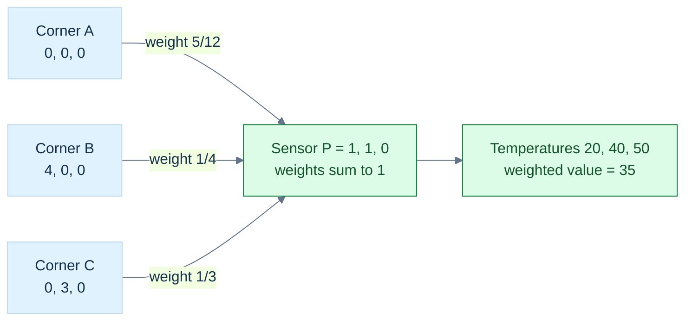
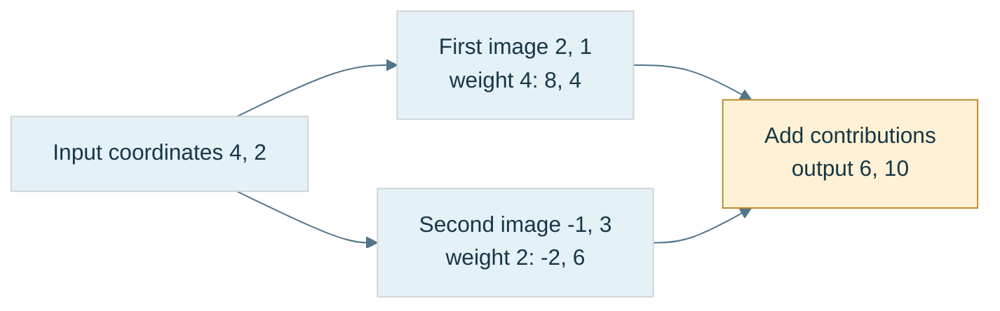
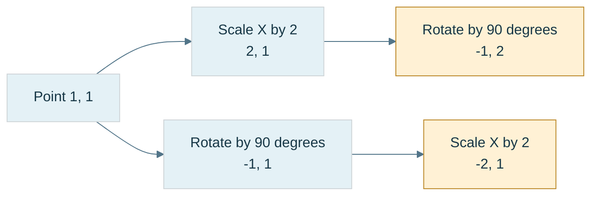
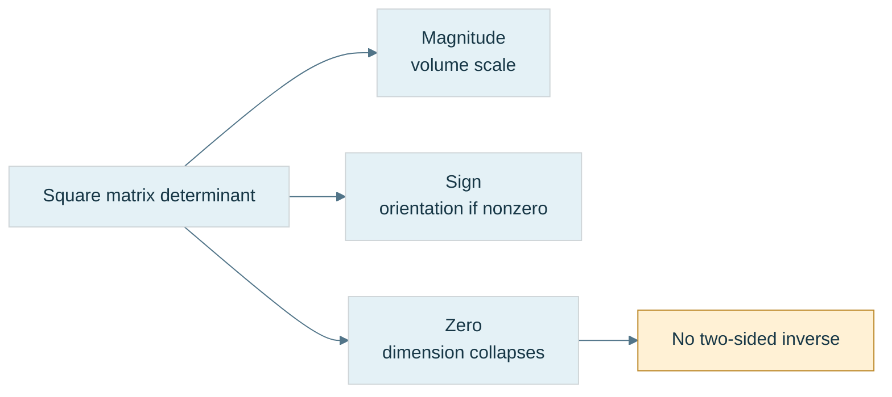
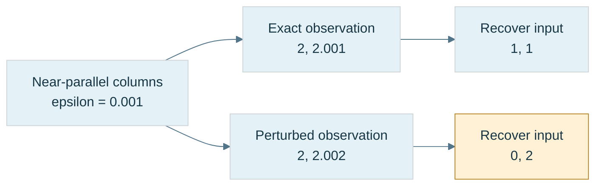
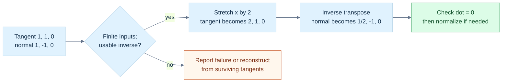
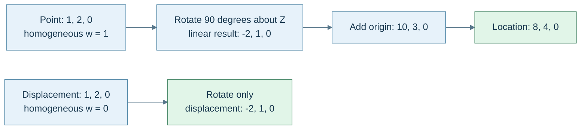

# 18 — Vectors for Light and Frames

[[Chapter Edition/01 - Computing Foundations/00 - Reading Map|Reading map]] · [[Chapter Edition/01 - Computing Foundations/17 - Python and Numerical Tools for Graphics Systems|Previous chapter]] · [[Chapter Edition/01 - Computing Foundations/19 - Coordinate Frames and Linear Systems|Next chapter]]

A shared decomposition of a vector into normal and tangent components explains reflection, refraction, and surface frames. This chapter reuses that geometric tool across optics and local coordinates before composition and inverse transforms.

**By the end:** Derive reflection and refraction from vector components, and apply named frames to points and displacements.

**Recall question:** Which component changes under reflection, and how does refraction change the tangent component?

<!-- Derived from Continuous Notes/Computing Foundations - From Bits to C++ and Systems APIs.md; source lines 41804–43226; source-span SHA256 32eec0ce560b794c9b06b3077e1b89dd484af5c4e58f165878bbe54f9f2dbe97. -->

<!-- CHAPTER-SOURCE-BEGIN -->
## Light uses the same decomposition in a new role

Our panel is now a surface, not just a movement plane. A ray approaches it with unit direction $\mathbf i$ pointing **toward** the interface. Choose a unit normal $\mathbf n$ pointing back into the incident medium, so front-side incidence obeys $\mathbf i\cdot\mathbf n\le0$.

### Reflection reverses the normal component

The tangential part is unchanged and the normal part reverses. Therefore [[Chapter Edition/01 - Computing Foundations/18 - Vectors for Light and Frames#Light uses the same decomposition in a new role|reflection across the surface plane]] gives

$$
\mathbf r=\mathbf i-2(\mathbf i\cdot\mathbf n)\mathbf n.
$$

For $\mathbf i=(0.6,0,-0.8)$ and $\mathbf n=(0,0,1)$, the result is $(0.6,0,0.8)$. The length stays one in exact arithmetic. At normal incidence, $\mathbf i=-\mathbf n$ reflects to $\mathbf n$.

If the normal is not unit, use the general projection denominator:

$$
\mathbf r=\mathbf i-2\frac{\mathbf i\cdot\mathbf n}{\mathbf n\cdot\mathbf n}\mathbf n.
$$

Reflection across a line instead preserves the along-line component and reverses the perpendicular component. State which mirror you mean. “Reflect around the normal” is otherwise ambiguous.

### Refraction changes the tangent amount

For a transparent material with scalar refractive indices $n_1,n_2$, define $\eta=n_1/n_2$ and $c_i=-\mathbf i\cdot\mathbf n$. Snell's law is

$$
n_1\sin\theta_i=n_2\sin\theta_t.
$$

The incident tangential vector is $\mathbf i+c_i\mathbf n$ and has length $\sin\theta_i$. The transmitted tangent must therefore be $\eta(\mathbf i+c_i\mathbf n)$. To complete a unit transmitted direction, its normal magnitude must be

$$
c_t=\sqrt{k},\qquad k=1-\eta^2(1-c_i^2).
$$

Choose its normal component into the second medium, opposite $\mathbf n$:

$$
\mathbf t=\eta\mathbf i+(\eta c_i-\sqrt{k})\mathbf n.
$$

For air-to-glass indices $1$ and $1.5$ at $45^\circ$ incidence, the transmitted sine is $\sqrt2/3$ and the angle is approximately $28.1^\circ$. The ray bends toward the normal. These indices are a simplified example, not a wavelength-dependent material model.

If $k<0$, no real transmitted direction satisfies Snell's law: **total internal reflection** occurs. When $n_1>n_2$, the critical angle obeys

$$
\theta_c=\arcsin(n_2/n_1).
$$

At the threshold, tiny arithmetic errors can change the sign of $k$. A physically chosen uncertainty policy may treat a narrow interval specially. Unconditionally clamping every negative $k$ to zero destroys the distinction between rounding and genuine total internal reflection.

When a ray leaves rather than enters, orient the normal against the incident direction and use the correct incident/transmitted index ratio. Snell's law computes a direction, not Fresnel energy splitting, absorption, dispersion, or full material appearance.

The sign conventions and formulas agree with the GLSL reflection/refraction definitions when their input requirements are met; the shader specification's zero-return convention for total internal reflection differs from our explicit failure result. [GLSL 4.60, Geometric Functions](https://registry.khronos.org/OpenGL/specs/gl/GLSLangSpec.4.60.html#geometric-functions).

### A half-vector is a bisector only after its inputs are understood

For shading, let $\mathbf l$ point from the surface toward the light and $\mathbf v$ toward the viewer. Both are unit directions, which differs from the incident-travel convention above. The **half-vector** is

$$
\mathbf h=\frac{\mathbf l+\mathbf v}{\|\mathbf l+\mathbf v\|}.
$$

Because $\mathbf l\cdot(\mathbf l+\mathbf v)=1+\mathbf l\cdot\mathbf v$ and the same expression holds for $\mathbf v$, the normalized sum makes equal angles with both directions. If the directions are opposite, their sum is zero and no unique half-vector exists.

If the inputs have unequal magnitudes, their sum is biased toward the larger one and is not the desired angular bisector. The half-vector supports certain specular-lighting models; it does not by itself define a physically complete reflectance law. The panel's geometry gives a direction, while material modeling determines what that direction means for brightness.

### Immediate footing — gradient

For a differentiable scalar function, the gradient is the vector of partial derivatives. Under the ordinary Euclidean metric it points in the direction of steepest increase. For $f(x,y)=x^2+3y$, $\nabla f=(2x,3)$, so at $(1,2)$ it is $(2,3)$. A small displacement $\delta$ changes the function approximately by $\nabla f\cdot\delta$. In a non-orthonormal metric, the gradient vector depends on that metric even though the differential is a covector. Gradient descent moves opposite the gradient, with step size controlling progress and stability.

[[Chapter Edition/01 - Computing Foundations/21 - Multivariable Derivatives and Sensitivity#Multivariable derivatives and sensitivity|Full explanation and worked examples in this book]]

### A derivative measures change; a gradient needs a ruler

At a fixed point, the differential $df$ is a linear measurement of a small displacement $h$. If the coordinate derivatives form the column $g$, then $df[h]=g^{\mathsf T}h$. The notation does not require that $g$ itself already be the physically correct steepest-direction arrow. It is first a list of coefficients of a covector.

With inner product $\langle u,h\rangle_G=u^{\mathsf T}Gh$, the [[Concepts/Metric gradients and differential measurements|gradient]] is the vector satisfying $df[h]=\langle\operatorname{grad}_G f,h\rangle_G$ for every displacement. Therefore

$$
\operatorname{grad}_G f=G^{-1}g.
$$

In ordinary orthonormal Euclidean coordinates $G=I$, so the distinction is invisible: the coordinate derivative column and gradient arrow have the same numbers. In slanted coordinates or a deliberately weighted error geometry, the distinction changes the answer.

Take $f(x,y)=x+y$ and $G=\operatorname{diag}(1,4)$. Then $g=(1,1)$ but $\operatorname{grad}_Gf=(1,1/4)$. Among directions with $h^{\mathsf T}Gh\le1$, the largest first-order increase is

$$
\max g^{\mathsf T}h=\sqrt{g^{\mathsf T}G^{-1}g}=\frac{\sqrt5}{2},
$$

attained by $h=(1,1/4)/(\sqrt5/2)$. This is the dual-norm bound applied to a derivative. Moving a Euclidean unit distance along $(1,1)$ answers a different optimization question.

If $u=Bc$ is a coordinate change, the derivative coefficients transform as $g_c=B^{\mathsf T}g_u$, while the metric transforms as $G_c=B^{\mathsf T}G_uB$. Combining them gives the correct coordinate transformation of the gradient vector. This explains why normals, derivatives and directions can use related but different matrix formulas. Establish the role of the quantity before choosing the multiplication.

For teaching, trace one small move. In the slanted basis $B=[(1,0),(1,1)]$, let the world function be $f(u_x,u_y)=u_y$. Then $f(Bc)=c_2$, so $g_c=(0,1)$ and $G_c=\begin{pmatrix}1&1\\1&2\end{pmatrix}$. Solving $G_cz=g_c$ gives $z=(-1,1)$. Reconstruct $Bz=(0,1)$: the world gradient points vertically, as expected. Treating $(0,1)$ as slanted-basis vector coefficients would instead produce $(1,1)$ and the wrong direction.

## The sensor needs coordinates inside the triangle

Cartesian coordinates tell us where the sensor is in the workcell. [[Chapter Edition/01 - Computing Foundations/18 - Vectors for Light and Frames#The sensor needs coordinates inside the triangle|Barycentric coordinates]] tell us how it sits relative to the panel's three corners.

We seek weights satisfying

$$
P=\alpha A+\beta B+\gamma C,
\qquad \alpha+\beta+\gamma=1.
$$

This is shorthand for an affine construction, not permission for unrestricted point arithmetic. Translate all coordinate origins by a vector $\mathbf t$. The weighted expression changes by $(\alpha+\beta+\gamma)\mathbf t=\mathbf t$, exactly as a point should. Without the sum-to-one constraint, it would depend incorrectly on the origin.

Subtract $A$ to obtain a purely vector equation:

$$
P-A=\beta(B-A)+\gamma(C-A).
$$

For our panel, $P-A=(1,1,0)$, so $4\beta=1$ and $3\gamma=1$. Therefore

$$
\beta=\frac14,\qquad\gamma=\frac13,\qquad
\alpha=1-\frac14-\frac13=\frac5{12}.
$$

All weights are nonnegative, so the sensor lies inside or on the triangle. An edge has one zero weight; a vertex has one weight equal to one and the others zero. The triangle's **centroid**, its uniform geometric center, has three equal weights $1/3$. A **barycenter**, also spelled barycentre, is a weighted center. With nonnegative masses at the corners, normalized mass weights describe their center of mass. Barycentric weights in general are not distances, and need not be mass fractions. Do not confuse a triangle's centroid with an unweighted average of vertices for every possible shape.

### G3 - Reconstruct a sensor location from the corners



**Figure G3.** This is a weighted reconstruction diagram, not a perspective view of the panel. The point equation is $P=\frac5{12}A+\frac14B+\frac13C$; the same weights interpolate an attribute assumed affine on the triangle. **Limit:** corners must be noncollinear and $P$ must lie in their plane for an exact point reconstruction. Nonnegative weights then locate the point in the closed triangle. For an off-plane input, the Gram solve gives its planar projection; check the residual. Screen-space interpolation under perspective needs [[Chapter Edition/01 - Computing Foundations/18 - Vectors for Light and Frames#Perspective changes the interpolation weights|reciprocal clip-depth correction]].

### Derive the weights in a tilted triangle

Let $\mathbf e_1=B-A$, $\mathbf e_2=C-A$, and $\mathbf q=P-A$. Dot the reconstruction equation with each edge:

$$
\begin{pmatrix}
\mathbf e_1\cdot\mathbf e_1&\mathbf e_1\cdot\mathbf e_2\\
\mathbf e_1\cdot\mathbf e_2&\mathbf e_2\cdot\mathbf e_2
\end{pmatrix}
\begin{pmatrix}\beta\\\gamma\end{pmatrix}
=\begin{pmatrix}\mathbf e_1\cdot\mathbf q\\\mathbf e_2\cdot\mathbf q\end{pmatrix}.
$$

This is the two-edge Gram system. Define $g_{11},g_{12},g_{22}$ from its left side and $r_1,r_2$ from its right side. Eliminating the unknowns gives

$$
D=g_{11}g_{22}-g_{12}^2,
\qquad
\beta=\frac{g_{22}r_1-g_{12}r_2}{D},
\qquad
\gamma=\frac{g_{11}r_2-g_{12}r_1}{D}.
$$

$D=\|\mathbf e_1\times\mathbf e_2\|^2$. It vanishes for a degenerate triangle. Near degeneracy, solving for weights is sensitive even if a denominator happens to be nonzero in machine arithmetic.

If $P$ is off the plane, this system returns coordinates of its orthogonal projection onto the plane, not proof that $P$ belongs to the triangle. Check the reconstruction residual or signed plane distance separately.

### Signed area also answers which side we are on

For two-dimensional points, define

$$
\operatorname{orient}_2(A,B,C)
=(B_x-A_x)(C_y-A_y)-(B_y-A_y)(C_x-A_x).
$$

It is the signed doubled area. Positive means counterclockwise in an upward-positive, positively oriented Cartesian drawing; negative means clockwise. Reverse vertical screen coordinates and the visual interpretation reverses too.

The barycentric weights can be written as signed area ratios:

$$
\alpha=\frac{\operatorname{orient}_2(P,B,C)}{\operatorname{orient}_2(A,B,C)},\quad
\beta=\frac{\operatorname{orient}_2(A,P,C)}{\operatorname{orient}_2(A,B,C)},\quad
\gamma=\frac{\operatorname{orient}_2(A,B,P)}{\operatorname{orient}_2(A,B,C)}.
$$

For the panel in its plane, the denominator is $12$. The three numerators are $5$, $3$, and $4$, reproducing the earlier weights. With a fixed base, a subtriangle's area scales with the opposite point's perpendicular height. That is why an area ratio gives an affine coordinate.

In three dimensions the four-point orientation quantity is

$$
\operatorname{orient}_3(A,B,C,D)
=\big((B-A)\times(C-A)\big)\cdot(D-A).
$$

It tells which side of the oriented plane contains $D$. Some libraries define the opposite ordering and hence the opposite sign. Match the documented definition rather than comparing function names.

### A predicate needs a trustworthy sign

A **predicate** answers a categorical question, such as left/right or inside/outside. A measurement estimates a magnitude. A slightly inaccurate area may be acceptable; a wrong sign used to connect a mesh can corrupt topology.

Near cancellation, ordinary floating-point determinants may have the wrong sign. Wider arithmetic helps but is not a universal certificate. Nor is replacing “small” values with zero: that changes the geometry and can make decisions inconsistent.

[[Chapter Edition/01 - Computing Foundations/18 - Vectors for Light and Frames#The sensor needs coordinates inside the triangle|Adaptive predicates]] first use a fast calculation with a justified error bound, then use more exact arithmetic when the sign is uncertain. Shewchuk's work supplies orientation and incircle implementations and discusses the required arithmetic environment. This protects decisions about the stored coordinates; it cannot restore physical accuracy lost before those coordinates were stored. [Shewchuk, Robust Geometric Predicates](https://www.cs.cmu.edu/~quake/robust.html).

Our laboratory tests well-conditioned examples with ordinary arithmetic. It does **not** implement certified orientation predicates, watertight triangle intersection, or shared-edge rasterization ownership. Those are next-depth topics with stricter contracts.

### The same weights interpolate attributes

Suppose corner temperatures are $20$, $40$, and $50$ degrees Celsius. An affine interpolation gives

$$
T(P)=\frac5{12}(20)+\frac14(40)+\frac13(50)=35.
$$

The weights reconstruct any attribute assumed to vary affinely across this triangle: texture coordinates, scalar fields, and suitable vector-valued data. At a vertex the formula returns that vertex's attribute. Along an edge the opposite attribute contributes nothing.

Interpolation preserves linear constraints, not all nonlinear ones. A weighted average of unit normals need not be unit. Colors stored in nonlinear transfer-encoded channels need conversion to a linear-light representation before physical light interpolation; see [[Color encoding and linear-light operations]]. A unit-direction interpolation needs a specified path and a zero/antiparallel policy, not just a call to `lerp`.

The barycentric gradients are constant over a flat affine triangle. For our panel, $\beta=x/4$, $\gamma=y/3$, and $\alpha=1-x/4-y/3$. This means the temperature gradients are

$$
\frac{\partial T}{\partial x}=\frac{40-20}{4}=5,
\qquad
\frac{\partial T}{\partial y}=\frac{50-20}{3}=10
$$

in degrees Celsius per metre. A derivative is not an extra decoration: it tells the robot how the interpolated measurement changes as the sensor moves.

### Perspective changes the interpolation weights

Screen-space barycentric weights $\lambda_i$ are not generally the original affine surface weights after perspective projection. For an attribute $a_i$ and clip-space coordinates $w_i$ at the three vertices, perspective-correct interpolation has the form

$$
a(P)=\frac{\sum_i\lambda_i a_i/w_i}{\sum_i\lambda_i/w_i}.
$$

To see the weighting issue without a full rasterizer, consider two endpoints with $w_0=1,w_1=2$ and equal screen weights $1/2$. Their corrected weights are $(1/2)/(3/4)=2/3$ and $(1/4)/(3/4)=1/3$, not equal halves. A texture that ignores this correction can appear to swim or bend incorrectly.

This formula requires a valid projected configuration and clipping policy. A denominator near zero or a primitive crossing the camera's projective boundary cannot be repaired by casually dividing. The projective story below explains why.

## Weighted points lead from affine geometry to collision shapes

We have now met three kinds of combinations. They answer different questions:

| Combination | Restrictions | Meaning |
|---|---|---|
| Linear combination of vectors | Arbitrary scalar weights | Reachable movement in a span. |
| Affine combination of points | Weights sum to one | Origin-independent location, including extrapolation. |
| Convex combination of points | Weights sum to one and are nonnegative | Weighted location inside the contributors' convex hull. |

An affine combination can lie outside a segment or triangle. For example, $2B-A$ extrapolates beyond $B$. A combination whose weights sum to zero transforms as a displacement rather than a point. These statements follow by translating every contributor and tracking the total translation coefficient.

### Convex means every straight connection stays inside

A [[Chapter Edition/01 - Computing Foundations/18 - Vectors for Light and Frames#Weighted points lead from affine geometry to collision shapes|convex set]] contains the complete line segment joining any two of its points:

$$
(1-t)P+tQ\in C\qquad(P,Q\in C,\ 0\le t\le1).
$$

A filled disk is convex; its circular boundary alone is not. A rectangle is convex; a crescent-shaped region generally is not. Repeatedly applying the segment property gives closure under any finite convex combination.

The **convex hull** of a point set is all of its finite convex combinations. It is the smallest convex set containing those points. Imagine a taut rubber band around two-dimensional samples; in three dimensions imagine a tight enclosing convex shell. Interior samples do not necessarily become hull vertices.

The triangular panel is its corners' convex hull. Convex models simplify collision queries, but a convex hull may fill holes and concavities in the original object. Faster geometry does not mean identical geometry.

### Sweeping an object is a set addition

For sets expressed relative to a common frame and origin, the [[Chapter Edition/01 - Computing Foundations/18 - Vectors for Light and Frames#Weighted points lead from affine geometry to collision shapes|Minkowski sum]] is

$$
A\oplus B=\{\mathbf a+\mathbf b:\mathbf a\in A,\mathbf b\in B\}.
$$

Here point locations are represented by position coordinates; the set operation is not an unrestricted intrinsic point-plus-point API. A singleton offset translates a shape. A horizontal segment plus a vertical segment makes a rectangle. A line-segment path plus a radius-$r$ disk makes a capsule-shaped swept region in the plane.

For a circular robot moving around an obstacle $O$, forbidden center positions are $O\oplus(-R)$, where $R$ is the robot shape centered at its reference point. A symmetric disk equals its own reflection, so this becomes expansion of the obstacle by the robot radius. Non-symmetric robot shapes need the reflection explicitly.

Convexity is preserved. For $x=a_1+b_1$ and $y=a_2+b_2$, their convex mixture is

$$
(1-t)x+ty=[(1-t)a_1+ta_2]+[(1-t)b_1+tb_2].
$$

Both bracketed terms remain in their respective convex sets, so the result stays in the sum. A naive vertex-pair construction produces $mn$ candidate sums for $m$ and $n$ vertices; support queries can avoid materializing that whole set.

### A swept region answers *whether*; a time-of-impact equation answers *when*

We just constructed the swept region of a moving disk as a Minkowski sum. The next question is more demanding: the robot or physics engine needs to know *the first time* its boundary touches another object, because it must integrate only up to that event before changing velocity. That is a different mathematical object from a yes/no overlap query. It is also the point where convex geometry, quadratic equations, constrained dynamics, and floating-point error become one computational system.

Let two planar disks have initial centres $\mathbf x_A,\mathbf x_B\in\mathbb R^2$, constant velocities $\mathbf v_A,\mathbf v_B$ in metres per second, and positive radii $r_A,r_B$ in metres. Define $\mathbf p=\mathbf x_B-\mathbf x_A$ (relative centre position), $\mathbf v=\mathbf v_B-\mathbf v_A$ (relative velocity), and $R=r_A+r_B$ (combined radius). The moving disk centres touch at a time $t$ precisely if $\|\mathbf p+t\mathbf v\|=R$. Squaring is valid because both sides are nonnegative. Expanding the Euclidean inner product gives

$
\begin{aligned}
(\mathbf p+t\mathbf v)\cdot(\mathbf p+t\mathbf v)&=R^2,\\
(\mathbf v\cdot\mathbf v)t^2+2(\mathbf p\cdot\mathbf v)t
+\mathbf p\cdot\mathbf p-R^2&=0,\\
at^2+bt+c&=0,\\
a=\mathbf v\cdot\mathbf v,\quad
b=2\mathbf p\cdot\mathbf v,\quad
c=\mathbf p\cdot\mathbf p-R^2.&
\end{aligned}
$

Here $a$ has units $\mathrm{m}^2/\mathrm{s}^2$, $b$ has units $\mathrm{m}^2/\mathrm{s}$, and $c$ has units $\mathrm{m}^2$: every term in the equation has units of squared distance. Unit consistency is a useful implementation test. An initial overlap corresponds to $c<0$ and needs a separate positional-contact policy; it is not a new impact with a negative time. If $c>0$ and $a=0$, the relative positions do not move and cannot make first contact. If $c>0$ and $b\ge0$, squared separation is initially nondecreasing and, under constant relative velocity, no future positive-time first contact occurs. If the discriminant $D=b^2-4ac<0$, the path misses; $D=0$ is a geometrically tangent path whose normal closing speed at touch is zero. A valid approaching root must lie inside $[0,\Delta t]$ for the requested step.

The quadratic formula appears sufficient until the near root is obtained by subtracting nearly equal floating-point values. Under $b<0$ and $c>0$, use the numerically more stable $q=-\tfrac12(b-\sqrt D)$, then compute $t_{\mathrm{near}}=c/q$ and $t_{\mathrm{far}}=q/a$. This follows from Vieta's identity: the product of the two roots equals $c/a$. Choose the earlier nonnegative root, check it against the time horizon, and reject nonfinite coefficients or endpoints. Computing $D$ with a fused multiply-add can avoid one rounding step, but does not magically make arbitrary floating-point inputs exact. The independent, compilable implementation and its edge-case tests live in [the CCD lab](../../tools/labs/disk_ccd_lab.cpp); the corresponding geometry lesson explains outward-rounded swept bounds.

For a fixed radius-1 disk at $x_A=0$ and radius-1 disk initially at $x_B=10$ moving at $-100\ \mathrm{m/s}$, $\mathbf p=(10,0)$, $\mathbf v=(-100,0)$ and $R=2$. The quadratic is $10000t^2-2000t+96=0$, giving roots $t=0.08$ and $t=0.12$ seconds. The first is *entry*, the second would be *exit* if the two disks passed through each other without a collision response. During a $0.10$-second frame the engine must advance only $0.08$ seconds before solving the contact. A return value of “yes, these swept regions intersect” does not specify that event boundary.

### The same contact has a second quadratic structure: effective mass

At the impact, a velocity constraint determines what impulse is required. For planar rigid bodies, let $\mathbf r_A=\mathbf x_c-\mathbf x_A$ and $\mathbf r_B=\mathbf x_c-\mathbf x_B$ be contact-point offsets measured from centres of mass, with $\mathbf n$ a unit normal pointing A to B. A body point has velocity $\mathbf u=\mathbf v+\omega(-r_y,r_x)$; the scalar $\omega$ is angular velocity in radians per second, which acts as reciprocal seconds because radians are dimensionless. Define the relative normal velocity

$
v_n=\mathbf n\cdot\left[
(\mathbf v_B+\omega_B\times\mathbf r_B)-
(\mathbf v_A+\omega_A\times\mathbf r_A)\right].
$

Here planar $\omega\times(r_x,r_y)=(-\omega r_y,\omega r_x)$. An impulse $+\lambda\mathbf n$ on B and $-\lambda\mathbf n$ on A changes both linear and angular velocity. Applying $\Delta\mathbf v=\mathbf P/m$ and $\Delta\omega=I^{-1}(\mathbf r\times\mathbf P)$, then substituting into $v_n$, gives

$
\Delta v_n=k_n\lambda,\qquad
k_n=m_A^{-1}+m_B^{-1}
+I_A^{-1}(\mathbf r_A\times\mathbf n)^2
+I_B^{-1}(\mathbf r_B\times\mathbf n)^2.
$

The scalar $k_n$ is the **inverse effective mass** of the contact direction; the rotational terms are not arbitrary corrections but the projection of the angular impulse back into contact-point velocity. A positive inverse mass or inverse inertia is a measure of how readily the body responds, and a static body is represented by zero for both. The expression is nonnegative under physically valid inverse masses. A static/static pair has $k_n=0$ and cannot be solved by division. In matrix language this is one row of $JM^{-1}J^\mathsf T$, where $M^{-1}$ is the generalized inverse-mass matrix and $J$ maps generalized velocity to relative normal velocity.

For a nonpenetrating frictionless contact at the velocity level, normal impulse $\lambda\ge0$ must not attract the bodies. With desired outgoing normal speed $b_{\mathrm{out}}$ frozen from the initial impact state, an iterative projected update is

$
\lambda_{\mathrm{new}}=\max\!\left(0,\lambda_{\mathrm{old}}
+\frac{b_{\mathrm{out}}-v_n}{k_n}\right).
$

Only the **change** $\Delta\lambda=\lambda_{\mathrm{new}}-\lambda_{\mathrm{old}}$ is applied to velocities, because $\lambda_{\mathrm{old}}$ has already been applied in prior iterations or a carefully initialized warm start. Reapplying the full accumulated impulse double-counts a historical correction. Friction introduces a tangential direction $\mathbf t=(-n_y,n_x)$ and projected constraint $|\lambda_t|\le\mu\lambda_n$; in three dimensions a single tangent scalar becomes a two-dimensional tangent impulse. These are constraints on *impulses*, not an invitation to add arbitrary forces every frame.

For equal unit masses at a central contact, $\mathbf r_A\times\mathbf n=\mathbf r_B\times\mathbf n=0$, hence $k_n=2\ \mathrm{kg}^{-1}$. If A moves at $2\ \mathrm{m/s}$ and B is stationary, $v_n=-2\ \mathrm{m/s}$. For restitution $e=1$ the outgoing target is $b_{\mathrm{out}}=-e\,v_n^{\mathrm{before}}=+2\ \mathrm{m/s}$. The first impulse is $(2-(-2))/2=2\ \mathrm{kg\,m/s}$; A becomes stationary and B moves at $2\ \mathrm{m/s}$. Linear momentum and kinetic energy are each conserved for this isolated ideal elastic pair. In contrast, an inelastic pair loses kinetic energy even while preserving its combined linear momentum.

### Conservative bounds are a mathematical inclusion guarantee, not a collision decision

A moving disk's **exact swept set** over $[0,h]$ is the Minkowski sum of its centre-path segment and its closed radius-$r$ disk. Its axis-aligned bounding box has x limits $\min(x_0,x_0+hv_x)-r$ and $\max(x_0,x_0+hv_x)+r$, and corresponding y limits. Let $S_i$ be a disk's swept set and $B_i$ its box. By construction $S_i\subseteq B_i$. If two disks ever overlap at a shared time, some point belongs to both swept sets; hence $B_i\cap B_j\neq\varnothing$. This gives the **no false negatives** proof for the broad phase.

The converse fails: boxes may overlap even if the disks are never at the same place at the same time. Such false positives are intentionally passed to a narrower collision test. In floating-point code, outward rounding and finite-input checks help preserve inclusion. For accelerating bodies, using only linear-motion endpoints may no longer enclose the true path, so the proof's assumptions must be changed; invoking the same code without stronger motion bounds is unsound.

A full event step repeatedly finds the earliest surviving narrow-phase hit, advances all bodies to that time, solves simultaneous contacts, and recomputes candidates for the remaining interval after velocity changes. In the worked wall impact, after $0.08$ seconds the moving disk is at $x=2$, reverses to $+100\ \mathrm{m/s}$, and ends at $x=4$ after another $0.02$ seconds. This can be checked against the [complete event simulation lab](../../tools/labs/disk_event_pipeline_lab.cpp), its [10,000-case seeded property regression](../../tools/labs/disk_event_property_lab.cpp), and the [swept-bound candidate oracle](../../tools/labs/swept_broadphase_lab.cpp). These are independent CPU witnesses, not a certificate that a particular engine runtime uses the same pipeline.

**Reconstruction gate.** Without looking at the formulas, derive the contact-time polynomial from relative position, explain why its three coefficients have compatible physical units, reconstruct $k_n$ by tracking one impulse through linear and angular point velocity, and prove why intersecting swept disks force intersecting bounding boxes. Then write two tests: a fast disk that would cross an obstacle in one frame, and an equal-mass elastic collision whose outgoing velocities conserve momentum and energy. Finally identify the cases deliberately *not* solved here: initial deep penetration, nonconstant acceleration, finite-precision degeneracies, persistent resting manifolds, arbitrary spinning convex shapes, and solver convergence for large coupled contact graphs.

### Collision becomes a question about the origin

In collision detection, the commonly named **Minkowski difference** is

$$
A-B=A\oplus(-B)=\{\mathbf a-\mathbf b\}.
$$

It is not ordinary set subtraction, and some mathematical sources use “difference” for erosion instead. Always check the definition.

The shapes intersect exactly when their difference contains zero:

$$
A\cap B\ne\varnothing\iff\mathbf0\in A-B.
$$

If they share point $p$, choose $a=b=p$ and obtain zero. Conversely, zero difference means some $a=b$, a shared point. This proof works for arbitrary sets; convexity is an additional condition used by algorithms such as GJK.

For intervals $A=[2,4]$ and $B=[3,5]$, the difference is $[-3,1]$, which contains zero. For $A=[0,1]$ and $B=[3,4]$, it is $[-4,-2]$, which does not. The abstract construction has become a visible one-dimensional collision trace.

### Support queries inspect the boundary without constructing it

For a nonempty compact set $C$, its **support function** is

$$
h_C(\mathbf d)=\max_{\mathbf x\in C}\mathbf d\cdot\mathbf x.
$$

Compact means closed and bounded in this finite-dimensional setting; it ensures a continuous linear measurement attains its maximum. For more general sets one uses a supremum, which may be infinite or unattained.

A **support point** is any location attaining the maximum. The function returns a scalar; the mapping returns a point. In a square and direction $(1,0)$, every point on the right edge is a maximizer. A deterministic implementation must define its tie rule if repeatability matters.

For a sphere with center $c$ and radius $r$,

$$
\operatorname{support}_C(\mathbf d)=c+r\frac{\mathbf d}{\|\mathbf d\|},
\qquad h_C(\mathbf d)=\mathbf d\cdot c+r\|\mathbf d\|
$$

for nonzero $\mathbf d$. For an axis-aligned box, independently choose each coordinate's upper endpoint for a positive direction component and lower endpoint for a negative one. For a finite convex hull, scan vertex dot products; one maximizer suffices.

Because choices in two sets are independent,

$$
h_{A\oplus B}(\mathbf d)=h_A(\mathbf d)+h_B(\mathbf d),
$$

$$
\operatorname{support}_{A-B}(\mathbf d)
=\operatorname{support}_A(\mathbf d)-\operatorname{support}_B(-\mathbf d).
$$

This lets GJK explore the difference shape on demand. GJK stands for Gilbert–Johnson–Keerthi. Its full simplex update, termination, degeneracy, and contact policies are not supplied by this identity; they belong to later collision lessons. Zero direction also needs a separate support-query policy.

# A matrix is a rule acting on geometry

Now turn a rule for one vector into a rule for every vector. Keep the map, coordinate frame, geometric metric and storage layout separate. Determinants, inverses, dual measurements and composed rotations each have a precise job.

## From Basis Images to Moving Worlds: Matrices, Transforms and Quaternions

The robot in [[Chapter Edition/01 - Computing Foundations/17 - Python and Numerical Tools for Graphics Systems#The panel gives us a reason to learn|Phase 6]] could measure directions and inspect one triangular panel. Now place that panel on a moving tool, mount the tool on a robot, and view both through a camera. A point must survive several changes of description before it becomes a screen sample. A normal must remain perpendicular after deformation. An orientation must turn smoothly without confusing a storage format with a geometric rule.

This volume develops the machinery needed to answer those questions. We begin with the images of basis vectors, derive matrix multiplication from composition, discover when information is lost, then add origins and coordinate frames. Quaternions arrive when the controller needs an orientation that composes and interpolates cleanly. The last step is a computational contract: what the data means, how it is stored, how failure is reported, and what our tests actually establish.

### Immediate footing — quaternion

A quaternion has one scalar and three vector components, written $q=(w,\mathbf v)$. Unit quaternions can represent three-dimensional rotations. For unit axis $\mathbf a$ and angle $\theta$, use $q=(\cos(\theta/2),\mathbf a\sin(\theta/2))$. Applying the corresponding rotation to a vector uses the quaternion product $q(0,\mathbf x)q^{-1}$. The multiplication law makes composition possible and noncommutative. The values $q$ and $-q$ represent the same rotation; arbitrary component-wise interpolation therefore needs care. State the multiplication order, frame convention and normalization contract.

[[Chapter Edition/01 - Computing Foundations/19 - Coordinate Frames and Linear Systems#Orientation needs a state that can be composed|Full explanation and worked examples in this book]]
## Reference recap — definitions after the workcell

The following compact definitions are retained verbatim from the earlier opening. They serve as review after the causal demonstrations, **not** as a substitute for the full first-use explanations above.

### Immediate footing — field

A field is a number system in which addition, subtraction, and multiplication follow the familiar algebraic rules, and every nonzero number has a reciprocal. The real numbers form a field: $3/2$ is defined, while division by zero is not. Vector spaces use field elements as scalars. In graphics, calculations are modeled over the real numbers, while code stores rounded finite-precision approximations. The identity $a(b+c)=ab+ac$ holds exactly in the model, though floating-point evaluation can round.

[[Chapter Edition/01 - Computing Foundations/17 - Python and Numerical Tools for Graphics Systems#Numbers become a system of permitted operations|Full explanation and worked examples in this book]]


### Immediate footing — matrix

A matrix is a rectangular table that defines an input-output rule formed from weighted sums after input and output coordinates are chosen. With column vectors, its columns are the images of the input coordinate directions. For example, $A=\begin{bmatrix}2&1\\1&3\end{bmatrix}$ maps $\begin{bmatrix}1\\2\end{bmatrix}$ to $\begin{bmatrix}4\\7\end{bmatrix}$ because $A\begin{bmatrix}1\\2\end{bmatrix}=\begin{bmatrix}2+2\\1+6\end{bmatrix}$. The matrix shape determines which inputs it accepts. Row-major and column-major describe memory layout, not a different mathematical map.

[[Chapter Edition/01 - Computing Foundations/18 - Vectors for Light and Frames#A linear rule is determined by its basis images|Full explanation and worked examples in this book]]


### Immediate footing — determinant

The determinant of a square matrix is its signed volume scale. For two columns $u=(a,b)$ and $v=(c,d)$ in 2D, $\det\begin{bmatrix}a&c\\b&d\end{bmatrix}=ad-bc$ is their signed parallelogram area. The identity matrix has determinant $1$; swapping its columns gives $-1$, indicating reversed orientation. A zero determinant means the columns are dependent and the map is not invertible. Determinants explain orientation, area scaling, and invertibility, but determinant formulas are usually a numerically fragile way to compute an inverse.

[[Chapter Edition/01 - Computing Foundations/18 - Vectors for Light and Frames#Determinant measures oriented volume and exposes lost dimensions|Full explanation and worked examples in this book]]


### Immediate footing — inner product

An inner product pairs two vectors to produce a scalar and defines lengths and angles. In ordinary real orthonormal coordinates, $\langle u,v\rangle=\sum_i u_i v_i$. For $u=(1,0)$ and $v=(3,4)$, the value is $3$, the component of $v$ along the unit direction $u$. The induced length is $\|u\|=\sqrt{\langle u,u\rangle}$, and perpendicular vectors have inner product zero. In a slanted basis, include the metric or Gram matrix; the plain coordinate dot product may not represent geometric measurement.

[[Chapter Edition/01 - Computing Foundations/17 - Python and Numerical Tools for Graphics Systems#The dot product turns two movements into a measurement|Full explanation and worked examples in this book]]


### Immediate footing — linear map

A linear map $T$ preserves vector addition and scalar multiplication: $T(u+v)=T(u)+T(v)$ and $T(cu)=cT(u)$. Scaling and rotation about the origin are linear; translation by a nonzero offset is not, because it moves the zero vector. A map is determined by its action on a basis. If $T(e_1)=(2,1)$ and $T(e_2)=(1,3)$, then $T(3e_1+2e_2)=3(2,1)+2(1,3)=(8,5)$. Once bases are selected, the basis images form the columns of its matrix.

[[Chapter Edition/01 - Computing Foundations/18 - Vectors for Light and Frames#The robot needs a rule for moving every direction|Full explanation and worked examples in this book]]


### Immediate footing — covector and dual space

A covector is a linear measurement that takes a vector to a scalar; in coordinates it can be written as a row $n^T$ acting on displacement $t$ by $n^Tt$. The dual space contains all such linear measurements. A normal to a surface can be defined as a covector that returns zero on every tangent displacement: $n^Tt=0$. Under a basis change, vector and covector coordinates transform differently so their pairing stays the same. In an orthonormal Euclidean frame a covector is often identified with a normal column vector, but that identification depends on the metric.

[[Chapter Edition/01 - Computing Foundations/18 - Vectors for Light and Frames#A normal is a measuring rule before it is an arrow|Full explanation and worked examples in this book]]


### Immediate footing — transpose and adjoint

The transpose $A^T$ swaps matrix rows and columns and obeys $(AB)^T=B^TA^T$. For real Euclidean inner products it is the adjoint: $\langle Ax,y\rangle=\langle x,A^Ty\rangle$. For complex vectors with the standard Hermitian inner product, the adjoint is the conjugate transpose $A^H=\overline{A}^T$. With coordinate Gram matrices $G_X$ and $G_Y$ on the input and output spaces, the adjoint matrix is $A^*=G_X^{-1}A^HG_Y$ (for real spaces, replace $A^H$ by $A^T$). State the scalar field and metrics before using the identity.

[[Chapter Edition/01 - Computing Foundations/18 - Vectors for Light and Frames#Transpose lets us compare measurements and structure|Full explanation and worked examples in this book]]


## Keep the promises visible while moving between representations

| Question                                 | Vocabulary and promise                                                                                                                                                                                                                                  |
| ---------------------------------------- | ------------------------------------------------------------------------------------------------------------------------------------------------------------------------------------------------------------------------------------------------------- |
| What does the table mean?                | [[Matrices as linear maps and basis images]]; [[Chapter Edition/01 - Computing Foundations/21 - Multivariable Derivatives and Sensitivity#Jacobians, curvature, and local approximation|Matrix multiplication and composition order]]; [[Matrix transpose symmetry and trace]]. Shape and basis determine meaning before layout does.           |
| Can the operation be undone reliably?    | [[Determinants orientation and volume]]; [[Matrix inversion pivoting and residuals]]; [[Chapter Edition/01 - Computing Foundations/18 - Vectors for Light and Frames#An inverse can exist and still amplify uncertainty|Conditioning and singularity]]. Algebraic invertibility and numerical usefulness are separate questions.   |
| Which frame describes the point?         | [[Linear affine and projective transformations]]; [[Chapter Edition/01 - Computing Foundations/37 - Camera Contracts and Transform-Chain Debugging#A camera model must close the loop|Coordinate frames and change of basis]]; [[Chapter Edition/01 - Computing Foundations/37 - Camera Contracts and Transform-Chain Debugging#A camera model must close the loop|Camera view and clip-space pipeline]]. Name the input and output spaces.       |
| Where do the entries live?               | [[Matrix storage indexing and strides]]; [[Matrix SIMD tiling and cache reuse]]. Memory layout, ownership and execution order need explicit contracts.                                                                                                  |
| Which orientation operation is intended? | [[Quaternion algebra and Hamilton product]]; [[Quaternion rotation and double cover]]; [[Quaternion matrix and axis-angle conversion]]; [[Quaternion interpolation and shortest paths]]. Component order and multiplication convention are independent. |
| What can the representation retain?      | [[Euler angles and gimbal singularity]]; [[Dual quaternions and rigid motion]]; [[Transform hierarchies TRS and shear]]. A compact representation has a domain, not unlimited expressive power.                                                         |

### Immediate footing — expectation

Expectation is the probability-weighted average of a random quantity. For a fair die, $\mathbb{E}[X]=\sum_{k=1}^6 k/6=3.5$, although no single roll shows $3.5$. It describes the model's long-run center, not a guarantee about one sample. For a continuous variable with density $p(x)$, $\mathbb{E}[X]=\int x p(x)\,dx$ when the integral exists. Linearity gives $\mathbb{E}[aX+bY]=a\mathbb{E}[X]+b\mathbb{E}[Y]$ without requiring independence. A finite-sample estimate has sampling error, distinct from model error and floating-point rounding.

[[Chapter Edition/01 - Computing Foundations/23 - Probability Models and Measurement Error#3. Expected values describe centers; covariance describes dependence|Full explanation and worked examples in this book]]

### Immediate footing — covariance

The mean of a random quantity is its expectation: for a random vector $X$, write $\mu=\mathbb{E}[X]$. Covariance measures how deviations from these means vary together: $\operatorname{Cov}(X,Y)=\mathbb{E}[(X-\mathbb{E}[X])(Y-\mathbb{E}[Y])]$. Positive covariance means deviations tend to share a sign; negative covariance means they tend to have opposite signs. The vector covariance matrix is $\Sigma=\mathbb{E}[(X-\mu)(X-\mu)^T]$; it is symmetric positive semidefinite. For centered observations $x_i-\bar{x}$, estimate it by averaging their outer products, with divisor $N$ for the observed-cloud covariance or often $N-1$ for an unbiased population estimate under independent sampling. Its eigenvectors give principal variation directions and eigenvalues give variance along them.

[[Chapter Edition/01 - Computing Foundations/23 - Probability Models and Measurement Error#3. Expected values describe centers; covariance describes dependence|Full explanation and worked examples in this book]]

## The robot needs a rule for moving every direction

The panel from Phase 6 is still on the workbench. We know how to describe a point, a displacement, a tangent and a normal. Now the robot needs to turn an entire tool, stretch a model, express measurements in a different frame, or reverse a calibration. Storing a new answer for every possible input would be impossible. We need a compact rule that determines all those answers.

A **matrix** starts as a rectangular arrangement of scalars. The word *scalar* means one value from the number system being used; here the mathematical model uses real numbers, while the implementation stores floating-point approximations. The notation $A\in\mathbb R^{m\times n}$ says that $A$ has $m$ rows and $n$ columns. The entry $a_{ij}$ is in row $i$, column $j$. Mathematical subscripts usually start at one; our C++ accessors use zero-based `A(row, column)`.

Consider

$$
A=\begin{bmatrix}1&2&3\\4&5&6\end{bmatrix}.
$$

This is a $2\times3$ matrix, not a $3\times2$ matrix. Its shape is rows first, columns second. It has six scalar positions, and its two rows each contain three values. A matrix does not need to be square. Square means only that the two dimensions agree.

The rectangular table does not announce its meaning. It could hold coefficients of equations, a linear map, a covariance, or image samples. A transform interpretation needs an additional contract: what the input coordinates mean, what the output coordinates mean, which bases are used, and how the matrix acts. This is the same lesson as the earlier bit story: a representation acquires meaning through an interpretation.

### The convention contract for this volume

Unless a section explicitly changes the convention, vectors are columns and a map acts on the left:

$$
\mathbf y=A\mathbf x.
$$

The geometric coordinate frame is right-handed, positive rotations follow the right-hand rule, and rotation examples are **active**: the vector moves while the coordinate axes stay fixed. Angles used by code are in radians. Thus $90^\circ=\pi/2$ radians. Each of these choices is independent of how the scalars are arranged in memory.

Under this convention, $A\in\mathbb R^{m\times n}$ represents a linear map from an $n$-component input to an $m$-component output. It needs one column for each input basis direction, and each column contains the $m$ coordinates of that direction's output. Shape is therefore a mathematical type contract. A $2\times3$ map accepts a three-component vector and produces a two-component vector; equal byte counts do not make incompatible shapes interchangeable.

We also need to distinguish a vector's role from its written orientation. A row of coefficients can represent a measurement, or it can be the row-vector convention's representation of a vector. Those roles should not be inferred from the fact that three numbers happen to be horizontal. Later, a frame change will reveal why the distinction matters.
## A linear rule is determined by its basis images

A **map** assigns an output to each permitted input. A map $T$ is **linear** when it preserves addition and scalar multiplication:

$$
T(a\mathbf u+b\mathbf v)=aT(\mathbf u)+bT(\mathbf v).
$$

This is a rule about the behavior of the map, not about how straight its graph looks. In particular, $T(\mathbf0)=\mathbf0$: substitute zero for the scalar in the scaling rule. Translation by a nonzero vector therefore cannot be a linear map on ordinary point coordinates. Moving every point by $\mathbf t$ moves the origin to $\mathbf t$. We will add a larger representation when we need translation.

Every vector in a chosen basis has an expansion. In the standard two-dimensional basis,

$$
\mathbf x=x_1\mathbf e_1+x_2\mathbf e_2.
$$

Apply linearity:

$$
T(\mathbf x)=x_1T(\mathbf e_1)+x_2T(\mathbf e_2).
$$

So knowing the two basis images determines the output of every vector. Suppose the calibration sends

$$
T(\mathbf e_1)=\begin{bmatrix}2\\1\end{bmatrix},\qquad
T(\mathbf e_2)=\begin{bmatrix}-1\\3\end{bmatrix}.
$$

Put those images into the columns:

$$
A=\begin{bmatrix}2&-1\\1&3\end{bmatrix}.
$$

The columns tell us where the input basis directions go. For $\mathbf x=(4,2)^{\mathsf T}$, retain the same input coefficients but combine the new directions:

$$
A\mathbf x
=4\begin{bmatrix}2\\1\end{bmatrix}
+2\begin{bmatrix}-1\\3\end{bmatrix}
=\begin{bmatrix}8\\4\end{bmatrix}+\begin{bmatrix}-2\\6\end{bmatrix}
=\begin{bmatrix}6\\10\end{bmatrix}.
$$

This is matrix-vector multiplication. The arithmetic comes directly from preserving the vector's basis expansion. In general, if $\mathbf c_j$ is column $j$ of $A$,

$$
A\mathbf x=\sum_{j=1}^{n}x_j\mathbf c_j.
$$

### Figure M1 - Coordinates weight the new basis directions



**Figure M1.** The diagram expands a vector into its input-basis coefficients and then recombines the stored output directions. It is an arithmetic trace rather than a scale drawing. Its coordinates are tied to the declared bases; changing a basis changes the table representing the same geometric map.

### Rows describe how to compute one output coordinate

Read the same example row by row:

$$
y_1=2x_1-x_2,\qquad y_2=x_1+3x_2.
$$

Each row supplies the coefficients of one output measurement. The component formula is

$$
y_i=\sum_{j=1}^{n}a_{ij}x_j.
$$

In standard orthonormal Euclidean coordinates this is the familiar row dot input calculation. More generally it is a row acting as a linear functional on the coordinate tuple; do not silently replace a geometric inner product in a skew basis with an ordinary component dot product. Phase 6's Gram matrix is still needed when that is the actual measurement question.

A rectangular example makes the dimensions visible:

$$
B=\begin{bmatrix}2&1&-1\\0&3&4\end{bmatrix},\qquad
\mathbf x=\begin{bmatrix}5\\2\\-1\end{bmatrix}.
$$

The output is $B\mathbf x=(13,2)^{\mathsf T}$ because the row sums are $10+2+1=13$ and $0+6-4=2$. A fourth input coordinate would have no matching coefficient; a two-component input would leave a coefficient unused. The shape mismatch is an undefined mathematical request, not a small implementation inconvenience.

### One projection, two coordinate descriptions

Projecting onto $y=x$ has standard-coordinate matrix
$$
P=\begin{bmatrix}1/2&1/2\\1/2&1/2\end{bmatrix}.
$$
Both $(1,0)$ and $(0,1)$ map to $(1/2,1/2)$. In the adapted orthonormal basis $v_1=(1,1)/\sqrt2$, $v_2=(-1,1)/\sqrt2$, the same map keeps $v_1$ and removes $v_2$, so its matrix is $\operatorname{diag}(1,0)$. In either basis $P^2=P$. The geometric map is unchanged; only its coordinate description changes. The basis-image principle is illustrated in MIT 18.06 Lecture 30. [MIT 18.06 Lecture 30, official notes](https://ocw.mit.edu/courses/18-06-linear-algebra-spring-2010/71bffaffa75c005516ee010daf17868b_MIT18_06S10_L30.pdf)

The derivative is another linear map whose matrix depends on the chosen input and output bases. For $D:P_2\to P_1$, use input basis $(1,x,x^2)$ and output basis $(1,x)$. Since $D(c_0+c_1x+c_2x^2)=c_1+2c_2x$, the matrix is
$$
[D]=\begin{bmatrix}0&1&0\\0&0&2\end{bmatrix}.
$$
This is the basis-image rule applied to a function space, as in MIT 18.06 Lecture 30. [MIT 18.06 Lecture 30, official notes](https://ocw.mit.edu/courses/18-06-linear-algebra-spring-2010/71bffaffa75c005516ee010daf17868b_MIT18_06S10_L30.pdf)
## Keep the transformation separate from its storage

The logical element `A(0, 1)` means row zero, column one regardless of the memory layout. For the $2\times3$ table with rows $(1,2,3)$ and $(4,5,6)$, two compact layouts are

```text
row-major:    [1][2][3][4][5][6]
column-major: [1][4][2][5][3][6]
```

For $m$ rows and $n$ columns, zero-based compact row-major indexing uses $rn+c$, while compact column-major indexing uses $cm+r$. These are element offsets; multiply by the element size to obtain byte offsets. Bounds still require $0\le r<m$ and $0\le c<n$. A stride is the number of elements or bytes advanced when an index increases by one; an API must state which unit it uses. Padding and views can make the actual stride larger than the logical row or column length.

Row-major does not mean row-vector mathematics. Column-vector multiplication works with either storage layout when the accessor returns the correct logical element. Conversely, changing from column-vector mathematics to an equivalent row-vector representation requires transposing the represented map:

$$
\mathbf y=A_c\mathbf x
\quad\Longrightarrow\quad
\mathbf y^{\mathsf T}=\mathbf x^{\mathsf T}A_c^{\mathsf T}.
$$

Thus $A_r=A_c^{\mathsf T}$ represents the same map with row vectors relative to the same corresponding bases. That is an algebraic conversion, not a decision to store the old table in a different order.

The matrix itself has $mn$ scalar entries. A particular C++ object may also have padding or chosen alignment. If the component really occupies four bytes, a compact $4\times4$ component payload contains 64 bytes. Neither that arithmetic nor `sizeof` proves a shader interface contract. At a CPU/GPU boundary, check the component type, logical row/column interpretation, declared shader layout, stride and upload behavior together.

For a layout diagnostic, use distinct asymmetric values. Identity is a poor diagnostic because its transpose is identical. Applying a matrix to standard basis vectors isolates its columns: $A\mathbf e_j$ must reproduce column $j$. That test can locate a transposition mistake before camera or hierarchy code makes it harder to see.

## Combining rules explains the multiplication law

Addition and scalar multiplication are the simplest matrix operations. They act entry by entry:

$$
(A+B)_{ij}=A_{ij}+B_{ij},\qquad
(\lambda A)_{ij}=\lambda A_{ij}.
$$

Addition needs the same shape. Scalar multiplication preserves shape. The meaning is also direct: $(A+B)\mathbf x=A\mathbf x+B\mathbf x$, and $(\lambda A)\mathbf x=\lambda(A\mathbf x)$. Adding two maps adds their outputs; it does not apply one after the other. Two rotations generally do not add to a rotation, and multiplying every entry of a rotation by two doubles output lengths.

All $m\times n$ real matrices form a vector space of dimension $mn$: one basis matrix has a one at each chosen position and zero everywhere else. This vector-space structure is useful, but special families inside it can have extra constraints. The family of rotation matrices is constrained by orthonormality and positive orientation; arbitrary sums do not preserve those constraints.

To apply one rule after another, we need composition. Let $B:\mathbb R^n\to\mathbb R^p$ and $A:\mathbb R^p\to\mathbb R^m$. The output of $B$ is a valid input to $A$, so the combined map is $A\circ B$. We want a matrix $C$ satisfying $C\mathbf x=A(B\mathbf x)$ for every permitted input.

Expand one component:

$$
y_k=\sum_{j=1}^{n}B_{kj}x_j,
\qquad
z_i=\sum_{k=1}^{p}A_{ik}y_k
=\sum_{j=1}^{n}\left(\sum_{k=1}^{p}A_{ik}B_{kj}\right)x_j.
$$

Comparing coefficients gives the product rule:

$$
C=AB,\qquad C_{ij}=\sum_{k=1}^{p}A_{ik}B_{kj}.
$$

The inner dimension is the intermediate coordinate space. In the product $(m\times p)(p\times n)$ it must match, and the result has shape $m\times n$. Equivalently, each column of $AB$ is $A$ applied to the corresponding column of $B$. This is why row-column multiplication is the rule: it makes the stored table agree with composed linear maps.
For

$$
A=\begin{bmatrix}1&2\\3&4\end{bmatrix},\qquad
B=\begin{bmatrix}5&6\\7&8\end{bmatrix},
$$

the product is

$$
AB=\begin{bmatrix}1(5)+2(7)&1(6)+2(8)\\3(5)+4(7)&3(6)+4(8)\end{bmatrix}
=\begin{bmatrix}19&22\\43&50\end{bmatrix}.
$$

The reverse product is $BA=\begin{bmatrix}23&34\\31&46\end{bmatrix}$. Both products are defined here, but they differ. With rectangular matrices, one order may not even be defined.

### Order describes actions; parentheses describe grouping

Take $\mathbf p=(1,1)^{\mathsf T}$, an X stretch $S=\operatorname{diag}(2,1)$, and a quarter-turn $R=\begin{bmatrix}0&-1\\1&0\end{bmatrix}$. Applying scale then rotation gives

$$
\mathbf p\xrightarrow{S}(2,1)^{\mathsf T}\xrightarrow{R}(-1,2)^{\mathsf T}.
$$

The product is $RS\mathbf p$. Reverse the actions and the result is $SR\mathbf p=(-2,1)^{\mathsf T}$. Matrix multiplication is **noncommutative**: order is not generally interchangeable. Some pairs commute, including diagonal matrices with each other and uniform scaling with any compatible linear map. Noncommutative does not mean that every pair fails to commute.

### Figure M2 - The same operations give different results in different orders



**Figure M2.** The arrows show execution order. In column-vector notation the upper path is $RS\mathbf p$ and the lower path is $SR\mathbf p$. Both stretches use the declared fixed coordinate axes. A hierarchy may instead ask for a local-axis operation, so name the space before choosing multiplication order.

Grouping is different. Exact real matrix multiplication is **associative**: $(AB)C=A(BC)$ when shapes permit the products. Both sides apply $C$, then $B$, then $A$. Expanding either component produces the same finite double sum. In floating-point arithmetic, different grouping can change rounding and overflow, so algebraic equality is not a bitwise reproducibility guarantee.

Grouping also changes cost. If $A$ is $1000\times10$, $B$ is $10\times1000$, and $C$ is $1000\times1$, the classical algorithm uses about 11 million multiply-accumulate terms for $(AB)C$, versus 20 thousand for $A(BC)$. The first route also creates a million-entry intermediate; the second creates ten entries. These are arithmetic counts, not measured timings.

For a classical dense product of shapes $(M\times K)(K\times N)$, there are $MN$ output entries and $K$ terms per entry, giving $\Theta(MKN)$ work. Matrix-vector multiplication costs $\Theta(MN)$ for an $M\times N$ map. Addition, scalar multiplication and transpose touch $MN$ entries and take $\Theta(MN)$ work. Layout and loop ordering change data reuse; they do not change these mathematical shapes or classical asymptotic counts.

## A mathematical object is more than its coordinates

A graphics calculation begins with an object in a space and a question about that object. A point, a direction, a color, a velocity, a pixel measurement, and a list of unknown parameters may all be stored as arrays of numbers. They do not thereby become the same kind of thing. The meaning of each array depends on the operations it supports, the units of its entries, and the coordinate frame in which those entries were measured.

A vector space supplies operations for adding vectors and multiplying them by scalars. If $u$ and $v$ are vectors and $a$ and $b$ are real numbers, then $au+bv$ is another vector. A basis is a collection of independent vectors that lets every vector be expressed uniquely as a weighted sum. In a chosen basis $B=(b_1,\ldots,b_n)$, the coordinate tuple $[v]_B$ records those weights; it is a description of $v$, not the vector itself. Changing the basis changes the tuple while leaving the represented geometric object unchanged.
A linear map $T$ preserves addition and scalar multiplication:

$$
T(au+bv)=aT(u)+bT(v).
$$

Once input and output bases are chosen, the map has a matrix representation. Its $j$th column is the coordinate vector of $T(b_j)$, the image of the $j$th input basis vector. This fact is the simplest way to understand what a matrix means: each column records where one basis direction goes. Matrix multiplication follows function composition. If $S$ acts first and $T$ second, the composite is $T\circ S$, represented by the product $[T][S]$ when the coordinate conventions agree.

This interpretation prevents a common error in graphics: treating a matrix as a bag of numbers divorced from its input frame, output frame, and storage convention. A transform may map object coordinates to world coordinates, world coordinates to camera coordinates, or one basis representation to another. Those maps have different semantic directions even if they happen to use the same dimensions. Multiplying in the wrong order is not a minor coding mistake; it composes different functions.

Coordinates become measurements only after geometry is specified. A dot product gives a way to measure length and angle. In an orthonormal Euclidean basis, $u\cdot v=u^Tv$ and $\|u\|_2=\sqrt{u^Tu}$. In a non-orthonormal basis, the coordinate dot product is generally not the geometric dot product. If the basis matrix is $B$, then the Gram matrix $G=B^TB$ stores the basis inner products, and

$$
\langle u,v\rangle = [u]_B^T G [v]_B.
$$

The metric is therefore part of the problem. It says what counts as a unit of distance and which directions are orthogonal. This becomes essential when parameter vectors combine quantities with different units, when a fit weights some residuals more strongly, or when PCA is applied to differently scaled measurements.

For an approachable numerical example, let a 2D linear map send $e_1=(1,0)$ to $(2,1)$ and $e_2=(0,1)$ to $(-1,1)$. Its matrix is

$$
A=\begin{bmatrix}2&-1\\1&1\end{bmatrix}.
$$

A point with coordinates $(3,2)$ maps to $A(3,2)^T=(4,5)^T$. This result can be reconstructed from the columns: $3(2,1)+2(-1,1)=(4,5)$. If the input coordinates had instead been expressed in a skew basis, the same geometric point would have different coordinates, and the matrix entries would have to describe the map relative to that basis. The picture is unchanged; its numerical description is not.

### Immediate footing — eigenpair

An eigenpair is a nonzero vector $v$ and scalar $\lambda$ satisfying $Av=\lambda v$. The map preserves the direction of $v$ and scales it by $\lambda$; a negative value also reverses orientation. For $A=\operatorname{diag}(2,3)$, the coordinate directions $e_1=(1,0)$ and $e_2=(0,1)$ have eigenvalues $2$ and $3$. Not every matrix has a full basis of real eigenvectors. Real symmetric matrices have real eigenvalues and can be diagonalized with orthonormal eigenvectors. Eigenvectors of a general matrix may be sensitive to perturbations, especially when eigenvalues are close.
[[Chapter Edition/01 - Computing Foundations/20 - Choose Matrix Factorizations from Structure#Eigenvectors reveal the directions a square map does not turn|Full explanation and worked examples in this book]]
### Immediate footing — symmetric positive definite

A real symmetric matrix $A$ is positive definite when $x^TAx>0$ for every nonzero $x$. For $A=\operatorname{diag}(2,5)$, $x^TAx=2x_1^2+5x_2^2$, which is positive except at zero. This property makes the associated quadratic form bowl-shaped and guarantees a unique solution to $Ax=b$. Positive definite matrices admit a Cholesky factorization $A=LL^T$ in exact arithmetic. Symmetry alone is insufficient: $\operatorname{diag}(1,-1)$ is symmetric but indefinite. Finite-precision algorithms must check symmetry and handle loss of positive definiteness.
[[Chapter Edition/01 - Computing Foundations/20 - Choose Matrix Factorizations from Structure#Positive definiteness is a structural promise|Full explanation and worked examples in this book]]


### Immediate footing — singular value and SVD

For any real $m\times n$ matrix, the singular value decomposition is $A=U\Sigma V^T$. The columns of $V$ are orthonormal input directions; $A$ maps each to an orthogonal output direction in $U$, scaled by a nonnegative singular value in $\Sigma$. For $A=\operatorname{diag}(3,1)$, the coordinate directions are scaled by $3$ and $1$. A zero singular value marks an erased direction; a very small one marks a direction that is hard to invert reliably. Unlike eigen decomposition, SVD applies to rectangular matrices.
[[Chapter Edition/01 - Computing Foundations/24 - Waiting Times, Covariance, and Matrix Decomposition#Singular value decomposition covers every rectangular map|Full explanation and worked examples in this book]]


### Immediate footing — condition number

A condition number measures how strongly a problem's answer can change when its input changes slightly. For an invertible matrix in the 2-norm, $\kappa_2(A)=\sigma_{\max}/\sigma_{\min}$. Thus $\operatorname{diag}(100,1)$ has condition number $100$, while $\operatorname{diag}(100,0.001)$ has condition number $100{,}000$; solving can amplify error along the weakly scaled direction. Conditioning is a property of the mathematical problem and chosen norm, not proof that an algorithm is inaccurate. Stability describes whether an algorithm adds excessive error; both matter when interpreting residuals.
[[Chapter Edition/01 - Computing Foundations/24 - Waiting Times, Covariance, and Matrix Decomposition#Conditioning: weak singular directions amplify uncertainty|Full explanation and worked examples in this book]]

## A Gram matrix remembers the geometry of a slanted basis

In the slanted basis from earlier, dotting coordinate lists directly gives the wrong answer. Let basis columns be $\mathbf b_1,\ldots,\mathbf b_k$. The [[Chapter Edition/01 - Computing Foundations/18 - Vectors for Light and Frames#A Gram matrix remembers the geometry of a slanted basis|Gram matrix]] stores all pairwise inner products:

$$
G_{ij}=\mathbf b_i\cdot\mathbf b_j.
$$

The diagonal holds squared lengths; off-diagonal entries hold alignment. With $\mathbf b_1=(1,0)$ and $\mathbf b_2=(1,1)$,

$$
G=\begin{pmatrix}1&1\\1&2\end{pmatrix}.
$$

If $\mathbf v=\sum_i c_i\mathbf b_i$ and $\mathbf w=\sum_jd_j\mathbf b_j$, distribute the dot product:

$$
\mathbf v\cdot\mathbf w
=\sum_{i,j}c_iG_{ij}d_j=c^\mathsf TGd.
$$

The superscript $\mathsf T$ means **transpose**: exchange rows and columns. It lets a column coordinate list act as the row that weights the next expression.

For $c=(1,2)^\mathsf T$, compute $Gc=(3,5)^\mathsf T$, then $c^\mathsf TGc=3+10=13$. The reconstructed vector is $(3,2)$, whose Euclidean squared length is also $13$. Blindly squaring the coordinates would give $5$.
$G$ is symmetric. It is **positive semidefinite** because

$$
c^\mathsf TGc=\left\|\sum_i c_i\mathbf b_i\right\|^2\ge0.
$$

For independent columns it is **positive definite**: this quantity is positive for every nonzero coefficient vector. For dependent columns a nonzero coefficient list can reconstruct zero, so $G$ is singular. An orthonormal basis has $G=I$, the identity matrix, explaining why ordinary coordinate dotting is then correct.

The Gram determinant measures squared area for two vectors and squared volume for three. But it does not retain orientation; reflecting every basis vector can preserve every dot product. A Gram matrix remembers metric geometry, not the complete physical frame.

To project onto a multi-vector span, require the residual to be perpendicular to every generator. In matrix notation this produces

$$
Gc=B^\mathsf T\mathbf v.
$$

This explains the system, but forming $G=B^\mathsf TB$ can square the two-norm condition number of a full-column-rank $B$:

$$
\kappa_2(B^\mathsf TB)=\kappa_2(B)^2.
$$

QR-based solves are usually a better route when numerical conditioning matters. We will build the orthogonalization intuition shortly rather than hide this behind a matrix recipe.

## Special matrices tell us what information a rule preserves

The **identity** $I_n$ has ones on the diagonal and zeros elsewhere. It sends every basis direction to itself, so $I_n\mathbf x=\mathbf x$. For an $m\times n$ matrix, use $I_mA=A$ and $AI_n=A$. A transform product must begin with identity, while an accumulation of additions begins with the zero matrix. Starting a product at zero destroys every later contribution.

The **zero matrix** maps every input to zero. It is the additive identity, but it destroys all information as a map. From $AB=AC$ one cannot generally cancel $A$; if $A$ is zero the equality tells us nothing about $B$ and $C$.

A **diagonal matrix** permits nonzero entries only on the main diagonal. In $D=\operatorname{diag}(d_1,d_2,d_3)$, each output coordinate is $d_ix_i$; coordinates do not mix. An ordinary three-axis scaling matrix has exactly this form. Uniform nonzero scaling preserves angles, while nonuniform scaling can change angles between arbitrary directions. A negative scale reverses a basis direction; a zero scale erases the corresponding coordinate and cannot be undone.

A **shear** changes one coordinate in proportion to another. The elementary planar example

$$
H=\begin{bmatrix}1&k\\0&1\end{bmatrix}
\quad\Longrightarrow\quad(x,y)\mapsto(x+ky,y)
$$

slides higher layers farther sideways, like a stack of cards. It sends $\mathbf e_1$ to $(1,0)$ and $\mathbf e_2$ to $(k,1)$, preserving area but generally changing angles. Off-diagonal entries mean coordinate coupling, but they are not by themselves proof of shear: rotation also mixes coordinates. Nor does a general matrix with all diagonal entries equal to one automatically have determinant one. For example $\begin{bmatrix}1&2\\3&1\end{bmatrix}$ has determinant $-5$; it is not the area-preserving elementary shear above.

## Derive rotations from the directions that stay fixed

A **proper rotation** preserves Euclidean lengths, angles and orientation. In two dimensions, rotate the first unit axis through angle $\theta$. Its image is $(\cos\theta,\sin\theta)^{\mathsf T}$. The second unit axis began at angle $\pi/2$, so its image is

$$
\begin{bmatrix}\cos(\pi/2+\theta)\\\sin(\pi/2+\theta)\end{bmatrix}
=\begin{bmatrix}-\sin\theta\\\cos\theta\end{bmatrix}.
$$

Place the two images into columns. Writing $c=\cos\theta$ and $s=\sin\theta$ gives

$$
R(\theta)=\begin{bmatrix}c&-s\\s&c\end{bmatrix},\qquad
x'=cx-sy,\quad y'=sx+cy.
$$

At $\theta=\pi/2$, $\mathbf e_x$ goes to $\mathbf e_y$, and $\mathbf e_y$ goes to $-\mathbf e_x$. These basis tests expose a wrong sign immediately. A general vector $(2,3)^{\mathsf T}$ goes to $(-3,2)^{\mathsf T}$.

Why is this truly length preserving? Expand the squared output length:

$$
(cx-sy)^2+(sx+cy)^2
=x^2(c^2+s^2)+y^2(c^2+s^2)=x^2+y^2.
$$

The cross terms cancel and $c^2+s^2=1$. The columns are also unit length and mutually perpendicular, summarized by $R^{\mathsf T}R=I$. Therefore $R^{-1}=R^{\mathsf T}=R(-\theta)$. Multiplying two such matrices and applying the angle-addition identities gives $R(\alpha)R(\beta)=R(\alpha+\beta)$, so planar rotations commute.

### The oriented plane explains the Y-rotation signs

In three dimensions, rotation about an axis leaves that axis fixed. Choose the ordered perpendicular-plane coordinates so their basis cross product points along the positive rotation axis. For X use $(y,z)$ because $\mathbf e_y\times\mathbf e_z=\mathbf e_x$. For Y use $(z,x)$ because $\mathbf e_z\times\mathbf e_x=\mathbf e_y$. For Z use $(x,y)$ because $\mathbf e_x\times\mathbf e_y=\mathbf e_z$.
Insert the same planar rotation into each ordered plane. For X,

$$
y'=cy-sz,\quad z'=sy+cz,\quad x'=x,
\qquad
R_x=\begin{bmatrix}1&0&0\\0&c&-s\\0&s&c\end{bmatrix}.
$$

For Y, first rotate the ordered pair $(z,x)$:

$$
z'=cz-sx,\qquad x'=sz+cx,\qquad y'=y.
$$

Then return to the usual output order $(x',y',z')$:

$$
R_y=\begin{bmatrix}c&0&s\\0&1&0\\-s&0&c\end{bmatrix}.
$$

The differing-looking signs are consequences of choosing an oriented plane, not exceptions to the two-dimensional rule. Finally,

$$
R_z=\begin{bmatrix}c&-s&0\\s&c&0\\0&0&1\end{bmatrix}.
$$

Use the actual vector $\mathbf v=(2,3,4)^{\mathsf T}$ at a positive quarter-turn:

$$
R_x\mathbf v=(2,-4,3)^{\mathsf T},\qquad
R_y\mathbf v=(4,3,-2)^{\mathsf T},\qquad
R_z\mathbf v=(-3,2,4)^{\mathsf T}.
$$

For the Y case, explicitly read the rows: $x'=0(2)+0(3)+1(4)=4$, $y'=3$, and $z'=-1(2)+0(3)+0(4)=-2$. Its squared length is $16+9+4=29$, matching the input's $4+9+16=29$. The right-hand rule agrees: positive Y sends positive Z toward positive X and positive X toward negative Z.

Arbitrary rotations in three dimensions do not share one axis. For example, with $\mathbf e_z$ and quarter-turns, $R_yR_x\mathbf e_z=-\mathbf e_y$ while $R_xR_y\mathbf e_z=\mathbf e_x$. This is why a rotation API must state the axes, the coordinate space and the composition order.

A diagonal matrix can represent some nonidentity rotations: in two dimensions $\operatorname{diag}(-1,-1)$ is a half-turn, and in three dimensions $\operatorname{diag}(-1,-1,1)$ is a half-turn about Z. What a diagonal matrix cannot do is continuous general coordinate mixing. Do not turn a useful pattern-recognition shortcut into an absolute claim.

Repeated floating-point rotation products can drift away from orthonormality. Check $R^{\mathsf T}R$ against identity with a meaningful residual. Finite entries alone do not prove that a matrix remains a rotation. Later quaternion normalization gives a compact orientation-maintenance method, with its own preconditions.

## Transpose lets us compare measurements and structure

The **transpose** exchanges logical indices: $(A^{\mathsf T})_{ij}=A_{ji}$. A $2\times3$ table becomes $3\times2$. This operation is not a physical rotation of the represented geometry, nor is it merely a memory-layout conversion. For real columns $\mathbf x,\mathbf y$ in an orthonormal Euclidean basis, $\mathbf x^{\mathsf T}\mathbf y$ is their dot product.

Transpose twice returns the original matrix; it distributes over addition and scalar multiplication. Products reverse order:

$$
(AB)^{\mathsf T}=B^{\mathsf T}A^{\mathsf T}.
$$

Indeed, the $(i,j)$ entry on the left is $\sum_kA_{jk}B_{ki}$, which is the $(i,j)$ entry of the right side after commuting each pair of real scalars. The dimensions also force the reversed order. This identity will support the inverse-transpose normal rule later.

A real square matrix is **symmetric** when $A^{\mathsf T}=A$. Its opposite-side entries match; only $n(n+1)/2$ values are independent. A covariance matrix is symmetric because exchanging the two variables leaves the covariance unchanged. The product $A^{\mathsf T}A$ is symmetric by the transpose identity, though using it to solve systems can worsen conditioning and is not a universal numerical recommendation.

A matrix is **skew-symmetric** when $K^{\mathsf T}=-K$. Over the reals its diagonal is zero because $k_{ii}=-k_{ii}$. In three dimensions,

$$
[\boldsymbol\omega]_\times=
\begin{bmatrix}0&-\omega_z&\omega_y\\\omega_z&0&-\omega_x\\-\omega_y&\omega_x&0\end{bmatrix}
\quad\Longrightarrow\quad
[\boldsymbol\omega]_\times\mathbf v=\boldsymbol\omega\times\mathbf v.
$$

For $\boldsymbol\omega=(1,2,3)^{\mathsf T}$ and $\mathbf v=(4,5,6)^{\mathsf T}$, both calculations give $(-3,6,-3)^{\mathsf T}$. This connects a cross product to a linear operator. A small rotation has the form $I+\theta[\widehat{\mathbf a}]_\times+O(\theta^2)$; dropping the higher terms gives a first-order approximation, not an exactly orthogonal finite rotation.

Every real square matrix separates uniquely into symmetric and skew parts:

$$
A=\underbrace{\frac{A+A^{\mathsf T}}2}_{S}
+\underbrace{\frac{A-A^{\mathsf T}}2}_{K}.
$$

For $A=\begin{bmatrix}1&4\\2&3\end{bmatrix}$, these are $S=\begin{bmatrix}1&3\\3&3\end{bmatrix}$ and $K=\begin{bmatrix}0&1\\-1&0\end{bmatrix}$. This is an additive decomposition of coefficients. It is not a rotation-times-stretch factorization.

The **trace** of a square matrix is $\operatorname{tr}A=\sum_i a_{ii}$. For compatible rectangular $A$ and $B$ with square products, expanding the sums gives $\operatorname{tr}(AB)=\operatorname{tr}(BA)$. This permits cyclic reorderings of longer products when dimensions permit, not arbitrary permutations. If $P$ is an invertible change-of-basis matrix,

$$
\operatorname{tr}(P^{-1}AP)=\operatorname{tr}(APP^{-1})=\operatorname{tr}(A).
$$

Trace is therefore independent of the chosen basis for the same endomorphism, meaning a linear map from a vector space to itself. It summarizes one invariant; it does not identify the complete transformation. Eigenvalue interpretations will be developed when those terms have their own foundations.

## Determinant measures oriented volume and exposes lost dimensions

In two dimensions, the columns of $A=\begin{bmatrix}a&b\\c&d\end{bmatrix}$ are the images of the unit square's edge directions. Their oriented parallelogram area is

$$
\det A=ad-bc.
$$

For $A=\begin{bmatrix}3&1\\2&4\end{bmatrix}$, the determinant is $12-2=10$: ordinary areas scale by ten and orientation is preserved. A reflection $\operatorname{diag}(-1,1)$ has determinant $-1$: area magnitude is preserved but orientation reverses. The singular table $\begin{bmatrix}1&2\\2&4\end{bmatrix}$ has dependent columns and zero area.

In three dimensions, let the columns be $\mathbf u,\mathbf v,\mathbf w$ in that order. Their oriented parallelepiped volume is

$$
\det A=\mathbf u\cdot(\mathbf v\times\mathbf w).
$$

This is the scalar triple product from Phase 6: base area times signed height. For a general table,

$$
\det\begin{bmatrix}a&b&c\\d&e&f\\g&h&i\end{bmatrix}
=a(ei-fh)-b(di-fg)+c(dh-eg).
$$

Use one calibration throughout the following inversion examples:

$$
A=\begin{bmatrix}1&2&3\\0&1&4\\5&6&0\end{bmatrix}.
$$

Expansion gives $-24+40-15=1$. Independently, its columns are $(1,0,5)^{\mathsf T}$, $(2,1,6)^{\mathsf T}$ and $(3,4,0)^{\mathsf T}$. The cross product of the last two is $(-24,18,5)^{\mathsf T}$, whose dot product with the first is $-24+25=1$.

This map preserves volume and orientation, but not necessarily lengths or angles. A determinant of one does not prove rotation. Proper rotations additionally satisfy $R^{\mathsf T}R=I$. Elementary shears also have determinant one while distorting angles.

In $n$ dimensions, $|\det A|$ is the ordinary $n$-volume scale. The sign records orientation. Composition multiplies the scales: $\det(AB)=\det A\det B$. Therefore $\det(A^{-1})=1/\det A$ when an inverse exists. A scale $\operatorname{diag}(2,3,4)$ multiplies volume by 24; its inverse multiplies it by $1/24$.

### Figure M3 - Three different questions answered by one determinant



**Figure M3.** These are distinct interpretations. None gives a reliable condition estimate by itself. Orientation is defined for a full-dimensional nonsingular map; a collapsed image does not retain a full ordered basis. In a renderer, a negative model determinant may reverse winding, but rasterizer front-face settings and the complete viewing/projection convention still determine actual culling behavior.

A square matrix is **singular** when it has no two-sided inverse. The matrix $\begin{bmatrix}1&2\\2&4\end{bmatrix}$ sends both $(2,0)^{\mathsf T}$ and $(0,1)^{\mathsf T}$ to $(2,4)^{\mathsf T}$. Its nonzero vector $(2,-1)^{\mathsf T}$ maps to zero. An inverse could not distinguish the original inputs. For a square matrix over the reals, these are equivalent: nonzero determinant, independent columns, no nonzero null vector, and existence of an inverse. Rectangular maps need separate questions about left inverses, right inverses, injectivity and surjectivity; do not apply the square determinant test to them.

## Recovering an input has an algebraic route and a computational route

An inverse $A^{-1}$ must satisfy both $A^{-1}A=I$ and $AA^{-1}=I$ for a square map. It undoes the same specified input/output relationship; it does not reverse lost information. When $C=AB$, undoing $A$ must happen before undoing $B$, so $(AB)^{-1}=B^{-1}A^{-1}$. Scale inverses reciprocate nonzero scales. Rotation inverses transpose an orthogonal matrix. Use known structure when it is guaranteed rather than invoking an unnecessary general inverse.

### Minors and cofactors build a symbolic inverse

The **minor** $M_{ij}$ is the determinant remaining after deleting row $i$ and column $j$. The **cofactor** is $C_{ij}=(-1)^{i+j}M_{ij}$, adding alternating signs. The **adjugate** is the cofactor matrix transposed, $\operatorname{adj}A=C^{\mathsf T}$. Do not confuse adjugate with a conjugate-transpose adjoint used elsewhere.

For our determinant-one calibration, the cofactor matrix is

$$
C=\begin{bmatrix}-24&20&-5\\18&-15&4\\5&-4&1\end{bmatrix}.
$$

For instance, deleting row one and column two leaves $\begin{bmatrix}0&4\\5&0\end{bmatrix}$, with minor $-20$ and cofactor $+20$. The resulting inverse is

$$
A^{-1}=\frac{\operatorname{adj}A}{\det A}
=\begin{bmatrix}-24&18&5\\20&-15&-4\\-5&4&1\end{bmatrix}.
$$

Why does the formula work? A diagonal entry of $A\operatorname{adj}A$ is a row's cofactor expansion, hence $\det A$. An off-diagonal entry has the same expansion with a different row inserted, producing a determinant with repeated rows, hence zero. Therefore $A\operatorname{adj}A=(\det A)I$. Division is valid only when $\det A\ne0$.

Verify rather than trust the table. The first row of $AA^{-1}$ is $(-24+40-15,\ 18-30+12,\ 5-8+3)=(1,0,0)$. The second row is $(20-20,-15+16,-4+4)=(0,1,0)$; the third is $(-120+120,90-90,25-24)=(0,0,1)$. The reverse product also equals identity. A left-side check alone is insufficient as a general software interface test, even though exact square algebra makes the two-sided relationship follow.
For a $2\times2$ matrix this construction reduces to

$$
\begin{bmatrix}a&b\\c&d\end{bmatrix}^{-1}
=\frac1{ad-bc}\begin{bmatrix}d&-b\\-c&a\end{bmatrix}.
$$

Closed formulas are useful for symbolic reasoning and some carefully implemented small matrices. Recursive cofactor expansion is not an appropriate general dense-matrix inversion algorithm. A compact formula does not automatically minimize numerical error.

### Row reduction makes the inverse observable

Form the augmented table $[A\mid I]$ and apply each row operation to both halves. A row operation is multiplication on the left by an invertible **elementary matrix**. If their combined operation is $E$ and $EA=I$, then $E=A^{-1}$; the right half becomes $EI=A^{-1}$.
For the same calibration, the complete useful trace is:

| Operation | Left half after operation | Right half after operation |
|---|---|---|
| Start | $\begin{bmatrix}1&2&3\\0&1&4\\5&6&0\end{bmatrix}$ | $I$ |
| $R_3\leftarrow R_3-5R_1$ | $\begin{bmatrix}1&2&3\\0&1&4\\0&-4&-15\end{bmatrix}$ | $\begin{bmatrix}1&0&0\\0&1&0\\-5&0&1\end{bmatrix}$ |
| $R_3\leftarrow R_3+4R_2$ | $\begin{bmatrix}1&2&3\\0&1&4\\0&0&1\end{bmatrix}$ | $\begin{bmatrix}1&0&0\\0&1&0\\-5&4&1\end{bmatrix}$ |
| $R_2\leftarrow R_2-4R_3$ | $\begin{bmatrix}1&2&3\\0&1&0\\0&0&1\end{bmatrix}$ | $\begin{bmatrix}1&0&0\\20&-15&-4\\-5&4&1\end{bmatrix}$ |
| $R_1\leftarrow R_1-3R_3$ | $\begin{bmatrix}1&2&0\\0&1&0\\0&0&1\end{bmatrix}$ | $\begin{bmatrix}16&-12&-3\\20&-15&-4\\-5&4&1\end{bmatrix}$ |
| $R_1\leftarrow R_1-2R_2$ | $I$ | $\begin{bmatrix}-24&18&5\\20&-15&-4\\-5&4&1\end{bmatrix}$ |

A **pivot** is the entry used to eliminate other entries in its column. An initial zero pivot does not prove singularity: $\begin{bmatrix}0&1\\2&3\end{bmatrix}$ is invertible with determinant $-2$. A row swap brings the two into the first pivot position. **Partial pivoting** chooses the largest available absolute entry in the current column among the remaining rows, reducing unnecessary division by small pivots. It improves many calculations but does not guarantee tiny error for every matrix or cure a sensitive problem.

Dense Gauss–Jordan inversion takes $\Theta(n^3)$ arithmetic and $\Theta(n^2)$ storage. To solve $A\mathbf x=\mathbf b$ for one or several right-hand sides, a factorization and direct solve is usually preferable to forming $A^{-1}$ and multiplying. A transform inverse remains useful when the inverse map itself is the object required, such as a cached world-to-local transform. The requirement decides the operation.

## An inverse can exist and still amplify uncertainty

An **ill-conditioned problem** is one whose exact answer changes greatly when its input changes slightly, measured relative to the stated input/output scales. **Algorithmic stability** describes how much additional error an algorithm introduces. A stable algorithm cannot erase uncertainty already inherent in an ill-conditioned problem.
Take

$$
A_\varepsilon=\begin{bmatrix}1&1\\1&1+\varepsilon\end{bmatrix},\qquad
A_\varepsilon^{-1}=\frac1\varepsilon\begin{bmatrix}1+\varepsilon&-1\\-1&1\end{bmatrix}.
$$

The columns approach parallel directions as $\varepsilon\to0$. For $\varepsilon=0.001$, the input $(1,1)^{\mathsf T}$ produces $(2,2.001)^{\mathsf T}$. Change only the second observed output to $2.002$. The exact recovered input becomes $(0,2)^{\mathsf T}$: the equations give $x_1+x_2=2$ and $0.001x_2=0.002$. The output perturbation is small, but the reconstructed input changes substantially. No implementation bug is needed to produce this effect.

### Figure M4 - Uncertainty can be amplified by a reversible map



**Figure M4.** Both paths solve the same invertible matrix. The different answers follow from different observations. This separates problem sensitivity from an algorithm defect. Values are exact decimal examples for reasoning; floating-point storage adds another approximation layer.

A compatible induced matrix norm measures the largest amplification relative to a chosen vector norm. A corresponding normwise condition number for a nonsingular square matrix is

$$
\kappa(A)=\|A\|\,\|A^{-1}\|.
$$

For a fixed matrix and a perturbed right-hand side, the relative solution error is bounded by the relative right-hand-side error multiplied by $\kappa(A)$, in the same compatible norm. When both matrix and right-hand side change, additional terms and smallness conditions enter the bound. A condition number is tied to a problem and scaling; it is not an unqualified quality score for every possible downstream use.

In the 2-norm, $\kappa_2(A)=\sigma_{\max}/\sigma_{\min}$, where the singular values describe the largest and smallest directional stretches. This is a preview of later SVD, not a requirement to learn its full construction now. Equal stretches have condition one; a huge ratio means one direction was compressed relative to another.

This immediately disproves a determinant-only numerical threshold. Compare two matrices with the same determinant:

$$
U=\operatorname{diag}(10^{-10},10^{-10}),\qquad
V=\operatorname{diag}(1,10^{-20}).
$$

Both determinants equal $10^{-20}$, yet $\kappa_2(U)=1$ and $\kappa_2(V)=10^{20}$. The first scales every direction equally; the second nearly erases one direction relative to the other. The source's earlier comparison used different determinant magnitudes; this equal-determinant pair makes the intended argument exact.

Uniform tiny scaling can still create absolute range problems or amplify an absolute measurement error. Relative conditioning one does not promise that an application can ignore those issues. Similarly, a determinant of one does not imply good conditioning: $\operatorname{diag}(10^{10},10^{-10})$ has determinant one and condition $10^{20}$.

An inverse API should therefore return a failure state or diagnostic result when it cannot meet its contract. Check finite inputs and outputs, use scale-aware pivot/condition information, and inspect an inverse residual such as $\|I-A\widehat{A^{-1}}\|$. A small residual supports the computed relationship, but by itself does not guarantee small forward error in every recovered input. Choose tolerances from the represented units, precision and use case; a global determinant epsilon hides those decisions.

### Reconstruct the machine before adding translation

At the board, start with two basis images and rebuild a matrix. Apply it by column weights and by row sums. Compose it with a second map and explain why the product order follows the action order. Rebuild the rotation matrices from the three oriented planes, then test the unit axes and one asymmetric vector. Finally, use the determinant-one calibration to derive an inverse by cofactors and by row reduction, and use the near-parallel example to explain why obtaining an inverse is only the beginning of the numerical question.

The remaining limitation is now visible. Every linear map still fixes the origin. The robot must also place its tool at a location, carry it through parent frames and look at it from a camera. That need leads to affine transforms and coordinate-frame matrices rather than another arbitrary matrix formula.

## A normal is a measuring rule before it is an arrow

The panel is scaled nonuniformly. Its edges transform as ordinary movements. Its normal must remain perpendicular to those transformed edges. Why does the same transform not always work?

A [[Chapter Edition/01 - Computing Foundations/19 - Coordinate Frames and Linear Systems#Normals undo scale before following rotation|linear functional]] is a rule $\omega$ that turns a vector into a scalar and obeys

$$
\omega(a\mathbf u+b\mathbf v)=a\omega(\mathbf u)+b\omega(\mathbf v).
$$

“Functional” simply means a scalar-valued function in this setting. A **covector** is such a linear measurement rule. The **dual space** $V^*$ is the vector space of these rules on $V$.

For $\omega(x,y)=2x+y$, movement $(3,2)$ gives measurement $8$. Think of a price list applied to a quantity basket: the price list is not another basket even though both can be stored as two numbers. A covector's units can be reciprocal to the vector's units.

Its **kernel** is the set of vectors it measures as zero. Saying the rule **annihilates** a tangent only means it returns zero for that tangent. This vocabulary is useful only after the ordinary meaning is clear.

A plane normal defines such a rule: $\omega_{\mathbf n}(\mathbf v)=\mathbf n\cdot\mathbf v$. Tangent vectors lie in its kernel. In orthonormal Euclidean coordinates we identify the measurement with a vector using the inner product, hiding the distinction. In general basis coordinates, the conversion uses the metric: a coordinate vector $n$ represents covector coefficients $Gn$.

### Derive the inverse transpose

Let an invertible active linear map send tangents to $\mathbf v'=A\mathbf v$. To preserve the measurement relationship, require

$$
\mathbf n'^\mathsf TA\mathbf v=\mathbf n^\mathsf T\mathbf v
\quad\text{for every }\mathbf v.
$$

Therefore $\mathbf n'^\mathsf TA=\mathbf n^\mathsf T$, and

$$
\mathbf n'=A^{-\mathsf T}\mathbf n.
$$

The inverse compensates for transformed motion; the transpose converts row measurement coefficients back into the column storage convention. This is a derived requirement, not a special shader incantation.

Use tangent $\mathbf t=(1,1,0)$ and normal $\mathbf n=(1,-1,0)$. Their dot is zero. Under $A=\operatorname{diag}(2,1,1)$, the tangent becomes $(2,1,0)$. Naively applying $A$ to the normal gives $(2,-1,0)$, whose dot with the new tangent is $3$. The correct normal $(1/2,-1,0)$ gives dot zero.

Re-normalize if a unit shading normal is needed. Translation does not enter this tangent calculation. Under a pure rotation, $A^{-\mathsf T}=A$, which explains why the bug stays hidden until nonuniform scale or shear appears.
### G4 - Transform the normal and prove the relationship survived



**Figure G4.** The inverse transpose compensates for the tangent stretch: $(2,1,0)\cdot(1/2,-1,0)=0$. Applying the original stretch to both instead gives dot product $3$, breaking perpendicularity. **Limit:** an invertible matrix is mathematically sufficient, but an ill-conditioned numerical inverse can still be unreliable. Check finite output, conditioning and an appropriate normalized dot residual. Reconstructed normals require independent transformed tangents; collapsed surfaces have no unique normal. Cross-derived area normals also retain the determinant's area scale and orientation sign, as derived below.

If $A$ is singular, the inverse does not exist. Some surviving surfaces still have geometric normals that can be reconstructed from transformed tangents, but there is no general invertible normal-map formula. Decide how collapsed geometry is represented rather than forcing an inverse.

An area normal computed by crossing transformed edges obeys the fuller identity

$$
(A\mathbf u)\times(A\mathbf v)
=\det(A)A^{-\mathsf T}(\mathbf u\times\mathbf v)
$$

when $A$ is invertible. The determinant retains area scaling and orientation, including a mirror sign. A plane-measurement normal and a cross-derived oriented area normal are closely related, but not identical in every transformation policy.

![[Visual Recall/Math Foundations/M06-1_vector-reflection.png]]

**M06-1. Reflection across the horizontal mirror normal.** The shown incident vector has v dot n=-1 and reflected vector r=(2,1); both squared norms are 5.
For velocity $\mathbf v=(3,4)$ and unit surface normal $\mathbf n=(0,1)$, $\mathbf v\cdot\mathbf n=4$ is signed normal speed: positive means movement toward the chosen normal side. The tangent component is $(3,0)$. This applies projection without assuming a collision response or sign convention. Freya Holmér also uses a velocity projected onto a surface normal for collision-audio intensity; the chosen absolute or inward component depends on the application. [Freya Holmér, Vectors & Dot Product](https://www.youtube.com/watch?v=MOYiVLEnhrw)

## Oriented areas deserve their own representation

The cross product encodes area as a vector only in a special setting. [[Chapter Edition/01 - Computing Foundations/18 - Vectors for Light and Frames#Oriented areas deserve their own representation|Exterior algebra]] keeps the area itself. Its **wedge product** $\mathbf a\wedge\mathbf b$ is bilinear and antisymmetric:

$$
\mathbf a\wedge\mathbf b=-\mathbf b\wedge\mathbf a,
\qquad \mathbf a\wedge\mathbf a=0.
$$

In three-dimensional coordinates,

$$
\mathbf a\wedge\mathbf b
=(a_xb_y-a_yb_x)\mathbf e_x\wedge\mathbf e_y
+(a_xb_z-a_zb_x)\mathbf e_x\wedge\mathbf e_z
+(a_yb_z-a_zb_y)\mathbf e_y\wedge\mathbf e_z.
$$

A **bivector** represents oriented area; it is not merely two independent vectors stored together. A **grade** counts the dimensional character: scalars have grade zero, vectors grade one, area elements grade two, and volume elements grade three. A decomposable wedge of two vectors is a **simple bivector**. In higher dimensions, a sum of simple bivectors need not describe one single plane.

Expand the wedge in a basis to obtain those signed area coefficients. If the inputs are dependent, all two-dimensional minors vanish and the wedge is zero. In an appropriate Euclidean metric, its squared magnitude is the two-vector Gram determinant. A metric and orientation supply the **Hodge dual** identification that turns a three-dimensional bivector into the familiar cross-product vector. This identification is extra structure, not part of the wedge's definition.

### Geometric algebra unifies measurement and area

In Euclidean geometric algebra, the product of two vectors combines their inner and exterior products:

$$
\mathbf a\mathbf b=\mathbf a\cdot\mathbf b+\mathbf a\wedge\mathbf b.
$$

The symmetric and antisymmetric pieces recover the two operations:

$$
\mathbf a\cdot\mathbf b=\frac{\mathbf a\mathbf b+\mathbf b\mathbf a}{2},\qquad
\mathbf a\wedge\mathbf b=\frac{\mathbf a\mathbf b-\mathbf b\mathbf a}{2}.
$$

In two orthonormal axes, the plane element $I=\mathbf e_1\mathbf e_2$ has

$$
I^2=\mathbf e_1\mathbf e_2\mathbf e_1\mathbf e_2=-1.
$$

This reconnects planar rotation to complex-number behavior. A **rotor** encodes rotation as a sandwich action, for example $\mathbf v'=R\mathbf v\widetilde R$, where the reverse $\widetilde R$ reverses product order. In one oriented plane we can use $R=\cos(\theta/2)-I\sin(\theta/2)$ with the corresponding convention. The half-angle appears because the rotor acts on both sides.

With unit plane normal $\mathbf n$, reflection of a vector in the plane can be written $-\mathbf n\mathbf v\mathbf n$. Expanding the geometric product recovers $\mathbf v-2(\mathbf v\cdot\mathbf n)\mathbf n$, the earlier formula. Composition of reflections naturally produces rotations.

This chapter establishes motivation and basic identities, not a complete geometric-algebra implementation or performance claim. Matrices and quaternions remain useful representations with established engine interfaces. The gain here is understanding why vectors, areas, measurements, and orientations should not all be collapsed into an unqualified `Vec3`.
### Immediate footing — homogeneous coordinates

Homogeneous coordinates append a scale component to ordinary coordinates. An affine point can be written $(x,y,z,1)$ and a direction $(d_x,d_y,d_z,0)$. Multiplying a homogeneous tuple by a nonzero common scale leaves the represented projective point unchanged. A tuple with nonzero last component $w$ returns to an affine chart by dividing the first components by $w$. A zero last component represents an ideal direction, so that division is invalid. This representation lets translation and perspective participate in matrix operations, while their geometric meanings remain distinct.
[[Chapter Edition/01 - Computing Foundations/18 - Vectors for Light and Frames#Homogeneous coordinates preserve the role of a location|Full explanation and worked examples in this book]]

## Homogeneous coordinates preserve the role of a location

Translation affects a point but not a free direction. [[Chapter Edition/01 - Computing Foundations/19 - Coordinate Frames and Linear Systems#Figure M6 - Follow one point through named spaces|Homogeneous coordinates]] make that distinction visible in an extra component:

$$
P_h=(x,y,z,1),\qquad \mathbf d_h=(d_x,d_y,d_z,0).
$$

For an affine transform with linear part $A$ and translation $t$, the rule on a homogeneous pair is

$$
(x,w)\longmapsto(Ax+wt,w).
$$

When $w=1$, translation is added; when $w=0$, it is not. Subtract two canonical point representatives and the result has $w=0$. Add a direction to a point and the result retains $w=1$. This is the affine algebra from earlier, not an arbitrary convention.

### A projective point has many representatives

A nonzero tuple $H=(X,Y,Z,W)$ represents the same projective point as $\lambda H$ for any nonzero scalar $\lambda$. We write $H\sim\lambda H$. If $W\ne0$, divide to select a finite representative:

$$
(x,y,z)=\left(\frac XW,\frac YW,\frac ZW\right).
$$

For example, $(2,4,6,2)$ and $(1,2,3,1)$ represent the same finite point. The all-zero homogeneous tuple is invalid: it describes no projective line through the origin.

Nonzero tuples with $W=0$ describe projective points at infinity. They encode directions of parallel lines. This is the formal origin of vanishing-point intuition. However, a projective point identifies $H$ with $-H$, so it forgets an oriented direction's sign and magnitude. A physical direction represented as $(\mathbf d,0)$ retains vector information in the affine transform pipeline; treating it as a projective equivalence class is a different semantic step.

Adding two canonical point representatives gives $(P+Q,2)$; dividing by the last component gives their midpoint. But projective representatives may be independently rescaled, so adding arbitrary representatives is not a well-defined projective point operation. Define affine weights before combining them.

### NDC is not unit-vector normalization

After a camera projection, a point may have clip coordinates $(X_c,Y_c,Z_c,W_c)$. **Normalized device coordinates**, or NDC, typically follow from perspective division:

$$
x_n=X_c/W_c,\qquad y_n=Y_c/W_c,\qquad z_n=Z_c/W_c.
$$

“Normalized” here means mapped to a canonical coordinate range, not length one. Depth conventions and clipping ranges depend on the chosen API and projection. State them rather than infer them from the letters NDC.

The division is not linear. If $F(X,W)=X/W$, then $F(1,1)=1$, yet $F((1,1)+(1,1))=F(2,2)=1$, not $2$. A homogeneous matrix stage can be linear while the complete dehomogenized mapping is not.

Clip primitives in the proper homogeneous domain before division. In particular, negative common scaling is valid projective equivalence but does not preserve an oriented clip representative's inequalities. Do not rescale clip coordinates arbitrarily and assume rasterization is unchanged.

For a viewport of width $W$ and height $H$ with downward-positive pixel coordinates, one common mapping is

$$
x_{\mathrm{pixel}}=\frac{x_n+1}{2}W,\qquad
y_{\mathrm{pixel}}=\frac{1-y_n}{2}H.
$$

For $x_n=-0.5$ and $W=1920$, the horizontal coordinate is $480$. This maps continuous boundaries; the last pixel index is $W-1$, and sample-center conventions require their own care. Apply this to NDC, not raw clip coordinates.

## The origin exposes the limit of an ordinary linear map

Our robot can now rotate, stretch and shear a displacement. But it still cannot place the panel somewhere else in the workcell using a three-by-three linear map alone. The reason is already inside the definition of linearity. A linear map $L$ obeys $L(a\mathbf u+b\mathbf v)=aL(\mathbf u)+bL(\mathbf v)$. Set both coefficients to zero and we obtain $L(\mathbf0)=\mathbf0$. The origin is fixed. A translation by a nonzero vector $\mathbf t$ sends zero to $\mathbf t$, so translation is not linear in ordinary three-dimensional coordinates.

This is a useful boundary, rather than a defect in matrices. We were asking a displacement-only operation to answer a location question. A **point** names a location; a **free vector** names a displacement independently of where its arrow is drawn. Changing the panel's position should move its points, while a displacement between two of its points should receive no extra translation. If $P'=AP+\mathbf t$ and $Q'=AQ+\mathbf t$, then

$$
Q'-P'=A(Q-P).
$$

The translations cancel because a displacement measures the difference between locations. That cancellation is the bridge from the vector-space material in Phase 6 to the affine transformations needed for scenes.
### Homogeneous coordinates give points and directions different roles

An **affine map** has the form

$$
P'=AP+\mathbf t,
$$

where $A$ is its linear part and $\mathbf t$ is its translation. $A$ may rotate, scale, reflect, shear or collapse directions. An affine map need not be invertible; we will require invertibility when it is used as a full coordinate frame or when an inverse is requested.

Append a fourth coordinate and write an ordinary finite point as $\widetilde P=(P_x,P_y,P_z,1)^{\mathsf T}$. Write a displacement as $\widetilde{\mathbf v}=(v_x,v_y,v_z,0)^{\mathsf T}$. The affine matrix is

$$
F(A,\mathbf t)=
\begin{bmatrix}
A&\mathbf t\\
\mathbf0^{\mathsf T}&1
\end{bmatrix}.
$$

Multiplication makes the roles explicit:

$$
F\begin{bmatrix}P\\1\end{bmatrix}
=\begin{bmatrix}AP+\mathbf t\\1\end{bmatrix},
\qquad
F\begin{bmatrix}\mathbf v\\0\end{bmatrix}
=\begin{bmatrix}A\mathbf v\\0\end{bmatrix}.
$$

The final coordinate is not a flag that authorizes arbitrary operations. In projective geometry a finite point also has representatives $(wP,w)$ for any nonzero $w$, and recovering ordinary coordinates requires division by $w$. For the present affine matrices, the conventional representatives with $w=1$ for points and $w=0$ for directions make translation behavior especially easy to inspect. A general four-by-four matrix may change $w$ and need not be an affine frame at all.

### Figure M5 - The same frame moves a point and redirects a displacement



**Caption:** this uses active, right-handed positive rotation about $Z$, column vectors and a fixed parent frame. The two equal three-component tuples begin with different geometric roles. Translation changes only the point result. The arrows describe calculation dependencies; they are not a drawing of the coordinate axes to scale.

## A frame combines directions with a place to stand

A **basis** supplies independent direction vectors. A **coordinate frame** supplies a basis and an origin. Its origin answers “where is local zero?”; its basis answers “what does one unit along each local axis mean in the parent frame?” Those answers can be encoded together:

$$
F=\begin{bmatrix}B&\mathbf o\\\mathbf0^{\mathsf T}&1\end{bmatrix},
\qquad B=[\,\mathbf b_x\ \mathbf b_y\ \mathbf b_z\,].
$$

The upper-left three-by-three block contains the three basis columns; the rightmost upper column contains the local origin expressed in the parent frame. The basis columns must be independent for a full three-dimensional frame. An affine matrix with dependent columns can still map points, but it cannot uniquely convert every parent coordinate back into local coordinates.
For the frame in Figure M5,

$$
F=
\begin{bmatrix}
0&-1&0&10\\
1&0&0&3\\
0&0&1&0\\
0&0&0&1
\end{bmatrix}.
$$

Read column zero: local $+X$ points along parent $+Y$. Read column one: local $+Y$ points along parent $-X$. Read column three: the local origin lies at parent position $(10,3,0)$. A local point $(1,2,0)$ therefore means “start at that origin, take one local $X$ step, and two local $Y$ steps,” giving $(8,4,0)$. Reading columns this way is often faster than guessing which Euler angles produced a matrix.

### Composition follows the dependency of locations

Suppose one transform first applies $P_1=BP+\mathbf u$, and a second applies $P_2=AP_1+\mathbf t$. Substitute before memorizing any product formula:

$$
P_2=A(BP+\mathbf u)+\mathbf t
=ABP+(A\mathbf u+\mathbf t).
$$

Consequently,

$$
F(A,\mathbf t)F(B,\mathbf u)
=F(AB,A\mathbf u+\mathbf t).
$$

The earlier translation $\mathbf u$ is also transformed by the later linear map. Merely adding translation columns is incorrect when the later transform rotates or scales their frame. With our column-vector convention, $M_2M_1P$ means apply $M_1$ first. A notation change to row vectors would change how the same composition is written; a storage-layout change would not.

If an object should be scaled in local axes, then rotated, then placed in world coordinates, its matrix is $M=TRS$. The rightmost operation acts first. If it should rotate about a pivot $\mathbf c$ expressed in the same coordinate frame as the points, use $T(\mathbf c)RT(-\mathbf c)$: move the pivot to zero, rotate, move back. For a door hinge at $\mathbf c=(1,0,0)$, a point $P=(2,0,0)$ rotated $90^\circ$ about $Z$ follows $(2,0,0)\to(1,0,0)\to(0,1,0)\to(1,1,0)$. That trace explains the order more clearly than naming a “pivot matrix.”

A **transform hierarchy** stores relationships such as panel relative to robot base, then base relative to world. If $L$ maps child-local to parent-local and $W_p$ maps parent-local to world, the child's world matrix is $W_c=W_pL$. This is ordinary composition with meaningful endpoints.

If world matrices are cached, a **dirty flag** means “this cached result no longer agrees with the data it depends on.” Changing a parent's local transform invalidates its own world matrix and the world matrices of dependent descendants. A correct update evaluates the parent before the child or ensures the parent is current on demand. The invariant is explicit: whenever a world matrix is consumed, it equals the current parent world matrix times the current local matrix. The word “dirty” is bookkeeping for that invariant, not a mathematical property of a matrix.

Do not assume arbitrary hierarchy products remain expressible as translation, rotation and diagonal scale without shear. A rotated child under a nonuniformly scaled parent can produce a linear block whose transformed basis columns are not perpendicular. A four-by-four affine matrix preserves that full result; a restricted TRS representation may require decomposition, approximation, or rejection. Later quaternion operations do not remove this closure problem.

### Undo the linear action before undoing its translated origin

From $Q=AP+\mathbf t$, subtract the translation and solve:

$$
P=A^{-1}(Q-\mathbf t)=A^{-1}Q-A^{-1}\mathbf t.
$$

Therefore, if $A$ is invertible,

$$
F(A,\mathbf t)^{-1}
=F(A^{-1},-A^{-1}\mathbf t).
$$

The inverse translation is generally not just $-\mathbf t$; it is expressed after the inverse linear action. For a rigid frame whose linear block $R$ is an orthonormal rotation, $R^{-1}=R^{\mathsf T}$, and the inverse is $F(R^{\mathsf T},-R^{\mathsf T}\mathbf t)$. That shortcut does not apply to a basis containing nonunit scale or shear. Check the actual promise, not the variable name `rotation`.
<!-- CHAPTER-SOURCE-END -->

---

[[Chapter Edition/01 - Computing Foundations/00 - Reading Map|Reading map]] · [[Chapter Edition/01 - Computing Foundations/17 - Python and Numerical Tools for Graphics Systems|Previous chapter]] · [[Chapter Edition/01 - Computing Foundations/19 - Coordinate Frames and Linear Systems|Next chapter]]
