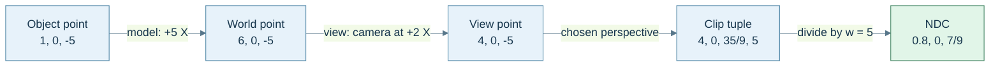
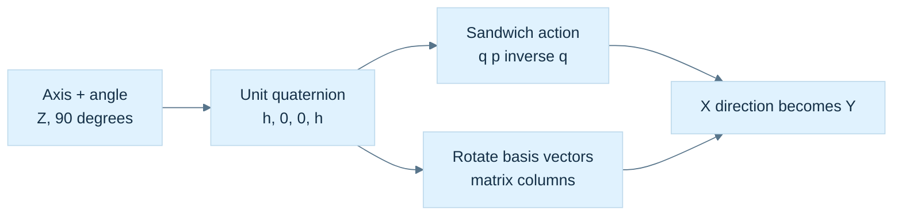
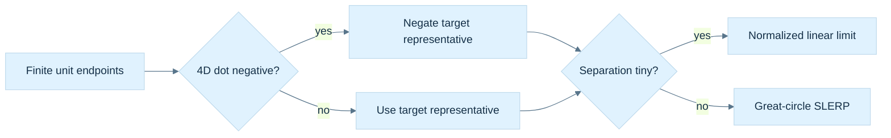
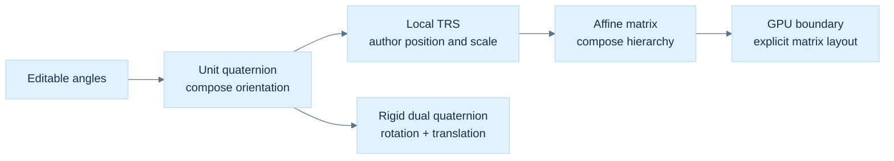
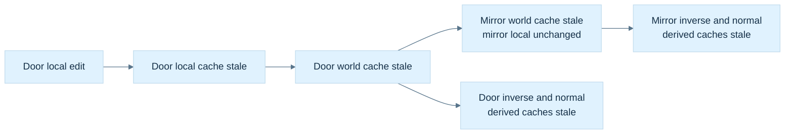
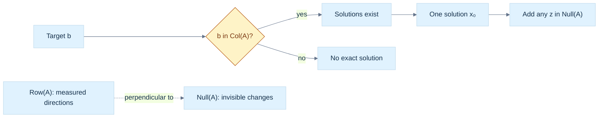
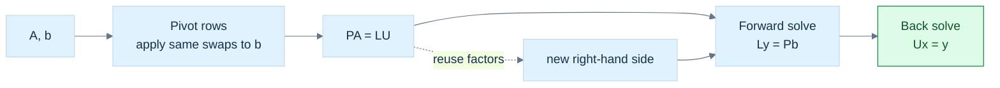

# 19 — Coordinate Frames and Linear Systems

[[Chapter Edition/01 - Computing Foundations/00 - Reading Map|Reading map]] · [[Chapter Edition/01 - Computing Foundations/18 - Vectors for Light and Frames|Previous chapter]] · [[Chapter Edition/01 - Computing Foundations/20 - Choose Matrix Factorizations from Structure|Next chapter]]

A geometric object stays fixed while its coordinate tuple changes with basis, camera, tangent, or clip frame. The chapter connects these transformations to matrix structure and linear solving, preserving distinctions among geometric points, coordinates, and numerical factorization.

**By the end:** Transform coordinates between named frames and select a stable linear solve from the structure of the system.

**Recall question:** How can two coordinate tuples differ while describing the same geometric vector, and how does a linear solve preserve that distinction?

<!-- Derived from Continuous Notes/Computing Foundations - From Bits to C++ and Systems APIs.md; source lines 43227–44574; source-span SHA256 86b692fbcd3525c37495127a52b261822698773c67f6df8fe2040779b4487014. -->

<!-- CHAPTER-SOURCE-BEGIN -->
## Coordinates can change while the geometric object stays still

A basis matrix $B=[\mathbf b_1\ \mathbf b_2\ \mathbf b_3]$ converts coefficients in that basis into the surrounding reference coordinates:

$$
\mathbf v=B[\mathbf v]_B.
$$

The coordinate tuple $[\mathbf v]_B$ says how much of each basis direction to combine. It is a description, not a second geometric vector wandering somewhere else in the world. For $\mathbf b_1=(1,0)$ and $\mathbf b_2=(1,1)$, the coefficients $(2,3)$ reconstruct $(5,3)$ because $2(1,0)+3(1,1)=(5,3)$.

Now describe one vector using two full bases $B$ and $C$. Both reconstructions must agree:

$$
B[\mathbf v]_B=C[\mathbf v]_C.
$$

Solving for the new coordinates gives

$$
[\mathbf v]_C=C^{-1}B[\mathbf v]_B.
$$

The direction of this conversion matters. $C^{-1}B$ takes $B$-coordinates to $C$-coordinates. Multiplying it by a tuple already expressed in the wrong frame is a semantic error even when the matrix dimensions match.

For a concrete check, let $B=I$ and

$$
C=\begin{bmatrix}1&-1\\1&1\end{bmatrix},
\qquad
C^{-1}=\frac12\begin{bmatrix}1&1\\-1&1\end{bmatrix}.
$$

The fixed vector with standard coordinates $(4,2)$ receives new coordinates $(3,-1)$. Reconstruction gives $3(1,1)-(-1,1)=(4,2)$. The vector did not rotate. Its coefficients changed because our measuring directions changed.

An **active transformation** moves the geometric vector while keeping the reference axes fixed. A **passive transformation** changes the coordinates used to describe the same vector. If axes are actively rotated by $R$ relative to the old axes, a fixed vector's components in those new axes are $R^{-1}\mathbf v$. For orthonormal rotations this inverse is $R^{\mathsf T}$. Thus active rotation by $+90^\circ$ takes world $+X$ to world $+Y$, whereas describing unchanged world $+X$ in axes rotated by $+90^\circ$ gives local $(0,-1)$.

The same distinction applies to whole frames, including their different origins. If $F_B$ and $F_C$ map frame-local points into one common parent/world frame, then

$$
[P]_C=F_C^{-1}F_B[P]_B
$$

using homogeneous point representatives. The inverse is needed because we first leave one local description and then enter the other. This is why endpoint names such as `world_from_object` and `camera_from_world` are more useful than an unexplained name such as `matrix1`.

![[Visual Recall/Math Foundations/M07-1_rotated-coordinate-chart.png]]

**M07-1. A point expressed in a rotated local chart.** For the quarter-turn basis at (1,1), point (3,2) has local coordinates (1,-2) and reconstructs the original point.

## A camera is another frame, so viewing uses its inverse

**Object space** is the model's authoring frame. A mesh vertex near its own origin does not say where that mesh instance is in the scene. Its origin may be a wheel axle, door hinge, character root, or artist-chosen pivot. The object's model matrix $M$ maps those local points into **world space**, the shared scene frame used to compare separate objects.

Two vertices both stored as $(1,0,0)$ need not coincide: their model matrices may place them far apart. Compare $M_A P_A$ with $M_B P_B$, not their unrelated local tuples. Large absolute world coordinates can also lose small differences through floating-point spacing; a shared frame solves meaning, not every precision problem. Camera-relative coordinates, origin rebasing and higher precision are design responses that require their own contracts.

Let $C$ be the camera's world frame. It maps camera-local points into world coordinates. Rendering asks the reverse question: “what are these world points in camera coordinates?” The **view matrix** is therefore $V=C^{-1}$. A camera at world $(10,0,0)$ with no rotation sees world point $(13,2,-5)$ at view coordinates $(3,2,-5)$. Nothing in the world moved; the description became relative to the camera. If the camera rotates, its inverse orientation appears in $V$ for the same reason.

### Figure M6 - Follow one point through named spaces



**Caption:** these are numerical states of one point under an explicitly chosen projection, not a picture of its motion. The camera has no rotation. The point stays in front of a right-handed camera looking along $-Z$. The projection below uses an illustrative normalized depth range of $[-1,1]$; it is not an assertion that every graphics API or every engine uses that range.

### Clip coordinates retain the divisor

With a projection matrix $P$, the full vertex chain is

$$
\widetilde P_{\mathrm{clip}}=PVM\widetilde P_{\mathrm{object}}.
$$

**Clip space** contains the four homogeneous components $(x_c,y_c,z_c,w_c)$. **Normalized device coordinates**, abbreviated NDC, are the three components $(x_c/w_c,y_c/w_c,z_c/w_c)$ after perspective division. They are different stages. Applying a four-by-four matrix does not automatically include the divide in a CPU helper, and a helper named `transformPoint` must say whether it performs affine transformation or a projective transformation with a checked divide.

For Figure M6, choose a symmetric $90^\circ$ vertical field of view, aspect ratio one, near distance $1$, far distance $10$, and the right-handed $-Z$ viewing convention just stated. One suitable educational projection is

$$
P=\begin{bmatrix}
1&0&0&0\\
0&1&0&0\\
0&0&-11/9&-20/9\\
0&0&-1&0
\end{bmatrix}.
$$

For view point $(4,0,-5,1)$, multiplication gives $(4,0,35/9,5)$, and division yields $(0.8,0,7/9)$. At view depth $z=-1$, the same matrix gives normalized depth $-1$; at $z=-10$, it gives $+1$. Those endpoint checks tell us what depth convention the matrix actually implements.

A view-space point at $z=0$ would have $w_c=0$ with this matrix, so it would not supply a finite NDC point. A pipeline sketch that blindly divides such a point is incomplete. A CPU projection routine must handle a zero, nonfinite, or policy-defined too-small divisor. A negative divisor or an out-of-volume point also requires appropriate visibility/clipping handling; dividing its numbers is not proof it should be displayed.

Graphics pipelines typically clip primitives using homogeneous inequalities before perspective division and rasterization. Clipping an edge can create new vertices; simply dropping every outside vertex would damage a triangle crossing the boundary. Different API and backend conventions affect depth range, viewport orientation, front-face rules and related setup. Preserve a declared convention through the CPU matrix, shader interface and backend rather than applying a remembered transpose or sign flip until one scene looks right.

### Tangent space supplies a surface-local measuring frame

At a surface point, a tangent $T$, bitangent $B$ and normal $N$ can form a local **TBN frame**. When stored as columns in parent coordinates, $F_{TBN}=[T\ B\ N]$ converts tangent-frame coefficients into that parent description. A normal-map sample decoded to $(0,0,1)$ should map to the local surface normal, because it selects the third basis column.
For $T=(1,0,0)$, $B=(0,0,1)$ and $N=(0,1,0)$,

$$
F_{TBN}=\begin{bmatrix}1&0&0\\0&0&1\\0&1&0\end{bmatrix}.
$$

Its third column is $(0,1,0)$, so the expected mapping works. Notice that this basis has determinant $-1$: it is orthonormal but left-handed. Orthonormality and positive orientation are separate properties. If reconstructing the bitangent as $B=h(N\times T)$, this example needs $h=-1$. A stored tangent handedness sign records precisely that relationship; it is not a disposable decorative attribute.

Interpolation, compression and deformation can disturb unit lengths and perpendicularity. Renormalizing a vector repairs its length when valid, but does not alone make three arbitrary axes perpendicular. Decide whether the surface frame needs re-orthogonalization, how the handedness sign is retained, and which geometric or shading normal the operation uses. Applying an ordinary basis expansion to a tangent-space direction and transforming a general geometric normal through an arbitrary deformation are related but distinct tasks.

## A normal transforms as a measurement that must still vanish on tangents

Suppose a surface tangent $\mathbf u$ and normal $\mathbf n$ obey $\mathbf n^{\mathsf T}\mathbf u=0$. Under the object's linear transform $A$, the tangent becomes $\mathbf u'=A\mathbf u$. We want a new normal satisfying $\mathbf n'^{\mathsf T}\mathbf u'=0$ for every transformed tangent. Choose

$$
\mathbf n'=A^{-\mathsf T}\mathbf n.
$$

Then

$$
\mathbf n'^{\mathsf T}\mathbf u'
=\mathbf n^{\mathsf T}A^{-1}A\mathbf u
=\mathbf n^{\mathsf T}\mathbf u=0.
$$

That is the **inverse-transpose normal transform**. Translation does not enter because the tangent is a displacement and a normal measures directions. For $\mathbf u=(1,1,0)$, $\mathbf n=(1,-1,0)$ and $A=\operatorname{diag}(2,1,1)$, the transformed tangent is $(2,1,0)$ and the correct normal is $(1/2,-1,0)$, whose dot product remains zero. Transforming the normal with $A$ instead gives $(2,-1,0)$; its dot product with the tangent is $3$, exposing the error.

After a valid transform, normalize a shading normal when the shading model requires a unit direction. Normalization cannot repair a normal produced by the wrong matrix, and an inverse cannot be obtained for a singular $A$. If independent transformed tangents still define a surface, their cross product may reconstruct a normal; if the surface collapses, there may be no unique normal to reconstruct. An almost singular transform also needs a conditioning policy, not merely an exact determinant-zero check. The earlier inversion chapter supplies the numerical reason.

## Orientation needs a state that can be composed

The robot now knows where its local axes point. A rotation matrix records those three axis images explicitly, which is ideal when many vertices must pass through the same transform. But the robot's controller also needs to store an orientation, add a small turn, and interpolate toward a target. These are related operations with different representation needs.

A proper rotation matrix has nine scalar entries but only three continuous degrees of freedom: its columns must be orthonormal and its determinant must be positive one. Three Euler angles use only three entries, but their coordinate chart becomes singular at certain orientations. A unit quaternion takes a useful middle route: four real numbers constrained to unit length. It represents orientation compactly and composes without choosing three sequential angle coordinates for every update.

We keep the chapter's conventions throughout: active rotations of geometric vectors, a right-handed coordinate system, and column-vector matrix action. A quaternion is written scalar first, $q=(w,x,y,z)$. Multiplication is Hamilton multiplication. Under these choices, first applying $q_A$, then $q_B$, is represented by $q_Bq_A$. An external library may expose components in a different order or use another convention. Convert at that boundary; do not repair an unexplained discrepancy by randomly transposing or negating values.

### A quaternion is an algebra before it is an orientation

A quaternion is a number of the form

$$
q=w+xi+yj+zk,
\qquad w,x,y,z\in\mathbb R.
$$

The basis symbols obey $i^2=j^2=k^2=-1$ and the cyclic rules $ij=k$, $jk=i$, $ki=j$. Reversing one of those mixed products changes its sign: $ji=-k$, $kj=-i$, $ik=-j$. Addition and multiplication by an ordinary real scalar remain componentwise. Quaternion multiplication is the extra structure; it is associative but generally not commutative.

The four coefficients form a vector in $\mathbb R^4$, but ordinary four-dimensional vector addition is not rotation composition. It helps to group the imaginary coefficients as a three-vector $\mathbf u=(x,y,z)$ and write $q=(w,\mathbf u)$. A quaternion with zero scalar part, $(0,\mathbf v)$, is called a **pure quaternion**. It lets a three-dimensional vector enter the algebra without claiming that the vector gained another geometric coordinate.

To derive the product, expand $(w_1+x_1i+y_1j+z_1k)(w_2+x_2i+y_2j+z_2k)$. Products of matching imaginary basis units contribute $-x_1x_2-y_1y_2-z_1z_2$. Mixed imaginary products collect into the cross product because their signs are antisymmetric. The remaining mixed scalar/vector terms are ordinary scalar multiples. Thus

$$
(w_1,\mathbf u_1)(w_2,\mathbf u_2)=
\left(w_1w_2-\mathbf u_1\cdot\mathbf u_2,
w_1\mathbf u_2+w_2\mathbf u_1+\mathbf u_1\times\mathbf u_2\right).
$$

The minus dot product records $i^2=j^2=k^2=-1$; the cross product records the order-sensitive mixed products. This is a reconstruction method for the formula, not a mnemonic detached from it. For implementation, its vector coefficients are

$$
\begin{aligned}
x&=w_1x_2+x_1w_2+y_1z_2-z_1y_2,\\
y&=w_1y_2-x_1z_2+y_1w_2+z_1x_2,\\
z&=w_1z_2+x_1y_2-y_1x_2+z_1w_2.
\end{aligned}
$$

A general quaternion is not automatically an orientation. Identity rotation uses $(1,0,0,0)$, the multiplicative identity. The zero quaternion $(0,0,0,0)$ is an additive zero with no inverse; accepting it as a rotation silently changes the input contract.

Four stored coefficients do not tell a caller which contract applies. A useful API distinguishes a general algebraic quaternion, a checked unit orientation, and a borrowed four-component view. The general type permits addition and arbitrary multiplication. The orientation type promises finite unit coefficients, so inverse-by-conjugate and optimized rotation become legal operations. A view promises only access to coefficients; it does not enforce a rotation invariant. A packed network or animation format additionally needs declared component order, scale, quantization and sign policy. Sixteen bytes on one ABI are a storage observation, not a serialized representation contract.

### Conjugation gives the inverse and its precondition

Conjugation keeps the scalar and reverses the imaginary part: $q^*=(w,-\mathbf u)$. Multiply once using the derived product:

$$
qq^*=(w^2+\mathbf u\cdot\mathbf u,\mathbf0)
=\|q\|^2.
$$

The vector terms cancel and $\mathbf u\times\mathbf u=\mathbf0$. Therefore, for $q\ne0$,

$$
q^{-1}=\frac{q^*}{\|q\|^2},
\qquad
\|q\|=\sqrt{w^2+x^2+y^2+z^2}.
$$

For example, $q=(1,2,2,1)$ has squared norm $10$, so its inverse is $(1,-2,-2,-1)/10$. A unit quaternion has norm one, and only then is conjugation alone the inverse. Conjugation reverses product order: $(ab)^*=b^*a^*$. Norms multiply, so exact multiplication of two unit quaternions produces a unit quaternion.

The norm multiplication rule can itself be reconstructed. Compute $(ab)(ab)^*=abb^*a^*$. Since $bb^*=\|b\|^2$ is real, it commutes with $a$ and $a^*$, giving $\|b\|^2aa^*=\|a\|^2\|b\|^2$. Taking nonnegative square roots yields $\|ab\|=\|a\|\|b\|$. This explains unit closure using the same conjugate identity that supplied the inverse; it does not require memorizing another unrelated rule.

Computing the norm naively can overflow before the final answer would be problematic. A checked normalization routine first rejects nonfinite inputs, finds $m=\max(|w|,|x|,|y|,|z|)$, rejects $m=0$, forms $s=q/m$, and returns $s/\|s\|$. Its intermediate squares are bounded. This validates a finite direction in four-dimensional coefficient space; it does not prove that arbitrary source data was intended to be an orientation.

## The sandwich turns half angles into a full rotation

Complex multiplication already rotates a plane: multiplying $x+iy$ by $\cos\theta+i\sin\theta$ produces the familiar sine/cosine rotation. For three dimensions, a single left multiplication generally sends a pure quaternion out of the pure subspace. The rotation action uses both sides:

$$
(0,\mathbf v')=q(0,\mathbf v)q^{-1}.
$$

For the normal orientation representation, $q$ is unit and $q^{-1}=q^*$. For a nonzero quaternion of arbitrary magnitude the action with the **true inverse** is still a pure rotation: write $q=m\widehat q$, where $m=\|q\|>0$, and the factors $m$ and $1/m$ cancel. By contrast, replacing the inverse with the conjugate for that nonunit input gives $q(0,\mathbf v)q^*=m^2\widehat q(0,\mathbf v)\widehat q^*$, which scales the rotated vector by $m^2$. These two operations must not be conflated.

### Derive the axis-angle mapping by deriving its action

Let $\mathbf a$ be a unit rotation axis and try $q=(c,s\mathbf a)$, with $c^2+s^2=1$. The first Hamilton product is

$$
q(0,\mathbf v)=
\left(-s\mathbf a\cdot\mathbf v,
c\mathbf v+s\mathbf a\times\mathbf v\right).
$$

Multiplying that result by $(c,-s\mathbf a)$ cancels its scalar part. The vector part is

$$
\mathbf v'=(c^2-s^2)\mathbf v
+2cs(\mathbf a\times\mathbf v)
+2s^2\mathbf a(\mathbf a\cdot\mathbf v).
$$

To check the algebra, the term involving two crosses reduces using $(\mathbf a\times\mathbf v)\times\mathbf a=\mathbf v-\mathbf a(\mathbf a\cdot\mathbf v)$. Now choose $c=\cos(\theta/2)$ and $s=\sin(\theta/2)$. The double-angle identities give $c^2-s^2=\cos\theta$, $2cs=\sin\theta$, and $2s^2=1-\cos\theta$. Consequently,

$$
q=\left(\cos\frac\theta2,\mathbf a\sin\frac\theta2\right),
\qquad
\mathbf v'=\mathbf v\cos\theta
+(\mathbf a\times\mathbf v)\sin\theta
+\mathbf a(\mathbf a\cdot\mathbf v)(1-\cos\theta).
$$

This is Rodrigues' rotation formula. The axis-parallel component stays fixed, while the perpendicular component rotates in its plane. The half angle appears because the two-sided action combines its sine and cosine through double-angle identities. It is not a spare convention to change independently.

For a $90^\circ$ turn around positive Z, let $h=\sqrt2/2$ and $q_Z=(h,0,0,h)$. Acting on $\mathbf e_x$ gives a first pure product $(0,h,h,0)$, then the final vector $(h^2-h^2,2h^2,0)=(0,1,0)$. The original basis vector has turned toward positive Y as required by the right-hand rule.

### Figure M8 - One orientation, several checkable actions



**Caption:** $h=\sqrt2/2$; the sandwich label means $qpq^{-1}$, in that order. This diagram compares representations of the same active rotation. It is not a picture of four-dimensional space. The unit invariant permits conjugation in place of the inverse.

### Recover the axis while admitting when it is undefined

For a normalized orientation $q=(w,\mathbf u)$, a useful angle is $\theta=2\operatorname{atan2}(\|\mathbf u\|,w)$. When $\mathbf u\ne0$, its normalized direction is the axis. If the quaternion is the identity, the rotation angle is zero and every axis gives the same action; there is no unique physical axis to recover. A routine may return a documented arbitrary axis with a status describing that degeneracy.

Choosing the sign of $q$ changes the reported axis-angle representative. For a shortest-angle report, one may choose the representative with $w\ge0$, giving an angle in $[0,\pi]$, with an additional tie rule at $w=0$. This is a reporting convention. It can jump near the boundary and should not be imposed blindly on every frame of a continuous animation.

### Remove the redundant arithmetic only after preserving the proof

Write a unit quaternion as $q=(w,\mathbf u)$. Expanding the sandwich gives

$$
\mathbf v'=(w^2-\mathbf u\cdot\mathbf u)\mathbf v
+2\mathbf u(\mathbf u\cdot\mathbf v)
+2w(\mathbf u\times\mathbf v).
$$

Use $w^2+\mathbf u\cdot\mathbf u=1$ and $\mathbf u\times(\mathbf u\times\mathbf v)=\mathbf u(\mathbf u\cdot\mathbf v)-\mathbf v(\mathbf u\cdot\mathbf u)$. Then define $\mathbf t=2\mathbf u\times\mathbf v$ to obtain

$$
\mathbf v'=\mathbf v+w\mathbf t+\mathbf u\times\mathbf t.
$$

For $q_Z$ and $\mathbf v=(1,0,0)$, $\mathbf t=(0,\sqrt2,0)$, $w\mathbf t=(0,1,0)$, and $\mathbf u\times\mathbf t=(-1,0,0)$; the sum is $(0,1,0)$. The optimized form is a useful computational result because we can explain its agreement with the literal sandwich. Off the unit sphere it is generally neither the true-inverse action nor simply the conjugate sandwich; validate or restore the input invariant instead of assuming one error model.

One adversarial input makes the three contracts visible. Double every coefficient of $q_Z$, obtaining $q=2q_Z=(\sqrt2,0,0,\sqrt2)$, and keep $\mathbf v=(1,0,0)$. The true inverse is $q^{-1}=q_Z^*/2$, so the two scale factors cancel and the action still gives $(0,1,0)$. The conjugate-only sandwich instead produces $(0,4,0)$, because $\|q\|^2=4$. In the unit-optimized formula, however, $\mathbf t=(0,2\sqrt2,0)$, $w\mathbf t=(0,4,0)$, and $\mathbf u\times\mathbf t=(-4,0,0)$. Its answer is $(-3,4,0)$, whose length is five. It is not even the same direction as the conjugate-sandwich result.

This counterexample explains why a debug norm assertion and a checked construction boundary are worthwhile. The optimized routine has a legitimate narrow precondition; it is not defective for requiring unit inputs. The API becomes defective when it exposes unrestricted coefficients while presenting the routine as valid for every quaternion. A test with only identity and a single normalized quarter turn would miss this failure entirely.
## Composition remembers which frame a new turn belongs to

Apply $q_A$, then $q_B$:

$$
q_B\bigl(q_Apq_A^{-1}\bigr)q_B^{-1}
=(q_Bq_A)p(q_Bq_A)^{-1}.
$$

Associativity lets the products regroup; it never permits reversing them. The rightmost turn happens first under our action. As a complete check, take $q_Z=(h,0,0,h)$ and $q_Y=(h,0,h,0)$. Their product is

$$
q_Yq_Z=\left(\frac12,\frac12,\frac12,\frac12\right).
$$

It is unit length and encodes $120^\circ$ about $(1,1,1)/\sqrt3$. It sends X to Y, Y to Z, and Z to X. In reverse order, $q_Zq_Y=(1/2,-1/2,1/2,1/2)$; X first goes to negative Z under the Y turn and stays there under the Z turn. The product order changes the physical result.

Suppose $q$ maps an object's local directions into world space. A delta expressed in the object's local axes acts before that existing map, so $q_{\mathrm{new}}=q\,\Delta q$. A delta expressed in fixed world axes acts afterward, so $q_{\mathrm{new}}=\Delta q\,q$. Neither multiplication side is universally correct; the delta's frame determines it. The same rule explains why world-space angular velocity uses $\dot q=\tfrac12(0,\boldsymbol\omega_W)q$, while local angular velocity uses $\dot q=\tfrac12q(0,\boldsymbol\omega_L)$ under these conventions.

### The sign changes the stored value without changing the orientation

The inverse of $-q$ is $-q^{-1}$, so $(-q)p(-q)^{-1}=qpq^{-1}$. Thus $q$ and $-q$ are different algebraic values with the same three-dimensional rotation action. Unit quaternion coefficients lie on $S^3$, the unit sphere in four-dimensional coefficient space; opposite points correspond to the same physical orientation. This is the **double cover**.

A $360^\circ$ axis-angle turn gives $(-1,0,0,0)$ and therefore identity action, while $720^\circ$ returns the coefficients to $(1,0,0,0)$. A chosen continuous quaternion trajectory can record the path between those representatives, but a final orientation does not record an object's accumulated number of turns. Keep turn count separately if the application needs it.
Component equality and orientation equality therefore answer different questions. For normalized $a,b$, the shortest relative angle is

$$
\delta=2\arccos\bigl(\min(1,|a\cdot b|)\bigr).
$$

An angular tolerance on $\delta$ has a physical interpretation. Clamping here handles small numerical excess only after finite normalized inputs have been established. Near equality, an appropriately sign-aligned relative quaternion and an $\operatorname{atan2}$ extraction can be more informative than an $\arccos$ of a nearly-one dot product.

## A matrix and a quaternion should agree on every basis direction

To derive quaternion-to-matrix conversion, rotate $\mathbf e_x$, $\mathbf e_y$, and $\mathbf e_z$ with the expanded action. Put those results in the columns. With normalized $q=(w,x,y,z)$ this yields

$$
R(q)=\begin{bmatrix}
1-2(y^2+z^2)&2(xy-wz)&2(xz+wy)\\
2(xy+wz)&1-2(x^2+z^2)&2(yz-wx)\\
2(xz-wy)&2(yz+wx)&1-2(x^2+y^2)
\end{bmatrix}.
$$

For example, the first column follows from $\mathbf u\cdot\mathbf e_x=x$ and $\mathbf u\times\mathbf e_x=(0,z,-y)$. Its result is $(1-2y^2-2z^2,2xy+2wz,2xz-2wy)$. Nothing about row-major or column-major **memory storage** enters this derivation; those choices only determine how the logical entries are indexed in memory.

For $q_Z$, the matrix is exactly the familiar $\begin{bmatrix}0&-1&0\\1&0&0\\0&0&1\end{bmatrix}$ in real arithmetic. For $(1/2,1/2,1/2,1/2)$, its columns are Y, Z and X. Tests should compare the matrix and quaternion actions on multiple vectors, not compare a screenshot that happens to look plausible from one camera.

### Recover a large component instead of dividing by a nearly-zero one

Inverting the representation map requires choosing one of $q,-q$. From the matrix diagonal,

$$
\begin{aligned}
4w^2&=1+r_{00}+r_{11}+r_{22},\\
4x^2&=1+r_{00}-r_{11}-r_{22},\\
4y^2&=1-r_{00}+r_{11}-r_{22},\\
4z^2&=1-r_{00}-r_{11}+r_{22}.
\end{aligned}
$$

If the $w$ expression is well conditioned, choose $w>0$ from its square root and recover $x=(r_{21}-r_{12})/(4w)$, $y=(r_{02}-r_{20})/(4w)$, $z=(r_{10}-r_{01})/(4w)$. Near a $180^\circ$ turn, $w$ approaches zero; those divisions become poor choices. Choose the largest of the four squared-component expressions instead. If $x$ is selected, recover it first, then use

$$
w=\frac{r_{21}-r_{12}}{4x},\quad
y=\frac{r_{01}+r_{10}}{4x},\quad
z=\frac{r_{02}+r_{20}}{4x}.
$$

The Y and Z branches follow the same diagonal/symmetric-entry logic. At an exact $180^\circ$ X turn, $R=\operatorname{diag}(1,-1,-1)$, so the X expression is $4$ and the branch safely produces $(0,1,0,0)$ without dividing by $w=0$.

The input must be a finite matrix close to a **proper rotation**, with $R^TR\approx I$ and $\det R\approx1$. A scale, shear or reflection is outside that conversion contract. Tiny negative radicands caused by rounding can be handled with a narrow documented numerical policy; blindly clamping arbitrary invalid matrices hides the wrong input. Extracting a nearest rotation from a general affine matrix is a separate problem, for which polar decomposition or SVD supplies principled tools later.

## Animation asks for a path, not merely an intermediate tuple

An animation needs orientations between unit endpoints $q_0$ and $q_1$. Componentwise matrix averaging can collapse an object: the midpoint between the 2D identity and a $180^\circ$ rotation is the zero matrix. Raw quaternion linear interpolation stays on a chord, not the sphere:

$$
\ell(t)=(1-t)q_0+tq_1,\qquad 0\le t\le1.
$$

From identity to a $180^\circ$ Z quaternion, the midpoint is $(1/2,0,0,1/2)$ with norm $1/\sqrt2$. Normalized linear interpolation, **NLERP**, divides that chord point by its length. It follows the same short great-circle route after suitable sign handling, but its parameter does not advance at constant angular speed.

Before either NLERP or SLERP, choose consistent endpoint signs. If $q_0\cdot q_1<0$, negate the target. This selects a nearer representative of the same target orientation. Otherwise interpolating $q_0$ and $-q_0$ would reach the zero quaternion at the midpoint despite both endpoints meaning the same orientation. At a physical relative angle of exactly $180^\circ$, the dot is zero and there are two equally short rotation paths; an application that needs stable direction must choose a tie-breaking or continuity policy.

### Derive SLERP in a two-dimensional plane inside four dimensions

After sign alignment, let $d=q_0\cdot q_1=\cos\Omega$, with $0\le\Omega\le\pi/2$. For distinct endpoints, define

$$
u=\frac{q_1-q_0\cos\Omega}{\sin\Omega}.
$$

This $u$ is a unit vector in quaternion coefficient space, perpendicular to $q_0$. It is not a three-dimensional rotation axis. The endpoint decomposition is $q_1=q_0\cos\Omega+u\sin\Omega$. Advancing a fraction $t$ along the unit circle in this plane gives $q(t)=q_0\cos(t\Omega)+u\sin(t\Omega)$. Substitute $u$ and use the sine-subtraction identity:

$$
\operatorname{slerp}(q_0,q_1,t)=
\frac{\sin((1-t)\Omega)}{\sin\Omega}q_0
+\frac{\sin(t\Omega)}{\sin\Omega}q_1.
$$

At the endpoints the weights reduce to $(1,0)$ and $(0,1)$. The orthogonal-plane form proves its norm stays one. The physical rotation advances through angle $2t\Omega$, so the ideal path has constant angular speed when $t$ advances uniformly. Easing the parameter deliberately changes that speed.

Take identity and a $120^\circ$ Z rotation: $q_1=(1/2,0,0,\sqrt3/2)$. At $t=1/4$, SLERP gives a $30^\circ$ physical turn. NLERP normalizes $(0.875,0,0,\sqrt3/8)$; its angle is $2\operatorname{atan2}(\sqrt3/8,0.875)\approx27.7958^\circ$. NLERP reaches the same endpoints with different speed. Neither numerical choice is universally preferable; the motion contract decides whether constant speed matters.

The halfway case alone is therefore a weak test: on a common short arc NLERP and SLERP agree at the midpoint by symmetry, even though their quarter points differ. Test a quarter point as well as both endpoints. Also test equivalent opposite-sign endpoints, a tiny separation, and a physical half turn. Compare orientation action and unit norm, not just raw coefficient equality. A routine may legitimately return $-q_1$ at $t=1$ after shortest-path sign alignment because it reaches the same target orientation. If the application promises raw coefficient interpolation instead, that is a different function.

When $\Omega\to0$, $\sin(t\Omega)/\sin\Omega\to t$. A normalized linear blend therefore supplies a stable small-angle fallback. A practical implementation validates and normalizes both endpoints, sign-aligns them, clamps the dot against rounding excess, takes a documented near-equality branch, and checks the final finite norm. A threshold such as $0.9995$ is a numerical design choice, not a geometric law. The statements here assume interpolation over $0\le t\le1$; extrapolation requires its own conditioning and behavior policy.

### Figure M9 - Choose a representative before choosing a path



**Caption:** Sign alignment preserves the target orientation while changing its coefficient representative. The short-path tie at a physical half turn needs a chosen policy. The figure assumes valid unit endpoints and an interpolation parameter in $[0,1]$; it does not validate arbitrary four-float input by drawing it on a sphere.

### Norm repair and sign selection solve different problems

Floating-point composition perturbs the unit constraint. Explicit Euler integration also leaves the unit sphere even in exact arithmetic because it follows a tangent-line approximation to curved motion. A renormalization policy can normalize after each update or when the measured squared-norm error exceeds a justified threshold. Use finite/range-safe normalization; a NaN can evade an ordinary `if (n2 <= 0)` test, and squaring extreme finite coefficients can overflow.

Normalization restores unit length. Canonicalization chooses a sign representative, for example $w\ge0$. It does not restore length and can introduce a discontinuity at $w=0$. For sampled animation continuity, a common approach aligns each quaternion's sign with the previous stored sample. For a single serialized orientation, a deterministic canonical sign may be useful. Different tasks call for different choices.

### Angle rates are not three components of angular velocity

The panel's orientation is a state. Angular velocity describes its instantaneous rotation. Three numbers used to label the state do not automatically have derivatives equal to angular-velocity components. This distinction connects the earlier basis lesson to a common simulation failure.

The set $SO(3)$ consists of real matrices satisfying $R^{\mathsf T}R=I$ and $\det R=1$: length-preserving, orientation-preserving three-dimensional rotations. It is not a vector space under ordinary matrix addition. Adding two valid rotations does not generally yield another valid rotation. A **configuration** is the current state, and a **local coordinate chart** assigns numerical parameters to a neighborhood of configurations. Euler angles provide one such local description, with singularities analogous to the loss of a longitude direction at a geographical pole.

Declare a convention before deriving anything. Here use column vectors, active right-handed rotations, and

$$
R=R_z(\psi)R_y(\theta)R_x(\phi),
$$

where $\psi$ is yaw, $\theta$ pitch and $\phi$ roll. The rightmost rotation acts first. Contributions to world angular velocity are rotations about the actual instantaneous axes:

$$
\omega=
\dot\phi\,R_z(\psi)R_y(\theta)e_x
+\dot\theta\,R_z(\psi)e_y
+\dot\psi\,e_z.
$$

Roll's axis has already been moved by pitch and yaw; pitch's axis has been moved by yaw. Define $q=(\phi,\theta,\psi)$ and collect these axes as columns of $E(q)$. Then $\omega=E(q)\dot q$. This is a change from parameter rates to physical instantaneous rotation, not a fixed orthogonal basis transform.

At zero yaw and pitch, the axes are $e_x,e_y,e_z$, so their rate coefficients do equal world angular-velocity components. At $\theta=\pi/2$, the first column becomes $-e_z$ and the last remains $e_z$. The columns are dependent. Equal nonzero roll and yaw rates can cancel to give zero angular velocity. The rigid body still has three rotational degrees of freedom; the chosen angle coordinates have become singular.

More generally, these columns give

$$
\|\omega\|^2=
\dot\phi^2+\dot\theta^2+\dot\psi^2
-2\sin\theta\,\dot\phi\dot\psi.
$$

Simply summing the squared angle rates drops the cross term. Near the singularity, recovering angle rates from a small physical rotation can require very large cancelling coefficients, exactly like recovering coordinates in a nearly dependent slanted basis.

Rotational kinetic energy supplies another useful ruler. With symmetric physical inertia $I_w$ expressed in world coordinates,

$$
T=\frac12\omega^{\mathsf T}I_w\omega
=\frac12\dot q^{\mathsf T}E^{\mathsf T}I_wE\dot q.
$$

The matrix $E^{\mathsf T}I_wE$ measures kinetic cost in angle-rate coordinates. It can lose rank at a chart singularity even when the physical body's inertia is positive definite. That is a coordinate failure, not disappearance of physical inertia. Re-expressing orientation with a quaternion or rotation matrix avoids this particular chart problem, while introducing its own representation constraints and integration requirements.

Arnold's *Mathematical Methods of Classical Mechanics*, physical pages 165–166, printed pages 148–149, motivates this distinction using a symmetric top and a proper-Euler construction with stationary and body axes. Those scanned pages were rendered and visually read. The yaw-pitch-roll sequence above is explicitly a different convention, derived here so its axes, cross term and singularity can be checked independently.

## Euler coordinates remain useful when their chart is explicit

Editors often expose roll, pitch and yaw because people can reason about named controls. The names do not specify an equation. Here roll $\phi$ is about X, pitch $\theta$ about Y, and yaw $\psi$ about Z, with

$$
R=R_Z(\psi)R_Y(\theta)R_X(\phi).
$$

With active column-vector action this means fixed-axis X, then Y, then Z. Three distinct axes form a Tait–Bryan sequence, informally included under “Euler angles”; a proper Euler sequence repeats its first axis, such as ZXZ. State the actual matrix product rather than relying on an ambiguous “XYZ” label.

Writing $c_\phi=\cos\phi$, $s_\phi=\sin\phi$ and similarly for the other angles, multiplication gives

$$
R=\begin{bmatrix}
c_\psi c_\theta&c_\psi s_\theta s_\phi-s_\psi c_\phi&c_\psi s_\theta c_\phi+s_\psi s_\phi\\
s_\psi c_\theta&s_\psi s_\theta s_\phi+c_\psi c_\phi&s_\psi s_\theta c_\phi-c_\psi s_\phi\\
-s_\theta&c_\theta s_\phi&c_\theta c_\phi
\end{bmatrix}.
$$

At $\theta=\pi/2$, this reduces to

$$
R=\begin{bmatrix}
0&\sin(\phi-\psi)&\cos(\phi-\psi)\\
0&\cos(\phi-\psi)&-\sin(\phi-\psi)\\
-1&0&0
\end{bmatrix}.
$$

Only the difference $\phi-\psi$ remains. The triples $(0^\circ,90^\circ,30^\circ)$ and $(10^\circ,90^\circ,40^\circ)$ consequently give the same orientation. The Euler parameterization has lost local independence between two controls; the physical orientation and its matrix remain valid. This is the coordinate singularity called **gimbal lock**. Storing a quaternion avoids that Euler chart singularity, but converting back to Euler controls reintroduces it. No representation can change the mechanical constraints of real nested gimbals.

### Conversion cannot recover a historical sequence that was discarded

Construct Euler-to-quaternion conversion from $q=q_Z(\psi)q_Y(\theta)q_X(\phi)$. Let $c_r,s_r$ denote cosine/sine of $\phi/2$, $c_p,s_p$ of $\theta/2$, and $c_y,s_y$ of $\psi/2$. Hamilton multiplication gives

$$
q=(c_rc_pc_y+s_rs_ps_y,
s_rc_pc_y-c_rs_ps_y,
c_rs_pc_y+s_rc_ps_y,
c_rc_ps_y-s_rs_pc_y).
$$

For $(\phi,\theta,\psi)=(0,90^\circ,90^\circ)$, this is $(1/2,-1/2,1/2,1/2)$. The X coefficient is not a stored X angle; it arises from the product. This is another useful cross-check against the misconception that quaternion components are axis rotations.

In the ordinary extraction branch, choose $\theta\in[-\pi/2,\pi/2]$. Then

$$
\theta=\arcsin(-r_{20}),\quad
\phi=\operatorname{atan2}(r_{21},r_{22}),\quad
\psi=\operatorname{atan2}(r_{10},r_{00}).
$$

Clamp $-r_{20}$ only for small roundoff after validating the matrix. Near $\cos\theta=0$, the ordinary roll/yaw equations have nearly-zero arguments and cannot pick a unique original pair. One explicit singular reporting convention is to choose $\phi=0$ and return $\psi=\operatorname{atan2}(-r_{01},r_{11})$, along with the signed limiting pitch. This yields an equivalent orientation at either pitch singularity for this particular sequence. A threshold and continuity policy are still needed nearby. Test the reconstructed rotation, rather than demanding the original typed angle triple: periodicity, alternative Euler branches and singularity make that demand impossible.

## Rigid motion adds translation without adding scale or shear

A rigid transform acts as $\mathbf p'=R\mathbf p+\mathbf t$, preserving lengths and relative angles. It is perfectly reasonable to store a position vector and a unit quaternion separately. A dual quaternion packages the same rigid motion into one composable algebraic object.

Introduce a commuting symbol $\varepsilon$ with $\varepsilon^2=0$ but $\varepsilon\ne0$. A dual quaternion is $\widehat q=q_r+\varepsilon q_d$, where both $q_r$ and $q_d$ are ordinary quaternions. The subscript “real” here distinguishes the two quaternion parts; $q_r$ is not generally a scalar-only quaternion.

For unit rotation $q_r$ and translation pure quaternion $T=(0,\mathbf t)$, use

$$
q_d=\tfrac12Tq_r,\qquad T=2q_dq_r^*.
$$

The order is part of the convention. Multiplying two dual quaternions gives

$$
(a_r+\varepsilon a_d)(b_r+\varepsilon b_d)
=a_rb_r+\varepsilon(a_rb_d+a_db_r).
$$

The second-order term vanishes because $\varepsilon^2=0$. This matches rigid-transform composition when the rotation and translation encodings above are used. For pure translation $(2,0,0)$ with identity rotation, $q_r=(1,0,0,0)$ and $q_d=(0,1,0,0)$; recovery doubles the vector part of $q_d$ and obtains the original translation.

For the same translation combined with the positive-Z quarter turn, $q_r=(h,0,0,h)$ and $q_d=(0,h,-h,0)$. The dual part's negative Y coefficient does not mean that the body translated in negative Y. It is a coefficient in the coupled encoding. Multiplication by $q_r^*$ recovers $(0,1,0,0)$, and the factor two recovers $(2,0,0)$. Treating the dual vector coefficients directly as a position would be as mistaken as treating quaternion $x,y,z$ directly as Euler angles.

We can verify the composition rule without appealing to its name. For transforms A and B, substitute $a_d=\tfrac12T_Aa_r$ and $b_d=\tfrac12T_Bb_r$ into the dual product. Its dual part becomes $\tfrac12(a_rT_Bb_r+T_Aa_rb_r)$. Multiply on the right by $(a_rb_r)^*=b_r^*a_r^*$ and double. The result is $T_A+a_rT_Ba_r^*$: translation A plus translation B rotated into A's frame. The real part is $a_rb_r$. These are exactly the ordinary rigid composition equations, in the same order.

### Two coupled constraints make the eight coefficients a rigid motion

An arbitrary pair of quaternions is not automatically a valid rigid dual quaternion. The unit rigid constraints are

$$
\|q_r\|=1,\qquad q_r\cdot q_d=0,
$$

where the dot is the ordinary four-component dot product. The second condition makes the recovered translation pure: the scalar part of $q_dq_r^*$ is $q_d\cdot q_r$. The translation construction satisfies this condition because $T$ is pure.

Blending dual quaternions requires aligning signs of both halves together and restoring the coupled constraints. Normalizing $q_r$ and $q_d$ independently is incorrect and fails even for zero translation, whose $q_d$ is zero. Given finite blended $(r,d)$ with $a=\|r\|\ne0$, one projection to the constraints is $r'=r/a$, $d_0=d/a$, $d'=d_0-r'(r'\cdot d_0)$. It removes the dual component parallel to the real part. Degenerate cancellation and application-specific skinning weights still require an explicit failure policy.

Dual-quaternion blending can reduce characteristic matrix-blend twisting artifacts in suitable rigid skinning problems. It does not make an arbitrary weighted blend an exact physical interpolation, and a conventional rigid dual quaternion cannot encode general nonuniform scaling, shear or reflection. Choose it for the rigid domain it actually represents.

### Figure M10 - Representation follows the permitted operation



**Caption:** The branches reflect different contracts. Euler coordinates carry chart choices; a quaternion carries proper rotation; a rigid dual quaternion carries proper rotation plus translation; a general affine matrix can also carry scale, shear and reflection. Data conversions must check those domain boundaries.

## A transform type must say what its stored fields mean

For a local authoring transform, choose finite translation $\mathbf t$, unit orientation $q$, and axis scales $\mathbf s=(s_x,s_y,s_z)$, with matrix convention $M=TRS$. The **Hadamard product** $\odot$ means componentwise multiplication. A local point and direction then follow different paths:

$$
\mathbf p'=\mathbf t+R(q)(\mathbf s\odot\mathbf p),
\qquad
\mathbf v'=R(q)(\mathbf s\odot\mathbf v).
$$

Translation applies to points because their location changes; a free vector has no location to translate. The transform's linear part is $A=RS$. Its matrix columns are the rotated local basis directions multiplied by their respective scales, and its last homogeneous column contains translation.

For a point inverse, solve the steps backward:

$$
\mathbf p=\mathbf s^{-1}\odot R(q)^T(\mathbf p'-\mathbf t),
$$

requiring each scale component to be nonzero. The inverse operation is well defined under those conditions even when its result cannot be stored as another transform with the same restricted $TRS$ field convention. Finite input does not promise a finite or usable inverse: very small scales can overflow reciprocals or amplify uncertainty severely. Return a status when the requested operation is invalid or outside the numerical contract.

### Normals undo scale before following rotation

A normal is a measurement covector whose zero action identifies tangent directions. Preserving that relation requires $\mathbf n'=A^{-T}\mathbf n$. For $A=RS$ and orthogonal $R$,

$$
A^{-T}=\left(S^{-1}R^T\right)^T=RS^{-1}.
$$

Therefore apply reciprocal scale to the normal, rotate, and normalize when a unit shading direction is wanted. Never translate a normal. Zero scale makes the inverse-transpose undefined; an implementation may reconstruct a geometric normal from surviving transformed tangents when they remain independent, but that is a separate operation with its own degeneracy case.

For example, use tangent $(1,1,0)$ and normal $(1,-1,0)$ with $S=\operatorname{diag}(2,1,1)$ and identity rotation. The tangent becomes $(2,1,0)$ while the unnormalized normal becomes $(1/2,-1,0)$; their dot is zero. Transforming both with $S$ instead would give dot $3$ and break perpendicularity. Negative determinant additionally reverses orientation: a cross-derived area normal carries determinant sign as well as inverse-transpose direction. Keep face winding, geometric area and shading-normal policies distinct.

### The world result may no longer fit the local authoring fields

Rigid transforms are closed under composition. Applying local transform B and then parent A gives $R_C=R_AR_B$ and $\mathbf t_C=\mathbf t_A+R_A\mathbf t_B$, or $q_C=q_Aq_B$. This is why position plus quaternion is such a convenient rigid representation.

With nonuniform scale, the linear product becomes $R_AS_AR_BS_B$. The middle factors generally cannot be swapped, and the result need not equal any proper rotation times a diagonal scale. A concrete planar example makes the issue measurable. Let $S=\operatorname{diag}(2,1)$ and $R$ be a $45^\circ$ rotation. The columns of $SR$ are $(\sqrt2,\sqrt2/2)$ and $(-\sqrt2,\sqrt2/2)$. Their dot is $-2+1/2=-3/2$, so they are not perpendicular. The columns of any $R'D'$ with orthogonal $R'$ and diagonal $D'$ must be perpendicular. Consequently this composed map cannot be represented exactly by that restricted rotation/diagonal-scale form.

The same structural problem affects inverse storage: $(RS)^{-1}=S^{-1}R^T$, while storing inverse fields in the original order would yield $R^TS^{-1}$. Uniform scale commutes with rotation; arbitrary nonuniform scale does not. Some particular rotations and scale patterns also commute, but they are conditions to verify, not a default assumption.

The failure is a property of the restricted representation, rather than an inability to invert the underlying map. A general invertible affine matrix remains closed under inversion. A TRS object can consequently provide `inverseTransformPoint` by reversing its operations, or provide an inverse affine matrix, while correctly declining to promise another exact TRS object. Returning a transform with guessed reciprocal scales and inverse orientation silently changes the operation. The return type and name should express whether the result is exact, approximate, or potentially unavailable.
Store editable local transforms as TRS when useful, and compute general world affine matrices by hierarchy multiplication:

$$
M_{\mathrm{world,child}}=M_{\mathrm{world,parent}}M_{\mathrm{local,child}}.
$$

If an editor requests world TRS, disclose whether decomposition is exact, includes shear, or returns an approximation. A quaternion cannot absorb a reflection because its rotation has determinant positive one. A zero-scale matrix can still map points forward but has no inverse. These are API facts, not exceptional nuisances to hide behind a default identity result.

## A cached matrix is a dependency promise

Suppose local position, orientation and scale are canonical, while the matrix is cached for repeated use. A setter changes position but leaves the old matrix bytes in place until recomputation. The flag `localDirty` means exactly that those bytes no longer represent the current canonical fields. It does not mean that the transform data is corrupt.

World state has another dependency: parent world times local. If a door rotates on a car, the door's local and world values become dirty. A mirror attached to the door keeps the same local placement relative to the door, so its local matrix remains valid; its world matrix becomes dirty. The car's local and world matrices need not change. Cached world inverses and normal matrices become stale whenever their underlying world matrix changes.

### Figure M11 - Invalidate the values that actually depend on the edit



**Caption:** Local and world dirtiness name different dependencies. The hierarchy must be acyclic; the update order must make parents current before children. This figure describes invalidation, not a thread-safety mechanism or a complete transform-system scheduler.

Lazy recomputation rebuilds a cache only when read, potentially merging several edits into one rebuild. Immediate recomputation simplifies state but may rebuild repeatedly. Either strategy needs one authoritative representation. Independently writable TRS and matrix fields create conflicting truths.

Boolean propagation can mark an affected subtree. Skipping a node already marked dirty is valid only if the system guarantees that its descendants were invalidated under the same strategy, including after reparenting or insertion. An alternative stores local/world version counters and the parent/local versions used by each cache. On access, first refresh the parent, compare dependencies, then rebuild if necessary. Version wrap, stale handles, concurrent readers and writes, and graph cycles still need system-level policies. A `mutable` lazy cache is not automatically safe to access from multiple threads.

Reparenting is a useful stress test because it changes a dependency without necessarily changing the child's local coefficients. If a node is attached to a different parent while retaining its local TRS, its local matrix can stay valid while its world matrix must be invalidated. If the editor instead promises to preserve the world pose, it must solve for a new local affine map using the new parent's inverse, and then determine whether that map fits the allowed local TRS representation. A singular parent can make the requested operation impossible; nonuniform scale can make an exact local result require shear. A robust interface reports that situation instead of disguising it as a successful unchanged pose.

A cache reference also has a lifetime and mutation contract. Returning `const Mat4&` avoids a copy, but later recomputation can change the referenced object. A caller that needs a stable snapshot across updates should take a value or use a documented read phase. The word `const` limits writes through that reference; it does not stop the owner or another thread from changing the cache. This connects the transform system directly to the earlier C++ borrowing and logical-constness lessons.

The controller can now choose representations deliberately: Euler angles for specified editing controls, a checked unit quaternion for orientation, TRS for local authoring, an affine matrix for arbitrary world composition, inverse transpose for normal measurements, and optionally a constrained dual quaternion for rigid-motion blending. The useful result is not a winning representation. It is an explicit contract at every conversion and a test that can reveal when that contract was broken.

There is also a workload reason to keep these representations together. Composing an orientation once per object update and transforming a large vertex buffer are different tasks. A compact quaternion is convenient state for the first; a matrix prepared once can amortize conversion over the second and match a shader interface directly. This is a design possibility, not a benchmark result. Measure actual update counts, batch sizes, layout, precision and target instructions before asserting which path is faster. Avoid rebuilding the same matrix for every vertex or normalizing the same checked orientation redundantly at every inner-loop operation. Keep validation at trustworthy boundaries, then make the narrower inner-loop preconditions visible in names, types and tests.

### Quaternion and transform reconstruction desk

Derive the Hamilton product from the imaginary multiplication table, then derive the inverse from $qq^*=\|q\|^2$. Execute the positive-Z quarter turn on X and check both the literal sandwich and the optimized cross-product form. Compose Z then Y and recover the $120^\circ$ diagonal-axis result. Change the order and predict the changed basis image before running code.

Rebuild the quaternion matrix from its three basis images. At an exact half turn, demonstrate why dividing by the scalar component fails and a largest-component branch succeeds. Compare orientation actions after a matrix round trip, allowing $q$ or $-q$ as the coefficient result.

Finally, derive SLERP in its coefficient-space plane, expose the Euler chart singularity by substitution, verify the two dual-quaternion constraints, and exhibit the nonperpendicular columns of the composed nonuniform-scale example. For the car/door/mirror hierarchy, trace which canonical fields changed and which cached values became stale. Those questions connect algebraic understanding to an implementable transform system.

# Measurements become constraints and computable answers

A system of equations describes measurements that must hold together. Rank explains which answers exist; norms give errors a scale; elimination, pivoting and structured decompositions make the answer computable.
## From Constraints to Spectra: Systems, Decompositions, and Matrix Functions

### Immediate footing — principal component analysis

Principal component analysis (PCA) finds directions along which centered measurements vary most. Subtract the mean from each observation, form its covariance matrix, and choose orthonormal eigenvectors in decreasing eigenvalue order. For covariance $\operatorname{diag}(9,1)$, the first coordinate direction has variance $9$ and the second has variance $1$. Keeping only the first direction is a lossy one-dimensional description. The result depends on centering, units and scaling. Variance explains a dataset; a large principal component does not by itself establish a causal mechanism.
[[Chapter Edition/01 - Computing Foundations/24 - Waiting Times, Covariance, and Matrix Decomposition#PCA turns a cloud of points into measured variation|Full explanation and worked examples in this book]]

## The graphics problem hiding inside a matrix equation

Imagine a graphics engine fitting a flat surface to noisy depth samples, solving for a camera correction, estimating the dominant direction in a point cloud, or integrating a small deformation over time. Every one of these tasks asks a related question: what does a collection of linear measurements allow us to know, and how can we compute that answer without inventing information the data did not contain?

We will follow one chain. A row of a matrix is a measurement or constraint. A system asks for an input satisfying many such measurements. Elimination reveals which constraints are independent and which degrees of freedom remain. Factorizations organize that elimination so it can be reused and made stable. Eigenvectors identify directions preserved by a square map; singular vectors do the more general job of identifying input directions that are stretched into mutually perpendicular output directions. From that picture come least squares, pseudoinverses, PCA, low-rank approximation, polar decomposition, and a principled view of matrix functions. The final question is practical: how should a graphics library represent, compute, and validate these operations?

This phase builds directly on the earlier geometry and transform stories. [[Chapter Edition/01 - Computing Foundations/17 - Python and Numerical Tools for Graphics Systems#The panel gives us a reason to learn|Phase 6]] supplies vectors, dot products, Gram matrices, projections, and the meaning of orthogonality. [[Chapter Edition/01 - Computing Foundations/18 - Vectors for Light and Frames#Keep the promises visible while moving between representations|Phase 7]] supplies matrix maps, basis images, determinants, composition, and storage/layout contracts. Phase 8 asks what can be recovered when those maps are observed through measurements, and what numerical risk remains when a direction is almost lost.

The connecting question is always the same: **what information enters, what information can the map preserve, and what evidence tells us the computed answer is trustworthy?** This chapter combines the supplied Phase 8 lessons into a concept-led teaching sequence. The exact canonical titles remain in [[Supplementary/Foundations#Phase 8 - Parts 701-800|the coverage ledger]], while this chapter teaches them as one story.

## Constraints, rank, and what data can determine

Many graphics tasks ask for an unknown vector $x$ that satisfies measured constraints. A collection of linear measurements has the form

$$
Ax=b,
$$

where each row of $A$ describes one scalar measurement of $x$, and the matching entry of $b$ is the observed value. A single equation in three unknowns usually describes a plane; several equations describe the intersection of planes. The intersection can be one point, a line or plane of solutions, or empty if the observations conflict.

Rank is the number of independent constraints, equivalently the number of independent rows or columns. If $A$ has $n$ columns and rank $r$, then its nullspace has dimension $n-r$. A vector $z$ in this nullspace satisfies $Az=0$, so $x$ and $x+z$ produce the same measurements. This is the algebraic form of ambiguity: the data cannot distinguish those alternatives. Rank is not merely a property of a matrix algorithm. It says which degrees of freedom the experiment observes.

Consider two measurements of a three-component unknown:

$$
\begin{bmatrix}1&0&1\\0&1&1\end{bmatrix}
\begin{bmatrix}x_1\\x_2\\x_3\end{bmatrix}
=
\begin{bmatrix}4\\5\end{bmatrix}.
$$

There are two independent equations and three unknowns. Let $x_3=t$; then $x_1=4-t$ and $x_2=5-t$. Every value of $t$ gives a solution. The free parameter is not a defect of elimination. It is a direction the measurements do not determine. A regularizer, prior, extra view, or physical constraint can choose among solutions, but that choice adds information or preference that was not present in the original equations.

When noisy observations make exact equality impossible, choose $x$ to minimize the residual $r=Ax-b$. Least squares minimizes $\|Ax-b\|_2^2$. Orthogonal transformations preserve Euclidean lengths, which is why QR factorization is valuable: writing $A=QR$ separates the component of $b$ explained by the columns of $A$ from the orthogonal residual that no parameter choice can remove. The residual measures mismatch; it does not alone tell whether the estimated parameters are trustworthy. If small changes in $b$ cause large changes in $x$, the problem is ill-conditioned even when the computed residual is tiny.

Singular values make this distinction visible. For $A\in\mathbb R^{m\times n}$, a singular value decomposition has the form

$$
A=U\Sigma V^T,
$$

where the columns of $U$ and $V$ are orthonormal directions and the diagonal entries $\sigma_i\ge 0$ of $\Sigma$ are the stretch factors along paired input and output directions. A zero singular value marks a direction erased by the map. A very small singular value marks a direction that is almost erased: inversion along it amplifies noise by approximately $1/\sigma_i$. Thus numerical rank depends on a tolerance tied to scale and uncertainty; it is not always a crisp count encoded by exact zeros.

The Moore–Penrose pseudoinverse chooses a least-squares solution, and among tied least-squares solutions chooses the one with minimum Euclidean norm. This is a mathematically precise convention, but “minimum norm” depends on the metric and parameter units. If one parameter is measured in meters and another in micrometers, an unweighted Euclidean norm silently treats their raw numbers as comparable. Rescaling or weighting changes the preferred answer. Keep the units and metric beside the optimization objective.

<!-- begin V08.03 -->
## A linear equation is a measurement, and several equations are geometry

Start with one equation in two unknowns:

$$
2x+y=5.
$$

Each pair $(x,y)$ is a point in the plane. The equation selects a line: every point on it satisfies the same measurement. In three variables one nontrivial linear equation selects a plane, and in $n$ variables it selects a hyperplane. Here *hyperplane* means the flat set one dimension lower than the ambient space. The coefficients $(2,1)$ set the measurement direction; the right side $5$ moves the set without changing its orientation.

Several equations ask for the intersection of their constraint sets. Parallel distinct lines have no common point; distinct lines crossing once have one; repeated equations leave a whole line of answers. This geometric picture explains why the number of equations alone does not tell us how many independent facts we have. We need rank.

Write the [[Chapter Edition/01 - Computing Foundations/19 - Coordinate Frames and Linear Systems#A system is an intersection of constraints|linear system]] compactly as

$$
A\mathbf x=\mathbf b,
\qquad A\in\mathbb R^{m\times n},\quad
\mathbf x\in\mathbb R^n,\quad\mathbf b\in\mathbb R^m.
$$

The row view says each row of $A$ tests the unknown vector and produces one scalar measurement. The column view says $A\mathbf x$ is a weighted sum of the columns of $A$. Therefore an exact solution exists precisely when $\mathbf b$ can be made from those columns:

$$
A\mathbf x=\mathbf b\text{ is consistent}
\quad\Longleftrightarrow\quad
\mathbf b\in\operatorname{Col}(A).
$$

This is a powerful diagnostic. If a measured target lies outside the reachable column space, no amount of more careful elimination will make an exact solution exist. We must instead change the model, accept an approximation, or report failure.

Use the running system

$$
\begin{aligned}
x+y+z&=6,\\
2x-y+z&=3,\\
x+2y-z&=2.
\end{aligned}
$$

Its matrix form is $A\mathbf x=\mathbf b$ with rows $(1,1,1)$, $(2,-1,1)$, $(1,2,-1)$ and target $(6,3,2)^\mathsf T$. The solution $(1,2,3)^\mathsf T$ can be checked by substituting into the original measurements. Keeping this direct check in view matters: a transformed system is only useful if it preserves the same solution set.


<!-- end V08.03 -->

<!-- begin V08.04 -->
## A system is an intersection of constraints

One nontrivial equation $a_1x_1+\cdots+a_nx_n=b$ describes an $(n-1)$-dimensional hyperplane in $\mathbb R^n$. Its normal vector is $a=(a_1,\ldots,a_n)^\mathsf T$: moving parallel to the hyperplane changes the point while keeping the dot product with $a$ fixed. The scalar $b$ selects which parallel hyperplane is meant. For $a\ne0$, the plane's signed offset along its chosen unit normal is $b/\|a\|_2$, and its closest point to the origin is $ba/\|a\|_2^2$: that point is parallel to the normal and satisfies $a^\mathsf Tx=b$. If $a=0$, the equation is exceptional: it says either $0=b$, which is always true when $b=0$, or an impossibility when $b\ne0$.

Stacking $m$ equations gives $Ax=b$, with $A\in\mathbb R^{m\times n}$, $x\in\mathbb R^n$, and $b\in\mathbb R^m$. Each row is a constraint on the same unknown. Geometrically, solutions are points in the intersection of those hyperplanes. The intersection can be empty, a single point, or an affine flat with positive dimension. More equations do not necessarily mean more information: a duplicate or a linear combination of earlier rows adds no independent constraint.

The [[Chapter Edition/01 - Computing Foundations/19 - Coordinate Frames and Linear Systems#A system is an intersection of constraints|fundamental-subspace view]] keeps the reachable outputs and invisible inputs distinct.

There is a second view that is equally useful. Writing the columns as $a_1,\ldots,a_n$, the product is $Ax=x_1a_1+\cdots+x_na_n$. Thus a solution exists exactly when $b$ is in the column space of $A$. The row view explains the constraints; the column view explains which outputs are reachable. For an overdetermined data fit, an observed target may lie outside that reachable space, so an exact solution does not exist even though an approximate fit does.

For example,

$$
\begin{bmatrix}1&2&1\\2&4&2\\1&1&0\end{bmatrix}
\begin{bmatrix}x\\y\\z\end{bmatrix}
=\begin{bmatrix}4\\8\\1\end{bmatrix}
$$

has three equations but only two independent constraints. The first two rows and right-hand sides repeat the same equation at double scale. From $x+y=1$, write $x=t$ and $y=1-t$; then $x+2y+z=4$ gives $z=t+2$. Thus every solution is $(t,1-t,t+2)^\mathsf T$. The solution set is a line, not one point. If the second target changes from $8$ to $9$, the first two equations demand both $x+2y+z=4$ and $2x+4y+2z=9$, an inconsistency.


<!-- end V08.04 -->


### Immediate footing — gauge freedom

Gauge freedom means different parameter values describe the same observable configuration, so the parameters are not uniquely determined without a convention or anchor. Translating and rotating an entire scene and all cameras together may leave every image unchanged; absolute world pose is therefore unobservable. Fix a reference camera pose to choose world origin and orientation, and fix a baseline or known length when scale is also free. These choices select a representative solution, not an absolute truth. Gauge freedom produces singular directions in the equations, which calibration and optimization must identify and handle.

[[Chapter Edition/01 - Computing Foundations/36 - Exposure, Physical Optics, and Depth of Field#Calibration needs informative observations and a fixed gauge|Full explanation and worked examples in this book]]

<!-- begin V08.05 -->
## Rank separates what the measurements determine from what they leave free

The **[[Chapter Edition/01 - Computing Foundations/19 - Coordinate Frames and Linear Systems#A system is an intersection of constraints|row space]]** is the span of the measurement rows. It records the independent linear tests the system can make. The **[[Chapter Edition/01 - Computing Foundations/19 - Coordinate Frames and Linear Systems#A system is an intersection of constraints|column space]]** is the set of outputs the map can produce. The **[[Chapter Edition/01 - Computing Foundations/19 - Coordinate Frames and Linear Systems#A system is an intersection of constraints|null space]]** is the set of input changes invisible to every measurement:

$$
\operatorname{Null}(A)=\{\mathbf z:A\mathbf z=\mathbf0\}.
$$

If $\mathbf x_0$ is one solution, every solution is $\mathbf x_0+\mathbf z$ for some $\mathbf z\in\operatorname{Null}(A)$. The null vector is not measurement error; it is a direction the system cannot observe. In graphics, this can represent a gauge freedom, an unconstrained parameter, or a motion that does not change the sampled data.

The **rank** $r$ is the number of independent rows, equivalently the dimension of the row space or column space. Rank-nullity says

$$
\operatorname{rank}(A)+\dim\operatorname{Null}(A)=n.
$$

The input space splits into $r$ observable degrees of freedom and $n-r$ invisible ones. This immediately predicts the solution shape. For a consistent system, full column rank ($r=n$) gives a unique solution. If $r<n$, there are free directions and infinitely many solutions. If $\mathbf b$ lies outside the column space, there is no exact solution regardless of the number of free variables.

The row space is perpendicular to the null space: every row $\mathbf a_i^\mathsf T$ satisfies $\mathbf a_i^\mathsf T\mathbf z=0$ for every null vector. Thus the unobservable motions are precisely those orthogonal to all measurement directions. The left null space, $\operatorname{Null}(A^\mathsf T)$, instead describes dependencies among the rows and therefore among the measurement equations. These are distinct spaces with distinct jobs.

Do not infer rank from a determinant except in the narrow square case, and do not infer reliable rank from exact floating-point equality. In exact arithmetic rank is algebraic. In finite precision, *numerical rank* needs a scale and a tolerance or a singular-value threshold. A tiny singular value may mean weakly observed information rather than a truly absent dimension. This distinction returns when we build the pseudoinverse and truncate an SVD.

### Figure L2 - Consistency, freedom, and the four fundamental spaces



> **How to read Figure L2.** First ask whether the target is reachable. Only after consistency is established do we count the family's free directions; rank-nullity gives their number.


<!-- end V08.05 -->

<!-- begin V08.06 -->
## Rank, the four spaces, and the shape of the answer

The rank $r$ is the dimension of the row space and, by the row-column rank theorem, also the dimension of the column space. It counts independent constraints and independent reachable output directions. It is bounded by $r\le\min(m,n)$, not automatically equal to either dimension. The four fundamental spaces describe different sides of the map:

| Space | Ambient space | Meaning |
|---|---:|---|
| $\operatorname{Row}(A)$ | $\mathbb R^n$ | input directions tested by rows |
| $\operatorname{Null}(A)$ | $\mathbb R^n$ | input changes invisible to the map |
| $\operatorname{Col}(A)$ | $\mathbb R^m$ | outputs the map can produce |
| $\operatorname{Null}(A^\mathsf T)$ | $\mathbb R^m$ | dependencies among row constraints |

For any $z\in\operatorname{Null}(A)$, every row $a_i^\mathsf T$ obeys $a_i^\mathsf Tz=0$. Therefore $\operatorname{Null}(A)=\operatorname{Row}(A)^\perp$. Likewise, a vector $y\in\mathbb R^m$ is perpendicular to every column of $A$ exactly when $A^\mathsf Ty=0$, so $\operatorname{Null}(A^\mathsf T)=\operatorname{Col}(A)^\perp$. If $r=\operatorname{rank}(A)$, their dimensions are $n-r$ and $m-r$, respectively. These are useful geometric facts: invisible input motions lie parallel to all constraint hyperplanes through the origin, while left-null vectors express dependencies among output coordinates or equations.

If $x_p$ is one solution to $Ax=b$, then $x$ is another precisely when $A(x-x_p)=0$. Hence every solution is

$$
x=x_p+z,\qquad z\in\operatorname{Null}(A).
$$

This is the complete description, not only a way to generate examples. The solution set is a translated null space, an affine subspace whose dimension is the nullity. Rank-nullity follows from the dimension theorem for the map $A:\mathbb R^n\to\mathbb R^m$:

$$
\operatorname{rank}(A)+\operatorname{nullity}(A)=n.
$$

The input has $r$ independent directions that affect the output and $n-r$ independent directions that the map erases. A consistent system with $r=n$ has a unique solution. A consistent system with $r<n$ has infinitely many solutions over the reals because at least one free parameter can vary continuously. If $b$ lies outside $\operatorname{Col}(A)$, there are no exact solutions, regardless of nullity.

Here is a constructive proof of rank-nullity, with the domain made explicit. Choose a basis $v_1,\ldots,v_k$ for $\operatorname{Null}(A)$, where $k=\operatorname{nullity}(A)$. Extend it to a basis of the full input space by adding $w_1,\ldots,w_s$. The images $Aw_1,\ldots,Aw_s$ span the column space: any input is a combination of the null basis and the added vectors, and the null basis maps to zero. They are also independent. If $c_1Aw_1+\cdots+c_sAw_s=0$, then $c_1w_1+\cdots+c_sw_s$ belongs to the null space, so it is a combination of $v_1,\ldots,v_k$. That would be a dependence among the extended input basis unless every $c_i=0$. Thus $s=\operatorname{rank}(A)=r$. The extended basis has $k+s=n$ members, proving $k+r=n$. The proof also explains the result: choose null directions first, then each remaining independent input direction contributes exactly one independent output direction.

This also explains several common misdiagnoses. A square matrix can be singular; its dimensions alone do not determine rank. For square $A$, $\det(A)=0$ is equivalent to rank deficiency and to a nontrivial null space, but determinant is not a useful general rank measure for rectangular or badly scaled matrices. Likewise, exact algebraic rank and floating-point numerical rank differ. A tiny perturbation can turn an exactly rank-one matrix into full rank, while a tiny singular value may still represent practically unobservable information. Numerical rank requires an explicit scale-aware threshold.

Suppose measurements differ by noise near machine precision. If the second pivot produced during elimination is $10^{-14}$ while the first is order one, declaring rank two solely because the pivot is not bitwise zero can expose an enormous apparent coefficient in the solution. Conversely, treating every small pivot as zero can discard a meaningful variable if the entire matrix is scaled near $10^{-20}$. A defensible numerical decision compares pivots or singular values against both a global scale and an application tolerance. Row scaling can help when equations have different units, but it changes the metric in least squares; scaling therefore needs a model-based interpretation rather than being a cosmetic preprocessing trick.


<!-- end V08.06 -->

<!-- begin V08.65 -->
## Matrix norms give scale to residuals and error claims

A vector norm measures vector size. A [[Chapter Edition/01 - Computing Foundations/19 - Coordinate Frames and Linear Systems#Matrix norms put scale into error statements|matrix norm]] measures matrix size, but there is more than one useful choice. The induced 1-norm is the largest absolute column sum; the induced infinity norm is the largest absolute row sum. They bound how much a matrix can enlarge vectors under corresponding vector norms. The Frobenius norm is the square root of the sum of squared entries; it behaves like treating all entries as one long vector. The spectral norm is the largest singular value and equals the maximum 2-norm stretch:

$$
\|A\|_2=\sigma_{\max}(A).
$$

Frobenius and spectral norms answer different questions. The Frobenius norm accounts for energy across all singular directions; the spectral norm asks for the single most amplified direction. They satisfy $\|A\|_2\le\|A\|_F\le\sqrt{\operatorname{rank}(A)}\,\|A\|_2$. A condition number becomes concrete in norm language: $\kappa_2(A)=\|A\|_2\|A^{-1}\|_2$ for invertible square $A$.

This language also clarifies why “the residual is small” needs a denominator and a data scale. Absolute residuals have units and change when the entire problem is scaled. Relative residuals can compare proportionally, but zero and near-zero inputs require an explicit policy. Norm choice is part of the measurement contract, not merely notation.


<!-- end V08.65 -->

<!-- begin V08.66 -->
## Matrix norms put scale into error statements

A norm assigns a nonnegative size to a matrix, vanishes only for the zero matrix, scales as $\|\alpha A\|=|\alpha|\|A\|$, and satisfies the triangle inequality. An induced norm based on vector norm $\|\cdot\|_p$ is

$$
\|A\|_p=\max_{x\ne0}\frac{\|Ax\|_p}{\|x\|_p}
=\max_{\|x\|_p=1}\|Ax\|_p.
$$

It is the largest stretch of a unit input according to that length measure, so $\|Ax\|_p\le\|A\|_p\|x\|_p$. Induced norms are submultiplicative: $\|AB\|_p\le\|A\|_p\|B\|_p$, because first $B$ and then $A$ cannot stretch by more than their individual maxima.

For the vector 1-norm, triangle inequality applied to each output entry gives

$$
\|Ax\|_1=\sum_i\left|\sum_j a_{ij}x_j\right|
\le\sum_j |x_j|\sum_i|a_{ij}|
\le \left(\max_j\sum_i|a_{ij}|\right)\|x\|_1.
$$

The bound is attained by choosing a coordinate vector at a maximum column sum, hence $\|A\|_1=\max_j\sum_i|a_{ij}|$. By the analogous maximum-row argument, $\|A\|_\infty=\max_i\sum_j|a_{ij}|$. They are cheap to compute, but answer different questions: largest column sum versus largest row sum.

The Frobenius norm treats entries as one flattened vector:

$$
\|A\|_F=\sqrt{\sum_{ij}|a_{ij}|^2}
=\sqrt{\operatorname{tr}(A^*A)}
=\sqrt{\sum_k\sigma_k^2}.
$$

For real matrices $A^*=A^\mathsf T$. The trace identity follows because the diagonal entries of $A^\mathsf TA$ are squared column lengths. If $A=U\Sigma V^*$, orthogonal/unitary transformations preserve this sum of squares and $\Sigma$ has singular values on its diagonal, yielding the last identity. The Frobenius inner product $\langle A,B\rangle_F=\operatorname{tr}(A^*B)$ induces this norm. It measures total energy across directions, not the largest single stretch.

The spectral or operator 2-norm is $\|A\|_2=\max_{\|x\|_2=1}\|Ax\|_2$. SVD writes $Ax=U\Sigma V^*x$; $V^*$ and $U$ preserve Euclidean length, and $\Sigma$ stretches coordinates by singular values. Thus $\|A\|_2=\sigma_{\max}$. Equivalently, maximizing $\|Ax\|_2^2=x^*A^*Ax$ over unit vectors gives the largest eigenvalue of $A^*A$, so $\|A\|_2=\sqrt{\lambda_{\max}(A^*A)}$.

For $A=\begin{bmatrix}1&2\\3&4\end{bmatrix}$, the induced 1-norm is $\max(4,6)=6$ and infinity norm is $\max(3,7)=7$. The Frobenius norm is $\sqrt{30}\approx5.477$. Here $A^\mathsf TA=\begin{bmatrix}10&14\\14&20\end{bmatrix}$ has eigenvalues $15\pm\sqrt{221}$, so $\|A\|_2=\sqrt{15+\sqrt{221}}\approx5.465$. For the identity $I_2$, Frobenius norm is $\sqrt2$, but spectral norm is $1$: the map preserves every vector length, while its entries collectively have squared energy two. For rank $r$, $\sigma_1\le\sqrt{\sum_i\sigma_i^2}\le\sqrt r\,\sigma_1$, giving $\|A\|_2\le\|A\|_F\le\sqrt r\|A\|_2$.

Norm equivalence in finite dimensions means each norm bounds another up to dimension-dependent constants, not that their numerical values are interchangeable. A residual report must name its norm and scale. Absolute and relative residuals have different meanings; the denominator needs a policy when inputs are zero or near zero. See [[Chapter Edition/01 - Computing Foundations/19 - Coordinate Frames and Linear Systems#Matrix norms put scale into error statements|matrix norms and numerical error]] for the broader error vocabulary.


<!-- end V08.66 -->

<!-- begin V08.07 -->
## Elimination turns the geometry into an auditable calculation

Three elementary row operations preserve the solutions when applied to the entire augmented matrix $[A\mid\mathbf b]$: swap two rows, multiply a row by a nonzero scalar, or add a multiple of one row to another. Geometrically, these replace constraints by equivalent combinations. They change the written system but not the intersection it describes.

In **row-echelon form (REF)**, nonzero rows appear first, each leading entry (pivot) moves right as we go down, and entries below pivots are zero. **Reduced row-echelon form (RREF)** additionally makes each pivot one and clears its column above. REF is enough for rank, consistency, and back substitution. RREF is uniquely determined and makes free-variable relationships easy to read, but production solvers rarely need to spend extra work reducing all the way.

[[Chapter Edition/01 - Computing Foundations/19 - Coordinate Frames and Linear Systems#Elimination turns the geometry into an auditable calculation|Gaussian elimination]] derives each multiplier from the requirement that a pivot-column entry vanish. For pivot $a_{kk}\ne0$, row $i$ becomes

$$
R_i\leftarrow R_i-\frac{a_{ik}}{a_{kk}}R_k.
$$

If a pivot is zero, swap rows. **Partial pivoting** chooses the largest-magnitude candidate in the current column; this avoids dividing by a zero or unnecessarily tiny value. **Complete pivoting** searches the full remaining submatrix and may swap columns too, so it also permutes the unknown-variable order. It can reduce growth in some cases but costs more search and bookkeeping. Partial pivoting is common, not a universal guarantee against ill-conditioning or all element growth.

The familiar forward and back substitutions are triangular solves. For lower triangular $L$, solve the first row then move downward; for upper triangular $U$, solve from the last row upward. This costs $O(n^2)$ for one right-hand side after factorization. Explicitly constructing $A^{-1}$ is generally the wrong route: a solve uses the factorization directly, avoids extra work, and avoids turning a good problem into a less stable one.

Elimination naturally produces **[[Chapter Edition/01 - Computing Foundations/19 - Coordinate Frames and Linear Systems#A runnable pivoted LU reference preserves the elimination history|LU factorization]]**. With pivoting, the convention used here is

$$
PA=LU,
$$

where $P$ records row swaps, $L$ stores elimination multipliers below its diagonal, and $U$ stores the resulting upper triangle. This convention matters: libraries may write an equivalent permutation on the other side. A solve becomes $L\mathbf y=P\mathbf b$, then $U\mathbf x=\mathbf y$. Doolittle's convention places ones on $L$'s diagonal; other LU conventions distribute scaling differently. Never compare factors without first comparing conventions.

For many right-hand sides sharing the same $A$, factor once and solve each new right-hand side with the triangular factors. This is why a factorization is more than a compact identity: it amortizes expensive work. The $O(n^3)$ factorization dominates the one-time setup; each additional solve is approximately $O(n^2)$ for a dense matrix.


<!-- end V08.07 -->

<!-- begin V08.08 -->
## Row operations preserve equations for a precise reason

The three elementary row operations are: exchange two rows; multiply a row by a nonzero scalar; add a multiple of one row to another. Each can be undone, so each is multiplication on the left by an invertible elementary matrix $E$. The transformed system is $EAx=Eb$. Since $E$ has an inverse, $Ax=b$ and $EAx=Eb$ have the same solution set. This is why every operation must be applied to the right-hand side as well as to the coefficient matrix. Acting on $A$ alone changes the equations.

Left multiplication mixes rows. It preserves the row space because each new row is a linear combination of old rows and invertibility lets us recover the old rows. It preserves rank for the same reason. It does not preserve the original column vectors: $EA$ applies a map to every column. A safe way to use an echelon form to select a basis for the original column space is to locate pivot-column indices in the reduced matrix and then take those same indexed columns from the original $A$.


<!-- end V08.08 -->

<!-- begin V08.09 -->
## REF and RREF expose pivots and free variables

In row-echelon form (REF), zero rows are at the bottom; each nonzero row's first nonzero entry, its pivot, is to the right of the pivot in the row above; and entries below each pivot are zero. Pivots need not be one, and entries above a pivot may remain nonzero. REF is enough to read rank, check consistency, and solve by back substitution.

Reduced row-echelon form (RREF) adds two conditions: each pivot equals one, and it is the only nonzero entry in its column. RREF makes the dependence of pivot variables on free variables explicit and is unique for a given row-equivalence class. For example,

$$
\begin{bmatrix}1&0&2&0&|&4\\0&1&-1&0&|&3\\0&0&0&0&|&0\end{bmatrix}
$$

has pivots in columns one and two, and free variables $x_3,x_4$. Its equations are $x_1+2x_3=4$ and $x_2-x_3=3$, so with $x_3=s,x_4=t$ the family is $(4-2s,3+s,s,t)^\mathsf T$. A bottom row $[0\ 0\ 0\ 0\ |\ 1]$ would instead be a contradiction. An all-zero coefficient row is harmless only when its right-hand side is also zero.

RREF is valuable for teaching and exact symbolic work, but it is not the default for large floating-point solves. Clearing above pivots takes extra operations and can increase roundoff exposure. A numerical solver usually stops at a triangular factor and uses substitution. RREF is an explanatory normal form, not a performance objective.

For a direct REF/RREF comparison, start from

$$
\begin{bmatrix}2&1&|&5\\4&3&|&11\end{bmatrix}.
$$

One elimination step $R_2\leftarrow R_2-2R_1$ gives the REF matrix $\begin{bmatrix}2&1&|&5\\0&1&|&1\end{bmatrix}$. Back substitution gives $y=1,x=2$. To obtain RREF, clear the entry above the second pivot with $R_1\leftarrow R_1-R_2$, then normalize the first row by two: $\begin{bmatrix}1&0&|&2\\0&1&|&1\end{bmatrix}$. The extra work exposes the answer immediately, but it contributes no new mathematical information about the solution set. On an $m\times n$ system, an elimination path is preferable when the goal is a solve rather than a symbolic description of all variables.


<!-- end V08.09 -->

<!-- begin V08.10 -->
## Elimination multipliers become stored factor data

For a pivot $a_{kk}\ne0$, the entry in row $i$ below it is removed using

$$
m_{ik}=\frac{a_{ik}}{a_{kk}},\qquad R_i\leftarrow R_i-m_{ik}R_k.
$$

The multiplier is chosen because the new pivot-column entry is $a_{ik}-m_{ik}a_{kk}=0$. In matrix form the operation is left multiplication by a lower-triangular elimination matrix with $-m_{ik}$ in the relevant position. Its inverse has $+m_{ik}$ there. Chaining these operations turns $A$ into upper triangular $U$; collecting their inverses yields a unit lower-triangular matrix $L$ containing the multipliers, so in the no-swap case $A=LU$.

This is the derivation behind [[Chapter Edition/01 - Computing Foundations/19 - Coordinate Frames and Linear Systems#Elimination turns the geometry into an auditable calculation|Gaussian elimination and pivoting]].

For a concrete trace, use

$$
A=\begin{bmatrix}2&1&1\\4&-6&0\\-2&7&2\end{bmatrix},\qquad
b=\begin{bmatrix}5\\-2\\9\end{bmatrix}.
$$

The first-column multipliers are $m_{21}=2$ and $m_{31}=-1$. Subtract twice row one from row two, and add row one to row three. The result below the first pivot is $[0,-8,-2]$ and $[0,8,3]$, with right-hand values $-12$ and $14$. The second multiplier is $m_{32}=8/(-8)=-1$, so row three becomes row three plus row two, giving $[0,0,1]$ and right-hand value $2$. Back substitution gives $z=2$, $-8y-2z=-12$ hence $y=1$, and $2x+y+z=5$ hence $x=1$. The stored factors are

$$
L=\begin{bmatrix}1&0&0\\2&1&0\\-1&-1&1\end{bmatrix},\quad
U=\begin{bmatrix}2&1&1\\0&-8&-2\\0&0&1\end{bmatrix}.
$$

Multiplication verifies $LU=A$. The original equations also verify $(1,1,2)^\mathsf T$. Those checks catch sign mistakes in multipliers and confusion over which matrix stores them.


<!-- end V08.10 -->

<!-- begin V08.11 -->
## Pivoting separates algorithm failure from matrix failure

An unpivoted algorithm can fail on an invertible matrix. If

$$
A=\begin{bmatrix}0&2\\1&3\end{bmatrix},
$$

the first pivot is zero, so the multiplier formula divides by zero; yet the determinant is $-2$ and a row swap immediately permits elimination. That is algorithm failure, not singularity. Even a nonzero pivot may be too small: a pivot of $10^{-20}$ with an entry of size one creates a multiplier of $10^{20}$. Large multipliers can magnify rounding errors in subsequent subtraction.

Partial pivoting selects, at step $k$, the row $p$ maximizing $|a_{ik}|$ over active rows $i\ge k$, then swaps rows $k$ and $p$. It uses the best candidate in the current column. The absolute value matters because sign does not measure size. The search costs $O(n^2)$ comparisons over a dense factorization, small beside the $O(n^3)$ elimination.

Pivoting improves algorithmic stability; it does not fix a poorly conditioned problem. Conditioning describes how sensitive the exact answer is to small changes in data. Stability describes how much extra error the algorithm introduces. A stable solver cannot rescue information the input does not contain reliably. Partial pivoting is an excellent common trade-off, not a theorem that all growth is bounded by a small constant. The element-growth factor is $\rho=\max_{i,j,k}|a_{ij}^{(k)}|/\max_{i,j}|a_{ij}|$, where $A^{(k)}$ denotes the active matrix after elimination step $k$; equivalently, track the largest entry generated anywhere in the elimination process (including $U$) relative to the largest original entry. It is not merely the largest entry of $U$ if intermediate states are the quantity being measured. Certain matrices exhibit large growth even under partial pivoting.

The exact algebra says row operations preserve the solution set; floating-point arithmetic adds a second question, namely how faithfully the rounded operations represent those exact operations. This is why an algebraically legitimate elimination order can still be numerically poor. Pivoting controls one avoidable source of amplification, while condition estimates and residual checks describe the remaining limitations. These are complementary diagnostics, not competing definitions of correctness.

Complete pivoting searches the whole active submatrix and swaps both a row and a column. With row and column permutation matrices $P,Q$, the convention is $PAQ=LU$. A row permutation reorders equations; a column permutation reorders unknowns. To solve $Ax=b$, set $z=Q^\mathsf T x$. Then $LUz=Pb$, so solve for $z$ and recover $x=Qz$. Losing the column permutation can yield plausible values assigned to the wrong variables. Full searches add $O(n^3)$ comparisons and additional bookkeeping; complete pivoting is less common than partial pivoting. Rook pivoting is one practical compromise between search strength and cost.

For example, suppose the active block is $\begin{bmatrix}0&0&5\\0&2&1\\3&1&0\end{bmatrix}$. Partial pivoting in the first column selects the entry $3$ from the last row. Complete pivoting selects the magnitude-$5$ entry in column three, so it moves both that row and that column to the first pivot position. The resulting numerical factors describe a reordered variable vector. This extra freedom can reduce pivot growth, but the bookkeeping is not decorative: after a solve, the variable permutation must be undone. A correct complete-pivot implementation should test the original equation after unpermuting $x$, not just inspect its internally permuted triangular solve.


<!-- end V08.11 -->

<!-- begin V08.12 -->
## Triangular solves perform the cheap second half

For lower-triangular $L$, row $i$ gives $L_{ii}y_i+\sum_{j<i}L_{ij}y_j=b_i$. Therefore forward substitution is

$$
y_i=\frac{b_i-\sum_{j=0}^{i-1}L_{ij}y_j}{L_{ii}},\qquad i=0,1,\ldots,n-1.
$$

If $L$ is unit lower triangular, division disappears. For the example factor and $b=(5,-2,9)^\mathsf T$, the equations give $y_1=5$, then $2y_1+y_2=-2$ so $y_2=-12$, then $-y_1-y_2+y_3=9$ so $y_3=2$. Each new row depends on prior values, which creates a sequential dependency, though the dot-product update within one row can be vectorized.

For upper-triangular $U$, solve in reverse:

$$
x_i=\frac{y_i-\sum_{j=i+1}^{n-1}U_{ij}x_j}{U_{ii}},\qquad i=n-1,\ldots,0.
$$

The example gives $z=2$, then $-8y-2z=-12$ gives $y=1$, then $2x+y+z=5$ gives $x=1$. Each triangular solve costs about $n^2/2$ multiply-adds, or $O(n^2)$, compared with cubic factorization. This makes reusing a factorization worthwhile when several right-hand sides share the same matrix.

Compact kernels can make the dependency and failure condition explicit:

```text
forward(L, b):
  for i = 0 .. n-1:
    t = b[i] - dot(L[i, 0:i], y[0:i])
    if diagonal is unit: y[i] = t
    else require L[i,i] != 0; y[i] = t / L[i,i]
  return y

back(U, y):
  for i = n-1 .. 0:
    t = y[i] - dot(U[i, i+1:n], x[i+1:n])
    require U[i,i] != 0; x[i] = t / U[i,i]
  return x
```

The exact-zero check is illustrative for exact arithmetic. A floating-point library should use its scale, status, and singularity policy rather than treating an arbitrary universal epsilon as correct. Do not form $A^{-1}$ merely to compute $A^{-1}b$: factor and solve. An explicit inverse generally does more work, stores more data, and introduces avoidable error.


<!-- end V08.12 -->

<!-- begin V08.13 -->
## LU and Doolittle make elimination reusable

LU packages Gaussian elimination into $A=LU$, where $L$ is unit lower triangular and $U$ is upper triangular. For $Ax=b$, first solve $Ly=b$, then $Ux=y$. If rows were swapped, the correct relation is $PA=LU$ and the first solve is $Ly=Pb$. Factorization is roughly $2n^3/3$ floating-point operations for dense matrices, while each subsequent triangular solve is $O(n^2)$. This matters in graphics workloads where geometry, stiffness, or camera matrices are reused with new force or observation vectors.

See [[Chapter Edition/01 - Computing Foundations/19 - Coordinate Frames and Linear Systems#A runnable pivoted LU reference preserves the elimination history|LU factorization and reusable solves]] for the library-facing view of the same contract.

Doolittle's convention fixes $L_{ii}=1$. The factor entries follow by equating the $(i,j)$ entry in $A=LU$:

$$
a_{ij}=\sum_{k=0}^{\min(i,j)} l_{ik}u_{kj}.
$$

For a given pivot column $j$, compute the upper row entries

$$
u_{ji}=a_{ji}-\sum_{k=0}^{j-1}l_{jk}u_{ki},\quad i\ge j,
$$

then the lower-column entries

$$
l_{ij}=\frac{a_{ij}-\sum_{k=0}^{j-1}l_{ik}u_{kj}}{u_{jj}},\quad i>j.
$$

The recurrence follows directly from the product, not from a memorized recipe. At $j=0$, $u_{00}=a_{00}$ and each $l_{i0}=a_{i0}/u_{00}$; later columns subtract contributions already explained by earlier outer products. A zero or unsafe $u_{jj}$ requires pivoting or a failure report. Doolittle is one scaling convention; Crout instead normalizes the diagonal of $U$. A factor's entries cannot be compared correctly until its convention is known.

An in-place LU implementation commonly stores $U$ on and above the diagonal and the strict lower part of $L$ beneath it. The diagonal ones of $L$ are implicit. This saves an extra matrix but makes the storage contract important: callers must know that the returned array is packed factors, not the original matrix or a full $L$.


<!-- end V08.13 -->

<!-- begin V08.14 -->
## LUP carries the row permutation through the solve

With partial pivoting, row exchanges are recorded in a permutation matrix $P$. Under the convention $PA=LU$, solve

$$
Ly=Pb,\qquad Ux=y.
$$

For example, take $A=\begin{bmatrix}0&2\\1&3\end{bmatrix}$ and $b=(4,7)^\mathsf T$. Swap rows, so $P=\begin{bmatrix}0&1\\1&0\end{bmatrix}$ and $PA=\begin{bmatrix}1&3\\0&2\end{bmatrix}$. Here $L=I$ and $U=PA$. Then $Pb=(7,4)^\mathsf T$, and back substitution gives $y=2$, $x=1$. Check the original order: $A(1,2)^\mathsf T=(4,7)^\mathsf T$. The permutation acts on the right-hand side because it acted on the equations.

For a larger matrix, a robust trace records the pivot row selected at every step, the row swaps, the multipliers, and the final factor arrays. The permutation matrix can be materialized, but production code usually stores a pivot vector. Be explicit about convention: some texts write $A=PLU$ with $P$ representing inverse swaps. Both can be valid if applied consistently; silently switching notation is a common source of wrong solves.

With multiple swaps, the permutation vector is updated as a sequence, not reconstructed from only the last pivot. For instance, swapping rows zero and two, then rows one and three, yields the final row order $[2,3,0,1]$ relative to the original. Applying those same swaps in the same order to $b$ produces $Pb$. The inverse permutation would undo them in reverse order. This is why a pivot vector's meaning must be documented: it may encode the final row order, or it may store the stepwise swap targets. Both representations are used, and their application code differs.

When swapping rows during in-place factorization at step $k$, swap the active row data in $U$ and the permutation bookkeeping. Also swap the already-computed entries $L_{k,0:k}$ with those in the pivot row: those multipliers belong to the rows whose identities just exchanged. Failure to exchange these previous $L$ columns can produce factors that do not multiply back to the permuted input even though the current $U$ looks triangular. This detail is easy to miss because a swap happens after earlier elimination has written meaningful data below the diagonal.

An auditable factorization kernel therefore has an invariant: after each completed step, the processed columns satisfy the recorded elimination history, the remaining active submatrix is the one to be factored next, and the permutation vector describes the same row order applied to the original matrix. At the end, validate $PA\approx LU$ and then validate the solve residual $Ax-b$. These are separate checks: correct factor reconstruction does not prove that the caller permuted $b$ correctly.

Repeated right-hand sides make the value of this contract easy to quantify. If ten vectors $b^{(1)},\ldots,b^{(10)}$ share the same $A$, independently eliminating ten augmented systems repeats cubic work. Factoring once and performing ten forward/back substitutions spends the cubic work once and adds roughly ten quadratic solves. The factors also expose singular pivots once, rather than allowing separate calls to make inconsistent rank decisions. If $A$ changes each frame, that reuse disappears; the correct choice then depends on matrix size, update structure, and whether a cheaper incremental factorization exists.


<!-- end V08.14 -->

<!-- begin V08.15 -->
## A runnable pivoted LU reference preserves the elimination history

This C++20 reference is a small executable teaching example, not a production numerical library. It factors a finite, nonempty square matrix with partial pivoting, stores $L$ multipliers and $U$ together, and follows the convention $PA=LU$. The pivot vector records the original row now occupying each factored row, so solving applies $Pb$ as `b[pivot[i]]`. The tolerance is a documented teaching rejection policy relative to the largest input entry; it is not a numerical-rank or condition estimator.

Save the code block as `/tmp/phase8-lu-lab-ready.cpp`, compile using the command below, then run it. The program prints each result status and exits nonzero if any assertion fails.

```cpp
#include <algorithm>
#include <cassert>
#include <cmath>
#include <cstddef>
#include <iostream>
#include <limits>
#include <stdexcept>
#include <string_view>
#include <utility>
#include <vector>
class LUMatrix {
public:
    LUMatrix() = default; // Empty shape is representable; factorization rejects it.
    LUMatrix(std::size_t rows, std::size_t cols) : rows_(rows), cols_(cols) {
        if (rows != 0 && cols > std::numeric_limits<std::size_t>::max() / rows)
            throw std::length_error("matrix element count overflows size_t");
        const std::size_t count = rows * cols;
        if (count > data_.max_size()) throw std::length_error("matrix is too large");
        data_.assign(count, 0.0);
    }
    std::size_t rows() const noexcept { return rows_; } std::size_t cols() const noexcept { return cols_; }
    double& operator()(std::size_t r, std::size_t c) { if (r >= rows_ || c >= cols_) throw std::out_of_range("matrix index"); return data_[r * cols_ + c]; }
    double operator()(std::size_t r, std::size_t c) const { if (r >= rows_ || c >= cols_) throw std::out_of_range("matrix index"); return data_[r * cols_ + c]; }
private:
    std::size_t rows_ = 0, cols_ = 0;
    std::vector<double> data_;
};
enum class Status { NotRun, Success, InvalidDimensions, InvalidTolerance, NonFiniteInput,
                    NonFiniteIntermediate, SingularOrUnsafePivot };
std::string_view name(Status s) {
    switch (s) {
    case Status::NotRun: return "NotRun"; case Status::Success: return "Success";
    case Status::InvalidDimensions: return "InvalidDimensions";
    case Status::InvalidTolerance: return "InvalidTolerance"; case Status::NonFiniteInput: return "NonFiniteInput";
    case Status::NonFiniteIntermediate: return "NonFiniteIntermediate";
    case Status::SingularOrUnsafePivot: return "SingularOrUnsafePivot";
    }
    return "Unknown";
}
struct LUResult { LUMatrix packed; std::vector<std::size_t> pivot; Status status = Status::NotRun; };
struct SolveResult { std::vector<double> x; Status status = Status::NotRun; };
LUResult factorLU(const LUMatrix& input, double relativePivotTolerance = 1e-12) {
    LUResult out;
    if (input.rows() == 0 || input.rows() != input.cols()) { out.status = Status::InvalidDimensions; return out; }
    if (!std::isfinite(relativePivotTolerance) || relativePivotTolerance < 0.0) { out.status = Status::InvalidTolerance; return out; }
    const std::size_t n = input.rows();
    double scale = 0.0;
    for (std::size_t i = 0; i < n; ++i) for (std::size_t j = 0; j < n; ++j) {
        const double a = input(i, j);
        if (!std::isfinite(a)) { out.status = Status::NonFiniteInput; return out; }
        scale = std::max(scale, std::abs(a));
    }
    const double threshold = relativePivotTolerance * scale;
    if (!std::isfinite(threshold)) { out.status = Status::NonFiniteIntermediate; return out; }
    out.packed = input; out.pivot.resize(n);
    for (std::size_t i = 0; i < n; ++i) out.pivot[i] = i;
    for (std::size_t k = 0; k < n; ++k) {
        std::size_t p = k;
        for (std::size_t i = k + 1; i < n; ++i)
            if (std::abs(out.packed(i, k)) > std::abs(out.packed(p, k))) p = i;
        if (!std::isfinite(out.packed(p, k))) { out.status = Status::NonFiniteIntermediate; return out; }
        if (std::abs(out.packed(p, k)) <= threshold) { out.status = Status::SingularOrUnsafePivot; return out; }
        if (p != k) {
            for (std::size_t j = 0; j < n; ++j) std::swap(out.packed(k, j), out.packed(p, j));
            std::swap(out.pivot[k], out.pivot[p]); // Whole row includes prior L columns.
        }
        for (std::size_t i = k + 1; i < n; ++i) {
            out.packed(i, k) /= out.packed(k, k);
            if (!std::isfinite(out.packed(i, k))) { out.status = Status::NonFiniteIntermediate; return out; }
            for (std::size_t j = k + 1; j < n; ++j) {
                out.packed(i, j) -= out.packed(i, k) * out.packed(k, j);
                if (!std::isfinite(out.packed(i, j))) { out.status = Status::NonFiniteIntermediate; return out; }
            }
        }
    }
    out.status = Status::Success;
    return out;
}
SolveResult solveLU(const LUResult& lu, const std::vector<double>& b) {
    SolveResult out;
    if (lu.status != Status::Success) { out.status = lu.status; return out; }
    const std::size_t n = lu.packed.rows();
    if (lu.packed.cols() != n || b.size() != n || lu.pivot.size() != n) { out.status = Status::InvalidDimensions; return out; }
    for (double v : b) if (!std::isfinite(v)) { out.status = Status::NonFiniteInput; return out; }
    std::vector<double> y(n), x(n);
    for (std::size_t i = 0; i < n; ++i) {
        double t = b[lu.pivot[i]];
        for (std::size_t j = 0; j < i; ++j) t -= lu.packed(i, j) * y[j];
        if (!std::isfinite(t)) { out.status = Status::NonFiniteIntermediate; return out; }
        y[i] = t; // L has an implicit unit diagonal.
    }
    for (std::size_t ri = 0; ri < n; ++ri) {
        const std::size_t i = n - 1 - ri;
        double t = y[i];
        for (std::size_t j = i + 1; j < n; ++j) t -= lu.packed(i, j) * x[j];
        const double d = lu.packed(i, i);
        if (!std::isfinite(t) || !std::isfinite(d)) { out.status = Status::NonFiniteIntermediate; return out; }
        if (d == 0.0) { out.status = Status::SingularOrUnsafePivot; return out; }
        x[i] = t / d;
        if (!std::isfinite(x[i])) { out.status = Status::NonFiniteIntermediate; return out; }
    }
    out.x = std::move(x); out.status = Status::Success; return out;
}
bool close(double a, double b, double tol = 1e-10) { return std::abs(a - b) <= tol; }
bool reconstructs(const LUMatrix& a, const LUResult& lu) {
    const std::size_t n = a.rows();
    for (std::size_t i = 0; i < n; ++i) for (std::size_t j = 0; j < n; ++j) {
        double product = 0.0;
        for (std::size_t k = 0; k < n; ++k) {
            product += (i == k ? 1.0 : (i > k ? lu.packed(i,k) : 0.0))
                     * (k <= j ? lu.packed(k,j) : 0.0);
        }
        if (!close(product, a(lu.pivot[i], j))) return false; // P A = L U.
    }
    return true;
}
int main() {
    LUMatrix a(3, 3);
    const double values[3][3] = {{4,1,1},{2,1,0},{1,3,2}};
    for (std::size_t i = 0; i < 3; ++i) for (std::size_t j = 0; j < 3; ++j) a(i,j) = values[i][j];
    LUResult lu = factorLU(a);
    std::cout << "main factor: " << name(lu.status) << '\n';
    assert(lu.status == Status::Success && reconstructs(a, lu));
    assert(lu.pivot[1] == 2 && close(lu.packed(1,0),0.25) && close(lu.packed(2,0),0.5));
    SolveResult s = solveLU(lu, {9,4,13});
    std::cout << "known solve: " << name(s.status) << '\n'; assert(s.status == Status::Success && close(s.x[0],1) && close(s.x[1],2) && close(s.x[2],3));
    SolveResult s2 = solveLU(lu, {9,3,3}); // Reuse factors for x=(2,-1,2).
    std::cout << "repeated RHS: " << name(s2.status) << '\n'; assert(s2.status == Status::Success && close(s2.x[0],2) && close(s2.x[1],-1) && close(s2.x[2],2));
    LUMatrix z(2,2); z(0,1)=2; z(1,0)=1; z(1,1)=3;
    auto zl = factorLU(z); auto zs = solveLU(zl,{4,7});
    std::cout << "zero-leading-pivot: " << name(zl.status) << '\n';
    assert(zl.status == Status::Success && zs.status == Status::Success && close(zs.x[0],1) && close(zs.x[1],2));
    LUMatrix singular(2,2); singular(0,0)=1; singular(0,1)=2; singular(1,0)=2; singular(1,1)=4;
    auto bad = factorLU(singular); std::cout << "singular: " << name(bad.status) << '\n';
    assert(bad.status == Status::SingularOrUnsafePivot);
    LUMatrix nonfinite(1,1); nonfinite(0,0)=std::numeric_limits<double>::infinity();
    auto nf = factorLU(nonfinite); std::cout << "nonfinite input: " << name(nf.status) << '\n';
    assert(nf.status == Status::NonFiniteInput);
    auto empty = factorLU(LUMatrix{}); std::cout << "empty dimensions: " << name(empty.status) << '\n'; assert(empty.status == Status::InvalidDimensions);
}
```

Compile and run:

```sh
/usr/bin/clang++ -std=c++20 -Wall -Wextra -Wpedantic -Werror \
  -fsanitize=address,undefined -fno-omit-frame-pointer \
  /tmp/phase8-lu-lab-ready.cpp -o /tmp/phase8-lu-lab-ready
/tmp/phase8-lu-lab-ready
```

Expected output is one `Success` for the main factorization, known solve, repeated right-hand side, and zero-leading-pivot solve; `SingularOrUnsafePivot` for the dependent matrix; `NonFiniteInput` for infinity; and `InvalidDimensions` for an empty matrix. The READY copy was compiled and run after extracting this exact block; the results are recorded in `/tmp/phase8-ready-fixes-b.md`.

### What the packed factors mean

The factor routine copies the input, so this example is out of place. Rows are swapped across the entire packed row, including columns before the active pivot. Those earlier entries already contain the multipliers of $L$. In the numeric example, first-column elimination writes $1/2$ and $1/4$ below the diagonal. At the next pivot, row 1 and row 2 exchange; these stored multipliers must exchange too. The implementation gets this right by swapping every column, not only the active suffix. Ignoring the old $L$ region can produce a triangular-looking buffer that no longer satisfies $PA=LU$.

For a packed entry, read $L_{ii}=1$, $L_{ij}=0$ above the diagonal, $L_{ij}=\text{packed}_{ij}$ below it, and $U_{ij}=\text{packed}_{ij}$ on or above it. The pivot vector represents the current row order: factored row $i$ came from input row `pivot[i]`. Therefore reconstruction checks $(PA)_{ij}=A_{pivot[i],j}$ against $(LU)_{ij}$.

The known system has $x=(1,2,3)^\mathsf T$. At the first elimination step, multipliers are $1/2$ and $1/4$; the active second-column candidates become $1/2$ and $11/4$, so partial pivoting exchanges rows 1 and 2. At the last row, the earlier $L$ values become $1/4$ and $1/2$ in that exchanged order. Forward substitution solves $Ly=Pb$, then reverse substitution solves $Ux=y$. A second vector uses the same factors, demonstrating why factorization state should be separated from per-right-hand-side state.

### Statuses and numerical limits

The matrix constructor checks the product of dimensions before allocation and also respects `vector::max_size`; allocation failure can still throw `std::bad_alloc`. A default empty matrix is representable to make the factor routine's invalid-dimension status observable. Rectangular matrices are also rejected by factorization. Result objects default to `NotRun`; factorization and solve set `Success` only on their successful completion. The API reports nonfinite input, invalid tolerance, singular-or-rejected pivot, and nonfinite intermediate separately enough for a teaching trace. It checks division results and trailing updates because finite inputs can still overflow during arithmetic.

The relative pivot rule compares the selected pivot magnitude with $\tau\max_{ij}|a_{ij}|$. Here the default $\tau=10^{-12}$ deliberately rejects a pivot that is tiny relative to the largest input entry. This is a conservative example policy, not an estimator of algebraic rank or condition number: row scaling, matrix structure, and the intended accuracy all affect whether such a pivot is useful. Production solvers use algorithm-specific thresholds, scaling, error estimates, and richer statuses. A rejected pivot says this teaching routine declined the factorization under its policy; it does not prove the exact matrix is singular.

The solver applies the recorded row order to $b$, performs unit-lower forward substitution and upper back substitution, and checks nonfinite intermediates and exact zero diagonal before division. Its precondition is an unchanged `LUResult` returned by a successful call to `factorLU`; this teaching struct is public and does not defend against callers forging or mutating packed factors or pivot data. The exact-zero check is a final structural guard; an ill-conditioned but finite solve can still return a large inaccurate answer. A separate residual and condition analysis is needed for that judgment. This lab demonstrates control flow and convention, not universal numerical reliability.

The tests assert $PA\approx LU$, the stated known solution, a second right-hand side with the same factors, successful recovery from an invertible zero-leading-pivot matrix, and rejection of singular, nonfinite, and empty inputs. Assertions in this executable are checks on this small reference example. They are not a broad solver test suite, a performance benchmark, or evidence about GPU behavior. The `LUMatrix` is row-major and uses bounds-checked `at`; that favors a clear teaching example over the highest performance. The code is intentionally self-contained and uses only the C++ standard library.

### Figure L3 - Elimination stores work for later solves



> **How to read Figure L3.** Pivoting changes row order, so the right-hand side must receive the same permutation. Once $L$ and $U$ exist, later solves reuse them.


<!-- end V08.15 -->

<!-- begin V08.16 -->
<!-- CHAPTER-SOURCE-END -->

---

[[Chapter Edition/01 - Computing Foundations/00 - Reading Map|Reading map]] · [[Chapter Edition/01 - Computing Foundations/18 - Vectors for Light and Frames|Previous chapter]] · [[Chapter Edition/01 - Computing Foundations/20 - Choose Matrix Factorizations from Structure|Next chapter]]
