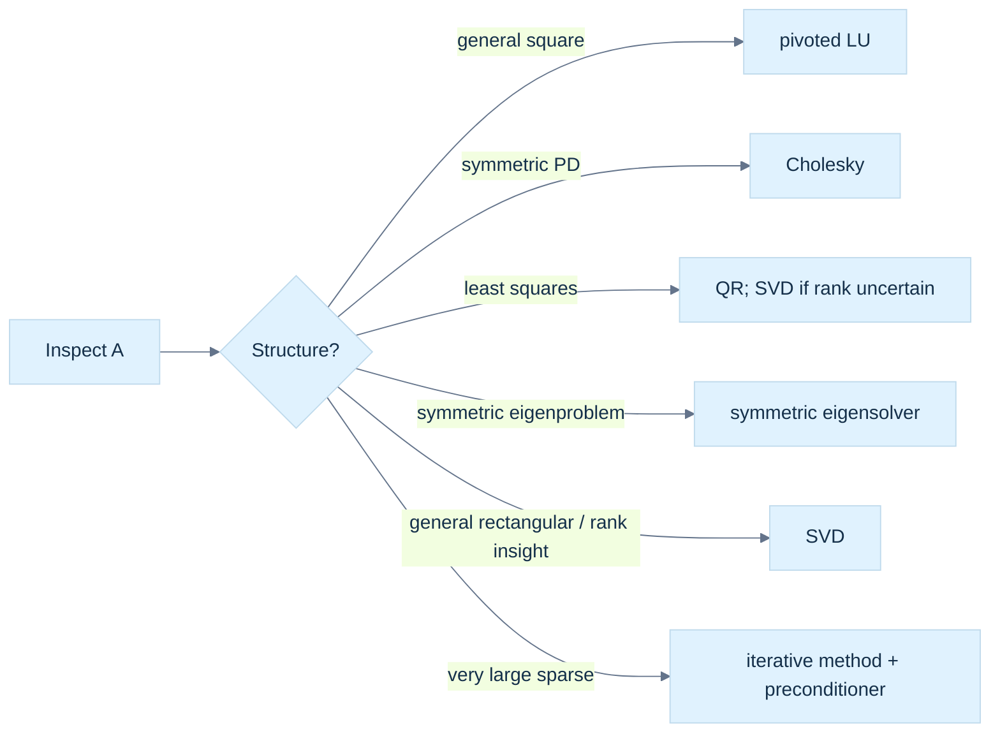
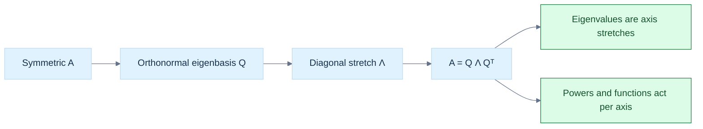

# 20 — Choose Matrix Factorizations from Structure

[[Chapter Edition/01 - Computing Foundations/00 - Reading Map|Reading map]] · [[Chapter Edition/01 - Computing Foundations/19 - Coordinate Frames and Linear Systems|Previous chapter]] · [[Chapter Edition/01 - Computing Foundations/21 - Multivariable Derivatives and Sensitivity|Next chapter]]

Before solving a system, inspect symmetry, definiteness, shape, sparsity, and repeated right-hand sides. This chapter compares decompositions and their domains, then connects those structural promises to downstream numerical tasks.

**By the end:** Select a factorization based on the matrix’s verified properties and explain when its assumptions fail.

**Recall question:** What property allows Cholesky factorization, and what should the solver do when that property is absent?

<!-- Derived from Continuous Notes/Computing Foundations - From Bits to C++ and Systems APIs.md; source lines 44575–46369; source-span SHA256 1cb4f1fe122092d026d946e499755021c659df8b061e538166acf8e2234fa251. -->

<!-- CHAPTER-SOURCE-BEGIN -->
## Structure makes a decomposition a better tool than generic elimination

Before choosing an algorithm, ask what the matrix promises. Symmetry, positive definiteness, rectangular shape, sparsity, and repeated right-hand sides each change the most useful representation.

A real symmetric matrix satisfies $A=A^\mathsf T$. It is **positive definite (PD)** when $\mathbf x^\mathsf T A\mathbf x>0$ for every nonzero $\mathbf x$, and **positive semidefinite (PSD)** when the value is merely nonnegative. A Gram matrix $B^\mathsf T B$ is PSD because $\mathbf x^\mathsf T B^\mathsf T B\mathbf x=\|B\mathbf x\|_2^2\ge0$. If $B$ has a nontrivial null vector, the Gram matrix is singular. Covariance matrices are PSD for the same sum-of-squares reason.

For symmetric positive-definite $A$, **[[Chapter Edition/01 - Computing Foundations/20 - Choose Matrix Factorizations from Structure#Positive definiteness is a structural promise|Cholesky factorization]]** writes $A=LL^\mathsf T$ with lower-triangular $L$. It uses symmetry, stores less work than general LU, and avoids pivoting under the mathematical assumptions. If a computed diagonal square-root argument is nonpositive, that is diagnostic evidence: the input may not be PD, may be badly scaled, or roundoff may have exposed a fragile assumption. Do not silently clamp a materially negative value and claim a valid Cholesky factor.

For symmetric indefinite matrices, **LDL$^\mathsf T$** represents $A=LDL^\mathsf T$ without square roots in the diagonal factor. Robust practical algorithms may require symmetric permutations and 1-by-1 or 2-by-2 diagonal blocks; a bare unpivoted scalar LDL$^\mathsf T$ is not a universal indefinite solver. Positive semidefinite matrices can be singular, so a decomposition must handle zero pivots or use a method designed for rank deficiency.

**[[Chapter Edition/01 - Computing Foundations/20 - Choose Matrix Factorizations from Structure#Reflections and plane rotations build QR without losing lengths|QR factorization]]** writes $A=QR$, where the columns of $Q$ are orthonormal and $R$ is upper triangular (or trapezoidal for rectangular matrices). It separates a coordinate change that preserves lengths from the remaining triangular solve. Gram–Schmidt explains the geometry by repeatedly subtracting projections, but classical Gram–Schmidt can lose orthogonality in floating point. Modified Gram–Schmidt improves behavior; Householder reflectors are a stable dense workhorse; Givens rotations efficiently eliminate selected entries and are useful for incremental or structured problems.

For overdetermined measurements $A\mathbf x\approx\mathbf b$, least squares chooses $\mathbf x$ minimizing $\|A\mathbf x-\mathbf b\|_2$. With full column rank, QR gives $A=QR$ and orthogonality yields

$$
\|A\mathbf x-\mathbf b\|_2^2
=\|R\mathbf x-Q^\mathsf T\mathbf b\|_2^2
+\|(I-QQ^\mathsf T)\mathbf b\|_2^2.
$$

Here $Q$ is the reduced $m\times n$ factor with $Q^\mathsf TQ=I_n$. The second term is the part of the measurements outside the column space. It does not depend on $\mathbf x$, so minimizing the first term gives the same minimizer. The two objective functions generally have different minimum values; the unavoidable perpendicular residual must be retained when reporting fit quality.

The residual is perpendicular to the column space: $A^\mathsf T(A\widehat{\mathbf x}-\mathbf b)=0$. The **normal equations** solve $A^\mathsf T A\mathbf x=A^\mathsf T\mathbf b$, but $\kappa_2(A^\mathsf T A)=\kappa_2(A)^2$ for full-column-rank $A$. Squaring the condition number can destroy useful digits; QR is generally safer, while SVD handles rank deficiency more explicitly.

### Figure L4 - Matrix structure determines the useful factorization



> **How to read Figure L4.** No decomposition wins on every matrix. The structural facts are inputs to algorithm selection, not implementation trivia.


<!-- end V08.16 -->


### Immediate footing — probability density

A probability density $p(x)$ describes a continuous random quantity. It is nonnegative and integrates to one; an interval probability is its area, $P(a\le X\le b)=\int_a^b p(x)\,dx$, not the density value at one point. A uniform density on $[0,1]$ has $p(x)=1$ there, giving $P(0.2\le X\le0.5)=0.3$. Densities have inverse units, such as per meter, so their values need not be at most one. Discrete probabilities instead assign mass to outcomes and sum to one.

[[Chapter Edition/01 - Computing Foundations/23 - Probability Models and Measurement Error#2. Random quantities and their probability laws|Full explanation and worked examples in this book]]


### Immediate footing — Gaussian distribution

A Gaussian (normal) distribution is a continuous bell-shaped probability model specified by mean $\mu$ and variance $\sigma^2$. Its density is $p(x)=\frac{1}{\sqrt{2\pi\sigma^2}}e^{-(x-\mu)^2/(2\sigma^2)}$. About $68\%$ of a one-dimensional Gaussian's probability lies within one standard deviation of its mean. In multiple dimensions, the mean is a vector and covariance controls spread and orientation. Gaussian assumptions are useful approximations, not universal facts; outliers, truncation, or multiple modes can make them misleading.

[[Chapter Edition/01 - Computing Foundations/23 - Probability Models and Measurement Error#4. Discrete and continuous distribution families|Full explanation and worked examples in this book]]


### Immediate footing — Monte Carlo estimation

Monte Carlo estimation uses random samples to approximate an expectation or integral. If independent samples $X_i$ follow the intended distribution, the average $N^{-1}\sum_{i=1}^N g(X_i)$ estimates $E[g(X)]$. With finite variance $\sigma^2$, the average has variance $\sigma^2/N$; four times as many samples halves its standard deviation. This describes random uncertainty, not model bias or arithmetic error. Sampling from a different density requires the appropriate weights and support. Repeating a fixed seed makes a computation reproducible, but does not prove independence or accuracy.

[[Chapter Edition/01 - Computing Foundations/30 - Monte Carlo Estimates and Uncertainty Metrics#8. Monte Carlo estimates trade computation for uncertainty|Full explanation and worked examples in this book]]

<!-- begin V08.17 -->
## Positive definiteness is a structural promise

A real symmetric matrix is positive definite (PD) when $x^\mathsf T A x>0$ for every nonzero $x$; positive semidefinite (PSD) replaces strict inequality with $\ge0$. The quadratic form is energy-like: positivity says no nonzero direction has zero or negative energy. For symmetric matrices, positive eigenvalues are equivalent to PD. A Gram matrix $B^\mathsf T B$ is PSD because $x^\mathsf T B^\mathsf T Bx=\|Bx\|_2^2\ge0$. It is PD exactly when $B$ has full column rank. Covariance and normal-equation matrices are common PSD examples; rank deficiency makes them singular.

The [[Chapter Edition/01 - Computing Foundations/20 - Choose Matrix Factorizations from Structure#Positive definiteness is a structural promise|Cholesky contract]] is valid only when this strict positivity promise holds.

Cholesky uses the stronger PD promise. It factors

$$
A=LL^\mathsf T
$$

with lower triangular $L$ and positive diagonal. Symmetry means only half the entries need be computed. Equating entries in the product yields the recurrence, for $j<i$,

$$
l_{ij}=\frac{a_{ij}-\sum_{k=0}^{j-1}l_{ik}l_{jk}}{l_{jj}},
$$

and on the diagonal,

$$
l_{ii}=\sqrt{a_{ii}-\sum_{k=0}^{i-1}l_{ik}^2}.
$$

A Schur complement is the remainder after eliminating one block: for $\begin{bmatrix}B&C\\C^\mathsf T&D\end{bmatrix}$ with invertible $B$, the trailing Schur complement is $D-C^\mathsf TB^{-1}C$. In Cholesky, the diagonal radicand $a_{ii}-\sum_{k<i}l_{ik}^2$ is the corresponding scalar remainder after removing contributions from earlier columns. If it is zero or negative, ordinary Cholesky cannot proceed as an SPD factorization. That may indicate a false structural promise, singular PSD input, bad scaling, or rounding. Silently replacing a negative value with zero changes the problem and can hide an important failure.

For a numerical trace, let

$$
A=\begin{bmatrix}4&2\\2&3\end{bmatrix}.
$$

Then $l_{11}=\sqrt4=2$, $l_{21}=2/2=1$, and $l_{22}=\sqrt{3-1^2}=\sqrt2$. Thus

$$
L=\begin{bmatrix}2&0\\1&\sqrt2\end{bmatrix},\qquad
LL^\mathsf T=\begin{bmatrix}4&2\\2&3\end{bmatrix}.
$$

To solve $Ax=(6,5)^\mathsf T$, first $Ly=b$: $y_1=3$, then $3+\sqrt2y_2=5$, so $y_2=\sqrt2$. Next solve $L^\mathsf Tx=y$: $\sqrt2x_2=\sqrt2$, hence $x_2=1$, and $2x_1+x_2=3$, hence $x_1=1$. The original equations return $(6,5)$.

Cholesky costs about half the leading arithmetic of general LU and needs no pivoting when the SPD assumption holds. It is usually the right dense solver for that structure. If a matrix is only nearly SPD due to measured noise, changing it through diagonal jitter or regularization is a modeling decision; it should be visible to the caller, not hidden inside a generic factor routine.

Positive definiteness can also be checked through leading principal minors for a symmetric matrix: every leading principal determinant must be positive. For the $2\times2$ example those checks are $4>0$ and $\det(A)=8>0$, consistent with the successful factorization. In practice, computing determinants is a poor standalone numerical test; Cholesky's pivots are a more useful operational test because they are the very quantities the factorization needs. For PSD matrices, strict positivity can fail. For instance $\begin{bmatrix}1&1\\1&1\end{bmatrix}$ has quadratic form $(x+y)^2$, is PSD, but has null vector $(1,-1)^\mathsf T$. Standard Cholesky reaches a zero final radicand. Rank-revealing or semidefinite-aware methods must decide how to represent that lost direction.

![[Visual Recall/Math Foundations/M08-1_cholesky-whitening.png]]

**M08-1. A covariance ellipse and its whitened coordinates.** For Sigma=[[4,1.2],[1.2,1]], L=[[2,0],[0.6,0.8]], mu=(3,-1), z=(1,1), x=(5,0.4), Mahalanobis squared distance 2, Euclidean squared distance 5.96, and density exp(-1)/(3.2 pi), about 0.0366 for an SPD 2D Gaussian.
This is an original Phase 10 teaching bridge: the Cholesky factor maps standard-normal coordinates into the covariance ellipse, and solving $Lz=x-\mu$ whitens them back. The complete numerical derivation is in [[Chapter Edition/01 - Computing Foundations/24 - Waiting Times, Covariance, and Matrix Decomposition#Original bridge: whiten a covariance ellipse|Phase 10]]. It is not an attributed Strang example.


<!-- end V08.17 -->

<!-- begin V08.18 -->
## LDLT reaches symmetric indefinite matrices

For symmetric matrices, an LDL$^\mathsf T$ factorization writes

$$
A=LDL^\mathsf T,
$$

where $L$ is unit lower triangular and $D$ is diagonal in the simplest no-pivot form. Equating entries in $A=LDL^\mathsf T$ gives the scalar recurrence $d_{jj}=a_{jj}-\sum_{k<j}l_{jk}^2d_{kk}$ and, for $i>j$, $l_{ij}=(a_{ij}-\sum_{k<j}l_{ik}l_{jk}d_{kk})/d_{jj}$. Unlike Cholesky, it uses no square roots, so negative diagonal entries in $D$ can represent negative curvature. For positive-definite $A$, diagonal $D$ entries are positive; for an indefinite matrix, signs reveal mixed curvature. A semidefinite matrix may have zero pivots and be singular. For example, with $A=\begin{bmatrix}2&4\\4&2\end{bmatrix}$, $d_{11}=2$, $l_{21}=4/2=2$, and $d_{22}=2-2^2\cdot2=-6$. Thus $L=\begin{bmatrix}1&0\\2&1\end{bmatrix}$ and $D=\operatorname{diag}(2,-6)$; direct multiplication verifies $LDL^\mathsf T=A$.

Consider the small indefinite matrix

$$
A=\begin{bmatrix}0&1\\1&0\end{bmatrix}.
$$

Its quadratic form is $2xy$, which is positive for some vectors and negative for others. It is invertible, but scalar unpivoted LDL$^\mathsf T$ would begin with a zero first pivot and fail. A symmetric pivoted method moves a suitable diagonal entry into place where possible. Some indefinite matrices require a 2-by-2 block in $D$: Bunch-Kaufman style factorizations use symmetric permutations and block diagonal $D$ so that the algorithm can pivot on a stable pair rather than divide by a weak scalar. Thus $A=LDL^\mathsf T$ with diagonal $D$ is a useful algebraic picture, not a universal robust recipe for every indefinite input.

This is a key contract distinction: Cholesky signals an SPD-specific method; pivoted block LDL$^\mathsf T$ is designed for symmetric indefinite systems. A routine should report permutation and block structure, singularity, and failure status. A bare scalar recurrence can be taught, but it should not be presented as production-safe for arbitrary symmetric matrices.


<!-- end V08.18 -->

<!-- begin V08.19 -->
## Orthogonal coordinates preserve the shape of the problem

The transition from elimination to QR is a transition from changing equations to changing coordinates. For a real matrix $A\in\mathbb R^{m\times n}$ with $m\ge n$, a [[Chapter Edition/01 - Computing Foundations/20 - Choose Matrix Factorizations from Structure#Reflections and plane rotations build QR without losing lengths|QR factorization]] writes

$$
A=QR.
$$

In the reduced form, $Q\in\mathbb R^{m\times n}$ has orthonormal columns, so $Q^\mathsf TQ=I_n$, and $R\in\mathbb R^{n\times n}$ is upper triangular. In the full form, $Q_f\in\mathbb R^{m\times m}$ is orthogonal and $R_f\in\mathbb R^{m\times n}$ has the triangular top block and zero rows beneath it; $A=Q_fR_f$. The full basis includes directions perpendicular to the columns of $A$, while reduced QR keeps just the basis for its column space. Only a square orthogonal matrix has a two-sided inverse identity, $Q^{-1}=Q^\mathsf T$ and $QQ^\mathsf T=Q^\mathsf TQ=I$. A thin rectangular $Q$ satisfies only $Q^\mathsf TQ=I_n$; $QQ^\mathsf T$ is the projector onto its column space, not an identity, so thin $Q$ has no two-sided inverse. In the square case, orthogonality implies length preservation: $\|Qx\|_2^2=x^\mathsf TQ^\mathsf TQx=\|x\|_2^2$. Thus the first factor changes coordinates without distorting Euclidean distances; $R$ holds the scaling and dependencies in triangular form.

Write the columns as $A=[a_1\;a_2\;\cdots\;a_n]$. Gram–Schmidt constructs $q_1,\ldots,q_n$ in sequence. At step $j$, subtract from $a_j$ its components along all already-built $q_i$, then normalize the remainder. If $u_j$ is this remainder, $r_{jj}=\|u_j\|_2$ and $q_j=u_j/r_{jj}$. The coefficient $r_{ij}$ records how much of $a_j$ lies along $q_i$. Since column $a_j$ uses only $q_1$ through $q_j$, entries below the diagonal of $R$ are zero. From $A=QR$ and $Q^\mathsf TQ=I$, $R=Q^\mathsf TA$: each entry is the coordinate of a column of $A$ measured along a basis vector.

For example, let $a_1=(1,1,0)^\mathsf T$ and $a_2=(1,0,1)^\mathsf T$. Then $r_{11}=\sqrt2$ and $q_1=(1,1,0)^\mathsf T/\sqrt2$. The first projection coefficient for the second column is $r_{12}=q_1^\mathsf Ta_2=1/\sqrt2$. Subtracting gives $u_2=a_2-r_{12}q_1=(1/2,-1/2,1)^\mathsf T$, with norm $\sqrt{3/2}=\sqrt6/2$. Therefore $q_2=(1,-1,2)^\mathsf T/\sqrt6$, and

$$
Q=\begin{bmatrix}1/\sqrt2&1/\sqrt6\\1/\sqrt2&-1/\sqrt6\\0&2/\sqrt6\end{bmatrix},\qquad
R=\begin{bmatrix}\sqrt2&1/\sqrt2\\0&\sqrt6/2\end{bmatrix}.
$$

Multiplying the factors recovers the two original columns. This example also shows why reduced $Q$ is rectangular: two independent columns in three-dimensional space need only two basis vectors, while a full orthogonal basis would add a third vector perpendicular to both.

Classical and modified Gram–Schmidt produce the same expressions in exact arithmetic but arrange the floating-point subtractions differently. Classical Gram–Schmidt computes the projections of the original $a_j$ against each $q_i$, then subtracts their sum: $u_j=a_j-\sum_{i<j}(q_i^\mathsf Ta_j)q_i$. Modified Gram–Schmidt starts with $v=a_j$, computes $r_{ij}=q_i^\mathsf Tv$, and immediately updates $v\leftarrow v-r_{ij}q_i$ before measuring the next projection. The next dot product therefore sees a residual from which the previous component has already been removed. In floating point, a dot product and subtraction are rounded; repeated projections of an almost dependent column can leave a small spurious component along an earlier direction. Classical Gram–Schmidt may reuse projection data that has not been updated to reflect those errors, so $Q^\mathsf TQ$ can drift appreciably from identity. Modified Gram–Schmidt usually controls this loss better because each new projection acts on the current residual. It is not immune when columns are extremely dependent, and a second reorthogonalization pass may be useful. Dense, general-purpose QR usually uses Householder reflectors, which maintain orthogonality more reliably and expose operations to efficient matrix kernels.

If $R_{jj}=0$, the current column lies in the span of earlier columns and this unpivoted procedure cannot append another normalized vector. Near zero is also a warning: dividing by a tiny norm magnifies roundoff. This is a rank question, not merely an exception condition. Pivoted QR can reorder columns to expose numerical rank; singular value methods provide a more explicit rank diagnostic. QR conventions may also choose signs differently: replacing a column of $Q$ and the matching row of $R$ by their negatives preserves $A=QR$.


<!-- end V08.19 -->

<!-- begin V08.20 -->
## Reflections and plane rotations build QR without losing lengths

A Householder reflector is a reflection across a hyperplane. Let nonzero $v$ be perpendicular to that plane. Decompose any $x$ into its in-plane part and its perpendicular part: $x=x_\parallel+x_\perp$, where $x_\perp=(v^\mathsf Tx)/(v^\mathsf Tv)\,v$. Reflection leaves the first part fixed and reverses the second, so $Hx=x_\parallel-x_\perp=x-2x_\perp$. Thus

$$
H=I-2\frac{vv^\mathsf T}{v^\mathsf Tv}.
$$

With unit $v$, this is $H=I-2vv^\mathsf T$. It is symmetric, $H^\mathsf T=H$, and self-inverse: $H^2=(I-2vv^\mathsf T)^2=I-4vv^\mathsf T+4v(v^\mathsf Tv)v^\mathsf T=I$. Hence $H^\mathsf TH=I$. This proof explains the numerical attraction: reflecting changes neither vector lengths nor angles, even though it can zero many entries at once.

To zero the tail of a vector $x\in\mathbb R^k$, seek a reflector taking it to $\alpha e_1$, where $e_1=(1,0,\ldots,0)^\mathsf T$. Set $u=x-\alpha e_1$ and reflect about the normal $u$. The reflector maps $x$ onto the target because $x$ and $\alpha e_1$ have the same norm and their difference defines the reflection direction. Choose $\alpha=-\operatorname{copysign}(\|x\|_2,x_1)$, which avoids cancellation by making $x_1-\alpha$ add magnitudes. Handle $x_1=0$ explicitly by taking $\alpha=-\|x\|_2$; if the entire active vector has zero norm, skip the reflector because its tail is already zero. If $x_1$ is positive and close to $\|x\|$, the alternative $u=x-\|x\|e_1$ subtracts two nearly equal numbers and can lose most significant digits. The negative sign instead makes the first component of $u$ add magnitudes. The norm itself must be computed with scaling or a stable norm routine so squaring huge or tiny components does not overflow or underflow. In a compact formulation, normalize the vector safely and store $H=I-\tau v v^\mathsf T$; applying it requires $z=v^\mathsf Tx$, then $x\leftarrow x-\tau vz$, without ever constructing the dense identity-sized matrix.

Householder QR applies such a reflector to the active part of each successive column. $H_1$ zeros rows 2 through $m$ in column 1. A reflector $H_2$ embedded in rows 2 through $m$ then zeros the entries below the diagonal in column 2 without disturbing the already-finished first column. Continuing gives $H_k\cdots H_2H_1A=R$. Since each reflector is orthogonal and its own inverse, $A=H_1H_2\cdots H_kR$; the product of reflectors is $Q$. Dense implementations do not form each $H_i$ or usually the full $Q$. They overwrite the upper triangle with $R$, store each reflector's tail below the diagonal (the leading one is implicit), and keep its scalar $\tau_i$ in a separate vector. Applying $Q$ or $Q^\mathsf T$ means applying these stored reflectors in the appropriate order. For $m\ge n$, dense Householder QR costs about $2mn^2-\tfrac23n^3$ floating point operations; its storage stays on the order of the original matrix rather than adding a second full square matrix. The orthogonal sequence is backward stable in the usual sense: the computed factors correspond closely to a nearby input, though the forward accuracy still depends on conditioning.

Givens rotations offer a local alternative. To annihilate $b$ beneath $a$, choose

$$
G=\begin{bmatrix}c&s\\-s&c\end{bmatrix},\quad
r=\operatorname{hypot}(a,b),\quad c=a/r,\quad s=b/r,
$$

If $r=0$, both entries already vanish and the rotation is skipped; otherwise $G(a,b)^\mathsf T=(r,0)^\mathsf T$. The function $\operatorname{hypot}$ computes $\sqrt{a^2+b^2}$ with scaling that avoids the overflow and underflow risks of the naive expression. The rotation touches just two selected rows and leaves all other rows unchanged. Householder is efficient for dense panels because one reflection removes a whole column tail; Givens can be better when the matrix is sparse, only a few entries need removal, or a new row arrives and the existing QR factor should be updated without rebuilding it. Both use orthogonal transformations, so both preserve Euclidean geometry.


<!-- end V08.20 -->

<!-- begin V08.21 -->
## QR turns least squares into a triangular solve plus an irreducible residual

For an overdetermined system $Ax\approx b$, with $A\in\mathbb R^{m\times n}$ and $m>n$, least squares seeks $\hat x$ minimizing $\|Ax-b\|_2$. Assume first that $A$ has full column rank and use reduced QR, $A=QR$. The columns of $Q$ form an orthonormal basis for $\operatorname{Col}(A)$. Decompose $b$ into its projection onto that column space, $QQ^\mathsf Tb$, and its perpendicular part $b_\perp=(I-QQ^\mathsf T)b$. Since $Q^\mathsf Tb_\perp=0$,

$$
Ax-b=Q(Rx-Q^\mathsf Tb)-b_\perp
$$

is a sum of perpendicular vectors. By Pythagoras,

$$
\|Ax-b\|_2^2=\|Rx-Q^\mathsf Tb\|_2^2+\|b_\perp\|_2^2.
$$

The second term is independent of $x$ and is generally nonzero: measurements may not lie exactly in the model's column space. Setting $Rx=Q^\mathsf Tb$ makes the first term zero and gives the minimizer. Because $R$ is triangular, solve it by back substitution. Crucially, the minimum residual norm is $\|b_\perp\|_2$, not zero. A derivation that replaces the least-squares objective by $\|Rx-Q^\mathsf Tb\|$ identifies the same minimizer but omits the constant perpendicular component and therefore does not give the original fit error.

At the solution, residual $r=A\hat x-b$ is perpendicular to every column of $A$, so $A^\mathsf Tr=0$, the normal-equation condition. Differentiating $f(x)=\|Ax-b\|_2^2$ gives $\nabla f=2A^\mathsf T(Ax-b)$, leading to $A^\mathsf TAx=A^\mathsf Tb$. This is a valid mathematical characterization, but explicitly forming $A^\mathsf TA$ can be a poor computational choice. In the 2-norm, the condition number $\kappa_2(A)=\|A\|_2\|A^{-1}\|_2$ for an invertible matrix measures the ratio of largest to smallest directional stretch. For full-column-rank rectangular $A$, the analogous ratio is $\sigma_{\max}/\sigma_{\min}$. Since the eigenvalues of $A^\mathsf TA$ are the squared singular values, $\kappa_2(A^\mathsf TA)=\kappa_2(A)^2$. Forming the product also rounds its dot products, which can erase the small differences distinguishing nearly dependent columns. QR avoids that squaring and is normally preferred for reliable least squares; normal equations plus Cholesky may be reasonable when speed and known-good conditioning justify them. SVD is useful when rank is uncertain or small directions must be examined.

A small [[Binary32|binary32]] example shows how forming the normal matrix can lose a direction before the solve starts. Let

$$
A=\begin{bmatrix}1&1\\0&10^{-4}\end{bmatrix},\qquad
A^\mathsf TA=\begin{bmatrix}1&1\\1&1+10^{-8}\end{bmatrix}.
$$

The columns of $A$ are independent, and its determinant is $10^{-4}$. Near one, binary32 spacing is about $1.19\times10^{-7}$, so the computed value $1+10^{-8}$ rounds to one under nearest rounding. The stored normal matrix can become $\begin{bmatrix}1&1\\1&1\end{bmatrix}$, which is singular. The original stored $A$ still distinguishes its columns; forming its Gram matrix erased the tiny squared difference. QR works on $A$ directly and avoids that particular loss, although the original problem's sensitivity still remains.

Conditioning belongs to the mathematical problem: it describes how much the answer can change under small input perturbations. Stability belongs to the algorithm: it describes whether the computation introduces errors beyond those inherent in the problem. A stable algorithm cannot recover information that an ill-conditioned input has already obscured. Conversely, even a well-conditioned problem can be damaged by an unstable algorithm. Orthogonal multiplication is unusually benign in 2-norm because it preserves lengths; it does not mean the whole problem has condition number one, nor does it remove sensitivity from a nearly rank-deficient $A$.


<!-- end V08.21 -->


### Immediate footing — Jacobian

The Jacobian is the matrix of first partial derivatives of a vector-valued function; it maps small input changes to first-order output changes. For $F(x,y)=(x^2+y,xy)$, $J_F(x,y)=\begin{bmatrix}2x&1\\y&x\end{bmatrix}$. At $(1,2)$, a small input change $(0.01,0)$ predicts output change $(0.02,0.02)$. This is a local approximation, not a global identity. The chain rule composes Jacobians in map order: $J_{G\circ F}(x)=J_G(F(x))J_F(x)$.

[[Chapter Edition/01 - Computing Foundations/21 - Multivariable Derivatives and Sensitivity#Jacobians, curvature, and local approximation|Full explanation and worked examples in this book]]


### Immediate footing — Hessian

The Hessian is the matrix of second partial derivatives of a scalar function and describes how its gradient changes. For $f(x,y)=x^2+3y^2$, $H=\begin{bmatrix}2&0\\0&6\end{bmatrix}$. The second-order Taylor term along a small displacement $d$ is $\tfrac12d^THd$; the full approximation is $f(x+d)\approx f(x)+\nabla f(x)^Td+\tfrac12d^THd$. Positive curvature in every nonzero direction gives a strict local bowl. The Hessian requires appropriate second derivatives, and inaccurate curvature estimates can make optimization updates unstable.

[[Chapter Edition/01 - Computing Foundations/21 - Multivariable Derivatives and Sensitivity#Jacobians, curvature, and local approximation|Full explanation and worked examples in this book]]

<!-- begin V08.22 -->
## Put the algorithms in a graphics context

The distinctions become concrete in engine work. If a constraint solver has fewer independent constraints than unknown impulses, nullity represents unconstrained combinations. A deformation map that collapses a dimension has a null direction. Camera reconstruction with weak parallax has near-null directions: exact rank may be full, but the estimate is sensitive. A noisy depth fit is often overdetermined; QR or SVD produces a least-squares answer rather than claiming exact consistency. A fixed symmetric positive-definite stiffness matrix reused across time steps invites Cholesky once and repeated triangular solves. An indefinite Hessian in optimization requires a method that recognizes negative curvature, not a Cholesky routine forced through it.

The useful workflow is therefore: characterize the system; distinguish exact inconsistency from rank deficiency and sensitivity; choose the factorization whose assumptions match; track permutations; solve with triangular routines; and report residual and status. Names such as “LU succeeded” are insufficient evidence unless factor convention, pivot behavior, dimensions, and residual are inspectable.

### Scoped algorithm kernels worth retaining

The following sketches are deliberately limited to dense square matrices in memory. They teach the invariants and do not define a complete production API, error policy, sparse algorithm, or GPU implementation.

```text
partial_pivot_LU(A, b):
  piv = [0,1,...,n-1]
  for k = 0 .. n-1:
    p = argmax(i=k..n-1, abs(A[i,k]))
    if A[p,k] is zero or rejected by scale policy: report singular/unsafe
    swap the complete packed rows k,p of A, including earlier L columns
    swap piv[k], piv[p]
    for i = k+1 .. n-1:
      A[i,k] /= A[k,k]                  # packed L multiplier
      for j = k+1 .. n-1:
        A[i,j] -= A[i,k] * A[k,j]       # update active U block
  y = forward solve with implicit unit diagonal, RHS b[piv[i]]
  x = back solve using packed upper triangle
  return packed factors, piv, x, status
```

The row swap is applied to the whole packed row before elimination, which automatically carries the previously stored multipliers with the row. Then factorization can be reused without the particular $b$.

For SPD input, the Cholesky kernel's invariant is that the already-computed columns reconstruct the corresponding leading block of $A$:

```text
cholesky(A):
  for j = 0 .. n-1:
    d = A[j,j] - sum(k=0..j-1, L[j,k]^2)
    require d > 0 under the routine's numeric policy
    L[j,j] = sqrt(d)
    for i = j+1 .. n-1:
      L[i,j] = (A[i,j] - sum(k=0..j-1, L[i,k]*L[j,k])) / L[j,j]
  return L, status
```

After either factorization, reconstruction and solve residuals test different obligations. For LU, compute a scaled measure such as $\|PA-LU\|/(\|A\|+\|L\|\|U\|)$, then separately evaluate $\|Ax-b\|$ against the original, unpermuted inputs. For Cholesky, check symmetry assumptions and $\|A-LL^\mathsf T\|$ plus the original-system residual. A small residual does not certify a well-conditioned answer; perturbation sensitivity remains a property of the problem.


<!-- end V08.22 -->


# Change and uncertainty acquire a mathematical language

Learn spectral directions before Hessian classifications, derivatives and integration before continuous probability densities, and expectation/covariance before statistical principal components. A Jacobian is the coordinate table of local change; a covariance matrix is a table of centered second moments.

<!-- begin V08.23 -->
## Eigenvectors reveal the directions a square map does not turn

For a square matrix $A$, an [[Chapter Edition/01 - Computing Foundations/20 - Choose Matrix Factorizations from Structure#Eigenvalues, eigenspaces, and the two kinds of multiplicity|eigenvector]] $\mathbf v\ne\mathbf0$ and eigenvalue $\lambda$ satisfy

$$
A\mathbf v=\lambda\mathbf v.
$$

The transformation may stretch, shrink, reverse, or annihilate this direction, but it does not turn it into a different direction. Eigenvectors are directions rather than unique vectors: any nonzero scalar multiple is also an eigenvector. The corresponding eigenspace is $\operatorname{Null}(A-\lambda I)$.

If a matrix has enough independent eigenvectors, it is diagonalizable: $A=V\Lambda V^{-1}$. This can simplify repeated powers and matrix functions, but $V$ may be poorly conditioned or not exist as a full basis. A repeated eigenvalue does not guarantee enough eigenvectors. Algebraic multiplicity counts the root's repetition in the characteristic polynomial; geometric multiplicity counts independent eigenvectors. The latter cannot exceed the former.

For real symmetric $A$, the spectral theorem gives an orthonormal eigenbasis: $A=Q\Lambda Q^\mathsf T$. The coordinate change by $Q$ is unusually safe because it preserves Euclidean length and does not magnify 2-norm error. This is the setting where Rayleigh quotients, PCA covariance analysis, and symmetric eigensolvers have especially clean meanings. Orthogonal does not mean error-free; it means the transformation itself does not add condition amplification in the 2-norm.

Iterative eigen methods seek selected spectral information without always computing every eigenpair. **Power iteration** repeatedly applies $A$ and renormalizes; when a unique dominant eigenvalue is separated and the initial vector has a component in its eigendirection, the dominant direction tends to take over. **Inverse iteration** solves shifted systems $(A-\mu I)\mathbf y=\mathbf x$ to emphasize eigenvalues near $\mu$; a good shift can make it fast, but a near-singular solve and factorization cost matter. The **Rayleigh quotient** $\rho(\mathbf x)=\mathbf x^\mathsf T A\mathbf x/(\mathbf x^\mathsf T\mathbf x)$ estimates the eigenvalue associated with a candidate vector for symmetric $A$; a small residual is evidence of an approximate eigenpair, while eigenvalue accuracy also depends on separation and conditioning.

QR iteration repeatedly factors and recombines a matrix to drive it toward a form whose diagonal exposes eigenvalues. Symmetric Jacobi methods apply plane rotations to reduce off-diagonal entries while maintaining orthogonal similarity. Stopping criteria should measure a scaled residual or off-diagonal norm, include a maximum iteration count, and report nonconvergence. A small residual says the computed pair nearly satisfies its equation; it does not, by itself, guarantee a uniquely accurate eigenvector when eigenvalues are tightly clustered. Eigenvalue sensitivity depends on both the problem and the perturbation model.

The characteristic polynomial $\det(A-\lambda I)$ explains eigenvalues algebraically and establishes multiplicity, but directly expanding and solving it is not generally a reliable numerical eigensolver for large matrices. It is a conceptual definition; stable algorithms use transformations and structured iterations.


<!-- end V08.23 -->

<!-- begin V08.24 -->
## Eigenvalues, eigenspaces, and the two kinds of multiplicity

For a square matrix $A$, an eigenvector is a nonzero vector $v$ whose image stays on the same line: $Av=\lambda v$. The scalar $\lambda$ is its eigenvalue. A positive value stretches that direction, a negative value reverses and scales it, and zero annihilates it. Thus zero is an eigenvalue exactly when $A$ has a nontrivial null space, which for a square matrix is equivalent to singularity. Eigenvectors describe directions rather than unique arrows: if $v$ is an eigenvector, every nonzero scalar multiple $cv$ is also one. Rearranging the equation gives $(A-\lambda I)v=0$, so all eigenvectors for $\lambda$ together with zero form the [[Chapter Edition/01 - Computing Foundations/20 - Choose Matrix Factorizations from Structure#Eigenvalues, eigenspaces, and the two kinds of multiplicity|eigenspace]] $E_\lambda=\operatorname{Null}(A-\lambda I)$.

The characteristic polynomial turns this null-space condition into an equation for possible eigenvalues. A nonzero solution to $(A-\lambda I)v=0$ exists only when $A-\lambda I$ is singular, hence $\det(A-\lambda I)=0$. Some conventions instead use $\det(\lambda I-A)$; its roots are identical, though its overall sign may differ. For $A=\begin{bmatrix}a&b\\c&d\end{bmatrix}$, expanding $\det(\lambda I-A)$ gives $\lambda^2-(a+d)\lambda+(ad-bc)$. Therefore the sum of the two roots is $\operatorname{tr}(A)$ and their product is $\det(A)$. In any dimension, trace and determinant respectively give the sum and product of eigenvalues counted with algebraic multiplicity. For a teaching-size example, $A=\begin{bmatrix}2&1\\1&2\end{bmatrix}$ yields $(\lambda-3)(\lambda-1)$; solving the associated null spaces gives directions $(1,1)^\mathsf T$ and $(1,-1)^\mathsf T$.

The algebraic multiplicity of $\lambda$ is how many times it is a root of the characteristic polynomial. Its geometric multiplicity is $\dim\operatorname{Null}(A-\lambda I)=n-\operatorname{rank}(A-\lambda I)$, by rank-nullity. It satisfies $1\le m_g\le m_a$. For $A=2I_2$, the characteristic polynomial is $(\lambda-2)^2$ and every vector is an eigenvector, so both multiplicities are two. For $J=\begin{bmatrix}2&1\\0&2\end{bmatrix}$, the same polynomial has algebraic multiplicity two, but $(J-2I)v=0$ forces $v_2=0$, leaving only one independent eigenvector. $J$ is defective: it cannot be diagonalized. Repetition alone is not the problem; a repeated eigenvalue is harmless if its eigenspace has enough independent directions.

This algebra also makes clear why directly expanding the characteristic polynomial is not a practical large-matrix eigensolver. Coefficients can be highly sensitive to rounding, and solving a high-degree polynomial is itself a numerical problem. The determinant equation defines the eigenvalues and supports exact small examples and theorems. Reliable numerical methods instead apply orthogonal or similarity transformations to the matrix and extract its spectrum from a structured form.


<!-- end V08.24 -->

<!-- begin V08.25 -->
## Diagonalization leads to the stronger symmetric spectral theorem

If an $n\times n$ matrix has $n$ independent eigenvectors $v_i$ with eigenvalues $\lambda_i$, place the vectors in $V=[v_1\;\cdots\;v_n]$ and values in diagonal $\Lambda$. Column by column, $Av_i=\lambda_i v_i$, hence $AV=V\Lambda$. Independence makes $V$ invertible, giving $A=V\Lambda V^{-1}$. This says: convert into eigenvector coordinates, scale each coordinate independently, then convert back. It also gives $A^k=V\Lambda^kV^{-1}$, which can make repeated applications or matrix functions easy to understand. If $V$ is ill-conditioned, however, converting into and out of these coordinates can magnify roundoff. A diagonal formula is not automatically a numerically safe representation.

Real symmetric matrices have a stronger guarantee from the [[Chapter Edition/01 - Computing Foundations/20 - Choose Matrix Factorizations from Structure#Eigenvalues, eigenspaces, and the two kinds of multiplicity|spectral theorem]]. Their eigenvalues are real, and they admit an orthonormal eigenbasis, so $A=Q\Lambda Q^\mathsf T$. One proof of reality begins with a possibly complex eigenvector $z$ satisfying $Az=\lambda z$. Because $A=A^\mathsf T$ is real symmetric, $z^*Az$ is real; but $z^*Az=\lambda z^*z$ and $z^*z>0$, so $\lambda$ is real. For eigenvectors $u,v$ with distinct eigenvalues $\lambda,\mu$, symmetry gives $u^\mathsf TAv=(Au)^\mathsf Tv$. Substitution yields $\mu u^\mathsf Tv=\lambda u^\mathsf Tv$, so $(\lambda-\mu)u^\mathsf Tv=0$ and therefore $u^\mathsf Tv=0$.

Distinct eigenspaces are orthogonal. If an eigenvalue repeats, choose an orthonormal basis within its eigenspace by orthogonalization; the resulting total set is still an eigenbasis. To see that this produces a complete basis rather than only orthogonal pairs, maximize $x^\mathsf TAx$ over the compact unit sphere. At a maximizer $v$, the constrained first-order condition gives $Av=\lambda v$ with real $\lambda$. The orthogonal complement $v^\perp$ is invariant because for $x\perp v$, $v^\mathsf TAx=(Av)^\mathsf Tx=\lambda v^\mathsf Tx=0$. Restrict $A$ to that complement and repeat by induction on dimension. This yields an orthonormal eigenbasis and proves the spectral theorem; the earlier distinct-eigenvalue calculation explains why its separate eigenspaces are orthogonal. The spectral theorem therefore rules out defectiveness for real symmetric matrices.

An orthogonal square matrix satisfies $Q^\mathsf TQ=I$. It preserves inner products because $(Qx)^\mathsf T(Qy)=x^\mathsf Ty$, so lengths and angles are preserved too. Its inverse is $Q^\mathsf T$, its singular values are all one, and thus $\kappa_2(Q)=1$. Taking determinants in $Q^\mathsf TQ=I$ gives $\det(Q)^2=1$, so $\det(Q)=\pm1$; rotations have determinant $+1$, while reflections reverse orientation and have determinant $-1$. These facts explain why orthogonal eigenvectors and transformations are so useful numerically, but they do not imply that every matrix being diagonalized is well-conditioned.

For symmetric $A$, the quadratic form exposes the spectral meaning directly. Write $x=Qy$; then $x^\mathsf TAx=y^\mathsf T\Lambda y=\sum_i\lambda_i y_i^2$. Thus $A$ is positive definite exactly when every eigenvalue is positive, and positive semidefinite exactly when none is negative. The axes of a covariance ellipsoid or inertia tensor are its orthonormal eigenvectors; the associated eigenvalues give variance or inertia along those axes. When eigenvalues are repeated, individual eigenvectors within that repeated subspace are not unique, though the subspace is.

### Figure L5 - Eigenanalysis is cleanest when the basis is orthonormal



> **How to read Figure L5.** Symmetry guarantees perpendicular eigen-directions, so the diagonal form is a genuine orthonormal coordinate change rather than an unstable oblique one.


<!-- end V08.25 -->

<!-- begin V08.26 -->
## Iteration extracts selected eigenpairs without solving a polynomial

Power iteration is the simplest way to reveal a dominant eigenvector. Suppose $A$ is diagonalizable with eigenvectors $v_i$ and $|\lambda_1|>|\lambda_2|\ge\cdots$. Express an initial vector as $x_0=\sum_i c_i v_i$, with $c_1\ne0$. Repeated multiplication gives $A^kx_0=\lambda_1^k[c_1v_1+\sum_{i>1}c_i(\lambda_i/\lambda_1)^kv_i]$. The ratios shrink, so after normalizing to prevent overflow or underflow, the direction approaches $v_1$. The leading direction error is typically governed by $|\lambda_2/\lambda_1|^k$: a separated dominant magnitude converges quickly, while a ratio near one converges slowly. If $c_1=0$, the dominant direction is absent forever; if two eigenvalues tie in magnitude, oscillation or convergence to a mixture can occur. A negative dominant eigenvalue can flip the sign each step without changing the represented line. Once a normalized vector $x_k$ is available, estimate its eigenvalue with a Rayleigh quotient.

Inverse iteration targets a chosen spectral neighborhood. If $Av_i=\lambda_i v_i$, then $(A-\mu I)^{-1}v_i=(\lambda_i-\mu)^{-1}v_i$. Eigenvalues near shift $\mu$ become large in the transformed operator, so its dominant direction corresponds to the eigenvalue nearest the shift. The actual algorithm does not form the inverse: solve $(A-\mu I)y_k=x_k$ using a factorization, normalize $y_k$ to obtain the next vector, and repeat. A shift close to the desired eigenvalue improves selectivity but makes the linear system nearly singular; a factorization can be reused if the shift is fixed. Rayleigh quotient iteration updates the shift from the current vector and can converge very quickly for symmetric problems near an eigenvector, at the cost of a new shifted solve per step.

For symmetric $A$ and nonzero $x$, the Rayleigh quotient is $\rho(x)=x^\mathsf TAx/(x^\mathsf Tx)$. If $x$ is an eigenvector, substitution gives its exact eigenvalue. Expand a unit $x$ in an orthonormal eigenbasis, $x=\sum_i c_i v_i$, with $\sum_i c_i^2=1$. Then $\rho(x)=\sum_i\lambda_i c_i^2$, a weighted average of eigenvalues, so it lies between the smallest and largest. This makes it a useful estimate with a geometric interpretation: the quadratic form's value per unit squared length in direction $x$. For a symmetric matrix, if $x$ makes a small angle with a simple eigenvector, the eigenvalue estimate can be second-order accurate in that angle, while the vector's own directional error is first order.


<!-- end V08.26 -->

<!-- begin V08.27 -->
## QR iteration and Jacobi rotations preserve the spectrum while simplifying shape

QR iteration applies factorization repeatedly to drive a matrix toward a form revealing its eigenvalues. Starting with $A_k=Q_kR_k$, define $A_{k+1}=R_kQ_k$. Since $Q_k$ is orthogonal, $A_{k+1}=Q_k^\mathsf TA_kQ_k$, a similarity transform, so it has exactly the same eigenvalues. The accumulated basis $Z_{k+1}=Z_kQ_k$ tracks eigenvectors. For symmetric matrices, the iterates remain symmetric and, under suitable conditions, approach a diagonal matrix. Convergence is not automatic: a practical shifted QR solver checks subdiagonal residuals, uses deflation and a finite iteration budget, and returns a nonconvergence status if its target criterion is not met. For a general real matrix, a successful target is real Schur form: orthogonal similarity produces an upper quasi-triangular matrix with 1-by-1 blocks for real eigenvalues and 2-by-2 blocks for complex-conjugate pairs. Such a 2-by-2 block is a converged Schur representation, not an unfinished scalar diagonal. This is why “read the diagonal” is not a complete account for a real nonsymmetric problem.

A production QR eigensolver first reduces a dense matrix by Householder similarity transformations to Hessenberg form, where entries below the first subdiagonal are zero. This costs cubic work once; subsequent QR sweeps exploit the banded structure and cost quadratic work. For a symmetric matrix, reduction yields tridiagonal form. Shifts choose a nearby spectral target and accelerate convergence. When a subdiagonal coupling becomes tiny relative to neighboring diagonal scale, deflation treats it as zero and splits the active problem into smaller blocks. This preserves the practical spectrum to working precision while reducing future work. Accumulated orthogonal transformations allow eigenvectors to be recovered if requested. For a 2-by-2 real block with complex eigenvalues, the block itself is the meaningful real Schur representation; forcing two real scalar diagonal entries would be impossible.

The Jacobi algorithm is a direct symmetric alternative. For a selected off-diagonal pair $\gamma=a_{pq}=a_{qp}$, it constructs a plane rotation affecting only coordinates $p$ and $q$ and applies $A'=J^\mathsf TAJ$. Orthogonal similarity preserves eigenvalues, and symmetry is preserved because $(J^\mathsf TAJ)^\mathsf T=J^\mathsf TAJ$. To keep one consistent rotation convention, take the 2-by-2 block $B=\begin{bmatrix}\alpha&\gamma\\\gamma&\beta\end{bmatrix}$ and

$$
J=\begin{bmatrix}c&s\\-s&c\end{bmatrix},\qquad c=\cos\theta,\quad s=\sin\theta.
$$

Then the transformed off-diagonal entry is $\gamma'=(\alpha-\beta)cs+\gamma(c^2-s^2)$. Set it to zero and divide by $c^2$ (when $c\ne0$): with $t=s/c$, $\gamma t^2+(\beta-\alpha)t-\gamma=0$. Define $\tau=(\beta-\alpha)/(2\gamma)$. The stable small-magnitude root is

$$
t=\operatorname{sign}(\tau)\big/(|\tau|+\sqrt{1+\tau^2}),\qquad c=1/\sqrt{1+t^2},\qquad s=tc.
$$

When $\tau=0$, choose either equal-magnitude root consistently, for example $t=1$. Evaluate $\sqrt{1+\tau^2}$ as $\operatorname{hypot}(1,\tau)$ to avoid overflow; computing $\tau=(\beta-\alpha)/(2\gamma)$ also needs care if subtraction or doubling overflows or underflows, so scale the three block entries by a shared magnitude before forming the ratio. If $\gamma=0$, no rotation is needed. This convention gives $p'=cp-sq$ and $q'=sp+cq$ for the two rotated coordinates. The resulting diagonal values of the transformed block are its eigenvalues; the same rotation updates the corresponding rows and columns of the full matrix and the accumulated eigenvector matrix.

For example, with $\alpha=4$, $\beta=2$, and $\gamma=1$, $\tau=-1$, hence $t=-1/(1+\sqrt2)=-(\sqrt2-1)$. The angle has negative tangent under this declared $J$ convention, and substitution into $\gamma'=(4-2)cs+(c^2-s^2)$ gives zero. Signs in descriptions of Jacobi rotations vary because authors may transpose $J$ or define the coordinate update oppositely; the matrix and formula must be kept consistent. Each rotation removes one selected coupling, but modifies other entries in rows and columns $p$ and $q$. Repeated sweeps reduce off-diagonal energy. A common strategy annihilates the largest off-diagonal magnitude; cyclic sweeps visit every pair in a fixed order. The Frobenius norm of off-diagonal entries is a natural progress measure. Jacobi is simple, parallelizable in variants, and often gives excellent eigenvectors, while classical dense QR-based solvers are usually more efficient at large sizes.


<!-- end V08.27 -->

<!-- begin V08.28 -->
## Residuals distinguish backward accuracy from forward certainty

For an approximate eigenpair $(\hat\lambda,\hat v)$, its residual is $r=A\hat v-\hat\lambda\hat v$. If $r=0$, it is exact. A small residual means the pair is an exact eigenpair of a nearby matrix: for normalized $\hat v$, define $E=-r\hat v^\mathsf T$, so $(A+E)\hat v=\hat\lambda\hat v$ and $\|E\|_2=\|r\|_2$. This is a backward-error statement. It does not by itself say how close $\hat\lambda$ and $\hat v$ are to a particular exact eigenpair of the original matrix; that is forward error and depends on conditioning and spectral separation.

Residuals must be scaled. One dimensionless check is $\|A\hat v-\hat\lambda\hat v\|_2/((\|A\|_2+|\hat\lambda|)\|\hat v\|_2)$, with a safe zero-scale policy. For eigenvalue iteration, changes between successive estimates, $|\lambda_{k+1}-\lambda_k|$, can supplement the residual but cannot replace it: values can stagnate while the vector remains poor. Eigenvector comparisons must account for sign because $v$ and $-v$ are the same direction; for normalized vectors, $|v_k^\mathsf Tv_{k+1}|$ measures alignment independent of sign. For a symmetric decomposition $A\approx Q\Lambda Q^\mathsf T$, check reconstruction error and orthogonality error $\|Q^\mathsf TQ-I\|$ as distinct invariants. Checking only that each column has unit length misses non-orthogonality between columns. Jacobi may monitor $\operatorname{off}(A)/\|A\|_F$, where $\operatorname{off}(A)^2=\sum_{i\ne j}a_{ij}^2$. QR deflation checks subdiagonal entries against their local scale. All iterative methods need a maximum iteration or sweep count and a failure status; “not converged” is a meaningful result.

A small residual can coexist with a substantially uncertain eigenvector. If two eigenvalues are clustered, small perturbations can rotate the individual eigenvectors greatly within their nearly shared invariant subspace. The subspace may remain stable even though no particular basis vector is. This is why a solver's returned vectors need not match another implementation's signs or basis choices for repeated and clustered eigenvalues. Assess the invariant subspace and eigengap when that distinction matters.


<!-- end V08.28 -->

<!-- begin V08.29 -->
## Sensitivity depends on left and right eigenvectors

The condition number of a linear solve describes amplification in its input-output relation; eigenvalues have their own sensitivity. A right eigenvector satisfies $Av=\lambda v$. A left eigenvector satisfies $w^\mathsf TA=\lambda w^\mathsf T$, equivalently $A^\mathsf Tw=\lambda w$ for a real matrix. For a simple real eigenvalue $\lambda$ and its real left/right eigenvectors, under a small real perturbation $E$, suppose the eigenvalue and vector change by $\delta\lambda$ and $\delta v$. The first-order formula below is local to a simple eigenvalue; at a repeated or defective eigenvalue, eigenvalue branches may split and need not have this derivative. For a complex simple eigenvalue of a real matrix, use conjugate transpose $w^*$ in place of $w^\mathsf T$ and the corresponding complex left eigenvector. Keeping only first-order terms in $(A+E)(v+\delta v)=(\lambda+\delta\lambda)(v+\delta v)$ gives $(A-\lambda I)\delta v+Ev\approx\delta\lambda v$. Left-multiply by $w^\mathsf T$: since $w^\mathsf T(A-\lambda I)=0$, the vector-change term vanishes, leaving

$$
\delta\lambda\approx\frac{w^\mathsf TEv}{w^\mathsf Tv}.
$$

For a complex simple eigenvalue, the corresponding formula is $\delta\lambda\approx(w^*Ev)/(w^*v)$, with $w^*A=\lambda w^*$. For the simple real case, under the induced 2-norm, the eigenvalue sensitivity factor is $\|w\|_2\|v\|_2/|w^\mathsf Tv|$. If normalized left and right eigenvectors are nearly perpendicular, the denominator is tiny and small matrix perturbations can produce large eigenvalue changes. This is common for non-normal matrices, those not satisfying $AA^\mathsf T=A^\mathsf TA$. In a real symmetric problem, a normalized eigenvector can serve as both left and right vector, so $w^\mathsf Tv=v^\mathsf Tv=1$; eigenvalues are optimally conditioned to first order in the spectral norm. More generally, symmetric perturbations obey Weyl's bound: ordered eigenvalues move by no more than $\|E\|_2$.

The distinction between residual and forward accuracy follows directly. A computed eigenpair with a tiny residual is a good solution to a nearby problem. If its target eigenvalue is isolated and well-conditioned, that also supports a close answer for the original problem. If the matrix is non-normal or the eigenvalue is tightly clustered, the same residual may not determine a unique nearby vector. Report residual and, when needed, separation or a subspace error; do not infer exact vector accuracy from one scalar residual.

The story now connects constraints, decompositions, and spectra. QR uses orthogonal changes to avoid amplifying 2-norm errors; least squares projects onto the reachable column space and retains the irreducible perpendicular residual; normal equations square the stretch ratio and can lose information. Eigenvectors identify invariant directions, multiplicity counts how many independent such directions exist, and diagonalization uses them as coordinates. Symmetry upgrades that basis to an orthonormal one, making the spectral representation numerically clean. Iterative methods exploit dominant directions, shifts, or orthogonal similarities rather than expanding a polynomial. Convergence is evidenced by residuals and structure checks, while sensitivity explains what data precision can support.

Ordinary eigendecomposition still does not analyze every linear map. If $A$ is rectangular, $Av$ and $v$ live in different spaces, so $Av=\lambda v$ is not dimensionally defined. A square matrix can be defective and have too few eigenvectors. A diagonalizable matrix can still have a badly conditioned eigenvector basis. Its eigenvalues may also be complex even when its entries are real. The next general decomposition must describe input and output directions separately, work for rectangular maps, and use orthonormal directions with nonnegative stretches. That requirement motivates the singular value decomposition without needing its formula yet.


<!-- end V08.29 -->

<!-- begin V08.30 -->
## Why eigenvectors, coordinates, and condition numbers connect

Similarity explains why changing coordinates preserves eigenvalues. If $B=S^{-1}AS$ with invertible $S$ and $Av=\lambda v$, then $B(S^{-1}v)=S^{-1}Av=\lambda(S^{-1}v)$. Thus the corresponding eigenvector in the new coordinate system is $S^{-1}v$, while $\lambda$ is unchanged. The characteristic polynomial sees the same fact: $\det(B-\lambda I)=\det(S^{-1}(A-\lambda I)S)=\det(A-\lambda I)$ because determinants multiply and $\det(S^{-1})\det(S)=1$. The matrix may look different in the new basis, but the linear map's eigenvalues do not.

Distinct eigenvalues force independent eigenvectors. Suppose $v_1,\ldots,v_k$ correspond to distinct $\lambda_i$, and assume for contradiction there is a nontrivial dependence with the fewest terms, $\sum_{i=1}^k c_iv_i=0$, where all listed $c_i\ne0$. Apply $A-\lambda_kI$: the $k$th term vanishes and leaves $\sum_{i=1}^{k-1}c_i(\lambda_i-\lambda_k)v_i=0$. At least one coefficient remains nonzero, producing a dependence with fewer terms, a contradiction. Hence distinct-eigenvalue vectors are independent. Repeated values require a separate count: the algebraic multiplicity says how many roots occur, while geometric multiplicity says how many independent vectors actually exist. A matrix is diagonalizable exactly when it has a full basis of eigenvectors, equivalently the sum of geometric multiplicities across its distinct eigenvalues is $n$. For each eigenvalue, geometric multiplicity cannot exceed algebraic multiplicity, and the two are equal for every eigenvalue precisely when enough eigenvectors are available.

The condition number makes the danger of a skewed eigenbasis quantitative. If $A=V\Lambda V^{-1}$, then $A^kx=V\Lambda^kV^{-1}x$. In exact arithmetic this cleanly separates independent scalar powers. In floating point, the computed coordinates pass through $V^{-1}$ and then back through $V$. When columns of $V$ nearly point in the same direction, a small perturbation in the represented vector can cause large coordinate changes; $\kappa_2(V)=\|V\|_2\|V^{-1}\|_2$ measures that amplification. Thus the matrix may have a mathematically valid diagonalization while the decomposition is poor for computation. In the symmetric spectral theorem, $V$ can be chosen orthogonal, so $\kappa_2(V)=1$ and this source of amplification disappears.

For a linear solve, the same condition number follows from the perturbation equations. Starting from $Ax=b$ and perturbed $b+\delta b$, the solution change obeys $A\delta x=\delta b$. Therefore $\|\delta x\|\le\|A^{-1}\|\|\delta b\|$. Since $b=Ax$, $\|b\|\le\|A\|\|x\|$, which rearranges to $\|x\|\ge\|b\|/\|A\|$. Combining these gives the relative bound $\|\delta x\|/\|x\|\le\kappa(A)\,\|\delta b\|/\|b\|$. This is a worst-case first-order amplification bound, not a promise that every perturbation reaches the worst case. Geometrically, if $A$ stretches one unit direction by 1 and another by $10^{-6}$, inverting it magnifies the weak direction by $10^6$; the stretch ratio is the condition number. Normal equations square this ratio because $A^\mathsf TA$ has eigenvalues equal to squared stretches.

An error budget makes the distinction practical. Suppose a measurement has relative uncertainty around $10^{-8}$ and the system's condition number is about $10^6$. The worst-case relative solution change can be on the order of $10^{-2}$ before counting algorithmic rounding. A solver with tiny backward error cannot claim eight accurate solution digits, because input uncertainty has already made the answer sensitive. Conversely, if the problem is well-conditioned but an algorithm forms large cancelling quantities, poor forward accuracy can be caused by the computation rather than the problem. For eigensolvers, the analogous separation is residual (backward accuracy) versus eigenvalue/eigenvector sensitivity (forward accuracy).

A compact worked power iteration illustrates how the formulas predict actual steps. Let $A=\operatorname{diag}(4,1)$ and $x_0=(1,1)^\mathsf T$. Then $Ax_0=(4,1)^\mathsf T$, whose normalized direction is $(4,1)^\mathsf T/\sqrt{17}$. After another multiplication the unnormalized vector is $(16,1)^\mathsf T$, whose direction is closer to $(1,0)^\mathsf T$. After $k$ multiplies the ratio of the second coordinate to the first is $4^{-k}$, exactly the predicted $|\lambda_2/\lambda_1|^k$. The Rayleigh quotient at the first normalized step is $(4\cdot16+1\cdot1)/17=65/17$, close to 4 but not exact; as the second component decays, the quotient approaches 4. If instead the initial vector were $(0,1)^\mathsf T$, every iterate would remain there and return eigenvalue 1, demonstrating the missing-dominant-component failure concretely.

A two-by-two shifted inverse step shows why one solves rather than forms an inverse. For $A=\operatorname{diag}(4,1)$ and shift $\mu=0.9$, $(A-\mu I)y=x$ divides the first coordinate by $3.1$ and the second by $0.1$. After normalization, the component associated with eigenvalue 1 is amplified relative to the other by a factor $31$. Repeating rapidly isolates that direction. An explicit inverse would contain the same divisions but is unnecessary: factor once, solve each right-hand side, and retain the direct linear-system operation. If the shift were exactly 1, the matrix would be singular; near 1, roundoff and solve errors may be magnified. Shift selection is therefore both the mechanism of targeting and a conditioning decision.


<!-- end V08.30 -->

<!-- begin V09.00 -->
## From Local Change to Reliable Motion: Calculus and Optimization

#### How to read this volume

A reader can revisit the earlier geometry foundations through [[Chapter Edition/01 - Computing Foundations/17 - Python and Numerical Tools for Graphics Systems#The dot product turns two movements into a measurement|dot products and vector projections]], [[Chapter Edition/01 - Computing Foundations/18 - Vectors for Light and Frames#A normal is a measuring rule before it is an arrow|normals]], and [[Chapter Edition/01 - Computing Foundations/18 - Vectors for Light and Frames#Homogeneous coordinates preserve the role of a location|homogeneous coordinates]]. Phase 7 supplies the frame and rotation machinery used by local camera derivatives: [[Chapter Edition/01 - Computing Foundations/18 - Vectors for Light and Frames#A frame combines directions with a place to stand|frames]], [[Chapter Edition/01 - Computing Foundations/19 - Coordinate Frames and Linear Systems#A camera is another frame, so viewing uses its inverse|camera frames]], and [[Chapter Edition/01 - Computing Foundations/19 - Coordinate Frames and Linear Systems#Composition remembers which frame a new turn belongs to|rotation composition]]. Phase 8 supplies numerical linear algebra for normal systems and conditioning: [[Chapter Edition/01 - Computing Foundations/20 - Choose Matrix Factorizations from Structure#QR turns least squares into a triangular solve plus an irreducible residual|QR least squares]], [[Chapter Edition/01 - Computing Foundations/24 - Waiting Times, Covariance, and Matrix Decomposition#Conditioning: weak singular directions amplify uncertainty|conditioning]], and [[Chapter Edition/01 - Computing Foundations/26 - Matrix Functions and Nonlinear Least Squares#The exponential solves a linear differential equation|matrix exponentials]]. Independent graphics connections are in [[Chapter Edition/02 - Graphics Vision and XR/03 - Lens Optics and Image Formation#Perspective projection links 3-D velocity to image flow|perspective image flow]], [[Chapter Edition/02 - Graphics Vision and XR/29 - Acceleration Structures and Robust Queries#Differentiating through a graphics pipeline|differentiable graphics]], and [[Chapter Edition/02 - Graphics Vision and XR/32 - Pose Estimation and Robust Fitting#Bundle adjustment objective and gauge|bundle adjustment and gauge freedom]]. These links are retrieval paths; the explanations needed here remain in this volume.

A derivative describes local change. A Jacobian carries that idea to vector outputs; a Hessian adds local curvature. Integration accumulates change, and an ordinary differential equation uses a rate law to define a trajectory. Numerical integrators approximate that trajectory. Automatic differentiation propagates sensitivities through the computations that implement it. Optimization uses those sensitivities to improve parameters, then checks whether each proposed update is valid, useful, and numerically representable.

The narrative follows that dependency chain. Original part IDs remain in the source ledger and provenance files rather than teaching headings. The source copies are retained beside this draft so every derivation, example, implementation specimen, caveat, and enrichment can be traced. Claims about repository state, compiler runs, and external program output in the pasted sources are not independently confirmed here; they require their own evidence before adoption as current vault facts.


<!-- end V09.00 -->


## Derivatives are local linear maps

A derivative answers a local question: if the input changes a little, how does the output change to first order? For a scalar function $f:\mathbb R\to\mathbb R$, differentiability at $x$ means there is a number $f'(x)$ such that

$$
f(x+h)=f(x)+f'(x)h+o(|h|)
$$

as $h\to0$. The remainder becomes small relative to $|h|$. The derivative is the slope of the best local linear approximation, not merely a ratio that is valid for every finite step.

For a vector-valued function $f:\mathbb R^n\to\mathbb R^m$, the derivative at $x$ is a linear map $Df(x)$ satisfying

$$
f(x+h)=f(x)+Df(x)h+o(\|h\|).
$$

After choosing input and output bases, its matrix is the Jacobian $J_f(x)\in\mathbb R^{m\times n}$, with entry $(i,j)$ equal to the partial derivative of output component $i$ with respect to input component $j$. With column-vector perturbations, the first-order output change is $\Delta y\approx J_f(x)\Delta x$. This convention fixes a common transpose ambiguity. A Jacobian is not a separate kind of magic object; it is the coordinate representation of the derivative map.

For example, perspective projection sends a camera-space point $(X,Y,Z)$ with $Z>0$ to image coordinates $(u,v)=(fX/Z,fY/Z)$. Its Jacobian is

$$
J=\begin{bmatrix}
f/Z & 0 & -fX/Z^2\\
0 & f/Z & -fY/Z^2
\end{bmatrix}.
$$

The matrix says how a small 3D displacement changes the two image coordinates near this point. A displacement in $X$ changes $u$ by about $(f/Z)\Delta X$; the same displacement has less image effect at larger depth. The $Z$ column captures the coupled change caused by moving toward or away from the camera. The approximation is local: if the step is large or crosses the invalid boundary $Z=0$, the first-order prediction is not reliable.

The chain rule composes local maps. If $g$ maps a parameter vector to a 3D point and $f$ projects the point into an image, then

$$
D(f\circ g)(x)=Df(g(x))\,Dg(x).
$$

The rightmost map acts first. This is the same composition law as ordinary matrices, now applied to local sensitivities. It is the foundation of backpropagation through geometry, differentiable rendering, and inverse problems. Hessians extend the idea to curvature by describing how the derivative itself changes.

<!-- begin V09.01 -->
## Functions, limits, continuity, and scalar change
### Local change: functions, derivatives, and differential geometry

#### Functions are mappings, not merely equations

Suppose Kairo's renderer is given a 3D point. It must compute where that point appears on the screen.

Mathematically, this is a function. But a function is not the equation that happens to implement it. A function is a rule that maps permitted inputs to uniquely determined outputs.

We write:

$$
f:A\rightarrow B
$$

where $A$ is the domain, the set of allowed inputs, and $B$ is the codomain, the set in which outputs are declared to live.

For every $x\in A$, there must be exactly one $f(x)\in B$. Multiple different inputs may produce the same output. Uniqueness is required in the input-to-output direction, not the reverse direction.

The image or range is the subset of $B$ actually produced:

$$
f(A)=\{f(x):x\in A\}.
$$

Consider:

$$
f:\mathbb R\rightarrow\mathbb R,\qquad f(x)=x^2.
$$

Its domain is all real numbers and its codomain is all real numbers, but its image is $[0,\infty)$. Negative output values belong to the codomain but cannot be produced.

This is not a useless mathematical distinction. Whether a function is invertible depends partly on its specified [[Chapter Edition/01 - Computing Foundations/20 - Choose Matrix Factorizations from Structure#Functions, limits, continuity, and scalar change|domain and codomain]]. Squaring cannot be inverted uniquely over all real numbers because both $2$ and $-2$ map to $4$. If we restrict the domain to $[0,\infty)$, the square-root operation becomes its inverse on that interval.

A function's domain must also reflect where its computation is meaningful. For example:

$$
p(X,Y,Z)= \begin{bmatrix} f_xX/Z+c_x\\ f_yY/Z+c_y \end{bmatrix}
$$

is not defined at $Z=0$. In a physical pinhole camera with a positive-forward camera convention, we commonly restrict the useful visible domain to $Z>0$, and clipping imposes additional constraints.

##### The four kinds of functions we will continually encounter

In graphics and physics, classify functions by their input and output dimensions.

| Function                          | Meaning          | Example                        |
| --------------------------------- | ---------------- | ------------------------------ |
| $f:\mathbb R\to\mathbb R$     | Scalar to scalar | Animation easing               |
| $f:\mathbb R\to\mathbb R^3$   | Scalar to vector | Position as a function of time |
| $f:\mathbb R^3\to\mathbb R$   | Vector to scalar | Signed-distance field          |
| $f:\mathbb R^3\to\mathbb R^2$ | Vector to vector | Camera projection              |

More generally:

$$
f:\mathbb R^n\rightarrow\mathbb R^m.
$$

The dimensions $n$ and $m$ tell us what kind of derivative structure to expect. Scalar-to-scalar functions have scalar derivatives. Scalar-valued multivariable functions have gradients. General vector-valued functions have Jacobians.

One subtlety: mathematical inputs need not be ordinary numbers or vectors. A function could map a mesh to a scalar loss, a rotation matrix to another matrix, a ray to an intersection record, or a complete scene to an image. These often have differentiable parameterizations even when the original objects do not form simple Euclidean vector spaces.

##### Functions have more properties than their formulas suggest

The following distinctions will matter later.

An injective function maps distinct inputs to distinct outputs. A surjective function reaches every element of its codomain. A bijective function has both properties and therefore possesses a two-sided inverse.

A linear function satisfies:

$$
f(\alpha x+\beta y)=\alpha f(x)+\beta f(y).
$$

An affine function adds a constant offset, as in $f(x)=Ax+b$.

A smooth function has continuous derivatives to the required order. Smoothness is stronger than continuity. Some functions are differentiable but have discontinuous derivatives; others are continuous yet nowhere differentiable.

A piecewise function uses different formulas over different regions. Collision response, visibility selection, LOD switching, ReLU activation, interpolation clamps, and signed-distance-field CSG operations frequently produce piecewise functions.

Finally, distinguish a function's mathematical purity from its implementation. A C++ function may modify memory, access mutable global state, or depend on the clock. Its result is not necessarily determined by its explicit arguments. Mathematical differentiation normally assumes a well-defined mapping between values, not arbitrary side effects.

#### Function composition: building complex systems from smaller ones

A graphics system rarely performs one isolated transformation.

A point begins in object space, moves into world space, enters camera space, and eventually maps to an image.

We might describe this as:

$$
\mathbf p_o \xrightarrow{M} \mathbf p_w \xrightarrow{V} \mathbf p_c \xrightarrow{\pi} \mathbf p\_{\text{image}}.
$$

Here $M$ is a model transform, $V$ is a view transform, and $\pi$ is perspective projection.

A composition combines these mappings:

$$
(g\circ f)(x)=g(f(x)).
$$

The inner function is evaluated first. If $f:A\to B$ and $g:B\to C$, then $g\circ f:A\to C$, provided the relevant outputs of $f$ belong to the domain of $g$.

For example, suppose an animation uses:

$$
q(t)=t^2,\qquad r(q)=\sin q.
$$

Then:

$$
(r\circ q)(t)=\sin(t^2).
$$

The outer function is sine. The inner function squares the input.

This becomes important because the rate at which the output changes depends on both transformations. If $t$ changes slightly, the intermediate $q$ changes; the output $r$ then responds to that change.

The [[Chapter Edition/01 - Computing Foundations/20 - Choose Matrix Factorizations from Structure#Functions, limits, continuity, and scalar change|chain rule]] will quantify this.

Notice also that composition is generally not commutative:

$$
f\circ g\ne g\circ f.
$$

For $f(x)=x^2$ and $g(x)=x+1$:

$$
f(g(x))=(x+1)^2, \qquad g(f(x))=x^2+1.
$$

This is the same reason changing the order of camera and object transformations changes what they do.

The supplied lesson makes a repository-specific connection here: it claims that KairoMath uses row-major CPU storage with column-vector multiplication and that `A * B * v` applies $B$ before $A$. That claim is unverified in this workspace. The mathematical point stands independently: composition order and memory layout are different choices and must not be confused.

#### Limits: understanding behavior without necessarily evaluating a point

A limit describes what a function approaches as its input approaches some value.

The notation is:

$$
\lim\_{x\to a}f(x)=L.
$$

It says that when $x$ is sufficiently close to $a$, $f(x)$ can be made arbitrarily close to $L$.

Importantly, the value of $f(a)$ may be different, or $f(a)$ may not even exist.

Consider:

$$
f(x)=\frac{x^2-4}{x-2}.
$$

Direct substitution at $x=2$ gives $0/0$, which is undefined. However, for $x\ne2$:

$$
f(x)=\frac{(x-2)(x+2)}{x-2}=x+2.
$$

Therefore:

$$
\boxed{\lim\_{x\to2}f(x)=4}.
$$

The limit exists although the original expression is undefined at that point.

##### The rigorous epsilon-delta definition

To understand limits beyond visual intuition, we need precise control of input and output error.

We say $\lim\_{x\to a}f(x)=L$ if, for every desired output tolerance $\varepsilon>0$, there exists an input tolerance $\delta>0$ such that:

$$
0<|x-a|<\delta \quad\Longrightarrow\quad |f(x)-L|<\varepsilon.
$$

The condition $0<|x-a|$ excludes the point $a$ itself. A limit concerns neighboring behavior.

For $f(x)=3x+2$ and $a=4$, the candidate limit is $14$. We compute:

$$
|f(x)-14|=|3x+2-14|=3|x-4|.
$$

To guarantee the output is within $\varepsilon$, choose:

$$
\delta=\frac{\varepsilon}{3}.
$$

Then $0<|x-4|<\delta$ implies $|f(x)-14|<\varepsilon$. That completes a rigorous proof.

The significance is not the Greek letters themselves. It is the idea of controllable error: if we need output accuracy, can we constrain input variation enough to guarantee it?

Later, when we use a Jacobian to predict pixel motion, we will again ask whether a sufficiently small 3D perturbation produces a controllably small approximation error.

##### Left, right, infinite, and nonexistent limits

A left-hand limit approaches $a$ using values $x\<a$, and a right-hand limit approaches using $x>a$. A two-sided finite limit exists exactly when both one-sided limits exist and agree.

The function $|x|$ has a perfectly valid limit at zero, but its left and right slopes differ. This distinction becomes critical when studying derivatives.

For $f(x)=1/x$, the function diverges positively approaching zero from the right and negatively from the left. There is no common two-sided finite limit.

For $f(x)=\sin(1/x)$, the function oscillates infinitely frequently as $x\to0$, never approaching a single value.

These cases appear in numerical systems as discontinuities, singularities, unstable expressions, or quantities whose limiting values depend on the direction of approach.

##### Why limits matter to graphics

A camera's perspective mapping contains $1/Z$. As $Z\to0^+$, projected coordinates can grow without bound when $X$ or $Y$ remains nonzero. This explains why perspective projection becomes numerically unstable near the camera plane.

In contrast, the function

$$
g(\theta)=\frac{\sin\theta}{\theta}
$$

has a removable singularity at zero because:

$$
\lim\_{\theta\to0}\frac{\sin\theta}{\theta}=1
$$

when angles are measured in radians.

Expressions of this kind occur in stable small-angle rotation formulas, exponential maps, and interpolation algorithms. A good implementation uses an appropriate limit or series approximation rather than evaluating a numerically dangerous $0/0$.

#### Continuity: when small input changes cannot cause finite output jumps

A function $f$ is continuous at $a$ when:

$$
\lim\_{x\to a}f(x)=f(a).
$$

This requires three things: $f(a)$ must exist, the limit must exist, and they must be equal.

At an intuitive level, continuity means that nearby inputs produce nearby outputs, with arbitrarily precise agreement as the inputs approach one another.

A stronger computational formulation is:

$$
x\to a \implies f(x)\to f(a).
$$

For a multivariable function, we use vector distance rather than absolute scalar distance.

##### Three discontinuity mechanisms

A removable discontinuity occurs when the limiting value exists but the point is missing or assigned incorrectly.

A jump discontinuity occurs when the left and right limits disagree, as with a threshold switching between two fixed values.

An essential or infinite discontinuity occurs when the function oscillates without settling or diverges.

Graphics examples include an abrupt LOD threshold, a hard visibility test, and a reciprocal approaching a singular depth.

##### Continuity does not imply differentiability

Consider:

$$
f(x)=|x|.
$$

This function is continuous everywhere. At zero, however, its left-hand slope is $-1$ and its right-hand slope is $+1$. Therefore its derivative at zero does not exist.

This matters in optimization because many useful objectives contain absolute values, maximum operations, clipping, collision activation, or robust losses.

For example:

$$
L(r)=|r|
$$

penalizes the magnitude of a residual $r$, but has a corner at $r=0$. Optimization methods can handle such functions using subgradients, smooth approximations, proximal methods, or formulations specifically designed for nonsmooth objectives.

A particularly relevant edge case is the length of a vector:

$$
f(\mathbf v)=\|\mathbf v\|\_2.
$$

It is continuous everywhere, but its ordinary gradient is undefined at the zero vector. Normalizing a zero-length direction therefore has a mathematical singularity, not merely a software inconvenience.

##### Differentiability implies continuity

Suppose $f$ is differentiable at $a$. By the derivative definition, near $a$:

$$
f(a+h)-f(a) = h\left(f'(a)+\epsilon(h)\right), \qquad \epsilon(h)\to0.
$$

As $h\to0$, the right side tends to zero. Thus:

$$
f(a+h)\to f(a).
$$

So every differentiable function is continuous at its differentiability point, but not every continuous function is differentiable there.

This implication will remain true in the multivariable setting when differentiability is defined as the existence of an appropriate total linear derivative.

#### The derivative as an instantaneous rate

Imagine an animation in Kairo in which the position of an object is:

$$
x(t)=t^2
$$

with $x$ measured in metres and $t$ in seconds.

At $t=2$, its position is $4$ metres. At $t=3$, its position is $9$ metres.

The average velocity over this one-second interval is:

$$
v\_{\text{average}}=\frac{9-4}{3-2}=5\ \text{m/s}.
$$

But what was its velocity at exactly $t=2$?

An instantaneous rate cannot be calculated from an interval of finite duration without making an approximation. We must study progressively smaller intervals.

Let the time interval be $h$:

$$
\frac{x(t+h)-x(t)}{h}.
$$

For our function:

$$
\begin{aligned} \frac{(t+h)^2-t^2}{h} &=\frac{t^2+2th+h^2-t^2}{h}\\ &=2t+h. \end{aligned}
$$

As $h\to0$:

$$
\boxed{x'(t)=\lim\_{h\to0}\frac{x(t+h)-x(t)}h=2t}.
$$

At $t=2$, instantaneous velocity is $4\ \text{m/s}$.

The derivative measures how rapidly the output changes with respect to its input.

It is not inherently velocity. Velocity is one particular derivative: position differentiated with respect to time.

Other examples include:

$$
\frac{dT}{dt} \quad\text{temperature change per second},
$$

$$
\frac{dE}{dx} \quad\text{energy change per metre},
$$

$$
\frac{dI}{d\theta} \quad\text{image-intensity change per unit angle}.
$$

The unit of a derivative is always the output unit divided by the input unit.

If a pixel position $u$ is measured in pixels and a 3D position $X$ in metres, then:

$$
\frac{\partial u}{\partial X}
$$

has units of pixels per metre.

##### The difference quotient is a secant slope

For two points on a graph,

$$
(a,f(a)),\qquad(a+h,f(a+h)),
$$

the line connecting them is a secant. Its slope is:

$$
\frac{f(a+h)-f(a)}h.
$$

Taking the limit produces the tangent slope, if that limit exists.

Geometrically, this means we continuously shrink the interval until the change ratio approaches its local value.

##### A real implementation cannot use an infinitely small interval

A computer cannot represent $h\to0$ as an actual arithmetic operation. It must choose a finite $h$:

$$
f'(x)\approx\frac{f(x+h)-f(x)}h.
$$

But reducing $h$ indefinitely does not monotonically improve numerical accuracy.

When $h$ is moderately large, the approximation has truncation error because the function bends over the interval. When $h$ becomes extremely small, the subtraction $f(x+h)-f(x)$ can lose significant digits through floating-point cancellation.

The result is an accuracy trade-off.

For sufficiently smooth $f$, forward differentiation has truncation error of order $O(h)$, whereas central differentiation:

$$
f'(x)\approx\frac{f(x+h)-f(x-h)}{2h}
$$

has truncation error of order $O(h^2)$. Under a standard floating-point error model, roundoff-related error often scales roughly as $O(\epsilon\_{\mathrm{mach}}/h)$ times an appropriate function scale.

Thus, for forward differences, balancing the leading error terms frequently suggests $h$ of order $\sqrt{\epsilon\_{\mathrm{mach}}}$ times a problem-dependent scale; central differences often suggest a cube-root scaling. These are heuristics, not universal fixed step sizes.

We will implement and compare these methods rigorously in M052.

#### The derivative is a local linear approximation

This is the most important conceptual transition in the first chunk.

The derivative is not merely the slope of a graph. It tells us which linear function best describes small changes around a particular point.

Suppose $f$ is differentiable at $a$. By definition:

$$
\lim\_{h\to0} \frac{f(a+h)-f(a)}h=f'(a).
$$

Rearranging the mathematical statement gives:

$$
f(a+h)-f(a)=f'(a)h+r(h),
$$

where:

$$
\lim\_{h\to0}\frac{r(h)}h=0.
$$

Equivalently:

$$
\boxed{f(a+h)=f(a)+f'(a)h+o(|h|)}.
$$

Here $o(|h|)$, pronounced little-o of $|h|$, means an error whose magnitude becomes negligible relative to $|h|$ as $h\to0$.

The approximation itself is:

$$
\boxed{f(a+h)\approx f(a)+f'(a)h}.
$$

This is the tangent-line approximation.

##### Numerical example: predicting nonlinear motion

Consider:

$$
f(x)=x^2,\qquad a=3.
$$

We have:

$$
f(3)=9,\qquad f'(3)=6.
$$

For a small change $h=0.01$, the local linear model predicts:

$$
f(3.01)\approx9+6(0.01)=9.06.
$$

The exact value is:

$$
f(3.01)=9.0601.
$$

The prediction misses by $0.0001$, because:

$$
(3+h)^2=9+6h+h^2.
$$

The linear approximation captures the constant and first-order terms, but discards $h^2$.

This immediately gives an intuition for accuracy. The neglected term shrinks quadratically in this example: making $h$ ten times smaller makes the approximation error one hundred times smaller.

For many twice-differentiable functions with bounded second derivatives, first-order approximation errors have this quadratic behavior locally.

##### Why this is more powerful than memorizing derivative rules

In real-time rendering, suppose a 3D point moves by $\Delta\mathbf p$. Instead of recomputing a complicated nonlinear mapping conceptually from scratch, we can locally approximate the change in its projected position.

The scalar formula:

$$
\Delta y\approx f'(x)\Delta x
$$

will become:

$$
\Delta\mathbf y\approx J_f(\mathbf x)\Delta\mathbf x.
$$

The scalar derivative becomes a matrix.

That matrix is the Jacobian, and it is the natural continuation of what you learned about linear transformations in Phase 7.

![[Visual Recall/Math Foundations/F09-1_tangent-linearization.png]]

**F09-1. Tangent prediction and local residual.** At h=0.2, the exact residual for the shown exponential is about 0.03529 and the quadratic leading term about 0.03297; this illustrates local-order behavior.

#### Deriving the elementary differentiation rules

We will derive these rules from limits rather than treating them as unrelated formulas.

##### Constants and linear functions

For $f(x)=c$, where $c$ is constant:

$$
\frac{f(x+h)-f(x)}h=\frac{c-c}h=0.
$$

Therefore:

$$
\frac d{dx}c=0.
$$

For $f(x)=mx+b$:

$$
\frac{m(x+h)+b-(mx+b)}h=m.
$$

Thus:

$$
\frac d{dx}(mx+b)=m.
$$

##### The power rule

We want to derive:

$$
\boxed{\frac d{dx}x^n=nx^{n-1}}.
$$

For a positive integer $n$:

$$
\frac d{dx}x^n = \lim\_{h\to0}\frac{(x+h)^n-x^n}{h}.
$$

Using the binomial theorem:

$$
(x+h)^n= x^n+nx^{n-1}h+ \binom n2x^{n-2}h^2+\cdots+h^n.
$$

Subtract $x^n$ and divide by $h$:

$$
nx^{n-1}+ \binom n2x^{n-2}h+\cdots+h^{n-1}.
$$

Every term containing a positive power of $h$ vanishes as $h\to0$. Only the first remains.

Therefore:

$$
\frac d{dx}x^n=nx^{n-1}.
$$

For $n=-1$, the quotient rule or direct algebra yields:

$$
\frac d{dx}\frac1x=-\frac1{x^2},\qquad x\ne0.
$$

The general real-exponent rule, for $x>0$, follows from writing:

$$
x^\alpha=e^{\alpha\ln x}.
$$

By the chain rule and exponential/logarithmic derivatives:

$$
\frac d{dx}x^\alpha =e^{\alpha\ln x}\frac{\alpha}{x} =\alpha x^{\alpha-1}.
$$

The domain restriction matters: noninteger real powers of negative numbers are not generally real-valued.

##### The product rule

Let:

$$
h(x)=f(x)g(x).
$$

Start with:

$$
h'(x)= \lim\_{\Delta x\to0} \frac{f(x+\Delta x)g(x+\Delta x)-f(x)g(x)}{\Delta x}.
$$

Insert and subtract the intermediate term $f(x)g(x+\Delta x)$:

$$
\begin{aligned} h'(x)=\lim\_{\Delta x\to0} \bigg[ &\frac{f(x+\Delta x)-f(x)}{\Delta x}g(x+\Delta x)\\ +{}&f(x)\frac{g(x+\Delta x)-g(x)}{\Delta x} \bigg]. \end{aligned}
$$

Because differentiability implies continuity:

$$
g(x+\Delta x)\to g(x).
$$

Taking the limit yields:

$$
\boxed{(fg)'=f'g+fg'}.
$$

Intuition: The product changes because the first factor changes, because the second factor changes, and because both change together. The product of the two small changes is second-order and disappears from the first-order derivative.

For example, the area of a rectangle is:

$$
A(t)=w(t)h(t).
$$

Its rate of area change is:

$$
A'(t)=w'(t)h(t)+w(t)h'(t).
$$

Both width growth and height growth contribute.

For a graphics example, let:

$$
L(t)=\alpha(t)C(t)
$$

where $\alpha$ is opacity and $C$ is radiance. Changing both requires both product-rule terms.

##### The quotient rule

For:

$$
q(x)=\frac{f(x)}{g(x)},\qquad g(x)\ne0,
$$

we can view division as multiplication by a reciprocal:

$$
q(x)=f(x)g(x)^{-1}.
$$

From the power and chain rules:

$$
\frac d{dx}g(x)^{-1} =-g(x)^{-2}g'(x).
$$

Apply the product rule:

$$
\begin{aligned} q'(x) &=f'(x)g(x)^{-1} -f(x)g'(x)g(x)^{-2}\\ &=\boxed{\frac{f'g-fg'}{g^2}}. \end{aligned}
$$

The order of terms in the numerator matters.

For example:

$$
q(x)=\frac{x^2+1}{x+2}.
$$

Then:

$$
q'(x)= \frac{2x(x+2)-(x^2+1)}{(x+2)^2} = \frac{x^2+4x-1}{(x+2)^2}.
$$

At $x=-2$, the quotient and its derivative are undefined.

This rule will reappear directly when we differentiate perspective division. A projected coordinate such as $u=f_xX/Z+c_x$ is a quotient of coordinate functions.

##### The chain rule

Consider:

$$
y=f(g(x)).
$$

Let $u=g(x)$. A small change $\Delta x$ produces:

$$
\Delta u\approx g'(x)\Delta x.
$$

The outer function then changes by:

$$
\Delta y\approx f'(u)\Delta u.
$$

Substitute:

$$
\Delta y\approx f'(g(x))g'(x)\Delta x.
$$

Therefore:

$$
\boxed{\frac d{dx}f(g(x))=f'(g(x))g'(x)}.
$$

This gives the right intuition, but the rigorous justification is through the local linear remainder definitions. We write:

$$
g(x+h)=g(x)+g'(x)h+o(|h|)
$$

and, letting $k=g(x+h)-g(x)$,

$$
f(g(x)+k)=f(g(x))+f'(g(x))k+o(|k|).
$$

Since differentiability of $g$ implies $k=O(|h|)$, the outer remainder is $o(|h|)$. Substituting the expression for $k$ gives the product of derivatives as the coefficient of $h$.

This proof also handles cases where $g'(x)=0$, without incorrectly dividing by an intermediate change that might vanish.

###### Worked example

Let:

$$
y(t)=\sin(3t^2+1).
$$

The inner function is:

$$
g(t)=3t^2+1,\qquad g'(t)=6t.
$$

The outer function is sine, with derivative cosine. Therefore:

$$
\boxed{y'(t)=6t\cos(3t^2+1)}.
$$

A common mistake is to write only $\cos(3t^2+1)$ and forget that the argument of sine itself changes.

##### The chain rule as a computational graph

A complex function can be decomposed into intermediate calculations:

At every intermediate operation, we know how its output responds to changes in its input. Multiplying these local derivatives gives the response of the entire composition.

The same idea governs automatic differentiation, reverse-mode gradient propagation, differentiable physics, and neural-network backpropagation.

We will explore the implementations in M052. For now, the essential insight is that derivatives compose because local changes compose.

#### Exponential functions

Exponential functions arise whenever the instantaneous rate of change is proportional to the current value.

Examples include radioactive decay, friction-like damping, transmission attenuation, and continuously compounded growth.

A common equation is:

$$
\frac{dy}{dt}=ky
$$

where $k$ is a constant with units of inverse time.

The solution is:

$$
y(t)=y_0e^{kt}.
$$

Its defining derivative property is:

$$
\boxed{\frac d{dx}e^x=e^x}.
$$

Why is $e$ special?

For a general base $a>0$, write:

$$
a^x=e^{x\ln a}.
$$

Then:

$$
\boxed{\frac d{dx}a^x=a^x\ln a}.
$$

When $a=e$, $\ln e=1$, so the derivative equals the original function.

We can also understand this from the limit definition:

$$
\frac d{dx}e^x =e^x\lim\_{h\to0}\frac{e^h-1}{h} =e^x.
$$

The final limit equals $1$, a defining characteristic of the natural exponential.

##### Example: exponential motion damping

Suppose velocity decays as:

$$
v(t)=v_0e^{-\lambda t},
$$

where $\lambda>0$ is a damping rate measured in $\mathrm{s}^{-1}$.

Its derivative is:

$$
\frac{dv}{dt}=-\lambda v_0e^{-\lambda t} =-\lambda v(t).
$$

This is exactly what the differential equation describes: the rate of velocity decay is proportional to the remaining velocity.

If $v_0=10\ \text{m/s}$, $\lambda=2\ \mathrm{s}^{-1}$, and $t=0.5\ \text{s}$:

$$
v(0.5)=10e^{-1}\approx3.6788\ \text{m/s}.
$$

The acceleration at that instant is:

$$
a(0.5)=-2(3.6788)\approx-7.3576\ \text{m/s}^2.
$$

An important production detail: damping written as multiplication by a fixed factor each frame is generally frame-rate dependent. A continuous exponential model permits correct elapsed-time scaling. We will revisit this when covering ordinary differential equations and numerical integration.

Exponential function arguments must be dimensionless. The expression $-\lambda t$ is dimensionless because $\lambda$ has units $\mathrm{s}^{-1}$ and $t$ has units $\mathrm{s}$.

#### Logarithms

A logarithm answers the inverse question of exponentiation.

If:

$$
y=e^x,
$$

then:

$$
x=\ln y,\qquad y>0.
$$

To derive the logarithmic derivative, differentiate $e^{\ln x}=x$:

$$
e^{\ln x}\frac d{dx}\ln x=1.
$$

Since $e^{\ln x}=x$:

$$
\boxed{\frac d{dx}\ln x=\frac1x},\qquad x>0.
$$

For any real $x\ne0$, the derivative of $\ln|x|$ is also $1/x$.

For a different logarithmic base:

$$
\log_a x=\frac{\ln x}{\ln a},
$$

so:

$$
\boxed{\frac d{dx}\log_a x=\frac1{x\ln a}}
$$

for $a>0$, $a\ne1$, and $x>0$.

##### Logarithmic differentiation

Sometimes it is easier to differentiate the logarithm of an expression than the expression itself.

Suppose:

$$
y(x)=x^x,\qquad x>0.
$$

Take logarithms:

$$
\ln y=x\ln x.
$$

Differentiate both sides:

$$
\frac{y'}y=\ln x+1.
$$

Therefore:

$$
\boxed{\frac d{dx}x^x=x^x(\ln x+1)}.
$$

This is useful when differentiating products, powers with variable exponents, determinants under suitable assumptions, likelihood functions, and expressions involving many positive factors.

##### Why logarithms are important in numerical computing

Consider the product of many small positive probabilities:

$$
P=\prod\_{i=1}^{N}p_i.
$$

With thousands of factors, $P$ may underflow to zero in floating-point arithmetic.

Taking logarithms transforms multiplication into addition:

$$
\ln P=\sum\_{i=1}^{N}\ln p_i.
$$

Instead of storing an extremely tiny probability, we can accumulate its log-probability.

For example, if $1000$ independent terms each contribute $p_i=0.01$:

$$
P=10^{-2000},
$$

which is far below the normal representable range of IEEE-754 binary64.

Yet:

$$
\ln P=1000\ln(0.01)\approx-4605.17
$$

is easily representable.

The logarithm also converts multiplicative relative changes into additive changes. This is useful for scale parameters, likelihood optimization, and positive-valued scene parameters.

#### Trigonometric differentiation

Trigonometric derivatives are essential for rotations, oscillations, animation, cameras, and physical motion.

The two fundamental identities are:

$$
\boxed{\frac d{dx}\sin x=\cos x}, \qquad \boxed{\frac d{dx}\cos x=-\sin x}.
$$

They depend on measuring angles in radians.

##### Why radians matter

The radian measure of an angle is arc length divided by radius:

$$
\theta=\frac{s}{r}.
$$

Because the length ratio is dimensionless, radians are a natural angular measure for calculus.

The standard limits are:

$$
\lim\_{h\to0}\frac{\sin h}{h}=1, \qquad \lim\_{h\to0}\frac{\cos h-1}{h}=0.
$$

These are true in their stated form for radians, not degrees.

##### Deriving the sine derivative

Start with the angle-addition identity:

$$
\sin(x+h)=\sin x\cos h+\cos x\sin h.
$$

Then:

$$
\begin{aligned} \frac{\sin(x+h)-\sin x}{h} =&\sin x\frac{\cos h-1}{h}\\ &+\cos x\frac{\sin h}{h}. \end{aligned}
$$

Taking $h\to0$:

$$
\frac d{dx}\sin x =\sin x(0)+\cos x(1) =\cos x.
$$

The cosine derivative follows similarly:

$$
\cos(x+h)=\cos x\cos h-\sin x\sin h,
$$

giving:

$$
\frac d{dx}\cos x=-\sin x.
$$

The derivative of tangent follows from the quotient rule:

$$
\tan x=\frac{\sin x}{\cos x}.
$$

Therefore:

$$
\frac d{dx}\tan x = \frac{\cos^2x+\sin^2x}{\cos^2x} = \boxed{\sec^2x}
$$

where $\cos x\ne0$.

##### Physical interpretation using circular motion

Consider:

$$
\mathbf p(t)= \begin{bmatrix} R\cos(\omega t)\\ R\sin(\omega t) \end{bmatrix}.
$$

Here $R$ is a radius in metres, and $\omega$ is angular velocity in radians per second.

Differentiate:

$$
\mathbf v(t)= \begin{bmatrix} -R\omega\sin(\omega t)\\ R\omega\cos(\omega t) \end{bmatrix}.
$$

Differentiate again:

$$
\mathbf a(t)= \begin{bmatrix} -R\omega^2\cos(\omega t)\\ -R\omega^2\sin(\omega t) \end{bmatrix} =-\omega^2\mathbf p(t).
$$

Several facts emerge directly:

The velocity is perpendicular to the radius because their dot product is zero. The speed is constant:

$$
\|\mathbf v\|=R|\omega|.
$$

The acceleration points toward the centre and has magnitude $R\omega^2$.

This is much more informative than memorizing sine and cosine derivatives independently.

It shows how derivatives describe the geometry of actual motion.

#### Inverse trigonometric differentiation

Inverse trigonometric functions reconstruct angles from ratios and geometric relationships.

They appear in angle recovery, IK, camera orientation, spherical coordinates, and rotation reconstruction.

##### Arcsine

Let:

$$
y=\arcsin x.
$$

Then:

$$
\sin y=x.
$$

Differentiate implicitly:

$$
\cos y\frac{dy}{dx}=1.
$$

Because $y\in[-\pi/2,\pi/2]$, we have $\cos y\ge0$, and:

$$
\cos y=\sqrt{1-\sin^2y}=\sqrt{1-x^2}.
$$

Therefore:

$$
\boxed{\frac d{dx}\arcsin x=\frac1{\sqrt{1-x^2}}}
$$

for $-1\<x<1$.

Notice what happens near $x=\pm1$: the derivative becomes unbounded. This tells us that a tiny input error near an endpoint can produce a relatively large angular error.

##### Arccosine

Let:

$$
y=\arccos x,\qquad\cos y=x.
$$

Differentiating:

$$
-\sin y\frac{dy}{dx}=1.
$$

For $y\in[0,\pi]$, $\sin y=\sqrt{1-x^2}$. Thus:

$$
\boxed{\frac d{dx}\arccos x=-\frac1{\sqrt{1-x^2}}}.
$$

Again, the ordinary derivative exists only for $-1\<x<1$.

This explains why recovering an angle using:

$$
\theta=\arccos(\mathbf a\cdot\mathbf b)
$$

for unit vectors can be sensitive when the vectors are almost parallel or antiparallel.

Input clamping can prevent accidental out-of-domain values caused by rounding, but it does not remove the mathematical conditioning problem near the endpoints.

A more robust angle computation often uses `atan2` with both sine-like and cosine-like information:

$$
\theta=\operatorname{atan2} \left(\|\mathbf a\times\mathbf b\|,\\, \mathbf a\cdot\mathbf b\right)
$$

for nonzero vectors, with the appropriate interpretation of the returned angle.

##### Arctangent

Let:

$$
y=\arctan x.
$$

Then:

$$
\tan y=x.
$$

Differentiate:

$$
\sec^2y\frac{dy}{dx}=1.
$$

Using $\sec^2y=1+\tan^2y=1+x^2$:

$$
\boxed{\frac d{dx}\arctan x=\frac1{1+x^2}}.
$$

Unlike arcsine and arccosine, the arctangent derivative is finite for every real $x$.

##### The derivative of `atan2`

The function $\operatorname{atan2}(y,x)$ determines an angle using both vector components and their signs.

Locally, away from the origin and the chosen angular branch cut:

$$
\theta=\operatorname{atan2}(y,x).
$$

Its partial derivatives are:

$$
\boxed{ \frac{\partial\theta}{\partial x} =-\frac{y}{x^2+y^2}, \qquad \frac{\partial\theta}{\partial y} =\frac{x}{x^2+y^2} }.
$$

One way to derive this is through the differential of the direction angle. Along a radial movement, the angle does not change; along a tangential movement, it changes proportionally to displacement divided by radius.

The corresponding local differential is:

$$
d\theta=\frac{-y\\,dx+x\\,dy}{x^2+y^2}.
$$

At the origin, the direction is undefined. The denominator makes this explicit.

The selected angle branch also introduces a discontinuity. Crossing the negative $x$-axis in the conventional principal-value representation can jump from approximately $+\pi$ to $-\pi$, even though the underlying physical direction changes continuously.

For continuous angle tracking, applications often unwrap angles or represent orientation using vectors, matrices, or quaternions instead of relying on a principal angle value.

##### Derivatives of inverse functions in general

Inverse trigonometric differentiation is an instance of a broader principle.

Suppose $f$ is locally invertible and differentiable, with $f'(x)\ne0$. If $g=f^{-1}$, then:

$$
f(g(y))=y.
$$

Differentiate:

$$
f'(g(y))g'(y)=1.
$$

Therefore:

$$
\boxed{g'(y)=\frac1{f'(g(y))}}.
$$

This theorem explains logarithmic differentiation, inverse trig differentiation, and eventually the Jacobian of an inverse coordinate transformation.

The condition $f'\ne0$ is important. If the original function has zero slope, the inverse may have an infinite derivative or fail to be differentiable.

**Concept link:** [[Chapter Edition/01 - Computing Foundations/20 - Choose Matrix Factorizations from Structure#Functions, limits, continuity, and scalar change|epsilon-delta limit]] — A limit describes the value a function approaches as….

**Concept link:** [[Chapter Edition/01 - Computing Foundations/20 - Choose Matrix Factorizations from Structure#Functions, limits, continuity, and scalar change|differential]] — The derivative measures first-order change.


<!-- end V09.01 -->

<!-- begin V09.02 -->
<!-- CHAPTER-SOURCE-END -->

---

[[Chapter Edition/01 - Computing Foundations/00 - Reading Map|Reading map]] · [[Chapter Edition/01 - Computing Foundations/19 - Coordinate Frames and Linear Systems|Previous chapter]] · [[Chapter Edition/01 - Computing Foundations/21 - Multivariable Derivatives and Sensitivity|Next chapter]]
