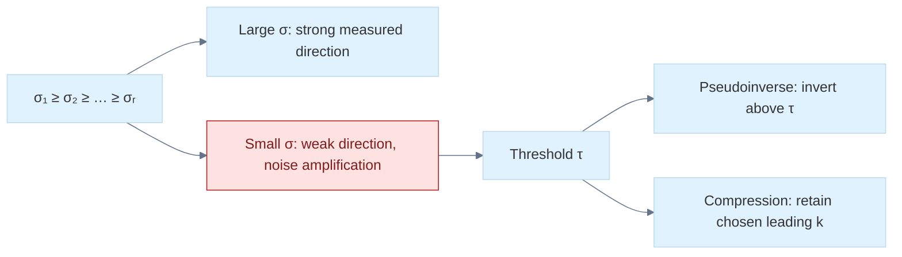

# 24 — Waiting Times, Covariance, and Matrix Decomposition

[[Chapter Edition/01 - Computing Foundations/00 - Reading Map|Reading map]] · [[Chapter Edition/01 - Computing Foundations/23 - Probability Models and Measurement Error|Previous chapter]] · [[Chapter Edition/01 - Computing Foundations/25 - Continuous Models and Numerical Error|Next chapter]]

The exponential distribution describes memoryless waiting times, while covariance captures how measurements vary together across dimensions. Matrix decompositions then reveal rotation-like structure, stretch, and numerical limitations in real data.

**By the end:** Derive waiting-time quantities and interpret covariance and matrix decompositions without confusing geometry with statistical variation.

**Recall question:** What does covariance’s off-diagonal structure say about two measured components, and when can a decomposition be non-unique?

<!-- Derived from Continuous Notes/Computing Foundations - From Bits to C++ and Systems APIs.md; source lines 55712–57904; source-span SHA256 fa6b786b766b094a03643ce67e036b6dd04561ce3319c57fc48d55b5f9978613. -->

<!-- CHAPTER-SOURCE-BEGIN -->
## 5. Waiting times, event counts, and covariance geometry

### Exponential distribution

The exponential distribution models a nonnegative waiting time in a memoryless event process.

Let:

$$
 T\sim\operatorname{Exponential}(\lambda), 
$$

where:

$$
 \lambda>0 
$$

is the rate parameter.

Its PDF is:

$$
 \boxed{ p_T(t)= \begin{cases} \lambda e^{-\lambda t},&t\ge0,\\ 0,&t<0. \end{cases} } 
$$

The parameter $\lambda$ has units of inverse time if $T$ is measured in time.

#### 1 Deriving the CDF

For $t\ge0$:

$$
 F_T(t)= \int_0^t\lambda e^{-\lambda s}\\,ds. 
$$

Integrate:

$$
 F_T(t)= \left[-e^{-\lambda s}\right]\_0^t. 
$$

Therefore:

$$
 \boxed{ F_T(t)=1-e^{-\lambda t} }. 
$$

For $t<0$, the CDF is zero.

The survival function is:

$$
 S_T(t)=P(T>t). 
$$

For $t\ge0$:

$$
 \boxed{ S_T(t)=e^{-\lambda t} }. 
$$

#### 2 Deriving the mean: exponential distribution

The mean is:

$$
 \mathbb E[T]= \int_0^\infty t\lambda e^{-\lambda t}\\,dt. 
$$

Integration by parts gives:

$$
 \mathbb E[T] = \frac1\lambda 
$$

because the boundary term vanishes and the remaining exponential integral evaluates to $1/\lambda$.

Thus:

$$
 \boxed{ \mathbb E[T]=\frac1\lambda }. 
$$

The second moment is:

$$
 \mathbb E[T^2]=\frac2{\lambda^2}. 
$$

Therefore:

$$
 \operatorname{Var}(T) = \frac2{\lambda^2} -\frac1{\lambda^2} = \boxed{\frac1{\lambda^2}}. 
$$

The standard deviation is also:

$$
 \sigma_T=\frac1\lambda. 
$$

#### 3 Memorylessness

The defining property is:

$$
 \boxed{ P(T>s+t\mid T>s)=P(T>t) } 
$$

for $s,t\ge0$.

Let's derive it.

Because:

$$
 \{T>s+t\}\subseteq\{T>s\}, 
$$

conditional probability gives:

$$
 P(T>s+t\mid T>s) = \frac{P(T>s+t)}{P(T>s)}. 
$$

Using the exponential survival function:

$$
 = \frac{e^{-\lambda(s+t)}}{e^{-\lambda s}} =e^{-\lambda t}. 
$$

But:

$$
 e^{-\lambda t}=P(T>t). 
$$

Therefore the exponential distribution is memoryless.

Knowing that no event has happened during the first $s$ seconds does not change the distribution of the additional waiting time.

This is a special property and is not true for most waiting-time distributions.

#### 4 Numerical example: exponential waiting times

Suppose events arrive at an average rate of:

$$
 \lambda=2\text{ events per second}. 
$$

The mean waiting time is:

$$
 \mathbb E[T]=0.5\text{ seconds}. 
$$

The probability of observing an event within $0.1$ seconds is:

$$
 \begin{aligned} P(T\le0.1) &=1-e^{-2(0.1)}\\ &=1-e^{-0.2}\\ &\approx\boxed{0.181269}. \end{aligned} 
$$

The probability of waiting longer than one second is:

$$
 P(T>1)=e^{-2}\approx0.135335. 
$$

#### 5 Numerical stability of the CDF

The formula:

$$
 1-e^{-\lambda t} 
$$

can lose precision when $\lambda t$ is very small, because $e^{-\lambda t}$ is close to one.

C++ provides:

```cpp
std::expm1(x)
```

which evaluates $e^x-1$ accurately for small $x$.

Therefore a stable exponential CDF can use:

```cpp
return -std::expm1(-lambda * t);
```

rather than:

```cpp
return 1.0 - std::exp(-lambda * t);
```

This is an example of mathematically equivalent formulas having different numerical behavior.

#### 6 Inverse-transform sampling

Let:

$$
 U\sim U(0,1). 
$$

Set:

$$
 U=F_T(t)=1-e^{-\lambda t}. 
$$

Then:

$$
 1-U=e^{-\lambda t}. 
$$

Take logarithms:

$$
 \log(1-U)=-\lambda t. 
$$

Thus:

$$
 \boxed{ T=-\frac{\log(1-U)}{\lambda} }. 
$$

In floating-point code, `-log1p(-u)/lambda` can be preferable when $u$ is small.

This is a concrete example of inverse-CDF sampling, which we will generalize in the sampling and Monte Carlo chapters.

### Poisson distribution

The Poisson distribution models counts of events under an idealized Poisson process or other situations satisfying the appropriate count law.

A Poisson random variable takes values:

$$
 K\in\{0,1,2,\ldots\}. 
$$

Write:

$$
 \boxed{K\sim\operatorname{Poisson}(\lambda)} 
$$

where $\lambda\ge0$ is the expected count over the specified observation interval or region.

Its PMF is:

$$
 \boxed{ P(K=k)= e^{-\lambda}\frac{\lambda^k}{k!} }. 
$$

For $\lambda=0$, the distribution is concentrated at $K=0$.

#### 1 Derivation as a limit of binomial distributions

Suppose an interval is divided into $n$ small subintervals.

Assume each subinterval contains an event with probability:

$$
 p=\frac\lambda n, 
$$

and trials are independent.

The total count is:

$$
 K_n\sim\operatorname{Binomial} \left(n,\frac\lambda n\right). 
$$

Therefore:

$$
 P(K_n=k) = \binom nk \left(\frac\lambda n\right)^k \left(1-\frac\lambda n\right)^{n-k}. 
$$

Rewrite the first two factors:

$$
 \binom nk\left(\frac\lambda n\right)^k = \frac{n(n-1)\cdots(n-k+1)}{k!} \frac{\lambda^k}{n^k}. 
$$

For fixed $k$, as $n\to\infty$:

$$
 \frac{n(n-1)\cdots(n-k+1)}{n^k} \to1. 
$$

Therefore:

$$
 \binom nk\left(\frac\lambda n\right)^k \to \frac{\lambda^k}{k!}. 
$$

The remaining factor satisfies:

$$
 \left(1-\frac\lambda n\right)^{n-k} \to e^{-\lambda}. 
$$

Thus:

$$
 \boxed{ P(K=k)=e^{-\lambda}\frac{\lambda^k}{k!} }. 
$$

This is the Poisson limit of the binomial distribution.

#### 2 Deriving the mean: Poisson distribution

Start with:

$$
 \mathbb E[K] = \sum\_{k=0}^\infty k e^{-\lambda}\frac{\lambda^k}{k!}. 
$$

The $k=0$ term vanishes.

For $k\ge1$:

$$
 \frac{k}{k!}=\frac1{(k-1)!}. 
$$

Therefore:

$$
 \begin{aligned} \mathbb E[K] &= e^{-\lambda} \sum\_{k=1}^\infty \frac{\lambda^k}{(k-1)!}\\ &= \lambda e^{-\lambda} \sum\_{j=0}^\infty \frac{\lambda^j}{j!}\\ &=\lambda e^{-\lambda}e^\lambda. \end{aligned} 
$$

Thus:

$$
 \boxed{\mathbb E[K]=\lambda}. 
$$

#### 3 Deriving the variance: Poisson distribution

First calculate the factorial second moment:

$$
 \mathbb E[K(K-1)]. 
$$

Using the PMF:

$$
 \mathbb E[K(K-1)] = \sum\_{k=2}^\infty k(k-1)e^{-\lambda} \frac{\lambda^k}{k!}. 
$$

Because:

$$
 \frac{k(k-1)}{k!}=\frac1{(k-2)!}, 
$$

we obtain:

$$
 \mathbb E[K(K-1)] = \lambda^2e^{-\lambda} \sum\_{j=0}^{\infty}\frac{\lambda^j}{j!} =\lambda^2. 
$$

Now use:

$$
 K^2=K(K-1)+K. 
$$

Thus:

$$
 \mathbb E[K^2] = \lambda^2+\lambda. 
$$

Therefore:

$$
 \operatorname{Var}(K) = \lambda^2+\lambda-\lambda^2. 
$$

Hence:

$$
 \boxed{ \operatorname{Var}(K)=\lambda }. 
$$

The Poisson distribution has equal mean and variance.

This equality is an important model diagnostic, although finite-sample estimates will not generally be exactly equal.

#### 4 Numerical example: Poisson event counts

Suppose:

$$
 K\sim\operatorname{Poisson}(2). 
$$

What is the probability of exactly three events?

$$
 P(K=3) = e^{-2}\frac{2^3}{3!}. 
$$

Therefore:

$$
 P(K=3)= e^{-2}\frac86 \approx\boxed{0.180447}. 
$$

The probability of zero events is:

$$
 P(K=0)=e^{-2}\approx0.135335. 
$$

#### 5 Poisson process and exponential waiting times

Suppose events occur according to a homogeneous Poisson process with rate $r$ events per unit time.

The count in an interval of duration $t$ satisfies:

$$
 \boxed{ N(t)\sim\operatorname{Poisson}(rt) }. 
$$

Thus:

$$
 \mathbb E[N(t)]=rt. 
$$

The probability of no events during the interval is:

$$
 P(N(t)=0)=e^{-rt}. 
$$

Let $T$ be the waiting time until the first event.

The event $T>t$ means no event occurred during the first $t$ units of time.

Therefore:

$$
 P(T>t)=P(N(t)=0)=e^{-rt}. 
$$

This is exactly the survival function of an exponential distribution with rate $r$.

Hence:

$$
 \boxed{ T\sim\operatorname{Exponential}(r) }. 
$$

This establishes the connection between Poisson counts and exponential waiting times.

#### 6 Poisson counts in physical simulation

Poisson distributions can model idealized event arrivals, emission counts, radioactive decay counts, and photon detection under appropriate independence and rate assumptions.

But not every light-related or sensor-related count is Poisson.

Dead time, saturation, correlations, varying event rates, and detector processing can produce different distributions.

In rendering research, such distinctions matter when constructing physically motivated noise models or benchmarking stochastic estimators.

### Multivariate Gaussian distribution

We now extend the Gaussian distribution from one uncertain scalar to an entire uncertain vector.

Suppose a reconstructed point has uncertain position:

$$
 \mathbf X= \begin{bmatrix} X\\Y\\Z \end{bmatrix}. 
$$

We need to describe not only how uncertain each coordinate is, but also how coordinate errors are coupled.

A multivariate Gaussian uses a mean vector:

$$
 \boldsymbol\mu\in\mathbb R^n 
$$

and covariance matrix:

$$
 \Sigma\in\mathbb R^{n\times n}. 
$$

We write:

$$
 \boxed{ \mathbf X\sim\mathcal N(\boldsymbol\mu,\Sigma) }. 
$$

For a nonsingular covariance matrix, its PDF is:

$$
 \boxed{ p(\mathbf x)= \frac{ \exp\left[ -\frac12(\mathbf x-\boldsymbol\mu)^T \Sigma^{-1} (\mathbf x-\boldsymbol\mu) \right] }{ (2\pi)^{n/2}\sqrt{\det\Sigma} } }. 
$$

This formula is dense, so we will derive it from transformations and explain every component.

#### 1 Begin with independent standard normals

Let:

$$
 \mathbf Z= \begin{bmatrix} Z_1\\ \vdots\\ Z_n \end{bmatrix} 
$$

where each $Z_i\sim\mathcal N(0,1)$, and the components are independent.

Their joint density is the product of the scalar densities:

$$
 p\_{\mathbf Z}(\mathbf z)= \prod\_{i=1}^{n} \frac1{\sqrt{2\pi}}e^{-z_i^2/2}. 
$$

Multiply the normalizing factors:

$$
 \prod\_{i=1}^{n}\frac1{\sqrt{2\pi}} = \frac1{(2\pi)^{n/2}}. 
$$

Combine the exponents:

$$
 \prod_i e^{-z_i^2/2} = e^{-\frac12\sum_i z_i^2}. 
$$

Since:

$$
 \sum_i z_i^2=\mathbf z^T\mathbf z, 
$$

the joint density becomes:

$$
 \boxed{ p\_{\mathbf Z}(\mathbf z)= \frac1{(2\pi)^{n/2}} e^{-\frac12\mathbf z^T\mathbf z} }. 
$$

This is the standard multivariate Gaussian with zero mean and identity covariance.

Its equal-density surfaces are spheres because the exponent depends only on:

$$
 \\|\mathbf z\\|^2. 
$$

#### 2 Transform the standard Gaussian

Let:

$$
 \boxed{ \mathbf X=\boldsymbol\mu+A\mathbf Z } 
$$

where $A$ is an invertible $n\times n$ matrix.

The mean is:

$$
 \mathbb E[\mathbf X] = \boldsymbol\mu+A\mathbb E[\mathbf Z] =\boldsymbol\mu. 
$$

The covariance is:

$$
 \begin{aligned} \operatorname{Cov}(\mathbf X) &= \mathbb E[ (A\mathbf Z)(A\mathbf Z)^T ]\\ &= A\mathbb E[\mathbf Z\mathbf Z^T]A^T\\ &=AIA^T. \end{aligned} 
$$

Therefore:

$$
 \boxed{\Sigma=AA^T}. 
$$

This says an arbitrary nonsingular linear transformation of an independent standard Gaussian produces a correlated Gaussian.

We can interpret $A$ as combining rotation, stretching, and shearing of the standard spherical distribution.

#### 3 Derive the density with a change of variables

We have:

$$
 \mathbf x=\boldsymbol\mu+A\mathbf z. 
$$

Solve for $\mathbf z$:

$$
 \mathbf z=A^{-1}(\mathbf x-\boldsymbol\mu). 
$$

The Jacobian of this inverse transformation is:

$$
 J=A^{-1}. 
$$

The density transformation formula is:

$$
 p\_{\mathbf X}(\mathbf x) = p\_{\mathbf Z}(A^{-1}(\mathbf x-\boldsymbol\mu)) |\det A^{-1}|. 
$$

Substitute the standard Gaussian density:

$$
 p\_{\mathbf X}(\mathbf x) = \frac{|\det A^{-1}|}{(2\pi)^{n/2}} \exp\left[ -\frac12 \\|A^{-1}(\mathbf x-\boldsymbol\mu)\\|^2 \right]. 
$$

Now expand the squared norm:

$$
 \begin{aligned} \\|A^{-1}\mathbf d\\|^2 &=(A^{-1}\mathbf d)^T(A^{-1}\mathbf d)\\ &=\mathbf d^TA^{-T}A^{-1}\mathbf d. \end{aligned} 
$$

Because:

$$
 \Sigma=AA^T, 
$$

we have:

$$
 \Sigma^{-1}=A^{-T}A^{-1}. 
$$

Thus:

$$
 \\|A^{-1}\mathbf d\\|^2 = \mathbf d^T\Sigma^{-1}\mathbf d. 
$$

For the normalization, use:

$$
 \det\Sigma= \det(AA^T) =(\det A)^2. 
$$

Therefore:

$$
 |\det A|=\sqrt{\det\Sigma}. 
$$

Since:

$$
 |\det A^{-1}|=\frac1{|\det A|}, 
$$

we obtain:

$$
 \boxed{ p(\mathbf x)= \frac1{(2\pi)^{n/2}\sqrt{\det\Sigma}} \exp\left[ -\frac12(\mathbf x-\boldsymbol\mu)^T \Sigma^{-1}(\mathbf x-\boldsymbol\mu) \right] }. 
$$

That is the full multivariate Gaussian density, derived rather than memorized.

#### 4 The Mahalanobis distance

The quantity:

$$
 \boxed{ d_M^2= (\mathbf x-\boldsymbol\mu)^T \Sigma^{-1} (\mathbf x-\boldsymbol\mu) } 
$$

is the squared [[Chapter Edition/01 - Computing Foundations/24 - Waiting Times, Covariance, and Matrix Decomposition#5. Waiting times, event counts, and covariance geometry|Mahalanobis distance]].

Ordinary Euclidean squared distance is:

$$
 d_E^2= (\mathbf x-\boldsymbol\mu)^T (\mathbf x-\boldsymbol\mu). 
$$

Mahalanobis distance accounts for the distribution's scale and correlations.

If one direction has large variance, moving along that direction contributes less to Mahalanobis distance.

If another direction has small variance, a comparable physical displacement can produce a much larger Mahalanobis distance.

#### 5 Geometric interpretation using eigenvectors

Because a covariance matrix is symmetric, it can be eigendecomposed:

$$
 \Sigma=Q\Lambda Q^T. 
$$

For positive-definite covariance:

$$
 \Lambda= \operatorname{diag}(\lambda_1,\ldots,\lambda_n) 
$$

with every $\lambda_i>0$.

Then:

$$
 \Sigma^{-1}=Q\Lambda^{-1}Q^T. 
$$

Let:

$$
 \mathbf d=\mathbf x-\boldsymbol\mu. 
$$

Express the displacement in the covariance eigenbasis:

$$
 \mathbf z=Q^T\mathbf d. 
$$

The squared Mahalanobis distance becomes:

$$
 \boxed{ d_M^2= \sum\_{i=1}^{n}\frac{z_i^2}{\lambda_i} }. 
$$

A constant-density surface satisfies:

$$
 d_M^2=c 
$$

for some $c>0$.

In 2D, this describes an ellipse. In 3D, it describes an ellipsoid.

The eigenvectors identify the principal directions. The square roots of eigenvalues determine the standard-deviation scale along those directions.

For the contour $d_M^2=c$, the semi-axis lengths are:

$$
 \boxed{ a_i=\sqrt{c\lambda_i} }. 
$$

Thus covariance is not merely a table of correlations. It encodes the geometry of an uncertainty ellipsoid.

#### 6 Numerical 2D Gaussian example

Consider a random vector with mean:

$$
 \boldsymbol\mu= \begin{bmatrix} 0.5\\-1 \end{bmatrix} 
$$

and covariance:

$$
 \boxed{ \Sigma= \begin{bmatrix} 4&1.2\\ 1.2&9 \end{bmatrix} }. 
$$

The first coordinate has variance 4, so its standard deviation is:

$$
 \sigma_X=2. 
$$

The second has variance 9:

$$
 \sigma_Y=3. 
$$

The covariance between them is:

$$
 \operatorname{Cov}(X,Y)=1.2. 
$$

Their correlation is:

$$
 \rho=\frac{1.2}{(2)(3)} =\boxed{0.2}. 
$$

The positive correlation causes the distribution's equal-density contours to be tilted relative to the coordinate axes.

#### 7 Determinant and density at the mean

The determinant is:

$$
 \begin{aligned} \det\Sigma &=(4)(9)-(1.2)^2\\ &=36-1.44\\ &=\boxed{34.56}. \end{aligned} 
$$

For a two-dimensional Gaussian:

$$
 p(\boldsymbol\mu)= \frac1{2\pi\sqrt{\det\Sigma}}, 
$$

because the Mahalanobis distance at the mean is zero.

Thus:

$$
 \boxed{ p(\boldsymbol\mu) = \frac1{2\pi\sqrt{34.56}} \approx0.027072806 }. 
$$

The units are inverse square units of the random coordinates. This is a density value, not the probability that $\mathbf X$ equals the mean exactly.

#### 8 Cholesky factorization and Gaussian sampling

We can generate a correlated Gaussian from independent standard normals using:

$$
 \mathbf X=\boldsymbol\mu+L\mathbf Z 
$$

where:

$$
 \Sigma=LL^T. 
$$

For our covariance, choose lower-triangular:

$$
 L= \begin{bmatrix} a&0\\ b&c \end{bmatrix}. 
$$

Then:

$$
 LL^T= \begin{bmatrix} a^2&ab\\ ab&b^2+c^2 \end{bmatrix}. 
$$

Match this with:

$$
 \Sigma= \begin{bmatrix} 4&1.2\\ 1.2&9 \end{bmatrix}. 
$$

First:

$$
 a^2=4 \quad\Longrightarrow\quad a=2. 
$$

Then:

$$
 ab=1.2 \quad\Longrightarrow\quad b=\frac{1.2}{2}=0.6. 
$$

Finally:

$$
 b^2+c^2=9. 
$$

Thus:

$$
 c^2=9-0.36=8.64, 
$$

so:

$$
 c=\sqrt{8.64}. 
$$

Therefore:

$$
 \boxed{ L= \begin{bmatrix} 2&0\\ 0.6&\sqrt{8.64} \end{bmatrix} }. 
$$

If:

$$
 Z_1,Z_2\overset{\mathrm{iid}}{\sim}\mathcal N(0,1), 
$$

then:

$$
 \boxed{ X=0.5+2Z_1 } 
$$

and:

$$
 \boxed{ Y=-1+0.6Z_1+\sqrt{8.64}\\,Z_2 }. 
$$

The shared $Z_1$ component creates the desired correlation.

Verify the covariance:

$$
 \operatorname{Cov}(X,Y) = \operatorname{Cov}(2Z_1,0.6Z_1+\sqrt{8.64}Z_2). 
$$

By bilinearity:

$$
 = 1.2\operatorname{Var}(Z_1) + 2\sqrt{8.64}\operatorname{Cov}(Z_1,Z_2). 
$$

The standard normals are independent, so their covariance is zero. Also $\operatorname{Var}(Z_1)=1$.

Therefore:

$$
 \boxed{\operatorname{Cov}(X,Y)=1.2}. 
$$

The variance of $Y$ is:

$$
 0.6^2+8.64=9. 
$$

The transformation reproduces the required covariance exactly in the mathematical model.

#### 9 Conditional Gaussian distributions

An especially important result is that conditioning one part of a jointly Gaussian vector on another produces a Gaussian conditional distribution, under the usual nonsingular covariance assumptions.

Partition the random vector:

$$
 \mathbf X= \begin{bmatrix} \mathbf X_a\\ \mathbf X_b \end{bmatrix} 
$$

with mean:

$$
 \boldsymbol\mu= \begin{bmatrix} \boldsymbol\mu_a\\ \boldsymbol\mu_b \end{bmatrix} 
$$

and covariance:

$$
 \Sigma= \begin{bmatrix} \Sigma\_{aa}&\Sigma\_{ab}\\ \Sigma\_{ba}&\Sigma\_{bb} \end{bmatrix}. 
$$

If $\Sigma\_{aa}$ is positive definite, then:

$$
 \boxed{ \mathbb E[\mathbf X_b\mid\mathbf X_a=\mathbf a] = \boldsymbol\mu_b+ \Sigma\_{ba}\Sigma\_{aa}^{-1} (\mathbf a-\boldsymbol\mu_a) } 
$$

and:

$$
 \boxed{ \operatorname{Cov}(\mathbf X_b\mid\mathbf X_a) = \Sigma\_{bb} - \Sigma\_{ba}\Sigma\_{aa}^{-1}\Sigma\_{ab} }. 
$$

For any vector $v$, set $u=-\Sigma_{aa}^{-1}\Sigma_{ab}v$. Then
$$
\begin{bmatrix}u^T&v^T\end{bmatrix}
\Sigma
\begin{bmatrix}u\\v\end{bmatrix}
=
v^T\left(\Sigma_{bb}-\Sigma_{ba}\Sigma_{aa}^{-1}\Sigma_{ab}\right)v
\ge 0,
$$
because the joint covariance is PSD. Thus the conditional covariance is PSD; if the joint covariance is PD, this Schur complement is PD. The second expression is a Schur complement.

This directly connects probability to the Schur-complement linear algebra used in optimization.

#### 10 Numerical conditional Gaussian example

Return to:

$$
 \mu_X=0.5,\qquad \mu_Y=-1, 
$$

$$
 \operatorname{Var}(X)=4,\qquad \operatorname{Var}(Y)=9, 
$$

$$
 \operatorname{Cov}(X,Y)=1.2. 
$$

The conditional mean of $Y$ given $X=x$ is:

$$
 \mathbb E[Y\mid X=x] = -1+\frac{1.2}{4}(x-0.5). 
$$

Thus:

$$
 \boxed{ \mathbb E[Y\mid X=x] = -1+0.3(x-0.5) }. 
$$

If we observe:

$$
 X=2.5, 
$$

the conditional mean becomes:

$$
 -1+0.3(2) =\boxed{-0.4}. 
$$

The conditional variance is:

$$
 \operatorname{Var}(Y\mid X) = 9-\frac{1.2^2}{4}. 
$$

Therefore:

$$
 \boxed{ \operatorname{Var}(Y\mid X)=8.64 }. 
$$

Before observing $X$, the variance of $Y$ was 9.

After conditioning, it becomes 8.64.

The reduction reflects information gained from observing the correlated variable.

For a jointly Gaussian model, the conditional covariance does not depend on the specific observed value of $x$, although the conditional mean does.

That property is one reason Gaussian models are convenient for estimation and filtering.

#### 11 Important geometry: a 2D one-sigma ellipse is not a 68% region

For a scalar Gaussian:

$$
 P(|Z|\le1)\approx0.6827. 
$$

It is tempting to assume that the corresponding two-dimensional one-sigma ellipse contains 68.27% probability.

That is incorrect.

For:

$$
 \mathbf X\sim\mathcal N(\boldsymbol\mu,\Sigma) 
$$

in two dimensions with positive-definite covariance, the squared Mahalanobis distance:

$$
 D^2= (\mathbf X-\boldsymbol\mu)^T \Sigma^{-1} (\mathbf X-\boldsymbol\mu) 
$$

follows a chi-squared distribution with two degrees of freedom.

Therefore:

$$
 P(D^2\le c)=1-e^{-c/2}. 
$$

For the ellipse with:

$$
 D^2\le1, 
$$

the enclosed probability is:

$$
 \boxed{ P(D^2\le1)=1-e^{-1/2}\approx0.393469 }. 
$$

So the one-sigma ellipse contains only about 39.3% probability.

To enclose 95% probability, solve:

$$
 1-e^{-c/2}=0.95. 
$$

Then:

$$
 e^{-c/2}=0.05, 
$$

$$
 c=-2\log0.05\approx5.991465. 
$$

The ellipse semi-axis lengths are therefore:

$$
 \sqrt{5.991465\lambda_i} 
$$

along the covariance eigenvectors.

This distinction is extremely important when drawing uncertainty ellipses in SLAM, tracking, reconstruction, robotics, and statistics.

### Covariance matrices in probability

We have already introduced covariance matrices, but now we will study their full structure.

For a random vector $\mathbf X\in\mathbb R^n$:

$$
 \boxed{ \Sigma= \mathbb E[ (\mathbf X-\boldsymbol\mu) (\mathbf X-\boldsymbol\mu)^T ] }. 
$$

Write the centred random vector as:

$$
 \mathbf Z=\mathbf X-\boldsymbol\mu. 
$$

Then:

$$
 \Sigma=\mathbb E[\mathbf Z\mathbf Z^T]. 
$$

Each matrix entry is:

$$
 \Sigma\_{ij}=\mathbb E[Z_iZ_j]. 
$$

#### 1 Covariance is symmetric

Take the transpose:

$$
 \Sigma^T = \mathbb E[(\mathbf Z\mathbf Z^T)^T]. 
$$

But:

$$
 (\mathbf Z\mathbf Z^T)^T = \mathbf Z\mathbf Z^T. 
$$

Therefore:

$$
 \boxed{\Sigma^T=\Sigma}. 
$$

This is an exact mathematical property of covariance matrices.

A nonsymmetric matrix cannot be the exact covariance of a real-valued random vector under the conventional definition.

Small numerical asymmetries may arise from independent calculations or rounding, but they should be diagnosed or handled explicitly.

#### 2 Variance in an arbitrary direction

Choose any deterministic vector:

$$
 \mathbf a\in\mathbb R^n. 
$$

Form the scalar random variable:

$$
 Y=\mathbf a^T\mathbf X. 
$$

Its mean is:

$$
 \mathbb E[Y]=\mathbf a^T\boldsymbol\mu. 
$$

Its variance is:

$$
 \begin{aligned} \operatorname{Var}(Y) &= \mathbb E[ (\mathbf a^T(\mathbf X-\boldsymbol\mu))^2 ]\\ &= \mathbb E[ \mathbf a^T\mathbf Z\mathbf Z^T\mathbf a ]\\ &= \mathbf a^T\mathbb E[\mathbf Z\mathbf Z^T]\mathbf a. \end{aligned} 
$$

Therefore:

$$
 \boxed{ \operatorname{Var}(\mathbf a^T\mathbf X) = \mathbf a^T\Sigma\mathbf a }. 
$$

This is one of the most powerful covariance identities.

It says the uncertainty of a linear measurement is obtained by projecting the covariance matrix onto that measurement direction.

#### 3 Affine uncertainty propagation

Let:

$$
 \mathbf Y=A\mathbf X+\mathbf b, 
$$

where $A$ is a deterministic matrix and $\mathbf b$ is a deterministic translation.

The mean is:

$$
 \boxed{ \boldsymbol\mu_Y=A\boldsymbol\mu_X+\mathbf b }. 
$$

The centred output is:

$$
 \mathbf Y-\boldsymbol\mu_Y = A(\mathbf X-\boldsymbol\mu_X). 
$$

Its covariance becomes:

$$
 \begin{aligned} \Sigma_Y &= \mathbb E[ A(\mathbf X-\boldsymbol\mu_X) (\mathbf X-\boldsymbol\mu_X)^TA^T ]\\ &= A\Sigma_XA^T. \end{aligned} 
$$

Therefore:

$$
 \boxed{ \Sigma_Y=A\Sigma_XA^T }. 
$$

Translation changes the mean but does not change covariance.

#### 4 Connection to rotations

If $R$ is a rotation matrix:

$$
 \mathbf Y=R\mathbf X+\mathbf t, 
$$

then:

$$
 \boxed{ \Sigma_Y=R\Sigma_XR^T }. 
$$

This rotates the covariance ellipsoid without changing its eigenvalues.

A rigid rotation changes the orientation of the uncertainty but not its principal variance magnitudes.

By contrast, a nonuniform scale or general affine transform changes those variance magnitudes.

#### 5 Nonlinear uncertainty propagation

Suppose:

$$
 \mathbf Y=f(\mathbf X) 
$$

with differentiable $f$.

For small uncertainty around the mean, linearize:

$$
 f(\mathbf X) \approx f(\boldsymbol\mu_X) + J_f(\boldsymbol\mu_X) (\mathbf X-\boldsymbol\mu_X). 
$$

The approximate covariance is:

$$
 \boxed{ \Sigma_Y \approx J_f\Sigma_XJ_f^T }. 
$$

This is the first-order covariance propagation formula derived through Jacobians in the geometry and Jacobian discussion.

The approximation becomes less reliable when uncertainty is large relative to local curvature, when the function is singular, or when the input distribution crosses discontinuities.

A second-order Taylor expansion can also introduce a correction to the predicted mean:

$$
 \mathbb E[f_i(\mathbf X)] \approx f_i(\boldsymbol\mu) + \frac12\operatorname{tr}(H\_{f_i}\Sigma). 
$$

Here $H\_{f_i}$ is the Hessian of output component $i$.

Thus nonlinear transformations can change both the covariance and the mean in ways that first-order propagation does not fully capture.

#### 6 The connection to Gaussian splatting

A 3D Gaussian representation may have a mean position:

$$
 \boldsymbol\mu\_{3D} 
$$

and covariance:

$$
 \Sigma\_{3D}. 
$$

A camera rotation maps its covariance into camera coordinates:

$$
 \Sigma_c=R\Sigma\_{3D}R^T. 
$$

A local perspective-projection Jacobian then gives an approximate image-space covariance:

$$
 \boxed{ \Sigma\_{2D}\approx J\_\pi\Sigma_cJ\_\pi^T }. 
$$

Combining:

$$
 \boxed{ \Sigma\_{2D}\approx J\_\pi R\Sigma\_{3D}R^TJ\_\pi^T }. 
$$

This formula is directly relevant to projected Gaussian footprints.

But there is an important distinction between a normalized probability density and a Gaussian-shaped rendering kernel.

A probability density contains the normalization factor involving $\det\Sigma$. Many Gaussian rendering formulations use kernels of the form:

$$
 G(\mathbf x)= \exp\left( -\frac12(\mathbf x-\boldsymbol\mu)^T \Sigma^{-1}(\mathbf x-\boldsymbol\mu) \right) 
$$

together with learned opacity or amplitude terms.

This Gaussian-shaped kernel is not automatically a normalized PDF.

Confusing the two can lead to incorrect interpretations of opacity, spatial mass, and covariance normalization.

The mathematical covariance transformation is closely related, but the full rendering model and its compositing semantics must be treated separately.

#### 7 The rank of propagated covariance

Let:

$$
 \Sigma_Y=J\Sigma_XJ^T. 
$$

The rank satisfies:

$$
 \operatorname{rank}(\Sigma_Y) \le \min(\operatorname{rank}(J),\operatorname{rank}(\Sigma_X)). 
$$

If a transformation loses dimensions, the output covariance cannot recover them.

For a $2\times3$ perspective-projection Jacobian:

$$
 J\_\pi:\mathbb R^3\rightarrow\mathbb R^2, 
$$

the output covariance has rank at most two.

If the projected Gaussian has sufficient spread in two independent image directions and the point lies in a valid projection region, the resulting $2\times2$ covariance may be positive definite.

But degenerate 3D uncertainty or a rank-deficient effective mapping can produce a singular 2D covariance.

A renderer must handle or regularize such cases deliberately rather than blindly inverting every covariance.

### Why covariance must be positive semidefinite

This is one of the most important results of the distribution and covariance chapters because it connects probability directly to symmetric matrices, eigenvalues, Cholesky factorization, and numerical robustness.

A covariance matrix cannot be arbitrary.

It must be symmetric and positive semidefinite, abbreviated PSD.

We write:

$$
 \boxed{\Sigma\succeq0}. 
$$

The mathematical definition is:

$$
 \boxed{ \mathbf a^T\Sigma\mathbf a\ge0 \quad\text{for every }\mathbf a\in\mathbb R^n }. 
$$

Why must this hold?

From the covariance quadratic-form section:

$$
 \mathbf a^T\Sigma\mathbf a = \operatorname{Var}(\mathbf a^T\mathbf X). 
$$

A variance is an expectation of a square:

$$
 \operatorname{Var}(Y) = \mathbb E[(Y-\mathbb E[Y])^2]. 
$$

A square is nonnegative.

Therefore variance cannot be negative.

Hence:

$$
 \boxed{ \mathbf a^T\Sigma\mathbf a = \operatorname{Var}(\mathbf a^T\mathbf X) \ge0 }. 
$$

That proves the PSD requirement.

#### 1 Eigenvalue interpretation

Because $\Sigma$ is real symmetric, it has real eigenvalues and an orthonormal eigenbasis.

Let:

$$
 \Sigma\mathbf v_i=\lambda_i\mathbf v_i. 
$$

Choose $\mathbf a=\mathbf v_i$, with $\\|\mathbf v_i\\|=1$.

Then:

$$
 \mathbf v_i^T\Sigma\mathbf v_i = \lambda_i. 
$$

But PSD requires this quadratic form to be nonnegative.

Therefore:

$$
 \boxed{\lambda_i\ge0}. 
$$

Every eigenvalue of a valid covariance matrix must be nonnegative.

Conversely, a real symmetric matrix with all nonnegative eigenvalues is PSD.

Thus these are equivalent descriptions.

#### 2 Positive definite versus positive semidefinite

A matrix is positive definite, or PD, if:

$$
 \mathbf a^T\Sigma\mathbf a>0 
$$

for every nonzero $\mathbf a$.

It is positive semidefinite if the result is allowed to equal zero.

A PD covariance has strictly positive variance along every nonzero direction.

A PSD but singular covariance has at least one direction with zero variance.

That means some linear combination of the random variables is deterministic.

#### 3 Example of a singular but valid covariance

Consider:

$$
 \boxed{ \Sigma= \begin{bmatrix} 1&2\\ 2&4 \end{bmatrix} }. 
$$

The determinant is:

$$
 \det\Sigma=4-4=0. 
$$

The eigenvalues are:

$$
 5,\qquad0. 
$$

Both are nonnegative, so the matrix is PSD.

But it is singular.

What physical uncertainty could produce it?

Let $X$ be a scalar random variable with variance one, and let:

$$
 Y=2X. 
$$

Then:

$$
 \operatorname{Var}(X)=1, 
$$

$$
 \operatorname{Var}(Y)=4, 
$$

$$
 \operatorname{Cov}(X,Y)=2. 
$$

The covariance matrix is exactly:

$$
 \begin{bmatrix} 1&2\\2&4 \end{bmatrix}. 
$$

The variables have perfect linear dependence.

The combination:

$$
 Y-2X 
$$

has zero variance.

Thus the distribution occupies a one-dimensional line in the two-dimensional plane.

It does not have an ordinary nonsingular 2D Gaussian density with respect to area measure.

#### 4 Example of an invalid covariance

Consider:

$$
 \boxed{ A= \begin{bmatrix} 1&2\\ 2&1 \end{bmatrix} }. 
$$

Its eigenvalues are:

$$
 3,\qquad-1. 
$$

The negative eigenvalue makes it indefinite.

Choose:

$$
 \mathbf a= \begin{bmatrix} 1\\-1 \end{bmatrix}. 
$$

Then:

$$
 \mathbf a^TA\mathbf a=-2. 
$$

If this matrix were a covariance, it would imply:

$$
 \operatorname{Var}(X-Y)=-2, 
$$

which is impossible.

Therefore $A$ cannot be a valid covariance matrix.

#### 5 A 2D covariance validity condition

Consider a symmetric covariance matrix:

$$
 \Sigma= \begin{bmatrix} \sigma_X^2&c\\ c&\sigma_Y^2 \end{bmatrix}. 
$$

For it to be PSD, we require:

$$
 \sigma_X^2\ge0, \qquad \sigma_Y^2\ge0, 
$$

and:

$$
 \boxed{ \sigma_X^2\sigma_Y^2-c^2\ge0 }. 
$$

Equivalently:

$$
 |c|\le\sigma_X\sigma_Y. 
$$

If both standard deviations are positive:

$$
 \left|\frac{c}{\sigma_X\sigma_Y}\right|\le1. 
$$

Thus:

$$
 \boxed{|\rho|\le1}. 
$$

The familiar correlation bound is therefore also a matrix positive-semidefiniteness condition.

#### 6 Cholesky factorization and positive definiteness

For a symmetric positive-definite matrix:

$$
 \boxed{\Sigma=LL^T} 
$$

with $L$ lower triangular and positive diagonal.

This is Cholesky factorization.

It is useful for sampling, Gaussian density evaluation, whitening, Mahalanobis-distance calculations, and stable linear solves.

For a singular PSD matrix, an ordinary non-pivoted Cholesky implementation that assumes strictly positive pivots may fail.

That failure does not necessarily mean the covariance is invalid. It may be valid but singular.

To handle singular covariance, use an eigendecomposition, an SVD, a rank-revealing factorization, or an appropriate pivoted method, depending on the task.

#### Original bridge: whiten a covariance ellipse

This worked connection links covariance geometry to Cholesky factorization. It is an added example for this volume, not a claim about Strang's lectures. Let

$$
\Sigma=\begin{bmatrix}4&1.2\\1.2&1\end{bmatrix},
\qquad
L=\begin{bmatrix}2&0\\0.6&0.8\end{bmatrix},
\qquad
LL^T=\Sigma.
$$

For mean $\mu=(3,-1)$ and standard-normal coordinates $z=(1,1)$,
$$
x=\mu+Lz=(5,0.4).
$$
Whitening solves $z=L^{-1}(x-\mu)$, so the squared Mahalanobis distance is $d_M^2=z^Tz=2$. The squared Euclidean distance from the mean is
$$
\|x-\mu\|_2^2=(5-3)^2+(0.4+1)^2=5.96.
$$
The determinant is $\det\Sigma=(\det L)^2=2.56$; the bivariate Gaussian density at $x$ is
$$
p(x)=\frac{\exp(-d_M^2/2)}{2\pi\sqrt{\det\Sigma}}=\frac{e^{-1}}{3.2\pi}\approx0.0366.
$$
This assumes an SPD covariance and full two-dimensional Lebesgue measure. A singular PSD Gaussian is confined to a lower-dimensional affine subspace and does not have this full-area density.

#### 7 Numerical covariance repair

In practical code, a covariance estimate can contain a tiny negative eigenvalue due to floating-point error.

One simple repair for a symmetric matrix is to eigendecompose:

$$
 A=Q\Lambda Q^T, 
$$

replace negative eigenvalues by zero:

$$
 \Lambda\_+= \operatorname{diag}(\max(\lambda_i,0)), 
$$

then reconstruct:

$$
 \boxed{ A\_+=Q\Lambda\_+Q^T }. 
$$

For a real symmetric matrix, this is a nearest PSD projection in the Frobenius norm when no additional constraints are imposed.

But if the diagonal variances must remain fixed, or the result must be a correlation matrix with unit diagonal, simple eigenvalue clipping may not satisfy all requirements.

More sophisticated nearest-PSD or nearest-correlation methods may be necessary. Nicholas Higham's work establishes important matrix-nearness formulations and algorithms for these problems. 

Most importantly, a covariance repair modifies the model.

If a matrix has a significantly negative eigenvalue, do not simply clip it and claim everything is correct. First investigate whether the cause is numerical roundoff, incorrect covariance assembly, invalid parameterization, or an actual modeling mistake.

**Concept link:** [[Chapter Edition/01 - Computing Foundations/24 - Waiting Times, Covariance, and Matrix Decomposition#5. Waiting times, event counts, and covariance geometry|Schur complement covariance]] — Conditioning one block of a jointly Gaussian vector on….


<!-- end V10.06 -->


# Singular directions explain reconstruction and variation

Use SVD to separate input directions, gains and output directions. Least squares, minimum norm, regularization, PCA and polar decomposition then become connected applications of maps already understood.

<!-- begin V08.31 -->
## Why a matrix factorization is a change in how we see the map

A matrix is first a rule that transforms an input, not a rectangular block of numbers. If $A=BC$, then $Ax=B(Cx)$: the input passes through $C$ and then through $B$. A factorization is useful when it exposes simpler actions whose composition equals the original one. This is the right starting point for [[Chapter Edition/01 - Computing Foundations/24 - Waiting Times, Covariance, and Matrix Decomposition#Full, thin, and compact shapes for tall and wide matrices|singular value decomposition (SVD)]], because SVD is a coordinate choice that makes a complicated map look like independent one-dimensional channels.

Consider the two-coordinate map $A=\begin{bmatrix}2&1\\1&2\end{bmatrix}$. It sends $(x,y)^\mathsf T$ to $(2x+y,x+2y)^\mathsf T$. Each output depends on both input coordinates: the coordinates are coupled in this basis. A diagonal map such as $D=\operatorname{diag}(3,1)$ instead sends $(p,q)$ to $(3p,q)$; each coordinate evolves independently. Coupling is not always an intrinsic property of the physical transformation. It can be a consequence of how we chose coordinates.

For the symmetric example, the orthonormal directions $q_1=(1,1)^\mathsf T/\sqrt2$ and $q_2=(1,-1)^\mathsf T/\sqrt2$ form the columns of $Q$. In the original basis, $A$ mixes $x$ and $y$; in the $Q$ basis it has the diagonal representation $Q^\mathsf T A Q=\operatorname{diag}(3,1)$. Coordinates $p=(x+y)/\sqrt2$ and $q=(x-y)/\sqrt2$ reveal the independent modes: $p$ is multiplied by three and $q$ is unchanged. The transformation itself did not change. We changed the frame in which we describe it.

An orthogonal matrix changes between orthonormal frames while preserving lengths and angles. In two dimensions a determinant-$+1$ orthogonal matrix is a rotation; determinant $-1$ also includes a reflection. “Rotate, scale, rotate” is an intuitive reading of SVD, but the precise description is “change to an orthonormal input basis, scale each coordinate independently, then express the result in an orthonormal output basis.” The input and output bases can differ because a rectangular map can take one space into another.

Eigenanalysis asks a square map to return a direction to itself up to scalar: $Av=\lambda v$. That is a useful but restrictive demand. SVD asks the more flexible question: can we choose an orthonormal input direction $v_i$ whose image is a scalar multiple of some orthonormal output direction $u_i$? The relation is $Av_i=\sigma_i u_i$, with $\sigma_i\ge0$. The input and output directions need not coincide. This distinction makes SVD available for every real rectangular matrix, even when eigenvectors are missing, complex, or numerically awkward.


<!-- end V08.31 -->

<!-- begin V08.32 -->
## Singular value decomposition covers every rectangular map

Eigenvectors are tied to square maps. A graphics transform may instead map an $n$-dimensional input to an $m$-dimensional measurement, and its input and output directions live in different spaces. **[[Chapter Edition/01 - Computing Foundations/24 - Waiting Times, Covariance, and Matrix Decomposition#Full, thin, and compact shapes for tall and wide matrices|singular value decomposition (SVD)]]** handles that general case:

$$
A=U\Sigma V^\mathsf T.
$$

For real $A\in\mathbb R^{m\times n}$, $U$ and $V$ are orthogonal (or have orthonormal columns in a thin factorization), and $\Sigma$ is rectangular diagonal with nonnegative entries $\sigma_1\ge\sigma_2\ge\cdots\ge0$. In a complex problem transpose becomes conjugate transpose. The right singular vector $\mathbf v_i$ is an input direction; $A\mathbf v_i=\sigma_i\mathbf u_i$ sends it to the paired output direction. The singular value is the stretch. Unlike an eigenvector, this does not require input and output spaces to be the same.

The geometric story is “rotate or reflect the input coordinates, stretch along perpendicular axes, then rotate or reflect in the output space.” Orthogonal stages preserve length; the diagonal stage exposes the map's true principal stretches. The singular values are square roots of eigenvalues of $A^\mathsf T A$, but computing SVD by explicitly forming $A^\mathsf T A$ is often a poor numerical shortcut: it squares the condition number and may erase small singular information. Use this identity to understand, not automatically to implement.

Full SVD uses $U\in\mathbb R^{m\times m}$ and $V\in\mathbb R^{n\times n}$. Thin/economy SVD keeps only the columns needed to represent $A$, saving storage and work. If $r=\operatorname{rank}(A)$, compact rank-revealing forms retain $r$ nonzero singular directions. For rank-deficient matrices, zero singular values identify null directions. Singular vectors corresponding to repeated singular values are not individually unique: any orthonormal basis of the repeated subspace is valid. A sign flip of a paired pair $(\mathbf u_i,\mathbf v_i)$ also leaves the product unchanged.


<!-- end V08.32 -->

<!-- begin V08.33 -->
## The SVD equation as independent input-output channels

For $A\in\mathbb R^{m\times n}$, a full SVD is

$$
A=U\Sigma V^\mathsf T,
$$

where $U\in\mathbb R^{m\times m}$ and $V\in\mathbb R^{n\times n}$ are orthogonal, and $\Sigma\in\mathbb R^{m\times n}$ is rectangular diagonal. Its diagonal singular values are nonnegative and conventionally sorted as $\sigma_1\ge\sigma_2\ge\cdots\ge0$. Multiplying by $V$ on the right gives $AV=U\Sigma$. Reading this equality column by column yields $Av_i=\sigma_i u_i$. That vector equation is the atomic meaning of the factorization.

For an arbitrary input $x$, its coordinates in the right-singular-vector basis are $z=V^\mathsf T x$. Then the map acts as $w=\Sigma z$, and the output in ordinary coordinates is $y=Uw$. Thus

$$
x\xrightarrow{V^\mathsf T}z\xrightarrow{\Sigma}w\xrightarrow{U}y=Ax.
$$

In singular coordinates each surviving channel follows $w_i=\sigma_i z_i$: no input coefficient spills into a different output coefficient. The right singular vectors are in the domain $\mathbb R^n$; the left singular vectors are in the codomain $\mathbb R^m$. This makes the two-basis structure explicit and avoids treating the factors as unexplained symbols.

The unit sphere in input space remains a sphere through the orthogonal coordinate change $V^\mathsf T$. The diagonal stage turns it into an axis-aligned ellipsoid whose semiaxis lengths are the singular values. The final orthogonal change $U$ orients that ellipsoid in output space. Consequently $\sigma_i=\|Av_i\|_2$ for unit $v_i$, the largest singular value is the largest possible 2-norm stretch, and $v_1$ is a direction that attains it:

$$
\sigma_1=\max_{\|x\|_2=1}\|Ax\|_2=\|A\|_2.
$$

A zero singular value collapses an input direction completely. A small positive singular value preserves that direction mathematically but nearly erases its magnitude, which makes reversal sensitive to noise. Singular values are nonnegative because a sign can be absorbed by changing the sign of a paired singular vector. A simultaneous sign flip of $u_i$ and $v_i$ leaves $\sigma_i u_i v_i^\mathsf T$ unchanged. When a singular value is repeated, its singular subspace is determined, while the particular orthonormal basis chosen inside that subspace is not unique.


<!-- end V08.33 -->

<!-- begin V08.34 -->
## Deriving singular directions through a Gram matrix

The Gram matrix $A^\mathsf T A$ is the algebraic bridge between SVD and symmetric eigenanalysis. Starting from an SVD and using $U^\mathsf T U=I$ gives

$$
A^\mathsf T A=V\Sigma^\mathsf T\Sigma V^\mathsf T.
$$

The middle matrix is diagonal with entries $\sigma_i^2$, so $v_i$ is an eigenvector of $A^\mathsf T A$ with eigenvalue $\sigma_i^2$. Likewise $AA^\mathsf T=U\Sigma\Sigma^\mathsf T U^\mathsf T$, so the $u_i$ are eigenvectors of $AA^\mathsf T$ with the same squared singular values. This explains why eigenvalues of a Gram matrix are nonnegative and why singular values are their square roots.

The existence argument can be read in the other direction. Since $A^\mathsf T A$ is symmetric positive semidefinite, choose an orthonormal eigenbasis $v_i$ with nonnegative eigenvalues $\lambda_i$. For a unit eigenvector,

$$
\|Av_i\|_2^2=v_i^\mathsf T A^\mathsf T A v_i=\lambda_i.
$$

Set $\sigma_i=\sqrt{\lambda_i}$. For each positive $\sigma_i$, define $u_i=Av_i/\sigma_i$. These output vectors are orthonormal: $u_i^\mathsf T u_j=v_i^\mathsf T A^\mathsf T A v_j/(\sigma_i\sigma_j)$, which is zero for distinct orthogonal eigenvectors and one when $i=j$. Complete the bases orthonormally in any unused directions. The resulting factors satisfy $Av_i=\sigma_i u_i$ and reconstruct $A$.

For any $x$, the quadratic form makes the positive-semidefinite fact immediate:

$$
x^\mathsf T A^\mathsf T A x=(Ax)^\mathsf T(Ax)=\|Ax\|_2^2\ge0.
$$

It is positive for every nonzero $x$ exactly when $Ax\ne0$ for every nonzero $x$, which means $A$ has full column rank. Thus $A^\mathsf T A$ is positive definite if and only if $\operatorname{Null}(A)=\{0\}$. This derivation is valuable for understanding geometry and rank. It is not a recommendation to compute an SVD by explicitly forming $A^\mathsf T A$: the operation squares the condition number, $\kappa_2(A^\mathsf T A)=\kappa_2(A)^2$ when $A$ has full column rank, and can erase information about small singular values. Stable SVD algorithms work with orthogonal transformations and bidiagonal forms rather than relying on that numerically damaging shortcut.


<!-- end V08.34 -->

<!-- begin V08.35 -->
## Full, thin, and compact shapes for tall and wide matrices

Shape is part of the SVD contract. For $A$ of shape $m\times n$, the full factors have $U$ of shape $m\times m$, $\Sigma$ of shape $m\times n$, and $V^\mathsf T$ of shape $n\times n$. The product has shape $(m\times m)(m\times n)(n\times n)=m\times n$. The diagonal of $\Sigma$ has length $p=\min(m,n)$; values beyond the rank are zero in exact arithmetic.

For a tall matrix with $m\ge n$, the economy or thin factorization normally returns $U_t\in\mathbb R^{m\times n}$, $\Sigma_t\in\mathbb R^{n\times n}$, and $V\in\mathbb R^{n\times n}$, so $A=U_t\Sigma_tV^\mathsf T$. Full SVD would also store $m-n$ extra columns of $U$ completing the output-space basis. Those columns describe directions perpendicular to the image of $A$, and are unnecessary when the task only needs reconstruction or application of the map. Example shapes for a $5\times2$ input are full $U:5\times5$, $\Sigma:5\times2$, $V:2\times2$; thin $U_t:5\times2$, $\Sigma_t:2\times2$, $V:2\times2$.

For a wide matrix with $m<n$, a common economy form uses $U\in\mathbb R^{m\times m}$, a square diagonal $\Sigma_t\in\mathbb R^{m\times m}$, and $V_t^\mathsf T\in\mathbb R^{m\times n}$, giving $A=U\Sigma_tV_t^\mathsf T$. It contains the $p=m$ paired singular directions. A full SVD adds $n-m$ additional columns to $V$; those complete the input basis and, when rank is full row rank, span the nullspace of $A$. For a $2\times5$ matrix, full shapes are $U:2\times2$, $\Sigma:2\times5$, $V:5\times5$; economy shapes can be $U:2\times2$, $\Sigma_t:2\times2$, $V_t:5\times2$. The economy product is dimensionally $(2\times2)(2\times2)(2\times5)=2\times5$. Libraries vary in the precise “economy” return convention, so a result type or API must state its shapes rather than rely on that word alone.

When the exact rank is $r$, the compact rank-$r$ SVD retains only the nonzero paired directions: $U_r\in\mathbb R^{m\times r}$, $\Sigma_r\in\mathbb R^{r\times r}$, and $V_r\in\mathbb R^{n\times r}$, with $A=U_r\Sigma_rV_r^\mathsf T$. This is the smallest exact factor representation, but exact rank is a mathematical concept and [[Chapter Edition/01 - Computing Foundations/19 - Coordinate Frames and Linear Systems#A system is an intersection of constraints|numerical rank]] requires a tolerance. If $A$ has dimensions $1{,}000{,}000\times64$, a full $U$ would require a million-square array, while thin $U_t$ needs only $1{,}000{,}000\times64$. The choice between full, thin, and compact factors changes whether storage is feasible and which subspaces are explicitly available.

A rectangular diagonal map also has a direct geometric reading. For example, $\Sigma=\begin{bmatrix}4&0\\0&2\\0&0\end{bmatrix}$ maps $(a,b)^\mathsf T$ to $(4a,2b,0)^\mathsf T$. It embeds a two-dimensional input into a plane in three-dimensional output space; the output cannot fill the third dimension. The two input singular directions receive independent stretches, and the unused output direction lies perpendicular to the range.


<!-- end V08.35 -->

<!-- begin V08.36 -->
## Rank, both nullspaces, and the four fundamental subspaces

If $\operatorname{rank}(A)=r$, exactly $r$ singular values are positive in exact arithmetic. The first $r$ right singular vectors span the row space, while the remaining $n-r$ right singular vectors span $\operatorname{Null}(A)$, since $Av_i=0$ for each zero singular value. The first $r$ left singular vectors span $\operatorname{Col}(A)$. The remaining $m-r$ left singular vectors span $\operatorname{Null}(A^\mathsf T)$ because $A^\mathsf T u_i=\sigma_i v_i=0$. Thus SVD places all four fundamental subspaces in paired orthogonal bases: row space with nullspace in the domain, column space with left nullspace in the codomain.

For $A=\begin{bmatrix}1&1\\2&2\end{bmatrix}$ the second column duplicates the first, so rank is one. Here $A^\mathsf T A=\begin{bmatrix}5&5\\5&5\end{bmatrix}$ has eigenvalues $10$ and $0$, hence singular values $\sqrt{10}$ and $0$. The zero right singular vector points along $(1,-1)^\mathsf T$, a change to the input that the matrix cannot observe. The surviving right vector points along $(1,1)^\mathsf T$ and the surviving left vector spans the column direction $(1,2)^\mathsf T$. Rank deficiency is not an SVD failure: it is precisely the information SVD reveals.

Floating-point computations rarely produce a perfect zero for a theoretically rank-deficient matrix. A numerical rank rule may declare $\sigma_i$ negligible when it is below a scale-relative cutoff, often related to $\max(m,n)\epsilon_{\mathrm{machine}}\sigma_1$, but the appropriate tolerance depends on measurement noise and application meaning. Multiplying all entries by a unit conversion factor should not arbitrarily change a relative rank decision. Conversely, a tiny singular value can encode a real but weakly measured direction rather than a dimension that is truly absent. Keep algebraic rank, numerical rank, and domain-specific confidence distinct.

### Figure L6 - Every linear map is orthogonal change, stretch, orthogonal change


> **How to read Figure L6.** The middle stage contains all scale information. The outer stages choose the input and output orthonormal coordinates.


<!-- end V08.36 -->

<!-- begin V08.37 -->
## A concrete rotation, stretch, and coordinate trace

Take

$$
A=\begin{bmatrix}3&1\\1&3\end{bmatrix},\qquad c=\cos45^\circ=\frac1{\sqrt2},\qquad R=\begin{bmatrix}c&-c\\c&c\end{bmatrix}.
$$

This symmetric positive-definite matrix has eigenvectors $v_1=(c,c)^\mathsf T$ and $v_2=(-c,c)^\mathsf T$, with eigenvalues $4$ and $2$. These are also its right singular vectors; because the eigenvalues are positive, the left singular vectors can be chosen equal to the right ones. Hence $U=V=R$ and $\Sigma=\operatorname{diag}(4,2)$, so $A=R\Sigma R^\mathsf T$. The trace for $x=(1,0)^\mathsf T$ makes each factor concrete:

$$
x=(1,0)^\mathsf T\xrightarrow{R^\mathsf T}(c,-c)^\mathsf T\xrightarrow{\Sigma}(4c,-2c)^\mathsf T\xrightarrow{R}(3,1)^\mathsf T.
$$

Direct multiplication also gives $Ax=(3,1)^\mathsf T$. The first basis change exposes the components of the input along the two independent modes; scaling changes those components separately; the final basis change puts the output back into ordinary coordinates. This nontrivial example links coordinate geometry to actual numbers and gives a small witness for implementation checks.

### Figure L6a - Watch the same directions become an ellipse

![[Visual Recall/phase8_svd_geometry.png]]

**Worked geometric figure.** Here $A=\begin{bmatrix}3&1\\1&3\end{bmatrix}$, $U=V=R(\pi/4)$, and $\Sigma=\operatorname{diag}(4,2)$. Track one colored point through all four panels rather than comparing silhouettes alone. The red input is $\mathbf x=(1,0)^\mathsf T$. In singular input coordinates it is $(1/\sqrt2,-1/\sqrt2)^\mathsf T$; stretching gives $(2\sqrt2,-\sqrt2)^\mathsf T$; output placement gives $(3,1)^\mathsf T$, agreeing with direct multiplication by $A$. The input circle and its coordinate-rotated image are both circles; only $\Sigma$ changes lengths. $U$ then turns the stretched ellipse without changing its axis lengths. The first two and final two panels use different axis ranges, stated by their tick marks, while each panel preserves equal horizontal and vertical scale. The asset is computed from the displayed matrices; the [[Visual Recall/phase8_svd_geometry.svg|editable vector figure]] preserves those exact geometric relationships.


<!-- end V08.37 -->

<!-- begin V08.38 -->
## Pseudoinverse makes least squares and minimum norm one operation

If $A$ is square and invertible, $A^{-1}\mathbf b$ solves exactly. Real problems may be rectangular, inconsistent, or rank-deficient. The **[[Chapter Edition/01 - Computing Foundations/24 - Waiting Times, Covariance, and Matrix Decomposition#The Moore–Penrose inverse and its four identities|Moore–Penrose pseudoinverse]]** generalizes inversion while respecting least squares and minimum norm. Its exact mathematical definition uses every strictly positive singular value:

$$
A^+=V\Sigma^+U^\mathsf T,
\qquad
\Sigma^+_{ii}=\begin{cases}1/\sigma_i,&\sigma_i>0,\\0,&\sigma_i=0.\end{cases}
$$

In finite precision we often choose a threshold $\tau$ and reciprocate only singular values above it. Call that result $A_\tau^+$, the truncated or numerical pseudoinverse. If a positive singular value is discarded, $A_\tau^+\mathbf b$ solves the retained-rank approximation of the problem; it need not minimize the original residual over every direction. The threshold is a policy tied to scale, precision, and application. Tiny singular values correspond to directions where inversion would magnify noise; discarding them states that those directions are not trusted at the selected resolution.

Take the rank-one matrix $A=\begin{bmatrix}3&0\\0&0\end{bmatrix}$ and target $\mathbf b=(6,5)^\mathsf T$. Its SVD is already visible: $U=V=I$ and $\Sigma=A$. The exact equation would require $3x_1=6$ and $0x_2=5$, so no exact solution exists. Least squares sets $x_1=2$ and cannot change the second residual; every $(2,t)$ has residual $(0,-5)$. The minimum-norm member is $(2,0)$, exactly what $A^+\mathbf b$ returns. This small example keeps three facts distinct: rank deficiency, inconsistency, and the extra minimum-norm rule.

Then $\mathbf x=A^+\mathbf b$ is a least-squares minimizer of $\|A\mathbf x-\mathbf b\|_2$. If many minimizers have the same residual, it is the one with smallest Euclidean norm. For a consistent underdetermined system, that chooses the solution closest to zero. This is a principled choice, not proof that the minimum-norm answer is the only physically meaningful one; a graphics application may need regularization, constraints, or a prior.

The 2-norm condition number for a full-rank matrix is $\kappa_2(A)=\sigma_{\max}/\sigma_{\min}$. For rank-deficient $A$, it is infinite in the ordinary inverse sense. A large condition number means small data perturbations can cause large solution changes. Residual and solution error are different: a solver can produce a small residual while the solution remains highly sensitive. Report both when the distinction matters.

The truncated SVD also gives the best rank-$k$ approximation to $A$ in both spectral and Frobenius norms. Keeping the leading singular directions preserves the most energy under those measures; discarding the tail compresses information. **Eckart–Young** is the theorem that makes “keep the largest $k$ singular values” optimal for this specific approximation objective. It does not say the approximation is best for every perceptual, semantic, or downstream-engine objective.


<!-- end V08.38 -->

<!-- begin V08.39 -->
## The Moore–Penrose inverse and its four identities

For a full-column-rank square or rectangular matrix, inverse intuition still has limits: a rectangular matrix has no two-sided ordinary inverse, and a singular matrix cannot be inverted. SVD supplies the [[Chapter Edition/01 - Computing Foundations/24 - Waiting Times, Covariance, and Matrix Decomposition#The Moore–Penrose inverse and its four identities|Moore–Penrose pseudoinverse]]. Reverse the nonzero channels in reverse order: $U^\mathsf T$ returns output coordinates to singular coordinates, $\Sigma^+$ reciprocates positive scales, and $V$ returns to the input basis:

$$
A^+=V\Sigma^+U^\mathsf T,
\qquad
\Sigma^+_{ii}=\begin{cases}1/\sigma_i,&\sigma_i>0,\\0,&\sigma_i=0.\end{cases}
$$

The exact definition uses every strictly positive singular value, however small. In a full factorization the pseudoinverse has shape $n\times m$. For invertible square $A$, it equals $A^{-1}$. Zero singular directions are assigned zero in $\Sigma^+$; division by zero is never attempted.

The four Moore–Penrose identities are

$$
AA^+A=A,\qquad A^+AA^+=A^+,\qquad (AA^+)^\mathsf T=AA^+,\qquad (A^+A)^\mathsf T=A^+A.
$$

The first two express inverse-like consistency on the portions of the map that can be reached and recovered. The symmetry conditions make $AA^+$ and $A^+A$ orthogonal projections rather than oblique projections. Specifically, $AA^+$ projects output vectors onto $\operatorname{Col}(A)$; $A^+A$ projects input vectors onto $\operatorname{Row}(A)$. For the SVD, these are $U_rU_r^\mathsf T$ and $V_rV_r^\mathsf T$ respectively. These projection meanings are more useful than memorizing the identities without context.

A small positive singular value makes its reciprocal large. If $\sigma_i=10^{-12}$, exact $A^+$ multiplies the corresponding output coefficient by $10^{12}$. That is mathematically correct for the exact map but can magnify measurement noise catastrophically. This is why the distinction between exact pseudoinverse and truncated pseudoinverse matters. Given a threshold $\tau$, define $A_\tau^+$ by reciprocating only singular values satisfying $\sigma_i>\tau$ and setting the rest to zero. This is a rank decision and a modeling policy. If it discards any positive singular values, $A_\tau^+b$ does not in general minimize the residual $\|Ax-b\|_2$ over all $x$ for the original matrix: it solves using the retained singular subspace and may leave a residual component that an omitted positive direction could have reduced. Exact $A^+$, by contrast, uses all positive directions and produces an original-problem least-squares minimizer. Thresholding may be more useful in noisy settings, but it trades residual fit for stability and must be named accurately.


<!-- end V08.39 -->

<!-- begin V08.40 -->
## Least squares from decoupling, then minimum norm

Consider $Ax\approx b$. Insert the SVD and use orthogonality, which preserves the Euclidean norm. Let $z=V^\mathsf T x$ and $c=U^\mathsf T b$. Then

$$
\|Ax-b\|_2=\|\Sigma z-c\|_2.
$$

The [[Chapter Edition/01 - Computing Foundations/20 - Choose Matrix Factorizations from Structure#Reflections and plane rotations build QR without losing lengths|least-squares problem]] has become independent scalar problems, one per singular direction. For every positive singular value, choose $z_i=c_i/\sigma_i$, which matches that output coordinate. A zero singular direction cannot affect the output, so its coefficient does not change residual size. Among all minimizers, setting each such free coefficient to zero gives the smallest input norm because $V$ is orthogonal and $\|x\|_2=\|z\|_2$. Therefore $z=\Sigma^+c$, $x=Vz=V\Sigma^+U^\mathsf T b=A^+b$. This proves both claims: exact pseudoinverse solution minimizes the original Euclidean residual, then chooses the minimum-norm solution among residual minimizers.

The same logic also explains the projection residual. The component of $b$ in $\operatorname{Col}(A)$ is matched; the orthogonal component is unreachable and remains as residual. In exact arithmetic, the least-squares residual $r=Ax-b$ obeys $A^\mathsf T r=0$, so it is perpendicular to every column of $A$. This geometry is the least-squares normal condition, derived without needing to solve normal equations.

For an inconsistent rank-deficient example, let $A=\operatorname{diag}(3,0)$ and $b=(6,5)^\mathsf T$. The second output coordinate cannot be produced, so no exact solution exists. Any $x=(2,t)^\mathsf T$ gives the same residual $(0,-5)^\mathsf T$; the pseudoinverse selects $(2,0)^\mathsf T$ because a nullspace component only increases norm. For an underdetermined consistent example, let $A=\begin{bmatrix}1&1\end{bmatrix}$ and $b=2$. Every solution satisfies $x_1+x_2=2$. Write $x=(1,1)^\mathsf T+t(1,-1)^\mathsf T$. Its squared norm is $(1+t)^2+(1-t)^2=2+2t^2$, minimized at $t=0$. Thus $A^+b=(1,1)^\mathsf T$, the shortest solution. These are distinct decisions: least squares minimizes residual first; minimum norm breaks ties between residual minimizers.

A minimum-norm answer is a mathematical convention based on the Euclidean metric, not automatic proof of physical appropriateness. If variables have different units, costs, or prior plausibility, rescaling, constraints, or regularization may be needed. The pseudoinverse gives a precise baseline whose assumptions can be inspected.


<!-- end V08.40 -->

<!-- begin V08.41 -->
## Conditioning: weak singular directions amplify uncertainty

For invertible square $A$, the largest stretch is $\sigma_{\max}$ and the largest stretch of $A^{-1}$ is $1/\sigma_{\min}$. Therefore

$$
\kappa_2(A)=\|A\|_2\|A^{-1}\|_2=\frac{\sigma_{\max}}{\sigma_{\min}}.
$$

A rank-deficient matrix has zero smallest singular value and infinite ordinary condition number. The same ratio of largest to smallest positive singular value describes the conditioning on the nonzero subspace for full-rank rectangular problems. Geometrically this is the long-axis to short-axis ratio of the ellipsoid: a nearly spherical image is well-conditioned, a very thin pancake is sensitive, and a flattened dimension is noninvertible.

A large [[Chapter Edition/01 - Computing Foundations/18 - Vectors for Light and Frames#An inverse can exist and still amplify uncertainty|condition number]] says that small perturbations in data can create large changes in a recovered solution. It does not say every particular residual is large. A solve can fit the supplied measurements with a tiny residual while its coefficients remain highly sensitive to a small measurement perturbation. Residual error and solution sensitivity are different quantities. Condition numbers also depend on units and parameterization: scaling one input variable changes the numerical singular spectrum, so sensible nondimensionalization may be important.

Because the eigenvalues of $A^\mathsf T A$ are squared singular values, its condition number is the square of $A$'s. This is another way to understand why the Gram-matrix route is risky in floating-point arithmetic. The identity is explanatory; robust numerical routines should avoid constructing the Gram matrix as a shortcut when small singular values matter.


<!-- end V08.41 -->

<!-- begin V08.42 -->
## Low-rank approximation and why the largest directions win

Expanding the factorization by columns gives

$$
A=\sum_{i=1}^{r}\sigma_i u_i v_i^\mathsf T.
$$

Each summand is rank one. Acting on $x$, it first measures the component $v_i^\mathsf T x$, scales it by $\sigma_i$, and emits it along $u_i$. A matrix is therefore a sum of independent rank-one input-output channels. Keeping the first $k$ terms creates $A_k=\sum_{i=1}^k\sigma_i u_i v_i^\mathsf T=U_k\Sigma_kV_k^\mathsf T$, with rank at most $k$. This is useful for [[Chapter Edition/01 - Computing Foundations/24 - Waiting Times, Covariance, and Matrix Decomposition#Full, thin, and compact shapes for tall and wide matrices|compression]] when $k$ is much smaller than both dimensions: dense storage costs $mn$ values, while the factors cost approximately $mk+k+nk$ values.

The [[Chapter Edition/01 - Computing Foundations/24 - Waiting Times, Covariance, and Matrix Decomposition#Full, thin, and compact shapes for tall and wide matrices|Eckart–Young]] result says that this truncation is not merely plausible: it is a best rank-$k$ approximation under two important norms. In spectral norm,

$$
\min_{\operatorname{rank}(B)\le k}\|A-B\|_2=\sigma_{k+1},
$$

and in Frobenius norm,

$$
\|A-A_k\|_F^2=\sum_{i=k+1}^{r}\sigma_i^2.
$$

The spectral error is the strongest discarded channel; the Frobenius error combines squared energy across all discarded channels. Here is the dimension argument for the spectral lower bound. For $k<r$ and any $B$ with $\operatorname{rank}(B)\le k$, its null space has dimension at least $n-k$. If $k\ge r$, the truncated approximation is exact and both lower bounds are zero. The span $S=\operatorname{span}(v_1,\ldots,v_{k+1})$ has dimension $k+1$, so $S\cap\operatorname{Null}(B)$ contains a nonzero vector. Normalize one to $x$. Then $Bx=0$, while $x\in S$ implies $\|Ax\|_2\ge\sigma_{k+1}$; hence $\|A-B\|_2\ge\|(A-B)x\|_2=\|Ax\|_2\ge\sigma_{k+1}$. Truncation attains this bound.

For the Frobenius lower bound, choose an orthonormal matrix $W\in\mathbb R^{n\times(n-k)}$ whose columns lie in $\operatorname{Null}(B)$. Then $(A-B)W=AW$. Multiplication by an orthonormal-column matrix cannot increase Frobenius norm, so $\|A-B\|_F^2\ge\|AW\|_F^2=\operatorname{tr}(W^\mathsf TA^\mathsf TAW)$. In right-singular coordinates, this trace is $\sum_i\sigma_i^2 w_i$, where $w_i$ is the squared length of row $i$ of $V^\mathsf TW$. Because $V^\mathsf TW$ has orthonormal columns, $0\le w_i\le1$ and $\sum_iw_i=n-k$. The smallest weighted sum assigns weight one to the $n-k$ smallest values of $\sigma_i^2$ and zero to the others, giving at least $\sum_{i=k+1}^{r}\sigma_i^2$ (pad with zeros when $m<n$). The truncated SVD attains this Frobenius bound too.

The guarantee is tied to the chosen matrix norm and low-rank objective. It does not promise best perceptual quality, best downstream rendering, or best prediction accuracy. A domain-specific weighting can change which directions matter. Frobenius energy retained after $k$ components is $\sum_{i=1}^k\sigma_i^2/\sum_i\sigma_i^2$, a common summary for PCA or compression, but that ratio is not a universal quality score.


<!-- end V08.42 -->

<!-- begin V08.43 -->
## Thresholding and regularization are different choices

A rank-based truncation keeps exactly $k$ leading singular values. An absolute cutoff retains values above $\tau$; a relative cutoff can retain values satisfying $\sigma_i/\sigma_1>\tau$. These choices answer different questions. A fixed rank can meet a storage budget. A scale-relative threshold can mark directions too weak relative to the dominant one. A noise model may imply a different cutoff. Numerical rank is never solely a property of a floating-point array without a precision and tolerance policy.

Truncated SVD pseudoinversion sets weak reciprocals to zero. This removes unstable directions completely: it reduces noise amplification but introduces bias and may increase the original residual because omitted positive directions are no longer used. Smooth regularization uses a different filter. For example, Tikhonov/ridge regularization solves a penalized problem $\min_x \|Ax-b\|_2^2+\lambda^2\|x\|_2^2$. In singular coordinates its coefficient filter is $\sigma_i/(\sigma_i^2+\lambda^2)$ applied to $c_i$, rather than either $1/\sigma_i$ or a hard zero/reciprocal switch. Small directions are damped continuously instead of abruptly discarded. Both methods express a preference for stability over exact inversion of weakly observed information, but they encode different assumptions and objectives.

For SVD compression, truncating small values approximates the matrix itself. For solving inverse problems, truncating singular values modifies how measurements map back to parameters. Those operations share a spectrum but are not the same task. State whether the goal is best rank-$k$ approximation, a numerical-rank solve, or a regularized inverse before interpreting a cutoff.


<!-- end V08.43 -->

<!-- begin V08.44 -->
## SVD in a graphics sensitivity picture

A local graphics transform or Jacobian maps small perturbations $\delta x$ to $\delta y=A\delta x$. SVD tells which input perturbations are amplified, which are suppressed, and in which output directions the effect appears. A small input sphere becomes an ellipsoid. The $v_i$ axes are sensitive input directions, $\sigma_i$ are gains, and $u_i$ axes show the response directions. This interpretation applies to deformation gradients, inverse problems, camera sensitivity, mesh processing, optimization Jacobians, covariance analysis, and shape variation.

The singular basis also explains why SVD connects so many topics. Rank counts surviving channels. Nullity counts erased input channels. The row and column spaces are the input and output spans of surviving directions. Pseudoinversion reverses surviving channels. Least squares projects onto reachable outputs. Minimum norm removes arbitrary nullspace components. Conditioning compares the strongest and weakest channels. Low-rank approximation discards selected channels under a stated error measure. Each concept is a different question about the same geometry, so the equations, data, and implementation can be checked against one another.


<!-- end V08.44 -->

<!-- begin V08.45 -->
## Why the pseudoinverse identities follow from projections

The four Moore–Penrose relations become almost mechanical in compact SVD coordinates. Let $A=U_r\Sigma_rV_r^\mathsf T$ with all entries of the square $\Sigma_r$ positive, and let $A^+=V_r\Sigma_r^{-1}U_r^\mathsf T$. Then

$$
AA^+=U_rU_r^\mathsf T,\qquad A^+A=V_rV_r^\mathsf T.
$$

These are symmetric idempotent matrices because $U_r^\mathsf T U_r=I_r$ and $V_r^\mathsf T V_r=I_r$. They project onto the column and row spaces. Applying $AA^+$ to $A$ keeps every column-space component, so $AA^+A=A$. Applying $A^+A$ to $A^+$ keeps every row-space component, so $A^+AA^+=A^+$. Symmetry gives the remaining two identities. This derivation shows what the properties guarantee: the operator behaves like an inverse on the rank-$r$ subspaces and like zero on orthogonal complements. For a full-column-rank tall matrix, $A^+A=I_n$; for a full-row-rank wide matrix, $AA^+=I_m$. In the opposite products, the identity is only a projection unless the map is square and invertible.

This is also a useful dimensional check. With $A:m\times n$, its pseudoinverse is $n\times m$, so $AA^+$ is $m\times m$ and acts on outputs, while $A^+A$ is $n\times n$ and acts on inputs. Accidentally reversing $U$ and $V$ can produce products with plausible square shapes while projecting onto the wrong space; naming each factor's domain and codomain catches that error.

### Figure L7 - The singular spectrum makes inversion and compression explicit



> **How to read Figure L7.** A numerical threshold is a declared modeling decision. Pseudoinversion and compression use the spectrum for different goals, even though both may discard small directions.


<!-- end V08.45 -->

<!-- begin V08.46 -->
## PCA turns a cloud of points into measured variation

[[Chapter Edition/01 - Computing Foundations/24 - Waiting Times, Covariance, and Matrix Decomposition#Centered measurements reveal principal directions|Principal component analysis]] begins with data, not with a mysterious covariance matrix. Put $N$ samples in the rows of a data table $X\in\mathbb R^{N\times d}$. Compute each feature mean and subtract it from every sample. Without centering, the dominant direction may point toward the cloud's offset from the origin instead of along the cloud's variation.

For centered $X$, sample covariance is

$$
C=\frac{1}{N-1}X^\mathsf T X.
$$

The divisor may be $N$ in a population convention; state which convention you use. For a unit direction $\mathbf v$, the projected scores are $X\mathbf v$ and their sample variance is $\mathbf v^\mathsf T C\mathbf v$. Maximizing this quadratic form under $\|\mathbf v\|_2=1$ gives an eigenvector of $C$ for the largest eigenvalue. Requiring the next component to be orthogonal gives the next eigenvector. Eigenvalues are variances along those principal directions.

There is a direct SVD route. If $X=U\Sigma V^\mathsf T$, the columns of $V$ are principal directions and the scores are $XV=U\Sigma$. Covariance eigenvalues are $\sigma_i^2/(N-1)$. This avoids explicitly forming $X^\mathsf T X$, which can improve numerical behavior for data with a wide range of scales. PCA is not automatically scale invariant: changing units of one feature changes its variance and therefore its influence. Standardization is a separate modeling decision that changes the question.

For graphics, PCA can estimate a point-cloud plane: the eigenvector for the smallest covariance eigenvalue is a candidate normal, while the other two span the best-fit plane. If the cloud is nearly a line, two small eigenvalues make the plane normal ambiguous. If the eigenvalues are close, small perturbations can rotate individual principal axes substantially even while the subspace remains stable. A useful application should reason about the eigengap and the subspace, not just print three axes.

For a minimal worked cloud, take centered samples $(-1,0)$, $(0,0)$, $(1,0)$. With divisor $N-1=2$, the covariance is $\operatorname{diag}(1,0)$. The first principal direction is horizontal and carries variance one; the perpendicular direction carries zero variance. If small vertical noise is added, the second eigenvalue becomes small rather than exactly zero. Whether it is treated as signal or discarded is a modeling decision supported by noise scale, not an algebraic truth hidden in the word “PCA.”


<!-- end V08.46 -->

<!-- begin V08.47 -->
## Centered measurements reveal principal directions

[[Chapter Edition/01 - Computing Foundations/24 - Waiting Times, Covariance, and Matrix Decomposition#Centered measurements reveal principal directions|Principal component analysis (PCA)]] asks a geometric question about a cloud of samples: along which directions does it vary most, second most, and so on? Let there be $N$ samples with $d$ measured features. Use the row-sample convention $X\in\mathbb R^{N\times d}$, so row $i$ is $x_i^\mathsf T$. Samples must be finite. The sample-covariance path requires $N\ge2$: reject empty input because the mean is undefined and reject a singleton as insufficient for an unbiased sample covariance. An API may instead explicitly choose population covariance with divisor $N$; that permits $N=1$ and returns zero covariance, but still must define empty-input behavior. The mean is $\mu=\frac1N\sum_{i=1}^N x_i$. Center each sample, $\tilde x_i=x_i-\mu$, and place those rows in $X_c$. Centering ensures $\sum_i\tilde x_i=0$. This removes translation: a cloud shifted far from the origin has the same shape and variation after centering. Without centering, the offset itself can dominate squared coordinates, causing the first component to describe location instead of spread.

A direction must be normalized before comparing its variance with another direction. For unit $v\in\mathbb R^d$, the scalar coordinate of centered sample $i$ along that direction is $z_i=v^\mathsf T\tilde x_i$. Its sample variance, using the sample convention $N-1$, is

$$
\operatorname{Var}(z)=\frac1{N-1}\sum_i(v^\mathsf T\tilde x_i)^2
=v^\mathsf T\left(\frac1{N-1}\sum_i\tilde x_i\tilde x_i^\mathsf T\right)v.
$$

The bracketed matrix is the covariance $C=X_c^\mathsf TX_c/(N-1)$. Thus variance in unit direction $v$ is the Rayleigh quotient $v^\mathsf TCv$. Maximizing this subject to $v^\mathsf Tv=1$ gives an eigenvector of $C$ for its largest eigenvalue: use a Lagrange multiplier on $v^\mathsf TCv-\lambda(v^\mathsf Tv-1)$ to obtain $Cv=\lambda v$. The largest eigenvalue is the greatest attainable variance. The second component maximizes variance subject to perpendicularity to the first; continuing gives orthonormal eigenvectors of the symmetric covariance. Eigenvalues are variances along those axes.

For a direct computation, consider the centered 2D samples $(1,1)$, $(-1,-1)$, $(1,-1)$, and $(-1,1)$. Their sample mean is zero. Summing outer products gives $X_c^\mathsf TX_c=\begin{bmatrix}4&0\\0&4\end{bmatrix}$, so with divisor $N-1=3$, $C=\frac43I$. Every direction has the same variance and no unique principal axis exists: the two eigenvalues are repeated. If the second coordinates are instead $(0.5,-0.5,-0.5,0.5)$, the sum of outer products is $\begin{bmatrix}4&0\\0&1\end{bmatrix}$ and covariance is $\operatorname{diag}(4/3,1/3)$. The horizontal axis carries four times the variance of the vertical. These calculations make the meaning of the eigenvalues concrete and show why equal or close eigenvalues make individual axes ambiguous.

The covariance entry $C_{jk}$ measures co-variation between features $j$ and $k$. Diagonal entries are individual feature variances; positive off-diagonal entries mean deviations tend to have the same sign, while negative values mean opposite signs. These terms are coordinate coupling. If $C=Q\Lambda Q^\mathsf T$ and transformed sample coordinates are $y=Q^\mathsf T(x-\mu)$, then their covariance is $Q^\mathsf TCQ=\Lambda$. The eigenbasis removes cross-covariance because all off-diagonal coupling vanishes in those coordinates. Covariance is positive semidefinite: for any $v$, $v^\mathsf TCv=\frac1{N-1}\sum_i(v^\mathsf T\tilde x_i)^2\ge0$. A zero eigenvalue therefore means there is no measured variation along its eigenvector. If points lie in a plane in 3D, the normal direction has zero variance; the two large-eigenvalue directions span the best-fit plane. With noise, the smallest-eigenvalue eigenvector remains the least-variance normal estimate, and its reliability depends on the gap between that small eigenvalue and the next one.

PCA can instead use a [[Chapter Edition/01 - Computing Foundations/24 - Waiting Times, Covariance, and Matrix Decomposition#Full, thin, and compact shapes for tall and wide matrices|singular value decomposition (SVD)]] of the centered data, $X_c=U\Sigma V^\mathsf T$. Substitute this into covariance:

$$
C=\frac{X_c^\mathsf TX_c}{N-1}
=V\frac{\Sigma^\mathsf T\Sigma}{N-1}V^\mathsf T.
$$

Because $U^\mathsf TU=I$, the right singular vectors (columns of $V$) are covariance eigenvectors, and covariance eigenvalues are $\lambda_i=\sigma_i^2/(N-1)$. Keeping the first $k$ directions in $V_k$, the principal scores are $Z=X_cV_k=U_k\Sigma_k$. An approximate reconstruction is $\hat X=ZV_k^\mathsf T+\mathbf1\mu^\mathsf T$, where the mean is added back to every row. By the Eckart–Young theorem this is the best rank-$k$ approximation in Frobenius norm. A point-cloud plane fit is the same recipe: subtract the centroid, form a 3-by-3 covariance or use data SVD, then take the eigenvector of that covariance, equivalently the right singular vector of the centered $N\times3$ sample matrix, associated with its smallest eigenvalue/singular value as the normal. Left singular vectors live in sample space $\mathbb R^N$, so they are not the 3D feature-space normal. A thin, noisy, or nearly collinear cloud may not determine a stable plane; the eigengap and noise level matter.

Feature units alter the result. If one coordinate is in millimeters and another in meters, a numerical rescaling changes covariance and therefore PCA. Standardizing each feature by a scale produces correlation-based PCA and asks a different question: relative variation after unit normalization instead of absolute physical variance. Neither convention is automatically correct. Record whether the data was centered only, centered and standardized, or weighted, since the output axes depend on that modeling decision.


<!-- end V08.47 -->

<!-- begin V08.48 -->
## Plane fits, eigengaps, and interpretation of uncertain components

For centered 3D points $x_i-\mu$, a plane through the centroid with unit normal $n$ has signed residual distance $d_i=n^\mathsf T(x_i-\mu)$. The sum of squared distances is $\sum_i d_i^2=(N-1)n^\mathsf TCn$. Minimizing it under $\|n\|=1$ selects the eigenvector for the smallest covariance eigenvalue. This is the same direction that PCA describes as having the least variance. The two other eigenvectors span the fitted plane. For example, a flat tabletop cloud might have covariance eigenvalues $0.9,0.4,0.0002$: the last direction is a clear normal candidate. If instead they are $0.9,0.4,0.39$, the two low directions are close, and the estimated normal is sensitive to small noise; there is no strong evidence separating one normal from another within that plane-like subspace. Eigenvalue magnitudes tell variance, while the gap measures axis identifiability. Reporting a normal without examining this gap can give false confidence.

The sample divisor is a convention with consequences. The unbiased sample covariance estimator uses $N-1$ when the mean is estimated from the same samples; population covariance uses $N$. This changes eigenvalues and score variance by a scalar factor but does not change eigenvectors when all features share the same divisor. Weights also change the geometric question: a weighted covariance gives more influence to selected observations. For large data, a streaming mean and covariance algorithm can avoid storing every sample, but the same centered-data interpretation still applies. If the stored matrix is rows=features rather than rows=samples, transpose formulas accordingly; writing the shape next to each product prevents accidental computation of $XX^\mathsf T$ when the intended feature covariance is $X^\mathsf TX$.


<!-- end V08.48 -->

<!-- begin V08.49 -->
## Polar decomposition separates rotation-like motion from stretch

SVD also gives the **[[Chapter Edition/01 - Computing Foundations/24 - Waiting Times, Covariance, and Matrix Decomposition#Polar decomposition separates frame dependent stretch from orientation|polar decomposition]]** of a real square matrix:

$$
A=QH,
\qquad H=(A^\mathsf T A)^{1/2},
$$

where $H$ is positive semidefinite and $Q$ is orthogonal when $A$ is nonsingular. For singular $A$, an orthogonal completion may not be unique. This is the right polar form: first apply stretch $H$, then orthogonal motion $Q$ under column-vector composition. A left polar form $A=H_LQ$ uses $H_L=(AA^\mathsf T)^{1/2}$.

The symmetric stretch can include shear in the original basis; “symmetric” does not mean “diagonal scale in the current coordinates.” If $\det A<0$, the orthogonal factor may include a reflection. It is therefore not always a pure rotation in $SO(n)$. This distinction matters in graphics where a mirrored transform changes handedness and normal orientation.

In an SVD, $H=V\Sigma V^\mathsf T$ and $Q=UV^\mathsf T$ for the nonsingular case. This makes polar decomposition a concise way to ask: what orthogonal part and what symmetric stretch combine to produce this deformation? For a deformation gradient, it separates the local rigid-like motion from strain-like change, though the exact interpretation depends on the physical model and frame.


<!-- end V08.49 -->

<!-- begin V08.50 -->
## Polar decomposition separates frame dependent stretch from orientation

The [[Chapter Edition/01 - Computing Foundations/24 - Waiting Times, Covariance, and Matrix Decomposition#Polar decomposition separates frame dependent stretch from orientation|polar decomposition]] separates a linear map into an orthogonal factor and a symmetric positive-semidefinite stretch. For square $A$, the right polar form is $A=RS$, where $R$ is orthogonal and $S$ is the right stretch. For rectangular maps the analogous orthogonal factor is a partial isometry, not a square orthogonal matrix; the square case is the one used for rotation extraction below. If $A$ is square and invertible, derive $S$ by multiplying the equation by its transpose: $A^\mathsf TA=(RS)^\mathsf T(RS)=S^\mathsf TR^\mathsf TRS=S^2$, since $S=S^\mathsf T$ and $R^\mathsf TR=I$. The positive-semidefinite square root is therefore $S=(A^\mathsf TA)^{1/2}$, and then $R=AS^{-1}$. The symmetric stretch has orthonormal principal axes: in its eigenbasis it scales each axis by a nonnegative amount, without a net rotation. The orthogonal factor carries the remaining orientation, including a possible reflection.

There is also a left polar form $A=PR$ with $P=(AA^\mathsf T)^{1/2}$. The right stretch is measured in the input or material frame; the left stretch is measured in the output or spatial frame. They are generally different matrices because the frames differ. For a concrete check, let $S=\operatorname{diag}(2,0.5)$ and let $R$ be a 30-degree rotation. Then $RS=\begin{bmatrix}\sqrt3&-0.25\\1&\sqrt3/4\end{bmatrix}$: the first coordinate is stretched by 2 and the second by one half in the principal frame, then the result is rotated. A shear can also have a nonidentity polar orthogonal factor: although the matrix is described as a shear, it changes the orientation of vectors, and polar decomposition assigns part of that change to the best orthogonal component. In deformation gradients, this split lets a model remove rigid rotation before measuring elastic strain.

From SVD, $A=U\Sigma V^\mathsf T$, regroup factors as $A=(UV^\mathsf T)(V\Sigma V^\mathsf T)$. Hence $R=UV^\mathsf T$ and $S=V\Sigma V^\mathsf T$. The first is orthogonal; the second is symmetric PSD. Also $A^\mathsf TA=V\Sigma^2V^\mathsf T$, so its positive square root is exactly $V\Sigma V^\mathsf T$. The analogous left stretch is $P=U\Sigma U^\mathsf T$, yielding $A=PR$. For nonsingular square $A$, the right polar orthogonal factor is unique. In singular directions, $A$ collapses vectors to zero, so its action cannot determine how an orthogonal factor should map those unobserved directions; completions can differ while the product remains valid.

An orthogonal matrix has determinant either $+1$ or $-1$. Only determinant $+1$ belongs to $SO(n)$, the group of proper rotations. If $UV^\mathsf T$ has determinant $-1$, it includes a reflection. Applications that require a proper rotation, such as rigid pose alignment, need an explicit nearest-$SO(n)$ rule, commonly a sign correction on a singular direction with smallest singular value; this changes the optimality problem to constrain orientation and must be stated. In this determinant-correction case, if the least singular value is repeated, multiple choices tie and the nearest proper rotation is nonunique; a zero least singular value also permits freedom in its null direction. Repeated singular values alone do not make the nearest proper rotation nonunique when no determinant correction is needed. Never label every orthogonal factor “rotation” without checking determinant.


<!-- end V08.50 -->

<!-- begin V08.51 -->
## Two-sided rotations, nearest proper rotation, and nonunique directions

Two-sided Jacobi can be understood by looking at a local $2\times2$ block $D$. First choose a right rotation $J_R$ that diagonalizes $D^\mathsf TD$; this makes the two columns of $DJ_R$ orthogonal. Then choose a left rotation $J_L$ that aligns those perpendicular columns with coordinate axes, equivalently diagonalizing $(DJ_R)(DJ_R)^\mathsf T$. The updated local block $J_L^\mathsf TDJ_R$ is diagonal up to signs. Embedded in the full identity, these rotations act on selected column and row pairs. The right transformations accumulate into $V$ and the left transformations into $U$. A sweep repeats across pairs. This local 2-by-2 SVD view explains both sides of the algorithm: right rotations remove input-direction coupling; left rotations align the corresponding output directions. Unlike one-sided Jacobi, the working matrix itself is driven toward diagonal form rather than merely toward mutually orthogonal columns.

For a square nonsingular matrix, the orthogonal polar factor $R=UV^\mathsf T$ is the closest orthogonal matrix to $A$ in Frobenius norm. To see why, for any orthogonal $W$, expand $\|A-W\|_F^2=\|A\|_F^2+\|W\|_F^2-2\operatorname{tr}(W^\mathsf TA)$. The first two terms do not depend on $W$, so minimizing distance maximizes $\operatorname{tr}(W^\mathsf TA)$. Substitute $A=U\Sigma V^\mathsf T$ and let $Z=U^\mathsf TWV$, also orthogonal. Then the trace is $\operatorname{tr}(Z^\mathsf T\Sigma)=\sum_i\sigma_i z_{ii}\le\sum_i\sigma_i$, because each diagonal entry of an orthogonal matrix is at most one. Equality is attained by $Z=I$, giving $W=UV^\mathsf T$.

If the requirement is a proper rotation with determinant $+1$, then when $\det(UV^\mathsf T)=-1$ one must force $\det Z=-1$. The best trace is then obtained by assigning the required sign reversal to a direction with smallest singular value. With singular values in descending order, let $D=\operatorname{diag}(1,\ldots,1,\det(UV^\mathsf T))$; the constrained minimizer is $R_{SO}=UDV^\mathsf T$. Its stretch/error cost reflects the smallest direction. In this determinant-correction case, a repeated least singular value gives tied sign-reversal directions and a nonunique nearest proper rotation; a zero least singular value permits freedom in its null direction. Repeated singular values alone do not imply nonuniqueness when $UV^\mathsf T$ already has determinant $+1$. This is a constrained Procrustes choice, not the same unconstrained polar orthogonal factor when that factor reflects.


<!-- end V08.51 -->

<!-- begin V08.52 -->
## How numerical software computes and checks an SVD

Reliable SVD algorithms do not usually diagonalize $A^\mathsf T A$ directly. A common route first uses Householder transformations to reduce a dense matrix to **bidiagonal** form: nonzeros remain only on the main diagonal and one neighboring diagonal. These orthogonal transformations preserve singular values while concentrating the work into a simpler structure. Golub–Kahan bidiagonalization names this reduction process; it should not be confused with every later iterative bidiagonal solver.

Jacobi SVD methods repeatedly rotate column pairs toward orthogonality. In one-sided Jacobi, the working matrix columns are orthogonalized directly and their norms become singular values; the accumulated rotations build right singular vectors. This can provide excellent relative accuracy for small singular values, but sweep counts and stopping tests must be explicit. A maximum sweep count is essential: failure to converge is an outcome to return, not a loop to hide.

After computation, sort singular values in descending order and permute corresponding columns of $U$ and $V$ together. Choose a sign convention only for presentation consistency; no sign convention removes the nonuniqueness of repeated singular subspaces. Temporal applications may need to align signs or subspaces between frames to avoid visually jumping axes.

Validation checks reconstruction and orthogonality. For a computed $A\approx U\Sigma V^\mathsf T$, use a scaled residual such as

$$
\frac{\|A-U\Sigma V^\mathsf T\|_F}
{\max(\|A\|_F,\text{safe scale})},
$$

and check $\|U^\mathsf TU-I\|$ and $\|V^\mathsf TV-I\|$ with dimensions appropriate to full or thin output. A zero input needs a defined denominator policy. Checking only column lengths is insufficient: columns can each have unit length and still fail to be mutually perpendicular. Reconstruction alone is also insufficient if factors are nonorthogonal but happen to multiply to a close matrix. Both classes of invariant matter.


<!-- end V08.52 -->


<!-- CHAPTER-SOURCE-END -->

---

[[Chapter Edition/01 - Computing Foundations/00 - Reading Map|Reading map]] · [[Chapter Edition/01 - Computing Foundations/23 - Probability Models and Measurement Error|Previous chapter]] · [[Chapter Edition/01 - Computing Foundations/25 - Continuous Models and Numerical Error|Next chapter]]
