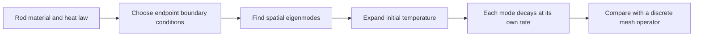
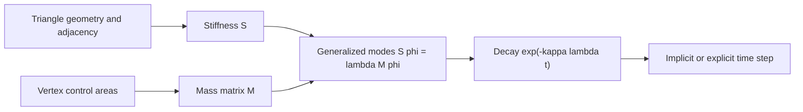

# 25 — Continuous Models and Numerical Error

[[Chapter Edition/01 - Computing Foundations/00 - Reading Map|Reading map]] · [[Chapter Edition/01 - Computing Foundations/24 - Waiting Times, Covariance, and Matrix Decomposition|Previous chapter]] · [[Chapter Edition/01 - Computing Foundations/26 - Matrix Functions and Nonlinear Least Squares|Next chapter]]

Differential equations and mesh operators model continuous change, but computers must discretize the domain and approximate derivatives. This chapter studies boundaries, modes, finite differences, and step-size limits so that mathematical models are not confused with their numerical approximations.

**By the end:** Connect boundary conditions and spatial discretization to a numerical operator, then identify truncation and roundoff limits.

**Recall question:** Why can making a finite-difference step smaller eventually make the derivative estimate worse?

<!-- Derived from Continuous Notes/Computing Foundations - From Bits to C++ and Systems APIs.md; source lines 57905–61007; source-span SHA256 98e491fd57ef297f86d8dfe4392e1d3ea527f3585a5a03b61c35468287b36a0f. -->

<!-- CHAPTER-SOURCE-BEGIN -->
# Continuous models meet numerical computation

Differential equations lead to matrix functions and simulation. Optimization uses the derivative and solver tools already developed. Numerical analysis distinguishes the mathematical problem, the approximation and the arithmetic that executes it.

<!-- begin V09.05 -->
## Heat on a rod: why boundaries, modes, and mesh operators belong together

Take a straight metal rod of length $L$. Its sides are insulated, its ends are held at prescribed temperatures, and someone briefly warms one small region near the middle. The temperature field $u(x,t)$ changes smoothly: the hot spot spreads and its peak falls. We want a model that tells us how the end conditions affect that spreading, how a triangle mesh can approximate it on a curved surface, and what numerical evidence would show that our computation is behaving as intended.

For a uniform rod with no internal heat source, the one-dimensional heat equation is

$$
\frac{\partial u}{\partial t}=\kappa\frac{\partial^2u}{\partial x^2},\qquad 0<x<L,
$$

where $u$ is temperature and $\kappa$ is thermal diffusivity. For a material with conductivity $k$, density $\rho$ and specific heat capacity $c$, $\kappa=k/(\rho c)$. Conductivity is measured in watts per metre per kelvin, volumetric heat capacity in joules per cubic metre per kelvin, so $\kappa$ has units $\mathrm{m^2/s}$. The second spatial derivative has units temperature per square metre; multiplying by diffusivity gives temperature per second, as required by the left side.

The differential equation describes the interior. It does not specify what the ends do. Those conditions are part of the model, because they determine which temperature patterns can persist and which can appear as independent modes. A simulation without its boundary conditions is an incomplete physical problem.



### Boundary conditions choose the modes

A Dirichlet condition prescribes the field value at a boundary. First hold both ends at a reference temperature and subtract that reference so the boundary values are zero: $u(0,t)=u(L,t)=0$. Seek one separable solution $u(x,t)=X(x)T(t)$. Substitution gives

$$
XT'=\kappa X''T
\quad\Longrightarrow\quad
\frac{1}{\kappa}\frac{T'}{T}=\frac{X''}{X}.
$$

The left side depends only on time; the right side depends only on position. For the equality to hold for every $x$ and $t$, each side must equal one constant. Choose it to be $-\lambda$ so that the spatial solutions can be oscillatory while the time solutions decay:

$$
X''+\lambda X=0,\qquad T'+\kappa\lambda T=0.
$$

The general spatial solution for $\lambda=\mu^2>0$ is $X=A\cos(\mu x)+B\sin(\mu x)$. The boundary at $x=0$ forces $A=0$; the boundary at $x=L$ then requires $\sin(\mu L)=0$. Nonzero solutions exist only when $\mu L=n\pi$ for positive integer $n$. Thus the allowed eigenvalues and eigenfunctions are

$$
\lambda_n=\left(\frac{n\pi}{L}\right)^2,
\qquad
X_n(x)=\sin\left(\frac{n\pi x}{L}\right),
\qquad n=1,2,\ldots
$$

and the matching time factor is $T_n(t)=e^{-\kappa\lambda_nt}$. A boundary condition has turned a continuum of possible spatial frequencies into a discrete family. The first mode has one broad arch; higher modes have more zero crossings and shorter wavelengths. Their decay rate grows like $n^2$: fine ripples disappear much faster than broad temperature differences.

The rod's initial temperature $f(x)=u(x,0)$ is expanded in this sine family:

$$
f(x)=\sum_{n=1}^{\infty}b_n\sin\left(\frac{n\pi x}{L}\right),
\qquad
b_n=\frac{2}{L}\int_0^L f(x)\sin\left(\frac{n\pi x}{L}\right)dx.
$$

Orthogonality makes this projection possible: the integral of the product of two different sine modes over $[0,L]$ is zero, while the squared norm of each mode is $L/2$. By linearity, the complete solution is

$$
u(x,t)=\sum_{n=1}^{\infty}b_n\sin\left(\frac{n\pi x}{L}\right)e^{-\kappa(n\pi/L)^2t}.
$$

Each term solves the same PDE and boundary conditions; adding solutions remains a solution because the equation is linear. The coefficients encode the initial pattern; the boundary-selected modes and exponential factors encode how it evolves. The series is not merely a symbolic trick: it says every resolved initial pattern is a weighted sum of independently decaying shapes.

Other endpoint physics changes the spectrum. If the ends are insulated, there is no heat flux through them, so $u_x(0,t)=u_x(L,t)=0$. The spatial modes become $X_n(x)=\cos(n\pi x/L)$ for $n=0,1,2,\ldots$, including a constant mode. That zero mode does not decay: in an insulated rod the average temperature stays fixed. If one end is held at zero and the other insulated, the eigenfunctions are shifted half-wave patterns such as $\sin((n+1/2)\pi x/L)$. A Neumann condition prescribes a normal derivative or associated flux; insulation is the zero-flux case. A Robin condition mixes the value and its normal derivative. For convective heat exchange it can take the form $-k\,\partial_nu=h_c(u-u_{\mathrm{ambient}})$, with outward normal derivative $\partial_n$, conductivity $k$ and heat-transfer coefficient $h_c$. These conditions lead to different eigenvalue equations. Boundary conditions therefore define the operator and its modes together.

The zero mode is not an annoying exception. It carries the conserved average under no-flux conditions. For a uniform rod, integrating the heat equation gives

$$
\frac{d}{dt}\int_0^L u(x,t)dx
=\kappa\int_0^L u_{xx}(x,t)dx
=\kappa\big[u_x(L,t)-u_x(0,t)\big].
$$

Insulated endpoints make the right side zero. The rod redistributes heat internally, but its total excess heat—and, for constant heat capacity and cross-section, its spatial average—does not change. Fixed-temperature ends can exchange heat with their reservoirs, so that same integral need not be conserved.

### Derivatives act on modes by multiplying their frequency

Why are sine waves so useful? Differentiation does not create a new spatial frequency. For a complex wave $e^{ikx}$,

$$
\frac{d}{dx}e^{ikx}=ik e^{ikx},
\qquad
\frac{d^2}{dx^2}e^{ikx}=-k^2 e^{ikx}.
$$

A derivative is therefore multiplication by $ik$ in the frequency representation, and the second derivative is multiplication by $-k^2$. For finite-interval Dirichlet modes, differentiating the sine once gives a cosine, then twice returns the original sine with multiplier $-(n\pi/L)^2$. That is exactly the spatial eigenvalue relation $X_n''=-\lambda_nX_n$. The heat equation consequently becomes a separate scalar decay equation for every mode: $\dot a_n=-\kappa\lambda_na_n$.

This makes the “high frequencies decay faster” statement precise. If the initial temperature contains only a low mode and a high mode, after elapsed time $t$ their amplitudes are multiplied by $e^{-\kappa k^2t}$. When the high mode has four times the wavenumber, it has sixteen times the decay exponent. Smoothing is thus a low-pass operation. It removes oscillations because second derivatives penalize rapid spatial variation.

A Fourier series describes periodic patterns; a sine expansion on $[0,L]$ can be understood by extending a function oddly outside the interval and then periodically. A cosine expansion corresponds to an even extension. The chosen extension matters at the endpoints. If the interior initial temperature does not agree with the fixed end values at $t=0$, the odd periodic extension has a jump. The series still represents the interior in a limiting sense, but convergence near that jump oscillates. This is one way that boundary assumptions show up as ringing rather than disappearing behind the algebra.

### From a mesh Laplacian to a heat operator

The earlier triangle-field calculation constructed a cotangent stiffness matrix for vertex values. We can now give it a clear evolution meaning. Let $u_i(t)$ be a temperature stored at mesh vertex $i$. Build a stiffness matrix $S$ from the surface geometry and a mass matrix $M$ from the areas represented by the vertices. For a common cotangent convention, each interior edge $(i,j)$ has weight $w_{ij}=\tfrac12(\cot\alpha_{ij}+\cot\beta_{ij})$. Set $S_{ij}=-w_{ij}$ off the diagonal and choose $S_{ii}=\sum_{j\ne i}w_{ij}$. Then $S$ is symmetric and, for a suitable mesh, positive semidefinite. A lumped mass matrix is diagonal with $M_{ii}=A_i$, a local area; a consistent finite-element mass matrix can include off-diagonal terms.

With this positive stiffness convention, the discrete heat equation is

$$
M\dot{\mathbf u}=-\kappa S\mathbf u.
$$

If the previous mesh note uses $\Delta=-M^{-1}S$, this is the same statement $\dot{\mathbf u}=\kappa\Delta\mathbf u$. Signs vary across libraries, so test the constant field and a known mode before wiring a new matrix into an update. For a constant vector $\mathbf 1$, every edge difference vanishes, giving $S\mathbf 1=0$ when there is no imposed-temperature boundary. Thus an isolated closed surface or natural no-flux boundary has a zero mode, just like the insulated rod.

The mass matrix is not bookkeeping overhead. It turns an integrated stiffness balance into a rate per unit area or length. On a triangulated surface, $M$ has units square metres and cotangent entries in $S$ are dimensionless; therefore $M^{-1}S$ has units inverse square metres. Multiplying by surface diffusivity $\kappa$ in square metres per second gives a rate in inverse seconds. In a one-dimensional finite-element rod, the mass entries instead have units metres and the stiffness entries have units inverse metres, so $M^{-1}S$ still has units inverse square metres. The matrix dimensions depend on the domain dimension, but the discrete operator approximating a second spatial derivative always carries inverse-length-squared units.

Under a coordinate scaling by factor $s$, areas on a surface scale as $s^2$ while cotangent weights are invariant. Thus $M^{-1}S$ scales as $s^{-2}$. The diffusivity must be expressed in the same physical length units as the geometry. A mesh stored in millimetres paired with $\kappa$ in square metres per second is inconsistent until one representation is converted. Dimensional checks catch this error even when every number in the code looks plausible.

The generalized eigenproblem

$$
S\boldsymbol\phi_n=\lambda_nM\boldsymbol\phi_n
$$

is the mesh counterpart of the rod's spatial mode equation. Its eigenvectors are discrete temperature patterns; its eigenvalues measure how rapidly each pattern bends across the surface. The evolution of a mode amplitude is $a_n(t)=a_n(0)e^{-\kappa\lambda_nt}$. Because $S$ is symmetric and $M$ is positive definite, these modes can be chosen orthogonal in the mass-weighted inner product $\langle u,v\rangle_M=u^TMv$. This is the finite-dimensional version of the orthogonality that made the sine-series coefficients independent.



### Explicit steps have a mesh-dependent stability limit

For the standard centered second difference on a uniform 1D grid with spacing $h$, an interior value has discrete Laplacian

$$
(L_hu)_j=\frac{u_{j-1}-2u_j+u_{j+1}}{h^2}.
$$

Dirichlet endpoints are held fixed; consider the unknown interior values. A discrete sine mode $u_j=\sin(k\pi j/(N+1))$, with $h=L/(N+1)$, is an eigenvector of $L_h$ with eigenvalue

$$
\mu_k=-\frac{4}{h^2}\sin^2\left(\frac{k\pi}{2(N+1)}\right).
$$

The magnitude is largest for the most rapidly alternating grid pattern and approaches $4/h^2$. Forward Euler updates $u^{n+1}=u^n+\kappa\Delta t L_hu^n$. A mode is multiplied each step by $g_k=1+\kappa\Delta t\mu_k$. For no growth in magnitude we need $|g_k|\le1$ for every mode. The most restrictive eigenvalue gives

$$
0\le\frac{\kappa\Delta t}{h^2}\le\frac12,
\qquad\text{or}\qquad
\Delta t\le\frac{h^2}{2\kappa}.
$$

This is a stability bound for the stated standard 1D grid and explicit forward Euler scheme. It is not a universal bound for every mesh, boundary condition, or time integrator. In an unstructured mesh, use the largest eigenvalue of the mass-normalized stiffness operator or a proven bound for the chosen discretization; the spectral scale still behaves like inverse length squared.

A numerical witness makes the instability visible. Let $h=0.25\,\mathrm m$ and $\kappa=0.1\,\mathrm{m^2/s}$. The limit is $0.25^2/(2\cdot0.1)=0.3125\,\mathrm s$. If we take $\Delta t=0.375\,\mathrm s$, then $r=\kappa\Delta t/h^2=0.6$. For a unit-length rod with three interior vertices, the highest Dirichlet mode has $g=1-4(0.6)\sin^2(3\pi/8)\approx-1.048528$. Its sign flips and its magnitude grows by about $4.85\%$ per step. On an even periodic grid, the exact alternating mode instead has $g=1-4r=-1.4$, giving $40\%$ growth. Distinguish the finite-boundary eigenvalue from this limiting or periodic case. At the threshold $r=0.5$, that limiting mode has amplification $-1$: it does not grow, but it is not damped and remains a poor practical choice near the stability edge.

Implicit Euler uses the new-time temperature in the Laplacian:

$$
\frac{\mathbf u^{n+1}-\mathbf u^n}{\Delta t}=-\kappa M^{-1}S\mathbf u^{n+1},
\qquad
(M+\kappa\Delta tS)\mathbf u^{n+1}=M\mathbf u^n.
$$

For a generalized eigenmode with $\lambda_n\ge0$, its amplification is $1/(1+\kappa\Delta t\lambda_n)$, which lies between zero and one for any positive step. This gives unconditional linear stability for diffusion with a positive semidefinite stiffness and positive mass matrix. It requires a linear solve, and a large step can still erase detail or be inaccurate even though it does not blow up. Stability and fidelity are different questions.

On a 2D mesh with area mass matrix, the explicit stability limit is controlled by a largest eigenvalue of order $1/h^2$, where $h$ is a representative edge length. Refining edge length by two can therefore require roughly four times as many explicit steps for the same simulated duration. This cost is one reason implicit diffusion is attractive in geometry processing. It does not follow that every mesh flow should be implicit: intended feature behavior, accuracy, solver conditioning and cost still matter.

### A Green function is an impulse response

A Green function answers a concrete experiment: what field is produced by a unit point source, subject to the same boundaries as the original problem? For a linear operator $L$ with homogeneous boundary conditions, define $G(x,\xi)$ by

$$
L_xG(x,\xi)=\delta(x-\xi),
$$

where the subscript reminds us that $L$ differentiates in the observation coordinate $x$. A distributed source $f(\xi)$ is a superposition of point sources, so the solution is

$$
u(x)=\int G(x,\xi)f(\xi)\,d\xi.
$$

For time-dependent heat flow, the impulse response depends on elapsed time. With the rod's normalized Dirichlet eigenfunctions $\phi_n(x)=\sqrt{2/L}\sin(n\pi x/L)$, the heat kernel is

$$
H_D(x,\xi,t)=\sum_{n=1}^{\infty}\phi_n(x)\phi_n(\xi)e^{-\kappa(n\pi/L)^2t},\qquad t>0.
$$

A point of heat inserted at $\xi$ spreads according to $H_D$; an initial field evolves as $u(x,t)=\int_0^LH_D(x,\xi,t)u(\xi,0)d\xi$. A time-varying source $s(\xi,\tau)$ contributes through a space-time convolution, integrating $H_D(x,\xi,t-\tau)s(\xi,\tau)$ over earlier times $\tau$ and source positions $\xi$. This is the continuous analogue of repeatedly applying a linear diffusion update to source inputs.

The kernel is symmetric in $x$ and $\xi$ for a self-adjoint diffusion operator with the same homogeneous boundary conditions on both arguments. In the rod case this follows term by term because each factor is $\phi_n(x)\phi_n(\xi)$. More generally, Green-function reciprocity follows from self-adjointness and the boundary terms vanishing under the chosen domain and boundary conditions. If coefficients, boundary conditions, or the operator make the problem non-self-adjoint, do not assume $G(x,\xi)=G(\xi,x)$. For a weighted Sturm–Liouville problem, symmetry may be with respect to the appropriate weighted inner product or measure rather than plain coordinate integration.

There is a subtle zero-mode case. With insulated boundaries, the Laplacian has a constant eigenfunction with eigenvalue zero. The steady Poisson equation $-u_{xx}=f$ with pure Neumann conditions cannot have a solution for arbitrary nonzero-mean $f$: integrating both sides shows the source must satisfy the net-flux compatibility condition. Even when compatible, the solution is defined only up to an added constant until a mean or reference value is fixed. The transient heat kernel remains meaningful; the zero mode simply preserves the average instead of decaying. A numerical inverse that silently divides by a zero eigenvalue is not a valid Green-function construction.

### Sampling, truncation, and ringing

A continuous field becomes finite data only after sampling. On a regular 1D grid, the highest alternating mode is near the Nyquist frequency, roughly one half-cycle per sample spacing. Shorter wavelengths cannot be represented uniquely: they alias into lower-frequency patterns. On irregular triangle meshes there is no single global Nyquist number, but local edge length and element shape limit which oscillations are resolved. If the initial hot spot is narrower than the sampling scale, the mesh may miss its peak or encode it as a misleading pattern. Subsequent heat flow smooths the samples it received; it cannot reconstruct the lost sub-grid event.

A truncated Fourier or eigenfunction sum introduces another approximation. Keeping only the first $N$ modes reconstructs the broad structure well when the field is smooth, but a sharp jump needs many modes. Near a discontinuity, partial sums can overshoot and oscillate (Gibbs behavior); increasing $N$ narrows the affected region but does not remove the limiting overshoot at the jump. In heat flow, each mode is additionally multiplied by an exponential decay. At positive time, high-frequency terms are strongly damped, but at time zero the series must still represent the initial/boundary data correctly. If initial temperature and fixed endpoint temperatures disagree at a corner in space-time, a rapid boundary layer is physically implied, not a failure of the series method.

For a finite mesh, eigenvalue truncation and timestep are separate resolution controls. Dropping small-scale eigenvectors discards spatial detail; taking a large implicit-Euler step changes each mode's decay relative to the continuous evolution (its factor $1/(1+x)$ exceeds $e^{-x}$ for $x>0$); taking an unstable explicit step amplifies the highest modes. A visually smooth result is not proof of accuracy because excessive smoothing can hide aliasing, poor mesh quality, or a wrong boundary condition. Report sample spacing, kept modes or timestep, and error against a known field when making a quantitative claim.

### Manufactured fields make the solver testable

A manufactured solution gives an analytic answer for a problem with known boundaries and coefficients. For fixed-zero endpoints choose one sine mode

$$
u(x,t)=A\sin\left(\frac{\pi x}{L}\right)e^{-\kappa(\pi/L)^2t}.
$$

It satisfies both the PDE and $u(0,t)=u(L,t)=0$. With $L=1\,\mathrm m$, $\kappa=0.1\,\mathrm{m^2/s}$, $A=100\,\mathrm K$ and $t=1\,\mathrm s$, the center temperature is

$$
u(L/2,1)=100e^{-0.1\pi^2}\,\mathrm K\approx37.27\,\mathrm K.
$$

For a second, independently decaying mode at twice the wavenumber, the decay exponent is four times larger. A two-mode initial field tests that the solver handles superposition and does not accidentally mix modes in a uniform rod with homogeneous endpoints. Compare grid values to the analytic field at fixed physical times while halving $h$ and reducing $\Delta t$ consistently; measure error rather than relying on a plot.

For a no-flux test choose

$$
u(x,t)=20+5\cos\left(\frac{\pi x}{L}\right)e^{-\kappa(\pi/L)^2t}.
$$

Its derivative is zero at $x=0$ and $x=L$, and its spatial mean is $20$ at every time. A discrete solver should preserve the corresponding mass-weighted mean up to rounding and linear-solver tolerance. For fixed-temperature endpoints, instead measure boundary flux. Fourier’s law gives heat flux $q=-k u_x$; integrating the temperature equation yields the net heat change from inflow at one boundary minus outflow at the other. The rod’s interior energy need not be conserved when reservoirs hold its ends at fixed temperature.

On the mesh, the matching tests are: $S\mathbf1=0$ for a no-flux/closed setting; symmetry $S=S^T$; nonnegative generalized eigenvalues; exponential decay of each measured eigenmode at rate $\kappa\lambda_n$; and conservation of $\mathbf1^TM\mathbf u$ when no heat crosses the boundary and no source is present. For Dirichlet vertices fixed to a reservoir, remove or constrain those degrees of freedom and verify the change in total heat matches integrated boundary flux. A matrix can be symmetric and still have the wrong units, scale, boundary rows, or source signs, so keep the analytic rod and unit checks beside the structural matrix checks.

The rod story now carries through to a curved triangle mesh. Material and boundary conditions define a differential operator; its self-adjoint eigenmodes form a basis; spatial derivatives multiply modes by their squared frequencies; the mesh stiffness and mass matrices approximate that operator; and time integration advances its modes according to their decay rates. Green functions express how localized heat sources propagate under those same boundaries. Sampling and truncation set what detail can be represented, while manufactured solutions and flux balances tell us whether the computed field matches the stated model.

### What the boundary means to the discrete solver

Boundary data must be encoded in the discrete unknowns and matrix, not merely displayed as a condition in a comment. With fixed-temperature Dirichlet endpoints, the endpoint values are known and are removed from the unknown vector or incorporated into the right-hand side. If a known endpoint value is nonzero, its neighboring stencil contains a source contribution proportional to that value. A common error is to drop the endpoint neighbor term when constructing the reduced matrix, thereby solving a different rod with an insulated or shortened boundary.

For an insulated endpoint, the Neumann condition $u_x=0$ says the normal heat flux vanishes. A finite-volume view writes heat balance in terms of fluxes through cell faces; the boundary face contributes zero flux. A finite-difference view can use a ghost value reflected across the endpoint, such as $u_{-1}=u_1$, so the centered derivative $(u_1-u_{-1})/(2h)$ is zero. Either construction should leave the constant vector in the nullspace and conserve the weighted sum. Dirichlet and Neumann are not interchangeable “edge handling” options: one couples the rod to a reservoir; the other isolates it.

For a curved mesh, an open boundary has an analogous choice. A natural finite-element boundary on the diffusion problem usually represents zero flux unless a boundary term is supplied. Pinning boundary temperatures imposes a Dirichlet constraint. A Robin boundary can represent transfer to an ambient temperature, with flux proportional to the difference between the surface temperature and ambient. If the application actually intends a heat bath but the implementation leaves the natural no-flux condition, total mesh heat will be conserved incorrectly. Boundary semantics are part of the physics API.

Self-adjointness explains why a clean mode decomposition exists. For the one-dimensional operator $A=-d^2/dx^2$ with homogeneous Dirichlet conditions, integration by parts gives

$$
\int_0^L f^*Ag\,dx-\int_0^L(Af)^*g\,dx
=\left[-f^*g'+(f')^*g\right]_0^L=0.
$$

The boundary term vanishes because both functions are zero at each end. For homogeneous Neumann conditions, it vanishes because both derivatives are zero. Other boundary conditions may also yield a self-adjoint operator, but this must be checked rather than assumed. The eigenvalues are real, distinct-eigenvalue modes are orthogonal, and the operator can be diagonalized in that basis. This is the continuum reason the heat equation reduces to independent exponential decays.

The same fact has a discrete energy witness. If $S$ is symmetric positive semidefinite and $M$ is positive definite, then

$$
\frac{d}{dt}\left(\frac12\mathbf u^TM\mathbf u\right)
=\mathbf u^TM\dot{\mathbf u}
=-\kappa\mathbf u^TS\mathbf u\le0.
$$

This quadratic norm is not the total heat; it measures squared temperature variation around the chosen zero reference. It decreases under diffusion. Total heat in the no-flux case is instead $\mathbf1^TM\mathbf u$, and it stays constant because $S\mathbf1=0$. Keeping these two quantities separate prevents the false claim that “heat is conserved” means every norm or every boundary case is conserved.

### Spatial and temporal error have different signatures

For a smooth sine mode with wavenumber $k$, the centered difference approximates the second derivative by the discrete eigenvalue

$$
\mu_h=-\frac{4}{h^2}\sin^2\left(\frac{kh}{2}\right)
=-k^2+\frac{k^4h^2}{12}+O(h^4).
$$

The leading error is proportional to $h^2$ for a fixed resolved mode. Since $|\mu_h|$ is slightly less than $k^2$ at small but finite $kh$, the discrete mode decays a little more slowly than the continuum mode. Near the grid's highest frequency, the approximation is no longer close to $-k^2$; the grid cannot represent finer structure. This is spatial discretization error, distinct from the forward-Euler time error and its stability limit.

A convergence experiment should separate them. Fix a smooth analytic initial field, hold temporal error small while refining $h$, and compare at a fixed time to estimate spatial convergence. Then fix a sufficiently fine spatial grid and reduce $\Delta t$ to measure temporal convergence. Finally sweep the ratio $r=\kappa\Delta t/h^2$ toward the stability edge to verify the predicted highest-mode amplification. If both $h$ and $\Delta t$ change arbitrarily in one experiment, a smaller error cannot be attributed to either change.

A practical manufactured solution can include a source term as well. Choose a smooth field $u_*(x,t)$ satisfying the desired boundary values, then define

$$
s(x,t)=\partial_tu_*(x,t)-\kappa\partial_{xx}u_*(x,t).
$$

The field $u_*$ is now an exact solution of $u_t=\kappa u_{xx}+s$ by construction. For example, let $u_*=e^{-t}\sin(\pi x/L)+t\sin(2\pi x/L)$, whose endpoints remain zero. Differentiate it analytically to construct $s$. This tests the source assembly, boundary treatment, spatial operator and time stepping together without needing a complicated closed-form solution to an unrelated physical problem. Report a normed error, such as $\|u_h-u_*\|_M$, at stated times.

The mode formulas also support an impulse-response check. A sharply localized initial heat pulse can be projected onto the sine basis; its coefficient for mode $n$ is the pulse's inner product with $\phi_n$. At later times, each coefficient must be multiplied by $e^{-\kappa\lambda_nt}$. Compare direct time stepping against this truncated spectral reference on a fine grid. The two methods will not match exactly because one has grid and timestep error and the other has truncation error, but their discrepancy should shrink under the declared refinements. This test exercises the same linear evolution from two independent representations.

For a self-adjoint problem with a zero Neumann mode, the steady Green function for an inverse Laplacian is singular because constants are annihilated. One must project out the constant mode, enforce a zero-mean source, and choose a gauge such as zero-mean solution. For the transient heat kernel, the constant mode is retained: it is the long-time average left after all nonconstant modes decay. This distinction matters in mesh processing too. Solving a Poisson equation for geometry may need a pinned vertex or mean constraint; evolving heat on a closed surface should generally preserve the mean rather than accidentally delete it.

The continuous and discrete models therefore have matching but not identical contracts. In the continuum, the boundary condition defines the operator domain and Green identity. In the mesh, it determines constrained rows, boundary flux terms and the nullspace. In the spectrum, it selects modes and eigenvalues. In the time step, it controls stability and decay. Verifying one layer with the appropriate witness makes it possible to localize a bad result instead of compensating for it with an arbitrary damping factor or a smaller timestep.


## Linear fields become easier when we choose coordinates that match the operator

The heat-equation discussion above already showed that a differential operator has modes. Riley, Hobson, and Bence develop the larger mathematical pattern: many linear physical problems become tractable by finding functions that play the role of eigenvectors for a differential operator.

A **Sturm–Liouville** problem has the form

\[
-\frac{d}{dx}
\left(
p(x)\frac{dy}{dx}
\right)
-q(x)y
=
\lambda \rho(x)y
\]

under boundary conditions that make the differential operator self-adjoint with respect to the weighted inner product

\[
\langle f,g\rangle_\rho
=
\int_a^b
f(x)^*g(x)\rho(x)\,dx.
\]

Self-adjointness is the infinite-dimensional analogue of a real symmetric/Hermitian matrix. Under the appropriate regular setting, eigenvalues are real and eigenfunctions associated with distinct eigenvalues are orthogonal under the weight \(\rho\). The conceptual bridge to the matrix spectral theorem is direct: a function can be expanded in operator-adapted modes, and the differential equation acts independently on those modes.

This is why sine/cosine series appear for strings and heat flow, spherical harmonics appear for angular problems on a sphere, and Bessel functions appear in cylindrical/radial separation problems. They are not a bag of unrelated “special functions.” They are eigenfunctions selected by the operator, coordinate geometry, and boundary conditions.

For a one-dimensional fixed-end string, spatial separation leads to

\[
X''+\lambda X=0,
\qquad
X(0)=X(L)=0,
\]

whose nonzero modes are

\[
X_n(x)=
\sin\left(\frac{n\pi x}{L}\right).
\]

The boundary conditions quantize the allowed spatial frequencies. The temporal equation then determines how each coefficient oscillates. For heat flow the same spatial modes decay exponentially rather than oscillate. The geometry of the domain and boundary conditions choose the basis; the time-evolution law chooses what happens to each coefficient.

This operator viewpoint is useful far beyond textbook PDEs. Mesh Laplacian eigenvectors are discrete manifold modes. Environment maps can use spherical-harmonic bases. Modal deformation represents elastic motion in a reduced eigenbasis. Spectral denoising suppresses selected high-frequency coefficients. The same mathematical decision recurs: **choose a basis in which the governing operator is simple**.

Source basis: Riley, Hobson, and Bence, *Mathematical Methods for Physics and Engineering*, Chapters 17–18 on self-adjoint/Hermitian operators, Sturm–Liouville equations, eigenfunction superposition, Green’s functions, and special-function eigenfamilies.

### Fourier, Laplace, and Green methods answer different versions of “invert this linear system”

A Fourier series expands a periodic function in discrete harmonics. A Fourier transform extends the idea to a continuum of frequencies. With one common convention,

\[
\hat f(\omega)
=
\int_{-\infty}^{\infty}
f(t)e^{-i\omega t}\,dt,
\qquad
f(t)
=
\frac{1}{2\pi}
\int_{-\infty}^{\infty}
\hat f(\omega)e^{i\omega t}\,d\omega.
\]

The exact \(2\pi\) factors depend on convention; the transform pair must be declared together.

Differentiation becomes multiplication:

\[
\widehat{f'}(\omega)=i\omega\hat f(\omega),
\]

when boundary/regularity assumptions justify the manipulation. Convolution becomes pointwise multiplication:

\[
\widehat{f*g}
=
\hat f\,\hat g.
\]

This is why blur kernels, linear shift-invariant filters, diffraction formulas, image correlation, and frequency-domain PDE solvers all meet Fourier analysis. The transform is not “making an image into frequencies” in a vague sense; it changes coordinates so translation-invariant linear operators become multiplication.

A Laplace transform,

\[
F(s)
=
\int_0^\infty
f(t)e^{-st}\,dt,
\]

uses a complex parameter \(s\) and is especially useful for initial-value systems where exponential growth/decay and transient behavior matter. Derivatives transform into algebraic expressions that include initial conditions. Fourier analysis emphasizes steady frequency content; Laplace analysis includes a real exponential weighting and exposes poles that govern temporal modes. One can often obtain a Fourier transform as a boundary case when the relevant convergence conditions permit.

A **Green function** solves a different but connected problem. For a linear operator \(L\), define \(G(x,\xi)\) by

\[
L_x G(x,\xi)=\delta(x-\xi)
\]

with the desired boundary conditions. Then a solution of

\[
L u=f
\]

can be represented schematically as

\[
u(x)
=
\int G(x,\xi)f(\xi)\,d\xi
\]

plus any terms required by nonhomogeneous boundary conditions. \(G\) is an impulse response: it tells how a unit source at \(\xi\) influences \(x\). In translation-invariant domains, \(G(x,\xi)\) may depend only on \(x-\xi\), turning the integral into a convolution and reconnecting directly to Fourier multiplication.

These are therefore three views of the same linear-operator problem. Eigenfunction expansion diagonalizes using problem-specific modes. Fourier/Laplace transforms diagonalize or algebraize operators using standard exponential families. A Green function represents the inverse operator as the response to impulses. The right choice depends on domain, boundary/initial conditions, symmetry, and whether an analytic or numerical representation is desired.

Source basis: Riley, Hobson, and Bence, Chapters 12–17 and 20–21 on Fourier series/transforms, Laplace transforms, ODE/PDE eigenfunction methods, separation of variables, integral transforms, and Green functions.

### PDE names are incomplete until the data and domain are specified

The same differential expression can define very different physical and numerical problems depending on its boundary and initial data. Three canonical linear PDE families recur throughout graphics and simulation:

\[
\frac{\partial u}{\partial t}
=
\kappa\nabla^2u
\quad\text{(diffusion/heat)},
\]

\[
\frac{\partial^2u}{\partial t^2}
=
c^2\nabla^2u
\quad\text{(wave)},
\]

and

\[
\nabla^2u=f
\quad\text{(Poisson; \(f=0\) gives Laplace)}.
\]

Diffusion is dissipative: high-frequency modes decay rapidly. The wave equation is second order in time and supports propagating oscillations. Poisson/Laplace are typically boundary-value equations without a time evolution at all. Reusing one “PDE solver” abstraction without representing these different contracts can hide which data are mathematically required.

A Dirichlet condition specifies the field value on a boundary. A Neumann condition specifies a normal derivative/flux. Mixed/Robin conditions combine them. Initial-value data specify the state at a starting time; a second-order time equation generally needs enough initial information for both displacement-like and velocity-like state. Existence and uniqueness depend on the equation, domain, and data together. For pure Neumann Poisson problems, for example, a constant gauge can remain unless an additional normalization fixes it, and source compatibility conditions may be required.

**Separation of variables** assumes a product such as

\[
u(x,t)=X(x)T(t)
\]

and rearranges a PDE so each coordinate-dependent side must equal a separation constant. This does not magically solve arbitrary PDEs. It succeeds when geometry, coefficients, and boundary conditions permit a separable basis. The resulting spatial equations are often Sturm–Liouville eigenproblems, which explains why the previous section is not separate trivia.

Characteristics provide another coordinate system for PDEs, especially first-order hyperbolic transport: they trace curves along which the PDE reduces to an ODE. In rendering, transport equations literally describe quantities moving along rays; in fluid and wave problems, characteristic directions encode propagation. Numerically, respecting that propagation structure often matters more than treating the PDE as a generic grid stencil.

The practical workflow is therefore: state the PDE, domain, coefficients, initial/boundary data, regularity assumptions, and conserved/dissipated quantities **before** choosing the discretization. A stable discretization of the wrong boundary-value problem is still a wrong solver.

Source basis: Riley, Hobson, and Bence, Chapters 20–21 on the wave, diffusion, Laplace and Poisson equations, characteristics, existence/uniqueness, separation of variables, integral-transform methods, and Green-function boundary problems.

### Complex analysis explains why conformal maps, residues, and asymptotic integrals share one language

A complex-valued function \(f(z)\) of \(z=x+iy\) is differentiable in the complex sense only under stronger conditions than ordinary two-variable differentiability. Writing

\[
f(z)=u(x,y)+iv(x,y),
\]

analyticity implies the Cauchy–Riemann relations

\[
u_x=v_y,\qquad u_y=-v_x
\]

under the standard regularity assumptions. These equations force angle-preserving local behavior wherever \(f'(z)\neq0\), which is why analytic functions are a natural source of **conformal maps**.

Contour integration then turns analyticity into global identities. Cauchy’s theorem and integral formula constrain integrals of analytic functions; a Laurent series exposes isolated singularities. The coefficient of \((z-z_0)^{-1}\) is the **residue**, and the residue theorem converts certain contour integrals into a sum over enclosed singularities:

\[
\oint_C f(z)\,dz
=
2\pi i
\sum_{z_k\in\mathrm{inside}(C)}
\operatorname{Res}(f,z_k).
\]

For engineering mathematics, the point is not to replace numerical integration with clever contours everywhere. The pole/singularity structure often reveals system behavior directly. Inverse Laplace transforms, linear-system responses, wave propagation, and asymptotic integrals can all be interpreted through complex singularities.

When an integral contains a rapidly varying phase or exponential,

\[
I(\lambda)
=
\int e^{\lambda\phi(z)}a(z)\,dz,
\qquad |\lambda|\gg1,
\]

the dominant contribution often comes from neighborhoods of stationary/saddle points where \(\phi'(z)=0\). Stationary-phase and steepest-descent methods deform or analyze the integration path so the important local contributions become explicit. WKB methods apply related asymptotic reasoning to differential equations with a slowly varying scale. These techniques are useful conceptual ancestors of modern importance/saddle-point approximations: large problems can be dominated by small geometrically structured regions.

Source basis: Riley, Hobson, and Bence, Chapters 24–25 on analytic functions, Cauchy–Riemann equations, conformal transformations, contour integration, Laurent series, residues, inverse Laplace transforms, WKB, stationary phase, and steepest descent.

## ODEs and numerical simulation
### Explicit Euler: deriving a simulator from a differential equation

Consider:

$$
\dot y=f(t,y).
$$

We want to advance from time $t_n$ to:

$$
t\_{n+1}=t_n+h,
$$

where $h>0$ is the timestep.

Taylor-expand the unknown solution:

$$
y(t_n+h) = y(t_n) + h\dot y(t_n) + \frac{h^2}{2}\ddot y(t_n) +\cdots.
$$

Since:

$$
\dot y(t_n)=f(t_n,y_n),
$$

discarding second-order and higher terms gives:

$$
\boxed{ y\_{n+1}=y_n+h f(t_n,y_n) }.
$$

This is explicit Euler integration.

It is called explicit because the right side depends only on information already available at the current step.

The solver does not need to solve an equation involving the unknown $y\_{n+1}$.

##### The algorithmic state transition

A generic explicit Euler step performs these operations:

```text
Current time:  t_n
Current state: y_n

1. Evaluate slope:
      k = f(t_n, y_n)

2. Multiply by timestep:
      change = h * k

3. Update state:
      y_(n+1) = y_n + change

4. Advance time:
      t_(n+1) = t_n + h
```

The word slope refers to the state derivative. For a scalar $y$, it is a scalar. For a vector state, it is a vector of rates, one for each state component.

##### Worked example: exponential decay

Solve approximately:

$$
y'=-2y,\qquad y(0)=1.
$$

Choose:

$$
h=0.1.
$$

At the initial state:

$$
f(0,1)=-2.
$$

Euler gives:

$$
y_1=1+0.1(-2)=\boxed{0.8}.
$$

The exact solution is:

$$
y(t)=e^{-2t}.
$$

At $t=0.1$:

$$
y(0.1)=e^{-0.2}\approx0.818730753.
$$

Euler's result is too small by about $0.01873$.

For a second Euler step:

$$
f(0.1,0.8)=-1.6,
$$

so:

$$
y_2=0.8+0.1(-1.6)=0.64.
$$

The exact value at $t=0.2$ is:

$$
e^{-0.4}\approx0.670320046.
$$

The numerical error accumulates across steps.

##### Local truncation error versus global error

Euler's formula comes from discarding terms beginning at:

$$
\frac{h^2}{2}\ddot y.
$$

For a sufficiently smooth solution, the local truncation error per step, assuming an exact starting state, is:

$$
O(h^2).
$$

But over a fixed interval of duration $T$, the number of steps is proportional to $1/h$.

The accumulated global error is generally:

$$
\boxed{O(h)}.
$$

This is why Euler is called a first-order method.

Do not confuse the local order and the global order.

A numerical method can have a locally tiny error but still produce a substantial accumulated trajectory error when applied repeatedly.

#### Explicit Euler in a spring simulation

Take a unit-mass undamped spring:

$$
m=1\ \mathrm{kg}, \qquad k=4\ \mathrm{N/m}.
$$

Its acceleration is:

$$
a=-4x.
$$

Use initial state:

$$
x_0=1\ \mathrm m, \qquad v_0=0\ \mathrm{m/s},
$$

and timestep:

$$
h=0.1\ \mathrm s.
$$

Explicit Euler updates both position and velocity using the old state:

$$
x\_{n+1}=x_n+hv_n,
$$

$$
v\_{n+1}=v_n+ha_n.
$$

At the initial state:

$$
a_0=-4.
$$

Then:

$$
x_1=1+0.1(0)=\boxed{1},
$$

$$
v_1=0+0.1(-4)=\boxed{-0.4}.
$$

The new state is:

$$
\boxed{\mathbf y_1=(1,-0.4)}.
$$

Notice the physical issue. The spring has already begun pulling the mass inward, so velocity has changed, but position remains unchanged throughout the step because Euler used the original zero velocity.

That behavior is expected from the algorithm, not evidence of a software bug.

##### The energy problem

The mechanical energy of an ideal undamped spring is:

$$
E=\frac12mv^2+\frac12kx^2.
$$

Initially:

$$
E_0=0+2(1)^2=\boxed{2\ \mathrm J}.
$$

After explicit Euler:

$$
E_1= \frac12(1)(-0.4)^2+ \frac12(4)(1)^2.
$$

Therefore:

$$
E_1=0.08+2=\boxed{2.08\ \mathrm J}.
$$

The simulation has created $0.08$ joules of energy even though no external force has added energy.

This is numerical energy drift.

For the ideal harmonic oscillator, explicit Euler injects energy systematically. We will derive that behavior from its update matrix in the stability section.


### Variational mechanics explains where the equations of motion come from

The spring examples above began from a differential equation and asked how to integrate it. Classical mechanics provides a deeper layer: instead of accepting the equation of motion as the starting point, we can derive it from a scalar quantity defined over an entire trajectory.

Let the generalized coordinates of a mechanical system be

\[
\mathbf q(t)
=
(q_1(t),\ldots,q_n(t)).
\]

The coordinates do not have to be Cartesian positions. They may be joint angles, slider distances, or any independent coordinates that describe a configuration locally.

Define the **Lagrangian**

\[
\boxed{
L(\mathbf q,\dot{\mathbf q},t)
=
T(\mathbf q,\dot{\mathbf q},t)
-
V(\mathbf q,t)
}
\]

for the common conservative mechanical case, where \(T\) is kinetic energy and \(V\) is potential energy.

For a candidate trajectory between fixed endpoint configurations at fixed times, define the **action**

\[
\boxed{
S[\mathbf q]
=
\int_{t_0}^{t_1}
L(\mathbf q,\dot{\mathbf q},t)\,dt
}.
\]

Hamilton's principle states that the physical trajectory is stationary with respect to admissible infinitesimal variations of the path whose endpoint variations vanish:

\[
\delta S=0.
\]

“Stationary” is more precise than “minimum.” Depending on the problem, the physical path need not globally minimize the action. The first variation must vanish.

#### Deriving the Euler–Lagrange equations rather than quoting them

Perturb one coordinate by a small function \(\eta_i(t)\):

\[
q_i(t)\mapsto q_i(t)+\varepsilon\eta_i(t),
\]

with

\[
\eta_i(t_0)=\eta_i(t_1)=0.
\]

Differentiate the action with respect to \(\varepsilon\) at zero:

\[
\delta S
=
\int_{t_0}^{t_1}
\sum_i
\left(
\frac{\partial L}{\partial q_i}\eta_i
+
\frac{\partial L}{\partial \dot q_i}\dot\eta_i
\right)
dt.
\]

Integrate the second term by parts:

\[
\int
\frac{\partial L}{\partial\dot q_i}
\dot\eta_i\,dt
=
\left[
\frac{\partial L}{\partial\dot q_i}\eta_i
\right]_{t_0}^{t_1}
-
\int
\frac{d}{dt}
\left(
\frac{\partial L}{\partial\dot q_i}
\right)\eta_i\,dt.
\]

The boundary term vanishes because the endpoint variations are zero. Therefore

\[
\delta S
=
\int_{t_0}^{t_1}
\sum_i
\left[
\frac{\partial L}{\partial q_i}
-
\frac{d}{dt}
\left(
\frac{\partial L}{\partial\dot q_i}
\right)
\right]
\eta_i\,dt.
\]

The variations \(\eta_i\) are otherwise arbitrary. Hence every coefficient must vanish:

\[
\boxed{
\frac{d}{dt}
\left(
\frac{\partial L}{\partial\dot q_i}
\right)
-
\frac{\partial L}{\partial q_i}
=
0
}.
\]

These are the Euler–Lagrange equations.

For a particle in one dimension,

\[
L(x,\dot x)=\frac12m\dot x^2-V(x).
\]

Then

\[
\frac{\partial L}{\partial\dot x}=m\dot x,
\qquad
\frac{\partial L}{\partial x}=-V'(x),
\]

so

\[
m\ddot x+V'(x)=0.
\]

Because force is

\[
F(x)=-V'(x),
\]

we recover

\[
m\ddot x=F(x).
\]

The variational and Newtonian descriptions agree here, but the variational form generalizes naturally to non-Cartesian coordinates and exposes symmetries that may be hidden in component force equations.

#### Generalized momentum is defined by the Lagrangian

The momentum conjugate to \(q_i\) is

\[
\boxed{
p_i
=
\frac{\partial L}{\partial\dot q_i}
}.
\]

For a Cartesian particle with ordinary kinetic energy this becomes \(p_i=m\dot q_i\), but the definition is more general. In curvilinear coordinates or coupled systems, conjugate momentum need not be a mass times the corresponding coordinate velocity.

This matters when converting an engine model into Hamiltonian form: blindly storing \(\mathbf p=m\mathbf v\) is only valid when the model's kinetic energy gives that relation.

#### Cyclic coordinates reveal conservation laws immediately

If a coordinate \(q_j\) does not appear explicitly in the Lagrangian,

\[
\frac{\partial L}{\partial q_j}=0,
\]

then the Euler–Lagrange equation gives

\[
\frac{d}{dt}
\left(
\frac{\partial L}{\partial\dot q_j}
\right)
=0.
\]

Thus

\[
\boxed{p_j=\text{constant}.}
\]

Such a coordinate is called **cyclic** or **ignorable**. The word “ignorable” does not mean physically unimportant; it means the Lagrangian is invariant under translation in that coordinate.

This is the local computational face of a much deeper principle: symmetry creates conservation laws.

### Noether's principle connects continuous symmetry to conserved quantities

A conservation law should not be treated as a lucky algebraic cancellation. When the action is invariant under a continuous one-parameter transformation, an associated quantity is conserved along solutions of the Euler–Lagrange equations.

The full theorem can be expressed geometrically, but three standard correspondences provide the engineering intuition:

\[
\boxed{
\text{spatial translation symmetry}
\longleftrightarrow
\text{linear momentum conservation}
}
\]

\[
\boxed{
\text{rotational symmetry}
\longleftrightarrow
\text{angular momentum conservation}
}
\]

\[
\boxed{
\text{time-translation symmetry}
\longleftrightarrow
\text{energy conservation}
}
\]

The assumptions matter. An external time-dependent force breaks time-translation invariance. A fixed wall or field can break spatial translation symmetry. Dissipation is generally not described by the simple conservative action above. A collision solver that injects or removes energy according to restitution is not obliged to conserve the pre-impact Hamiltonian.

For debugging, however, symmetry-derived invariants are extremely useful. If an isolated rotationally symmetric system should conserve angular momentum and a numerical method produces systematic drift, the invariant gives a targeted test. The right question is not “does the simulation look plausible?” but “which continuous symmetry should imply which invariant, and which part of the discrete update violates it?”

### Configuration space, velocity space, and phase space are different state spaces

A configuration is one possible geometric arrangement of the system. The set of all configurations is the **configuration space**, usually denoted \(Q\).

For a point particle constrained to a sphere, \(Q\) is the sphere itself, not all of \(\mathbb R^3\). For a rigid body's orientation, the configuration space is the rotation group \(SO(3)\), not an arbitrary three-vector space even though software may use three local parameters or four quaternion components to represent it.

A Lagrangian state needs both configuration and velocity. Geometrically, velocities live in the tangent space \(T_qQ\) at the current configuration. The collection of all pairs

\[
(q,\dot q)
\]

forms the tangent bundle \(TQ\).

Hamiltonian mechanics instead uses configuration and conjugate momentum:

\[
(q,p).
\]

Momenta are covector-like objects belonging to the cotangent space \(T_q^*Q\). The collection of all such pairs is the **cotangent bundle**

\[
\boxed{T^*Q,}
\]

which is the natural phase space for Hamiltonian mechanics.

This distinction connects directly to the earlier vector/covector discussion in this volume. Velocity is tangent to a trajectory in configuration space. Momentum is produced by differentiating the scalar Lagrangian with respect to velocity, so it naturally acts like a covector. In Euclidean coordinates with a fixed identity metric, software often identifies vectors and covectors so casually that the distinction disappears. Curved coordinates, generalized inertia, and geometric mechanics force it back into view.

### The Legendre transform moves from velocity to momentum

Starting with a Lagrangian \(L(q,\dot q,t)\), define

\[
p_i=\frac{\partial L}{\partial\dot q_i}.
\]

If these relations can be inverted to obtain

\[
\dot{\mathbf q}
=
\dot{\mathbf q}(\mathbf q,\mathbf p,t),
\]

then define the Hamiltonian by the Legendre transform

\[
\boxed{
H(\mathbf q,\mathbf p,t)
=
\mathbf p^T\dot{\mathbf q}
-
L(\mathbf q,\dot{\mathbf q},t)
}.
\]

For

\[
L=\frac12m\dot q^2-V(q),
\]

we have

\[
p=m\dot q,
\qquad
\dot q=\frac pm.
\]

Therefore

\[
H
=
p\frac pm
-
\left(
\frac12m\frac{p^2}{m^2}
-
V(q)
\right)
=
\boxed{
\frac{p^2}{2m}+V(q)
}.
\]

In this familiar case \(H\) is total mechanical energy.

But “Hamiltonian equals energy” is not a definition that works without qualification. Time-dependent coordinates, velocity-dependent potentials, constrained or singular systems, and other generalized models can make the relationship subtler.

The invertibility condition is also substantive. The velocity Hessian

\[
\left[
\frac{\partial^2L}
{\partial\dot q_i\partial\dot q_j}
\right]
\]

must be nonsingular for the ordinary Legendre transformation to define velocities uniquely from momenta. If it is singular, constraints are present in the Hamiltonian description and a naive inversion fails. This is one reason constrained mechanics requires more than rearranging equations.

### Hamilton's equations turn mechanics into first-order flow on phase space

When the Legendre transform is regular, the dynamics can be written

\[
\boxed{
\dot q_i
=
\frac{\partial H}{\partial p_i},
\qquad
\dot p_i
=
-
\frac{\partial H}{\partial q_i}
}.
\]

Second-order equations in configuration become a first-order system on phase space.

For a harmonic oscillator,

\[
H(q,p)
=
\frac{p^2}{2m}
+
\frac12kq^2.
\]

Then

\[
\dot q=\frac pm,
\qquad
\dot p=-kq.
\]

The energy level

\[
H(q,p)=E
\]

is an ellipse in the \((q,p)\) phase plane:

\[
\frac{p^2}{2mE}
+
\frac{kq^2}{2E}
=
1.
\]

The exact trajectory circulates around this ellipse. This phase portrait makes numerical behavior visually interpretable. A method whose states spiral outward is injecting energy. A method whose states spiral inward is dissipating energy. A structure-preserving method may follow a nearby closed curve while its exact energy oscillates.

That geometric picture is the reason the symplectic discussion below is more than terminology.

### The canonical symplectic form encodes the position-momentum pairing

In canonical coordinates

\[
(q_1,\ldots,q_n,p_1,\ldots,p_n),
\]

the canonical symplectic two-form is

\[
\boxed{
\omega
=
\sum_{i=1}^{n}
dq_i\wedge dp_i
}.
\]

A two-form measures oriented infinitesimal area in pairs of tangent directions. The wedge product is antisymmetric:

\[
dq_i\wedge dp_i
=
-
dp_i\wedge dq_i.
\]

In matrix form the same bilinear structure is represented by

\[
\Omega
=
\begin{bmatrix}
0&I\\
-I&0
\end{bmatrix}.
\]

A Hamiltonian \(H\) determines a vector field \(X_H\) through the symplectic form. With one common sign convention,

\[
\boxed{
\iota_{X_H}\omega=dH
}
\]

with the corresponding canonical-coordinate convention chosen consistently. Expanding the relation yields Hamilton's equations. Different texts may place a minus sign in the defining contraction depending on whether \(\omega\) is written \(dq\wedge dp\) or \(dp\wedge dq\); the physical equations do not change when conventions are used consistently.

The important idea is that the Hamiltonian is not merely a scalar we try to conserve. Through \(\omega\), its differential generates the direction of motion in phase space.

### Poisson brackets turn observables into a dynamical algebra

Let \(f(q,p,t)\) be any scalar observable on phase space. Define the canonical **Poisson bracket**

\[
\boxed{
\{f,g\}
=
\sum_i
\left(
\frac{\partial f}{\partial q_i}
\frac{\partial g}{\partial p_i}
-
\frac{\partial f}{\partial p_i}
\frac{\partial g}{\partial q_i}
\right)
}.
\]

Along Hamiltonian motion,

\[
\boxed{
\frac{df}{dt}
=
\{f,H\}
+
\frac{\partial f}{\partial t}
}.
\]

This single formula packages many conservation arguments. If \(f\) has no explicit time dependence and

\[
\{f,H\}=0,
\]

then \(f\) is conserved.

For the coordinate observable \(q_j\),

\[
\{q_j,H\}
=
\frac{\partial H}{\partial p_j}
=
\dot q_j.
\]

For \(p_j\),

\[
\{p_j,H\}
=
-
\frac{\partial H}{\partial q_j}
=
\dot p_j.
\]

Thus Hamilton's equations themselves are special cases of observable evolution.

The bracket is bilinear and antisymmetric:

\[
\{f,g\}=-\{g,f\},
\]

obeys a product rule, and satisfies the Jacobi identity. Those properties make phase-space observables into a Lie algebra. For practical mechanics, the main value is conceptual compression: “commutes with the Hamiltonian under the Poisson bracket” becomes a test for a conserved quantity.

### Liouville's theorem says Hamiltonian flow does not compress phase-space volume

Consider the phase-space vector field

\[
\dot{\mathbf z}
=
\begin{bmatrix}
\dot{\mathbf q}\\
\dot{\mathbf p}
\end{bmatrix}
=
\begin{bmatrix}
\nabla_pH\\
-\nabla_qH
\end{bmatrix}.
\]

Its divergence in canonical coordinates is

\[
\nabla_{\mathbf z}\cdot\dot{\mathbf z}
=
\sum_i
\left(
\frac{\partial^2H}{\partial q_i\partial p_i}
-
\frac{\partial^2H}{\partial p_i\partial q_i}
\right)
=0
\]

when the required mixed derivatives are regular.

Zero divergence means the continuous Hamiltonian flow preserves phase-space volume. A cloud of initial states can stretch, shear, and fold, but its phase-space volume is preserved.

This is **Liouville's theorem**.

For one degree of freedom, phase space is two-dimensional, so volume preservation becomes area preservation. In higher dimensions, preserving \(2n\)-dimensional volume is weaker than preserving the full symplectic structure. A map can have determinant one and still fail the symplectic condition

\[
(D\Phi)^T\Omega(D\Phi)=\Omega.
\]

This distinction prevents a common shortcut: “volume preserving” and “symplectic” are not interchangeable.

### Canonical transformations preserve the mechanics, not merely coordinates

A change of phase-space variables

\[
(q,p)\mapsto(Q,P)
\]

is **canonical** when it preserves the symplectic form. In matrix language for a differentiable map, the Jacobian must satisfy the same symplectic condition used below for discrete integrators.

Ordinary coordinate changes can rewrite equations. Canonical transformations do something stronger: they preserve the Hamiltonian geometric structure, so the transformed variables still obey Hamiltonian mechanics in canonical form.

This perspective explains why the symplectic condition is the right discrete analogue to care about. A symplectic integrator attempts to make each timestep a canonical transformation, even though it only approximates the exact Hamiltonian flow.

### What this means for an engine integrator

The hierarchy is now precise:

\[
\boxed{
\text{action}
\rightarrow
\text{Euler--Lagrange equations}
\rightarrow
\text{conjugate momentum}
\rightarrow
\text{Hamiltonian phase-space flow}
\rightarrow
\text{symplectic discrete update}
}
\]

Each arrow introduces assumptions.

A real-time engine can violate the clean conservative model in many legitimate ways: damping, control forces, impulses, unilateral contact, friction, constraint stabilization, sleeping, clamping, adaptive stepping, and discontinuous gameplay state changes. The point of geometric mechanics is not to pretend those features do not exist. It gives a reference structure against which each modification can be understood.

When a solver changes momentum through an impact impulse, ask which invariant the collision law is meant to preserve. When damping is applied, do not diagnose energy loss as an integrator bug if energy loss is the model. When variable timestep logic is introduced, do not assume a method retains every fixed-step structural property. When a projection step enforces a constraint, verify what that projection does to momentum and phase-space geometry.

The value of the theory is therefore diagnostic: it tells us which properties belong to the physical model, which belong to the continuous equations, and which belong to the numerical approximation.

Source basis: V. I. Arnold, *Mathematical Methods of Classical Mechanics*, especially the development from variational/Lagrangian mechanics to Hamiltonian mechanics and the geometric formulation of phase-space flow. The implementation-facing diagnostics and engine examples above are a synthesis with the numerical-integration narrative already developed here.


### Semi-implicit Euler: why update order changes the dynamics

[[Chapter Edition/01 - Computing Foundations/25 - Continuous Models and Numerical Error#ODEs and numerical simulation|Semi-implicit Euler]] is often called symplectic Euler or Euler–Cromer integration when applied in the appropriate canonical position-momentum formulation.

For our constant-mass spring, the velocity-first form is:

$$
\boxed{ v\_{n+1}=v_n+h a(x_n,v_n,t_n) }
$$

followed by:

$$
\boxed{ x\_{n+1}=x_n+h v\_{n+1} }.
$$

Compare this with explicit Euler, where position uses $v_n$.

The difference is only the order in which state is updated, but its long-term behavior can be dramatically different.

##### Deriving the update for the same spring

We already found:

$$
v_1=-0.4.
$$

Now position uses that updated velocity:

$$
x_1=1+0.1(-0.4).
$$

Therefore:

$$
\boxed{x_1=0.96}.
$$

The new state becomes:

$$
\boxed{\mathbf y_1=(0.96,-0.4)}.
$$

Its energy is:

$$
E_1= \frac12(0.4)^2+ 2(0.96)^2.
$$

Thus:

$$
E_1=0.08+1.8432=\boxed{1.9232\ \mathrm J}.
$$

This time the energy has decreased.

Does that mean semi-implicit Euler continuously destroys energy? No.

For an ideal harmonic oscillator in its stable regime, symplectic Euler generally produces bounded oscillatory error in the original energy rather than the systematic exponential energy growth of explicit Euler.

It does not exactly conserve the original Hamiltonian at every step.

For sufficiently small fixed steps, however, its symplectic structure provides much better qualitative long-term behavior for many Hamiltonian systems.

##### What does symplectic actually mean?

A symplectic system is naturally expressed using positions $\mathbf q$ and conjugate momenta $\mathbf p$.

Hamilton's equations are:

$$
\dot{\mathbf q}=\frac{\partial H}{\partial\mathbf p}, \qquad \dot{\mathbf p}=-\frac{\partial H}{\partial\mathbf q},
$$

where $H$ is the Hamiltonian, often corresponding to total energy.

A symplectic transformation preserves the symplectic two-form. In canonical coordinates, a differentiable update map with Jacobian $D\Phi$ is symplectic when:

$$
\boxed{ (D\Phi)^T\Omega(D\Phi)=\Omega }
$$

where:

$$
\Omega= \begin{bmatrix} 0&I\\ -I&0 \end{bmatrix}.
$$

For one position-momentum pair, this implies preservation of oriented phase-space area. In higher dimensions, symplecticity is stronger than simply preserving volume.

A symplectic integrator preserves this geometric structure at the discrete level, even though it may not preserve the exact original energy at every step.

This distinction is crucial. Symplectic does not mean perfectly energy conserving.

##### Why this matters in real engines

Graphics and physics engines often prefer stable and visually plausible long-term motion over exceptionally accurate results for one isolated timestep.

For a spring, a very accurate non-symplectic integrator may have smaller short-term trajectory error yet accumulate undesirable long-term energy drift.

A symplectic method may have lower formal order but preserve qualitative structure better over long simulations.

However, damping, nonconservative forces, variable timesteps, collision impulses, and constraint projection all complicate the simple Hamiltonian picture.

Calling an entire physics engine symplectic merely because it uses a velocity-first update would be inaccurate.

The mathematical property must be evaluated for the full implemented update.

### Midpoint integration: sampling a slope where it matters

Explicit Euler assumes the derivative throughout a timestep equals the derivative at the beginning.

But if the derivative changes significantly over the interval, this is a poor approximation.

A natural improvement is to estimate the state halfway through the interval and evaluate the derivative there.

Start with:

$$
\dot{\mathbf y}=f(t,\mathbf y).
$$

Compute the initial slope:

$$
k_1=f(t_n,\mathbf y_n).
$$

Predict a half-step state using Euler:

$$
\mathbf y\_{\mathrm{mid}} = \mathbf y_n+\frac h2k_1.
$$

Evaluate the derivative there:

$$
k_2=f\left(t_n+\frac h2,\mathbf y\_{\mathrm{mid}}\right).
$$

Finally, use that midpoint slope for the full update:

$$
\boxed{ \mathbf y\_{n+1}=\mathbf y_n+hk_2 }.
$$

This is the explicit midpoint method, a second-order Runge–Kutta method.

##### Why it is second-order

The exact solution has Taylor expansion:

$$
y(t+h) = y+hy'+\frac{h^2}{2}y''+O(h^3).
$$

Since:

$$
y'=f(t,y),
$$

the total second derivative is:

$$
y''=f_t+f_yf
$$

for a scalar equation, where $f_t$ is the partial derivative with respect to time and $f_y$ with respect to state.

The midpoint stage evaluates:

$$
k_2=f\left(t+\frac h2,y+\frac h2f\right).
$$

Taylor-expand $f$ about $(t,y)$:

$$
k_2 = f+\frac h2f_t+\frac h2f_yf+O(h^2).
$$

Multiply by $h$:

$$
hk_2 = hf+\frac{h^2}{2}(f_t+f_yf)+O(h^3).
$$

Thus:

$$
y+hk_2 = y+hy'+\frac{h^2}{2}y''+O(h^3).
$$

The terms match the exact Taylor expansion through second order.

The local truncation error is $O(h^3)$, and the global error is generally $O(h^2)$.

##### Worked example: midpoint integration update

Return to:

$$
y'=-2y,\qquad y_0=1,\qquad h=0.1.
$$

First slope:

$$
k_1=-2.
$$

Midpoint state:

$$
y\_{\mathrm{mid}} = 1+\frac{0.1}{2}(-2) =0.9.
$$

Midpoint slope:

$$
k_2=-2(0.9)=-1.8.
$$

Full update:

$$
y_1=1+0.1(-1.8)=\boxed{0.82}.
$$

The exact value is approximately $0.818730753$.

Midpoint is much closer than Euler's $0.8$.

### Runge–Kutta second order: a family, not one formula

There is an important distinction between the explicit midpoint method and the broader RK2 family.

Both explicit midpoint and Heun's method are second-order Runge–Kutta schemes, but they use different intermediate stages and weights.

We have already derived explicit midpoint:

$$
k_1=f(t_n,y_n),
$$

$$
k_2=f(t_n+h/2,y_n+hk_1/2),
$$

$$
y\_{n+1}=y_n+hk_2.
$$

Heun's explicit trapezoidal method instead predicts the endpoint slope:

$$
k_1=f(t_n,y_n),
$$

$$
k_2=f(t_n+h,y_n+hk_1),
$$

then averages the two slopes:

$$
\boxed{ y\_{n+1} = y_n+\frac h2(k_1+k_2) }.
$$

For $y'=-2y$, $y_0=1$, and $h=0.1$:

$$
k_1=-2.
$$

The predicted endpoint is:

$$
y\_{\mathrm{predicted}}=1-0.2=0.8.
$$

The endpoint derivative is:

$$
k_2=-2(0.8)=-1.6.
$$

Average slopes:

$$
\frac{k_1+k_2}{2}=-1.8.
$$

Therefore:

$$
y_1=1-0.18=\boxed{0.82}.
$$

For this linear autonomous equation, both midpoint RK2 and Heun produce the same one-step result. For general nonlinear or explicitly time-dependent equations, their intermediate stages and numerical results can differ.

##### Butcher tableaux: representing Runge–Kutta methods as data

A general Runge–Kutta method uses several derivative evaluations, called stages.

The generic equations are:

$$
k_i= f\left( t_n+c_ih,\\, y_n+h\sum\_{j=1}^{s}a\_{ij}k_j \right),
$$

$$
\boxed{ y\_{n+1} = y_n+h\sum\_{i=1}^{s}b_ik_i }.
$$

The coefficients $a\_{ij}$, $b_i$, and $c_i$ define the method.

For explicit methods, stage $i$ depends only on earlier stages $j\<i$, so its coefficient matrix is strictly lower triangular.

For implicit methods, a stage may depend on itself or another stage whose value has not yet been determined, requiring a simultaneous or nonlinear solve.

A Butcher tableau stores these coefficients. For explicit midpoint:

$$
\begin{array}{c|cc} 0&0&0\\ \frac12&\frac12&0\\ \hline &0&1 \end{array}
$$

For Heun's method:

$$
\begin{array}{c|cc} 0&0&0\\ 1&1&0\\ \hline &\frac12&\frac12 \end{array}
$$

The bottom row contains the weights used to combine the stage derivatives. The entries on the left identify stage times as fractions of $h$.

This representation is useful for implementing a generic family of Runge–Kutta integrators, checking order conditions, and comparing numerical methods without hardcoding every formula separately.

### Classical fourth-order Runge–Kutta

The classical RK4 method estimates the state derivative four times within a timestep.

Its stages are:

$$
\boxed{ \begin{aligned} k_1&=f(t_n,y_n),\\ k_2&=f(t_n+h/2,y_n+hk_1/2),\\ k_3&=f(t_n+h/2,y_n+hk_2/2),\\ k_4&=f(t_n+h,y_n+hk_3). \end{aligned} }
$$

The final update is:

$$
\boxed{ y\_{n+1} = y_n+\frac h6(k_1+2k_2+2k_3+k_4) }.
$$

The weights are $1,2,2,1$, divided by six.

Do not confuse RK4 with Simpson's quadrature, even though the weight patterns look related. RK4 must account for the fact that the integrand $f(t,y(t))$ depends on the evolving state, and the intermediate stage states are themselves approximations.

The RK4 coefficients are selected so the resulting update matches the exact solution's Taylor expansion through order four, subject to the required Runge–Kutta order conditions.

##### A complete numerical trace

Again use:

$$
y'=-2y,\qquad y(0)=1,\qquad h=0.1.
$$

The first slope is:

$$
k_1=-2(1)=-2.
$$

For the second slope, predict a half-step using $k_1$:

$$
y+\frac h2k_1 = 1+0.05(-2)=0.9.
$$

Thus:

$$
k_2=-2(0.9)=-1.8.
$$

For the third slope, use $k_2$:

$$
y+\frac h2k_2 = 1+0.05(-1.8)=0.91.
$$

Therefore:

$$
k_3=-2(0.91)=-1.82.
$$

For the fourth slope, use $k_3$ to predict a full-step endpoint:

$$
y+hk_3=1+0.1(-1.82)=0.818.
$$

Thus:

$$
k_4=-2(0.818)=-1.636.
$$

Combine the stages:

$$
\begin{aligned} y_1 &=1+\frac{0.1}{6} [-2+2(-1.8)+2(-1.82)-1.636]\\ &=1+\frac{0.1}{6}(-10.876)\\ &=\boxed{0.818733333}. \end{aligned}
$$

The exact answer is:

$$
e^{-0.2}\approx0.818730753.
$$

The absolute error is approximately:

$$
2.58\times10^{-6}.
$$

For this small example, the order improvement is dramatic.

##### Where the $1,2,2,1$ structure comes from

The classical RK4 Butcher tableau is:

$$
\begin{array}{c|cccc} 0&0&0&0&0\\ \frac12&\frac12&0&0&0\\ \frac12&0&\frac12&0&0\\ 1&0&0&1&0\\ \hline &\frac16&\frac13&\frac13&\frac16 \end{array}
$$

The weight constraints include:

$$
\sum b_i=1,
$$

$$
\sum b_ic_i=\frac12,
$$

$$
\sum b_ic_i^2=\frac13,
$$

$$
\sum b_ic_i^3=\frac14.
$$

Additional coupled conditions are needed because the stages depend on the state as well as time, such as:

$$
\sum\_{i,j}b_i a\_{ij}c_j=\frac16.
$$

These are examples of Runge–Kutta order conditions. The full fourth-order conditions ensure the method agrees with the appropriate rooted-tree terms of the exact solution expansion.

This explains why simply evaluating a derivative four times at arbitrary locations does not produce a fourth-order integrator.

The stage locations and weights must satisfy specific algebraic relationships.

##### Computational cost

Classical RK4 evaluates the right-hand side four times per step.

For a scalar equation, this is inexpensive. For a large deformable-body simulation, each evaluation may require traversing many particles, springs, tetrahedra, or force terms.

RK4 also creates intermediate states. If a state is stored as a vector of $N$ floating-point values, these stages involve substantial memory traffic unless carefully organized.

If an ODE function costs $C_f$, the method's leading computation cost per step is approximately $4C_f$, plus vector arithmetic and temporary storage.

Thus, the number of stable and accurate steps needed for a target simulation matters more than the cost of any one step.

A fourth-order method may outperform Euler for a given accuracy requirement by taking far fewer steps, but that is workload-dependent rather than guaranteed.

### Numerical integrator stability

Accuracy and stability are not the same property.

A method can be formally high-order yet behave catastrophically if its timestep is outside its stability region.

To understand this, we examine the standard linear test equation:

$$
\boxed{y'=\lambda y},
$$

where $\lambda$ may be a real or complex constant.

The exact solution is:

$$
y(t)=y_0e^{\lambda t}.
$$

If $\operatorname{Re}(\lambda)<0$, the exact solution decays.

A sensible numerical method should reproduce that decay for appropriate timesteps.

#### Euler's amplification factor

Explicit Euler gives:

$$
y\_{n+1}=y_n+h\lambda y_n.
$$

Factor out $y_n$:

$$
\boxed{ y\_{n+1}=(1+h\lambda)y_n }.
$$

Define:

$$
z=h\lambda.
$$

The amplification factor is:

$$
R(z)=1+z.
$$

Repeated steps produce:

$$
y_n=R(z)^ny_0.
$$

If:

$$
|R(z)|<1,
$$

the numerical solution decays toward zero.

If:

$$
|R(z)|>1,
$$

its magnitude grows.

Thus, the absolute-stability region of explicit Euler is:

$$
\boxed{|1+z|\le1}.
$$

In the complex plane, this is a disk of radius one centered at $-1$.

##### Deriving Euler's stability condition for decay

Let:

$$
\lambda=-\alpha,\qquad\alpha>0.
$$

Then:

$$
R=1-\alpha h.
$$

For strict numerical decay:

$$
|1-\alpha h|<1.
$$

This gives:

$$
-1<1-\alpha h<1.
$$

Subtract one:

$$
-2<-\alpha h<0.
$$

Multiply by $-1$, reversing inequalities:

$$
0<\alpha h<2.
$$

Therefore:

$$
\boxed{ 0\<h<\frac2\alpha }.
$$

For:

$$
y'=-1000y,
$$

explicit Euler needs:

$$
\boxed{h<0.002}
$$

for strict decay of the numerical solution.

A large timestep can cause the numerical result to oscillate or diverge even though the exact physical solution decays smoothly.

##### Why explicit Euler destabilizes an ideal spring

For the harmonic oscillator:

$$
\dot{\mathbf y}=A\mathbf y,
$$

where:

$$
A= \begin{bmatrix} 0&1\\ -\omega^2&0 \end{bmatrix}.
$$

Explicit Euler produces:

$$
\mathbf y\_{n+1}=(I+hA)\mathbf y_n.
$$

Its update matrix is:

$$
\boxed{ M_E= \begin{bmatrix} 1&h\\ -h\omega^2&1 \end{bmatrix} }.
$$

Since the eigenvalues of $A$ are $\pm i\omega$, the update-matrix eigenvalues are:

$$
\mu\_\pm=1\pm ih\omega.
$$

Their magnitudes are:

$$
|\mu\_\pm| = \sqrt{1+h^2\omega^2}.
$$

For any positive $h\omega$:

$$
\boxed{|\mu\_\pm|>1}.
$$

Therefore explicit Euler is unstable for the ideal harmonic oscillator for every positive fixed timestep.

Making the timestep smaller slows the energy growth, but does not remove the underlying instability.

##### Semi-implicit Euler stability for the harmonic oscillator

The velocity-first update is:

$$
v\_{n+1}=v_n-h\omega^2x_n,
$$

$$
x\_{n+1}=x_n+hv\_{n+1}.
$$

Substitute the velocity update into position:

$$
x\_{n+1} =(1-h^2\omega^2)x_n+hv_n.
$$

The matrix is:

$$
\boxed{ M_S= \begin{bmatrix} 1-h^2\omega^2&h\\ -h\omega^2&1 \end{bmatrix} }.
$$

Its determinant is:

$$
\det M_S =(1-h^2\omega^2)+h^2\omega^2=1.
$$

The product of its eigenvalues is one.

Its trace is:

$$
\operatorname{tr}(M_S)=2-h^2\omega^2.
$$

When:

$$
-2<\operatorname{tr}(M_S)<2,
$$

the two eigenvalues are complex conjugates on the unit circle.

That condition becomes:

$$
-2<2-h^2\omega^2<2.
$$

For $h>0$, this yields:

$$
\boxed{0\<h\omega<2}.
$$

Inside this interval, the linear oscillator update has bounded oscillatory behavior. At the endpoints, repeated-root cases require special care and can exhibit secular growth; the strict inequality is the relevant generic stable regime.

This is a genuine mathematical reason why velocity-first Euler often behaves better for spring-like Hamiltonian systems.

It is not merely an implementation preference.

#### RK2, RK4, and their stability polynomials

For the scalar linear test equation $y'=\lambda y$, explicit midpoint and Heun's RK2 both have stability function:

$$
\boxed{ R\_{\mathrm{RK2}}(z)=1+z+\frac{z^2}{2} }.
$$

Classical RK4 has:

$$
\boxed{ R\_{\mathrm{RK4}}(z)= 1+z+\frac{z^2}{2} +\frac{z^3}{6} +\frac{z^4}{24} }.
$$

These are truncated exponential series.

The exact amplification over a timestep is:

$$
e^z.
$$

RK4 approximates it to fourth order, but its polynomial does not have magnitude at most one across the entire left half-plane.

Therefore RK4 is not unconditionally stable for stiff decaying problems.

For a purely imaginary eigenvalue $z=i\eta$, classical RK4 has a finite stability interval along the imaginary axis, extending to:

$$
|\eta|\le2\sqrt2.
$$

This is relevant to oscillatory systems, but stability of individual modes is not the same as long-term geometric fidelity or exact energy conservation.

#### Consistency, stability, and convergence

These words are frequently used interchangeably in informal discussions, but they represent different properties.

Consistency asks whether the numerical update approaches the differential equation as the timestep tends to zero.

Stability asks whether numerical perturbations are controlled rather than growing improperly under the method and problem conditions.

Convergence asks whether the computed solution approaches the true solution as the timestep decreases.

For a well-posed [[Chapter Edition/01 - Computing Foundations/25 - Continuous Models and Numerical Error#ODEs and numerical simulation|initial-value problem]] and an appropriate stable, consistent numerical method, these properties combine to justify convergence.

For linear multistep methods, the relationship is captured by the Dahlquist equivalence theorem under its assumptions. It should not be generalized carelessly to arbitrary nonlinear, hybrid, or discontinuous simulations.

A practical engineer must examine all three properties, not merely the nominal method order.

![[Visual Recall/Math Foundations/F09-4_oscillator-energy.png]]

**F09-4. Energy behavior for the stated harmonic-oscillator step size.** At h=0.1 for 80 periods, explicit Euler energy reaches about 2.62e21, semi-implicit Euler stays in [0.47619,0.526316], and RK4 ends near 0.499965. This is the plotted setup, not a universal ranking.

### Stiff differential equations

Stiffness is one of the most misunderstood numerical simulation concepts.

A stiff problem is not necessarily one whose solution changes rapidly all the time.

Instead, it is often a problem containing fast-decaying modes that severely constrain the timestep of explicit integration, even when the behavior we want to observe occurs on a much slower timescale.

Consider:

$$
y'=-1000y.
$$

The exact solution is:

$$
y(t)=y_0e^{-1000t}.
$$

Starting at $y_0=1$, the solution rapidly decays toward zero.

After a short transient, the solution is essentially flat.

Yet explicit Euler still requires $h<0.002$ for stable decay.

If our goal is to simulate behavior over several seconds, that restriction can force many unnecessary tiny timesteps after the transient is already negligible.

That is a characteristic stiffness problem.

##### Multiple timescales

Suppose:

$$
\dot{\mathbf y}= \begin{bmatrix} -1&0\\ 0&-1000 \end{bmatrix}\mathbf y.
$$

The first component decays on a timescale of roughly one second.

The second decays on a timescale of roughly one millisecond.

If we use explicit Euler, the fast mode imposes a timestep restriction even after that mode's amplitude is tiny.

But the slow component might need to be observed for several seconds.

The numerical solver is forced to resolve a timescale that may no longer be important to the requested output.

The practical stiffness criterion depends on the numerical method, requested accuracy, timescale separation, and system dynamics. The mere presence of a large coefficient does not universally define stiffness.

##### Backward Euler: an implicit alternative

Instead of evaluating the derivative at the current state:

$$
y\_{n+1}=y_n+hf(t_n,y_n),
$$

backward Euler evaluates it at the unknown future state:

$$
\boxed{ y\_{n+1}=y_n+hf(t\_{n+1},y\_{n+1}) }.
$$

The method is implicit because $y\_{n+1}$ appears on both sides.

For:

$$
y'=-\alpha y,
$$

we obtain:

$$
y\_{n+1}=y_n-h\alpha y\_{n+1}.
$$

Collect the future-state terms:

$$
y\_{n+1}(1+h\alpha)=y_n.
$$

Therefore:

$$
\boxed{ y\_{n+1}=\frac{y_n}{1+h\alpha} }.
$$

Its stability function is:

$$
R(z)=\frac1{1-z}.
$$

For any real $\alpha>0$ and $h>0$:

$$
0<\frac1{1+h\alpha}<1.
$$

So backward Euler remains stable for arbitrarily large positive timesteps on this scalar decay problem.

It is also A-stable for the scalar linear test equation, and L-stable, meaning its amplification tends to zero as $z$ moves deep into the stable left half-plane.

But unconditional stability does not mean unconditional accuracy.

For $y'=-1000y$ and $h=0.1$, backward Euler produces:

$$
y_1=\frac1{101}\approx0.00990099.
$$

The exact value is:

$$
e^{-100}\approx3.72\times10^{-44}.
$$

Backward Euler does not blow up, but the one-step approximation to the transient is extremely inaccurate.

It can still be useful when that transient is intentionally unresolved and accurate slow dynamics are the priority.

##### Why implicit integration is expensive

For a general vector ODE, define:

$$
G(\mathbf y\_{n+1}) = \mathbf y\_{n+1}-\mathbf y_n -hf(t\_{n+1},\mathbf y\_{n+1}).
$$

We need to solve:

$$
G(\mathbf y\_{n+1})=0.
$$

Newton's method linearizes this nonlinear equation.

Its Jacobian is:

$$
\frac{\partial G}{\partial\mathbf y} = I-h\frac{\partial f}{\partial\mathbf y}.
$$

At iteration $k$, solve:

$$
\boxed{ \left(I-hJ_f(\mathbf y^{(k)})\right)\Delta\mathbf y = -G(\mathbf y^{(k)}) }.
$$

Then update:

$$
\mathbf y^{(k+1)}=\mathbf y^{(k)}+\Delta\mathbf y.
$$

This can require sparse matrix assembly, factorization, iterative linear solves, and preconditioning.

Now Phases 8 and 9 become tightly linked. Cholesky, LDLT, sparse solvers, Jacobians, conditioning, and Newton methods are not separate topics. They are components of implicit physical simulation.

##### Stiff systems in graphics and simulation

Soft-body mechanics provides an important example. Very stiff springs have high natural frequencies, and explicit integration may require extremely small timesteps.

Contact constraints, high-frequency elastic modes, strong damping, and discretized partial differential equations can create similar numerical restrictions.

Implicit methods can permit larger stable timesteps, but they may introduce numerical damping, smooth over fast physical phenomena, or increase solve cost significantly.

Practical scientific software uses specialized methods rather than applying RK4 universally. For example, SUNDIALS provides CVODE for nonstiff and stiff ODE systems, including Adams and backward-differentiation methods. CVODES adds forward and adjoint sensitivity analysis.&#x20;

[image](https://www.google.com/s2/favicons?domain=https://sundials.readthedocs.io\&sz=32)

Documentation for SUNDIALS documentation+1


Similarly, SciPy's `solve_ivp` documentation distinguishes explicit Runge–Kutta methods for nonstiff problems from implicit methods such as Radau and BDF for stiff problems.&#x20;

[image](https://www.google.com/s2/favicons?domain=https://scipy.github.io\&sz=32)

SciPy v2.0.0.dev Manual


##### More advanced integration techniques worth connecting

The original Parts 832–846 establish the foundation, but several additional mechanisms belong in the broader mental model.

Adaptive timestep control estimates local numerical error and adjusts $h$. If the estimated error is too large, the step is rejected and retried with a smaller timestep. Embedded Runge–Kutta pairs, such as RK4(5) families, reuse stage information to obtain two approximations of different orders and estimate error. A typical controller uses a step-scaling relation involving $(\text{tolerance}/\text{error})^{1/(p+1)}$, with safety factors and limits.

Verlet integration uses a position-based recurrence. For constant timestep and suitable acceleration evaluation:

$$
x\_{n+1}=2x_n-x\_{n-1}+h^2a_n.
$$

It can provide useful time-reversible and long-term behavior for certain mechanical systems, but variable timesteps, damping, constraints, and velocity reconstruction require additional care.

Velocity Verlet updates position with current velocity and acceleration, then evaluates the new acceleration to update velocity:

$$
x\_{n+1}=x_n+hv_n+\frac{h^2}{2}a_n,
$$

$$
v\_{n+1}=v_n+\frac h2(a_n+a\_{n+1}).
$$

For forces depending only on position in standard separable Hamiltonian systems, it is a second-order symplectic method.

Differential-algebraic equations, or DAEs, combine differential dynamics with algebraic constraints. For example:

$$
\dot{\mathbf y}=f(\mathbf y,\boldsymbol\lambda), \qquad g(\mathbf y)=0.
$$

The multipliers $\boldsymbol\lambda$ may enforce contact or geometric constraints. These systems require additional methods beyond simply treating every constraint as another explicit force.

Event handling is necessary when the dynamics change at a collision, activation threshold, or switching surface. The simulator may need to locate the event time within a step, update state discontinuously according to a reset law, and resume integration under a different regime.

Multirate integration uses different step resolutions for subsystems with different physical timescales. It can be more efficient than forcing the entire system to use the timestep required by its fastest component, but coupling and synchronization make it substantially more complex.

### Production C++23: numerical quadrature and ODE integrators

We will implement the mathematical mechanisms directly rather than hiding them behind a numerical library.

The key distinction is that quadrature evaluates a known function of the integration variable, whereas an ODE integrator evaluates a derivative law that depends on the evolving state.

#### Explicit, semi-implicit, midpoint, Heun, and RK4 implementations

The following code uses a two-component mechanical state:

```cpp
struct State {
    double x; // Position in metres
    double v; // Velocity in metres/second
};
```

Its time derivative is another two-component object:

```cpp
State derivative(double t, State state) {
    // For a mass-spring system:
    // dx/dt = velocity
    // dv/dt = acceleration
    return {state.v, -4.0 * state.x};
}
```

Notice that the first returned component is velocity and the second is acceleration. The derivative object has different physical units from the state even though they share the same structural representation. This is convenient for a compact numerical demonstration, but a more strongly typed physics API may distinguish position, velocity, acceleration, and their units explicitly.

Here is the integrator implementation:

```cpp
// Vector-like arithmetic on a 2D simulation state.
// These operators are useful because Runge-Kutta formulas are
// written in terms of state addition and scalar multiplication.

struct State {
    double x{}; // m
    double v{}; // m/s
};

State operator+(State a, State b) {
    return {a.x + b.x, a.v + b.v};
}

State operator*(double c, State a) {
    return {c * a.x, c * a.v};
}

// Explicit Euler: the entire derivative comes from the old state.
// Global error: first order, under standard smoothness/stability conditions.
template<class RHS>
State explicitEuler(
    RHS rhs, double t, State y, double h
) {
    const State k1 = rhs(t, y);
    return y + h * k1;
}

// Explicit midpoint RK2: predict halfway, sample derivative there.
// Global error: second order.
template<class RHS>
State midpointRK2(
    RHS rhs, double t, State y, double h
) {
    const State k1 = rhs(t, y);

    const State midpointState = y + (h / 2.0) * k1;

    const State k2 = rhs(t + h / 2.0, midpointState);

    return y + h * k2;
}

// Heun RK2: average derivatives at initial and predicted end.
// Also second-order, but with different stage selection.
template<class RHS>
State heunRK2(
    RHS rhs, double t, State y, double h
) {
    const State k1 = rhs(t, y);

    const State endpointPrediction = y + h * k1;

    const State k2 = rhs(t + h, endpointPrediction);

    return y + (h / 2.0) * (k1 + k2);
}

// Classical RK4: four derivative evaluations per timestep.
// Global error: fourth order for sufficiently regular problems.
template<class RHS>
State rungeKutta4(
    RHS rhs, double t, State y, double h
) {
    const State k1 = rhs(t, y);

    const State k2 = rhs(
        t + h / 2.0,
        y + (h / 2.0) * k1
    );

    const State k3 = rhs(
        t + h / 2.0,
        y + (h / 2.0) * k2
    );

    const State k4 = rhs(
        t + h,
        y + h * k3
    );

    return y + (h / 6.0) *
        (k1 + 2.0 * k2 + 2.0 * k3 + k4);
}
```

Each method follows the same external contract: take a state and a timestep, evaluate the derivative law, and return a new state.

But their internal derivative sampling differs.

Explicit Euler performs one derivative evaluation. Both midpoint and Heun perform two. Classical RK4 performs four.

The staged derivatives are not merely repeated evaluations of the same function at the same state. Each stage is evaluated at a specifically constructed predicted state and time.

That is what produces the additional accuracy.

##### Semi-implicit Euler as a distinct mechanical update

Semi-implicit Euler is not merely another generic Runge–Kutta combination.

For a mechanical state with:

$$
x'=v,\qquad v'=a(t,x,v),
$$

we can implement velocity-first integration:

```cpp
template<class Acceleration>
State semiImplicitEuler(
    Acceleration acceleration,
    double t,
    State state,
    double h
) {
    // 1. Evaluate acceleration using the current physical state.
    const double a = acceleration(t, state);

    // 2. Advance velocity first.
    state.v += h * a;

    // 3. Advance position using the updated velocity.
    state.x += h * state.v;

    return state;
}
```

This intentionally assumes a particular mechanical state structure. A generic `RHS(t, y)` abstraction does not automatically tell the integrator which component represents position and which component represents velocity.

For production physics, this distinction affects interface design. A generic ODE solver can treat the state as an arbitrary vector, but a specialized physics integrator may exploit the canonical position-momentum structure to preserve useful geometric properties.

### Actual repository: KairoPhysicsMath's integration methods — source claims pending independent repository verification

The supplied source claims to inspect [KairoPhysicsMath/Integrators.cppm](https://github.com/swayam8624/KairoPhysicsMath/blob/main/Integrators.cppm?utm_source=chatgpt.com) on the repository's current default branch.

It already contains explicit Euler, semi-implicit Euler, position Verlet, scalar RK2, scalar RK4, and quaternion orientation integration.

The source claims `ExplicitEuler` updates position and orientation using the existing velocities, then updates linear and angular velocities using acceleration; this implementation detail is unverified here.

Conceptually, its execution order is:

```cpp
state.Position += state.LinearVelocity * dt;
state.Rotation = IntegrateAngularVelocity(
    state.Rotation, state.AngularVelocity, dt
);
state.LinearVelocity += linearAcceleration * dt;
state.AngularVelocity += angularAcceleration * dt;
```

The source-described `SemiImplicitEuler` function instead updates linear and angular velocities first:

```cpp
state.LinearVelocity += linearAcceleration * dt;
state.AngularVelocity += angularAcceleration * dt;
state.Position += state.LinearVelocity * dt;
state.Rotation = IntegrateAngularVelocity(
    state.Rotation, state.AngularVelocity, dt
);
```

If the supplied source description is accurate, the two functions implement different state-update orderings; the repository code has not been inspected here.

Your quaternion orientation integration computes an angular-velocity-based quaternion derivative and normalizes the resulting quaternion. The derivative has the form:

$$
\dot q=\frac12\omega_q q
$$

for the selected multiplication convention.

The quaternion is then advanced using a first-order Euler step and normalized to control unit-length drift.

This is not equivalent to an exact finite-angle exponential-map update. Quaternion normalization repairs unit length but does not eliminate all integration error in orientation.

Also, whether $\omega_q q$ or $q\omega_q$ is appropriate depends on how angular velocity is represented relative to the rotation convention. The implementation must remain consistent about world-frame versus body-frame angular velocity.

Your scalar `RK2` and `RK4` implementations accept a derivative function called with only the current scalar state. This means they directly support autonomous scalar equations of the form:

$$
y'=f(y).
$$

They do not directly represent the general nonautonomous vector equation:

$$
\mathbf y'=f(t,\mathbf y)
$$

through their current interface.

That is an API coverage distinction, not a claim that the existing implementation is incorrect.

Another detail worth preserving in your tests is that `VerletPosition` uses the recurrence:

$$
x\_{n+1}=x_n+(x_n-x\_{n-1})+h^2a_n.
$$

This is the standard constant-timestep position Verlet structure. Applying it unchanged to varying timesteps does not generally preserve the intended approximation order.

The existing `RequirePositive(dt)` checks also mean that zero-duration steps are rejected by those helpers. A higher-level simulation loop must decide whether a zero-delta frame should be skipped before calling the integrator.

These are precisely the kinds of repository-level details that generic numerical-analysis explanations do not reveal.


We have now learned how to simulate a differential equation: we start from a state, calculate its rate of change, and advance the state using numerical integration.

But what if we want to ask:

How would the resulting trajectory change if the spring were stiffer? What happens to a Gaussian's projected footprint if we alter its covariance? How does a reconstruction loss change when the camera rotates? How should an optimizer modify the parameters of a differentiable renderer?

All these questions require derivatives of computations, not necessarily derivatives of functions whose formulas we can manipulate symbolically by hand.

That creates a new problem: how do we obtain trustworthy derivatives from actual programs?

There are three major approaches.

Symbolic differentiation manipulates mathematical expressions to derive new expressions.

Numerical differentiation evaluates a function at nearby inputs and estimates the derivative using finite differences.

Automatic differentiation, or AD, propagates derivatives through the sequence of elementary operations executed by a program.

They have different accuracy properties, computational costs, memory requirements, and failure modes.

#### Finite differences: approximating derivatives from samples

In M049, we defined the derivative as a limit:

$$
f'(x)= \lim\_{h\to0} \frac{f(x+h)-f(x)}h.
$$

This is an exact mathematical definition.

A finite-difference method replaces the limit with a small but nonzero step size $h$.

Why would we do that?

Suppose a renderer exposes a function:

```cpp
double evaluateImageLoss(const SceneParameters& parameters);
```

We may not know its complete symbolic derivative. It could execute thousands of operations, including matrix multiplication, perspective projection, shading, and visibility calculations.

But we can evaluate its output at slightly different parameter values.

If changing a camera parameter by $h$ changes the loss by $\Delta L$, then:

$$
\frac{\Delta L}{h}
$$

provides an approximation of the derivative.

This makes finite differences extremely general. The internal code does not need to expose its algebraic structure.

However, that generality comes with limitations. Finite differences can be expensive, numerically sensitive, and inaccurate near discontinuities or singularities.

The critical variable is the finite step $h$.

A too-large step measures average behavior over a region rather than the local derivative. A too-small step amplifies floating-point error.

We need to derive that trade-off rather than blindly choose a value such as $10^{-6}$.

#### Forward finite differences

The forward-difference formula is:

$$
\boxed{ D_h^+f(x)=\frac{f(x+h)-f(x)}h }.
$$

This estimates the derivative using the current point and a point slightly ahead.

##### Deriving the error

Expand $f(x+h)$ using Taylor's theorem:

$$
f(x+h) = f(x)+hf'(x)+ \frac{h^2}{2}f''(x)+ \frac{h^3}{6}f'''(x)+O(h^4).
$$

Subtract $f(x)$:

$$
f(x+h)-f(x) = hf'(x)+ \frac{h^2}{2}f''(x)+ \frac{h^3}{6}f'''(x)+O(h^4).
$$

Divide by $h$:

$$
\frac{f(x+h)-f(x)}h = f'(x)+ \frac h2f''(x)+ \frac{h^2}{6}f'''(x)+O(h^3).
$$

Therefore:

$$
\boxed{ D_h^+f(x)-f'(x) = \frac h2f''(x)+O(h^2) }.
$$

The dominant truncation error is proportional to $h$.

This is why forward finite differences are first-order accurate.

##### Numerical example: forward-difference error

Let:

$$
f(x)=\sin x.
$$

We know analytically:

$$
f'(x)=\cos x.
$$

At $x=1$:

$$
f'(1)=\cos1\approx0.540302306.
$$

Take $h=0.1$.

The forward difference is:

$$
D\_{0.1}^+f(1)= \frac{\sin(1.1)-\sin(1)}{0.1}.
$$

Using:

$$
\sin1.1\approx0.891207360,
$$

$$
\sin1\approx0.841470985,
$$

we obtain:

$$
\boxed{ D\_{0.1}^+f(1)\approx0.497363753 }.
$$

The error is approximately:

$$
-0.042938553.
$$

For this relatively large step, the approximation is noticeably inaccurate.

#### Backward finite differences

The backward-difference formula is:

$$
\boxed{ D_h^-f(x)= \frac{f(x)-f(x-h)}h }.
$$

It uses the current point and a sample behind it.

Taylor-expand:

$$
f(x-h) = f(x)-hf'(x)+ \frac{h^2}{2}f''(x)- \frac{h^3}{6}f'''(x)+O(h^4).
$$

Subtract it from $f(x)$, then divide by $h$:

$$
D_h^-f(x) = f'(x)- \frac h2f''(x)+ \frac{h^2}{6}f'''(x)+O(h^3).
$$

Therefore:

$$
\boxed{ D_h^-f(x)-f'(x) = -\frac h2f''(x)+O(h^2) }.
$$

Backward differences are also first-order accurate.

They are especially useful when only past samples exist, such as when estimating velocity from a real-time stream without access to future measurements.

For example:

$$
v_n\approx\frac{x_n-x\_{n-1}}h.
$$

This estimates velocity using the current and previous positions.

It is a numerical approximation, not a literal replacement for instantaneous velocity. Its accuracy depends on the trajectory's smoothness and the sample interval.

##### Example using sine

At $x=1$, with $h=0.1$:

$$
D\_{0.1}^-f(1) = \frac{\sin1-\sin0.9}{0.1}.
$$

With:

$$
\sin0.9\approx0.783326910,
$$

we obtain:

$$
\boxed{ D\_{0.1}^-f(1)\approx0.581440752 }.
$$

The true derivative is approximately $0.540302306$.

The forward difference underestimated it, while the backward difference overestimated it.

This suggests using information on both sides to cancel the dominant errors.

#### Central finite differences

The central-difference formula is:

$$
\boxed{ D_h^0f(x)= \frac{f(x+h)-f(x-h)}{2h} }.
$$

It samples the function symmetrically around the evaluation point.

##### Deriving the second-order accuracy

Taylor-expand both sides:

$$
f(x+h)= f(x)+hf'(x)+ \frac{h^2}{2}f''(x)+ \frac{h^3}{6}f'''(x)+O(h^4),
$$

$$
f(x-h)= f(x)-hf'(x)+ \frac{h^2}{2}f''(x)- \frac{h^3}{6}f'''(x)+O(h^4).
$$

Subtract:

$$
f(x+h)-f(x-h) = 2hf'(x)+\frac{h^3}{3}f'''(x)+O(h^5)
$$

when sufficiently many derivatives exist.

Divide by $2h$:

$$
\boxed{ D_h^0f(x) = f'(x)+ \frac{h^2}{6}f'''(x)+O(h^4) }.
$$

The first-order error cancels because the samples are symmetric.

Thus, central differences are second-order accurate.

##### Numerical example: central-difference error

Again let:

$$
f(x)=\sin x,\qquad x=1,\qquad h=0.1.
$$

Then:

$$
D\_{0.1}^0f(1) = \frac{\sin1.1-\sin0.9}{0.2}.
$$

Numerically:

$$
\boxed{ D\_{0.1}^0f(1)\approx0.539402252 }.
$$

The true derivative is:

$$
0.540302306.
$$

The error is about:

$$
-0.000900054.
$$

Central differences are substantially more accurate here than either one-sided method.

But this improvement costs two function evaluations at nearby inputs, compared with one new evaluation for a one-sided derivative if the value $f(x)$ is already cached.

![[Visual Recall/Math Foundations/F09-6_finite-difference-error.png]]

**F09-6. Central-difference truncation and roundoff for sin(x) at x=0.7.** The analytic derivative is cos(0.7), about 0.7648422; the best sampled step has error about 8.94e-13. Guide curves are qualitative.

#### Why an extremely tiny step size can make finite differences worse

This is one of the most important numerical-analysis lessons in M052.

A floating-point computer does not evaluate $f(x)$ exactly. It evaluates an approximation:

$$
\widehat{f(x)}=f(x)+\delta_f,
$$

where $\delta_f$ represents accumulated numerical error.

For forward differences:

$$
\widehat{D_h^+f} = \frac{\widehat{f(x+h)}-\widehat{f(x)}}h.
$$

The numerator contains the difference of two nearly equal quantities when $h$ is small.

Their individual rounding errors may not cancel.

A simplified error model is:

$$
\boxed{ E\_{\mathrm{total}}(h) \approx C_1h+C_2\frac{\epsilon\_{\mathrm{mach}}}{h} }
$$

for forward differentiation, with constants depending on the function scale, curvature, arithmetic, and evaluation accuracy.

The first term is truncation error.

The second term represents rounding-error amplification.

As $h$ decreases, truncation error improves, but rounding sensitivity increases.

The best step size balances them.

##### Deriving the approximate optimal forward-difference step

Differentiate the error model with respect to positive $h$:

$$
E'(h)= C_1- C_2\frac{\epsilon\_{\mathrm{mach}}}{h^2}.
$$

Set it to zero:

$$
C_1= C_2\frac{\epsilon\_{\mathrm{mach}}}{h^2}.
$$

Therefore:

$$
\boxed{ h\_{\mathrm{opt}} \approx \sqrt{\frac{C_2\epsilon\_{\mathrm{mach}}}{C_1}} }.
$$

The characteristic scaling is:

$$
h\_{\mathrm{opt}}\sim\sqrt{\epsilon\_{\mathrm{mach}}}
$$

after suitable nondimensionalization.

For central differences, the truncation term is proportional to $h^2$:

$$
E\_{\mathrm{central}}(h) \approx C_1h^2+ C_2\frac{\epsilon\_{\mathrm{mach}}}{h}.
$$

Differentiate:

$$
2C_1h- C_2\frac{\epsilon\_{\mathrm{mach}}}{h^2}=0.
$$

Thus:

$$
h^3= \frac{C_2\epsilon\_{\mathrm{mach}}}{2C_1}.
$$

The characteristic scaling is:

$$
\boxed{ h\_{\mathrm{opt}}\sim \epsilon\_{\mathrm{mach}}^{1/3} }.
$$

For IEEE-754 binary64:

$$
\epsilon\_{\mathrm{mach}} \approx2.22\times10^{-16}.
$$

The cube root is of order $6\times10^{-6}$.

But this is not a universal instruction to use `h = 6e-6`.

It assumes compatible input scaling and a smooth, accurately evaluated function.

For camera positions measured in metres, focal lengths in pixels, angles in radians, and stiffness parameters in newtons per metre, different parameters may require different perturbation scales.

##### Finite-difference step representability

Even before cancellation, the computer must be capable of representing:

$$
x+h\ne x.
$$

If $h$ is smaller than the spacing between representable floating-point numbers near $x$, the addition may round back to $x$.

Then:

$$
f(x+h)-f(x)=0
$$

even when the true derivative is nonzero.

A robust finite-difference implementation can inspect the actual representable displacement:

$$
h\_{\mathrm{actual}}=\operatorname{fl}(x+h)-x,
$$

where $\operatorname{fl}$ denotes floating-point rounding.

It should also validate that the perturbed inputs remain inside the function's domain.

##### Additional methods: Richardson extrapolation and complex-step differentiation

Suppose a central-difference approximation has expansion:

$$
D(h)=f'(x)+Ch^2+Dh^4+\cdots.
$$

Evaluate it at $h$ and $h/2$:

$$
D(h/2)=f'(x)+\frac C4h^2+\frac D{16}h^4+\cdots.
$$

Form:

$$
4D(h/2)-D(h).
$$

The $Ch^2$ term cancels:

$$
4D(h/2)-D(h) = 3f'(x)+O(h^4).
$$

Therefore:

$$
\boxed{ f'(x)\approx \frac{4D(h/2)-D(h)}3 }
$$

with fourth-order truncation accuracy under suitable smoothness assumptions.

This is Richardson extrapolation.

Another technique, complex-step differentiation, evaluates an analytically extendable function at $x+ih$:

$$
f(x+ih) = f(x)+ihf'(x) -\frac{h^2}{2}f''(x)+\cdots.
$$

Taking the imaginary part:

$$
\boxed{ f'(x)\approx \frac{\operatorname{Im}f(x+ih)}h }.
$$

For functions admitting a suitable holomorphic extension and complex-compatible implementation, this avoids subtracting two nearly equal real values.

However, it cannot be applied blindly to arbitrary code using absolute values, comparisons, nonanalytic operations, real-only branches, or algorithms lacking a meaningful complex extension.

Complex-step differentiation is a powerful verification technique, not a universal replacement for automatic differentiation.


<!-- end V09.05 -->

<!-- begin V08.67 -->
<!-- CHAPTER-SOURCE-END -->

---

[[Chapter Edition/01 - Computing Foundations/00 - Reading Map|Reading map]] · [[Chapter Edition/01 - Computing Foundations/24 - Waiting Times, Covariance, and Matrix Decomposition|Previous chapter]] · [[Chapter Edition/01 - Computing Foundations/26 - Matrix Functions and Nonlinear Least Squares|Next chapter]]
