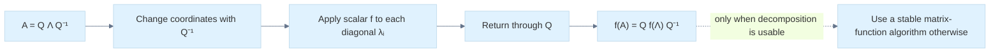

# 26 — Matrix Functions and Nonlinear Least Squares

[[Chapter Edition/01 - Computing Foundations/00 - Reading Map|Reading map]] · [[Chapter Edition/01 - Computing Foundations/25 - Continuous Models and Numerical Error|Previous chapter]] · [[Chapter Edition/01 - Computing Foundations/27 - Gauss–Newton for Geometry and Pose|Next chapter]]

Matrix powers and functions describe repeated linear actions and linear differential equations, while nonlinear least squares measures model mismatch through residuals. This chapter connects matrix structure to optimization and prepares the specific Gauss–Newton method that follows.

**By the end:** Interpret matrix exponential and related functions, and express nonlinear fitting as minimizing a residual-based objective.

**Recall question:** How does the matrix exponential solve a linear system’s continuous-time evolution, and what makes least-squares residuals informative?

<!-- Derived from Continuous Notes/Computing Foundations - From Bits to C++ and Systems APIs.md; source lines 61008–63465; source-span SHA256 c98645470dc3bb383700d217b80d9b1105f9d2e56cb75f057ad4011f366c7eb4. -->

<!-- CHAPTER-SOURCE-BEGIN -->
## Matrix functions turn repeated linear actions into one operator

For a square matrix $A$, integer powers are repeated composition: $A^0=I$, $A^1=A$, and $A^{k+1}=A^kA$. Negative powers require invertibility. Exponentiation by squaring computes an integer power in $O(\log k)$ matrix multiplications rather than $k$.

The [[Chapter Edition/01 - Computing Foundations/26 - Matrix Functions and Nonlinear Least Squares#Matrix functions turn repeated linear actions into one operator|matrix exponential]] is defined by the convergent series

$$
e^A=I+A+\frac{A^2}{2!}+\frac{A^3}{3!}+\cdots.
$$

It appears in linear differential equations: for $\dot{\mathbf x}=A\mathbf x$, the solution is $\mathbf x(t)=e^{tA}\mathbf x(0)$. If $A=Q\Lambda Q^{-1}$, then $e^A=Qe^\Lambda Q^{-1}$ in exact algebra, applying the scalar exponential to each diagonal entry. But diagonalization can be numerically poor or impossible, so it is not a universal implementation strategy.

Matrix multiplication is not commutative. In general $e^{A+B}\ne e^Ae^B$ unless additional commutation conditions hold. This is why two consecutive motions cannot be collapsed by casually adding their generators. For a skew-symmetric matrix $\Omega$, $e^{t\Omega}$ is orthogonal and describes a rotation; this connects Lie algebra generators to finite rotations.

Matrix logarithms, square roots, and fractional powers need branch and domain choices. For symmetric positive-definite matrices, the spectral theorem gives a clean definition by applying the scalar function to positive eigenvalues. General matrices can have nonunique logarithms or no real logarithm under some conditions. A named “matrix log” or “square root” is incomplete without its domain, branch, and numerical method.

Taylor series explain matrix functions but may be inefficient or inaccurate when the norm is large or the series converges slowly. For exponentials, **scaling and squaring** uses $e^A=(e^{A/2^s})^{2^s}$: scale the matrix until a low-degree approximation is accurate, then square the result $s$ times. Practical implementations use rational Padé approximants and carefully chosen scaling thresholds. Squaring also accumulates rounding, so this is a numerical algorithm with error analysis, not a magical exact identity in floating point.

### Figure L9 - A matrix function follows the same action after a change of basis



> **How to read Figure L9.** The formula explains the function. A reliable implementation still needs to consider conditioning, existence, branches, and whether the chosen eigenbasis is numerically safe.


<!-- end V08.67 -->

<!-- begin V08.68 -->
## The exponential solves a linear differential equation

For a square matrix, the matrix exponential is the convergent series $e^A=I+A+A^2/2!+A^3/3!+\cdots$. It is not entrywise `exp`. Its central use is the constant-coefficient system $\dot x=Ax$. Define $x(t)=e^{tA}x_0$. Term-by-term differentiation gives $\frac{d}{dt}e^{tA}=A+ tA^2+t^2A^3/2!+\cdots=Ae^{tA}$, hence $\dot x=Ax$. The initial value is $x(0)=Ix_0=x_0$. This is the matrix counterpart of scalar exponential growth and decay.

If $A$ is diagonal, $e^A$ applies scalar exponentials to the diagonal. If $A=V\Lambda V^{-1}$, then powers satisfy $A^k=V\Lambda^kV^{-1}$ and $e^A=Ve^\Lambda V^{-1}$. For symmetric $A=Q\Lambda Q^\mathsf T$, the basis is orthogonal, avoiding amplification from a poorly conditioned eigenvector matrix. Diagonalization is an explanatory identity; for nonnormal or defective matrices it may be inaccurate or unavailable as a computational method.

Matrix products do not commute. Generally $e^{A+B}\ne e^Ae^B$; the identity holds when $A$ and $B$ commute, with other subtleties outside this simple case. For scalar rotations use $J=\begin{bmatrix}0&-1\\1&0\end{bmatrix}$, which has $J^2=-I$. Separating even and odd powers in the exponential series gives $e^{\theta J}=I\cos\theta+J\sin\theta=\begin{bmatrix}\cos\theta&-\sin\theta\\\sin\theta&\cos\theta\end{bmatrix}$. More generally if $\Omega^\mathsf T=-\Omega$, then $(e^{t\Omega})^Te^{t\Omega}=e^{-t\Omega}e^{t\Omega}=I$, so the exponential of a real skew-symmetric matrix is orthogonal. This derives rotations from infinitesimal generators.

Since $A$ commutes with $-A$, $e^Ae^{-A}=I$, so the exponential is always invertible and $(e^A)^{-1}=e^{-A}$. But $e^{A+B}$ cannot be split casually. This is especially relevant when combining motion generators over time.


<!-- end V08.68 -->

<!-- begin V08.69 -->
## Logarithms and square roots need domains and branches

A matrix logarithm $X$ satisfies $e^X=A$. It may be nonunique or may not exist as a real matrix. A **principal logarithm** uses a branch analogous to the scalar principal complex logarithm. For matrices, its standard existence condition is that the spectrum avoid the closed negative real axis, including zero. This is the right statement for the principal logarithm; it is wrong to infer that every negative eigenvalue rules out every real logarithm. For example, $-I_2$ has the real logarithm $\begin{bmatrix}0&-\pi\\\pi&0\end{bmatrix}$, whose exponential is $-I_2$. Real logarithm existence depends on eigenvalue and Jordan-block structure.

For SPD $A=Q\Lambda Q^\mathsf T$ with positive eigenvalues, the real symmetric logarithm is cleanly defined as $Q\operatorname{diag}(\log\lambda_i)Q^\mathsf T$. The series $\log(I+E)=E-E^2/2+E^3/3-\cdots$ is useful near identity, but not a universal method for arbitrary matrices. In general $\log(AB)\ne\log A+\log B$ without commutation and branch qualifications. Transform interpolation formulas using logarithms are therefore domain-sensitive design choices.

A square root satisfies $X^2=A$. For SPD matrices, the spectral construction $A^{1/2}=Q\operatorname{diag}(\sqrt{\lambda_i})Q^\mathsf T$ is the unique symmetric positive-definite root. PSD matrices have a unique PSD root, allowing zero eigenvalues. General square roots need not be unique: both $I$ and $-I$ square to $I$. A real symmetric matrix with a negative eigenvalue cannot have a real symmetric PSD root, but more general real nonsymmetric roots can exist depending on structure. The API must specify which root and for what domain. Polar stretch $S=\sqrt{A^\mathsf TA}$ is a PSD square root; under SVD it is $V\Sigma V^\mathsf T$.


<!-- end V08.69 -->

<!-- begin V08.70 -->
## Matrix powers range from repeated action to fractional functions

For square $A$, $A^0=I$, and $A^k$ for positive integer $k$ is repeated composition. If $A$ is nonsingular, negative powers use $(A^{-1})^k$; singular matrices have no ordinary negative integer power. Fractional powers require a definition and branch/domain policy, often supplied by an eigendecomposition for SPD matrices.

Exponentiation by squaring computes integer powers in $O(\log k)$ matrix products. Maintain a result initialized to $I$, inspect the low bit of the exponent, multiply by the current base when that bit is one, then square the base and shift the exponent. For dense square matrices this is $O(n^3\log k)$ with conventional multiplication. A safe routine checks square dimensions and handles exponent zero. It should avoid the final unnecessary square after the exponent becomes zero.

If $x_{j+1}=Ax_j$, then $x_j=A^jx_0$. Eigenvalues explain long-run behavior: modes with magnitude below one decay, those above one grow, and unit magnitude modes persist or oscillate, subject to nonnormal transient effects. Matrix powers are therefore useful both as algorithms and as stability models.


<!-- end V08.70 -->

<!-- begin V08.71 -->
## Series define functions but do not guarantee a good algorithm

An analytic scalar power series $f(z)=\sum_{k\ge0}c_kz^k$ suggests $f(A)=\sum_{k\ge0}c_kA^k$ wherever the matrix series converges. This defines matrix sine, cosine, exponential, and local logarithm, among others. Powers of one matrix are manageable even though arbitrary matrices do not commute, because $A^iA^j=A^{i+j}=A^jA^i$.

A truncated series has truncation error from omitted terms and floating-point error from evaluating retained terms. More terms do not always improve a result indefinitely. For large $\|A\|$, exponential terms $\|A\|^k/k!$ can grow enormously before falling; direct summation may create large intermediate values and cancellation. The series converges in exact mathematics but can be a poor finite-precision algorithm. Likewise the logarithm series around identity has a restricted convergence region. Diagonalization is also not universally safe when the matrix is defective or its eigenvector matrix is ill-conditioned.

Scaling and squaring addresses a large exponential by using $e^A=(e^{A/2^s})^{2^s}$. Choose $s$ so the scaled matrix lies in a range suitable for a chosen approximation. For example if $\|A\|\approx64$, six halvings give a scaled norm near one; approximate $X\approx e^{A/64}$ and square six times to recover a result for $e^A$. Production implementations typically use a Padé rational approximation $r_m(A)=p_m(A)q_m(A)^{-1}$, evaluated by solving $q_m(A)X=p_m(A)$ rather than explicitly forming an inverse, followed by repeated squaring. Degree and scaling thresholds come from error analysis, not a universal hand-picked norm cutoff. Too little scaling hurts the approximation; too much adds solves/squarings and rounding error. Squaring itself also accumulates floating-point error. See [[Chapter Edition/01 - Computing Foundations/26 - Matrix Functions and Nonlinear Least Squares#Matrix functions turn repeated linear actions into one operator|matrix functions]] for matrix-function context.


<!-- end V08.71 -->


## Optimization joins derivatives and constraints

An inverse problem seeks parameters whose predicted observations match data. If residual vector $r(x)$ compares model output with measurements, least squares minimizes

$$
\phi(x)=\tfrac12\|r(x)\|_2^2.
$$

The factor of one-half simplifies the gradient. With Jacobian $J=Dr(x)$, the gradient is $\nabla\phi=J^Tr$. Near a current estimate $x$, linearize the residual as $r(x+\Delta x)\approx r(x)+J\Delta x$ and solve a linear least-squares problem for $\Delta x$. This is the core step in Gauss–Newton methods. The method's success depends on the quality of the local approximation, the rank and conditioning of $J$, a sensible parameter metric, and a step policy that prevents a poor local model from causing an unsafe jump.

If $J$ has a nullspace, some parameter changes do not affect predictions to first order. Those changes are unobservable locally. A camera reconstruction can possess gauge freedoms: for example, translating and scaling an entire scene and camera together may leave projected images unchanged. A solver may therefore have a continuum of equivalent solutions unless one pose, scale, or other reference is fixed. A singular Hessian or rank-deficient Jacobian can reveal this ambiguity, but adding damping alone does not explain its physical meaning. Fix the gauge or state the prior that selects a representative.

Covariance can quantify uncertainty near a solution, but only under a model. With independent, equal-variance measurement noise and a locally valid linearization, parameter covariance is often approximated by a scaled inverse of $J^TJ$ when that matrix is full rank. The singular vectors identify parameter combinations with strong or weak observational support; small singular values imply large uncertainty. If the model is nonlinear, noise is not as assumed, or the estimate lies near a boundary, this approximation may be misleading. Treat it as a local statistical approximation, not a universal error bar.

A simple two-parameter fit makes the geometry clear. Suppose the Jacobian columns are almost parallel. Then changing parameter one can be nearly canceled by changing parameter two, leaving the predictions almost unchanged. The fit may have a tiny image residual, yet the two parameter values are uncertain. The SVD exposes the weak combination as a small singular direction. A new measurement helps only if it observes that weak direction; repeating the same view with the same geometry may add many samples but little new information.

<!-- begin V09.07 -->
## Optimization and inverse problems
### Differentiating executable computations

#### Objective functions: translating a problem into mathematics

Optimization starts before we choose an algorithm. We first need to decide precisely what we are trying to minimize.

Suppose a camera predicts that a reconstructed 3D point appears at pixel location:

$$
\hat{\mathbf u}\_i(\mathbf x)= \begin{bmatrix}\hat u_i\\hat v_i\end{bmatrix}
$$

where $\mathbf x$ contains the unknown camera parameters.

The corresponding measured location is:

$$
\mathbf u_i= \begin{bmatrix}u_i\\v_i\end{bmatrix}.
$$

Define the residual:

$$
\boxed{ \mathbf r_i(\mathbf x) = \hat{\mathbf u}\_i(\mathbf x)-\mathbf u_i }.
$$

A residual is the signed difference between a prediction and a target. For reprojection error, its components have units of pixels.

We could minimize the sum of squared residual magnitudes:

$$
\boxed{ E(\mathbf x)= \frac12\sum\_{i=1}^{N} \|\mathbf r_i(\mathbf x)\|\_2^2 }.
$$

Why square the residuals?

Squaring makes positive and negative errors contribute positively, penalizes larger errors more strongly, and produces a smooth objective when the residual functions are smooth. The factor $1/2$ is included because differentiation of $r^2/2$ produces $r$ rather than $2r$.

But the choice is not automatically correct for every problem. Squared residuals amplify outliers, and the optimum depends on how residuals are scaled, which measurements are included, and what assumptions we make about their uncertainty.

For instance, if a measurement has standard deviation $\sigma_i$, it is often more appropriate to use the normalized residual:

$$
\tilde{\mathbf r}\_i= \frac{\mathbf r_i}{\sigma_i}.
$$

A weighted objective is then:

$$
E(\mathbf x)= \frac12\sum_i \mathbf r_i^TW_i\mathbf r_i,
$$

where $W_i$ is a symmetric positive-semidefinite weighting matrix. Under a Gaussian noise model with known nonsingular covariance $\Sigma_i$, a common choice is $W_i=\Sigma_i^{-1}$.

This makes the loss sensitive to error relative to measurement uncertainty, rather than treating every pixel measurement as equally reliable.

##### A complete optimization problem has several ingredients

A mathematical optimization problem specifies its decision variables, objective, domain, constraints, and assumptions.

For example, if our unknowns are a camera rotation $R$, camera translation $\mathbf t$, and positive focal length $f$, the problem could be:

$$
\min\_{R,\mathbf t,f}E(R,\mathbf t,f)
$$

subject to:

$$
R^TR=I,\qquad \det R=1,\qquad f>0.
$$

The rotation constraint means that $R$ belongs to the special orthogonal group $SO(3)$. It cannot be treated as an arbitrary matrix with nine independent entries without additional handling.

A correct optimization objective must also account for invalid evaluations. If a projected point lies behind the camera or near a singular depth, the objective's domain and error-handling rules must be explicit.

##### Objective functions versus evaluation metrics

An objective is what the algorithm optimizes. A metric is what we use to judge the final result.

These need not be identical.

A reconstruction algorithm might minimize mean squared reprojection error while its actual quality is judged using held-out reprojection accuracy, image quality, camera-pose accuracy, and geometric reconstruction metrics.

Optimizing one metric does not guarantee improvement in every other metric.

This matters especially for research. If you tune a method to minimize the same test metric used to claim success, your evaluation may be biased.

##### Parameters and hyperparameters

Decision variables are quantities changed by the optimization algorithm, such as camera pose or Gaussian scale.

Hyperparameters configure the optimization process or model, such as learning rate, regularization strength, initial damping, maximum iterations, and trust-region radius.

A hyperparameter can become a decision variable in an outer optimization problem, but within one specified inner problem it is ordinarily treated as fixed.

This distinction becomes important in nested optimization and hyperparameter sensitivity.

#### Local minima, global minima, maxima, and saddles

Before studying algorithms, we must understand the geometric destinations an algorithm might reach.

A point $\mathbf x^\star$ is a local minimum if some neighborhood exists in which:

$$
f(\mathbf x^\star)\le f(\mathbf x)
$$

for every feasible $\mathbf x$ in that neighborhood.

A global minimum satisfies the same inequality for every feasible point in the entire domain.

A strict minimum uses a strict inequality for all other feasible points in the relevant region.

A local maximum reverses the inequality.

A saddle point is a stationary point that is neither a local minimum nor a local maximum in the conventional smooth unconstrained setting.

Consider:

$$
f(x,y)=x^2-y^2.
$$

Its gradient is:

$$
\nabla f= \begin{bmatrix} 2x\\-2y \end{bmatrix}.
$$

At the origin:

$$
\nabla f(0,0)=0.
$$

If we move along the $x$-axis:

$$
f(x,0)=x^2>0
$$

for nonzero $x$.

If we move along the $y$-axis:

$$
f(0,y)=-y^2<0
$$

for nonzero $y$.

Thus the origin is a saddle: the objective rises in one direction and falls in another.

[Punto di sella - Wikipedia](https://images.openai.com/static-rsc-4/IqMqjdabbXp9lgF1Y59BWcBJuurZz0BV9d1Mv_AppeNOVYVoRQPuuV61Cf6TJAGqRi-DqMXoElE3-r5maVwHTXuo83A0mjM4FaBadvF4zNjF2LeOOzMjujVpT69hboVYADw65CSdRZt7hW_eNVx2xfRet5TkDNIoAwZTLnVQSgY?purpose=inline)

[The world of optimization](https://images.openai.com/static-rsc-4/2hdI6qSb-Gmq24hva1IPzdMch7SbSaYVsYlCAepKmsA3SZDPddxqa6DCww0y-FyOpM9G78ABWGxf3MsZs07Pfn1BlWk34xJqOTG0ScUe2i3GJrc8HXVjsf5kBDzuZpsfQjpbPkJbrEk2b-r1gAKcleVv-hPxqzAz9Qwbl9J2BsI?purpose=inline)

##### First-order necessary condition

For a differentiable unconstrained objective at an interior local minimum:

$$
\boxed{\nabla f(\mathbf x^\star)=0}.
$$

Why?

If the gradient were nonzero, the direction:

$$
\mathbf d=-\nabla f
$$

would have directional derivative:

$$
D\_{\mathbf d}f = \nabla f^T(-\nabla f) = -\|\nabla f\|^2<0.
$$

A sufficiently small movement along that direction would decrease the objective, contradicting local minimality.

This is a necessary condition, not a sufficient condition.

The saddle $x^2-y^2$ has zero gradient at the origin.

##### Second-order conditions

Assume $f$ is twice continuously differentiable in a neighborhood of an interior stationary point $\mathbf x^*$, so the second-order Taylor test applies. With $H=\nabla^2 f(\mathbf x^*)$:

If $H$ is positive definite, the point is a strict local minimum.

If $H$ is negative definite, the point is a strict local maximum.

If $H$ has both positive and negative eigenvalues, the point is a saddle.

If $H$ is positive semidefinite but singular, the second-order test may be inconclusive.

For instance:

$$
f(x)=x^4
$$

has:

$$
f'(0)=0,\qquad f''(0)=0,
$$

yet the origin is a strict minimum.

By comparison:

$$
g(x)=-x^4
$$

has the same zero first and second derivatives at zero but a strict maximum.

Second-order information cannot distinguish these cases.

##### Boundary optima are different

For a constrained problem:

$$
\min\_{x\ge0}(x+1)^2,
$$

the optimum is:

$$
x^\star=0.
$$

But:

$$
f'(0)=2\ne0.
$$

There is no contradiction. Moving in the negative direction would decrease the objective, but negative values are infeasible.

At a constrained optimum, we do not require every possible directional derivative to vanish. We require that no feasible descent direction remains.

This is the motivation for constrained first-order optimality conditions and KKT theory.

#### Convex functions and convex optimization

Convexity is one of the strongest useful structures an optimization problem can possess.

A set $\mathcal C$ is convex if, for any two points $\mathbf x,\mathbf y\in\mathcal C$, every point on the line segment joining them also belongs to $\mathcal C$:

$$
(1-t)\mathbf x+t\mathbf y\in\mathcal C, \qquad 0\le t\le1.
$$

A function $f$ is convex over a convex domain if:

$$
\boxed{ f((1-t)\mathbf x+t\mathbf y) \le (1-t)f(\mathbf x)+tf(\mathbf y) }.
$$

Geometrically, the straight chord between two points on the graph lies on or above the function graph.

For a twice-differentiable function on an open convex domain, a central characterization is:

$$
\boxed{ f\text{ convex} \iff H_f(\mathbf x)\succeq0 \text{ throughout the domain} }.
$$

The notation $H\succeq0$ means positive semidefinite:

$$
\mathbf d^TH\mathbf d\ge0
$$

for every $\mathbf d$.

##### Convexity from first-order geometry

For a differentiable convex function:

$$
\boxed{ f(\mathbf y)\ge f(\mathbf x)+ \nabla f(\mathbf x)^T(\mathbf y-\mathbf x) }.
$$

The tangent plane is a global lower bound.

This is much stronger than the local Taylor approximation from M050. The tangent plane cannot exceed the function anywhere on the convex domain.

We can derive a remarkable consequence.

If:

$$
\nabla f(\mathbf x^\star)=0,
$$

then:

$$
f(\mathbf y)\ge f(\mathbf x^\star)
$$

for every $\mathbf y$.

Therefore:

$$
\boxed{ \text{Every stationary point of a differentiable convex function is a global minimum.} }
$$

This is why convex optimization is special. We do not have to fear non-global local minima in the way we do with general nonconvex objectives.

The statement assumes the optimization domain and feasibility conditions are handled correctly. A convex objective alone does not make an arbitrary nonconvex constrained problem convex.

##### Strong convexity

A differentiable function is $\mu$-strongly convex under the Euclidean norm when:

$$
f(\mathbf y)\ge f(\mathbf x)+ \nabla f(\mathbf x)^T(\mathbf y-\mathbf x) +\frac\mu2\|\mathbf y-\mathbf x\|^2,
$$

where $\mu>0$.

If the Hessian exists everywhere, a sufficient and, under the usual smooth conditions, equivalent characterization is:

$$
H_f(\mathbf x)\succeq\mu I.
$$

Strong convexity provides a strictly positive lower curvature bound and, under standard existence assumptions, guarantees a unique minimizer.

Do not confuse strict convexity with strong convexity. A strictly convex function need not possess a uniform positive quadratic curvature bound everywhere.

For example, $x^4$ is strictly convex but not strongly convex over all real numbers.

##### Convexity does not automatically mean easy computation

A convex problem can still be enormous, poorly conditioned, nonsmooth, constrained, or expensive to evaluate.

Convexity tells us about the objective landscape and global optimality, not that every algorithm will converge quickly.

It also does not guarantee that a minimizer exists. The function:

$$
f(x)=e^x
$$

is convex over $\mathbb R$, but its infimum is zero and is not attained at any finite $x$.

For a foundation-level treatment extending to duality, optimality, and practical problem families, Stephen Boyd and Lieven Vandenberghe's Convex Optimization and Stanford's [EE364A course](https://web.stanford.edu/class/ee364a/?utm_source=chatgpt.com) provide a rigorous reference.&#x20;

[image](https://www.google.com/s2/favicons?domain=https://stanford.edu\&sz=32)

Boyd and Vandenberghe+1


#### Constraints in optimization

A general constrained problem can be expressed as:

$$
\begin{aligned} \min\_{\mathbf x}\quad &f(\mathbf x)\\ \text{subject to}\quad &g_i(\mathbf x)\le0,\quad i=1,\ldots,m,\\ &h_j(\mathbf x)=0,\quad j=1,\ldots,p. \end{aligned}
$$

Inequalities restrict the permissible region. Equalities restrict the solution to a surface or a lower-dimensional subset.

In graphics and physics, constraints appear naturally: positive focal lengths, unit quaternion norms, nonnegative masses, valid joint limits, nonpenetration, bounded particle positions, and positive-definite or positive-semidefinite material parameters.

There are several possible ways to enforce constraints, and they are not interchangeable.

Parameterization makes invalid values impossible by construction. For instance, writing $k=e^\theta$ ensures positive stiffness $k$.

Projection performs an unconstrained-looking update and maps the result back into the feasible set.

Penalty methods add a cost for constraint violations, but a finite penalty does not generally enforce exact equality.

Lagrange multipliers include constraint equations within a stationarity system.

Interior-point methods approach inequality boundaries from within the feasible region.

Augmented Lagrangian methods combine multiplier estimates and penalty terms.

We will derive the multiplier and KKT machinery after establishing how unconstrained updates are generated.

#### Gradient descent

Suppose we have a differentiable objective:

$$
f:\mathbb R^n\to\mathbb R.
$$

At the current point $\mathbf x_k$, its first-order Taylor model is:

$$
f(\mathbf x_k+\mathbf p) \approx f(\mathbf x_k)+\nabla f(\mathbf x_k)^T\mathbf p.
$$

The gradient describes the direction of steepest increase under the Euclidean norm.

Its negative describes steepest decrease.

If we choose:

$$
\mathbf p=-\alpha\nabla f(\mathbf x_k),
$$

we obtain the gradient-descent update:

$$
\boxed{ \mathbf x\_{k+1} = \mathbf x_k-\alpha_k\nabla f(\mathbf x_k) }.
$$

Here $\alpha_k>0$ is the step size, also called the learning rate in machine learning.

##### Why does this update decrease the function locally?

Let:

$$
\mathbf g=\nabla f(\mathbf x).
$$

Consider the one-dimensional function along the descent direction:

$$
\phi(\alpha)=f(\mathbf x-\alpha\mathbf g).
$$

Differentiate at $\alpha=0$:

$$
\phi'(0)= \nabla f(\mathbf x)^T(-\mathbf g).
$$

Therefore:

$$
\boxed{ \phi'(0)=-\|\mathbf g\|^2 }.
$$

If $\mathbf g\ne0$, this derivative is negative.

Hence a sufficiently small positive step decreases the objective when the required differentiability assumptions hold.

But this does not mean every positive step decreases it. The local first-order model can become inaccurate when the step is too large.

##### Exact worked example

Consider:

$$
f(x,y)=\frac12(4x^2+y^2).
$$

The gradient is:

$$
\nabla f= \begin{bmatrix} 4x\\y \end{bmatrix}.
$$

Start at:

$$
\mathbf x_0= \begin{bmatrix}2\\2\end{bmatrix}.
$$

The initial objective is:

$$
f(2,2)=\frac12(16+4)=10.
$$

The initial gradient is:

$$
\mathbf g_0= \begin{bmatrix}8\\2\end{bmatrix}.
$$

With $\alpha=0.2$:

$$
\mathbf x_1= \begin{bmatrix}2\\2\end{bmatrix} - 0.2 \begin{bmatrix}8\\2\end{bmatrix} = \begin{bmatrix}0.4\\1.6\end{bmatrix}.
$$

The new objective is:

$$
f(0.4,1.6) = \frac12(4(0.16)+2.56) =\boxed{1.6}.
$$

One step reduces the objective from 10 to 1.6.

Now consider an excessively large learning rate, $\alpha=0.6$.

The first coordinate becomes:

$$
x_1=2-0.6(8)=-2.8,
$$

and the second:

$$
y_1=2-0.6(2)=0.8.
$$

The objective is:

$$
f(-2.8,0.8) = \frac12(4(7.84)+0.64) =\boxed{16}.
$$

The same descent direction increases the objective when the step is too large.

This is why choosing the direction and choosing the step length are separate optimization decisions.

#### Learning rates and step sizes

An optimization update can be written:

$$
\mathbf x\_{k+1}=\mathbf x_k+\alpha_k\mathbf p_k,
$$

where $\mathbf p_k$ is a chosen search direction.

The scalar $\alpha_k$ determines how far we move in that direction.

A step size can be fixed, scheduled, or determined adaptively from the objective.

##### Exact stability calculation for a quadratic

Consider:

$$
f(\mathbf x)=\frac12\mathbf x^TA\mathbf x,
$$

where $A$ is symmetric positive definite.

Its gradient is:

$$
\nabla f=A\mathbf x.
$$

Gradient descent becomes:

$$
\mathbf x\_{k+1} = (I-\alpha A)\mathbf x_k.
$$

Diagonalize $A$:

$$
A=Q\Lambda Q^T,
$$

where $\Lambda$ contains positive eigenvalues $\lambda_i$.

Let:

$$
\mathbf z_k=Q^T\mathbf x_k.
$$

Then:

$$
\mathbf z\_{k+1} = (I-\alpha\Lambda)\mathbf z_k.
$$

Every eigenvector component evolves independently:

$$
\boxed{ z\_{i,k+1}=(1-\alpha\lambda_i)z\_{i,k} }.
$$

For convergence to zero, each component must contract:

$$
|1-\alpha\lambda_i|<1.
$$

This implies:

$$
0<\alpha<\frac2{\lambda_i}.
$$

To satisfy every direction, we require:

$$
\boxed{ 0<\alpha<\frac2{\lambda\_{\max}} }.
$$

This is not an arbitrary tuning recommendation. It is a stability condition derived from the eigenvalues of the objective's curvature matrix.

##### Why ill-conditioned objectives produce zigzagging

Suppose the eigenvalues of $A$ are:

$$
\lambda\_{\min}=1, \qquad \lambda\_{\max}=100.
$$

A step size must be below $0.02$ to satisfy the strict contraction condition for the steep direction.

But with $\alpha=0.01$, the shallow direction contracts by only:

$$
1-\alpha\lambda\_{\min}=0.99
$$

each iteration.

The steep direction contracts rapidly, while the shallow direction makes slow progress.

The ratio:

$$
\boxed{\kappa(A)=\frac{\lambda\_{\max}}{\lambda\_{\min}}=100}
$$

quantifies this curvature anisotropy for a positive-definite quadratic.

A long, narrow objective valley is difficult for ordinary steepest descent because the same scalar learning rate must handle very different curvature scales.

##### Exact best constant step for a strongly convex quadratic

Let the eigenvalues lie in $[\mu,L]$, with $0<\mu\le L$.

For a fixed step $\alpha$, the worst-case linear contraction factor is:

$$
q(\alpha)= \max\_{\lambda\in[\mu,L]} |1-\alpha\lambda|.
$$

The optimal minimax choice balances the two endpoint factors:

$$
1-\alpha\mu=-(1-\alpha L).
$$

Solving:

$$
2=\alpha(\mu+L),
$$

so:

$$
\boxed{ \alpha^\star=\frac2{\mu+L} }.
$$

The resulting contraction factor is:

$$
\boxed{ q^\star=\frac{L-\mu}{L+\mu} =\frac{\kappa-1}{\kappa+1} }.
$$

For $\kappa=100$:

$$
q^\star=\frac{99}{101}\approx0.980198.
$$

Even the best fixed scalar step can be slow when the condition number is large.

This provides the mathematical motivation for curvature-aware methods, preconditioning, and quasi-Newton algorithms.

#### Gradient-descent convergence

Convergence analysis asks what happens when the update is repeated indefinitely, not merely whether one step decreases the objective.

A function has an $L$-Lipschitz gradient if:

$$
\|\nabla f(\mathbf x)-\nabla f(\mathbf y)\| \le L\|\mathbf x-\mathbf y\|.
$$

This is commonly called $L$-smoothness.

For twice-differentiable functions over a convex region, an upper bound on the Hessian operator norm gives a corresponding gradient-Lipschitz bound.

The descent lemma states:

$$
f(\mathbf y) \le f(\mathbf x)+ \nabla f(\mathbf x)^T(\mathbf y-\mathbf x) +\frac L2\|\mathbf y-\mathbf x\|^2.
$$

Use:

$$
\mathbf y=\mathbf x-\alpha\mathbf g.
$$

Then:

$$
\begin{aligned} f(\mathbf x-\alpha\mathbf g) &\le f(\mathbf x) -\alpha\|\mathbf g\|^2 +\frac{L\alpha^2}{2}\|\mathbf g\|^2\\ &=f(\mathbf x) -\alpha\left(1-\frac{L\alpha}{2}\right)\|\mathbf g\|^2. \end{aligned}
$$

Thus, when:

$$
0<\alpha<\frac2L,
$$

the upper bound guarantees a decrease whenever $\mathbf g\ne0$.

For the common choice $\alpha=1/L$:

$$
\boxed{ f(\mathbf x\_{k+1}) \le f(\mathbf x_k)- \frac1{2L}\|\nabla f(\mathbf x_k)\|^2 }.
$$

This gives a quantitative decrease per step.

##### Different meanings of convergence

Optimization literature distinguishes several forms of convergence.

Objective convergence means the objective values approach a limiting value, ideally the optimum.

Parameter convergence means the iterates $\mathbf x_k$ approach a point.

Stationarity convergence means the gradient norm or an appropriate constrained optimality measure approaches zero.

These do not automatically imply one another without additional assumptions.

For a smooth convex objective, gradient descent with a suitable fixed step can achieve an objective gap of order $O(1/k)$ under standard assumptions.

For smooth strongly convex objectives, a suitable step produces a linear or geometric convergence rate.

For a general nonconvex smooth objective bounded below, a descent method may be able to guarantee that the gradient becomes small in an appropriate sense, but not that it finds a global minimum.

##### The Polyak–Łojasiewicz connection

A useful extension is the Polyak–Łojasiewicz, or PL, inequality:

$$
\frac12\|\nabla f(\mathbf x)\|^2 \ge \mu(f(\mathbf x)-f^\star)
$$

for some $\mu>0$.

This condition links gradient magnitude to objective suboptimality.

Strong convexity implies a PL-type inequality, but PL conditions can also hold for certain functions that are not strongly convex.

Under smoothness and a suitable gradient step, PL structure can yield a linear decrease in objective gap.

This shows that convergence can depend on properties weaker than full strong convexity.

#### Momentum optimization

Ordinary gradient descent computes each update from the current gradient alone.

Momentum introduces a persistent update state.

A common heavy-ball formulation is:

$$
\boxed{ \mathbf v\_{k+1} = \beta\mathbf v_k-\alpha\nabla f(\mathbf x_k) }
$$

followed by:

$$
\boxed{ \mathbf x\_{k+1}=\mathbf x_k+\mathbf v\_{k+1} }.
$$

Here $\beta$ is the momentum coefficient, often chosen between zero and one.

The state $\mathbf v_k$ is not necessarily physical velocity. It is an accumulated optimizer update, although its recurrence resembles a damped dynamical system.

##### Why momentum can help

Suppose the gradient repeatedly points in approximately the same direction.

The recurrence adds new gradient contributions to a decaying history:

$$
\mathbf v\_{k+1} = -\alpha\mathbf g_k -\alpha\beta\mathbf g\_{k-1} -\alpha\beta^2\mathbf g\_{k-2} -\cdots
$$

when initialized at zero, with the appropriate finite-history truncation.

Consistent gradient directions reinforce one another.

Directions in which gradients alternate can partially cancel.

This helps explain why momentum often makes faster progress through long, narrow valleys while reducing some oscillations across steep directions.

However, momentum can also overshoot, oscillate, or become unstable. Its behavior depends jointly on the learning rate, momentum coefficient, and curvature.

##### Numerical trace

Let:

$$
f(x)=\frac12x^2,\qquad f'(x)=x.
$$

Choose:

$$
x_0=4,\quad v_0=0,\quad\alpha=0.1,\quad\beta=0.9.
$$

First step:

$$
v_1=0.9(0)-0.1(4)=-0.4,
$$

$$
x_1=4-0.4=3.6.
$$

Second step:

$$
v_2=0.9(-0.4)-0.1(3.6) =-0.36-0.36=-0.72,
$$

$$
x_2=3.6-0.72=2.88.
$$

Third step:

$$
v_3=0.9(-0.72)-0.1(2.88) =-0.648-0.288=-0.936,
$$

$$
x_3=2.88-0.936=1.944.
$$

The accumulated momentum creates a progressively larger movement while the gradient continues to point toward zero.

Eventually, momentum may carry the iterate past zero. Overshooting is part of the method's dynamics and must be controlled through parameter choice or other globalization strategies.

##### The relationship to damped second-order motion

Momentum has a useful interpretation as discretized inertial dynamics:

$$
m\ddot{\mathbf x} +c\dot{\mathbf x} +\nabla f(\mathbf x)=0.
$$

The gradient acts like a restoring force in a potential-energy landscape.

The damping term suppresses motion, while inertia prevents velocity from immediately changing direction with every gradient fluctuation.

The analogy is not an exact identity for every momentum update or parameterization, but it motivates acceleration and damping analysis.

#### Nesterov-style acceleration

Momentum evaluates the gradient at the current iterate:

$$
\mathbf g_k=\nabla f(\mathbf x_k).
$$

A common Nesterov-style look-ahead update instead evaluates the gradient near where accumulated momentum is expected to take the parameters.

One implementation is:

$$
\mathbf y_k=\mathbf x_k+\beta\mathbf v_k,
$$

$$
\mathbf v\_{k+1} = \beta\mathbf v_k-\alpha\nabla f(\mathbf y_k),
$$

$$
\mathbf x\_{k+1}=\mathbf x_k+\mathbf v\_{k+1}.
$$

The gradient is evaluated at $\mathbf y_k$, not at $\mathbf x_k$.

##### Why look-ahead changes the update

Suppose momentum is carrying the iterate rapidly toward a minimum. Evaluating the gradient at the current point may underestimate how close the momentum-driven position is to overshooting.

Look-ahead evaluates the slope at the momentum-predicted position, allowing the gradient term to react to that future location.

But the expression above is one practical Nesterov-style formulation. The theoretical accelerated-gradient method for smooth convex optimization is often written in terms of a sequence of extrapolated points and scheduled coefficients.

Under suitable assumptions, accelerated methods can achieve:

$$
f(\mathbf x_k)-f^\star=O(1/k^2)
$$

for smooth convex objectives, improving on the typical $O(1/k)$ objective convergence of standard gradient descent.

This guarantee is not automatic for every fixed-$\beta$ implementation or nonconvex objective.

The precise recurrence and assumptions matter.

##### Repository connection

The supplied source says `KairoMath/Optimization.cppm` includes both `Momentum` and `Nesterov`; this has not been verified against the repository.

The `Nesterov` implementation forms a look-ahead state using the current momentum state, evaluates the gradient there, updates velocity, and then advances the parameters.

That matches the practical look-ahead structure described above.

A useful test is to compare the library's updates against a hand-calculated quadratic example for several iterations. Testing only that the loss eventually decreases would not prove the method implements the intended recurrence.

#### Newton's method in one dimension

Gradient descent uses local slope but does not directly account for curvature.

Newton's method introduces second derivatives.

Suppose we want to find a stationary point of $f(x)$:

$$
f'(x)=0.
$$

Treat:

$$
g(x)=f'(x).
$$

Newton's root-finding method approximates $g$ near the current point:

$$
g(x+\Delta x) \approx g(x)+g'(x)\Delta x.
$$

Set the approximation to zero:

$$
0=g(x)+g'(x)\Delta x.
$$

Solve:

$$
\Delta x=-\frac{g(x)}{g'(x)}.
$$

Since $g=f'$ and $g'=f''$:

$$
\boxed{ x\_{k+1} = x_k-\frac{f'(x_k)}{f''(x_k)} }.
$$

##### Quadratic example

Let:

$$
f(x)=3(x-2)^2+5.
$$

Then:

$$
f'(x)=6(x-2), \qquad f''(x)=6.
$$

Newton's update is:

$$
x\_{k+1} = x_k-\frac{6(x_k-2)}6 =2.
$$

For any starting point, one exact Newton step reaches the minimizer $x=2$, assuming exact arithmetic.

Why? A quadratic's second-order Taylor model is globally exact. Newton is solving that model's minimizer.

##### Newton is not inherently a minimization method

Consider:

$$
f(x)=x^3.
$$

Then:

$$
f'(x)=3x^2,\qquad f''(x)=6x.
$$

For $x\ne0$:

$$
x\_{k+1} = x-\frac{3x^2}{6x} =\frac x2.
$$

The iterates approach zero.

But $x=0$ is not a local minimum or maximum of $x^3$; it is a stationary inflection point.

Newton has located a root of $f'$, not necessarily a minimizer.

Similarly, a negative second derivative can make the Newton direction point uphill.

A trustworthy optimizer must check the curvature model and employ globalization safeguards.

#### Multidimensional Newton's method

For a scalar objective:

$$
f:\mathbb R^n\to\mathbb R,
$$

we want:

$$
\nabla f(\mathbf x)=0.
$$

Linearize the gradient:

$$
\nabla f(\mathbf x+\mathbf p) \approx \nabla f(\mathbf x)+H(\mathbf x)\mathbf p.
$$

Set this local approximation to zero:

$$
H\mathbf p=-\nabla f.
$$

Therefore the Newton step satisfies:

$$
\boxed{ H(\mathbf x_k)\mathbf p_k=-\nabla f(\mathbf x_k) }.
$$

The next iterate is:

$$
\mathbf x\_{k+1}=\mathbf x_k+\alpha_k\mathbf p_k.
$$

Classical undamped Newton uses $\alpha_k=1$. A damped or line-search [[Chapter Edition/01 - Computing Foundations/26 - Matrix Functions and Nonlinear Least Squares#Optimization and inverse problems|Newton method]] chooses $\alpha_k$ to improve robustness.

##### Why solving is better than explicitly inverting

The formula is often written:

$$
\mathbf p=-H^{-1}\nabla f.
$$

That is mathematically useful, but a production implementation should generally solve:

$$
H\mathbf p=-\nabla f
$$

using an appropriate linear-system method.

Explicitly constructing a matrix inverse commonly requires extra work, may amplify error, and is unnecessary for obtaining the step.

If $H$ is symmetric positive definite, Cholesky factorization is a natural option.

If $H$ is symmetric indefinite, an LDLT-type factorization with suitable pivoting may be more appropriate.

If the Hessian is sparse, sparse direct or iterative methods can exploit that structure.

##### The Newton direction is not always a descent direction

A direction $\mathbf p$ is locally descending when:

$$
\nabla f^T\mathbf p<0.
$$

For Newton:

$$
\mathbf p=-H^{-1}\nabla f.
$$

Thus:

$$
\nabla f^T\mathbf p = -\nabla f^TH^{-1}\nabla f.
$$

If $H$ is positive definite and $\nabla f\ne0$, this is negative.

But if $H$ is indefinite, the expression need not be negative.

Therefore an indefinite Hessian can produce an ascent direction.

Possible safeguards include regularizing the Hessian with $\lambda I$, modifying its factorization, using a trust region, or falling back to negative-gradient descent.

##### Worked 2D example

Consider:

$$
f(x,y)=\frac12(4x^2+y^2).
$$

We have:

$$
\nabla f= \begin{bmatrix} 4x\\y \end{bmatrix}, \qquad H= \begin{bmatrix} 4&0\\0&1 \end{bmatrix}.
$$

At $(2,2)$:

$$
H\mathbf p= - \begin{bmatrix}8\\2\end{bmatrix}.
$$

Solve:

$$
4p_x=-8,\qquad p_y=-2.
$$

Thus:

$$
\mathbf p= \begin{bmatrix}-2\\-2\end{bmatrix}.
$$

One full Newton step reaches:

$$
\boxed{\mathbf x_1=(0,0)}.
$$

Again, this is exact because the objective is quadratic and its Hessian is positive definite.

For a nonlinear objective, Newton typically needs repeated updates, and its quadratic local convergence behavior applies only under appropriate conditions near a suitable solution.

![[Visual Recall/Math Foundations/F09-5_damped-newton.png]]

**F09-5. Full Newton step versus Armijo backtracking for the plotted log-cosh example.** At x=3, the full step is about -100.8566; backtracking first accepts alpha=0.03125 in this setup.

#### Damping Newton's direction and recognizing its local phase

Write $g=\nabla f(x)$ and $H=\nabla^2 f(x)$. When $H$ is positive definite, the Newton step
$$
\Delta x_N=-H^{-1}g
$$
minimizes the local quadratic model
$$
m_x(v)=f(x)+g^Tv+\frac12v^THv.
$$
The Newton decrement $\lambda=(g^TH^{-1}g)^{1/2}$ obeys $\lambda^2=\Delta x_N^TH\Delta x_N=-g^T\Delta x_N$; thus $\lambda^2/2$ is the predicted reduction in this model. Far from the solution, a line search can choose $x^+=x+t\Delta x_N$, $0<t\le1$, to ensure progress on the true objective. Near a minimizer, full steps can yield quadratic convergence under assumptions such as strong convexity in the region and a Lipschitz-continuous Hessian. The decrement measures the local model; it is not a universal certificate of global objective error. Stanford EE364A selected official minimization slides distinguish damping/globalization from the local full-step phase and state assumptions behind the convergence claim. [Stanford EE364A selected Newton slides](https://web.stanford.edu/class/ee364a/lectures/lectures_hd.pdf)

#### Quasi-Newton methods

Newton requires the Hessian:

$$
H=\nabla^2 f.
$$

Computing and storing it may be expensive.

For $n$ parameters, a dense Hessian contains $n^2$ entries.

A direct dense factorization typically requires $O(n^3)$ arithmetic, although structure and hardware can change practical costs.

Quasi-Newton methods attempt to learn useful curvature information from changes in gradients instead of constructing the exact Hessian at every iteration.

Suppose an optimization step moves from $\mathbf x_k$ to $\mathbf x\_{k+1}$.

Define:

$$
\boxed{ \mathbf s_k=\mathbf x\_{k+1}-\mathbf x_k }
$$

and:

$$
\boxed{ \mathbf y_k= \nabla f(\mathbf x\_{k+1})- \nabla f(\mathbf x_k) }.
$$

The letter $\mathbf y$ here denotes a gradient difference, not the function output from previous examples.

From a first-order expansion of the gradient:

$$
\nabla f(\mathbf x_k+\mathbf s_k) \approx \nabla f(\mathbf x_k)+H\mathbf s_k,
$$

we obtain:

$$
\boxed{ \mathbf y_k\approx H\mathbf s_k }.
$$

This relationship is the basis of the secant condition.

Instead of computing the true Hessian, maintain an approximation $B_k$ satisfying:

$$
\boxed{ B\_{k+1}\mathbf s_k=\mathbf y_k }.
$$

This forces the new approximation to agree with the observed gradient change along the most recent step.

But one secant equation cannot uniquely determine all $n^2$ entries of a matrix. We need a rule for modifying the previous approximation while respecting symmetry and desirable curvature properties.

That leads to BFGS.

#### BFGS and the inverse-Hessian update

BFGS is named after Broyden, Fletcher, Goldfarb, and Shanno.

It updates a Hessian approximation or its inverse while incorporating observed curvature information.

Let $B_k$ approximate the Hessian.

Define:

$$
\mathbf s=\mathbf x\_{k+1}-\mathbf x_k,
$$

$$
\mathbf y=\nabla f(\mathbf x\_{k+1})-\nabla f(\mathbf x_k).
$$

The BFGS Hessian update is:

$$
\boxed{ B\_{k+1} = B_k - \frac{B_k\mathbf s\mathbf s^TB_k} {\mathbf s^TB_k\mathbf s} + \frac{\mathbf y\mathbf y^T} {\mathbf y^T\mathbf s} }.
$$

The update changes the curvature estimate in directions informed by the observed step and gradient difference.

In practice, the inverse-Hessian form is often convenient.

Let:

$$
M_k\approx H^{-1}.
$$

Define:

$$
\rho=\frac1{\mathbf y^T\mathbf s}.
$$

Then:

$$
\boxed{ M\_{k+1} = (I-\rho\mathbf s\mathbf y^T) M_k (I-\rho\mathbf y\mathbf s^T) + \rho\mathbf s\mathbf s^T }.
$$

The search direction is:

$$
\boxed{ \mathbf p_k=-M_k\nabla f(\mathbf x_k) }.
$$

##### Why the curvature condition matters

A central requirement is:

$$
\boxed{\mathbf y^T\mathbf s>0}.
$$

When $M_k$ is positive definite and this condition holds, the standard BFGS update preserves positive definiteness.

This helps ensure the resulting search direction remains descending when the gradient is nonzero.

A line search satisfying the Wolfe curvature condition can help establish positive curvature under appropriate assumptions.

A basic Armijo-only backtracking search does not, by itself, guarantee that the BFGS curvature condition holds.&#x20;

[image](https://www.google.com/s2/favicons?domain=https://convexoptimization.com\&sz=32)

convexoptimization.com


##### BFGS versus L-BFGS

Full BFGS stores a dense $n\times n$ approximate inverse Hessian or Hessian. Its storage is $O(n^2)$.

For millions of parameters, that is impractical.

Limited-memory BFGS, or L-BFGS, stores only a small number of recent $(\mathbf s,\mathbf y)$ pairs and uses a two-loop recursion to apply an implicit inverse-Hessian approximation to the gradient.

Its storage is approximately $O(mn)$, where $m$ is the retained history size.

L-BFGS does not produce the same matrix as full BFGS unless the retained history and initialization happen to reproduce it.

In research code, L-BFGS can be attractive when reliable gradients are available and full Hessian computation is expensive. It may be less attractive for very noisy stochastic objectives unless the implementation and line-search strategy are designed for that setting.

#### Line search: optimizing the distance along a direction

So far, our update has the form:

$$
\mathbf x\_{k+1}=\mathbf x_k+\alpha_k\mathbf p_k.
$$

Suppose a method has already selected a direction $\mathbf p_k$, perhaps from gradient descent, Newton, or BFGS.

We now need to choose $\alpha_k$.

Define the one-dimensional function:

$$
\boxed{ \phi(\alpha)=f(\mathbf x_k+\alpha\mathbf p_k) }.
$$

The original multidimensional step-selection problem has become a one-dimensional optimization problem.

Its derivative is:

$$
\phi'(\alpha)= \nabla f(\mathbf x_k+\alpha\mathbf p_k)^T\mathbf p_k.
$$

At zero:

$$
\phi'(0)=\mathbf g_k^T\mathbf p_k.
$$

If this quantity is negative, the direction is descending.

An exact line search would choose:

$$
\alpha^\star=\arg\min\_{\alpha\ge0}\phi(\alpha).
$$

But solving this one-dimensional problem exactly can be expensive. It may require many evaluations of a costly objective.

Therefore numerical optimizers usually employ an inexact line search that enforces sufficient conditions rather than finding the exact minimum along the direction.

##### Armijo sufficient decrease

The Armijo condition is:

$$
\boxed{ f(\mathbf x+\alpha\mathbf p) \le f(\mathbf x)+c_1\alpha\mathbf g^T\mathbf p }
$$

where:

$$
0\<c_1<1
$$

and $\mathbf g^T\mathbf p<0$.

The right-hand side is slightly below the current objective because the directional derivative is negative.

This criterion requires the actual objective to decrease sufficiently relative to the first-order prediction.

It prevents accepting a step merely because the gradient predicts a decrease at infinitesimal scale.

##### Wolfe conditions

A line search can additionally require a curvature condition.

The standard Wolfe curvature condition is:

$$
\phi'(\alpha)\ge c_2\phi'(0),
$$

where:

$$
0\<c_1\<c_2<1.
$$

Because $\phi'(0)<0$, the condition prevents accepting certain excessively short steps before the directional derivative has changed sufficiently.

The strong Wolfe condition instead requires:

$$
\boxed{ |\phi'(\alpha)|\le c_2|\phi'(0)| }.
$$

This more directly controls the magnitude of the new directional derivative.

Wolfe-type conditions are particularly relevant for quasi-Newton methods, because BFGS relies on useful gradient-difference curvature information.

An Armijo-only search is simpler but does not guarantee all the properties needed for standard BFGS convergence arguments.

#### Backtracking line search

Backtracking is an implementable way to satisfy Armijo sufficient decrease without performing a complete one-dimensional optimization.

Choose an initial step $\alpha_0>0$, a shrink factor $\rho\in(0,1)$, and Armijo parameter $c_1\in(0,1)$.

The algorithm evaluates:

$$
\alpha_0,\quad \rho\alpha_0,\quad \rho^2\alpha_0,\quad \rho^3\alpha_0,\ldots
$$

until the sufficient-decrease test passes.

##### Complete worked example

Let:

$$
f(x)=\frac12(10x^2),
$$

so:

$$
f'(x)=10x.
$$

At $x=1$:

$$
f(1)=5,\qquad g=10.
$$

Choose the descent direction:

$$
p=-10.
$$

The candidate point is:

$$
x(\alpha)=1-10\alpha.
$$

Let:

$$
c_1=10^{-4},\qquad\rho=\frac12,\qquad\alpha_0=1.
$$

Armijo requires:

$$
f(1-10\alpha) \le 5+10^{-4}\alpha(10)(-10).
$$

Thus:

$$
5(1-10\alpha)^2\le5-0.01\alpha.
$$

We can simplify:

$$
5-100\alpha+500\alpha^2 \le5-0.01\alpha.
$$

Therefore:

$$
500\alpha^2-99.99\alpha\le0.
$$

For positive $\alpha$, Armijo accepts:

$$
\boxed{\alpha\le0.19998}.
$$

Backtracking tries:

| Trial | Step $\alpha$ | Candidate $x$ | Objective | Decision |
| ----- | ----------------- | ----------------- | --------- | -------- |
| 1     | 1                 | -9                | 405       | Reject   |
| 2     | 0.5               | -4                | 80        | Reject   |
| 3     | 0.25              | -1.5              | 11.25     | Reject   |
| 4     | 0.125             | -0.25             | 0.3125    | Accept   |

The accepted step is $0.125$. The objective drops from $5$ to $0.3125$.

##### Production C++23 algorithm

```cpp
// Return a step size only after verifying a valid descent
// direction and satisfying the Armijo sufficient-decrease test.
//
// A failed search is not convergence. Returning alpha=0 as if it
// represented an accepted step can produce false convergence.

template<class Objective, class Gradient, class Vector>
std::optional<double> armijo_backtracking(
    const Objective& objective,
    const Gradient& gradient,
    const Vector& x,
    const Vector& direction,
    double initialStep = 1.0,
    double c1 = 1e-4,
    double shrink = 0.5
) {
    if (!(initialStep > 0.0) ||
        !(c1 > 0.0 && c1 < 1.0) ||
        !(shrink > 0.0 && shrink < 1.0))
        throw std::invalid_argument("Invalid line-search settings");

    const double initialValue = objective(x);
    const Vector g = gradient(x);
    const double slope = dot(g, direction);

    // Armijo is intended for a strictly descending direction.
    if (!std::isfinite(slope) || !(slope < 0.0))
        return std::nullopt;

    double alpha = initialStep;

    for (int trial = 0; trial < 80; ++trial) {
        const Vector candidate = x + alpha * direction;

        // If floating point cannot represent any movement, the
        // search has stagnated. Do not misreport convergence.
        if (candidate == x)
            return std::nullopt;

        const double candidateValue = objective(candidate);

        if (std::isfinite(candidateValue) &&
            candidateValue <=
                initialValue + c1 * alpha * slope)
            return alpha;

        alpha *= shrink;
    }

    return std::nullopt;
}
```

This is a conceptual generic implementation. The complete standalone program supplied later includes concrete vector types, arithmetic, validation, and executable tests.

##### When backtracking can fail

Backtracking requires a valid descent direction, a suitable objective domain, and meaningful function evaluations.

It may fail when the direction is uphill, the starting point is invalid, the function has discontinuities, the objective returns nonfinite values, or the step becomes unrepresentably small.

A robust optimizer must report failure distinctly from successful convergence.

This matters because an implementation that returns $\alpha=0$ after exhausting its search can subsequently observe a zero step and incorrectly declare that the optimizer has converged.

#### Trust-region optimization

Line search asks:

> Given a direction, how far should we move?

Trust-region optimization asks a different question:

> Within what neighborhood should we trust our local mathematical model?

Suppose we construct a quadratic approximation:

$$
m_k(\mathbf p) = f(\mathbf x_k)+ \mathbf g_k^T\mathbf p+ \frac12\mathbf p^TB_k\mathbf p.
$$

Here $B_k$ approximates the Hessian.

We solve:

$$
\boxed{ \min\_{\|\mathbf p\|\le\Delta_k}m_k(\mathbf p) }
$$

where $\Delta_k>0$ is the trust-region radius.

The radius limits how far we allow the local model to influence the proposed step.

##### Why a trust region is useful

Imagine optimizing near a point where the Hessian is nearly singular or indefinite.

The unconstrained quadratic model may propose an enormous step or even be unbounded below.

But the true nonlinear function may behave very differently far from the current point.

A trust region restricts the step to a neighborhood where the approximation is expected to be useful.

##### Predicted versus actual improvement

After generating a candidate step $\mathbf p$, compare the improvement predicted by the local model against the actual improvement.

Define:

$$
\boxed{ \rho= \frac{ f(\mathbf x_k)-f(\mathbf x_k+\mathbf p) }{ m_k(\mathbf 0)-m_k(\mathbf p) } }.
$$

The denominator is predicted reduction. The numerator is actual reduction.

This ratio is meaningful when the predicted reduction is positive.

If:

$$
\rho\approx1,
$$

the model's prediction was accurate.

If:

$$
\rho\approx0,
$$

the model predicted improvement but little actually occurred.

If:

$$
\rho<0,
$$

the candidate increased the actual objective.

If:

$$
\rho>1,
$$

the actual improvement was larger than predicted.

##### Numerical example: trust-region acceptance ratio

Suppose a local model predicts the objective will drop from 20 to 12.

Its predicted reduction is:

$$
20-12=8.
$$

The actual objective falls from 20 to 14.

The actual reduction is:

$$
20-14=6.
$$

Therefore:

$$
\rho=\frac68=\boxed{0.75}.
$$

The model predicted the improvement reasonably well.

If the model instead predicted a reduction of 8 but the actual objective rose to 21:

$$
\rho=\frac{20-21}{8}=-0.125.
$$

The candidate is unsuccessful.

The trust-region algorithm can reject the step, shrink the radius, and construct another candidate closer to the current point.

A successful step with good model agreement may justify increasing the radius.

##### The geometric distinction

Line-search methods usually determine a direction before choosing its length.

Trust-region methods jointly select a direction and step magnitude inside a region.

In nonlinear least-squares solvers, trust regions are often implemented through an equivalent or related damping formulation. Ceres Solver documents its use of trust-region methods, including Levenberg–Marquardt and Dogleg strategies, with step acceptance based on actual-versus-predicted decrease.&#x20;

[image](https://www.google.com/s2/favicons?domain=https://ceres-solver.readthedocs.io\&sz=32)

Ceres Solver


### Lagrange multipliers and constrained stationary points

Now return to constrained optimization.

Suppose we want to minimize:

$$
f(x,y)
$$

subject to:

$$
h(x,y)=0.
$$

The equality constraint restricts feasible points to a curve.

At a smooth constrained optimum, we cannot necessarily move freely in any direction. We may move only along directions tangent to the constraint.

If a feasible curve is parameterized by $\mathbf x(t)$, then:

$$
h(\mathbf x(t))=0.
$$

Differentiating:

$$
\nabla h(\mathbf x)^T\mathbf x'(t)=0.
$$

Thus feasible tangent directions are perpendicular to the constraint gradient.

At a constrained optimum, the objective's directional derivative must vanish along every permitted tangent direction:

$$
\nabla f^T\mathbf x'(t)=0.
$$

For a single regular equality constraint in two dimensions, both $\nabla f$ and $\nabla h$ are therefore perpendicular to the same one-dimensional tangent space. They must be parallel.

So there exists a scalar multiplier $\lambda$ such that:

$$
\boxed{ \nabla f+\lambda\nabla h=0 }.
$$

Define the Lagrangian:

$$
\boxed{ \mathcal L(\mathbf x,\lambda) = f(\mathbf x)+\lambda h(\mathbf x) }.
$$

The first-order equations are:

$$
\nabla\_{\mathbf x}\mathcal L=0, \qquad h(\mathbf x)=0.
$$

##### Worked example: constrained optimum on the unit circle

Minimize:

$$
f(x,y)=(x-3)^2+(y+1)^2
$$

subject to:

$$
x+y=0.
$$

Define:

$$
h(x,y)=x+y.
$$

The Lagrangian is:

$$
\mathcal L= (x-3)^2+(y+1)^2+\lambda(x+y).
$$

Differentiate:

$$
\frac{\partial\mathcal L}{\partial x} = 2(x-3)+\lambda=0,
$$

$$
\frac{\partial\mathcal L}{\partial y} = 2(y+1)+\lambda=0.
$$

The constraint is:

$$
x+y=0.
$$

Subtract the first stationarity equation from the second:

$$
2(y+1)-2(x-3)=0.
$$

Therefore:

$$
y+1=x-3,
$$

so:

$$
x-y=4.
$$

Together with $x+y=0$:

$$
2x=4.
$$

Thus:

$$
\boxed{x^\star=2,\qquad y^\star=-2}.
$$

Substituting into either stationarity equation gives:

$$
\boxed{\lambda^\star=2}.
$$

The unconstrained minimum was $(3,-1)$, but that point does not satisfy $x+y=0$. The constrained optimum is the closest feasible point under the squared Euclidean objective.

##### Multiple constraints and the KKT linear system

Let:

$$
h(\mathbf x)=0
$$

represent $m$ equality constraints.

Its Jacobian is:

$$
A=\frac{\partial h}{\partial\mathbf x} \in\mathbb R^{m\times n}.
$$

The stationarity condition becomes:

$$
\nabla f+A^T\boldsymbol\lambda=0.
$$

For a quadratic objective:

$$
f(\mathbf x)=\frac12\mathbf x^TH\mathbf x+\mathbf c^T\mathbf x
$$

with linear constraints:

$$
A\mathbf x=\mathbf b,
$$

the equations are:

$$
H\mathbf x+\mathbf c+A^T\boldsymbol\lambda=0,
$$

$$
A\mathbf x=\mathbf b.
$$

We can write one block linear system:

$$
\boxed{ \begin{bmatrix} H&A^T\\ A&0 \end{bmatrix} \begin{bmatrix} \mathbf x\\ \boldsymbol\lambda \end{bmatrix} = \begin{bmatrix} -\mathbf c\\ \mathbf b \end{bmatrix} }.
$$

This is commonly called a KKT system.

The block matrix is generally symmetric indefinite, even when $H$ is positive definite.

Consequently, a standard Cholesky factorization of the complete block matrix is not appropriate in general.

An LDLT factorization with suitable pivoting, a Schur-complement method, or a specialized sparse solver may be required.

This is one of the most direct connections between constrained optimization and the matrix-factorization work of Phase 8.

#### Karush–Kuhn–Tucker conditions

Lagrange multipliers handle equality constraints. KKT conditions extend first-order optimality to inequality constraints.

Consider:

$$
\min\_{\mathbf x}f(\mathbf x)
$$

subject to:

$$
g_i(\mathbf x)\le0
$$

and:

$$
h_j(\mathbf x)=0.
$$

The Lagrangian is:

$$
\mathcal L(\mathbf x,\boldsymbol\lambda,\boldsymbol\nu) = f(\mathbf x)+ \sum_i\lambda_i g_i(\mathbf x)+ \sum_j\nu_jh_j(\mathbf x).
$$

The KKT conditions are:

$$
\boxed{ \begin{aligned} \nabla\_{\mathbf x}\mathcal L&=0 &&\text{stationarity},\\ g_i(\mathbf x)&\le0 &&\text{primal inequality feasibility},\\ h_j(\mathbf x)&=0 &&\text{equality feasibility},\\ \lambda_i&\ge0 &&\text{dual feasibility},\\ \lambda_i g_i(\mathbf x)&=0 &&\text{complementary slackness}. \end{aligned} }
$$

##### Complementary slackness intuition

Consider one inequality:

$$
g(\mathbf x)\le0.
$$

Complementary slackness says:

$$
\lambda g(\mathbf x)=0.
$$

This permits two common cases.

If:

$$
g(\mathbf x)<0,
$$

the constraint is inactive: the solution lies strictly within its allowed region. Then $\lambda=0$.

If:

$$
g(\mathbf x)=0,
$$

the constraint is active: the solution lies on the boundary. Its multiplier may be positive, or it may be zero in a degenerate case.

This is why we cannot conclude that every active constraint has a strictly positive multiplier.

##### A complete one-dimensional example

Minimize:

$$
f(x)=\frac12x^2
$$

subject to:

$$
x\ge1.
$$

Express the inequality in standard form:

$$
g(x)=1-x\le0.
$$

The Lagrangian is:

$$
\mathcal L(x,\lambda) = \frac12x^2+\lambda(1-x).
$$

Stationarity:

$$
x-\lambda=0.
$$

Primal feasibility:

$$
x\ge1.
$$

Dual feasibility:

$$
\lambda\ge0.
$$

Complementary slackness:

$$
\lambda(1-x)=0.
$$

The optimum is:

$$
\boxed{x^\star=1}.
$$

Stationarity gives:

$$
\boxed{\lambda^\star=1}.
$$

The gradient of the objective at the optimum is:

$$
f'(1)=1,
$$

which is not zero. But moving toward smaller $x$ is prohibited by the constraint.

The multiplier represents the first-order influence of that active constraint on stationarity.

##### When are KKT conditions sufficient?

For a convex differentiable objective, convex inequality constraints, and affine equality constraints, a feasible point satisfying KKT conditions is globally optimal under the appropriate standard formulation.

A constraint qualification, such as Slater's condition in a suitable convex problem, helps guarantee that KKT multipliers exist at an optimum and that strong duality applies.

For a general nonconvex problem, KKT conditions are ordinarily necessary under suitable constraint qualifications, not sufficient for global optimality.

A KKT point can still be a local maximum or saddle relative to the feasible set.

This distinction matters when evaluating constrained numerical solvers. Merely reporting a small KKT residual does not prove global optimality in a nonconvex reconstruction problem.&#x20;

[image](https://www.google.com/s2/favicons?domain=https://web.stanford.edu\&sz=32)

web.stanford.edu


### The dual problem is a lower-bound certificate, a geometry, and a sensitivity model

The KKT conditions above are easier to understand once the **Lagrange dual function** is derived rather than treated as a separate optimization trick. Consider

\[
\begin{aligned}
\text{minimize}\quad & f_0(x)\\
\text{subject to}\quad & f_i(x)\le 0,\quad i=1,\ldots,m,\\
& Ax=b.
\end{aligned}
\]

With multipliers \(\lambda_i\ge0\) and \(\nu\), the Lagrangian is

\[
L(x,\lambda,\nu)
=
f_0(x)
+
\sum_{i=1}^{m}\lambda_i f_i(x)
+
\nu^T(Ax-b).
\]

For fixed multipliers, minimize over the primal variable:

\[
g(\lambda,\nu)
=
\inf_x L(x,\lambda,\nu).
\]

For any primal-feasible \(x\) and dual-feasible \(\lambda\ge0\),

\[
g(\lambda,\nu)
\le
f_0(x).
\]

This is **weak duality**. Every dual-feasible point supplies a certified lower bound on the primal optimum in a minimization problem. The dual problem chooses the best such certificate:

\[
\text{maximize}\quad g(\lambda,\nu)
\quad
\text{subject to}\quad \lambda\ge0.
\]

The **duality gap**

\[
f_0(x)-g(\lambda,\nu)
\]

therefore measures how far a primal/dual candidate pair is from proving optimality. A small objective gradient alone cannot make that certification.

For many convex problems, a constraint qualification such as **Slater’s condition**—existence of a strictly feasible point for the convex inequalities along with the affine equalities—gives strong duality. Then the primal and dual optima agree and KKT conditions characterize optimality. This is why complementary slackness is more than a memorized condition: at optimum, an inactive inequality has no need for a positive multiplier, while a positive multiplier can be associated with an active boundary.

Dual variables also describe first-order **sensitivity**. If a constraint bound is perturbed, its optimal multiplier often gives the local rate at which the optimal objective changes. In an engine problem, a multiplier attached to a frame-time, memory, energy, or geometric tolerance can therefore be interpreted as a shadow price: how much objective improvement would be available if that resource limit were relaxed slightly. This interpretation is model-local and depends on regularity; it is not a universal causal effect.

Geometry gives another bridge. Boyd and Vandenberghe show that projection/distance problems between convex sets have dual variables that define separating hyperplanes. Collision separation, constrained least squares, and resource allocation thus meet in the same architecture: primal variables construct a feasible candidate; dual variables can certify bounds and reveal active geometric constraints.

A solver API can expose both. Report primal residuals, dual residuals, complementarity, and the duality gap instead of returning only “converged.” Those quantities tell different failure stories: the candidate may violate constraints, fail stationarity, or remain too far from a certificate even when the objective barely moves.

Source basis: Boyd and Vandenberghe, *Convex Optimization*, Chapter 5 on the Lagrange dual function/problem, weak and strong duality, KKT conditions, Slater’s condition, perturbation/sensitivity analysis, and Chapter 8’s projection/separation interpretation.

### Interior-point methods turn inequality constraints into a controlled path of Newton systems

Projected methods react to a boundary after a trial step. **Interior-point methods** take a different route: stay inside the feasible region and solve a sequence of smooth problems that approach the constrained optimum. For inequalities

\[
f_i(x)\le0,
\]

the logarithmic barrier

\[
\phi(x)
=
-\sum_{i=1}^{m}\log(-f_i(x))
\]

is finite only for strictly feasible points and diverges as a boundary is approached. The barrier subproblem is

\[
\min_x\;
t f_0(x)+\phi(x)
\quad
\text{subject to}\quad Ax=b,
\]

with \(t>0\). Small \(t\) gives the barrier substantial influence; increasing \(t\) makes the objective dominate while the iterates remain interior.

The minimizers \(x^*(t)\) trace the **central path**. Introduce

\[
\lambda_i(t)
=
-\frac{1}{t f_i(x^*(t))}.
\]

The barrier optimality conditions can then be written like KKT, except complementary slackness becomes

\[
-\lambda_i f_i(x)=\frac{1}{t}.
\]

As \(t\rightarrow\infty\), the right side tends to zero. The central path is therefore a continuous deformation toward the KKT conditions rather than an arbitrary sequence of penalty parameters.

Each centering step is usually solved with Newton’s method subject to equality constraints. Linearization produces a KKT-like block system. This reconnects interior-point optimization to the existing material on symmetric-indefinite factorization and Schur complements. The numerical core is not “take an inverse”; it is repeatedly solve a structured linear system while controlling line search, feasibility, and residual decrease.

A primal-dual interior-point method works directly with modified KKT residuals. The state includes primal variables \(x\), inequality multipliers \(\lambda\), and equality multipliers \(\nu\). A Newton step simultaneously reduces stationarity, feasibility, and complementarity residuals. This is why a production implementation should track a vector of residual criteria rather than one scalar loss.

The barrier also has a useful mechanical interpretation given by Boyd and Vandenberghe. Each constraint creates a repulsive potential that becomes large near its boundary, while the scaled objective pulls toward lower objective values. A central point is where these influences balance. The analogy helps intuition, but the actual convergence claim comes from convex analysis and self-concordance, not from simulated physical dynamics.

Interior-point methods are especially attractive when high-accuracy solutions of structured convex LP, QP, SOCP, GP, or semidefinite problems justify solving dense/sparse Newton systems. They are not automatically the right real-time method for every per-frame problem. Factorization cost, warm-start behavior, sparsity, required accuracy, and deterministic budget all matter. The mathematical benefit is that the algorithm carries explicit feasibility and optimality certificates throughout the solve.

Source basis: Boyd and Vandenberghe, *Convex Optimization*, Chapters 10–11 on equality-constrained Newton methods, logarithmic barriers, the central path, barrier methods, primal-dual interior-point methods, feasibility/phase-I methods, and structured Newton/KKT systems.

### Least-squares objectives

Least squares is one of the most important optimization structures in geometry, inverse problems, sensor calibration, and physical parameter estimation.

Let:

$$
\mathbf r(\mathbf x)= \begin{bmatrix} r_1(\mathbf x)\\ \vdots\\ r_m(\mathbf x) \end{bmatrix}
$$

be a residual vector.

Define:

$$
\boxed{ E(\mathbf x)=\frac12\|\mathbf r(\mathbf x)\|\_2^2 }.
$$

The residual dimension $m$ need not equal the parameter dimension $n$.

Often $m\gg n$, meaning many observations constrain a smaller set of unknown parameters.

##### The linear case

Suppose:

$$
\mathbf r(\mathbf x)=A\mathbf x-\mathbf b.
$$

Then:

$$
E(\mathbf x)= \frac12(A\mathbf x-\mathbf b)^T(A\mathbf x-\mathbf b).
$$

Expand:

$$
E(\mathbf x) = \frac12\mathbf x^TA^TA\mathbf x -\mathbf b^TA\mathbf x +\frac12\mathbf b^T\mathbf b.
$$

Differentiate:

$$
\boxed{ \nabla E=A^T(A\mathbf x-\mathbf b) }.
$$

The Hessian is:

$$
\boxed{H_E=A^TA}.
$$

Set the gradient to zero:

$$
A^T(A\mathbf x-\mathbf b)=0.
$$

Therefore:

$$
\boxed{A^TA\mathbf x=A^T\mathbf b}.
$$

These are the normal equations.

If $A$ has full column rank, $A^TA$ is positive definite and the least-squares minimizer is unique.

If $A$ is rank deficient, the minimizer may not be unique. An SVD or rank-revealing QR factorization can identify the nullspace and support minimum-norm solutions.

##### Why normal equations can be numerically dangerous

For a full-column-rank matrix $A$, the spectral condition number satisfies:

$$
\boxed{ \kappa_2(A^TA)=\kappa_2(A)^2 }.
$$

If:

$$
\kappa_2(A)=10^5,
$$

then:

$$
\kappa_2(A^TA)=10^{10}.
$$

Forming the normal equations can substantially worsen conditioning.

This is why production least-squares solvers often favor QR factorization, SVD, or carefully designed sparse methods rather than assuming normal equations are always the best computational route.

The $A^TA$ formulation remains mathematically central and can be computationally useful for appropriate well-conditioned or structured problems. But it should not be treated as numerically harmless.

#### Nonlinear least squares

In a nonlinear least-squares problem, residuals depend nonlinearly on parameters.

For example:

$$
r_i(\mathbf x) = f_x\frac{X_i-t_x}{Z_i-t_z}+c_x-u_i^{\mathrm{observed}}
$$

depends nonlinearly on the unknown camera-depth translation $t_z$.

Define:

$$
E(\mathbf x)=\frac12\mathbf r(\mathbf x)^T\mathbf r(\mathbf x).
$$

Let the residual Jacobian be:

$$
J\_{ij}= \frac{\partial r_i}{\partial x_j}.
$$

The gradient is:

$$
\boxed{ \nabla E=J^T\mathbf r }.
$$

This follows from differentiating each squared residual:

$$
\frac{\partial E}{\partial x_j} = \sum_i r_i\frac{\partial r_i}{\partial x_j}.
$$

##### Deriving the exact Hessian

Differentiate the gradient component:

$$
\frac{\partial E}{\partial x_j} = \sum_i r_i\frac{\partial r_i}{\partial x_j}.
$$

Differentiate again with respect to $x_k$:

$$
\frac{\partial^2E}{\partial x_k\partial x_j} = \sum_i \left( \frac{\partial r_i}{\partial x_k} \frac{\partial r_i}{\partial x_j} + r_i\frac{\partial^2r_i}{\partial x_k\partial x_j} \right).
$$

Collecting the entries:

$$
\boxed{ H_E = J^TJ+ \sum_i r_iH\_{r_i} }.
$$

The first term depends only on the residual Jacobian.

The second depends on the residual values and their second derivatives.

If all residual functions are affine, the second term vanishes.

If the residuals are small near a solution, the second term may be relatively small, although this is not guaranteed solely by having a small total loss in every problem.

This decomposition motivates Gauss–Newton.

<!-- CHAPTER-SOURCE-END -->

---

[[Chapter Edition/01 - Computing Foundations/00 - Reading Map|Reading map]] · [[Chapter Edition/01 - Computing Foundations/25 - Continuous Models and Numerical Error|Previous chapter]] · [[Chapter Edition/01 - Computing Foundations/27 - Gauss–Newton for Geometry and Pose|Next chapter]]
