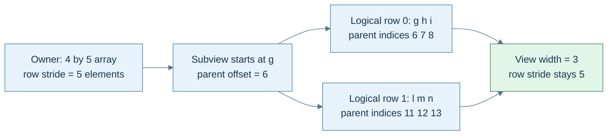
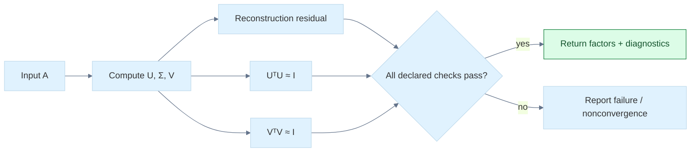
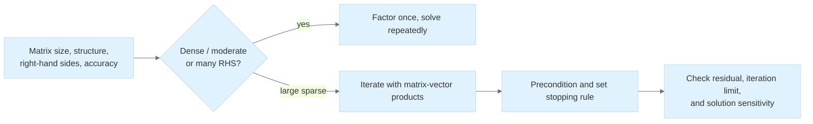

# 38 — Reconstruct the Complete Geometry Pipeline

[[Chapter Edition/01 - Computing Foundations/00 - Reading Map|Reading map]] · [[Chapter Edition/01 - Computing Foundations/37 - Camera Contracts and Transform-Chain Debugging|Previous chapter]] · [[Chapter Edition/01 - Computing Foundations/39 - Research Navigation and Source Boundaries|Next chapter]]

The earlier concepts now form one end-to-end route from imported panel measurements to a surface frame, reconstructed fields, and engine-facing state. This chapter combines complete examples and executable laboratories, then deliberately breaks assumptions to show where the proof changes.

**By the end:** Reconstruct the full geometry and numerical pipeline while keeping storage, coordinate, interpolation, and ownership assumptions explicit.

**Recall question:** Which assumptions must hold at each stage for the reconstructed value to remain meaningful when it reaches the engine?

<!-- Derived from Continuous Notes/Computing Foundations - From Bits to C++ and Systems APIs.md; source lines 95544–97115; source-span SHA256 3fb7946df56660e1cb430f56aa03a7dd70424ecc723f244234e76bd35e116cb1. -->

<!-- CHAPTER-SOURCE-BEGIN -->
## Teach the complete journey, then break one assumption at a time

Start with the physical panel and end with an engine boundary:

1. Interpret imported corner tuples as points in a declared frame and unit system.
2. Subtract points to obtain edge vectors; compare numerical resolution with the panel scale.
3. Check usable area, then derive the face normal and a surface frame.
4. Solve the sensor's barycentric coordinates and check that its plane residual is acceptable.
5. Interpolate the temperature and texture coordinates; distinguish linear constraints from unit-length promises.
6. Transform the panel points, tangents, and normals with their appropriate laws.
7. Compute reflected or transmitted light with explicit direction conventions.
8. Query collision shapes through a common coordinate frame and support contract.
9. Project visible points through homogeneous clip coordinates, then divide and map to the viewport.
10. Encode the destination buffer according to its measured layout, not the CPU class's name.

Now ask what happens if one input changes. Mirror the panel: which orientation signs change while distances stay the same? Collapse two corners: which quantities remain meaningful and which become undefined? Move the workcell to a huge coordinate: did information disappear during storage or arithmetic? Change the basis to a slanted one: which formulas need its Gram matrix? Reverse incident-ray conventions: where must the signs change?

These questions are better than asking a learner to repeat a formula. They require the mechanism and its domain to remain connected.

### A reconstruction desk for active teaching

| Prompt | Evidence of understanding |
|---|---|
| Why is a point not a free vector? | Show origin cancellation for point differences and failure for unrestricted point addition. |
| Why does a basis need both span and independence? | Explain reachability and uniqueness separately. |
| Why is coordinate length sometimes wrong? | Reconstruct the slanted-basis example with $G$, obtaining squared length $13$, not $5$. |
| Why normalize after scaling? | Bound the scaled squared length between one and three. |
| Where does projection's denominator come from? | Require the remainder's dot with the target to vanish. |
| Why does the cross product reverse with winding? | Swap the two edge inputs and track antisymmetry. |
| Why is an angle undefined for zero? | Zero determines no direction; neither inverse trigonometry nor clamping supplies one. |
| Why does a normal need inverse transpose? | Preserve its zero measurement on every transformed tangent. |
| Why are barycentrics affine? | Translate all corner coordinates and use the sum of weights. |
| Why does collision become an origin query? | Prove both directions of the shared-point/difference-zero equivalence. |
| Why is perspective division nonlinear? | Give the $(1,1)+(1,1)$ counterexample. |
| Why is a twelve-byte CPU vector not a GPU contract? | Inspect alignment, stride, format, and enabled shader-layout rules separately. |
| Why keep closeness outside equality? | Produce a three-value non-transitivity example. |
| What would make this teaching library production software? | Add target-specific contracts, certified decisions where needed, broad tests, CI, profiling, documentation, and integration evidence. |


<!-- end V06.28 -->

<!-- begin V07.17 -->
## The mathematical table needs an explicit storage agreement

A matrix's mathematical shape says how many entries it has. It does not specify their addresses. For an $R$-by-$C$ matrix, compact **row-major storage** puts each row contiguously, using element index $rC+c$. Compact **column-major storage** puts each column contiguously, using index $cR+r$. These are memory mappings. Our column-vector mathematical convention can use either storage arrangement as long as the accessor and boundary agreement match.

A compact two-by-three matrix with rows $(a,b,c)$ and $(d,e,f)$ has row-major sequence `a b c d e f` and column-major sequence `a d b e c f`. Neither sequence changes the equation $y=Mx$. A transpose changes the logical relation between indices, $M^{\mathsf T}_{rc}=M_{cr}$; reinterpreting bytes without the matching access contract can accidentally produce a transpose, but storage conversion and mathematical transposition are not definitions of one another.

### Own actual arrays rather than inventing array bounds between members

For fixed-size matrices, an actual array provides the element sequence that indexing requires. A pointer to one separately declared scalar member does not become a pointer to a four-element array merely because nearby members happen to be adjacent in one ABI. The source's illustrative `(&m00)[r*2+c]` crosses that language boundary; use the source's array-based alternative instead.

```cpp
#include <array>
#include <cstddef>
#include <limits>
#include <stdexcept>

template<std::size_t Rows, std::size_t Cols>
struct Matrix {
    static_assert(Rows > 0 && Cols > 0);
    static_assert(Rows <= std::numeric_limits<std::size_t>::max() / Cols);
    std::array<double, Rows * Cols> data{}; // zero is the default contract

    double& operator()(std::size_t r, std::size_t c) {
        if (r >= Rows || c >= Cols)
            throw std::out_of_range("matrix index");
        return data[r * Cols + c];
    }
    const double& operator()(std::size_t r, std::size_t c) const {
        if (r >= Rows || c >= Cols)
            throw std::out_of_range("matrix index");
        return data[r * Cols + c];
    }
    static Matrix identity() requires (Rows == Cols) {
        Matrix result;
        for (std::size_t i = 0; i < Rows; ++i)
            result(i, i) = 1;
        return result;
    }
};
```

This small teaching type uses checked access and a stated zero default. A tuned internal loop may use an unchecked accessor with a proven precondition, but should not claim it is bounds-checked. The square-only factory prevents an accidental request for a rectangular identity under this API. Mat2, Mat3 and Mat4 can be aliases or dedicated wrappers with role-specific operations. Matrix multiplication can encode compatible inner dimensions in templates, while runtime matrices must check them at the boundary.

A fixed matrix owns its entries inline. Copying it copies numerical values; moving it usually does not avoid that entry transfer because there is no separate buffer to adopt. “Inline” does not require a stack location: a matrix can be a member of a heap object, stored in an array, or optimized into registers. Similarly, “typically 64 bytes for sixteen 32-bit floats” is a measured/assumed representation statement, not a portable theorem about every C++ `float` or every padded wrapper.

A Mat2 is useful when the operation acts on two-dimensional vectors: its four entries may encode planar rotation, shear or scaling. A Mat3 naturally acts on ordinary three-dimensional directions and can hold a basis, a general linear deformation, or an inverse-transpose normal map. A Mat4 acts on four-component homogeneous representatives and can encode three-dimensional affine and projective maps. These are roles selected by an API; the same mathematical two-by-two table could instead describe two measurements of two unrelated signals. Matrix dimensions alone do not establish a geometric meaning.

That distinction also explains initialization. A zero matrix annihilates every input; identity preserves it. Neither is an interchangeable harmless default. Identity can make sense for an unmodified transform, while zero can make sense for an accumulator. An explicit `identity()` factory keeps the intent visible. Before multiplying, initialize the result to zero when accumulating contributions; starting at identity would add an unintended diagonal. Before publishing a transform, establish the exact intended state rather than hoping a default happens to match it.

Alignment is a starting-address requirement, while padding changes spacing or total size. A three-by-three matrix may use nine scalars compactly, or three padded four-scalar rows for a chosen SIMD/backend contract. The latter consumes more storage but may simplify specific loads. Neither choice automatically matches a shader buffer's layout. Verify stride, offsets, component format and enabled backend rules at the upload boundary.

### Figure M7 - A submatrix keeps the parent's physical stride



**Caption:** the parent rows are `a b c d e`, `f g h i j`, `k l m n o`, `p q r s t`. The view is two rows by three columns, beginning at `g`. After `i`, the next physical entries `j k` are outside the view before its next row starts at `l`. Stride is measured in elements here; an API using byte strides needs the corresponding element-size conversion.


<!-- end V07.17 -->

<!-- begin V07.18 -->
## Runtime views borrow a layout as well as a lifetime

A **stride** is the physical distance between logical neighbors along a dimension. For a general two-dimensional view, the index can be written $r s_r+c s_c$, where $s_r$ is row stride and $s_c$ is column stride, both in elements. A compact row-major matrix has $s_r=C$ and $s_c=1$. A padded row-major matrix can have $s_r>C$. A transposed view can exchange the logical dimensions and the two strides while keeping the same underlying entries.

For Figure M7, indexing the second row with the view's width three would read `j k l` instead of `l m n`. The shape tells us which logical indices exist; the stride tells us where they live. Both are necessary metadata.

A **view** is a non-owning description of those entries. It should retain a backing-span/bounds contract, dimensions and strides rather than a bare pointer with unexplained capacity. For a nonempty row-major view with unit column stride and nonnegative row stride, the last accessed element has offset $(R-1)s_r+(C-1)$, so the backing region needs at least $(R-1)s_r+C$ elements. Check that multiplication and addition do not overflow before using that formula. Decide separately how empty views are represented; do not evaluate $R-1$ when $R=0$.

Dimension checks also belong before allocation. A request for `rows * cols` elements can wrap an unsigned size calculation before the container sees it, turning an enormous requested shape into a small allocation. Validate multiplication against the chosen container's limits first. A row stride shorter than the logical width may describe intentional overlapping rows in a very general view, but it violates an ordinary non-overlapping row-major contract. Choose which layouts the type accepts and validate that promise at construction, rather than hiding an accidental overlap in a permissive accessor.

Bounds on the descriptor do not extend the owner's lifetime. Destroying, reallocating or otherwise invalidating the owner's buffer can dangle the view. Moving an owner or swapping buffers also needs the container's actual guarantees; a pointer does not follow the meaning of a variable name. Mutation through overlapping views is another contract: `C = A * B` needs either an output independent of the inputs or a safe temporary when `C` aliases them. Arithmetic can be correct while in-place overwrite destroys values still needed by later iterations.


<!-- end V07.18 -->

<!-- begin V07.19 -->
## SIMD and loop order change the execution schedule, not the matrix question

SIMD means **single instruction, multiple data**. A four-lane operation may multiply four corresponding scalar pairs at once. For a row dot vector, lane products still need to be added into one result. That addition is a **horizontal reduction**, because several lanes contribute to one scalar. A lane-wise result and a reduction have different data movement and rounding behavior.

For matrix multiplication, another strategy computes a whole output row from scaled rows of the right operand:

$$
C_{i,:}=A_{i0}B_{0,:}+A_{i1}B_{1,:}+A_{i2}B_{2,:}+A_{i3}B_{3,:}
$$

for four-by-four matrices. Each $A_{ik}$ can be broadcast into all lanes, then multiplied by one four-lane row of $B$. That describes a computational organization; it does not change our use of column-vector mathematics. Fused multiply-add may reduce instruction count and round a product-plus-sum once, while shuffles, horizontal reductions and register spills can erase a benefit. Benchmark the actual workload, compiler flags and target rather than promoting “SIMD-friendly” into an unmeasured speed claim.

Classical scalar multiplication uses $C_{ij}=\sum_k A_{ik}B_{kj}$. For row-major arrays, an `i-j-k` loop walks one row of $A$ but a column of $B$ in its inner loop. The `B` accesses jump by a row stride. Reorder to `i-k-j` and the inner loop walks a row of $B$ and a row of $C$, while reusing one $A_{ik}$ across them:

```cpp
// C is initially zero and does not alias A or B.
for (std::size_t i = 0; i < rows; ++i)
    for (std::size_t k = 0; k < inner; ++k) {
        const double aik = A(i, k);
        for (std::size_t j = 0; j < cols; ++j)
            C(i, j) += aik * B(k, j);
    }
```

Both schedules perform the same classical order of growth, $\Theta(n^3)$ for square matrices. Their cache traffic can differ substantially. A **cache line** transfers a block of neighboring bytes; an illustrative 64-byte line contains sixteen 32-bit floats. Walking adjacent entries can use those neighbors before eviction. Walking widely separated entries may bring in many unused neighbors. Exact cache-line size, alignment effects and reuse depend on the machine.

For a tiny Mat4, the working set is already small, so unrolling, instruction scheduling and register use may dominate. For large arrays, **blocking** or **tiling** works on smaller submatrices so loaded blocks can serve many arithmetic operations before eviction. **Arithmetic intensity** is the amount of arithmetic performed per byte transferred at the memory level being discussed. Increasing reuse can increase that ratio without changing the mathematical operation or the classical asymptotic work count.

Floating-point execution still matters. Different reduction trees, reassociation or FMA contraction can change final bits even when the real-number identities agree. Reproducibility requirements therefore constrain the allowed execution schedule and compiler settings. A fast result needs an accuracy contract and a measurement protocol, just as a correct-looking transformation needs declared coordinate endpoints.

The practical reconstruction test is now concrete: read a frame's columns and origin; derive which inverse changes coordinates; trace one valid point through model, view, clip and NDC; explain why a normal uses the inverse transpose; locate a subview's entries using its actual strides; and predict which data a multiplication loop reuses. Each answer joins geometry to the memory and lifetime model rather than treating matrix code as sixteen unexplained numbers.


<!-- end V07.19 -->

<!-- begin V07.29 -->
## A complete scalar laboratory makes the contracts observable

The following C++20 program is a standalone teaching laboratory. Copy its whole fence into one source file. It uses actual array storage and checked logical indices; encodes rectangular product dimensions; performs pivoted Gauss–Jordan inversion with an explicit scale-relative rejection policy; and implements Hamilton orientation, stable matrix conversion, shortest-path SLERP, homogeneous point transformation and rigid dual-quaternion composition. The tests exercise both valid relationships and defined rejection paths.

The inverse routine is deliberately small: its pivot threshold is a laboratory policy, not a certified condition estimator. It rejects nonfinite inputs and finite matrices whose row sums overflow; a production solver would need more careful scaling, factorization and error estimates. The axis-angle constructor accepts finite nonzero axes and normalizes them with max-component scaling, including tiny axes whose direct norm could underflow. Quaternion rotation and matrix conversion require the documented finite-unit/proper-rotation preconditions. The SLERP API here accepts only interpolation fractions in [0,1]. The homogeneous helper checks an exactly zero or nonfinite divisor; application-specific clipping and near-plane tolerances remain separate.

The program does not implement an engine scheduler, GPU upload ABI, general polar/SVD decomposition, dynamic strided-view class or animation system. Those have been explained as contracts above. Its purpose is to give a small executable witness for the mathematics rather than inherit the source excerpts’ production-ready label.

### Complete runnable matrix and orientation reference

```cpp
#include <algorithm>
#include <array>
#include <cassert>
#include <cmath>
#include <cstddef>
#include <iostream>
#include <limits>
#include <optional>
#include <random>
#include <stdexcept>

using V = std::array<double, 3>;
V add(V a, V b) {
  for (int i = 0; i < 3; ++i)
    a[i] += b[i];
  return a;
}
V scale(V a, double s) {
  for (double &x : a)
    x *= s;
  return a;
}
double dot(V a, V b) {
  double x = 0;
  for (int i = 0; i < 3; ++i)
    x += a[i] * b[i];
  return x;
}
V cross(V a, V b) {
  return {a[1] * b[2] - a[2] * b[1], a[2] * b[0] - a[0] * b[2],
          a[0] * b[1] - a[1] * b[0]};
}
bool near(double a, double b, double tol = 1e-10) {
  return std::abs(a - b) <= tol * std::max({1.0, std::abs(a), std::abs(b)});
}
void same(V a, V b) {
  for (int i = 0; i < 3; ++i)
    assert(near(a[i], b[i]));
}

template <std::size_t R, std::size_t C> struct Mat {
  static_assert(R > 0 && C > 0 &&
                R <= std::numeric_limits<std::size_t>::max() / C);
  std::array<double, R * C> a{};
  double &operator()(std::size_t r, std::size_t c) {
    if (r >= R || c >= C)
      throw std::out_of_range("matrix index");
    return a[r * C + c];
  }
  double operator()(std::size_t r, std::size_t c) const {
    if (r >= R || c >= C)
      throw std::out_of_range("matrix index");
    return a[r * C + c];
  }
};
template <std::size_t N> Mat<N, N> identity() {
  Mat<N, N> a;
  for (std::size_t i = 0; i < N; ++i)
    a(i, i) = 1;
  return a;
}
template <std::size_t R, std::size_t K, std::size_t C>
Mat<R, C> mul(const Mat<R, K> &a, const Mat<K, C> &b) {
  Mat<R, C> c;
  for (std::size_t i = 0; i < R; ++i)
    for (std::size_t k = 0; k < K; ++k)
      for (std::size_t j = 0; j < C; ++j)
        c(i, j) += a(i, k) * b(k, j);
  return c;
}
template <std::size_t R, std::size_t C>
Mat<C, R> transpose(const Mat<R, C> &a) {
  Mat<C, R> t;
  for (std::size_t i = 0; i < R; ++i)
    for (std::size_t j = 0; j < C; ++j)
      t(j, i) = a(i, j);
  return t;
}
template <std::size_t N> double normInf(const Mat<N, N> &a) {
  double m = 0;
  for (std::size_t i = 0; i < N; ++i) {
    double s = 0;
    for (std::size_t j = 0; j < N; ++j)
      s += std::abs(a(i, j));
    m = std::max(m, s);
  }
  return m;
}
template <std::size_t N> std::optional<Mat<N, N>> inverse(Mat<N, N> a) {
  double m = normInf(a);
  if (!(m > 0) || !std::isfinite(m))
    return std::nullopt;
  for (double x : a.a)
    if (!std::isfinite(x))
      return std::nullopt;
  // Normalize global scale; threshold is a laboratory rejection policy,
  // not a certified condition-number estimator.
  for (double &x : a.a)
    x /= m;
  auto b = identity<N>();
  for (std::size_t k = 0; k < N; ++k) {
    std::size_t p = k;
    for (std::size_t i = k + 1; i < N; ++i)
      if (std::abs(a(i, k)) > std::abs(a(p, k)))
        p = i;
    if (std::abs(a(p, k)) <= 64 * std::numeric_limits<double>::epsilon())
      return std::nullopt;
    for (std::size_t j = 0; j < N; ++j) {
      std::swap(a(k, j), a(p, j));
      std::swap(b(k, j), b(p, j));
    }
    const double pivot = a(k, k);
    for (std::size_t j = 0; j < N; ++j) {
      a(k, j) /= pivot;
      b(k, j) /= pivot;
    }
    for (std::size_t i = 0; i < N; ++i)
      if (i != k) {
        double f = a(i, k);
        for (std::size_t j = 0; j < N; ++j) {
          a(i, j) -= f * a(k, j);
          b(i, j) -= f * b(k, j);
        }
      }
  }
  for (double &x : b.a) {
    x /= m;
    if (!std::isfinite(x))
      return std::nullopt;
  }
  return b;
}
template <std::size_t N> void checkIdentity(const Mat<N, N> &a) {
  for (std::size_t i = 0; i < N; ++i)
    for (std::size_t j = 0; j < N; ++j)
      assert(near(a(i, j), i == j ? 1.0 : 0.0));
}
V matvec(const Mat<3, 3> &a, V v) {
  V r{};
  for (int i = 0; i < 3; ++i)
    for (int j = 0; j < 3; ++j)
      r[i] += a(i, j) * v[j];
  return r;
}
double det(const Mat<3, 3> &a) {
  return a(0, 0) * (a(1, 1) * a(2, 2) - a(1, 2) * a(2, 1)) -
         a(0, 1) * (a(1, 0) * a(2, 2) - a(1, 2) * a(2, 0)) +
         a(0, 2) * (a(1, 0) * a(2, 1) - a(1, 1) * a(2, 0));
}

struct Q {
  double w, x, y, z;
};
Q operator+(Q a, Q b) { return {a.w + b.w, a.x + b.x, a.y + b.y, a.z + b.z}; }
Q operator*(Q a, double s) { return {a.w * s, a.x * s, a.y * s, a.z * s}; }
Q conj(Q q) { return {q.w, -q.x, -q.y, -q.z}; }
double qdot(Q a, Q b) { return a.w * b.w + a.x * b.x + a.y * b.y + a.z * b.z; }
Q operator*(Q a, Q b) {
  V av{a.x, a.y, a.z}, bv{b.x, b.y, b.z};
  V c = add(add(scale(bv, a.w), scale(av, b.w)), cross(av, bv));
  return {a.w * b.w - dot(av, bv), c[0], c[1], c[2]};
}
std::optional<Q> unit(Q q) {
  const double m =
      std::max({std::abs(q.w), std::abs(q.x), std::abs(q.y), std::abs(q.z)});
  if (!(m > 0) || !std::isfinite(m))
    return std::nullopt;
  q = {q.w / m, q.x / m, q.y / m, q.z / m};
  const double n = std::sqrt(qdot(q, q));
  if (!std::isfinite(n))
    return std::nullopt;
  return q * (1.0 / n);
}
Q axis(V a, double theta) {
  if (!std::isfinite(theta))
    throw std::invalid_argument("nonfinite angle");
  const double m = std::max({std::abs(a[0]), std::abs(a[1]), std::abs(a[2])});
  if (!(m > 0) || !std::isfinite(m))
    throw std::invalid_argument("invalid axis");
  a = {a[0] / m, a[1] / m, a[2] / m};
  const double n = std::hypot(a[0], a[1], a[2]);
  if (!std::isfinite(n))
    throw std::invalid_argument("invalid axis");
  a = scale(a, std::sin(theta / 2) / n);
  return {std::cos(theta / 2), a[0], a[1], a[2]};
}
// Precondition for rotate and rotation: finite unit quaternion.
V rotate(Q q, V v) {
  V u{q.x, q.y, q.z};
  V t = scale(cross(u, v), 2);
  return add(v, add(scale(t, q.w), cross(u, t)));
}
Mat<3, 3> rotation(Q q) {
  Mat<3, 3> m;
  for (int j = 0; j < 3; ++j) {
    V e{};
    e[j] = 1;
    V c = rotate(q, e);
    for (int i = 0; i < 3; ++i)
      m(i, j) = c[i];
  }
  return m;
}
// Input contract: finite proper orthogonal matrix, independently checked
// by caller. This routine is not a matrix-to-rotation repair algorithm.
Q fromRotation(const Mat<3, 3> &m) {
  Q q{};
  const double tr = m(0, 0) + m(1, 1) + m(2, 2);
  if (tr > 0) {
    double s = 2 * std::sqrt(1 + tr);
    q = {s / 4, (m(2, 1) - m(1, 2)) / s, (m(0, 2) - m(2, 0)) / s,
         (m(1, 0) - m(0, 1)) / s};
  } else if (m(0, 0) > m(1, 1) && m(0, 0) > m(2, 2)) {
    double s = 2 * std::sqrt(1 + m(0, 0) - m(1, 1) - m(2, 2));
    q = {(m(2, 1) - m(1, 2)) / s, s / 4, (m(0, 1) + m(1, 0)) / s,
         (m(0, 2) + m(2, 0)) / s};
  } else if (m(1, 1) > m(2, 2)) {
    double s = 2 * std::sqrt(1 + m(1, 1) - m(0, 0) - m(2, 2));
    q = {(m(0, 2) - m(2, 0)) / s, (m(0, 1) + m(1, 0)) / s, s / 4,
         (m(1, 2) + m(2, 1)) / s};
  } else {
    double s = 2 * std::sqrt(1 + m(2, 2) - m(0, 0) - m(1, 1));
    q = {(m(1, 0) - m(0, 1)) / s, (m(0, 2) + m(2, 0)) / s,
         (m(1, 2) + m(2, 1)) / s, s / 4};
  }
  return *unit(q);
}
Q slerp(Q a, Q b, double t) {
  auto na = unit(a), nb = unit(b);
  if (!na || !nb || !std::isfinite(t) || t < 0 || t > 1)
    throw std::invalid_argument("invalid interpolation");
  a = *na;
  b = *nb;
  double d = qdot(a, b);
  if (d < 0) {
    b = b * (-1);
    d = -d;
  }
  d = std::clamp(d, -1.0, 1.0);
  if (d > .9995)
    return *unit(a * (1 - t) + b * t);
  double th = std::acos(d);
  return *unit(a * (std::sin((1 - t) * th) / std::sin(th)) +
               b * (std::sin(t * th) / std::sin(th)));
}
Mat<4, 4> affine(const Mat<3, 3> &l, V t) {
  auto a = identity<4>();
  for (int i = 0; i < 3; ++i) {
    for (int j = 0; j < 3; ++j)
      a(i, j) = l(i, j);
    a(i, 3) = t[i];
  }
  return a;
}
V point(const Mat<4, 4> &a, V p) {
  V r{};
  double w = a(3, 3);
  for (int j = 0; j < 3; ++j)
    w += a(3, j) * p[j];
  if (!std::isfinite(w) || w == 0)
    throw std::domain_error("invalid homogeneous divide");
  for (int i = 0; i < 3; ++i) {
    r[i] = a(i, 3);
    for (int j = 0; j < 3; ++j)
      r[i] += a(i, j) * p[j];
    r[i] /= w;
  }
  return r;
}
struct DQ {
  Q real, dual;
};
DQ rigid(Q q, V t) { return {q, (Q{0, t[0], t[1], t[2]} * q) * .5}; }
DQ operator*(DQ a, DQ b) {
  return {a.real * b.real, a.real * b.dual + a.dual * b.real};
}
V translation(DQ q) {
  Q t = (q.dual * conj(q.real)) * 2;
  return {t.x, t.y, t.z};
}

int main() {
  const double pi = std::acos(-1.0);
  Mat<2, 3> a{{1, 2, 3, 4, 5, 6}};
  Mat<3, 2> b{{7, 8, 9, 10, 11, 12}};
  auto c = mul(a, b);
  assert(c(0, 0) == 58 && c(0, 1) == 64 && c(1, 0) == 139 && c(1, 1) == 154);
  auto ct = transpose(c);
  assert(ct(0, 1) == 139);
  Mat<3, 3> pivot{{0, 1, 0, 1, 0, 0, 0, 0, 2}};
  auto ip = inverse(pivot);
  assert(ip);
  checkIdentity(mul(pivot, *ip));
  Mat<3, 3> singular{{1, 2, 3, 2, 4, 6, 0, 1, 0}};
  assert(!inverse(singular));
  auto scaled = identity<3>();
  for (double &x : scaled.a)
    x *= 1e-120;
  auto si = inverse(scaled);
  assert(si);
  checkIdentity(mul(scaled, *si));
  auto bad = identity<3>();
  bad(0, 0) = std::numeric_limits<double>::infinity();
  assert(!inverse(bad));
  Q z = axis({0, 0, 1}, pi / 2), x = axis({1, 0, 0}, pi / 2);
  same(rotate(z, {1, 0, 0}), {0, 1, 0});
  same(rotate(x * z, {1, 0, 0}), {0, 0, 1});
  same(rotate(z * x, {1, 0, 0}), {0, 1, 0});
  assert(!unit({0, 0, 0, 0}));
  assert(!unit({std::numeric_limits<double>::infinity(), 0, 0, 0}));
  auto huge = unit({1e300, 1e300, 0, 0});
  assert(huge && near(qdot(*huge, *huge), 1));
  auto tiny = unit({std::numeric_limits<double>::denorm_min(), 0, 0, 0});
  assert(tiny && near(tiny->w, 1));
  const double sub = std::numeric_limits<double>::denorm_min();
  same(rotate(axis({sub, 0, 0}, pi / 2), {0, 1, 0}), {0, 0, 1});
  Q tinyAxis = axis({sub, sub, 0}, pi / 2);
  assert(near(qdot(tinyAxis, tinyAxis), 1));
  bool badIndex = false;
  try {
    (void)a(0, 3);
  } catch (const std::out_of_range &) {
    badIndex = true;
  }
  assert(badIndex);
  bool badT = false;
  try {
    (void)slerp(z, x, -.1);
  } catch (const std::invalid_argument &) {
    badT = true;
  }
  assert(badT);
  Q half = slerp({1, 0, 0, 0}, z, .5);
  same(rotate(half, {1, 0, 0}), {std::sqrt(.5), std::sqrt(.5), 0});
  same(rotate(slerp(z, z * (-1), .37), {1, 0, 0}), rotate(z, {1, 0, 0}));
  Mat<3, 3> scale2 = identity<3>();
  scale2(0, 0) = 2;
  V tangent{1, 1, 0}, normal{1, -1, 0};
  auto invs = inverse(scale2);
  assert(invs);
  assert(
      near(dot(matvec(scale2, tangent), matvec(transpose(*invs), normal)), 0));
  auto trs = affine(mul(rotation(z), scale2), {10, 0, 0});
  same(point(trs, {1, 0, 0}), {10, 2, 0});
  auto ti = inverse(trs);
  assert(ti);
  same(point(*ti, point(trs, {1, 2, 3})), {1, 2, 3});
  // Nonuniform scale followed by 45-degree rotation has nonorthogonal
  // columns: it cannot in general be represented as rotation*diagonal-scale.
  auto shear = mul(scale2, rotation(axis({0, 0, 1}, pi / 4)));
  V c0{shear(0, 0), shear(1, 0), shear(2, 0)},
      c1{shear(0, 1), shear(1, 1), shear(2, 1)};
  assert(!near(dot(c0, c1), 0));
  auto parent = rigid(z, {10, 0, 0}), child = rigid(x, {1, 0, 0});
  auto combined = parent * child;
  same(translation(combined), {10, 1, 0});
  assert(near(qdot(combined.real, combined.dual), 0));
  // Euler XYZ active application means Rz(yaw)*Ry(pitch)*Rx(roll).
  Q r0 = axis({0, 0, 1}, .7) * axis({0, 1, 0}, pi / 2) * axis({1, 0, 0}, .2);
  Q r1 = axis({0, 0, 1}, 1.0) * axis({0, 1, 0}, pi / 2) * axis({1, 0, 0}, .5);
  assert(near(std::abs(qdot(r0, r1)), 1));
  std::mt19937 gen(700);
  std::uniform_real_distribution<double> d(-1, 1);
  for (int i = 0; i < 2000; ++i) {
    V ax{d(gen), d(gen), d(gen)}, v{d(gen), d(gen), d(gen)};
    Q q = axis(ax, pi * d(gen));
    auto m = rotation(q);
    same(rotate(q, v), matvec(m, v));
    same(rotate(q * (-1), v), rotate(q, v));
    assert(near(det(m), 1));
    checkIdentity(mul(transpose(m), m));
    Q recovered = fromRotation(m);
    assert(near(std::abs(qdot(q, recovered)), 1));
    auto im = inverse(m);
    assert(im);
    checkIdentity(mul(m, *im));
    Q p = axis({1, 2, 3}, pi * d(gen));
    same(rotate(p * q, v), rotate(p, rotate(q, v)));
  }
  for (V ax : std::array<V, 3>{V{1, 0, 0}, V{0, 1, 0}, V{0, 0, 1}}) {
    Q q = axis(ax, pi);
    assert(near(std::abs(qdot(q, fromRotation(rotation(q)))), 1));
  }
  bool rejected = false;
  try {
    (void)point(Mat<4, 4>{}, {1, 2, 3});
  } catch (const std::domain_error &) {
    rejected = true;
  }
  assert(rejected);
  std::cout << "Phase 7: fixed examples, failure cases, 180-degree branches, "
               "and 2000 seeded rotation properties passed\n";
}
```

### Read the assertions as experiments

The rectangular example checks a 2-by-3 times 3-by-2 product, while the zero-leading-pivot matrix verifies actual row swapping. Singular, infinite, invalid-index, invalid-SLERP-parameter and zero-quaternion cases exercise rejection. Uniform tiny scaling is accepted without a fixed determinant cutoff. A smallest-subnormal quaternion verifies that normalization divides components by the largest component instead of first forming an overflowing reciprocal.

The fixed orientation cases check composition order, q versus minus q, antipodal interpolation, a half-arc midpoint, inverse-transpose perpendicularity, exact point round trips, nonuniform-scale shear, rigid dual-quaternion translation, and two Euler triples representing one gimbal-lock orientation. The 2,000 seeded cases compare quaternion action with its matrix, check determinant one and orthogonality, recover matrix orientations including the three exact half-turn branches, and compare composed action with sequential action. These are regression checks for stated cases, not exhaustive proofs or performance measurements.


<!-- end V07.29 -->

<!-- begin V07.30 -->
## Teach the journey by changing one promise

Ask a learner to reconstruct each new rule from the previous one: basis images determine a linear map; substituting one map into another determines multiplication; oriented volume exposes loss of independence; inverses undo descriptions when information survives; homogeneous coordinates distinguish locations from movements; frames give endpoints to products; and quaternion conjugation derives a compact orientation action.

Then deliberately break one promise: exchange storage layout without changing access; change a destination frame without changing the matrix product; use a singular scale; feed a shear into rotation conversion; interpolate opposite coefficient representatives; extract Euler angles at a chart singularity; or compose restricted TRS as though it were closed. Predict the failure before checking a picture. A correct-looking scene from one camera is much weaker evidence than a basis test and a declared invariant.

The missing 635–650 lesson texts remain visible in the coverage ledger. The reconstructed bridge keeps this teaching narrative usable now and can be deepened when those sources arrive. Later numerical linear algebra can extend pivoting, conditioning, orthogonal factorizations, eigenstructure and decomposition without changing the representation contracts established here.

[[Visual Recall/07 - Matrices, Transforms and Quaternions - Visual Recall|Compact linked recall]] · [[Supplementary/Foundations#Phase 7 - Parts 601-700|Exact coverage]] · [[Chapter Edition/01 - Computing Foundations/39 - Research Navigation and Source Boundaries#Phase 7 - Transform reconstruction proofs|Extended reconstruction]] · [[Supplementary/Worked Traces#Phase 7 - The moving-panel tracebook|Extended traces]] · [[Supplementary/Sources and Code Anchors#Phase 7 - Source analysis and verification|Sources and verification]] · [[Keyword Index]] · [[Dependency Map]]

### Where transforms lead next

The determinant already asks whether a map collapses a dimension; its smallest singular value will later quantify how nearly that collapse occurs. The column dot products in $A^\mathsf T A$ measure whether transformed axes become coupled; QR and SVD turn those measurements into stable coordinates and explicit stretch directions. A matrix can therefore be perfectly meaningful as a transform and still be a difficult inverse problem. Phase 8 connects these transform foundations to [[Chapter Edition/01 - Computing Foundations/19 - Coordinate Frames and Linear Systems#A system is an intersection of constraints|Linear systems and fundamental subspaces]], [[Chapter Edition/01 - Computing Foundations/20 - Choose Matrix Factorizations from Structure#Reflections and plane rotations build QR without losing lengths|QR factorization and least squares]], [[Chapter Edition/01 - Computing Foundations/24 - Waiting Times, Covariance, and Matrix Decomposition#Full, thin, and compact shapes for tall and wide matrices|Singular value decomposition]], and [[Chapter Edition/01 - Computing Foundations/18 - Vectors for Light and Frames#An inverse can exist and still amplify uncertainty|Conditioning and singularity]].

Keep the roles straight as you move forward: Phase 7 asks what one matrix or orientation does to geometry; Phase 8 asks which unknowns can be recovered from measurements, how uncertainty changes the answer, and which factorization exposes the reliable information.

<!-- end V07.30 -->

<!-- begin V08.53 -->
## Implementation kernels and shape reasoning

A practical result need not materialize a dense diagonal $\Sigma$. Store singular values as a vector and store $U$ and $V^\mathsf T$ in documented full, thin, or compact shapes. For compact rank $r$, the contract is typically $U:m\times r$, $\sigma:r$, and $V^\mathsf T:r\times n$. Then applying the factorized matrix to $x\in\mathbb R^n$ can be done as three clear operations:

```text
z = Vt * x          // r coefficients; Vt is r by n
for i in 0 .. r-1:
    z[i] *= sigma[i]
y = U * z           // m outputs; U is m by r
```

The result is $y\in\mathbb R^m$. It costs $O(rn+rm)$ arithmetic instead of multiplying a reconstructed dense $m\times n$ matrix by $x$. When the factors are retained for repeated transforms, this can save storage and work. Validate dimensions at the boundary: input length must equal $n$, output length is $m$, and the shared rank dimension must agree between $U$, $\sigma$, and $V^\mathsf T$.

A pseudoinverse application should also avoid constructing $A^+$. For $b\in\mathbb R^m$, compute $c=U^\mathsf T b$ (length $r$), divide $c_i$ by every exact positive $\sigma_i$ for the mathematical $A^+$, then return $x=Vc$. Under a deliberate numerical cutoff, divide only when $\sigma_i>\tau$ and set the coefficient to zero otherwise; expose the threshold and the fact that this computes $A_\tau^+$. The output has length $n$. The reduction must distinguish exact positivity from threshold selection rather than silently hard-code a rank policy.

For a thin or compact factorization, $U^\mathsf T b$ is not necessarily the entire coordinate vector of $b$ in the codomain; it contains projections onto the range directions. The omitted orthogonal component is unreachable and becomes part of the least-squares residual. This observation helps avoid a common shape error: do not pad or truncate vectors casually to make products type-check. The factor dimensions encode domain, codomain, and retained subspace.

Numerical validation should check reconstruction $\|A-U\Sigma V^\mathsf T\|$ with a stated norm and scale, orthogonality of the returned bases, nonnegative descending singular values, and convergence status. Full factors can be checked against identity; thin factors should satisfy $U_t^\mathsf T U_t=I$ and $V_t^\mathsf T V_t=I$ on their retained columns. A rank-$r$ compact representation should be assessed against its claimed rank and residual. These checks answer different questions and should not be collapsed into one vague “valid” flag.

Dense SVD computation is costly compared with a triangular solve or Cholesky factorization, so compute a full decomposition only when its information is needed. A result contract should state full versus economy shapes, convergence status, workspace or allocation behavior, threshold policy if rank is reported, and whether the method is approximate. Reusable scratch storage can avoid repeated allocation, but must have explicit ownership, size, alignment, and concurrency rules. For large sparse or structured problems, selected singular triplets or randomized low-rank methods may be more appropriate than a full dense decomposition. Algorithm choice is workload dependent; the factorization's geometric definition does not certify speed or accuracy of any particular implementation.


<!-- end V08.53 -->

<!-- begin V08.54 -->
## An implementation review checklist grounded in the map

Before trusting an SVD API, trace one vector end to end. Confirm that a column of $V$ is read as a domain vector of length $n$, the corresponding $u_i$ has codomain length $m$, and applying the map returns $\sigma_i u_i$. For the $2\times2$ rotation example above, verify both singular vectors individually and verify the input trace $(1,0)\mapsto(c,-c)\mapsto(4c,-2c)\mapsto(3,1)$. Reconstruction alone may not expose a transposed-factor convention if the same convention is used consistently in both factor generation and application; the vector trace forces the documented orientation to be explicit.

Test shape policy separately on tall, square, and wide inputs, and include rank-deficient cases. A thin decomposition of a wide matrix should not be mistaken for a full right basis: it may omit the nullspace completion, even though the compact factors reconstruct $A$. If a caller needs a nullspace basis, the API must return a full $V$ or offer a separate nullspace operation. Likewise, if a caller needs the left nullspace, the full $U$ completion matters. This is why “economy” is a storage decision, not a claim that all geometric subspaces have been returned.

Finally, keep mathematical exactness separate from numerical policy in names and output. An exact pseudoinverse divides by every strictly positive singular value. A thresholded operation should report $\tau$, whether it is absolute or relative, the number of retained values, and whether a positive value was discarded. A low-rank approximation should report $k$ and a residual measure. A solver should distinguish convergence from nonconvergence and exact consistency from least-squares fit. Such outputs let a caller decide whether the result matches the meaning of the data rather than infer a guarantee from a type name.


<!-- end V08.54 -->

<!-- begin V08.55 -->
## Householder reductions turn a dense SVD into a bidiagonal problem

A dense SVD algorithm does not normally make an arbitrary matrix diagonal in one leap. It first reduces $A$ to bidiagonal form with left and right orthogonal transformations. Bidiagonal means only the main diagonal and one neighboring diagonal can be nonzero, for example upper bidiagonal $B_{ii}=d_i$, $B_{i,i+1}=e_i$. Write $B=Q_L^\mathsf TAQ_R$, so $A=Q_LBQ_R^\mathsf T$. Singular values are preserved: $B^\mathsf TB=Q_R^\mathsf TA^\mathsf TAQ_R$, which is an orthogonal similarity of $A^\mathsf TA$ and therefore has the same eigenvalues, namely the squared singular values.

Alternating Householder reflectors create this band structure. At stage $k$, a left reflector acting on rows $k$ through $m-1$ maps the active column tail to one leading value followed by zeros. A right reflector acting on columns $k+1$ through $n-1$ then maps the remaining active row tail to one superdiagonal value followed by zeros. These operations leave earlier completed bands alone. Continue on the trailing submatrix. For a small visual trace, a 4-by-4 dense matrix first becomes a shape with only column 0's diagonal entry nonzero below the first row; the right reflector removes row 0's entries from column 2 onward. The next left step clears column 1 below its diagonal, and the next right step clears that row beyond its superdiagonal. Repeating leaves exactly the diagonal and superdiagonal. A later iteration can now work on this narrow matrix instead of a dense one.

The reflector is represented compactly as $H=I-\tau vv^\mathsf T$. Store the vector tail and scalar $\tau$, not a full $m\times m$ reflector. Applying it to a matrix block is $HA=A-\tau v(v^\mathsf TA)$, a projection followed by a rank-one update. A reduction may overwrite the input: the final bidiagonal diagonal and superdiagonal occupy their positions, while unused lower/upper regions retain left/right reflector tails. This is an encoded factorization state, not a conventional matrix at every intermediate moment. Accumulating the reflectors yields $Q_L$ and $Q_R$ if vectors are requested. The dense Householder bidiagonal reduction is often called Golub–Kahan bidiagonalization in the direct SVD context. There is also a related Golub–Kahan–Lanczos recurrence for large sparse partial-SVD problems, which generates Krylov vectors and a small bidiagonal projection rather than reducing the entire dense matrix. They share a bidiagonal structure but are distinct algorithms; the latter is not a synonym for the dense reflector reduction.

The aspect ratio affects the route. A common direct bidiagonal backend is designed for tall or square input ($m\ge n$). For a wide $m\times n$ matrix with $m<n$, compute a thin SVD of the tall transpose $A^\mathsf T=\tilde U\Sigma_t\tilde V^\mathsf T$, where $\tilde U:n\times m$, $\Sigma_t:m\times m$, and $\tilde V^\mathsf T:m\times m$. Then $A=\tilde V\Sigma_t\tilde U^\mathsf T$, so the original thin factors are $U_A=\tilde V$, $V_A^\mathsf T=\tilde U^\mathsf T$, with shapes $m\times m$ and $m\times n$. Do not transpose a full rectangular $\Sigma$ without also specifying its dimensions. In particular, an $m\times n$ matrix with $m<n$ cannot have $n$ orthonormal columns in $U\in\mathbb R^{m\times n}$, because at most $m$ vectors in $\mathbb R^m$ are independent and orthonormal. A thin form uses $r=\min(m,n)$ triplets: $U:m\times r$, $\sigma:r$, $V^\mathsf T:r\times n$. Full outputs add orthonormal completion columns to square $U$ and $V$ factors. Rank deficient or zero columns still need a valid completion if full orthogonal factors are promised; such added columns are arbitrary orthonormal bases of the remaining complement, not extra observed singular directions.


<!-- end V08.55 -->

<!-- begin V08.56 -->
## Jacobi SVD removes column coupling pair by pair

A second route is Jacobi rotation. Two-sided Jacobi alternates left and right plane rotations to simplify local 2-by-2 blocks and drives $U^\mathsf TAV$ toward diagonal form. It maintains orthogonality on both sides and can give accurate singular vectors, though dense production algorithms often favor bidiagonal reduction followed by specialized iterations for speed. One-sided Jacobi is especially direct: copy $A$ into a working matrix $B$, initialize accumulated right factor $V=I$, and rotate pairs of columns of $B$ until the columns are mutually orthogonal. The same right rotations are applied to $V$, so the invariant $B=AV$ is maintained. If the final columns are orthogonal, set $\sigma_j=\|b_j\|_2$ and $u_j=b_j/\sigma_j$ for nonzero columns. Then $AV=U\Sigma$, or $A=U\Sigma V^\mathsf T$. This gives the factors from lengths and directions without diagonalizing a formed normal-equations matrix.

Fix one convention to avoid sign confusion. Let the selected column pair be $p,q$, and use

$$
J=\begin{bmatrix}c&s\\-s&c\end{bmatrix},\qquad c=\cos\theta,\ s=\sin\theta.
$$

Right multiplication $[p\ q]J$ produces $p'=cp-sq$ and $q'=sp+cq$. Their 2-by-2 Gram matrix is $G=\begin{bmatrix}\alpha&\gamma\\\gamma&\beta\end{bmatrix}$ with $\alpha=p^\mathsf Tp$, $\beta=q^\mathsf Tq$, and $\gamma=p^\mathsf Tq$. The new cross product is the off-diagonal element of $J^\mathsf TGJ$:

$$
{p'}^\mathsf Tq'=(\alpha-\beta)cs+\gamma(c^2-s^2).
$$

Set it to zero, let $t=s/c$, and divide by $c^2$ to obtain $\gamma t^2+(\beta-\alpha)t-\gamma=0$. Directly forming $\alpha=p^\mathsf Tp$, $\beta=q^\mathsf Tq$, and $\gamma=p^\mathsf Tq$ can overflow. A safer scalar calculation scales both columns by a shared $g=\max(\|p\|_2,\|q\|_2)$ and forms the Gram values from $p/g,q/g$ using safe dot products; the common scale cancels from the rotation ratio. Let $\delta=\beta-\alpha$. For $\delta\ne0$, compute the small root in the equivalent form $t=2\gamma/(\delta+\operatorname{copysign}(\operatorname{hypot}(\delta,2\gamma),\delta))$, where $\operatorname{hypot}$ avoids squaring overflow. For $\delta=0$, choose one of the equal-magnitude roots consistently, such as $t=1$; if $\gamma=0$, skip the rotation. This avoids first forming a potentially overflowing $\tau=\delta/(2\gamma)$ and avoids $\sqrt{1+\tau^2}$. Then use $c=1/\operatorname{hypot}(1,t)$ and $s=tc$. As a numeric check, take $\alpha=4$, $\beta=2$, $\gamma=1$. Then $t=-(\sqrt2-1)$; substitution into the cross product formula gives zero. A transpose of $J$ or a swapped coordinate update changes signs, so formulas from another convention cannot be copied piecemeal.

An actual sweep visits column pairs $(0,1),(0,2),\ldots,(n-2,n-1)$, computes their Gram entries, skips already orthogonal pairs, rotates the two columns of $B$, and applies the same rotation to columns $p,q$ of $V$. Repeated sweeps reduce all pairwise correlations. Once converged, compute each column norm with a scaled stable norm, sort singular values descending while permuting matching columns of $U$ and $V$, and set $U$ columns by normalized working columns. A zero-norm column cannot be normalized; it corresponds to a zero singular value and null-space direction. For a thin rank-$r$ output one may omit null directions based on a declared rank threshold; for a full orthogonal output, construct a deterministic or documented orthonormal completion in the remaining complement. In a wide case, use a tall backend on $A^\mathsf T$ and swap factors rather than trying to construct an impossible $m\times n$ column-orthonormal $U$.

A pedagogical one-sided Jacobi loop is not a production SVD. Its naive dot products and squared norms can overflow or underflow, it may require scaling and safe accumulation, rank policy is application dependent, zero-column completion and wide-matrix handling are nontrivial, and convergence is not guaranteed within a fixed sweep budget. Mature numerical libraries use carefully tested algorithms and workspace policies. The useful claim here is the derivation and invariant, not that a short loop replaces those implementations.


<!-- end V08.56 -->

<!-- begin V08.57 -->
## Scale-aware convergence and output conventions make results interpretable

For one-sided Jacobi, a useful normalized measure for columns $p,q$ is their absolute cosine $\rho_{pq}=|p^\mathsf Tq|/(\|p\|_2\|q\|_2)$. Avoid computing $\sqrt{\alpha\beta}$ because the product can overflow or underflow even when each column norm is representable. Compute stable scaled norms and a dot product of separately normalized columns, $\rho=|(p/\|p\|)^\mathsf T(q/\|q\|)|$, with safe accumulation. It is dimensionless and does not depend on column units. A stopping rule checks all relevant pairs against a tolerance and also has a maximum sweep count. Raw $|p^\mathsf Tq|$ is misleading: the same dot product could be negligible for huge columns and large relative to tiny columns. Near-zero columns require separate rank/zero handling because normalized correlation is undefined. The criterion should state its behavior for them rather than divide by zero.

Check approximate singular triplets $(u_i,\sigma_i,v_i)$ with both residuals $r_i=Av_i-\sigma_i u_i$ and $s_i=A^\mathsf Tu_i-\sigma_i v_i$. Scale residual norms against a safe expression involving $\|A\|$, $\sigma_i$, and vector norms. For a bidiagonal iteration, convergence appears as superdiagonal entries becoming negligible relative to neighboring diagonal scale; deflation then separates blocks. Also check reconstruction and orthogonality independently: small residual alone does not prove the full factor matrices are orthogonal, and reconstruction alone may hide compensating factor errors. Iteration count, tolerance, scaling, and nonconvergence status belong in the result contract.

Singular values are nonnegative and commonly sorted $\sigma_1\ge\cdots\ge0$. When reordering, apply exactly the same permutation to paired columns of $U,V$; otherwise reconstruction changes. Signs are not unique: replacing both $u_i$ and $v_i$ by their negatives leaves $\sigma_i u_iv_i^\mathsf T$ unchanged. With repeated singular values, any orthogonal basis of that repeated singular subspace is valid; with zero values, the corresponding left and right null-space completions can be selected independently subject to orthogonality. Therefore two valid runs can return different columns. In animation or tracking, arbitrary sign flips can make axes jump; aligning signs to a previous frame helps for isolated singular values, while repeated-value clusters require subspace alignment rather than sign correction alone.

Numerical stability and conditioning must be separated. Householder and Givens factors are orthogonal, so they preserve 2-norm and have condition number one; Jacobi rotations share that property. They avoid artificial scaling during reduction. A very small singular value, however, means the input nearly erases a direction; inversion along that direction is intrinsically sensitive. Forming $A^\mathsf TA$ to compute singular values squares the condition number: if singular values are $1$ and $10^{-10}$, the squared problem contains eigenvalues $1$ and $10^{-20}$, which can lose relative information in finite precision. The computation may also overflow when squaring values near $10^{300}$ or underflow near $10^{-300}$. Use scaled norm and dot-product strategies. Tiny singular values need both absolute and relative interpretation: a computed $2\times10^{-12}$ for a true $10^{-12}$ has tiny absolute error but 100% relative error, which may change rank or pseudoinverse results. A backward-stable algorithm returns an exact answer to a nearby input; if the original problem is ill-conditioned, that small input perturbation can still yield a large forward change.


<!-- end V08.57 -->

<!-- begin V08.58 -->
## Independent reconstruction and orthogonality checks test the SVD invariants

For a thin factorization of $A\in\mathbb R^{m\times n}$ with $r=\min(m,n)$, store $U$ as $m\times r$, the singular values as a length-$r$ vector, and $V^\mathsf T$ as $r\times n$. Since $\Sigma$ is diagonal, it need not be stored densely. Reconstruct entry $(i,j)$ by $\hat A_{ij}=\sum_{k=0}^{r-1}U_{ik}\sigma_kV^\mathsf T_{kj}$. The Frobenius norm is the Euclidean norm of all entries, $\|M\|_F=(\sum_{ij}M_{ij}^2)^{1/2}$. Relative reconstruction error is $\|A-\hat A\|_F/\|A\|_F$: it measures aggregate reconstruction discrepancy compared with input scale. For the zero matrix, the denominator is zero, so define a separate absolute-error policy or use a safe scale; do not silently divide by zero. For extreme magnitudes, compute norms with scaling rather than directly summing squares.

Thin left singular vectors must satisfy $U^\mathsf TU=I_r$; right vectors satisfy $VV^\mathsf T=I_r$ when stored as $V^\mathsf T$ with $r$ orthonormal rows, equivalently $V_r^\mathsf TV_r=I_r$ if stored as $V_r$. Measure the Gram-matrix defects, such as $\|U^\mathsf TU-I_r\|_F$ and $\|V_r^\mathsf TV_r-I_r\|_F$. A diagonal defect means columns are not unit length; an off-diagonal defect means two vectors are not perpendicular. Checking norms alone is insufficient: two identical unit columns pass individual length checks. Check nonnegative sorted singular values, both singular-triplet residuals, reconstruction, and orthogonality. These invariants expose different failures and should not be collapsed into one `success` boolean.

### Figure L8 - SVD validation needs independent checks



> **How to read Figure L8.** A product that reconstructs the input is not enough. Independently test the orthogonality promises and return meaningful status.


<!-- end V08.58 -->

<!-- begin V08.59 -->
## A matrix object must describe shape, ownership, and workspace

Dynamic matrices need one owned contiguous allocation, explicit row and column counts, and a stride contract. A `std::vector<std::vector<double>>` gives each row a separate allocation, weakens locality, and complicates interfaces. A non-owning matrix view borrows storage and must not outlive it. For row-major storage, element $(i,j)$ at a view's base pointer is `data[i * stride + j]`; the stride is the number of stored elements from one row start to the next, which may exceed the logical column count.

Before allocating $mn$ elements, check that size multiplication does not overflow. Check indexing and shape compatibility at API boundaries or encode them in a validated type. Empty matrices are not automatically invalid; define which shapes are accepted by each factorization and what outputs they produce. In-place algorithms may overwrite the input with factors, which saves memory but changes ownership and aliasing expectations. Out-of-place algorithms preserve input and simplify failure handling but require additional storage. A safe API names this choice.

Numerical routines often need scratch **workspace**. Repeatedly allocating inside an iteration can cost time and fragment memory. A caller-provided workspace or reusable arena can improve predictability, but it needs size, alignment, lifetime, reentrancy, and thread-safety rules. Do not hide shared mutable scratch in a global singleton. GPU routines may require device-specific workspace and synchronization rules that a CPU matrix view does not express.

An SVD result type should expose the actual shape and status, not only three unlabelled buffers. It should say whether factors are full or thin, what threshold or algorithm was used, how many iterations occurred, whether convergence succeeded, and how the residual/orthogonality checks were evaluated. An approximate result can still be useful if its quality is visible.


<!-- end V08.59 -->

<!-- begin V08.60 -->
## Dynamic matrix storage makes factorization dimensions and lifetimes explicit

Decomposition input sizes are runtime values, so fixed `Mat3` types are not enough. An owning dense matrix should keep dimensions and one contiguous allocation. For row-major storage, element $(i,j)$ is at offset $i\cdot s+j$, where $s$ is the row stride and equals the number of columns for tightly packed storage. A non-owning view needs a pointer, row count, column count, row stride, and extent/capacity information sufficient to verify that the last referenced element is within the allocation. `std::vector<std::vector<double>>` is usually a poor dense numerical layout: rows may have separate allocations, rows are not guaranteed adjacent, and pointer chasing impedes cache use and library interoperability.

A checked owner can guard multiplication before allocating:

```cpp
#include <cstddef>
#include <limits>
#include <stdexcept>
#include <vector>

class Matrix {
public:
    using size_type = std::size_t;

    Matrix(size_type rows, size_type cols)
        : rows_(rows), cols_(cols),
          data_(checkedCount(rows, cols), 0.0) {}

    size_type rows() const noexcept { return rows_; }
    size_type cols() const noexcept { return cols_; }
    size_type stride() const noexcept { return cols_; }
    size_type size() const noexcept { return data_.size(); }
    double* data() noexcept { return data_.data(); }
    const double* data() const noexcept { return data_.data(); }

    double& operator()(size_type i, size_type j) {
        if (i >= rows_ || j >= cols_) throw std::out_of_range("matrix index");
        return data_[i * cols_ + j];
    }
    double operator()(size_type i, size_type j) const {
        if (i >= rows_ || j >= cols_) throw std::out_of_range("matrix index");
        return data_[i * cols_ + j];
    }

private:
    static size_type checkedCount(size_type r, size_type c) {
        if (r != 0 && c > std::numeric_limits<size_type>::max() / r)
            throw std::length_error("matrix element count overflow");
        const size_type count = r * c;
        if (count > std::vector<double>{}.max_size())
            throw std::length_error("matrix exceeds vector max_size");
        return count;
    }
    size_type rows_ = 0, cols_ = 0;
    std::vector<double> data_;
};
```

The overflow check must happen before multiplication; otherwise unsigned arithmetic can wrap and allocate too little. A view over an existing allocation also needs an extent check. For nonzero dimensions and row stride $s$, the largest addressed offset is $(r-1)s+(c-1)$; checked arithmetic must confirm this is less than the available element count, and require $c\le s$. Empty views need a deliberate policy because no element is addressed, and null pointers can be permitted only when the extent is zero.

```cpp
class MatrixView {
public:
    using size_type = std::size_t;
    MatrixView(double* p, size_type rows, size_type cols,
               size_type stride, size_type extent)
        : p_(p), rows_(rows), cols_(cols), stride_(stride), extent_(extent) {
        if (p == nullptr && extent != 0)
            throw std::invalid_argument("null view pointer requires zero extent");
        if (cols > stride) throw std::invalid_argument("width exceeds stride");
        if (rows != 0 && cols != 0) {
            if (rows - 1 > (std::numeric_limits<size_type>::max() - (cols - 1)) / stride)
                throw std::length_error("view extent calculation overflow");
            const size_type last = (rows - 1) * stride + (cols - 1);
            if (last >= extent)
                throw std::out_of_range("view exceeds backing storage");
        }
    }
    double& operator()(size_type i, size_type j) const {
        if (i >= rows_ || j >= cols_) throw std::out_of_range("view index");
        const size_type offset = i * stride_ + j; // safe after constructor bound proof
        if (offset >= extent_) throw std::out_of_range("view storage extent");
        return p_[offset];
    }
private:
    double* p_; size_type rows_, cols_, stride_, extent_;
};
```

The view's extent argument is the number of accessible elements from its starting pointer, not the entire parent's capacity unless the start pointer is the parent base. A submatrix beginning at row $i_0$, column $j_0$ has base offset $i_0s+j_0$ and still uses the parent's stride; its remaining extent is parent size minus that offset. A view owns nothing. Its lifetime cannot exceed the owner's, and vector reallocation, move, resize, or destruction can invalidate it. A safe API documents this borrow and avoids retaining views past calls that may resize the owner. Row-major and column-major are storage choices, distinct from mathematical row/column conventions. One-sided Jacobi streams columns, so column-major storage may suit it; other kernels may prefer another layout or blocking. Factorization routines also overwrite storage with encoded reflectors, so specify whether an API copies input or mutates it.

A result type should make output shape and status inspectable instead of returning an undocumented tuple. For a thin SVD it can own $U$, a singular-value vector, and $V^\mathsf T$, plus convergence status and iteration count. Rank is not an exact floating-point fact: if reported, its threshold policy and scale must be documented. Full SVD requires square orthogonal completions; thin SVD may include all $r=\min(m,n)$ directions including zero singular values, or a compact rank-$k$ output after a rank policy. Those are different contracts. Never claim $U\in\mathbb R^{m\times n}$ has orthonormal columns when $m<n$; instead route through a tall algorithm on $A^\mathsf T$ and swap factor roles. For zero columns and full outputs, construct an orthonormal complement and label those vectors as completion directions. Zero dimensions, allocation failure, overflow, and nonconvergence all need defined outcomes.

The connection across these ideas is now operational: center samples to uncover data variation; diagonalize covariance or factor the data to find principal directions; regroup SVD factors to separate stretch and orientation; reduce dense input orthogonally to bidiagonal form or orthogonalize columns with Jacobi; test normalized convergence and independent decomposition invariants; then represent the result with checked dimensions, strides, extents, and lifetimes. The derivations explain why the algorithm works, while the storage and validation contract states what a caller can safely trust. This is an implementation teaching model, not evidence that a short educational routine is a complete production SVD.


<!-- end V08.60 -->

<!-- begin V08.61 -->
## Zero singular directions require deliberate orthonormal completion

Suppose a tall $m\times n$ matrix has rank $k<n$. Its compact nonzero SVD needs $k$ paired singular vectors. A thin shape that returns all $n$ singular values also needs $n-k$ zero-singular directions. The right vectors for those zeros span the null space of $A$; the left vectors may span any orthogonal directions completing the range in $\mathbb R^m$. For reconstruction, any such orthonormal completions are valid because their singular values are zero, so their outer-product terms vanish. They still matter to APIs that promise orthogonal factors or expose null-space bases.

A simple completion method starts from standard basis candidates $e_1,e_2,\ldots$, subtracts projections onto all existing columns, and accepts a candidate only if the remaining norm exceeds a scale-aware threshold. Normalize the accepted remainder and continue until the requested number of orthonormal vectors is reached. If a candidate nearly lies in the existing span, it is rejected to avoid normalizing roundoff noise. This is Gram–Schmidt in a constrained complementary subspace and may need reorthogonalization for robustness. A full square $U$ needs $m$ orthonormal columns; full $V$ needs $n$. A wide matrix can be handled by factoring $A^\mathsf T$ with a tall method and swapping left/right roles, preserving the feasible dimensions. The completion vectors are mathematically valid choices but can vary across implementations, especially near repeated or zero singular values. Any consumer requiring temporal continuity or a domain-specific null-space orientation must add its own selection rule.


<!-- end V08.61 -->

<!-- begin V08.62 -->
## Matrix views need checked address arithmetic as well as a stride

For a non-owning view with base pointer $p$, rows $r$, columns $c$, row stride $s$, and accessible extent $e$ elements starting at $p$, the address calculation is $p[i s+j]$. Bounds on logical indices alone do not prove the address is within the backing allocation. Require $c\le s$ for nonempty row-major views. When $r,c>0$, the last accessed offset is $(r-1)s+(c-1)$; before evaluating it, check multiplication/addition overflow, then require the offset to be less than $e$. For a subview starting at offset $o$ into a parent allocation, pass the pointer $p+o$ and extent $e-o$, not the original extent, or the view's bounds check may incorrectly permit reaching beyond the parent. Empty views should have an explicit rule: they access no elements, so one may allow null data and avoid all pointer arithmetic, while still retaining meaningful row/column metadata.

The owner and view types have distinct responsibilities. The owner allocates, controls capacity, and may move; a view borrows and must not extend that lifetime. Returning a view from a temporary owner is unsafe. Resizing a vector-backed matrix can reallocate and invalidate every view, even when the dimensions look similar. A factorization that creates a trailing-submatrix view must ensure no resize occurs until the operation ends. For const correctness, provide separate mutable and read-only views so a function that only validates $A$ cannot accidentally overwrite its input. These rules are part of numerical API correctness because an otherwise sound reflector update becomes memory corruption if its strided block points outside the allocation.


<!-- end V08.62 -->

<!-- begin V08.63 -->
## Factorization is also a memory and lifetime decision

Calling `factor(A)` raises an API question before an arithmetic one: will the caller's original matrix still exist afterward? An out-of-place routine accepts a read-only view, copies or otherwise reads the input, and writes factors to owned result storage. An in-place routine treats the input buffer as scratch and returns an encoded factorization. Both choices can be correct, but an ambiguous choice is dangerous.

For LU, packed storage puts $U$ on and above the diagonal and the strict lower part of $L$ beneath it; the unit diagonal of $L$ is implicit. After factorization, an entry below the diagonal is a multiplier, not the corresponding original coefficient. A caller that continues to interpret the array as $A$ will use the wrong matrix. For Householder QR, the upper triangle stores $R$, while the lower region stores reflector tails and a separate $\tau$ vector describes the reflectors. That buffer is not a regular matrix of $Q$ or $R$; it is a compact representation of both factors.

An out-of-place call such as `factorLU(ConstMatrixView A)` can preserve source data for later diagnostics, retries, or comparison. It costs an $O(mn)$ copy and a second matrix-sized allocation. For square dense LU, factorization work is $O(n^3)$, so the copy is asymptotically smaller, but its memory bandwidth and peak storage matter for large matrices. In-place factorization reduces peak memory and can be essential when a dense matrix already occupies several gigabytes. It also means a mid-factorization failure has partially mutated the caller's buffer. That failure behavior belongs in the contract.

Aliasing must be stated with equal care. If `multiply(A, B, A)` is permitted, the algorithm must guarantee that writing output does not destroy an input value still needed later. A factorization may accept one mutable buffer because it is explicitly destructive, but an output view must not overlap scratch or source in ways the implementation cannot handle. A simple API can prohibit overlap and validate it; an advanced API can document exact supported alias patterns. `const` communicates the input mutation promise, while names like `factorInPlace` make destructive behavior conspicuous.

Factor objects also have a lifetime. A returned view into a caller buffer must not outlive that buffer. A workspace-backed result must not be used after its arena resets. An owned result can outlive the call but costs allocation and copy/move behavior. A library should make these choices visible in the types or function names, because memory lifetime errors can masquerade as numerical corruption.


<!-- end V08.63 -->

<!-- begin V08.64 -->
## Workspace allocation is part of the solver contract

Numerical algorithms need scratch: permutation indices, temporary columns, reflector coefficients, norm estimates, block buffers, convergence flags, or temporary right-hand sides. Allocating a fresh vector inside every sweep or iteration creates allocator overhead, latency spikes, and possible fragmentation. A useful routine either owns a single predictable allocation or accepts caller-controlled workspace.

One common lifecycle is: query the required workspace size from dimensions and options; allocate an arena once; pass the arena into one or more numerical calls; reset or reuse it only after results that depend on it are no longer needed. This fits a frame arena, task arena, or long-lived per-thread scratch object. It also lets real-time code reserve memory before the hot path.

A byte arena must align every allocation for the requested type. Conceptually, for cursor $c$ and required alignment $a$, the aligned start is $c'=\lceil c/a\rceil a$. Before reserving $n$ objects of size $s$, validate both multiplication and addition: reject if $n>\lfloor\text{SIZE\_MAX}/s\rfloor$ before computing $ns$, then reject if $c'>\text{capacity}$ or $ns>\text{capacity}-c'$. These checks prevent integer overflow from making an undersized buffer appear large enough. The storage base itself also needs the requested alignment; aligning only the offset is insufficient if the underlying pointer is misaligned.

The implementation of the alignment formula needs its own overflow care. Rather than blindly calculating `c + a - 1`, compute the remainder, derive the padding, and verify `padding <= capacity - c` before advancing. Also validate that $a$ is nonzero and meets the allocator's supported alignment rules. These details are part of memory safety even though they do not change the numerical equations.

An illustrative interface is:

```cpp
#include <cstddef>
#include <vector>

struct WorkspaceRequirement {
    std::size_t bytes;
    std::size_t alignment;
};

struct SVDOptions;
enum class SVDStatus;
struct SVDResultView;
struct WorkspaceView;
class ConstMatrixView;
class MatrixView;

WorkspaceRequirement svdWorkspaceRequirement(
    std::size_t rows,
    std::size_t cols,
    const SVDOptions& options);

SVDStatus svdInPlace(
    MatrixView inputAndFactors,
    SVDResultView result,
    WorkspaceView workspace,
    const SVDOptions& options);
```

This sketches a contract, not a finished allocator. The caller owns the storage and must keep it valid, sufficiently large, correctly aligned, and exclusive for the call's duration. A reusable workspace cursor should reset at a clearly stated point. Do not use a hidden global scratch vector: simultaneous calls, recursion, and thread reentrancy can overwrite one another. A thread-safe routine can still use caller-provided, per-call or per-thread workspaces without locks.

Small fixed-size kernels often use stack arrays, which avoid allocation. Dynamic matrices can require scratch too large for a safe stack allocation; they need heap storage, an arena, or caller memory. GPU routines introduce a separate device workspace: host pointers cannot be treated as device buffers, device allocation is expensive, and stream/lifetime synchronization matters. CPU and GPU requirements should be distinct in the API, even if the mathematical operation has the same name.


<!-- end V08.64 -->

<!-- begin V08.72 -->
## Sparse problems change the economics of solving

Dense storage keeps every entry, even zeros. [[Chapter Edition/01 - Computing Foundations/38 - Reconstruct the Complete Geometry Pipeline#Sparse storage changes the cost model|Sparse matrices]] arise when each constraint interacts with only a few variables: meshes, graph neighborhoods, finite-element systems, and large network problems are common examples. Coordinate (COO) storage records row, column, value triples and is convenient for assembly. Compressed sparse row (CSR) stores row offsets, column indices, and values for efficient row traversal and matrix-vector products.

Sparse is not automatically faster. Index overhead can exceed the cost of storing a small dense matrix, and fill-in during sparse direct factorization may make factors much denser than the input. Direct methods provide a finite sequence of factorizations and solves; iterative methods build an approximate solution through repeated matrix-vector products. For huge sparse systems, iteration can be practical when convergence is suitable and preconditioning works, but it must report residual and stopping status.

[[Chapter Edition/01 - Computing Foundations/38 - Reconstruct the Complete Geometry Pipeline#Sparse storage changes the cost model|Conjugate gradient]] applies to symmetric positive-definite systems. In exact arithmetic it minimizes an energy error over expanding Krylov subspaces; in finite precision, loss of conjugacy and conditioning affect behavior. Preconditioning changes the effective spectrum and can accelerate convergence, but a preconditioner must be chosen for the matrix, memory, and workload. For general nonsymmetric systems, other Krylov methods are used. Warm starts can help when successive frames or timesteps change only slightly, but stale or invalid initial state must not be mistaken for convergence.

### Figure L10 - Direct and iterative methods occupy different workloads



> **How to read Figure L10.** The shape and reuse pattern matter as much as dimension. Iteration trades factorization work for convergence behavior that must be measured.


<!-- end V08.72 -->

<!-- begin V08.73 -->
## Sparse storage changes the cost model

Sparse systems occur when interactions are local: mesh neighborhoods, graph edges, finite elements, Laplacians, bundle adjustment, and constraints. A dense million-by-million double matrix would require roughly eight terabytes; a matrix with seven nonzeros per row has about seven million values and is practical in sparse form. Sparse does not mean “store dense with zeros skipped in a loop”; it needs indices and a representation matched to operations.

Coordinate (COO) format stores triplets $(row,column,value)$ and is simple during incremental assembly. It may contain duplicate coordinates that must be combined before some operations. Compressed sparse row (CSR) stores a flat value array, corresponding column indices, and row offsets. For $A=\begin{bmatrix}4&0&2\\0&5&0\\1&0&3\end{bmatrix}$, `values=[4,2,5,1,3]`, `columns=[0,2,1,0,2]`, `rowOffsets=[0,2,3,5]`. Row $i$ traverses offsets `rowOffsets[i]` through `rowOffsets[i+1]-1`. With $x=(1,2,3)^\mathsf T$, its product is $Ax=(10,10,10)^\mathsf T$.

CSR matrix-vector multiplication is:

```text
for row in 0 .. rows-1:
    sum = 0
    for k in rowOffsets[row] .. rowOffsets[row+1]-1:
        sum += values[k] * x[columnIndices[k]]
    y[row] = sum
```

Its arithmetic cost is $O(\operatorname{nnz})$. The indirect gather from $x$ can make it memory-bandwidth and latency bound. Tiny matrices can be slower in sparse form because index and branch overhead outweigh saved zero arithmetic. Sparse direct factorization can also create fill-in: zero entries become nonzero in $L$ or $U$. Reordering variables (nested dissection, approximate minimum degree, and related methods) can reduce fill; here permutation is also a memory/performance algorithm. [[Chapter Edition/01 - Computing Foundations/38 - Reconstruct the Complete Geometry Pipeline#Sparse storage changes the cost model|sparse and iterative solvers]] need different data structures and contracts than dense kernels.


<!-- end V08.73 -->

<!-- begin V08.74 -->
## Direct and iterative solvers suit different workloads

Direct methods such as LU, Cholesky, and QR build factors through a finite sequence of operations. They often suit moderate dense systems or many right-hand sides sharing a matrix. Iterative methods begin from $x_0$, compute residual $r_0=b-Ax_0$, and improve the estimate until a stopping rule or iteration limit. They may need only matrix-vector products and so avoid storing factors, which matters for huge sparse or matrix-free problems.

For SPD $A$, Conjugate Gradient (CG) solves by generating $A$-conjugate search directions and, in exact arithmetic, minimizes $\phi(x)=\tfrac12x^\mathsf TAx-b^\mathsf Tx$ over successively larger Krylov subspaces. The $k$th Krylov space is $\mathcal K_k(A,r_0)=\operatorname{span}\{r_0,Ar_0,\ldots,A^{k-1}r_0\}$, and CG minimizes error in the energy norm $\|e\|_A=\sqrt{e^\mathsf TAe}$. Its standard recurrence is:

$$
r_0=b-Ax_0,\quad p_0=r_0;
\qquad \alpha_k=\frac{r_k^\mathsf Tr_k}{p_k^\mathsf TAp_k},\quad
x_{k+1}=x_k+\alpha_kp_k,
$$

$$
r_{k+1}=r_k-\alpha_kAp_k,\quad
\beta_k=\frac{r_{k+1}^\mathsf Tr_{k+1}}{r_k^\mathsf Tr_k},\quad
p_{k+1}=r_{k+1}+\beta_kp_k.
$$

Before entering the recurrence, compute the residual and stop successfully if the scaled residual already meets the tolerance; otherwise an exact initial solution would cause $0/0$ in the first step. At each step, treat nonpositive or nonfinite $p_k^\mathsf TAp_k$ as breakdown, and stop on convergence before forming the next $\beta$ if the new residual is zero or small. The denominator is positive for nonzero $p_k$ when $A$ is SPD. In exact arithmetic CG terminates in at most $n$ steps; finite precision can lose conjugacy. Convergence depends on the eigenvalue distribution and condition number. A classic bound behaves like $2((\sqrt\kappa-1)/(\sqrt\kappa+1))^k$ in the energy norm: clustered spectrum and small condition number help. CG is not an all-matrix method: symmetric indefinite problems may use MINRES; nonsymmetric ones may use GMRES or BiCGSTAB.

Preconditioning chooses an easy-to-apply approximation $M$. For CG, use a symmetric positive-definite preconditioner through the standard preconditioned-CG recurrence, equivalently the symmetric transformed system $M^{-1/2}AM^{-1/2}y=M^{-1/2}b$ with $x=M^{-1/2}y$. Do not apply the unpreconditioned recurrence directly to the left-preconditioned operator $M^{-1}A$, which need not be symmetric in the Euclidean inner product even when $M$ and $A$ are SPD. The goal is a more favorable spectrum, not merely a matrix that looks numerically smaller. Jacobi/diagonal scaling, incomplete factorizations, and multigrid are families with distinct cost and assumptions. A preconditioner can dominate iteration speed and must be included in the workload contract.

Stopping must inspect residuals with scale, iteration count, and finite-value checks. A recursive CG residual may drift from the true residual due to rounding, so periodically recompute $b-Ax$ when assurance matters. The true residual $r=b-A\hat x$ and solution error $e=x-\hat x$ obey $Ae=r$, hence $e=A^{-1}r$ and $\|e\|\le\|A^{-1}\|\|r\|$. A small residual alone does not establish small solution error when the system is ill-conditioned. A good report includes convergence status, iteration limit, chosen norm/tolerance, final true residual, and perhaps an error/condition estimate where feasible.

Warm starts use a prior solution as $x_0$, which can be effective in frame-to-frame simulation or slowly changing constraints. They do not excuse stale state: validate dimensions and current-system residual, and fall back or continue iterating if the prior answer is no longer useful. Direct methods and iterative methods therefore trade factorization cost, fill/memory, repeated right-hand sides, convergence, preconditioner setup, and hardware behavior. See [[Chapter Edition/01 - Computing Foundations/38 - Reconstruct the Complete Geometry Pipeline#Sparse storage changes the cost model|iterative solver selection]].


<!-- end V08.74 -->

<!-- begin V08.75 -->
## Choose a factorization from structure and the requested answer

“Square” alone does not imply LU. For dense general square systems, pivoted LU is a practical general choice. Symmetric positive-definite systems usually favor Cholesky. Symmetric indefinite systems need pivoted block $LDL^\mathsf T$. Full-rank least squares favors QR; if rank is uncertain or minimum norm matters, SVD is more revealing. Symmetric eigenproblems have specialized orthogonal eigensolvers. Huge sparse systems may favor iterative methods if convergence and preconditioning work, while sparse direct factorization may be preferable for moderate problems or many right-hand sides when fill remains controlled.

For least squares, do not explicitly invert normal equations. Forming $A^\mathsf TA$ squares the 2-norm condition number in full column rank: $\kappa_2(A^\mathsf TA)=\kappa_2(A)^2$. QR avoids this squaring; SVD exposes weak directions. Ask whether every singular value or eigenpair is needed: partial/iterative methods are more suitable if only leading components matter. The same matrix with one right-hand side versus thousands can have a different best strategy because one factorization can be amortized. Hardware also matters: dense matrix-matrix kernels make blocked algorithms fast; sparse gathers are memory bound; triangular solves have dependencies; GPU workspaces and transfer costs enter the calculation.

| Workload | Structural promise | Typical route | Question that can change the choice |
|---|---|---|---|
| Dense general square solve | none beyond square | pivoted LU | How many right-hand sides reuse $A$? |
| Symmetric solve | positive definite | Cholesky | Is definiteness verified and well-scaled? |
| Symmetric solve | indefinite | pivoted block $LDL^\mathsf T$ | Are stable symmetric pivots required? |
| Overdetermined least squares | full column rank | QR | Is rank uncertain enough to use SVD? |
| Large sparse system | SPD | sparse Cholesky or CG | How much fill and what preconditioner? |
| Large sparse nonsymmetric | none | sparse LU or Krylov | Is only a partial answer required? |
| PCA / low-rank approximation | many singular values unnecessary | partial or randomized SVD | What accuracy and rank cutoff are meaningful? |

This is [[Chapter Edition/01 - Computing Foundations/38 - Reconstruct the Complete Geometry Pipeline#Choose a factorization from structure and the requested answer|factorization choice by matrix structure]], not a fixed ranking of algorithms.


<!-- end V08.75 -->

<!-- begin V08.76 -->
## Board workbench: follow the numbers before trusting the name

### One elimination step preserves the complete equation

Start with

$$
\left[\begin{array}{cc|c}2&1&5\\4&3&11\end{array}\right].
$$

The first multiplier is $m_{21}=4/2=2$. Replacing row two by $R_2-2R_1$ gives

$$
\left[\begin{array}{cc|c}2&1&5\\0&1&1\end{array}\right].
$$

Back substitution gives $y=1$, then $2x+1=5$, so $(x,y)=(2,1)$. The same operations on $A$ alone would not preserve the original equation because the changed second row would no longer represent the same target measurement. The factorization is $L=\begin{bmatrix}1&0\\2&1\end{bmatrix}$ and $U=\begin{bmatrix}2&1\\0&1\end{bmatrix}$; direct multiplication returns the original matrix. If the first coefficient had been zero, swap rows and the corresponding entries of $b$ before dividing.

### Cholesky exposes an energy structure

For

$$
A=\begin{bmatrix}4&2\\2&3\end{bmatrix}
=\begin{bmatrix}2&0\\1&\sqrt2\end{bmatrix}
\begin{bmatrix}2&1\\0&\sqrt2\end{bmatrix}=LL^\mathsf T,
$$

the diagonal entries of $L$ are positive. To solve $Ax=(6,5)^\mathsf T$, first solve $Ly=b$: $2y_1=6$ gives $y_1=3$, then $y_1+\sqrt2y_2=5$ gives $y_2=\sqrt2$. Next solve $L^Tx=y$: $\sqrt2x_2=\sqrt2$ gives $x_2=1$, then $2x_1+x_2=3$ gives $x_1=1$. Substitution into the original two equations confirms the answer. This small example shows why the factor is useful: every new target vector reuses the same two triangular solves.

### QR fits noisy samples without changing the residual measure

Fit $y=a+mx$ through $(0,1),(1,2),(2,2)$. The columns of $A$ are $(1,1,1)^\mathsf T$ and $(0,1,2)^\mathsf T$. Their means are one and one, so centering gives slope $m=1/2$ and intercept $a=5/3-1/2=7/6$. Predictions are $(7/6,5/3,13/6)$; the residual is $(-1/6,1/3,-1/6)$. Its dot product with both columns is zero, proving that no small change to intercept or slope reduces squared error. The squared residual length is $1/6$. QR performs this fit by an orthogonal change of output coordinates followed by a triangular solve. It avoids explicitly squaring the condition of the design matrix as normal equations do.

### Power iteration needs a visible starting component

For $A=\operatorname{diag}(4,2)$ and initial $x_0=(1,1)^\mathsf T$, one unnormalized step gives $(4,2)^\mathsf T$. The ratio of first to second components is now two. Each further multiplication doubles that ratio, so normalization makes the vector approach the first coordinate axis. That axis is the eigenvector for eigenvalue four. But if the initial vector is $(0,1)^\mathsf T$, its dominant component is exactly absent and the method stays on the second axis. Iterative methods have starting assumptions, convergence criteria, and failure states; the word “iteration” does not remove them.

### An SVD separates input directions from output directions

Consider the rectangular map

$$
A=\begin{bmatrix}3&0\\0&2\\0&0\end{bmatrix}
=I_3\begin{bmatrix}3&0\\0&2\\0&0\end{bmatrix}I_2^\mathsf T.
$$

The input basis direction $e_1$ becomes $3e_1$ in output space; $e_2$ becomes $2e_2$. For $x=(1,1)^\mathsf T$, $Ax=(3,2,0)^\mathsf T$, so the input length is $\sqrt2$ and output length is $\sqrt{13}$. The map has no single scale factor. Its largest stretch is three and smallest nonzero stretch is two. The third output coordinate is never reached. This small decomposition makes the full, thin, and rectangular dimension bookkeeping concrete.

### Pseudoinversion states what to do with an impossible target

Let $A=\operatorname{diag}(3,0)$ and $b=(6,5)^\mathsf T$. There is no exact solution because the second row can only produce zero. The least-squares residual must retain a vertical component of magnitude five. Every $x=(2,t)^\mathsf T$ gives that same residual, so the minimum-norm answer is $(2,0)^\mathsf T$. The SVD pseudoinverse produces it by inverting three and setting the zero singular direction to zero. If the zero were merely tiny, deciding whether to invert it would require a scale-aware rank threshold.

### PCA tells geometry only after centering and choosing units

The samples $(-1,0),(0,0),(1,0)$ are already centered. With sample divisor $N-1=2$, their covariance is $\operatorname{diag}(1,0)$. The first principal direction is horizontal; the second has zero variance. Adding slight vertical measurement noise makes that eigenvalue small rather than exactly zero. If the data's mean were not subtracted first, an offset cloud could make the first component describe its location instead of its shape. If one feature is measured in millimetres and another in metres, rescaling one feature changes PCA's answer unless a deliberate standardization policy is applied.

### Orthogonal factors support clearer error statements

For $A=\operatorname{diag}(3,2)$, $\|A\|_2=3$, $\|A\|_F=\sqrt{13}$, and $\kappa_2(A)=3/2$. The spectral norm asks for the largest single-direction gain; the Frobenius norm combines squared gains over all directions. Replacing the second entry by $10^{-8}$ leaves the matrix invertible but makes its condition number $3\times10^8$. A small residual then does not guarantee that a small change in the measurements causes only a small change in the recovered answer.


<!-- end V08.76 -->

<!-- begin V08.77 -->
## An SVD API begins with shapes and guarantees

For $A\in\mathbb R^{m\times n}$, let $r=\min(m,n)$. A thin SVD returns $U\in\mathbb R^{m\times r}$, a length-$r$ nonnegative singular-value vector $\sigma$, and $V^\mathsf T\in\mathbb R^{r\times n}$, such that $A\approx U\Sigma V^\mathsf T$. Do not allocate a dense rectangular $\Sigma$; only its diagonal vector is needed. A full SVD instead returns square $U$ of shape $m\times m$ and square $V^\mathsf T$ of shape $n\times n$, with extra orthonormal basis vectors. Full and thin have different storage and caller use cases.

State whether the API stores $V$ or $V^\mathsf T$. If it stores `Vt`, rows are right singular vectors, and the compact orthogonality check is $V_tV_t^\mathsf T\approx I_r$. If it stores a thin `V`, columns are right singular vectors and $V^\mathsf TV\approx I_r$. Mixing these conventions causes transposition and dimension errors that can look like numerical failures.

The output contract should include singular values sorted in descending order, unconditional rejection of nonfinite input, convergence status, sweep/iteration count, residual or final coupling measure, selected factor shapes, numerical rank threshold, and workspace requirements. `NoConvergence` is a useful numerical outcome even if invalid dimensions are exceptions. An output with plausible values but no status is difficult to trust. A “success” status means the selected stopping rule was met; it does not imply every downstream task is well-conditioned.

One possible interface sketch is:

```cpp
enum class SVDMode { Thin, Full };
enum class SVDStatus {
    NotRun, Success, NoConvergence, InvalidDimensions, InvalidOptions,
    NonFiniteInput, WorkspaceTooSmall
};

struct SVDOptions {
    SVDMode mode = SVDMode::Thin;
    double convergenceTolerance = 0.0; // 0: default; negative/nonfinite: InvalidOptions
    double rankTolerance = 0.0;         // 0: default; negative/nonfinite: InvalidOptions
    std::size_t maxSweeps = 64;         // 0: InvalidOptions
};

struct SVDResult {
    Matrix U{0,0};              // thin: m x r; full: m x m
    std::vector<double> sigma; // length r, descending and >= 0
    Matrix Vt{0,0};             // thin: r x n; full: n x n
    std::size_t numericalRank = 0;
    double effectiveRankThreshold = 0.0; // actual cutoff used for this result
    double inputScale = 0.0;             // scale used in convergence/rank policy
    std::size_t sweeps = 0;
    double finalCoupling = 0.0;
    SVDStatus status = SVDStatus::NotRun;
};

SVDResult svd(ConstMatrixView A,
              const SVDOptions& options = {});
```

This is an interface design, not a backend. `NotRun` is the default so an empty default-constructed result cannot falsely report success; a backend sets `Success` only after satisfying the requested stopping rule. The simple call rejects nonfinite input and returns descending triplets unconditionally. Zero tolerances request documented scale-aware defaults; negative or nonfinite tolerances and `maxSweeps == 0` report `InvalidOptions`. The result retains the effective numerical-rank threshold and input scale used so downstream rank-sensitive operations can make the policy visible. Return owned factors in a simple path; advanced paths can return views into caller-owned buffers with explicit lifetime. A workspace-size query should include overflow-checked bytes and alignment. The routine must describe whether output may overlap input, whether the call mutates input, and whether scratch is host or device memory.


<!-- end V08.77 -->

<!-- begin V08.78 -->
## Numerical policies must share one rank decision

An absolute magic tolerance such as $10^{-6}$ is not scale-independent. A default threshold might be proportional to $\max(m,n)\epsilon\sigma_{\max}$, with a documented algorithm-dependent multiplier. Applications can override it when units or noise models justify another decision. Numerical rank can be defined as the count of $\sigma_i>\tau$. The same threshold policy should feed pseudoinverse, condition estimates, and rank reporting; inconsistent cutoffs make the library's own results disagree.

If rank is full over the relevant dimensions, a 2-norm condition estimate is $\sigma_{\max}/\sigma_{\min}$. If rank is deficient, report infinity or a separate rank-deficient state rather than dividing by a value the policy has discarded. Nonfinite values should be rejected or explicitly propagated according to a documented option; otherwise NaNs can poison norm comparisons and cause false convergence.

Triplet sorting must apply the same permutation to each singular value, corresponding column of $U$, and corresponding row of `Vt`. Sign is also nonunique: $(u_i,v_i)$ and $(-u_i,-v_i)$ encode the same term. An optional deterministic sign rule can make logs repeatable but cannot make repeated-singular-value bases unique. Tests for a repeated singular subspace should compare its projector, not individual arbitrary basis vectors.


<!-- end V08.78 -->

<!-- begin V08.79 -->
## A call lifecycle makes ownership reviewable

A simple out-of-place lifecycle is: create a read-only matrix view; validate dimensions and finite inputs; query or allocate results and scratch; call the SVD; inspect status and shapes; compute diagnostics; consume or move owned outputs. A destructive lifecycle is: provide mutable input storage and nonoverlapping output/workspace views; accept that the input becomes packed/intermediate data; ensure workspace remains alive for the entire call; then interpret output only through the returned layout contract. These paths should not share an ambiguous name.

Algorithm dispatch may use specialized stack-based methods for $2\times2$ through $4\times4$ graphics matrices, a dense backend for medium matrices, and a partial sparse algorithm for huge matrices when only leading singular vectors are requested. Do not silently densify a huge sparse matrix. Backend choice can also depend on whether singular vectors are needed, factor mode, target hardware, workspace, and convergence requirements. A high-level API may dispatch; its status and numerical guarantees remain common.


<!-- end V08.79 -->

<!-- begin V08.80 -->
## Validate reconstruction, orthogonality, and triplets separately

A validator should be separate from the computational kernel so expensive checks can run in tests or debug builds but be disabled in hot release paths. For thin `U` and `Vt`, check normalized reconstruction

$$
e_{rec}=\frac{\|A-U\Sigma V_t\|_F}{\max(\|A\|_F,s)},
$$

where $s$ is an explicit safe scale for the zero matrix case. Reconstruct entrywise as $\hat a_{ij}=\sum_k U_{ik}\sigma_kV_{t,kj}$; there is no need to materialize $\Sigma$.

Check left orthogonality via $\|U^\mathsf TU-I_r\|_F$ for a thin factor. For a stored thin `Vt`, check $\|V_tV_t^\mathsf T-I_r\|_F$; its rows are the right singular vectors. For full factors, check the corresponding square orthogonality. Separately check triplet residuals $Av_i-\sigma_i u_i$ and $A^\mathsf Tu_i-\sigma_i v_i$. Reconstruction, orthogonality, and triplet residual diagnose different failure modes.

Test matrices should include zero and identity matrices; diagonal known spectra; rectangular tall and wide cases; exact and near rank deficiency; repeated singular values; strong scaling; orthogonal inputs; one-row and one-column shapes; empty-dimension policy; NaN/Inf policy; and matrices constructed from known $U\Sigma V^\mathsf T$. Compare to a trusted reference where possible. Avoid exact entrywise comparisons of singular vectors because signs and degenerate subspaces vary.

Debug in invariant order. NaN singular values suggest input screening or scaled norm problems. Plausible singular values with poor orthogonality point to incomplete Jacobi convergence or faulty normalization. Orthogonal factors but bad reconstruction suggest rotation order or mismatched sorting. Good reconstruction but unsorted output is ordering policy. Tiny singular-value disagreement may be conditioning and threshold policy. Sign flips or rotations within a repeated subspace are often valid nonuniqueness. The source describes a one-sided Jacobi backend pipeline, but the API design and validator here make no claim that a full backend has been implemented or run.


<!-- end V08.80 -->

<!-- begin V08.81 -->
## The library boundary is part of numerical correctness

A graphics math library can reasonably target small and medium dense matrices used for PCA, polar decomposition, local fitting, pseudoinverse, least squares, and diagnostics. It need not compete with LAPACK or GPU scientific libraries for enormous matrices unless that is an explicit project goal. Dense and sparse matrices have different access costs; CPU and GPU workspaces have different lifetimes; full SVD and leading-vector SVD return different amounts of information. A good boundary states supported shapes, ownership, storage, statuses, tolerance policy, and performance intent without promising universal accuracy.

Across Parts 786–800, the same rule repeats: describe the representation as carefully as the algebra. A factorization may overwrite input; a workspace may expire; a norm chooses what “small” means; a matrix function may have a branch; an iterative method may stop without solving accurately; an SVD may return a valid but nonunique basis. A numerical API earns trust by making those choices visible and by checking independent mathematical invariants.


<!-- end V08.81 -->

<!-- begin V08.82 -->
## Close the journey with an algorithm-selection conversation

When a system arrives, use [[Chapter Edition/01 - Computing Foundations/38 - Reconstruct the Complete Geometry Pipeline#Choose a factorization from structure and the requested answer|the matrix promises to choose a method]], then ask in order:

1. What are the matrix dimensions, units, storage layout, and intended meaning of rows and columns?
2. Is the system square, overdetermined, or underdetermined? Is the target in the reachable column space, approximately so, or unknown?
3. Is the matrix symmetric, positive definite, sparse, rank-deficient, or reused across many right-hand sides?
4. Is the goal an exact solve, a least-squares fit, a minimum-norm answer, selected eigenpairs, every singular value, a low-rank approximation, or a matrix function?
5. Which decomposition matches those promises, and what failure status will it return if a promise is false?
6. What scaled residual, orthogonality check, backward-error measure, or convergence report will make the result observable?
7. Which perturbations make the answer sensitive, and what threshold or regularization policy expresses the application's tolerance for that sensitivity?

For a small dense square system with many right-hand sides, pivoted LU is often appropriate. For symmetric positive-definite structure, Cholesky is cheaper. For least squares with known full column rank, QR avoids the normal-equation condition penalty. If rank is uncertain, an SVD or rank-revealing method makes weak directions explicit. For a large sparse problem, representation, fill-in, iterative convergence, and preconditioning dominate. For matrix functions, distinguish the mathematical definition from the stable algorithm that evaluates it.

The key implementation distinction is between a method name and a result contract. “SVD succeeded” should mean the routine returned factors of the promised shapes, a clear convergence status, and diagnostics that a caller can inspect. “Solve succeeded” should distinguish exact consistency from approximate least squares and should not hide rank thresholds or conditioning concerns. A CPU scalar demonstration is not GPU verification, performance benchmarking, a production library, or a guarantee for every floating-point input.


<!-- end V08.82 -->

<!-- begin V10.14 -->
## Reconstructed C++23 laboratory

The following implementation is newly reconstructed for this volume from the stated mathematical contracts and available teaching excerpts; it is not the unavailable source file referenced in those excerpts.

### Standalone C++23 probability and statistics laboratory

This compact source puts the main contracts together: finite-parameter validation, stable CDFs, log-PMFs, reproducible engine ownership, importance sampling, Welford moments, and covariance checks. It is newly written for this volume, not the unavailable source file claimed in the pasted excerpts. The parent verification pass compiled and ran this exact inline source with no warnings; its assertions passed. This verifies this program only, not an external repository implementation or a full project test suite.

```cpp
#include <array>
#include <cassert>
#include <cmath>
#include <cstddef>
#include <cstdint>
#include <iostream>
#include <limits>
#include <numbers>
#include <random>
#include <stdexcept>

struct Welford {
    std::uint64_t n = 0;
    double mean = 0.0;
    double m2 = 0.0;

    void add(double x) {
        if (!std::isfinite(x)) throw std::domain_error("sample must be finite");
        if (n == std::numeric_limits<std::uint64_t>::max())
            throw std::overflow_error("sample count overflow");
        ++n;
        const double delta = x - mean;
        mean += delta / static_cast<double>(n);
        const double delta2 = x - mean;
        m2 += delta * delta2;
    }
    double populationVariance() const {
        if (n == 0) throw std::domain_error("empty sample");
        return m2 / static_cast<double>(n);
    }
    double sampleVariance() const {
        if (n < 2) throw std::domain_error("need two samples");
        return m2 / static_cast<double>(n - 1);
    }
};

struct Lcg32 {
    std::uint32_t state;
    explicit Lcg32(std::uint32_t seed) : state(seed) {}
    std::uint32_t next() noexcept {
        // Unsigned overflow is defined modulo 2^32.
        state = state * 1664525u + 1013904223u;
        return state;
    }
};

std::uint64_t mix64(std::uint64_t x) noexcept {
    x ^= x >> 30;
    x *= 0xbf58476d1ce4e5b9ULL;
    x ^= x >> 27;
    x *= 0x94d049bb133111ebULL;
    x ^= x >> 31;
    return x;
}

std::uint64_t sampleKey(std::uint64_t seed, std::uint32_t x,
                        std::uint32_t y, std::uint32_t sample,
                        std::uint32_t dimension) noexcept {
    std::uint64_t key = mix64(seed);
    key = mix64(key ^ x);
    key = mix64(key ^ y);
    key = mix64(key ^ sample);
    return mix64(key ^ dimension);
}

std::uint32_t bounded(std::mt19937_64& engine, std::uint32_t bound) {
    if (bound == 0) throw std::domain_error("zero integer bound");
    constexpr std::uint64_t range = (std::uint64_t{1} << 32);
    const std::uint64_t limit = range - range % bound;
    for (;;) {
        const auto r = static_cast<std::uint32_t>(engine());
        if (r < limit) return r % bound;
    }
}

double sampleExpandingPdf(double u) {
    if (!(u >= 0.0 && u < 1.0))
        throw std::domain_error("uniform input must lie in [0,1)");
    return std::sqrt(u); // Target density p(x)=2x on [0,1].
}

double sampleExponential(double u, double rate) {
    if (!(u >= 0.0 && u < 1.0) || !std::isfinite(rate) || !(rate > 0.0))
        throw std::domain_error("invalid exponential sample input");
    return -std::log1p(-u) / rate;
}

double sampleRejection2x(std::mt19937_64& engine,
                         std::uniform_real_distribution<double>& unit) {
    for (;;) {
        const double x = unit(engine);
        const double accept = unit(engine);
        if (accept < x) return x; // Uniform proposal; p(x)=2x; M=2.
    }
}

double normalCdf(double x, double mu, double sigma) {
    if (!std::isfinite(x) || !std::isfinite(mu) ||
        !std::isfinite(sigma) || !(sigma > 0.0))
        throw std::domain_error("invalid normal arguments");
    const double z = (x - mu) / (sigma * std::numbers::sqrt2);
    return 0.5 * std::erfc(-z);
}

double exponentialCdf(double t, double rate) {
    if (!std::isfinite(t) || !std::isfinite(rate) || !(rate > 0.0))
        throw std::domain_error("invalid exponential arguments");
    if (t < 0.0) return 0.0;
    return -std::expm1(-rate * t);
}

double binomialPmf(unsigned n, unsigned k, double p) {
    if (!std::isfinite(p) || p < 0.0 || p > 1.0)
        throw std::domain_error("invalid probability");
    if (k > n) return 0.0;
    if (p == 0.0) return k == 0 ? 1.0 : 0.0;
    if (p == 1.0) return k == n ? 1.0 : 0.0;
    const double nn = static_cast<double>(n);
    const double kk = static_cast<double>(k);
    const double logChoose = std::lgamma(nn + 1.0) -
                             std::lgamma(kk + 1.0) -
                             std::lgamma(nn - kk + 1.0);
    return std::exp(logChoose + kk * std::log(p) +
                    (nn - kk) * std::log1p(-p));
}

double poissonPmf(unsigned k, double lambda) {
    if (!std::isfinite(lambda) || lambda < 0.0)
        throw std::domain_error("invalid Poisson mean");
    if (lambda == 0.0) return k == 0 ? 1.0 : 0.0;
    const double kk = static_cast<double>(k);
    return std::exp(kk * std::log(lambda) - lambda -
                    std::lgamma(kk + 1.0));
}

struct Cov2 {
    double xx, xy, yy;
    bool isPsd() const {
        return std::isfinite(xx) && std::isfinite(xy) && std::isfinite(yy) &&
               xx >= 0.0 && yy >= 0.0 && xx * yy >= xy * xy;
    }
    bool isPositiveDefinite() const {
        return isPsd() && xx > 0.0 && xx * yy > xy * xy;
    }
};

using Vec2 = std::array<double, 2>;

struct Normal2D {
    Vec2 mean;
    Cov2 cov;
    double l00, l10, l11;
    double logDet;

    Normal2D(Vec2 mu, Cov2 sigma) : mean(mu), cov(sigma) {
        if (!std::isfinite(mean[0]) || !std::isfinite(mean[1]) ||
            !cov.isPositiveDefinite())
            throw std::domain_error("need finite mean and positive-definite covariance");
        l00 = std::sqrt(cov.xx);
        l10 = cov.xy / l00;
        const double schur = cov.yy - l10 * l10;
        if (!(schur > 0.0) || !std::isfinite(schur))
            throw std::domain_error("covariance is singular or numerically invalid");
        l11 = std::sqrt(schur);
        logDet = 2.0 * (std::log(l00) + std::log(l11));
    }

    double logPdf(Vec2 x) const {
        const double y0 = (x[0] - mean[0]) / l00;
        const double y1 = ((x[1] - mean[1]) - l10 * y0) / l11;
        const double mahalanobis2 = y0 * y0 + y1 * y1;
        return -std::log(2.0 * std::numbers::pi)
               - 0.5 * logDet - 0.5 * mahalanobis2;
    }

    Vec2 sample(std::mt19937_64& engine,
                std::normal_distribution<double>& standard) const {
        const double z0 = standard(engine);
        const double z1 = standard(engine);
        return {mean[0] + l00 * z0,
                mean[1] + l10 * z0 + l11 * z1};
    }
};

int main() {
    // Explicit engine ownership makes this run repeatable on one implementation.
    // std::uniform_real_distribution's transformed sequence can vary by library.
    std::mt19937_64 engine(20261028);
    std::uniform_real_distribution<double> unit(0.0, 1.0);
    assert(std::abs(sampleExpandingPdf(0.25) - 0.5) < 1e-14);
    assert(std::abs(sampleExponential(0.0, 2.0)) < 1e-14);
    const auto keyA = sampleKey(7, 10, 20, 3, 1);
    assert(sampleKey(7, 10, 20, 3, 1) == keyA);
    (void)bounded(engine, 7); // Exercise unbiased bounded-integer selection.
    (void)sampleRejection2x(engine, unit);

    Welford uniformEstimate, importanceEstimate;
    constexpr std::size_t count = 200000;
    for (std::size_t i = 0; i < count; ++i) {
        const double u0 = unit(engine);
        uniformEstimate.add(u0 * u0);

        // F(x)=x^2 for density p(x)=2x, so x=sqrt(U).
        const double x = std::sqrt(unit(engine));
        // The ideal continuous endpoint x=0 has probability zero, but a
        // finite generator can represent it. Its limiting contribution is 0.
        importanceEstimate.add(x == 0.0 ? 0.0 : (x * x) / (2.0 * x));
    }

    assert(std::abs(binomialPmf(5, 2, 0.3) - 0.3087) < 1e-12);
    assert(std::abs(poissonPmf(3, 2.0) - 0.18044704431548356) < 1e-14);
    assert(std::abs(exponentialCdf(0.1, 2.0) - 0.18126924692201818) < 1e-14);
    assert(std::abs((normalCdf(1.0, 0.0, 1.0) -
                     normalCdf(-1.0, 0.0, 1.0)) - 0.6826894921370859) < 1e-14);

    Welford moments;
    for (double x : std::array{1.0, 2.0, 3.0, 4.0, 5.0, 6.0}) moments.add(x);
    assert(moments.mean == 3.5);
    assert(std::abs(moments.sampleVariance() - 3.5) < 1e-14);

    const Cov2 valid{4.0, 1.2, 9.0};
    const Cov2 singular{1.0, 2.0, 4.0};
    const Cov2 invalid{1.0, 2.0, 1.0};
    assert(valid.isPositiveDefinite());
    assert(singular.isPsd() && !singular.isPositiveDefinite());
    assert(!invalid.isPsd());
    const Normal2D gaussian({0.5, -1.0}, valid);
    const double densityAtMean = std::exp(gaussian.logPdf(gaussian.mean));
    assert(std::abs(densityAtMean - 0.027072806) < 1e-9);
    std::normal_distribution<double> standardNormal(0.0, 1.0);
    const Vec2 gaussianSample = gaussian.sample(engine, standardNormal);
    assert(std::isfinite(gaussianSample[0]) && std::isfinite(gaussianSample[1]));

    std::cout << "Exact integral: 0.3333333333\n"
              << "Uniform MC: " << uniformEstimate.mean << '\n'
              << "Importance MC: " << importanceEstimate.mean << '\n'
              << "Uniform theoretical one-sample variance: " << (4.0 / 45.0) << '\n'
              << "Importance theoretical one-sample variance: " << (1.0 / 72.0) << '\n'
              << "Normal central mass: "
              << normalCdf(1.0, 0.0, 1.0) - normalCdf(-1.0, 0.0, 1.0) << '\n'
              << "2D Gaussian density at mean: " << densityAtMean << '\n'
              << "Welford sample variance: " << moments.sampleVariance() << '\n';
}
```


<!-- end V10.14 -->

<!-- begin V10.25 -->
## A runnable laboratory for numerical contracts

This is a newly reconstructed, independent C++23 teaching driver. It tests the methods developed above; it is not the missing downloadable driver mentioned in the source. Build with strict floating-point semantics and without fast-math reassociation. Assertions remain enabled. Its contracts intentionally restrict inputs; the quadratic example is not a general production quadratic solver.

```cpp
#include <algorithm>
#include <array>
#include <cassert>
#include <cmath>
#include <iomanip>
#include <iostream>
#include <limits>
#include <numeric>
#include <stdexcept>
#include <vector>

double kahan(const std::vector<double>& xs) {
    double s=0, c=0;
    for(double x:xs) { double y=x-c, t=s+y; c=(t-s)-y; s=t; }
    return s;
}
double neumaier(const std::vector<double>& xs) {
    double s=0, c=0;
    for(double x:xs) { double t=s+x; c+=(std::abs(s)>=std::abs(x))?(s-t)+x:(x-t)+s; s=t; }
    return s+c;
}
// Finite nonempty logits only: infinities require a separately specified policy.
std::vector<double> softmax(const std::vector<double>& xs) {
    if(xs.empty() || !std::all_of(xs.begin(),xs.end(),[](double x){return std::isfinite(x);}))
        throw std::invalid_argument("finite nonempty logits required");
    double m=*std::max_element(xs.begin(),xs.end()), sum=0;
    std::vector<double> p;
    for(double x:xs) { p.push_back(std::exp(x-m)); sum+=p.back(); }
    for(double& x:p) x/=sum;
    return p;
}
// This deliberately bounded example is not a general quadratic solver.
std::array<double,2> reciprocal_roots(double b) {
    if(!std::isfinite(b) || b<2 || b>1e150) throw std::invalid_argument("require 2 <= b <= 1e150");
    double q=(b+std::sqrt(std::fma(b,b,-4.0)))/2;
    return {q,1/q};
}
double bisect_cos(double lo,double hi,double tolerance) {
    auto f=[](double x){return std::cos(x)-x;};
    if(!std::isfinite(lo)||!std::isfinite(hi)||!(lo<hi)||!(tolerance>0)||!std::isfinite(tolerance))
        throw std::invalid_argument("invalid interval/tolerance");
    if(f(lo)==0) return lo;
    if(f(hi)==0) return hi;
    if(std::signbit(f(lo))==std::signbit(f(hi))) throw std::invalid_argument("root not bracketed");
    for(int k=0;k<200;++k) {
        double mid=std::midpoint(lo,hi), fm=f(mid);
        if(fm==0 || hi-lo<=2*tolerance || mid==lo || mid==hi) return mid;
        if(std::signbit(fm)==std::signbit(f(lo))) lo=mid; else hi=mid;
    }
    throw std::runtime_error("iteration budget exhausted");
}
std::array<double,2> bezier(double t) {
    constexpr std::array<std::array<double,2>,4> p{{{0,0},{1,2},{2,-.8},{3,.5}}};
    const double q=1-t;std::array<double,4> w{q*q*q,3*q*q*t,3*q*t*t,t*t*t};
    std::array<double,2> v{};
    for(int i=0;i<4;++i) for(int j=0;j<2;++j) v[j]+=w[i]*p[i][j];
    return v;
}
int main() {
    std::vector<double> xs{1e16};xs.insert(xs.end(),10000,1);xs.push_back(-1e16);
    const double naive=std::accumulate(xs.begin(),xs.end(),0.0);
    assert(naive==0 && kahan(xs)==10000 && neumaier(xs)==10000);
    assert(kahan({1e16,1,-1e16})==0 && neumaier({1e16,1,-1e16})==1);
    const auto p=softmax({1000,1001,1002});
    assert(std::abs(std::accumulate(p.begin(),p.end(),0.)-1)<1e-15);
    const auto shifted=softmax({0,1,2});
    for(int i=0;i<3;++i) assert(std::abs(p[i]-shifted[i])<1e-15);
    bool rejected=false;
    try { (void)softmax({std::numeric_limits<double>::quiet_NaN()}); }
    catch(const std::invalid_argument&) { rejected=true; }
    assert(rejected);
    auto roots=reciprocal_roots(1e8);assert(std::abs(roots[0]*roots[1]-1)<1e-15);
    assert(std::abs(roots[1]-1e-8)<1e-22);
    double root=bisect_cos(0,1,1e-13);assert(std::abs(root-.7390851332151607)<1e-13);
    assert(bezier(0)[0]==0 && bezier(1)[0]==3);
    for(double t:{.1,.3,.8}) {
        const auto b=bezier(t);double h00=2*t*t*t-3*t*t+1,h10=t*t*t-2*t*t+t;
        double h01=-2*t*t*t+3*t*t,h11=t*t*t-t*t;
        const double x=h00*0+h10*3+h01*3+h11*3;
        const double y=h00*0+h10*6+h01*.5+h11*3.9;
        assert(std::abs(b[0]-x)<2e-15 && std::abs(b[1]-y)<2e-15);
    }
    // Five selected cells of a 3x3 grid have E[y]=0.3, not 0.5.
    double selected_expected_y=0;
    for(int k=0;k<5;++k) selected_expected_y+=(k/3+.5)/3/5;
    assert(std::abs(selected_expected_y-.3)<1e-15);
    std::cout<<std::setprecision(15)<<"naive="<<naive<<" compensated="<<kahan(xs)
             <<" root="<<root<<" softmax_sum="<<std::accumulate(p.begin(),p.end(),0.)
             <<" partial_grid_Ey="<<selected_expected_y<<"\n";
}
```

The trace prints a sequential sum of zero beside a compensated sum of 10000, a bracketed root near 0.739085133215156, a normalized softmax sum of one, and the biased partial-grid expectation 0.3. It also checks nonfinite-input rejection, shift invariance of softmax, Bézier/Hermite agreement, and the three-term counterexample to treating Kahan as exact arithmetic.


<!-- end V10.25 -->


<!-- CHAPTER-SOURCE-END -->

---

[[Chapter Edition/01 - Computing Foundations/00 - Reading Map|Reading map]] · [[Chapter Edition/01 - Computing Foundations/37 - Camera Contracts and Transform-Chain Debugging|Previous chapter]] · [[Chapter Edition/01 - Computing Foundations/39 - Research Navigation and Source Boundaries|Next chapter]]
