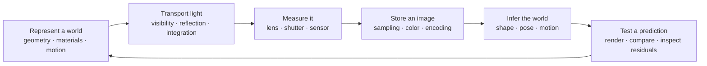

# 01 — From Worlds to Images and Inference

[[Chapter Edition/02 - Graphics Vision and XR/00 - Reading Map|Reading map]] · [[Chapter Edition/02 - Graphics Vision and XR/02 - Surfaces, Topology and Parameterization|Next chapter]]

A graphics system maps a scene description through light and a camera into measured image samples. The opening also runs the inverse direction, showing how those measurements constrain possible scenes.

**By the end:** Trace the graphics forward problem and distinguish it from vision’s inverse problem.

**Recall question:** What information must be known to predict an image, and what can an image constrain?

<!-- Derived from Continuous Notes/University - Worlds, Images and Inference - Graphics, Vision and Photography.md; source lines 1–2172; source-span SHA256 7659efcd194f6b929c4c50e53e9c9372330b5e0285cba270f7a9236c13809c02. -->

<!-- CHAPTER-SOURCE-BEGIN -->
# Worlds, Images and Inference

## The question that holds the whole story together

Put a small articulated arm, a textured panel, a glass sphere, and a piece of cloth on a table. Place a camera in front of them and a lamp to one side. There are two ways to ask about this scene.

First, suppose we know the scene (3D) . Where are its surfaces? How are its joints posed? What light leaves each surface, passes through the lens, and reaches the sensor? **Computer graphics** answers this forward question: build a description of a world, then calculate an image.

Now suppose we have the image but not the complete scene description. Can we recover the panel's tilt, the arm's position, the cloth's motion, or the lamp direction? **Machine vision** answers this inverse question: use measurements in images to constrain what could have produced them.

The physical camera sits between the two questions. Its lens, aperture, shutter, sensor, and processing pipeline determine which evidence survives. Photography therefore supplies more than useful examples. It explains the measurement device that a renderer approximates and a vision algorithm relies on.

We can write the forward relationship compactly as

$$
\mathbf I=\mathcal R(\boldsymbol\theta).
$$

Here $\boldsymbol\theta$ is a collection of scene and camera parameters, $\mathcal R$ is the image-formation procedure, and $\mathbf I$ is the resulting array of image measurements. The symbol $\mathcal R$ stands for a process; it need not be a small matrix. It may contain projection, visibility decisions, numerical integration, optical blur, sampling, and nonlinear encoding.

In a reconstruction problem, we compare a predicted image with an observed image $\mathbf I_{\mathrm{obs}}$. One possible objective is

$$
\boldsymbol\theta^{\star}
=\underset{\boldsymbol\theta}{\operatorname{argmin}}
\left[
\sum_j \rho\!\left(\mathcal R(\boldsymbol\theta)_j-I_{\mathrm{obs},j}\right)
+\lambda\,\Omega(\boldsymbol\theta)
\right].
$$

The index $j$ identifies an observed sample. The function $\rho$ turns a residual, or prediction error, into a penalty. Squaring is one choice; a robust penalty grows more gently for large errors. The function $\Omega$ expresses an additional preference, such as a smooth surface, and $\lambda\geq0$ sets its influence. **Regularization** is the act of adding such a preference to make an ambiguous or unstable problem more manageable. It introduces an assumption; it does not manufacture an extra measurement.

This equation is a map of the questions we will learn to ask. Before minimizing anything, we must understand what the parameters mean, what an image measures, and which changes the measurements can actually reveal.



**Read the arrows as contracts.** Geometry supplies positions and orientations. Light transport supplies radiance. A camera converts arriving light into measurements. Image processing changes those measurements. Inference estimates hidden quantities from what remains. Many difficult bugs come from passing the right numbers under the wrong contract: using display-encoded values as linear light, a direction as a point, a pixel displacement as a world velocity, or an interpolated normal as an area vector.

## How to use this volume without losing the thread

The chapters follow problems and prerequisites, not the order in which four instructors presented overlapping topics. We build and move a scene, decide what is visible, calculate its light, understand the camera, and recover information from images. When courses explain the same operation, their explanations meet in one place. The source legend still identifies each course.

The CMU welcome suggests a useful learning loop: answer short conceptual questions, implement missing routines in a modeling, rendering, and animation package, then inspect the results. Its four Scotty3D assignments connect the math to visible output. This volume adapts that loop through worked traces and runnable labs. 

Study a new mechanism in four passes. Identify the question it answers. Draw the quantities and state the assumptions. Work through the equations and a numerical example. Then break one assumption and predict what fails. For example, [[Stereo correspondence and epipolar geometry|stereo triangulation]] is easier to remember after seeing how a one-pixel disparity error can create a large depth error for a distant object.

Symbols are defined near where they are used. A letter may mean something different in a later chapter, so use its local definition. Vectors are usually bold. A superscript $\mathsf T$ means transpose, and $\|\mathbf v\|$ is vector length unless another norm is named. A hat often marks a unit vector (length one). A subscript labels a quantity or component; it does not mean multiplication. When differentiating a scalar equation, we state which quantities stay fixed.

Three habits make the mathematics easier to teach:

- **Name the space.** A position in object coordinates, a position in camera coordinates, and a pixel coordinate describe related things with different numbers.
- **Name the measure.** A density per unit area differs from a density per unit solid angle. An average over pixel area differs from a point sample.
- **Name the ambiguity.** A single brightness value cannot generally determine both material and shape. A single image displacement cannot generally determine full three-dimensional motion.

The vault develops related math in [[Chapter Edition/01 - Computing Foundations/17 - Python and Numerical Tools for Graphics Systems#The panel gives us a reason to learn|vectors and geometry]], [[Chapter Edition/01 - Computing Foundations/18 - Vectors for Light and Frames#Keep the promises visible while moving between representations|transforms and quaternions]], and [[Chapter Edition/01 - Computing Foundations/19 - Coordinate Frames and Linear Systems#The graphics problem hiding inside a matrix equation|linear systems and decompositions]]. Follow those links for more practice. This volume still includes the definitions and reasoning needed for its subject.

A **derivation** shows why a formula follows from its assumptions. A **trace** follows the values as an algorithm runs. A **laboratory check** tests a prediction in code or a controlled example. Each catches a different problem: a sound derivation can still be coded with the wrong coordinate convention, while one passing example can hide an unstated restriction.

> [!abstract]- Chapter map
> - [[Chapter Edition/02 - Graphics Vision and XR/01 - From Worlds to Images and Inference#A scene description becomes an image|A scene description becomes an image]]
> - [[Chapter Edition/02 - Graphics Vision and XR/01 - From Worlds to Images and Inference#Mathematical language: points, vectors, and derivatives|Mathematical language: points, vectors, and derivatives]]
> - [[Chapter Edition/02 - Graphics Vision and XR/01 - From Worlds to Images and Inference#Coordinate frames, transformations, and pose|Coordinate frames, transformations, and pose]]
> - [[Chapter Edition/02 - Graphics Vision and XR/01 - From Worlds to Images and Inference#Curves as controllable functions|Curves as controllable functions]]
> - [[Chapter Edition/02 - Graphics Vision and XR/02 - Surfaces, Topology and Parameterization#Surfaces, patches, topology, and parameterization|Surfaces, patches, topology, and parameterization]]
> - [[Chapter Edition/02 - Graphics Vision and XR/02 - Surfaces, Topology and Parameterization#Meshes, connectivity, and geometry processing|Meshes, connectivity, and geometry processing]]
> - [[Chapter Edition/02 - Graphics Vision and XR/03 - Lens Optics and Image Formation#Lens optics, focus, and image formation|Lens optics, focus, and image formation]]
> - [[Chapter Edition/02 - Graphics Vision and XR/03 - Lens Optics and Image Formation#Exposure, sensors, and dynamic range|Exposure, sensors, and dynamic range]]
> - [[Chapter Edition/02 - Graphics Vision and XR/03 - Lens Optics and Image Formation#Cameras, projection, and calibration|Cameras, projection, and calibration]]
> - [[Chapter Edition/02 - Graphics Vision and XR/03 - Lens Optics and Image Formation#Sampling continuous signals and image formation|Sampling continuous signals and image formation]]
> - [[Chapter Edition/02 - Graphics Vision and XR/04 - Sampling, Filtering and Reconstruction#Image sampling, filtering, and efficient reconstruction|Image sampling, filtering, and efficient reconstruction]]
> - [[Chapter Edition/02 - Graphics Vision and XR/04 - Sampling, Filtering and Reconstruction#Color perception, encoding, and display|Color perception, encoding, and display]]
> - [[Chapter Edition/02 - Graphics Vision and XR/04 - Sampling, Filtering and Reconstruction#Light measurement and radiometry|Light measurement and radiometry]]
> - [[Chapter Edition/02 - Graphics Vision and XR/04 - Sampling, Filtering and Reconstruction#Reflectance, BRDFs, and shading|Reflectance, BRDFs, and shading]]
> - [[Chapter Edition/02 - Graphics Vision and XR/07 - The Rendering Equation and Path Probabilities#The rendering equation and light transport|The rendering equation and light transport]]
> - [[Chapter Edition/02 - Graphics Vision and XR/12 - Probability, Statistics and Uncertainty#Numerical integration and Monte Carlo estimation|Numerical integration and Monte Carlo estimation]]
> - [[Chapter Edition/02 - Graphics Vision and XR/12 - Probability, Statistics and Uncertainty#Rasterization, coverage, and depth|Rasterization, coverage, and depth]]
> - [[Chapter Edition/02 - Graphics Vision and XR/19 - Textures as Sampled Surface Signals#Textures and surface detail|Textures and surface detail]]
> - [[Chapter Edition/02 - Graphics Vision and XR/28 - Visibility Queries and Ray Intersections#Visibility queries and ray intersections|Visibility queries and ray intersections]]
> - [[Chapter Edition/02 - Graphics Vision and XR/29 - Acceleration Structures and Robust Queries#Acceleration structures and robust queries|Acceleration structures and robust queries]]
> - [[Chapter Edition/02 - Graphics Vision and XR/29 - Acceleration Structures and Robust Queries#Scene graphs and articulated geometry|Scene graphs and articulated geometry]]
> - [[Chapter Edition/02 - Graphics Vision and XR/29 - Acceleration Structures and Robust Queries#Animation curves and motion paths|Animation curves and motion paths]]
> - [[Chapter Edition/02 - Graphics Vision and XR/29 - Acceleration Structures and Robust Queries#Dynamics, forces, and numerical integration|Dynamics, forces, and numerical integration]]
> - [[Chapter Edition/02 - Graphics Vision and XR/29 - Acceleration Structures and Robust Queries#Optimization, constraints, and inverse kinematics|Optimization, constraints, and inverse kinematics]]
> - [[Chapter Edition/02 - Graphics Vision and XR/30 - Mesh Operators, Boundaries and Diffusion#PDEs, fields, and discrete solvers|PDEs, fields, and discrete solvers]]
> - [[Chapter Edition/02 - Graphics Vision and XR/30 - Mesh Operators, Boundaries and Diffusion#Optical flow and motion from images|Optical flow and motion from images]]
> - [[Chapter Edition/02 - Graphics Vision and XR/30 - Mesh Operators, Boundaries and Diffusion#Edges, contours, and subpixel localization|Edges, contours, and subpixel localization]]
> - [[Chapter Edition/02 - Graphics Vision and XR/30 - Mesh Operators, Boundaries and Diffusion#Recognition, templates, and industrial matching|Recognition, templates, and industrial matching]]
> - [[Chapter Edition/02 - Graphics Vision and XR/32 - Pose Estimation and Robust Fitting#Pose estimation, transforms, and robust fitting|Pose estimation, transforms, and robust fitting]]
> - [[Chapter Edition/02 - Graphics Vision and XR/32 - Pose Estimation and Robust Fitting#Stereo, relative orientation, and reconstruction|Stereo, relative orientation, and reconstruction]]
> - [[Chapter Edition/02 - Graphics Vision and XR/32 - Pose Estimation and Robust Fitting#Surface orientation from illumination|Surface orientation from illumination]]
> - [[Chapter Edition/02 - Graphics Vision and XR/32 - Pose Estimation and Robust Fitting#Shape from shading and reflectance|Shape from shading and reflectance]]
> - [[Chapter Edition/02 - Graphics Vision and XR/32 - Pose Estimation and Robust Fitting#Surface descriptions and Gaussian images|Surface descriptions and Gaussian images]]
> - [[Chapter Edition/02 - Graphics Vision and XR/34 - Learned 3D Shapes and Scene Representations#Photographic composition, history, and communication|Photographic composition, history, and communication]]
> - [[Chapter Edition/02 - Graphics Vision and XR/34 - Learned 3D Shapes and Scene Representations#Photographic workflow and integrated decisions|Photographic workflow and integrated decisions]]

## A scene description becomes an image

### From a triangle to a measured image

Imagine a small workshop scene: a painted metal panel, a glass cover, a bright rectangular lamp, and a camera. We already know how to locate these objects with vectors and matrices. The next question is more demanding: what number should each image sample contain, and why? Keep that scene in mind as the rendering methods change. Rasterization and ray tracing ask about the same scene from different directions. A material model describes what happens when light meets a surface; a sampling method decides which of those interactions we can afford to calculate.


Treat graphics as a sequence of representations: a scene description must supply the right quantities to the image formation and sampling stages that follow.

### Graphics is a chain of representations

Two broad methods decide which scene elements contribute to a pixel. **Rasterization** starts with each primitive and finds the image samples it covers. Triangles work well on parallel graphics processors, so rasterization is useful for interactive rendering. **Ray tracing** starts with an image sample and asks which surfaces a ray hits. It describes visibility and light bouncing between surfaces directly, which helps formulate global illumination. Modern renderers combine the methods. Their central queries run in opposite directions: primitive to pixel, or pixel to scene. [[Chapter Edition/02 - Graphics Vision and XR/36 - Source Atlas and Reconstruction Checkpoints#CMU-01 - Course Overview|CMU-01]] · [[Chapter Edition/02 - Graphics Vision and XR/36 - Source Atlas and Reconstruction Checkpoints#CMU-04 - Drawing a Triangle and an Intro to Sampling|CMU-04]] · [[Chapter Edition/02 - Graphics Vision and XR/36 - Source Atlas and Reconstruction Checkpoints#CMU-08 - Depth and Transparency|CMU-08]] · [[Chapter Edition/02 - Graphics Vision and XR/36 - Source Atlas and Reconstruction Checkpoints#CMU-12 - Geometric Queries|CMU-12]]

An image pixel is not inherently the color of a mathematical point. It summarizes light from a small region of the image plane. A renderer approximates that summary by sampling coverage, texture, and illumination. This observation connects triangle antialiasing, texture filtering, and Monte Carlo rendering: all are attempts to estimate an integral from a finite set of measurements.


### Ray tracing becomes difficult at the boundaries: precision, footprints, variance, reuse and hybrid execution

The mathematical ray

\[
\mathbf r(t)=\mathbf o+t\mathbf d
\]

is simple. A production ray tracer becomes difficult when finite precision, secondary rays, texture filtering, stochastic sampling, denoising, temporal reuse, acceleration structures and rasterized passes interact.

Ray Tracing Gems is valuable because its chapters live at these boundaries: robust self-intersection avoidance, precision, multi-hit traversal, load balancing, nested volumes, adaptive ray-traced shadows, sampling transformations, many-light importance sampling, ray-cone/ray-differential filtering, denoising, hybrid rendering, volumetric transport, path reuse and radiance caching.

#### A secondary ray should not immediately hit the surface that spawned it

Suppose a ray intersects a surface at computed position

\[
\widehat{\mathbf p}.
\]

In exact arithmetic, a reflected ray begins on the surface and leaves it. Floating-point reconstruction can place the computed point microscopically on the wrong side. The acceleration structure may then report the same surface at a tiny positive parameter, producing acne, black speckles or recursive self-hits.

The naive fix

~~~
origin = p + epsilon * normal
~~~

is not scale invariant. A scene containing microscopic and kilometer-scale geometry cannot have one universally sensible world-space epsilon.

The robust concept is:

\[
\boxed{
\text{offset far enough to cross the numerical uncertainty interval,
not an arbitrary visual distance}
}
\]

The sign of the offset must also agree with the side of the interface into which the new ray travels. Reflection, transmission and nested-medium logic must use a consistent geometric-normal convention.

This generalizes beyond ray tracing: tolerances should be connected to scale and numerical error whenever possible rather than copied as magic constants.

#### A ray query includes an interval

A ray is not only origin and direction. Its valid parameter interval

\[
t\in[t_{\min},t_{\max}]
\]

can encode self-hit exclusion, nearest-hit search, continuation after a previous hit, a finite sensor range or a shadow segment ending at a light.

For a point light at \(\mathbf l\), a shadow ray from \(\mathbf p\) has

\[
\mathbf d=\mathbf l-\mathbf p,
\qquad
D=\|\mathbf d\|.
\]

After normalization, the useful ray ends at distance \(D\). A blocker farther away is irrelevant.

An engine ray type should therefore carry interval semantics explicitly rather than letting every caller invent a different distance test.

#### A mathematical ray has zero width; an image sample does not

Texture filtering exposes a mismatch between visibility mathematics and sampled images. A mathematical ray is one-dimensional, but a pixel represents a finite sensor region. The corresponding bundle of camera paths has a finite footprint on surfaces.

Rasterization estimates texture-coordinate derivatives from neighboring fragments. Ray tracing does not automatically receive the same local 2D neighborhood.

Two practical approximations are **ray differentials** and **ray cones**.

A ray differential tracks small changes of origin and direction with respect to image-space coordinates:

\[
\frac{\partial \mathbf o}{\partial x},
\quad
\frac{\partial \mathbf o}{\partial y},
\quad
\frac{\partial \mathbf d}{\partial x},
\quad
\frac{\partial \mathbf d}{\partial y}.
\]

After intersection, those derivatives induce a surface/texture Jacobian such as

\[
\frac{\partial(u,v)}{\partial(x,y)},
\]

which can drive mip selection and anisotropic filtering.

A ray cone stores a cheaper approximation to footprint size/spread as the ray propagates.

The tradeoff is:

~~~
ray differentials:
    directional footprint
    richer state
    more propagation work

ray cones:
    compact footprint approximation
    cheaper
    less directional information
~~~

The general sampling principle is:

\[
\boxed{
\text{filter width should reflect the sample footprint in signal space}
}
\]

Mipmapping is therefore not merely a texture-memory optimization. It is an anti-aliasing response to finite footprint.

#### Importance sampling changes variance only if the weight stays correct

For

\[
I=\int_\Omega f(x)\,dx
\]

and samples \(X_i\sim p\),

\[
\widehat I_N=
\frac1N
\sum_{i=1}^{N}
\frac{f(X_i)}{p(X_i)}.
\]

Changing \(p\) can reduce variance without changing the target, provided support and weights remain correct.

This matters for many-light rendering. A renderer may choose lights according to power, distance, a spatial hierarchy or another proxy. Whatever selection policy is used, the estimator must account for its sampling probability.

A useful invariant is:

~~~
selection policy says how a sample was chosen
weight says how that choice is corrected
~~~

If the policy changes and the probability in the weight does not, the renderer changes its estimator, often unintentionally.

#### Clamping and regularization trade bias for variance

Rare paths can produce huge contributions and visible fireflies.

Clamping

\[
\widetilde f=\min(f,C)
\]

reduces variance but changes expectation whenever values above \(C\) have nonzero probability:

\[
\mathbb E[\widetilde f]\neq\mathbb E[f].
\]

This does not make clamping forbidden. Real-time rendering frequently accepts controlled bias. It means the trade should be named correctly.

Path regularization makes a similar compromise by modifying difficult later scattering behavior to obtain a lower-variance estimator.

The general relation is

\[
\boxed{
\text{less variance may require more bias}
}
\]

and “looks cleaner” is not evidence that the estimator stayed unchanged.

#### Denoising is inference from a noisy measurement

A low-sample ray-traced component can be viewed schematically as

\[
Y=X+\varepsilon,
\]

where \(X\) is desired signal and \(\varepsilon\) is sampling noise.

A denoiser estimates \(X\) from \(Y\) plus features such as:

~~~
depth
normal
motion
material/roughness
albedo
history
sample count
variance
~~~

Spatial filtering assumes nearby compatible samples describe related signal. Temporal filtering assumes reprojected history remains valid.

Both can fail at disocclusions, thin geometry, rapid motion, changing light, specular highlights, transparency and bad motion vectors.

This is why denoising belongs inside the rendering estimator pipeline rather than being treated as an independent beautification filter.

#### Temporal reuse changes the statistics

History reuse can reduce variance dramatically, but reused samples are not fresh IID measurements.

A history sample may have been generated under a previous:

- camera pose,
- visibility state,
- material state,
- proposal distribution,
- light configuration.

Temporal accumulation therefore needs validity tests based on signals such as depth, normal, object/material identity, motion reprojection and history age.

Rejecting too aggressively discards useful information. Accepting too loosely causes ghosting and stale illumination.

The mathematics volume's warning about correlated/adaptive samples applies directly: the variance story must match the process that actually generated the accumulated data.

#### Hybrid rendering is a deliberate decomposition, not an embarrassing halfway state

A renderer may use rasterization for primary visibility, G-buffer generation, particles and efficient opaque geometry, and ray tracing for reflections, difficult shadows, indirect illumination or selected transparency/volume queries.

The real question is not “rasterized or ray traced?” but:

> Which representation/query gives the best cost-quality trade for each subproblem under the frame budget?

A frame may be:

~~~
raster primary visibility
    ↓
G-buffer
    ↓
ray-traced shadow/reflection/GI
    ↓
spatiotemporal filtering
    ↓
lighting/composition
    ↓
TAA/upscaling/presentation
~~~

This raises the value of a render graph because raster and ray passes share resources, coordinate conventions, motion vectors, material interpretation and lifetime dependencies.

#### Ray tracing performance is scheduling and memory behavior too

Rays are independently specifiable, but GPU lanes can diverge because neighboring rays traverse different BVH branches, hit different materials or terminate at different depths.

Irregular BVH and geometry access can also weaken locality.

Practical systems therefore use ideas such as:

- coherent ray generation,
- ray sorting/compaction,
- wavefront path tracing,
- work queues,
- material grouping,
- path-state compaction,
- load balancing.

A production ray tracer is not just an intersection function. It is a scheduler for irregular parallel work.

#### How the MIT lectures and Ray Tracing Gems fit together

The MIT graphics sequence supplies the conceptual chain:

\[
\text{ray casting}
\rightarrow
\text{ray tracing}
\rightarrow
\text{acceleration}
\rightarrow
\text{shading}
\rightarrow
\text{sampling}
\rightarrow
\text{Monte Carlo}
\rightarrow
\text{rasterization/shadows}
\]

Ray Tracing Gems adds the production pressure:

\[
\boxed{
\text{precision}
+
\text{footprints}
+
\text{variance}
+
\text{history}
+
\text{divergence}
+
\text{hybrid dependencies}
}
\]

Those two layers belong in one narrative: first understand what the renderer computes, then understand why a correct-looking mathematical formula can still fail in a real-time implementation.

Source basis: MIT 6.837 Computer Graphics and Ray Tracing Gems, especially its sections on intersections/efficiency, sampling, denoising/filtering, hybrid systems and global illumination.


### MIT graphics gap closure: the renderer is one continuous numerical model from shape to motion to light to pixels

The ray-tracing section above closes an important production gap, but the MIT 6.837 sequence is valuable precisely because it refuses to treat rendering as an isolated API exercise. Curves, transformations, hierarchy, color, animation, differential equations, collisions, shading, sampling, global illumination, rasterization and shadows are all different views of one problem:

\[
\boxed{
\text{represent a changing world continuously}
\rightarrow
\text{approximate it discretely}
\rightarrow
\text{produce a finite image}
}
\]

The deep connection is numerical. Geometry is sampled into vertices. Curves are sampled into segments. Motion is sampled in time. Textures are sampled in image space. Illumination is sampled in direction/path space. Rasterization samples coverage. A camera samples radiance. A display reconstructs emitted light from finite pixels.

Once this common structure is visible, many engine rules stop looking arbitrary.

#### Parametric curves are functions whose derivatives are geometric information

A parametric curve is

\[
\mathbf p(t)=
\begin{bmatrix}
x(t)\\
y(t)\\
z(t)
\end{bmatrix},
\qquad
t\in[a,b].
\]

The first derivative

\[
\mathbf p'(t)
\]

gives tangent direction and speed with respect to parameter t.

The second derivative

\[
\mathbf p''(t)
\]

describes how that tangent changes.

A cubic Bézier curve with control points \(\mathbf P_0,\mathbf P_1,\mathbf P_2,\mathbf P_3\) is

\[
\mathbf B(t)
=
(1-t)^3\mathbf P_0
+
3(1-t)^2t\mathbf P_1
+
3(1-t)t^2\mathbf P_2
+
t^3\mathbf P_3.
\]

Its endpoint properties are immediate:

\[
\mathbf B(0)=\mathbf P_0,
\qquad
\mathbf B(1)=\mathbf P_3.
\]

Its derivative is

\[
\mathbf B'(t)
=
3(1-t)^2(\mathbf P_1-\mathbf P_0)
+
6(1-t)t(\mathbf P_2-\mathbf P_1)
+
3t^2(\mathbf P_3-\mathbf P_2).
\]

Therefore

\[
\mathbf B'(0)=3(\mathbf P_1-\mathbf P_0),
\qquad
\mathbf B'(1)=3(\mathbf P_3-\mathbf P_2).
\]

This explains why the inner control points determine endpoint tangents even though the curve generally does not pass through them.

For an engine, derivatives matter because a curve is rarely only a visible line. It can drive:

- camera motion,
- animation paths,
- rails,
- roads,
- particle emitters,
- ribbon orientation,
- procedural modeling,
- motion blur,
- arc-length parameterization.

A camera following \(\mathbf B(t)\) can use a normalized tangent

\[
\mathbf T(t)=
\frac{\mathbf B'(t)}
{\|\mathbf B'(t)\|}
\]

as one orientation axis.

But parameter t does not usually correspond to constant world-space speed.

The speed is

\[
v(t)=\|\mathbf B'(t)\|.
\]

Arc length from 0 to t is

\[
s(t)=\int_0^t\|\mathbf B'(u)\|\,du.
\]

If the camera should move at constant physical speed, the engine should advance approximately uniformly in s, not uniformly in t.

This often requires a lookup table:

~~~text
sample t values
    ↓
accumulate segment lengths
    ↓
store approximate cumulative arc length
    ↓
desired distance s
    ↓
binary search/interpolate table
    ↓
recover t
~~~

The general lesson is:

\[
\boxed{
\text{parameter uniformity}
\neq
\text{spatial uniformity}
}
\]

This same distinction appears in texture parameterization and animation timing.

#### de Casteljau is both an evaluator and a geometric proof

Cubic Bézier evaluation can be written as repeated interpolation.

First level:

\[
\mathbf Q_0=(1-t)\mathbf P_0+t\mathbf P_1
\]

\[
\mathbf Q_1=(1-t)\mathbf P_1+t\mathbf P_2
\]

\[
\mathbf Q_2=(1-t)\mathbf P_2+t\mathbf P_3.
\]

Second level:

\[
\mathbf R_0=(1-t)\mathbf Q_0+t\mathbf Q_1
\]

\[
\mathbf R_1=(1-t)\mathbf Q_1+t\mathbf Q_2.
\]

Final:

\[
\mathbf B(t)=(1-t)\mathbf R_0+t\mathbf R_1.
\]

This construction proves the convex-hull property because every stage is an interpolation of points already inside the previous convex hull.

It also gives subdivision naturally. Evaluating at a split parameter produces control points for two smaller Bézier curves.

That is useful for adaptive tessellation:

~~~text
curve segment
    ↓
estimate flatness/error
    ↓
if acceptable:
    emit line/patch
else:
    subdivide with de Casteljau
    recurse
~~~

The important engine pattern is adaptive work based on error, not fixed work based on habit.

#### Continuity between curve segments has levels

Two curve pieces can meet with different continuity guarantees.

\(C^0\) continuity means positions agree:

\[
\mathbf B_1(1)=\mathbf B_2(0).
\]

\(C^1\) continuity means first derivatives also agree:

\[
\mathbf B_1'(1)=\mathbf B_2'(0).
\]

Geometric \(G^1\) continuity only requires tangent directions to agree up to positive scaling:

\[
\mathbf B_2'(0)=\lambda\mathbf B_1'(1),
\qquad
\lambda>0.
\]

This distinction matters visually.

A road or camera path can look directionally smooth under \(G^1\) while speed changes because derivative magnitudes differ.

Animation, camera rails, and physically meaningful trajectories often care about more than geometric appearance.

#### Hierarchical modeling is repeated change of basis

A scene graph is often introduced as a parent-child tree. The deeper model is composition of coordinate transforms.

Let

\[
M_{world}^{child}
=
M_{world}^{parent}
M_{parent}^{child}.
\]

For a chain

~~~text
world
  ↓
vehicle
  ↓
wheel
  ↓
brake-caliper
~~~

the final transform is

\[
M_{world}^{caliper}
=
M_{world}^{vehicle}
M_{vehicle}^{wheel}
M_{wheel}^{caliper}.
\]

The multiplication order encodes the change-of-basis sequence.

This is why transform order is not cosmetic.

If the convention uses column vectors,

\[
\mathbf p_{world}
=
M_{world}^{object}
\mathbf p_{object}.
\]

Then composing translation and rotation in the wrong order changes the pivot/orbit behavior.

A useful debugging technique is to draw basis vectors at each node:

~~~text
X axis = red line
Y axis = green line
Z axis = blue line
origin = point
~~~

A wrong transform then becomes visible as a wrong basis, not merely as a mysteriously misplaced mesh.

#### A scene graph and a transform-update graph are related but not identical

Logical hierarchy describes ownership or semantic relationship.

Transform dependency describes mathematical dependency.

A production engine may flatten transform data for update efficiency while retaining a logical entity hierarchy for editor purposes.

For example:

~~~text
Editor hierarchy:
Car
 ├─ Body
 ├─ FrontLeftWheel
 └─ FrontRightWheel

Runtime transform arrays:
parentIndex[]
localMatrix[]
worldMatrix[]
dirtyBits[]
~~~

The hot update can traverse arrays in topological order.

The editor can still present the tree.

Again:

\[
\boxed{
\text{logical abstraction}
\neq
\text{physical data layout}
}
\]

This connects MIT hierarchical modeling directly to the data-oriented C++ discussion.

#### Skinning is weighted coordinate transformation

Linear blend skinning transforms a rest-pose vertex by several joint transforms.

For vertex position \(\mathbf p\),

\[
\mathbf p'
=
\sum_{j=1}^{k}
w_j
M_j
\mathbf p,
\]

with

\[
\sum_j w_j=1.
\]

In practice each joint matrix often combines current pose with inverse bind pose:

\[
M_j
=
M_{world,j}^{current}
\left(M_{world,j}^{bind}\right)^{-1}.
\]

The inverse bind transform maps the vertex from mesh bind space into the joint's bind-local frame, after which the current joint transform carries it into the current posed frame.

The weighted sum is simple and GPU-friendly, but it has well-known artifacts such as collapsing volume around twisting joints.

That artifact is not a bug in matrix multiplication. It comes from linearly blending transformed positions produced by different rigid transformations.

Dual-quaternion skinning and other methods attempt to preserve rotational behavior better.

The engine lesson is to know what approximation the skinning representation makes.

#### Normals cannot always use the same matrix as positions

A transformed tangent \(\mathbf t\) and normal \(\mathbf n\) should remain perpendicular:

\[
\mathbf n^\top\mathbf t=0.
\]

Under a linear transform A,

\[
\mathbf t'=A\mathbf t.
\]

We want a transformed normal \(\mathbf n'\) such that

\[
{\mathbf n'}^\top A\mathbf t=0.
\]

Choosing

\[
\mathbf n'=(A^{-1})^\top\mathbf n
\]

gives

\[
{\mathbf n'}^\top A\mathbf t
=
\mathbf n^\top A^{-1}A\mathbf t
=
\mathbf n^\top\mathbf t
=
0.
\]

Therefore the normal matrix is inverse-transpose of the relevant linear transform when nonuniform scale/shear is present.

This derivation is better than memorizing the phrase inverse-transpose because it explains the invariant being preserved.

#### Color values are not all in the same mathematical space

An RGB triplet can represent several different things:

~~~text
linear scene radiance-like value
encoded display value
texture data
albedo parameter
normal-map vector encoding
HDR intermediate
post-tonemapped image
~~~

Arithmetic such as interpolation and lighting belongs in a linear-light domain.

If values are gamma encoded, naive averaging is wrong.

For two encoded colors \(c_1,c_2\), generally

\[
decode\left(
\frac{c_1+c_2}{2}
\right)
\neq
\frac{decode(c_1)+decode(c_2)}{2}.
\]

This is why texture formats and framebuffer transfer functions matter.

Color management is not a final export concern; it is part of numerical correctness throughout the pipeline.

#### The rendering equation and BRDF are only meaningful under consistent units and spaces

The rendering equation is

\[
L_o(\mathbf x,\omega_o)
=
L_e(\mathbf x,\omega_o)
+
\int_{\Omega}
f_r(\mathbf x,\omega_i,\omega_o)
L_i(\mathbf x,\omega_i)
(\mathbf n\cdot\omega_i)^+
d\omega_i.
\]

Each factor has a role:

- \(L_o\): outgoing radiance,
- \(L_e\): emitted radiance,
- \(f_r\): BRDF,
- \(L_i\): incident radiance,
- cosine term: projected-area factor,
- solid-angle differential: directional integration measure.

A renderer that mixes encoded color values, inconsistent normals, and arbitrary light units can still produce attractive images, but the equation no longer describes what the code is computing.

The point of physically based rendering is not realism by naming. It is maintaining enough consistent semantics that parameters behave predictably.

#### Animation turns the world into an ODE problem

Many animation systems can be expressed as ordinary differential equations.

For particle position x and velocity v:

\[
\dot{\mathbf x}=\mathbf v,
\]

\[
m\dot{\mathbf v}=\mathbf F(\mathbf x,\mathbf v,t).
\]

Equivalently,

\[
\dot{\mathbf v}
=
\frac{\mathbf F}{m}.
\]

The continuous equations do not directly tell the computer how to advance one frame.

A numerical integrator approximates that evolution.

##### Explicit Euler

\[
\mathbf x_{n+1}
=
\mathbf x_n+h\mathbf v_n,
\]

\[
\mathbf v_{n+1}
=
\mathbf v_n+h\mathbf a_n.
\]

It is simple and first-order accurate, but it can inject energy into oscillatory systems.

##### Semi-implicit Euler

Update velocity first:

\[
\mathbf v_{n+1}
=
\mathbf v_n+h\mathbf a_n,
\]

then position using the new velocity:

\[
\mathbf x_{n+1}
=
\mathbf x_n+h\mathbf v_{n+1}.
\]

For many game-physics systems, this small change has much better qualitative energy behavior than explicit Euler while remaining cheap.

This is why two methods with nearly identical code can behave very differently.

##### Backward Euler

Backward Euler evaluates the derivative at the future state:

\[
\mathbf x_{n+1}
=
\mathbf x_n
+
h f(\mathbf x_{n+1},t_{n+1}).
\]

Because the unknown future state appears on both sides, the step is implicit and often requires solving a system.

Its advantage is strong stability for stiff systems.

The trade is numerical damping and solve cost.

##### Verlet-style position integration

A simple position Verlet form is

\[
\mathbf x_{n+1}
=
2\mathbf x_n
-
\mathbf x_{n-1}
+
h^2\mathbf a_n.
\]

It stores previous position rather than explicit velocity.

Constraint-based cloth and particle systems often like Verlet-style formulations because positional constraints can be applied directly.

The deeper point is:

\[
\boxed{
\text{integration scheme is part of the simulated model}
}
\]

Changing integrator can change observed energy, damping, stability, and phase behavior even when the force equations remain identical.

#### Time step is a numerical parameter, not merely frame duration

If the render frame takes \(\Delta t\), it does not follow that the physics integrator should always advance by exactly that variable step.

Large variable steps can destabilize simulation.

A fixed-step accumulator uses:

~~~text
accumulator += realFrameDelta

while accumulator >= h:
    simulate(h)
    accumulator -= h

render interpolated state
~~~

This separates simulation step size h from render cadence.

The simulation then has more predictable numerical behavior and deterministic-replay potential.

The remaining interpolation fraction is

\[
\alpha=
\frac{accumulator}{h}.
\]

Visual state can be interpolated between the previous and current simulation states.

#### A mass-spring system exposes stiffness

For a spring between positions \(\mathbf x_i\) and \(\mathbf x_j\),

\[
\mathbf d=\mathbf x_j-\mathbf x_i,
\qquad
\ell=\|\mathbf d\|.
\]

Hooke's law force magnitude is

\[
F=-k(\ell-\ell_0).
\]

A vector force can be

\[
\mathbf F_i
=
k(\ell-\ell_0)
\frac{\mathbf d}{\ell},
\]

with opposite force on j.

As stiffness k increases, explicit integration often requires smaller h for stability.

This is the practical meaning of a stiff system: some modes evolve on a much faster time scale than the overall motion.

Integrator choice and time step therefore cannot be chosen independently from physical parameters.

#### Collision detection and collision response are different problems

Detection asks whether objects overlap or will contact.

Response asks what change in velocity/position should follow.

For a simple frictionless impulse between two bodies with contact normal \(\mathbf n\), relative contact velocity is

\[
\mathbf v_r
=
\mathbf v_B-\mathbf v_A.
\]

Its normal component is

\[
v_n=\mathbf v_r\cdot\mathbf n.
\]

If \(v_n\ge0\), the bodies are already separating along the normal and a new closing impulse is usually unnecessary.

For point masses with inverse masses \(m_A^{-1}\) and \(m_B^{-1}\), coefficient of restitution e, the scalar impulse magnitude is

\[
j
=
-\frac{(1+e)v_n}
{m_A^{-1}+m_B^{-1}}.
\]

Then

\[
\mathbf v_A'
=
\mathbf v_A
-
j m_A^{-1}\mathbf n,
\]

\[
\mathbf v_B'
=
\mathbf v_B
+
j m_B^{-1}\mathbf n.
\]

Rigid bodies add rotational terms because an impulse away from the center of mass changes angular velocity.

The full denominator contains effective mass contributions from inertia tensors and contact-arm cross products.

The conceptual lesson is:

\[
\boxed{
\text{contact response acts on relative velocity through effective mass}
}
\]

not simply by reversing one object's velocity.

#### Restitution is not a generic bounce multiplier

Restitution relates pre- and post-collision normal relative velocity in an idealized contact:

\[
v_n'
=
-e v_n.
\]

Using high restitution for tiny resting contacts can create jitter because numerical noise becomes repeated bounce energy.

Production solvers often suppress restitution below a velocity threshold.

This is an example of a physically motivated model requiring numerical policy.

#### Friction is constrained tangential impulse

After solving the normal impulse, compute tangential relative velocity:

\[
\mathbf v_t
=
\mathbf v_r
-
(\mathbf v_r\cdot\mathbf n)\mathbf n.
\]

If nonzero, tangent direction is

\[
\mathbf t=
\frac{\mathbf v_t}{\|\mathbf v_t\|}.
\]

A candidate tangential impulse can be derived through tangential effective mass, then clamped according to Coulomb friction:

\[
|j_t|
\le
\mu j_n.
\]

The normal impulse creates the bound on friction impulse.

This explains why friction cannot be modeled correctly as an arbitrary global velocity damping term.

#### Position correction and velocity correction solve different errors

A velocity impulse can stop future penetration but does not necessarily remove overlap already present because of discrete stepping.

Engines often need positional correction, split impulses, Baumgarte-style stabilization, or position-level constraint solves.

But aggressive correction injects energy or causes jitter.

The solver therefore balances:

~~~text
remove overlap fast enough to avoid visible sinking
versus
avoid adding excessive artificial energy
~~~

This is why contact resolution is iterative numerical optimization, not a one-line bounce formula.

#### Sampling unifies rasterization and ray tracing

A pixel value conceptually averages a continuous image signal over a footprint.

For pixel region A,

\[
I_A
=
\frac{1}{|A|}
\int_A I(x,y)\,dx\,dy.
\]

One sample at the pixel center estimates that integral poorly when signal frequencies exceed the sampling rate.

Aliasing appears because high-frequency variation is reconstructed as lower-frequency structure.

Supersampling, MSAA, texture filtering, mipmapping, TAA, stochastic path samples, and ray differentials are all responses to the same basic problem: finite samples approximate a continuous integral.

This is the central MIT sampling connection.

#### Mipmapping is prefiltered integration over scale

A mip chain stores progressively low-pass-filtered versions of a texture.

If a projected pixel footprint covers many texels, reading only the finest level samples a high-frequency signal too sparsely.

Choosing a coarser mip level approximates integrating the texture over a larger footprint.

Trilinear filtering interpolates between mip levels to reduce transitions between discrete scales.

Anisotropic filtering goes further because the projected footprint is often elongated, not square.

The correct abstraction is:

\[
\boxed{
\text{texture lookup should approximate footprint integration}
}
\]

not merely nearest color retrieval.

#### Rasterization is an analytic visibility shortcut plus sampling

For a triangle projected to screen, rasterization determines which pixels/samples lie inside the projected primitive and interpolates attributes across it.

Barycentric coordinates express a point as

\[
\mathbf p
=
\lambda_0\mathbf p_0
+
\lambda_1\mathbf p_1
+
\lambda_2\mathbf p_2,
\]

with

\[
\lambda_0+\lambda_1+\lambda_2=1.
\]

Attributes can be interpolated from those weights.

But perspective changes the correct interpolation rule.

For an attribute a stored at clip-space vertices with w values, perspective-correct interpolation uses quantities related to

\[
\frac{a_i}{w_i}
\quad\text{and}\quad
\frac{1}{w_i}
\]

then divides after interpolation:

\[
a
=
\frac{
\sum_i \lambda_i \frac{a_i}{w_i}
}{
\sum_i \lambda_i \frac{1}{w_i}
}.
\]

This is why naive screen-space linear interpolation makes textures visibly warp.

#### Depth is also a convention-sensitive quantity

Depth buffering depends on projection convention and representation.

Precision is not uniformly distributed in world-space distance.

Perspective projection makes near geometry consume more representational precision.

Reverse-Z techniques exploit floating-point distribution and projection mapping to improve useful depth precision.

The durable lesson is that a depth value is not just distance. It is the result of a projection mapping plus a depth-range convention.

#### Shadow mapping is another sampling problem

A shadow map samples visibility from the light's viewpoint.

The scene is projected into a finite depth texture.

A camera-visible point is transformed into light space and compared against stored light-space depth.

Artifacts follow from finite sampling and numerical mismatch:

- shadow acne,
- peter-panning,
- aliasing,
- perspective undersampling,
- cascade transitions,
- temporal instability.

Bias trades self-shadow error against detached-shadow error.

PCF averages multiple binary comparisons to approximate filtered visibility.

Cascaded shadow maps allocate more light-space resolution near the camera where screen-space error is more noticeable.

Again:

\[
\boxed{
\text{shadow quality}
=
\text{visibility approximation}
+
\text{sampling allocation}
+
\text{numerical robustness}
}
\]

#### Image-based lighting turns the environment into an integral

An environment map provides incident radiance over direction.

Diffuse irradiance at normal n is

\[
E(\mathbf n)
=
\int_{\Omega^+}
L_i(\omega)
(\mathbf n\cdot\omega)
\,d\omega.
\]

Rather than evaluate this expensive integral per shading point from raw environment samples, renderers precompute approximations such as irradiance maps or spherical-harmonic coefficients.

Specular IBL is roughness dependent because a rough microfacet BRDF integrates a broader range of directions than a smooth mirror-like surface.

Prefiltered environment maps approximate this directional convolution at different roughness levels.

This is the same strategy used throughout graphics:

~~~text
expensive continuous integral
    ↓
precompute/filter
    ↓
small runtime lookup
~~~

#### Output devices complete the numerical pipeline

The renderer eventually produces values that a physical display converts into emitted light.

That conversion includes:

- transfer functions,
- peak luminance,
- black level,
- color primaries,
- white point,
- bit depth,
- local/global tone behavior,
- HDR metadata in relevant systems.

A physically meaningful HDR internal value cannot simply be copied into an 8-bit display buffer.

Tone mapping performs a mapping from scene-referred radiometric range into display-referred range.

The creative and technical choices are intertwined because the mapping controls highlight compression, contrast, colorfulness, and adaptation.

The rendering pipeline is therefore not finished at lighting.

It is finished only when the display-facing signal is produced under a known color/transfer convention.

#### The MIT sequence is a dependency graph, not a list of disconnected lectures

The most useful reading of the course is:

\[
\boxed{
\begin{array}{c}
\text{curves/surfaces}\\
\downarrow\\
\text{transforms/hierarchy}\\
\downarrow\\
\text{animation + ODE integration}\\
\downarrow\\
\text{collision constraints}\\
\downarrow\\
\text{camera/visibility}\\
\downarrow\\
\text{shading + texture}\\
\downarrow\\
\text{sampling}\\
\downarrow\\
\text{global illumination}\\
\downarrow\\
\text{raster/ray execution}\\
\downarrow\\
\text{display}
\end{array}
}
\]

A game engine repeatedly traverses this dependency graph every frame.

That is why the best curriculum narrative introduces mathematics where it becomes operational: derivatives when curves need tangents, inverse-transpose when normals must remain perpendicular, differential equations when motion must advance, impulses when contact changes momentum, probability when illumination is sampled, and signal processing when pixels and textures alias.

Source integration basis: MIT 6.837 Computer Graphics lecture sequence covering curves/surfaces, transformations, hierarchical modeling, color, animation/skinning, particle systems and ODE solvers, mass-spring systems, collisions, ray casting/tracing and acceleration, shading, texture mapping, sampling/mipmaps, Monte Carlo/global illumination, image-based rendering/lighting, rasterization, real-time shadows, and output devices.


### Algorithmic scope and debugging the image pipeline

The first lecture treats graphics as the math and algorithms behind images, not as a tour of drawing software. Its examples introduce a shared toolkit: functions describe shape, transforms set pose, time-stepping rules evolve state, and sampling converts continuous pictures into pixels. Rasterization and ray-based rendering handle visibility in opposite directions, from primitive to pixel and from pixel to scene. A renderer can combine both. [[Chapter Edition/02 - Graphics Vision and XR/36 - Source Atlas and Reconstruction Checkpoints#MITG-01 - Introduction|MITG-01]] · [[Chapter Edition/02 - Graphics Vision and XR/36 - Source Atlas and Reconstruction Checkpoints#MITG-09 - Ray casting|MITG-09]] · [[Chapter Edition/02 - Graphics Vision and XR/36 - Source Atlas and Reconstruction Checkpoints#MITG-17 - Rasterization|MITG-17]] (00:19:00–00:45:00; 00:10:00–00:25:00; 00:10:00–00:30:00)

When an image looks wrong, find the first representation that went wrong. Is the shape incorrect? Did transforms compose in the wrong order? Did the simulation become unstable or the ray hit the wrong surface? Was the lighting approximation poor? Did a high-frequency signal alias, or did the system read linear intensity as a display code? These questions make debugging more useful than treating the final pixel as a mystery.

### The first lecture's scope: algorithms behind pictures

The recording opens with course setup, then maps out what “graphics” includes. Solomon contrasts a film frame that may take hours to simulate and render with an interactive game that must meet a budget of roughly 30 frames per second. This is an algorithmic constraint. A film renderer can spend more time on simulation, sampling, or lighting because it computes frames in advance. An interactive renderer must choose approximations before each frame's deadline. It may improve motion, lighting, or resolution, but usually cannot maximize all three at once. [[Chapter Edition/02 - Graphics Vision and XR/36 - Source Atlas and Reconstruction Checkpoints#MITG-01 - Introduction|MITG-01]] (00:17:29–00:18:23)

The examples extend beyond entertainment. A computer-aided manufacturing model describes a shape before it is built. Ray calculations can answer architectural questions about light and heat. Medical scans become 3D data that people can rotate or slice. Augmented reality combines a camera view with a virtual object, linking rendering to scene understanding. Scientific visualization presents fluid or structural simulations for engineering analysis. These applications share a task: represent, transform, analyze, and present visual information. [[Chapter Edition/02 - Graphics Vision and XR/36 - Source Atlas and Reconstruction Checkpoints#MITG-01 - Introduction|MITG-01]] (00:18:41–00:21:12; 00:22:22–00:25:32)

The course focuses on algorithms, representations, and the software and hardware that turn a scene into pixels. It does not teach drawing technique or tour design applications. “Graphics pipeline” is a teaching map: describe shapes, set their pose and motion, specify materials and light, then render. Real systems do not all follow one fixed sequence. The lecturer notes that a renderer can combine ray tracing and rasterization, giving each method different work. [[Chapter Edition/02 - Graphics Vision and XR/36 - Source Atlas and Reconstruction Checkpoints#MITG-01 - Introduction|MITG-01]] (00:25:35–00:29:32; 00:33:06–00:37:02)

The tractor composite in the first lecture raises a useful question: what information is needed to make its image? At minimum, describe the vehicle, character, and background; specify a camera view and surface appearance; and decide which scene elements contribute to each pixel. Artists may describe a shape as a curve, patch, or rig. The computer may use triangles and samples instead. **Tessellation** bridges these forms by approximating a high-level curve or surface with simpler primitives. Later steps also convert between forms: material settings become light-response calculations, 3D objects become image samples, and encoded pixel values become light from a display. The recurring challenge is to make each conversion useful, efficient, and visually adequate. [[Chapter Edition/02 - Graphics Vision and XR/36 - Source Atlas and Reconstruction Checkpoints#MITG-01 - Introduction|MITG-01]] (00:33:20–00:36:55)

### Learning path and conventions

Coordinates use a pinhole camera with image plane at focal length $f$. Capital letters such as $X,Y,Z$ denote a 3-D point in camera coordinates; lowercase $x,y$ denote its image coordinates. A dot denotes differentiation with respect to time. Surface height is $z(x,y)$ and its slopes are $p=\partial z/\partial x$ and $q=\partial z/\partial y$. Image brightness is $E(x,y,t)$. Vectors are bold only where ambiguity requires it; a hat denotes a unit vector. A matrix transpose is written $^T$. In every derivation, units and coordinate conventions matter: the notes sometimes choose the image plane at $f$ and sometimes discuss normalized image coordinates, so a scale factor $f$ must not be silently dropped.

### What an image can and cannot tell us

A useful way to reason about any inverse problem is to write $\mathbf{y}=F(\mathbf{x})$, where $\mathbf{x}$ is the unknown parameter vector and $\mathbf{y}$ is what the sensor measures. Near a candidate solution $\mathbf{x}_0$, a small error propagates approximately as $\delta\mathbf{y}=J\delta\mathbf{x}$, where $J$ is the Jacobian of $F$. If some direction in parameter space changes the measurements very little, recovering that direction amplifies noise. If $J$ is rank deficient, some combinations cannot be recovered at all. A solvable equation is therefore not necessarily a stable measurement procedure.

### Lecture 1’s demonstrations: vision is judged by the task it enables

The opening lecture supplies the through-line that the notes’ later derivations formalize. Horn begins with the perceptual puzzle that a flat printed face still suggests three-dimensional shape. A uniform material can look darker where its surface turns away from a nearby light and brighter where it faces the light. In the nose example, that shading conveys slope, yet there are two slope variables and only one brightness observation. A sequence of algorithm iterations on an oblate ellipsoid makes the global issue visible: intermediate reconstructions develop ridges and isolated conical points before moving toward the intended shape. The point is not that one image uniquely determines a surface; it is that the reconstruction process must expose what assumptions and additional constraints make its answer plausible. [[Chapter Edition/02 - Graphics Vision and XR/36 - Source Atlas and Reconstruction Checkpoints#MITV-01 - Introduction to Machine Vision|MITV-01]] (video 00:22:32–00:25:10)

The course overview then closes the loop between image evidence and action. A machine-vision system receives a scene under illumination, forms an image, estimates a description, and may use that description to act in the world. A robot grasp is a particularly clear acceptance check: if the estimated object identity and pose cause the gripper to approach correctly, that is stronger feedback than an unverified label. In one demonstrated work cell, one camera supplies object identity and orientation while an interrupted beam gives the missing depth cue; the robot then backs off, reorients, and grasps. A surveyor-style crosshair carried by the robot provides a sharply localizable point for estimating the transformation between the camera’s coordinates and the robot base. This connects the introductory application to later exterior orientation and calibration. [[Chapter Edition/02 - Graphics Vision and XR/36 - Source Atlas and Reconstruction Checkpoints#MITV-01 - Introduction to Machine Vision|MITV-01]] (video 00:25:11–00:26:40, 00:44:56–00:46:14)

The truck-approach demonstrations make the time-to-contact idea concrete. As the vehicle approaches, the image expands; a plotted computed time-to-contact tracks the known value. The vehicle approaches the truck door rather than the center, so its focus of expansion is off-center and reveals oblique travel. In a second time-lapse, manually moving the camera in nominal 10 mm increments introduces more measurement noise. These examples highlight both a useful invariance—ratio-based TTC does not require focal length in this setup—and practical sensitivity to camera motion and measurement accuracy. Horn also shows an analog chip calculating FOE nearly instantaneously and recounts cooling an overheating prototype with an ice-filled cooler and aquarium pump. This makes clear that computational constraints and physical implementation shape the algorithm, not just abstract mathematics. [[Chapter Edition/02 - Graphics Vision and XR/36 - Source Atlas and Reconstruction Checkpoints#MITV-01 - Introduction to Machine Vision|MITV-01]] (video 00:26:42–00:32:46)

A camera obscura in Santa Monica serves as an intuitive pinhole-camera model: light passes through a small opening into a dark room and projects an inverted scene on the opposite wall. The brightness discussion warns against treating pixel values as direct reflectance. The Moon looks bright without a nearby white reference even though the lecture says it reflects about 11 percent of incoming sunlight; apparent brightness depends on context. Similarly, inverse-square falloff for a point source does not mean that a uniformly lit extended wall looks one-quarter as bright from twice the distance: each pixel then represents a larger wall area, offsetting the per-source falloff. Foreshortening changes illumination per unit surface area by the cosine of the incident angle, but reflectance can be more complex.

 For an ideal thin lens with focal length $f$, pupil diameter $D$, and scene radiance $L$ at field angle $\alpha$, sensor-plane irradiance is:
 
  $$E_{\mathrm{img}}=(\pi/4)L(D/f)^2\cos^4\alpha$$ 
  
  under fixed-pupil geometric-optics assumptions. The fourth power combines projection and distance factors; this is image-plane irradiance, not the irradiance on the surface. The normal’s two degrees of freedom versus one brightness measurement motivates photometric stereo and the course’s recurring constraint-counting argument. [[Chapter Edition/02 - Graphics Vision and XR/36 - Source Atlas and Reconstruction Checkpoints#MITV-01 - Introduction to Machine Vision|MITV-01]] (video 00:51:15–00:52:27, 01:05:34–01:13:48)

### A photograph is a model of a view

The course opens by distinguishing viewpoint from focal length. Perspective comes from where the camera is located. For a pinhole model, a 3D point $(X,Y,Z)$ projects to image coordinates proportional to

$$
x=f\frac{X}{Z},\qquad y=f\frac{Y}{Z},
$$

## From sampled images to the mathematics that makes them controllable

A displayed image must reach a viewer at the right time and scale. To reason about that process, first give points, directions, changes and camera measurements precise meanings. We can then build the renderer and explain how its output meets a person's eyes and motion. The complete perceptual and XR foundation follows that rendering route; its original examples and derivations remain intact.

## Mathematical language: points, vectors, and derivatives

Build a precise mathematical vocabulary before composing transformations or interpreting numerical results.

### Points, vectors, bases, and linear maps

A **point** names a location. A **vector** describes displacement, direction, or a magnitude-bearing quantity. Subtracting point $p$ from point $q$ gives a displacement $q-p$. Adding vector $v$ to point $p$ gives another point $p+v$. Vectors can be added and scaled freely; scaling a point depends on the coordinate origin. This distinction becomes crucial when a transform should move locations but preserve directions. [[Chapter Edition/02 - Graphics Vision and XR/36 - Source Atlas and Reconstruction Checkpoints#CMU-02 - Linear Algebra (P)Review|CMU-02]]

A **vector space** is a collection of vectors where addition and scalar multiplication stay within the collection. A **basis** is a set of independent vectors that can express every vector in the space. If the basis vectors are $b_1,\ldots,b_n$, then a vector $v$ can be written as $v=\sum_i c_i b_i$. The coefficients $c_i$ give its coordinates. Change the basis and the coordinates change, even though the geometric vector stays the same. [[Chapter Edition/02 - Graphics Vision and XR/36 - Source Atlas and Reconstruction Checkpoints#CMU-02 - Linear Algebra (P)Review|CMU-02]]

A linear map $A$ preserves addition and scalar multiplication. Its matrix columns are the images of the basis vectors. Therefore, if $v=\sum_i c_i b_i$, then

$$
Av=A\left(\sum_i c_i b_i\right)=\sum_i c_iA(b_i).
$$

This gives a practical way to read matrix-vector multiplication: transform each basis direction, then combine those results using the original coefficients. The matrix columns show those transformed directions. Matrix products compose maps; with column vectors, the rightmost map acts first. A map is **invertible** if it can be undone. If its columns are linearly dependent, distinct inputs can collapse to the same output. [[Chapter Edition/02 - Graphics Vision and XR/36 - Source Atlas and Reconstruction Checkpoints#CMU-02 - Linear Algebra (P)Review|CMU-02]]

The determinant of a square matrix measures signed area or volume scaling. Its absolute value gives the scale; a negative sign means orientation reverses. A zero determinant means at least one dimension collapses, so the map has no inverse. An **eigenvector** is a direction that a map scales without turning: $Av=\lambda v$, where $\lambda$ is the scale. Singular-value decomposition gives a more general description:

$$
A=U\Sigma V^T.
$$

The orthogonal matrix $V^T$ rotates or reflects inputs into principal directions. The diagonal matrix $\Sigma$ scales those directions, and orthogonal $U$ maps them into output coordinates. The diagonal values are the **singular values**. This factorization describes stretching and rank loss, and supports least-squares solutions and data transformations. [[Chapter Edition/02 - Graphics Vision and XR/36 - Source Atlas and Reconstruction Checkpoints#CMU-02 - Linear Algebra (P)Review|CMU-02]] · [[Chapter Edition/02 - Graphics Vision and XR/36 - Source Atlas and Reconstruction Checkpoints#CMU-05 - Spatial Transformations|CMU-05]]

Principal directions are two perpendicular directions of maximum and minimum bending.

Normal matrix is : $AA^T = A^T A$
Thus, Orthogonal, Symmetric, Skew-Symmetric are children of it.
### Inner products and vector calculus

The Euclidean norm gives vector length: $\|v\|=\sqrt{v\cdot v}$. The dot product $u\cdot v=\sum_i u_iv_i$ measures alignment. For unit vectors it equals the cosine of their angle. In 3D, the cross product $u\times v$ is perpendicular to both inputs. Its length equals the area of their parallelogram, and its direction follows the right-hand rule. These operations support angle tests, projections, surface normals, and lighting. [[Chapter Edition/02 - Graphics Vision and XR/36 - Source Atlas and Reconstruction Checkpoints#CMU-03 - Vector Calculus (P)Review|CMU-03]]

A derivative gives a local linear approximation. If $f$ maps vectors to vectors, its derivative at $x$ is the **Jacobian matrix** $J_f(x)$. For a small input change,

$$
f(x+\Delta x)\approx f(x)+J_f(x)\Delta x.
$$

For a scalar field $f$, the **gradient** $\nabla f$ collects its partial derivatives. It points in the direction of steepest increase. The change along a unit direction $u$ is $\nabla f\cdot u$. For example, if $f(x,y)=x^2+3y^2$, then its gradient is $(2x,6y)$. At $(1,1)$ the gradient is $(2,6)$. A perpendicular move has zero first-order change. Gradients drive methods such as gradient descent and help find normals to level sets. [[Chapter Edition/02 - Graphics Vision and XR/36 - Source Atlas and Reconstruction Checkpoints#CMU-03 - Vector Calculus (P)Review|CMU-03]] · [[Chapter Edition/02 - Graphics Vision and XR/36 - Source Atlas and Reconstruction Checkpoints#CMU-22 - Optimization|CMU-22]]

A **vector field** assigns a vector to each point. Its divergence $\nabla\cdot v$ measures net local outflow. For $v(x,y,z)=(x,y,z)$, divergence is 3: the field expands uniformly. **Curl** measures local circulation. For $v(x,y,z)=(-y,x,0)$, it points along the $z$ axis. The **Laplacian** $\Delta f=\nabla\cdot\nabla f$ compares a function's value with nearby values. A bowl such as $x^2+y^2$ has positive Laplacian; a local peak usually has a negative one. A saddle may have zero Laplacian even though it curves in opposite directions. The Hessian, the matrix of second derivatives, retains more information than the Laplacian's sum. These operators appear in smoothing, curvature, fluid flow, diffusion, and physical animation. [[Chapter Edition/02 - Graphics Vision and XR/36 - Source Atlas and Reconstruction Checkpoints#CMU-03 - Vector Calculus (P)Review|CMU-03]] · [[Chapter Edition/02 - Graphics Vision and XR/36 - Source Atlas and Reconstruction Checkpoints#CMU-11 - Digital Geometry Processing|CMU-11]] · [[Chapter Edition/02 - Graphics Vision and XR/36 - Source Atlas and Reconstruction Checkpoints#CMU-23 - Physically Based Animation and PDEs|CMU-23]]

### Coordinate-free products and the meaning of second derivatives

A gradient depends on the inner product used to measure directions. With the ordinary dot product, $\nabla f$ is defined so that the directional derivative along $u$ is $Df[u]=\nabla f\cdot u$. The same idea works for functions: replace finite vectors with functions and the dot product with an integral. With the $L^2$ inner product $\langle f,g\rangle=\int f(x)g(x)\,dx$, the gradient of $\langle f,g\rangle$ with respect to $f$ is $g$. A small change $h$ to $f$ changes the objective by $\langle h,g\rangle$. Likewise, the gradient of $\|f\|^2=\langle f,f\rangle$ is $2f$, since its first-order change is $2\langle f,h\rangle$. This matches $\nabla_x(x^Tx)=2x$. Function-space gradients let optimization act on images, curves, and fields, not only on lists of numbers. [[Chapter Edition/02 - Graphics Vision and XR/36 - Source Atlas and Reconstruction Checkpoints#CMU-03 - Vector Calculus (P)Review|CMU-03]] · [[Chapter Edition/02 - Graphics Vision and XR/36 - Source Atlas and Reconstruction Checkpoints#CMU-22 - Optimization|CMU-22]]

In two dimensions, scalar curl is closely related to the divergence of a field rotated by 90 degrees. Fluid solvers use this relation to switch between velocity and stream-function descriptions and to measure vorticity. For a scalar field $f$, the Laplacian $\Delta f=\nabla\cdot\nabla f$ is the divergence of its gradient. In Cartesian coordinates, it is the sum of second partial derivatives. It is usually negative at a peak and positive at a valley. For $f(x,y)=\cos(3x)+\sin(3y)$, differentiating twice in each coordinate gives $\Delta f=-9\cos(3x)-9\sin(3y)=-9f$. The Laplacian scales this sinusoidal pattern without changing its shape. The same operator appears in smoothing, heat diffusion, waves, mesh fairing, and image processing. [[Chapter Edition/02 - Graphics Vision and XR/36 - Source Atlas and Reconstruction Checkpoints#CMU-03 - Vector Calculus (P)Review|CMU-03]] · [[Chapter Edition/02 - Graphics Vision and XR/36 - Source Atlas and Reconstruction Checkpoints#CMU-11 - Digital Geometry Processing|CMU-11]] · [[Chapter Edition/02 - Graphics Vision and XR/36 - Source Atlas and Reconstruction Checkpoints#CMU-23 - Physically Based Animation and PDEs|CMU-23]]

### A compact glossary of recurring terms

| Term | Meaning in this course context |
| --- | --- |
| Basis | Independent vectors used to express coordinates in a space. |
| Jacobian | Matrix of first derivatives that locally maps input changes to output changes. |
| Hessian | Matrix of second derivatives that describes curvature of a scalar objective. |
| Barycentric coordinates | Nonnegative triangle weights summing to one that locate a point relative to the vertices. |
| Manifold | Space that locally resembles ordinary Euclidean space. |
| Halfedge | Directed mesh edge paired with its opposite, used for neighborhood traversal. |
| Radiance | Light power per projected area per solid angle, carried along a ray. |
| Irradiance | Incoming light power per surface area. |
| BRDF | Directional ratio describing how incoming light is reflected toward an outgoing direction. |
| PDF | Probability density function; probability per unit measure, not probability at an exact continuous point. |
| Bias | Difference between an estimator’s expectation and its target. |
| Variance | Expected squared spread of an estimator around its expectation. |
| Consistency | Convergence to the target as sample count or resolution increases. |
| Stability | Property that numerical errors do not grow uncontrollably under repeated updates. |
| Boundary condition | Constraint specifying a field’s value or flux at a domain edge. |

These terms recur across subfields. A Jacobian can transform texture footprints, describe a camera projection locally, or map joint-angle changes to hand movement. A PDF can describe a hemisphere direction, a light sample, or a discrete alias-table choice. A mesh Laplacian can smooth geometry or discretize heat diffusion. The vocabulary is shared because the computational structures are shared. [[Chapter Edition/02 - Graphics Vision and XR/36 - Source Atlas and Reconstruction Checkpoints#CMU-02 - Linear Algebra (P)Review|CMU-02]] · [[Chapter Edition/02 - Graphics Vision and XR/36 - Source Atlas and Reconstruction Checkpoints#CMU-03 - Vector Calculus (P)Review|CMU-03]] · [[Chapter Edition/02 - Graphics Vision and XR/36 - Source Atlas and Reconstruction Checkpoints#CMU-07 - Perspective Projection and Texture Mapping|CMU-07]] · [[Chapter Edition/02 - Graphics Vision and XR/36 - Source Atlas and Reconstruction Checkpoints#CMU-11 - Digital Geometry Processing|CMU-11]] · [[Chapter Edition/02 - Graphics Vision and XR/36 - Source Atlas and Reconstruction Checkpoints#CMU-18 - Monte Carlo Rendering|CMU-18]] · [[Chapter Edition/02 - Graphics Vision and XR/36 - Source Atlas and Reconstruction Checkpoints#CMU-22 - Optimization|CMU-22]] · [[Chapter Edition/02 - Graphics Vision and XR/36 - Source Atlas and Reconstruction Checkpoints#CMU-23 - Physically Based Animation and PDEs|CMU-23]]

### Additional geometric and rendering mechanisms from the graphics course

#### Points and vectors obey different operations

A vector space is a set closed under two operations: add two members and get another member, or multiply a member by a scalar and remain in the set. Usual vector laws (commutativity, associativity, distributivity, and so on) make those operations behave consistently. In graphics, vectors commonly represent directions and displacements. Points represent locations. Although both may be stored as triples, they are not interchangeable geometric objects.

The permitted point operations express this distinction:

- Point plus vector gives a point: $Q=P+v$.
- Point minus point gives a vector: $v=Q-P$.
- A point can be formed as an affine combination of points, provided the weights sum to one.

The sum-to-one condition keeps the result independent of an arbitrary choice of origin. If every point is shifted by the same vector $d$, then $\sum_i\alpha_i(P_i+d)=\sum_i\alpha_iP_i+d\sum_i\alpha_i=\sum_i\alpha_iP_i+d$. When $\sum_i\alpha_i=1$, the combination shifts exactly with the geometry. (P3-01)

For two points, $P(t)=(1-t)P_0+tP_1$ has weights that sum to one. At $t=0$ it is $P_0$; at $t=1$ it is $P_1$; at $t=1/2$ it is their midpoint. Rewriting it as $P_0+t(P_1-P_0)$ exposes the vector: $P_1-P_0$ is the displacement from the start point, and $t$ scales that displacement. Both forms trace the same line segment for $0\leq t\leq1$. Values outside that interval extend along the line beyond the segment. (P3-01)

## Coordinate frames, transformations, and pose

Coordinates make geometry computable; the choice of frame and transformation determines what stays invariant.

### Coordinate frames and affine transforms

Graphics uses coordinate frames for objects, worlds, cameras, clips, and screens. A coordinate conversion changes the description, not necessarily the point. Translation is not linear because it moves the origin. Homogeneous coordinates represent a point $(x,y,z)$ as $(x,y,z,1)^T$ and a direction $(v_x,v_y,v_z)$ as $(v_x,v_y,v_z,0)^T$. The last coordinate makes translation affect points but not directions. In two dimensions, translation by $(t_x,t_y)$ is represented by

$$
\begin{bmatrix}1&0&t_x\\0&1&t_y\\0&0&1\end{bmatrix}
\begin{bmatrix}x\\y\\1\end{bmatrix}
=\begin{bmatrix}x+t_x\\y+t_y\\1\end{bmatrix}.
$$

Rotation, reflection, scaling, and shear are linear maps; translation combined with them is affine. A rotation around a pivot $c$ is $T(c)RT(-c)$: shift the pivot to the origin, rotate, then shift back. Applying this transform to $c$ verifies that the pivot remains fixed. Transform order matters. Starting from $(1,0)$, translate by $(2,0)$ then rotate by a quarter-turn to obtain $(0,3)$; rotate first then translate to obtain $(2,1)$. The results differ because matrix multiplication is not commutative. [[Chapter Edition/02 - Graphics Vision and XR/36 - Source Atlas and Reconstruction Checkpoints#CMU-05 - Spatial Transformations|CMU-05]]

A **scene graph** stores transforms in a hierarchy. Multiply the transforms from the root to a child to get its world transform. **Instancing** reuses one geometry with different transforms, as when a scene contains many copies of one tree. For animation, it can be more sensible to separate rotation and scale than to blend every matrix entry. Singular-value decomposition provides one factorization. **Linear blend skinning** deforms vertices using weighted bone transforms; the result depends on the weights and how rotations are interpolated. [[Chapter Edition/02 - Graphics Vision and XR/36 - Source Atlas and Reconstruction Checkpoints#CMU-05 - Spatial Transformations|CMU-05]]

### What different transforms preserve

Rigid transforms preserve distances and angles. Their linear parts are orthogonal matrices $R$ satisfying $R^TR=I$. Rotations have determinant 1; reflections have determinant -1. Similarities combine rigid motion with uniform scaling, preserving angles and shape up to size. General affine maps preserve parallel lines and ratios along a line but can change angles, lengths, and area. Projective maps preserve straight lines but not parallelism; parallel lines can meet at a vanishing point.

These properties help choose a representation. To animate a rigid object, keep its rotation separate from translation. For a nonuniformly scaled object, blending matrix entries directly can introduce shear or shrinkage. **Polar decomposition** separates a matrix into an orthogonal part and a symmetric stretch. Interpolating those parts separately preserves a clearer rotation-and-scale meaning. SVD also separates the input and output axes around a diagonal stretch. [[Chapter Edition/02 - Graphics Vision and XR/36 - Source Atlas and Reconstruction Checkpoints#CMU-05 - Spatial Transformations|CMU-05]]

### Rotation representations compared

For 2D, a complex number $z=x+iy$ represents a point in the plane. Multiplication by $e^{i\theta}=\cos\theta+i\sin\theta$ gives

$$
(x+iy)(\cos\theta+i\sin\theta)=(x\cos\theta-y\sin\theta)+i(x\sin\theta+y\cos\theta),
$$

which is exactly the 2D rotation matrix. This is why complex multiplication combines rotation and scale so compactly: magnitude scales and argument rotates.

In 3D, quaternions extend this idea. Write $q=(w,\mathbf v)$ with scalar $w$ and vector $\mathbf v$. The product is

$$
(w_1,\mathbf v_1)(w_2,\mathbf v_2)=
(w_1w_2-\mathbf v_1\cdot\mathbf v_2,\;w_1\mathbf v_2+w_2\mathbf v_1+\mathbf v_1\times\mathbf v_2).
$$

This formula combines dot and cross products. A unit quaternion maps vector $x$ to $q(0,x)q^{-1}$. Axis-angle rotation uses a half-angle because the quaternion acts on both sides. Spherical interpolation follows the shortest arc; if $q_0\cdot q_1<0$, negate one endpoint before interpolating. Componentwise linear blending can leave the unit sphere, so normalize afterward or use spherical interpolation. [[Chapter Edition/02 - Graphics Vision and XR/36 - Source Atlas and Reconstruction Checkpoints#CMU-06 - 3D Rotations and Complex Representations|CMU-06]]

### Coordinates make composition possible

A point has a location; a vector has a direction and magnitude. Translation changes a point's location, but it does not change a free direction vector. Treating both as the same three-number tuple is a common source of bugs. Homogeneous coordinates encode both in four coordinates: a point is $(x,y,z,1)$, while a direction is $(x,y,z,0)$. Then translation becomes matrix multiplication without incorrectly translating directions. A homogeneous point with $w\ne 1$ is converted back by dividing $(x,y,z)$ by $w$, the dehomogenization step. The transformations lecture calls attention to the difference between points and vectors and walks through homogeneous coordinates and dehomogenization [[Chapter Edition/02 - Graphics Vision and XR/36 - Source Atlas and Reconstruction Checkpoints#MITG-04 - Transformations|MITG-04]] (00:05:00–00:20:00; 01:00:00–01:10:00).

Keep the rules of an **affine space** explicit. If $p$ and $q$ are points, subtracting them gives a vector $p-q$. Adding a vector $v$ to a point gives another point, $p+v$. A weighted average such as $(1-\alpha)p+\alpha q$ is also a point. But adding two locations has no coordinate-independent meaning. A coordinate frame assigns numbers to an origin and basis directions; changing the frame changes those numbers, not the point. This lets a scene describe a model in its own coordinates and map it into a room, world, or camera frame. The Fall 2021 lecture distinguishes vectors, basis coordinates, points, and affine frames before introducing matrix notation [[Chapter Edition/02 - Graphics Vision and XR/36 - Source Atlas and Reconstruction Checkpoints#MITG-04 - Transformations|MITG-04]] (00:06:02–00:17:50; 00:39:08–00:43:20).

In ordinary Cartesian coordinates, a point and a direction may both be written with three components, but the homogeneous fourth component records their different behavior. A direction $(v_x,v_y,v_z)$ becomes $(v_x,v_y,v_z,0)$; a point $(x,y,z)$ becomes $(x,y,z,1)$. Then an affine transform

$$
\begin{bmatrix}A&t\\0&1\end{bmatrix}
\begin{bmatrix}v\\0\end{bmatrix}
=
\begin{bmatrix}Av\\0\end{bmatrix},
\qquad
\begin{bmatrix}A&t\\0&1\end{bmatrix}
\begin{bmatrix}p\\1\end{bmatrix}
=
\begin{bmatrix}Ap+t\\1\end{bmatrix}
$$

automatically applies translation $t$ only to points. A numeric check makes the distinction concrete: translating by $(3,0,0)$ sends point $(1,2,0)$ to $(4,2,0)$, but leaves direction $(1,2,0)$ unchanged. If a direction accidentally receives translation, line directions, normals, or velocities can shift as if they were anchored locations.

For column vectors, an affine transformation can be written

$$
\begin{bmatrix}x'\\y'\\z'\\1\end{bmatrix}=
\begin{bmatrix}A&t\\0&1\end{bmatrix}
\begin{bmatrix}x\\y\\z\\1\end{bmatrix},
$$

where $A$ holds linear effects such as rotation, scale, and shear, and $t$ is translation. Composition is matrix multiplication. If a model point must be scaled, then rotated, then translated, the combined transform is $TRS$ for column-vector convention. The rightmost matrix acts first. Reversing the order changes the result because matrix multiplication is not commutative. For a simple 2D witness, scale $(1,1)$ by two to get $(2,2)$, then translate by $(3,0)$ to get $(5,2)$. If the translation is applied first and then doubled, the result is $(8,2)$. Both are valid chains; they mean different things.

Check the convention with a point instead of memorizing it. With column vectors, let $S=\operatorname{diag}(2,2,1)$ and let $T$ translate by $(3,0,0)$. Then $TS(1,1,0,1)^T=(5,2,0,1)^T$, while $ST(1,1,0,1)^T=(8,2,0,1)^T$. In the first case, scale around the model's local origin, then place it. In the second, translate first, then scale the displacement from the world origin too. In code, write the intended order beside the point: “world translation × object rotation × local point.” This helps catch row/column mismatches and reversed order.

Normals require an extra rule. A tangent vector transforms by $A$, but a normal must remain perpendicular to transformed tangents. If $n\cdot v=0$ and $v'=Av$, we need $n'\cdot v'=0$. Since $n'\cdot Av=(A^Tn')\cdot v$, choosing $A^Tn'=n$ gives $n'=A^{-T}n$. Normalize the result if a unit normal is needed for lighting. For a simple counterexample to using $An$, let $A=\operatorname{diag}(2,1)$, tangent $v=(1,1)$, and normal $n=(1,-1)$. Their original dot product is zero. The transformed tangent is $(2,1)$; the wrong normal $An=(2,-1)$ has dot product $3$, while $A^{-T}n=(1/2,-1)$ has dot product zero. Under uniform scale and rotation, the distinction is less visible; under nonuniform scale or shear it is essential. The 2021 transformation lecture discusses normal transformation and flags the inverse-transpose requirement in its surrounding transform topics [[Chapter Edition/02 - Graphics Vision and XR/36 - Source Atlas and Reconstruction Checkpoints#MITG-04 - Transformations|MITG-04]] (00:15:00–00:25:00; 01:05:00–01:15:00). The 2012 OCW lecture 03 provides supplemental diagrams and examples on point/vector transformations and normal handling (pp. 15–23, 28–36).

### Figure U1 - Linear maps separate directions stretches and output placement

![[Visual Recall/phase8_svd_geometry.png]]

**Read the figure.** The same input vectors pass through a coordinate change, independent stretches, and output placement. The colored points keep their identities. Read the axis labels: each panel has equal horizontal/vertical scale, while different panels use different ranges. The illustrated map has singular values four and two; rotation factors alone preserve length.

### Matrix composition as a worked graphics pipeline

#### Matrix transforms build reusable models

Model-space coordinates describe one object's own convenient frame. World-space coordinates place many reusable models into a common scene. A soldier model can be translated to a location, rotated to face a direction, and scaled to match its intended size; repeating this operation creates a battlefield from one reusable asset. Transformations therefore separate asset construction from scene placement. (P1-22–26)

For a 2D point p=(x,y), translation by (a,b) gives (x+a,y+b). Scaling by (s_x,s_y) gives (s_x x,s_y y). Rotation by angle θ about the origin gives (x cosθ − y sinθ, x sinθ + y cosθ). At θ=90° counterclockwise, (2,1) becomes (−1,2). A rotation about a center c is performed by translating c to the origin, rotating, then translating back. Order matters: translating then rotating generally differs from rotating then translating. For example, rotate (1,0) by 90° to (0,1), then translate by (2,0) to (2,1); translate first to (3,0), then rotate to (0,3). (P1-22–26)

Homogeneous coordinates encode translation with matrices. Represent (x,y) as column vector (x,y,1). Then

$$
T(a,b)=\begin{bmatrix}1&0&a\\0&1&b\\0&0&1\end{bmatrix},\quad
S(s_x,s_y)=\begin{bmatrix}s_x&0&0\\0&s_y&0\\0&0&1\end{bmatrix},\quad
R(\theta)=\begin{bmatrix}\cos\theta&-\sin\theta&0\\\sin\theta&\cos\theta&0\\0&0&1\end{bmatrix}.
$$

With column vectors, applying A and then B means p' = BAp. The rightmost matrix acts first. This convention should be stated because row-vector conventions reverse the written product order. In 3D, use (x,y,z,1) and 4×4 matrices; translation occupies the last column under the column-vector convention. Rotation, scaling, shear, and reflection extend to 3D, with axis and handedness conventions made explicit. (P1-22–26)

#### Why homogeneous coordinates are useful

A 2×2 matrix can scale or rotate a point because each output coordinate is a weighted sum of the input coordinates. It cannot add the same fixed offset to every point: $ax+by$ always depends on $x$ and $y$. Add a constant coordinate $w=1$ and represent the point as $(x,y,1)^T$. Now the last matrix column contributes constants: the first two rows can produce $x+t_x$ and $y+t_y$, while the final row keeps $w=1$. For example, translating $(2,-1)$ by $(3,2)$ is

$$
\begin{bmatrix}1&0&3\\0&1&2\\0&0&1\end{bmatrix}
\begin{bmatrix}2\\-1\\1\end{bmatrix}
=
\begin{bmatrix}5\\1\\1\end{bmatrix}.
$$

The added coordinate is a calculation device; this affine translation does not change the point's displayed dimension. It also gives translation, scale, and rotation the same 3×3 shape, so they can be multiplied into one matrix. In 3D the same argument uses $(x,y,z,1)^T$ and 4×4 matrices. (P1-22–23)

Uniform scale multiplies both axes by one factor and preserves shape and aspect ratio. Nonuniform scale uses different factors, such as $(2,0.5)$, making an object twice as wide and half as tall. This changes shape. Scaling about the origin also moves points relative to the origin; scaling around a chosen center requires moving the center to the origin first, scaling, and moving it back. (P1-22–23)

#### Rotation from a circle and angle addition

For a point at radius $r$ and angle $\alpha$ from the positive x axis, $x=r\cos\alpha$ and $y=r\sin\alpha$. Rotating counterclockwise by $\theta$ changes the angle to $\alpha+\theta$, so $x'=r\cos(\alpha+\theta)$ and $y'=r\sin(\alpha+\theta)$. Expanding with the angle-addition identities and substituting $r\cos\alpha=x$ and $r\sin\alpha=y$ yields

$$
x'=x\cos\theta-y\sin\theta,\qquad y'=x\sin\theta+y\cos\theta.
$$

That pair of equations is the rotation matrix acting on a column vector. For a quarter-turn, $\cos90^\circ=0$ and $\sin90^\circ=1$, so $(2,1)$ becomes $(-1,2)$. Positive angles are counterclockwise in the lecture's stated OpenGL/right-hand convention; use a negative angle for clockwise motion. In 3D, choose the rotation axis explicitly. Rotation about x leaves x fixed and rotates the yz-plane; about y, it leaves y fixed and rotates xz; about z, it leaves z fixed and rotates xy. The lecture contrasts this right-hand convention with the left-hand convention it attributes to Direct3D. (P1-22–23)

#### Shear, reflection, and affine structure

A shear parallel to x maps $(x,y)$ to $(x+ay,y)$: the horizontal displacement depends on height, while y stays fixed. A shear parallel to y maps $(x,y)$ to $(x,y+bx)$. It slants a shape but keeps straight lines straight and parallel lines parallel. These are affine transformations. The P1-22 speaker momentarily calls shear non-affine, then explicitly corrects that statement; use the corrected classification. Reflection across the x axis changes $(x,y)$ to $(x,-y)$; reflection across y changes it to $(-x,y)$. Reflection across the diagonal $y=x$ swaps the coordinates. In 3D, reflecting across the xy plane negates z; across xz it negates y; across yz it negates x. The coordinate sign that changes is the one normal to the mirror plane. (P1-22–23)

#### Composing operations: order and a numerical trace

With column vectors, the rightmost matrix acts first. Thus $M=TRS$ means scale, then rotate, then translate. Matrix multiplication is associative, so $(TR)S=T(RS)$, but it is not generally commutative: $TR$ and $RT$ usually move a point to different places. This matters because a model's intended placement depends on operation order. A rotation around a model's own center can be made by translating that center to the origin, rotating, then translating back. (P1-23)

Work the lecture's stated triangle example with $S_x=2$, $S_y=1$, a $45^\circ$ counterclockwise rotation, and translation $(3,2)$. For the sample vertex $(1,0,1)^T$, scaling gives $(2,0,1)^T$. Rotation then gives $(\sqrt2,\sqrt2,1)^T$. Translation gives $(3+\sqrt2,2+\sqrt2,1)^T$, approximately $(4.4142,3.4142,1)^T$. The combined matrix is

$$
TRS=\begin{bmatrix}1&0&3\\0&1&2\\0&0&1\end{bmatrix}
\begin{bmatrix}\frac{\sqrt2}{2}&-\frac{\sqrt2}{2}&0\\\frac{\sqrt2}{2}&\frac{\sqrt2}{2}&0\\0&0&1\end{bmatrix}
\begin{bmatrix}2&0&0\\0&1&0\\0&0&1\end{bmatrix}
=\begin{bmatrix}\sqrt2&-\frac{\sqrt2}{2}&3\\\sqrt2&\frac{\sqrt2}{2}&2\\0&0&1\end{bmatrix}.
$$

Multiplying this by the homogeneous sample point reproduces the trace. The transcript's spoken final coordinates appear inconsistent with its declared point and transforms; the arithmetic above is recalculated from those declared inputs, rather than copying the spoken numerical result. It also demonstrates why numerical examples should be checked against their stated operations. (P1-23)

#### From one point to a hierarchy of objects

A model matrix applies the same transform to every vertex in an object's mesh; hundreds or millions of points move together and appear as one translated, rotated, or scaled object. In a hierarchy, child transforms are relative to a parent. For a tank, the body can be placed in the world, then the turret positioned relative to the body and rotated around its own pivot. The turret can turn while the body remains still. This differs from rotating both parts around the world origin. The same idea applies to limbs attached to a torso or wheels attached to a vehicle. (P1-23)

P1-22–23 introduce transforms through the course's legacy PyOpenGL/immediate-mode setting and NumPy matrix arithmetic; they do not teach modern shader-side model matrices. Keep that implementation context separate from contemporary OpenGL core-profile practice. The transform mathematics generalizes, but the API calls and programmable pipeline do not. (P1-22–23)

### Additional geometry notes for coordinate frames

These lecture examples are integrated by topic. The 2009 interface material below is explicitly historical; it is not a modern OpenGL core recipe.

#### A fixed matrix separates parameter, basis, and geometry

Expand the cubic formula by powers of $t$:

$$
C(t)=(1-3t+3t^2-t^3)P_0+(3t-6t^2+3t^3)P_1+(3t^2-3t^3)P_2+t^3P_3.
$$

For 2D or 3D points stored as rows in a $4\times d$ matrix $G$, the same computation is

$$
C(t)=\begin{bmatrix}1&t&t^2&t^3\end{bmatrix}
\begin{bmatrix}1&0&0&0\\-3&3&0&0\\3&-6&3&0\\-1&3&-3&1\end{bmatrix}G.
$$

The first row depends on $t$; the middle matrix is fixed; $G$ holds the four control points. This factorization turns a polynomial curve evaluation into matrix and vector operations, a form that is easy to implement and repeat for many parameter values. It also allows the derivative to be found by differentiating only the parameter basis:

$$
C'(t)=\begin{bmatrix}0&1&2t&3t^2\end{bmatrix}
\begin{bmatrix}1&0&0&0\\-3&3&0&0\\3&-6&3&0\\-1&3&-3&1\end{bmatrix}G.
$$

An equivalent expression obtained by differentiating the Bernstein form is

$$
C'(t)=3(1-t)^2(P_1-P_0)+6t(1-t)(P_2-P_1)+3t^2(P_3-P_2).
$$

Thus $C'(0)=3(P_1-P_0)$ and $C'(1)=3(P_3-P_2)$: endpoint tangent directions are determined by the first and last control-polygon edges. The instructor motivates derivatives as a way to obtain curve properties while preserving a compact representation in terms of only a few control points. (P3-01)

The course overview emphasizes a mix of geometry and matrix mathematics, light and material physics, and software that produces pictures through APIs such as OpenGL and Qt. It describes visual refinement as a substantial part of graphics work: a program that runs may still need careful tuning before its image looks right. The instructor encourages students to discuss and debug collaboratively while requiring submitted code to be each student's own. These are course-method statements, not geometric theorems. (P3-01)

#### Coordinate frames make object motion composable

A coordinate frame is an origin plus a set of independent basis vectors. In 2D, with origin $O$ and basis vectors $U,V$, a point with frame coordinates $(x,y)$ is

$$
P=xU+yV+O.
$$

The familiar Cartesian frame is the special case $U=(1,0)$, $V=(0,1)$, and $O=(0,0)$. A frame can also be skewed: $U$ and $V$ need not be perpendicular, but they must not point along the same line, or coordinates cease to be unique. In 3D, add a third independent basis vector $W$ and coordinate $z$: $P=xU+yV+zW+O$. Every moving object can carry a local frame; articulated figures can use a frame per body part. Transforming between object, parent, world, and camera frames is then a matrix-composition problem. (P3-03)

The P3-03 equations use **row vectors**: a point is written $[x\;y\;1]$ and multiplied by a matrix on the right. The homogeneous $1$ supplies the origin/translation term. For example,

$$
T(a,b)=\begin{bmatrix}1&0&0\\0&1&0\\a&b&1\end{bmatrix},\qquad
[x\;y\;1]T(a,b)=[x+a\;y+b\;1].
$$

Scaling is $S(a,b)=\begin{bmatrix}a&0&0\\0&b&0\\0&0&1\end{bmatrix}$. The row-vector rotation matrix is

$$
R(\theta)=\begin{bmatrix}\cos\theta&\sin\theta&0\\-\sin\theta&\cos\theta&0\\0&0&1\end{bmatrix},
$$

which produces $(x\cos\theta-y\sin\theta,\;x\sin\theta+y\cos\theta)$. A $90^\circ$ positive turn sends $(1,0)$ to $(0,1)$. Translation, scale, and rotation matrices are sparse, and a point on the right-hand side of an operation chain uses the row-vector convention. To apply $A$ and then $B$, compute $pAB$. This order is opposite to the column-vector convention in the earlier P1 teaching draft, where $BAp$ applies $A$ then $B$. The matrices are transposes of one another; the geometry is the same. This is a mathematical vector convention, not a claim about row-major versus column-major memory storage. (P3-03)

Scaling about center $c$ is $T(-c)ST(c)$ in this row-vector notation: subtract the center, scale about the origin, then add the center back. Rotation around a non-origin point uses the same pattern, replacing $S$ with $R$. For example, a square centered at $(2,2)$ should not be scaled directly about $(0,0)$ if the goal is to enlarge it in place; direct scaling moves its center outward too. The same matrix is applied to every vertex/control point, so a polygon or Bezier curve moves as a whole. A scene with many models means many points must be transformed; the lecture connects this regular workload to parallel GPU computation. (P3-03)

In 3D, the homogeneous point is $[x\;y\;z\;1]$. Translation stores $(a,b,c)$ in the final row; scaling uses diagonal factors $(s_x,s_y,s_z,1)$. To rotate around a known axis, leave the coordinate along the axis unchanged and use a 2D sine/cosine rotation on the perpendicular plane. For row vectors:

$$
R_x(\theta)=\begin{bmatrix}1&0&0&0\\0&\cos\theta&\sin\theta&0\\0&-\sin\theta&\cos\theta&0\\0&0&0&1\end{bmatrix},\quad
R_y(\theta)=\begin{bmatrix}\cos\theta&0&-\sin\theta&0\\0&1&0&0\\\sin\theta&0&\cos\theta&0\\0&0&0&1\end{bmatrix},\quad
R_z(\theta)=\begin{bmatrix}\cos\theta&\sin\theta&0&0\\-\sin\theta&\cos\theta&0&0\\0&0&1&0\\0&0&0&1\end{bmatrix}.
$$

A worked check for $R_x(90^\circ)$ sends $(0,1,0)$ to $(0,0,1)$; $R_z(90^\circ)$ sends $(1,0,0)$ to $(0,1,0)$. The lecture catches and fixes a sign in the y-axis example while checking the right-hand cupping direction. Earlier it once says “left-hand rule,” but its concrete rotation checks and repeated convention are right-handed. Do not silently copy a sign without testing a known axis vector. (P3-03)

Rotating around an arbitrary 3D line is not the same as rotating around a point. The next lecture's construction is previewed: translate the axis to the origin, rotate it onto a coordinate axis whose matrix is already known, perform that simple rotation, then undo the alignment and translation in reverse order. That composition is the route to an arbitrary-axis rotation matrix. (P3-03; P3-04)

The 2009 recording frames these transforms through C++ matrix classes and an OpenGL course; it does not demonstrate modern shader-based OpenGL or specify core-profile buffer APIs. Keep its row-vector derivations distinct from contemporary column-vector shader examples, and follow the convention required by the chosen math library/API. (P3-01; P3-03)

#### Homogeneous coordinates turn perspective into a projection

An ordinary 3D point is often embedded as $(x,y,z,1)$. More generally, a homogeneous point $(X,Y,Z,W)$ with $W\ne0$ represents the projected point $(X/W,Y/W,Z/W)$ on the $W=1$ plane. Geometrically, draw a line from the 4D origin through $(X,Y,Z,W)$; where that ray meets $W=1$ gives the normalized coordinates. This projective divide is different from the orthogonal drop-to-$W=1$ projection: perspective uses the line through the origin, which is why farther geometry can appear smaller. The same idea provides a compact mathematical model for a pinhole camera. (P3-04)

The lecture's rational circle illustrates the benefit. Consider homogeneous coordinates

$$
(X,Y,W)=(1-t^2,\;2t,\;1+t^2).
$$

Before dividing by $W$, plotting $(X,Y)$ gives a parabola because $X=1-t^2$ and $Y=2t$. After the projective divide,

$$
x=\frac{1-t^2}{1+t^2},\qquad y=\frac{2t}{1+t^2}.
$$

Then

$$
x^2+y^2=\frac{(1-t^2)^2+4t^2}{(1+t^2)^2}
=\frac{1+2t^2+t^4}{(1+t^2)^2}=1.
$$

So a rationally represented curve projects to a unit circle, even though its unprojected coordinates form a parabola. Rational splines exploit this extra homogeneous coordinate to represent conic shapes such as circles exactly. (P3-04)

This same divide appears in perspective viewing. A pinhole camera projects scene points radially through its center onto an image plane. In the graphics pipeline, projection produces clip coordinates; a later perspective divide by clip $w$ obtains normalized coordinates. Geometry behind the camera can project in front after division, and geometry outside the viewing pyramid must be clipped before rasterization. The lecture previews these ideas but defers the full camera and clipping derivations to later sources. Keep the explanatory $W=1$ plane picture separate from the exact clip-space rules of a particular OpenGL version. (P3-04)

#### Rotation matrices, gimbal lock, and quaternions

The lecture warns that chained rotations can encounter gimbal lock and previews quaternions as another way to represent orientation. More precisely, gimbal lock is a singular configuration of a three-angle Euler parameterization in which two rotation axes align; it is not a failure of matrix multiplication itself. Quaternions can represent and interpolate orientations without that Euler-angle singularity, and can be converted to rotation matrices for rendering. P3-09 develops quaternions. This note corrects the oversimplified causal wording in the 2009 lecture while preserving its motivating issue. (P3-04; P3-09)

#### Quaternions: a compact way to compose orientation

Rotations depend on order. Rotate $(1,0,0)$ by $90^\circ$ around x and then y, and the result differs from doing y then x. In matrix terms, generally $R_yR_x\ne R_xR_y$ (the written order depends on row/column convention). This is why an Euler-angle camera can become awkward: at certain orientations, two of the three parameterized axes align, so one independent rotational degree of freedom is lost. Gimbal lock is a singularity of that three-angle representation; the underlying 3D rotation remains valid. (P3-09)

A quaternion packages one scalar and one 3D vector: $q=(a,\mathbf v)$, or $a+bi+cj+dk$. Its product combines a dot product and a cross product:

$$
(a_1,\mathbf v_1)(a_2,\mathbf v_2)=
(a_1a_2-\mathbf v_1\cdot\mathbf v_2,\ a_1\mathbf v_2+a_2\mathbf v_1+\mathbf v_1\times\mathbf v_2).
$$

The dot product contributes to the scalar part; the oriented cross product contributes to the vector part. Since $\mathbf v_1\times\mathbf v_2=-\mathbf v_2\times\mathbf v_1$, quaternion multiplication is not generally commutative. The conjugate is $q^*=(a,-\mathbf v)$, the norm is $|q|=\sqrt{a^2+\mathbf v\cdot\mathbf v}$, and for nonzero $q$, $q^{-1}=q^*/|q|^2$. For a unit quaternion, inverse and conjugate are the same. These rules let us combine scalar/vector algebra into a representation that can encode 3D orientation. (P3-09)

To encode a rotation by angle $\theta$ around unit axis $\mathbf u$, use

$$
q=\left(\cos\frac{\theta}{2},\ \mathbf u\sin\frac{\theta}{2}\right).
$$

The half-angle is essential: a 3D vector is represented by pure quaternion $p=(0,\mathbf x)$, and the rotated vector is $p'=q p q^{-1}$. Applying q on both sides doubles the half-angle into the intended rotation. For a $90^\circ$ z rotation, $q=(\sqrt2/2,(0,0,\sqrt2/2))$ and $p=(0,(1,0,0))$ gives $p'=(0,(0,1,0))$. The scalar part alone is $\cos(\theta/2)$, so recover the principal angle with $\theta=2\arccos(a)$; normalize the vector part to get its axis when $\sin(\theta/2)\ne0$. The 2009 captions appear to use “cosine of the angle” without consistently showing the half-angle. This note uses the standard half-angle form. Hamilton, not Heisenberg, introduced quaternions; the captions’ “Heisenberg” is likely an ASR error. Hamilton’s 1843 letter and first paper are preserved in [Trinity College Dublin’s historical quaternion archive](https://www.maths.tcd.ie/pub/HistMath/People/Hamilton/QLetter/) and [the archival paper](https://www.maths.tcd.ie/pub/HistMath/People/Hamilton/Quatern1/). (P3-09)

Composition is simple but order still matters. If q1 acts first and q2 second, the combined active rotation is $q_2q_1$, because $q_2(q_1pq_1^{-1})q_2^{-1}=(q_2q_1)p(q_2q_1)^{-1}$. Products of unit quaternions remain unit, aside from numerical drift; renormalize after many updates. A quaternion avoids the Euler-angle gimbal-lock singularity, but it does not make rotations commute, and it does not eliminate representation details: q and −q describe the same orientation. Convert the final quaternion to a 3×3 or 4×4 rotation matrix when feeding a traditional matrix-based renderer. The lecture’s C++ code uses 4×4 matrices after accumulating orientation. (P3-09)

A trackball turns mouse motion into these small rotations. Map a cursor point inside a virtual disk to a point on a virtual sphere: inside the disk, use the sphere surface; outside, clamp or project to the rim. Let the old and new unit vectors be $u_0$ and $u_1$. Their cross product gives the rotation axis; their dot product gives $\cos\theta$. A robust angle is $\operatorname{atan2}(|u_0\times u_1|,u_0\cdot u_1)$. Build the incremental quaternion and multiply it into the accumulated orientation. Repeating this on mouse drags lets the user “grab” and turn the model. A timer can keep applying a small orientation update after release to simulate inertia, as the lecture’s Qt timer example suggests. (P3-09)

## Curves as controllable functions

A curve is a function with a controllable design space; its representation determines interpolation, subdivision, and sampling.

### Interpolating animation curves

Linear interpolation between values $p_0$ and $p_1$ at normalized time $t\in[0,1]$ is $p(t)=(1-t)p_0+tp_1$. It reaches the endpoints but has constant velocity and a velocity jump at the next segment unless neighboring slopes match. Cubic Hermite curves specify endpoint positions and endpoint tangents. A cubic Bezier curve uses four control points; endpoint controls determine tangents, and interior controls bend the path. A spline strings polynomial segments together and may enforce positional, tangent, or acceleration continuity. Matching positions is $C^0$ continuity; matching first derivatives is $C^1$; matching second derivatives is $C^2$. These conditions explain why smooth motion is more than just a sequence of key values. [[Chapter Edition/02 - Graphics Vision and XR/36 - Source Atlas and Reconstruction Checkpoints#CMU-20 - Introduction to Animation|CMU-20]]

Rotational animation needs a rotation-space interpolation. Interpolating Euler angles can cross a wrap boundary or encounter a gimbal singularity. Interpolating quaternion components follows a chord through four-dimensional space rather than an arc on the unit sphere. Spherical interpolation traces the geodesic, the shortest path on the sphere, and preserves unit length. A chosen easing curve can remap time before interpolation, changing velocity without changing the endpoints. [[Chapter Edition/02 - Graphics Vision and XR/36 - Source Atlas and Reconstruction Checkpoints#CMU-06 - 3D Rotations and Complex Representations|CMU-06]] · [[Chapter Edition/02 - Graphics Vision and XR/36 - Source Atlas and Reconstruction Checkpoints#CMU-20 - Introduction to Animation|CMU-20]]

### One cubic polynomial has several design languages

A cubic curve is not tied to one formula. Its coordinates are degree-three polynomials, so the same curve can be specified by four monomial coefficients, by its two endpoint positions and two endpoint tangents (the Hermite form), or by four Bézier control points (the Bernstein form). These are three coordinate systems for the same four-dimensional space of cubic functions. Each makes a different task convenient: coefficients make evaluation and algebra direct; Hermite data make endpoint conditions explicit; Bézier data give an intuitive control polygon and convex-hull bounds. The Fall 2021 lecture moves from the monomial form to endpoint-and-tangent data, then to Bernstein/Bézier data, and asks what each representation makes easy [[Chapter Edition/02 - Graphics Vision and XR/36 - Source Atlas and Reconstruction Checkpoints#MITG-02 - Cubic curves|MITG-02]] (00:25:00–00:51:00; 01:10:00–01:16:00). Its auto-caption transcript mangles “Hermite” as “air meet”; interpreting that phrase as Hermite fits the described endpoint/tangent data, but is a cautious reconstruction, not a claim that the caption transcribed it correctly.

For endpoint positions $P_0,P_1$ and endpoint derivatives $M_0,M_1$, the Hermite form is

$$
H(t)=(2t^3-3t^2+1)P_0+(t^3-2t^2+t)M_0+(-2t^3+3t^2)P_1+(t^3-t^2)M_1.
$$

The four basis functions are chosen so that plugging in $t=0$ and $t=1$, and differentiating there, returns exactly the supplied positions and tangents. Bézier data instead supplies $P_0,P_1,P_2,P_3$, with the curve endpoints at the first and last controls; the first and last control edges determine the tangents. A change-of-basis matrix converts one representation to another. The curve does not change when the representation changes; what changes is which quantities are directly available to the designer.

### Why endpoint data needs a cubic, and how the conversion works

Write a scalar cubic as $p(t)=at^3+bt^2+ct+d$. There are four unknown coefficients. If the desired information is $p(0)=p_0$, $p(1)=p_1$, $p'(0)=m_0$, and $p'(1)=m_1$, substituting $p$ and $p'(t)=3at^2+2bt+c$ gives

$$
d=p_0,\qquad a+b+c+d=p_1,\qquad c=m_0,\qquad 3a+2b+c=m_1.
$$

These are four independent linear constraints. A quadratic has only three coefficients, so after fitting its two endpoint values and one endpoint derivative, the other endpoint derivative is already determined. That is why a cubic is the lowest degree that can freely satisfy both endpoint positions and both endpoint derivatives. Solving gives

$$
a=2p_0-2p_1+m_0+m_1,\quad
b=-3p_0+3p_1-2m_0-m_1,\quad
c=m_0,\quad d=p_0.
$$

Regroup terms by the four user-supplied values to obtain

$$
p(t)=p_0(2t^3-3t^2+1)+m_0(t^3-2t^2+t)+p_1(-2t^3+3t^2)+m_1(t^3-t^2).
$$

This derivation explains what the Hermite basis functions do: each is a “cardinal” response that turns one datum on while making the other three endpoint constraints zero. For a space curve, apply the same scalar calculation independently to $x(t)$, $y(t)$, and $z(t)$, or treat $p_0,p_1,m_0,m_1$ as vectors and use the same scalar coefficients. The curve's tangent is the vector derivative $\boldsymbol{p}'(t)$; its direction describes the local heading, while its magnitude describes how quickly the parameter traverses the curve. The lecture emphasizes that two different parameterizations can trace the same geometric line with different speeds, so “same shape” does not imply “same animation timing.” [[Chapter Edition/02 - Graphics Vision and XR/36 - Source Atlas and Reconstruction Checkpoints#MITG-02 - Cubic curves|MITG-02]] (00:35:24–00:50:24)

To make the change of basis explicit, let $\mathbf{h}=(p_0,p_1,m_0,m_1)^T$. Then the monomial coefficients are

$$
\begin{bmatrix}a\b\c\d\end{bmatrix}=
\begin{bmatrix}
2&-2&1&1\\
-3&3&-2&-1\\
0&0&1&0\\
1&0&0&0
\end{bmatrix}\mathbf{h}.
$$

For Bézier controls $\mathbf{P}=(P_0,P_1,P_2,P_3)^T$, expand the Bernstein polynomials to get

$$
\begin{bmatrix}a\b\c\d\end{bmatrix}=
\begin{bmatrix}
-1&3&-3&1\\
3&-6&3&0\\
-3&3&0&0\\
1&0&0&0
\end{bmatrix}\mathbf{P}.
$$

Both matrices act separately on each coordinate. To move directly from Hermite to Bézier data, use the endpoint derivatives: $B'(0)=3(P_1-P_0)=m_0$ and $B'(1)=3(P_3-P_2)=m_1$. Thus

$$
P_0=p_0,\qquad P_1=p_0+\frac{m_0}{3},\qquad
P_2=p_1-\frac{m_1}{3},\qquad P_3=p_1.
$$

The factor of three is not decoration: the derivative of the cubic Bernstein polynomial at an endpoint scales the adjacent control edge by three. For a concrete example, choose $p_0=0$, $p_1=4$, and $m_0=m_1=6$. The monomial coefficients are $a=4$, $b=-6$, $c=6$, and $d=0$, so $p(t)=4t^3-6t^2+6t$. The equivalent Bézier controls are $(0,2,2,4)$. At $t=1/2$, direct polynomial evaluation gives $0.5-1.5+3=2$; Bernstein evaluation gives $\frac18(0)+\frac38(2)+\frac38(2)+\frac18(4)=2$. Both endpoint derivatives are six, as can be checked from either representation.

### The blossom explains both control points and exact subdivision

For $p(t)=at^3+bt^2+ct+d$, define its blossom

$$
F(u,v,w)=a uvw+\frac b3(uv+uw+vw)+\frac c3(u+v+w)+d.
$$

It is symmetric: permuting $u,v,w$ changes nothing. It is affine in each argument separately: holding $v,w$ fixed, changing $u$ from $r$ to $s$ along a line changes $F$ linearly. Finally, on the diagonal it recovers the original cubic: $F(t,t,t)=p(t)$. These three facts characterize the blossom. For example, if $p(t)=2t^3-3t^2+6t+1$, then

$$
F(u,v,w)=2uvw-(uv+uw+vw)+2(u+v+w)+1.
$$

Setting all arguments to $t$ gives $2t^3-3t^2+6t+1$, as required. Evaluating at the four multisets made from zero and one gives the Bézier controls: $P_0=F(0,0,0)$, $P_1=F(0,0,1)$, $P_2=F(0,1,1)$, and $P_3=F(1,1,1)$. For this polynomial the controls are $(1,3,4,6)$. The endpoint derivative checks are $3(3-1)=6$ and $3(6-4)=6$, matching $p'(t)=6t^2-6t+6$. Mixed blossom values therefore encode tangent and shape information without solving a new polynomial each time. [[Chapter Edition/02 - Graphics Vision and XR/36 - Source Atlas and Reconstruction Checkpoints#MITG-02 - Cubic curves|MITG-02]] (00:51:31–01:00:32)

The de Casteljau algorithm follows from multi-affinity. Start with four controls and repeatedly interpolate neighboring points. For parameter $t$, let $P_i^{(0)}=P_i$ and

$$
P_i^{(r)}(t)=(1-t)P_i^{(r-1)}(t)+tP_{i+1}^{(r-1)}(t).
$$

At level one there are three interpolants, then two, then one. The last is $B(t)$. When $t=1/2$, every step is a midpoint, so the construction is easy to do with a ruler or in code. The left edge of the triangular interpolation table gives the four controls of the left half; the right edge gives those of the right half. In the lecture's labeling, the levels correspond to blossom evaluations such as $F(0,0,1/2)$, $F(0,1/2,1/2)$, and finally $F(1/2,1/2,1/2)=B(1/2)$. Reusing the resulting subcurve control polygons recursively yields adaptive subdivision: stop a piece when its projected control polygon is close enough to its chord, otherwise split it again. The algorithm is exact; only the decision about how many line segments to draw is approximate. [[Chapter Edition/02 - Graphics Vision and XR/36 - Source Atlas and Reconstruction Checkpoints#MITG-02 - Cubic curves|MITG-02]] (01:00:32–01:10:15)

Here is one complete numerical de Casteljau trace. Let

$$
P_0=(0,0),\; P_1=(1,2),\; P_2=(3,2),\; P_3=(4,0),\quad t=\tfrac12.
$$

First-level midpoints are $Q_0=(0.5,1)$, $Q_1=(2,2)$, and $Q_2=(3.5,1)$. Next, $R_0=(1.25,1.5)$ and $R_1=(2.75,1.5)$. The final midpoint is

$$
B(\tfrac12)=\tfrac12(R_0+R_1)=(2,1.5).
$$

The same calculation splits the curve exactly: the left half has controls $P_0,Q_0,R_0,B(1/2)$; the right half has controls $B(1/2),R_1,Q_2,P_3$. If an application needs a polyline, it can subdivide until each piece is flat enough; the mathematical curve remains smooth and exact between those samples.

The whole evaluation fits in a small standard-library Python function. It accepts 2D or 3D points as tuples and repeatedly interpolates until one point remains:

```python
def lerp(a, b, t):
    return tuple((1 - t) * x + t * y for x, y in zip(a, b))

def de_casteljau(control_points, t):
    level = list(control_points)
    while len(level) > 1:
        level = [lerp(a, b, t) for a, b in zip(level, level[1:])]
    return level[0]

controls = [(0, 0), (1, 2), (3, 2), (4, 0)]
print(de_casteljau(controls, 0.5))  # (2.0, 1.5)
```

The loop is the algorithm's geometric definition: each new row is one fewer point than the previous row. The same intermediate rows can be retained to recover the exact left and right subcurves.

### A curve is a controllable function, not a row of dots

A smooth curve is most usefully represented by a function of a parameter. For a cubic Bézier segment with four control points $P_0$ through $P_3$, the Bernstein form is

$$
B(t)=(1-t)^3P_0+3(1-t)^2tP_1+3(1-t)t^2P_2+t^3P_3,\quad 0\le t\le1.
$$

The four scalar basis weights are nonnegative on this interval and sum to one, so the curve is a weighted average of its control points. This makes the curve lie in their convex hull. At the endpoints, $B(0)=P_0$ and $B(1)=P_3$. Differentiating gives $B'(0)=3(P_1-P_0)$ and $B'(1)=3(P_3-P_2)$; the first and last control edges therefore set the endpoint tangent directions. A control polygon is not the curve itself. It is a compact handle for controlling the curve.

Joining pieces introduces several kinds of smoothness. If the end point of one piece equals the start point of the next, the join is position-continuous ($C^0$). If their tangent vectors agree, including magnitude, the parameterized curve is $C^1$. If tangent directions agree but magnitudes may differ, the curves are geometrically tangent ($G^1$): an observer sees no corner, though the parameter may speed up or slow down at the join. Matching second derivatives asks for still more, often called $C^2$, while geometric curvature matching is the corresponding shape-oriented idea. The distinction matters: a modeler usually cares about visible shape; an animation or numerical method may care about the parameterized derivative. The lecture explicitly contrasts geometric and parametric continuity and relates those constraints to control-point placement [[Chapter Edition/02 - Graphics Vision and XR/36 - Source Atlas and Reconstruction Checkpoints#MITG-03 - Curves and surfaces|MITG-03]] (00:13:00–00:35:00).

For two Bézier cubics, let the first controls be $P_0,P_1,P_2,P_3$ and the next be $Q_0,Q_1,Q_2,Q_3$. Position continuity is the simple condition $P_3=Q_0$. Tangent continuity requires $3(P_3-P_2)=3(Q_1-Q_0)$; geometric tangent continuity only requires these two vectors to be parallel and point in the same direction. For example, if $P_3=Q_0=(2,0)$, $P_3-P_2=(1,1)$, and $Q_1-Q_0=(2,2)$, the join is G1 but not C1: the path has the same tangent line, but parameter speed doubles on the second segment. This matters if $t$ is time: the drawing can appear smooth while the motion accelerates abruptly. The distinction is also why simply matching endpoints does not prevent a visible corner.

Catmull–Rom splines are another useful interpolating construction: each segment passes through its neighboring data points, and its tangent is estimated from adjacent secants. A common uniform form for the segment from $P_1$ to $P_2$ is

$$
C(t)=\frac12\left(2P_1+(-P_0+P_2)t+(2P_0-5P_1+4P_2-P_3)t^2+(-P_0+3P_1-3P_2+P_3)t^3\right),\quad 0\le t\le1.
$$

It interpolates $P_1$ and $P_2$; differentiating gives endpoint tangents $C'(0)=\frac12(P_2-P_0)$ and $C'(1)=\frac12(P_3-P_1)$. Adjacent segments share these tangent estimates, giving C1 continuity under the uniform parameterization. If data points are unevenly spaced, chordal or centripetal parameter spacing is often used to reduce loops and cusps. This example clarifies the design trade: Hermite asks the user to provide endpoint tangent vectors; Catmull–Rom estimates them from neighboring positions; Bézier uses a control polygon to encode them indirectly. These bases do not define different degrees of freedom so much as different interfaces for choosing them.

One cubic is flexible but global: moving an interior control changes the entire segment. Piecewise curves add local control, but independently designed cubic segments require join constraints. A cubic uniform B-spline addresses this by using overlapping basis functions. Each segment is influenced by a small neighborhood of control points; moving one control point changes a local region rather than the entire curve. With the standard uniform cubic basis, adjacent spans meet with $C^2$ continuity in regular regions. Repeating a knot reduces continuity at that location, which can make a sharper feature. B-spline controls generally do not lie on the resulting curve; they pull it. The 2021 lecture compares the Bézier and B-spline viewpoints, explains knot repetition, and asks why one might prefer local influence and easy continuity to endpoint interpolation [[Chapter Edition/02 - Graphics Vision and XR/36 - Source Atlas and Reconstruction Checkpoints#MITG-03 - Curves and surfaces|MITG-03]] (00:29:00–00:42:00). The 2012 Bézier/spline deck supplements with basis plots and matrix forms (lecture 01, pp. 25–28, 32–38).

The uniform cubic basis makes those claims calculable. For one span, with local parameter $t\in[0,1]$ and consecutive controls $P_0,P_1,P_2,P_3$,

$$
C(t)=N_0(t)P_0+N_1(t)P_1+N_2(t)P_2+N_3(t)P_3,
$$

$$
N_0=\frac{(1-t)^3}{6},\quad N_1=\frac{3t^3-6t^2+4}{6},\quad
N_2=\frac{-3t^3+3t^2+3t+1}{6},\quad N_3=\frac{t^3}{6}.
$$

All four weights are nonnegative and their sum is one, so the span stays inside the control points' convex hull. At $t=0$, the weights are $(1,4,1,0)/6$, not $(1,0,0,0)$: the span begins at $(P_0+4P_1+P_2)/6$, which demonstrates why a B-spline generally does not interpolate its control points. At $t=1$, the weights are $(0,1,4,1)/6$. The next span slides its four-point window to $P_1,P_2,P_3,P_4$ and therefore begins at the same point.

For example, take $P_0=(0,0)$, $P_1=(1,0)$, $P_2=(2,1)$, and $P_3=(3,1)$. The span begins at $(1,\frac16)$, not at $P_0$ or $P_1$. Its endpoint is $(2,\frac56)$. This may seem inconvenient if a designer expects interpolation, but it is the source of smooth local behavior: each basis weight changes smoothly, and one control affects only the few spans whose basis support includes it.

The matching at a span boundary can be checked by differentiating the basis. At $t=0$, the first derivative is $(P_2-P_0)/2$, and at $t=1$ it is $(P_3-P_1)/2$. The next span starts with the same derivative because its controls are $P_1,P_2,P_3,P_4$. The second derivative at the end of the first span is $P_1-2P_2+P_3$, exactly the second derivative at the start of the next. Thus both first and second derivatives agree: the regular uniform cubic construction is $C^2$. A knot repeated enough times makes the neighboring polynomial pieces share fewer derivative constraints; that is the controlled way to introduce a corner or crease without abandoning the spline representation.

Curvature explains why matching only tangent direction can still look wrong. For a regular planar parameterized curve $\boldsymbol{p}(t)=(x(t),y(t))$, signed curvature is

$$
\kappa(t)=\frac{x'(t)y''(t)-y'(t)x''(t)}
{\left(x'(t)^2+y'(t)^2\right)^{3/2}}.
$$

The numerator measures how quickly the tangent direction turns; the denominator removes the effect of parameter speed. In three dimensions the curvature magnitude is $\|\boldsymbol{p}'\times\boldsymbol{p}''\|/\|\boldsymbol{p}'\|^3$. The unit tangent is $\boldsymbol{T}=\boldsymbol{p}'/\|\boldsymbol{p}'\|$, and differentiating $\boldsymbol{T}\cdot\boldsymbol{T}=1$ shows $\boldsymbol{T}\cdot\boldsymbol{T}'=0$: the tangent changes only perpendicular to itself. Curvature becomes undefined at a cusp where $\boldsymbol{p}'=0$, because there is no unique direction of travel there. Consequently, two curve pieces can satisfy $G^1$ by pointing in the same direction but still change curvature abruptly, producing a visible highlight or zebra-stripe kink. The 2021 lecture uses curvature and reflection stripes to make these continuity differences visible [[Chapter Edition/02 - Graphics Vision and XR/36 - Source Atlas and Reconstruction Checkpoints#MITG-03 - Curves and surfaces|MITG-03]] (00:19:00–00:28:00).

Subdivision is also an evaluation strategy. For a Bézier segment, de Casteljau produces two exact child polygons. To render a curve, project those controls into the target image and compare their distances to the line segment joining the projected endpoints. If every interior control is within tolerance $\epsilon$, draw the chord; otherwise split and test each child. A pixel-sized $\epsilon$ ties work to visible error: zoomed-out curves need fewer segments, while close-up curves refine. A production implementation also needs a depth limit and a rule for nearly coincident endpoints, because a loop can have a short chord but a long control polygon. This is an approximation of the image, not of the underlying mathematical curve.

Rational splines extend polynomial control by assigning weights. In homogeneous coordinates a rational curve can be expressed as

$$
C(t)=\frac{\sum_i N_i(t)w_iP_i}{\sum_i N_i(t)w_i}.
$$

The denominator is what lets a rational cubic represent a circle exactly; a polynomial cubic cannot represent a circular arc exactly. This motivates NURBS (non-uniform rational B-splines), which combine local spline control with rational weights. The lecture introduces the NURBS name and uses a circle as the telling case [[Chapter Edition/02 - Graphics Vision and XR/36 - Source Atlas and Reconstruction Checkpoints#MITG-03 - Curves and surfaces|MITG-03]] (00:40:00–00:44:00). A robust way to reason about rational curves is to lift $(x,y)$ to $(wx,wy,w)$, perform ordinary linear operations there, and divide by the final homogeneous coordinate to return to Euclidean space.

### Choosing where to sample a curve

A renderer or modeling tool eventually needs a finite approximation, but uniformly choosing a large number of parameter steps wastes work on nearly straight regions and may still undersample a tight bend. De Casteljau subdivision gives an adaptive alternative. For each subcurve, measure how far its interior controls depart from the endpoint chord in screen space. If the maximum departure is below a pixel tolerance, draw the chord; otherwise split at $t=1/2$ and recurse on each half. A stronger bound accounts for perspective projection and pixel footprint, but the core idea remains: use the control polygon to bound the curve, and spend samples where the bound says the approximation could be visible. The lecture motivates tessellation as a conversion from high-level geometry to a renderable polyline and points out that one cannot know a curve's interesting regions without some sampling [[Chapter Edition/02 - Graphics Vision and XR/36 - Source Atlas and Reconstruction Checkpoints#MITG-02 - Cubic curves|MITG-02]] (00:08:32–00:13:18; 01:06:40–01:10:15).

An implementation can avoid infinite recursion by including a maximum depth and testing for a degenerate chord. It can also use a flatness measure such as the maximum perpendicular distance of $P_1,P_2$ to the line through $P_0,P_3$. A tiny projected curve may need only one segment; a curve that fills a large part of the image may require many. This ties geometric approximation to viewing conditions: the right tessellation depends on the projected error, not solely on world-space curvature.

### Additional geometry notes for curves

These lecture examples are integrated by topic. The 2009 interface material below is explicitly historical; it is not a modern OpenGL core recipe.

#### Bernstein polynomials turn affine combinations into curves

A curve can be made by varying the affine weights continuously with a parameter $t$. The quadratic Bernstein weights are $(1-t)^2$, $2t(1-t)$, and $t^2$. They sum to one:

$$
(1-t)^2+2t(1-t)+t^2=((1-t)+t)^2=1.
$$

With control points $P_0,P_1,P_2$, the quadratic Bezier curve is

$$
C(t)=(1-t)^2P_0+2t(1-t)P_1+t^2P_2,\qquad 0\leq t\leq1.
$$

It starts at $P_0$ and ends at $P_2$ because the endpoint weights reduce to $(1,0,0)$ and $(0,0,1)$. It is a parabola (or a line in degenerate cases). The middle control point influences the bend; it is not generally a point the curve must pass through. These are affine combinations at every parameter value, so translation of the control points translates the whole curve without changing its shape. (P3-01)

For four control points, the cubic Bernstein weights are

$$
(1-t)^3,\quad 3t(1-t)^2,\quad 3t^2(1-t),\quad t^3.
$$

The binomial coefficients $1,3,3,1$ come from Pascal's triangle; their sum is $(1-t+t)^3=1$. The cubic Bezier curve is their weighted sum of $P_0,P_1,P_2,P_3$. It reaches the first and last control points at the endpoints and bends according to the two interior controls. For example, take $P_0=(0,0)$, $P_1=(1,2)$, $P_2=(3,2)$, $P_3=(4,0)$. At $t=1/2$, the weights are $(1/8,3/8,3/8,1/8)$ and $C(1/2)=(2,1.5)$. This calculation comes directly from the Bernstein formula.

#### Design curves: smooth without passing through every control point

The P3-02 lecture contrasts an **interpolating curve**—which passes through every specified sample—with a **design curve** whose control points shape the result. Interpolation is appropriate when each sample is a required value, but it can be a poor shape-design tool: a small noisy displacement in one sample can produce a large wiggle even when the intended outline is nearly straight. A design curve lets the artist place a small set of handles to steer a smooth result. This distinction complements the affine and Bezier foundations above: both use point combinations, but interpolation constraints and design-control semantics differ. (P3-02)

##### Chaikin corner cutting

For each polygon edge from $P_i$ to $P_{i+1}$, place two new points one-quarter and three-quarters of the way along it:

$$
Q_i=\tfrac34P_i+\tfrac14P_{i+1},\qquad
R_i=\tfrac14P_i+\tfrac34P_{i+1}.
$$

Connect the new points in order and repeat. Each step replaces sharp corners with shorter cut-off edges. The number of points grows with each iteration, so do only as many rounds as needed for the chosen screen scale; an unbounded loop can create vastly more segments than the image can show. The lecture describes the limiting curve as passing through edge midpoints with tangent direction matching the original edge there. For open curves, endpoint handling depends on the chosen variant; the recording does not specify a single boundary rule. (P3-02)

A drawn curve can be approximated by control points and local tangent handles. Chaikin's repeated smoothing can then produce a visually smooth curve from a coarse polygon. Since each span in the construction behaves as a quadratic piece, a curve with an inflection needs a join at that inflection; a single parabola cannot change concavity internally. This is a design rule the lecture motivates by inspecting tangent and curvature changes. (P3-02)

##### de Casteljau: evaluate the Bezier curve by repeated interpolation

P3-01 introduced Bernstein weights and the cubic curve's matrix form. P3-02 gives a geometric method that evaluates the same curve without expanding a polynomial. Start with control points $P_i^{(0)}=P_i$. At each level, interpolate adjacent points by the same parameter $t$:

$$
P_i^{(j)}=(1-t)P_i^{(j-1)}+tP_{i+1}^{(j-1)}.
$$

For a cubic, first form three interpolants, then two, then one. That final point is $C(t)$. This triangular construction is called de Casteljau's algorithm. Each operation is an affine interpolation, so it preserves the geometric meaning of points and behaves consistently under translation and scaling. The lecture emphasizes midpoint ($t=1/2$) because it makes the construction especially visual; the recurrence works for any $t$ in $[0,1]$. Repeated midpoint operations can also split a cubic into two smaller cubic Bezier curves, useful for recursive subdivision and adaptive drawing. (P3-02)

For $P_0=(0,0)$, $P_1=(1,2)$, $P_2=(3,2)$, and $P_3=(4,0)$ at $t=1/2$, the first level is $(0.5,1)$, $(2,2)$, $(3.5,1)$. Interpolating again gives $(1.25,1.5)$ and $(2.75,1.5)$. Their midpoint is $(2,1.5)$, the same result as the cubic Bernstein calculation above. Splitting at this point produces left controls $P_0,(0.5,1),(1.25,1.5),(2,1.5)$ and right controls $(2,1.5),(2.75,1.5),(3.5,1),P_3$. A renderer can recursively split only spans that are still too curved or too large on screen. (P3-02)

Repeated linear interpolation also avoids directly computing high powers of $t$ at every recursive stage; the lecturer presents this as a numerically stable way to evaluate curves and as a basis for subdivision-based methods. A claim in the lecture connects subdivision to rapid cubic-root isolation, but no benchmark or implementation is included here. (P3-02)

##### Joining curve segments and extending to surfaces

A piecewise curve can remain position-continuous when the endpoint of one segment equals the start of the next. To avoid a visible corner, the adjacent tangent directions should also be collinear. For cubic Bezier pieces, endpoint tangents are controlled by the vectors from each endpoint to its neighboring handle; matching direction gives geometric tangent continuity. If their magnitudes are matched under the same parameterization, first derivatives also agree. The lecture highlights collinear, equal-length adjacent handles as a practical smooth-join condition. (P3-02)

The recording previews applying corner cutting to a grid of control points to obtain a surface, then notes limitations and names Catmull–Clark as the common alternative. P3-16–17 later cover subdivision surfaces in detail; this preview is not a full surface algorithm specification. (P3-02; P3-16–17)

#### Smooth curve and patch families

A curve’s control points are design handles, not necessarily samples on the curve. A cubic Bezier curve has four controls $P_0,P_1,P_2,P_3$ and basis weights that sum to one:

$$
B(t)=(1-t)^3P_0+3t(1-t)^2P_1+3t^2(1-t)P_2+t^3P_3,\quad 0\le t\le1.
$$

It interpolates $P_0$ and $P_3$; its endpoint tangents are $B'(0)=3(P_1-P_0)$ and $B'(1)=3(P_3-P_2)$. De Casteljau’s repeated midpoint construction evaluates and splits the curve using only affine interpolation, making it numerically stable and easy to subdivide. As the control polygon is refined, its small segments approximate the smooth curve. If all controls are collinear, every affine combination stays on that line. More generally, the curve remains in the controls’ convex hull. A line cannot cross a Bezier curve more often than it crosses the control polygon (variation diminishing), so the curve does not make extra oscillations beyond its handles. These are design guarantees, not merely visual tendencies. (P3-02, P3-13)

To join two cubic segments at $P_3=Q_0$, positional continuity is $C^0$. For a visually smooth tangent direction, require $P_2,P_3,Q_1$ to be collinear and pointing in the same direction; this is geometric continuity $G^1$. For the same derivative with respect to each segment’s parameter, also require $P_3-P_2=Q_1-Q_0$; this is parametric $C^1$. Higher-order matching constrains more control points. This distinction matters when a curve is used as a path or as a texture/parameter seam: matching direction can remove a visible cusp while still changing speed across the join. (P3-13)

Bezier curves are convenient for isolated, small control nets but awkward to join in long models. B-splines and NURBS solve this by assembling polynomial or rational spans under a knot vector. For a degree-$p$ curve the order is $p+1$; cubic spans therefore have order four. The knot sequence partitions the parameter domain and its repeated values control how neighboring spans meet. A clamped end repeats an endpoint knot $p+1$ times so the curve reaches its endpoint controls. Uniform knots give repeated, evenly spaced spans; nonuniform knots let the designer concentrate parameter intervals or reduce continuity at selected joints. The local-support property means moving one control point affects only nearby spans rather than an entire high-degree polynomial. A NURBS curve is rational, which lets it represent circles and other conics exactly when weights are chosen appropriately. The 2009 captions use the ASR spelling “Beast blind” and compress several knot cases; use the standard term non-uniform rational B-spline and check endpoint multiplicity against the chosen degree. (P3-13)

A tensor-product Bezier patch uses a grid of controls $P_{ij}$ and independent parameters $u,v$:

$$
S(u,v)=\sum_{i=0}^{m}\sum_{j=0}^{n}B_i^m(u)B_j^n(v)P_{ij}.
$$

Think of the surface as applying one curve basis in the u direction and another in v. Its four boundary curves are Bezier curves, and its corner controls are on the patch; interior controls generally only pull the surface. With positive basis weights, each point stays in the control net’s convex hull. Splitting once in each parameter produces four smaller patches while preserving the same surface, a useful adaptive representation. Two neighboring patches need matching boundary curves for $C^0$ continuity. Align tangent control rows for $G^1$; match derivative magnitudes as well for $C^1$. Patch stitching becomes difficult as a model grows, which motivates spline surfaces that encode many smooth spans with a compact net. (P3-13)

The 2009 lecture also previews a three-dimensional Bezier solid: a 3D tensor-product control lattice shapes a volume, like a deformable block of jelly. It is a natural extension of the same basis idea, but surface patches are the common modeling tool. Exact polynomial Bezier subdivision cannot produce a perfect circle; rational quadratic Bezier/NURBS curves can. That is a practical reason CAD systems need rational splines. (P3-13, P3-16)

<!-- CHAPTER-SOURCE-END -->

---

[[Chapter Edition/02 - Graphics Vision and XR/00 - Reading Map|Reading map]] · [[Chapter Edition/02 - Graphics Vision and XR/02 - Surfaces, Topology and Parameterization|Next chapter]]
