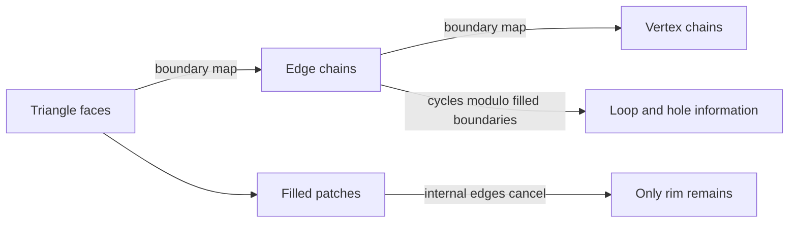

# 02 — Surfaces, Topology and Parameterization

[[Chapter Edition/02 - Graphics Vision and XR/00 - Reading Map|Reading map]] · [[Chapter Edition/02 - Graphics Vision and XR/01 - From Worlds to Images and Inference|Previous chapter]] · [[Chapter Edition/02 - Graphics Vision and XR/03 - Lens Optics and Image Formation|Next chapter]]

A surface has both local shape and global connectivity, and one representation rarely serves every operation equally well. This chapter builds the geometric and topological vocabulary used later for meshes, queries and simulation.

**By the end:** Choose between parametric, implicit and mesh representations based on the operation required.

**Recall question:** How do parameterization and topology answer different questions about a surface?

<!-- Derived from Continuous Notes/University - Worlds, Images and Inference - Graphics, Vision and Photography.md; source lines 2173–3087; source-span SHA256 3691cf05f3291ae62efa9c6d8c9ce065c149dd827c1424249af02f07ac4a9377. -->

<!-- CHAPTER-SOURCE-BEGIN -->
## Surfaces, patches, topology, and parameterization

Surfaces combine local parameter domains with global topology, so geometry and connectivity must be reasoned about together.

### Curves, surfaces, and local coordinates

A circle can be represented parametrically as $S(t)=(\cos t,\sin t)$ or implicitly as $F(x,y)=x^2+y^2-1=0$. A parameterization generates points and supports traversal. An implicit equation supports inside-outside tests and level-set queries. For a surface parameterized by $S(u,v)$, tangent vectors are $S_u$ and $S_v$; their cross product gives a normal. For an implicit surface $F(x,y,z)=0$, the gradient $\nabla F$ gives a normal when nonzero. Different representations expose different operations naturally. [[Chapter Edition/02 - Graphics Vision and XR/36 - Source Atlas and Reconstruction Checkpoints#CMU-09 - Introduction to Geometry|CMU-09]]

A manifold is a space that locally resembles ordinary Euclidean space. A curve locally resembles a line; a surface locally resembles a plane. A coordinate chart describes a patch. The tangent space collects directions that remain on a surface to first order. A sphere cannot be mapped globally to one flat chart without seams or distortion, though small patches are locally planar. Singularities occur when a chosen parameterization collapses directions or an implicit gradient vanishes. [[Chapter Edition/02 - Graphics Vision and XR/36 - Source Atlas and Reconstruction Checkpoints#CMU-09 - Introduction to Geometry|CMU-09]] · [[Chapter Edition/02 - Graphics Vision and XR/36 - Source Atlas and Reconstruction Checkpoints#CMU-10 - Meshes and Manifolds|CMU-10]]

### Orientability, boundaries, and local neighborhoods

Orientability means one can choose a consistent normal direction over the entire surface. For an orientable mesh, adjacent faces traverse their shared edge in opposite directions. A sphere and a torus are orientable; a Möbius strip is not. A boundary vertex has an open fan of incident faces; an interior vertex has a closed fan. At an interior manifold vertex, the incident faces form one cycle. At a boundary manifold vertex, they form one chain. Multiple disconnected cycles around one vertex signal a nonmanifold configuration.

Euler characteristic can detect topological changes. A closed sphere mesh with $V=8$, $E=18$, and $F=12$ has $8-18+12=2$. A torus has characteristic 0. Splitting an edge in a way that preserves topology adds one vertex, two edges, and one face in a simple triangular setting, leaving $V-E+F$ unchanged. A careless collapse may merge distinct regions and change topology or create a nonmanifold vertex. This makes topological checks useful before and after mesh edits.

### Parameterization distortions

Flattening a curved surface into a plane cannot preserve every geometric property globally. A conformal map preserves local angles but may change area. An area-preserving map retains area but can distort angles. Length-preserving maps are generally impossible for curved regions without special conditions. Texture artists often choose seams to divide a surface into charts and minimize distortion. Geometry-processing algorithms may choose a parameterization to reduce stretch or to make triangles closer to equilateral in the plane. The quality objective should follow the downstream use: texture appearance, finite-element conditioning, or atlas packing each values different properties.

### Surfaces: parameter domains, patches, and meshes

A parametric surface maps a two-dimensional domain into three-dimensional space, $S(u,v)\mapsto\mathbb R^3$. A tensor-product Bézier patch applies a one-dimensional basis independently in both parameters:

$$
S(u,v)=\sum_{i=0}^{3}\sum_{j=0}^{3} b_i^3(u)b_j^3(v)P_{ij}.
$$

where $P_{ij}\in\mathbb{R}^3$ is a $4\times4$ grid of 3D controls and $b_i^3$ are cubic Bernstein basis functions. Fixing $u$ gives a curve in $v$; fixing $v$ gives a curve in $u$. This makes the patch intuitive, but the rectangular parameter domain becomes awkward for complex topology, and stitching many independent patches while preserving derivative continuity can be difficult. The lecture walks through a bicubic patch, relating its rows and columns to families of Bézier curves, then discusses its patch-boundary continuity problem [[Chapter Edition/02 - Graphics Vision and XR/36 - Source Atlas and Reconstruction Checkpoints#MITG-03 - Curves and surfaces|MITG-03]] (00:47:00–01:01:00). The OCW 2012 lecture 02 is useful supplemental evidence for tensor-product patches and the Utah teapot example (pp. 24–34); its attribution/year must remain explicit.

The two parameter directions also give the local frame of the surface. Differentiate the tensor-product formula term by term:

$$
S_u(u,v)=\sum_{i=0}^{3}\sum_{j=0}^{3}\frac{d b_i^3(u)}{du}b_j^3(v)P_{ij},\qquad
S_v(u,v)=\sum_{i=0}^{3}\sum_{j=0}^{3}b_i^3(u)\frac{d b_j^3(v)}{dv}P_{ij}.
$$

$S_u$ points along the surface as $u$ changes while $v$ stays fixed; $S_v$ points along the other parameter direction. Their cross product $N=S_u\times S_v$ is perpendicular to both, so the unit surface normal is $n=N/\|N\|$. The direction depends on parameter orientation: swapping $u$ and $v$ flips the cross product. If $\|N\|$ is near zero, the parameterization is singular or locally collapsed; normalization then amplifies numerical noise, so a renderer must handle degenerate patches carefully.

For a numerical sanity check, consider the plane $S(u,v)=(u,v,2u+3v)$. Then $S_u=(1,0,2)$, $S_v=(0,1,3)$, and $S_u\times S_v=(-2,-3,1)$. The dot products with both tangent directions are zero: $(-2,-3,1)\cdot(1,0,2)=0$ and $(-2,-3,1)\cdot(0,1,3)=0$. This cross-product construction is the same whether the surface is represented by a patch, a mesh's local triangle, or a limit surface, though the derivative computation differs.

Joining two patches repeats the [[Spline bases and curve evaluation|curve continuity]] problem along an entire boundary. If $S^L(1,v)$ meets $S^R(0,v)$, position continuity requires equality for every boundary parameter $v$. Matching $S^L_u(1,v)$ to $S^R_u(0,v)$ gives parametric first-derivative continuity across the seam; requiring only aligned tangent planes gives geometric smoothness. In a control grid, the boundary rows determine the seam, and the adjacent rows determine cross-boundary tangent direction and scale. A patch can therefore be smooth internally yet show a crack or shading seam when connected to a neighbor with mismatched boundary data.

Subdivision surfaces start from a coarse polygon mesh and repeatedly refine it. A typical step splits faces and edges, then relocates old and new vertices using local weighted averages. Repetition makes a smoother limit surface. Instead of requiring an artist to lay out a clean rectangular patch network, subdivision begins with a mesh whose connectivity can represent complex topology. The 2021 lecture compares Loop subdivision on triangular meshes and Catmull–Clark subdivision on polygonal meshes, emphasizing that the resulting smooth surface is understood as the limit of repeated local rules [[Chapter Edition/02 - Graphics Vision and XR/36 - Source Atlas and Reconstruction Checkpoints#MITG-03 - Curves and surfaces|MITG-03]] (01:02:00–01:15:00). The key design question is not merely “how many polygons?” but “what limit surface does this connectivity and stencil imply?” Irregular vertices need special care because their local neighborhoods do not resemble a regular grid.

This is a different kind of representation from a single analytic patch. A coarse control cage is both compact and topological: edges say which regions meet, while the subdivision rule defines how the cage smooths. A character's elbow, for example, is awkward to cover with one rectangular patch network but natural as a polygonal mesh whose connectivity follows the limb. Refinement can be delayed until rendering, so the artist edits a manageable cage while the renderer evaluates a smooth limit. The costs are that the final surface may not interpolate the cage vertices and that extraordinary neighborhoods require special handling. The same refinement philosophy appears in adaptive curve drawing: preserve a high-level shape representation and create renderable detail only where the image needs it.

Implicit surfaces use a different representation: a scalar function $F(x,y,z)$ and a level set such as $F(x,y,z)=0$. This can describe shapes without explicitly storing a mesh, but surface sampling and intersection are less direct. A parametric mesh offers explicit points and connectivity; an implicit model offers a compact inside/outside or field-based rule. The 2021 lecture briefly places implicit surfaces alongside patch and subdivision representations [[Chapter Edition/02 - Graphics Vision and XR/36 - Source Atlas and Reconstruction Checkpoints#MITG-03 - Curves and surfaces|MITG-03]] (01:13:00–01:17:00). The trade is between ease of expressing shape and ease of the later operation: rendering needs intersections or samples, while modeling needs intuitive control.

## Meshes, connectivity, and geometry processing

### Reconstruction checkpoint — topology before surgery

The surrounding chapter explains half-edges, differential operators, remeshing and simplification; the new executable layer makes the first topology invariants inspectable. `tools/labs/mesh_topology_lab.cpp` builds directed and undirected edge records from triangles, pairs opposite half-edge twins, counts boundary and non-manifold edges, detects orientation conflicts, and checks Euler characteristic on both a two-triangle disk and a closed tetrahedron. A third construction deliberately creates an edge shared by three faces and must be rejected as non-manifold.

That is intentionally earlier than a QEM collapse loop. A simplifier must first prove that it knows what connectivity it is about to mutate. [[Half-edge topology invariants]] develops the representation contract, while [[QEM edge collapse and validity]] derives plane quadrics and explains why a low geometric error score cannot override link/manifold/orientation validity.

Rigid animation now has a separate representation witness as well. `tools/labs/dual_quaternion_skinning_lab.cpp` constructs dual quaternions from rotation plus translation, verifies rigid distance preservation, blends pure translations, and tests the antipodal sign case where physically equivalent dual quaternions would otherwise cancel. It does not yet claim arbitrary multi-joint GPU skinning or scale/shear; [[Dual quaternion skinning]] keeps that boundary explicit.


Meshes turn continuous shape into explicit data structures whose neighborhoods support edits, queries, and simulation.

### Mesh topology and data structures

A triangle mesh stores vertices, edges, and faces. Geometry gives vertex positions; topology gives connectivity. A surface vertex is manifold when its incident faces form one disk-like fan, or one half-disk fan at a boundary. A bow-tie vertex where two fans meet only at one vertex violates the manifold condition even if all individual triangles are valid. Algorithms that assume one coherent local sheet can fail on such a mesh. [[Chapter Edition/02 - Graphics Vision and XR/36 - Source Atlas and Reconstruction Checkpoints#CMU-10 - Meshes and Manifolds|CMU-10]]

An indexed-face array stores a list of vertex indices per triangle. It is compact for drawing but neighboring-face queries need extra work. A halfedge data structure stores each directed edge with a twin halfedge, the next halfedge around a face, and pointers to incident vertices and faces. It makes local traversal explicit. Boundary handling must be consistent, either with boundary halfedges or an exterior face. Orientation requires adjacent faces to traverse their shared edge in opposite directions. [[Chapter Edition/02 - Graphics Vision and XR/36 - Source Atlas and Reconstruction Checkpoints#CMU-10 - Meshes and Manifolds|CMU-10]]

For a closed, connected, orientable surface, Euler characteristic is $\chi=V-E+F$. For genus $g$, $\chi=2-2g$: a sphere-like surface has characteristic 2 and a torus has 0. In a closed triangular mesh every edge belongs to two faces, so counting face-edge incidences gives $3F=2E$. These identities help check connectivity, but do not by themselves prove manifoldness. [[Chapter Edition/02 - Graphics Vision and XR/36 - Source Atlas and Reconstruction Checkpoints#CMU-10 - Meshes and Manifolds|CMU-10]]

### Geometry processing and mesh edits

Smoothing reduces local variation. The umbrella Laplacian at vertex $p_i$ is the neighbor average minus the current point:

$$
\Delta p_i=\frac1{|N(i)|}\sum_{j\in N(i)}p_j-p_i.
$$

Moving vertices in this direction removes high-frequency noise but also shrinks convex shapes because neighbor averages fall inside the surface. Cotangent weights improve the connection to the continuous Laplace-Beltrami operator. For an edge $ij$ opposite angles $\alpha$ and $\beta$, a common weight is $w_{ij}=\tfrac12(\cot\alpha+\cot\beta)$. Negative weights can occur around obtuse triangles, and poor mesh quality affects the approximation. Denoising therefore requires more than averaging; constraints or feature-aware weights may be needed to preserve a silhouette. [[Chapter Edition/02 - Graphics Vision and XR/36 - Source Atlas and Reconstruction Checkpoints#CMU-11 - Digital Geometry Processing|CMU-11]]

An edge flip replaces the diagonal shared by two triangles with the other diagonal of their quadrilateral. It preserves the same planar patch when the four vertices are coplanar and the quadrilateral is convex; for a non-convex quadrilateral, the alternate diagonal does not triangulate the same patch. The flip also must satisfy the mesh’s manifold and orientation constraints. An edge split inserts a new vertex and subdivides incident faces, increasing sampling. An edge collapse merges endpoints and removes faces, simplifying the mesh but possibly changing shape or violating manifoldness. Each operation has topological preconditions and geometric quality checks. Subdivision repeatedly refines faces and repositions vertices according to a scheme. Loop subdivision targets triangular meshes; Catmull-Clark handles polygonal faces. Repeated refinement approaches a smooth limit surface, unless boundary or crease rules preserve sharp features. [[Chapter Edition/02 - Graphics Vision and XR/36 - Source Atlas and Reconstruction Checkpoints#CMU-11 - Digital Geometry Processing|CMU-11]]

Parameterization maps a surface patch into a plane. It supports texture coordinates and planar computation, but necessarily trades distortion in angle, area, or scale. Remeshing changes the sampling layout to improve triangle shape or local resolution. The mesh is not merely an approximation to a shape: its connectivity, attributes, and refinement rule influence the operations possible and the limit surface obtained. [[Chapter Edition/02 - Graphics Vision and XR/36 - Source Atlas and Reconstruction Checkpoints#CMU-11 - Digital Geometry Processing|CMU-11]]

### Local editing and quality measures

Triangle quality can be measured by minimum angle, aspect ratio, or area relative to edge lengths. Long thin triangles lead to poor interpolation and unstable numerical operators. Edge flips can improve local minimum angles in planar triangulations. Edge splits add resolution where error or curvature is high; collapses remove redundant detail. Remeshing combines these operations to achieve target edge lengths and better-shaped elements. A boundary or crease must be protected when edits would otherwise move it.

Smoothing with Laplacian displacement is a form of diffusion on a graph. For a graph Laplacian matrix $L$, vertex coordinate matrix $X$, and step size $\tau$, explicit smoothing is $X_{k+1}=X_k-\tau LX_k$. Large $\tau$ can oscillate or destabilize; repeated small steps attenuate high-frequency modes more gradually. Low-frequency shape modes decay too, which explains shrinkage. Solving an implicit step, such as $(I+\tau L)X_{k+1}=X_k$, can improve stability while still smoothing. Feature constraints, volume-preserving updates, or curvature-aware weights can reduce unwanted shape loss. [[Chapter Edition/02 - Graphics Vision and XR/36 - Source Atlas and Reconstruction Checkpoints#CMU-11 - Digital Geometry Processing|CMU-11]]

### A local connectivity structure makes edits explicit

A polygon mesh combines geometry, such as vertex positions, with topology, such as which vertices bound each face. Keeping the two separate matters: the same connectivity can be embedded with different coordinates, and moving coordinates does not by itself change which faces are adjacent. A triangle soup stores three positions per triangle. It is simple input for a rasterizer, but shared vertices and their attributes are duplicated, and a neighborhood query must scan every face. An indexed mesh stores positions once and stores each triangle as three indices. This removes duplication but does not automatically make reverse adjacency fast. If a billion-face indexed mesh is queried for the few faces touching one vertex, a direct scan still checks a billion triples.

Incidence matrices make adjacency explicit. A vertex-edge matrix has a row for each edge and a column for each vertex; a one marks that the edge touches the vertex. An edge-face matrix marks which faces use which edges. These tables can answer neighborhood questions, but most entries are zero. Sparse formats store only nonzero entries. A coordinate map stores row, column, and value triples and is convenient to build or edit. A row list chains nonzero entries by row. Compressed column storage packs values and row indices into arrays and uses a cumulative offset array to locate each column’s range. The latter is efficient for matrix-vector products, but awkward for frequent insertions. Connectivity storage, like numerical storage, is a workload choice. [[Chapter Edition/02 - Graphics Vision and XR/36 - Source Atlas and Reconstruction Checkpoints#CMU-10 - Meshes and Manifolds|CMU-10]]

A half-edge encodes directed adjacency with a small set of pointers. Every undirected edge becomes two oppositely directed half-edges. Each half-edge stores its twin (the opposite direction along the same edge), its next half-edge around the same face, the vertex it leaves, and references to its edge and face. Each face, edge, and vertex stores one representative half-edge. To list a face’s vertices, begin at its representative and repeatedly follow `next` until returning to the start. To circle a vertex, follow `twin.next`: cross the current edge to the neighboring face, then advance along that face to the next outgoing edge. For an interior manifold vertex this walks one complete fan. The method is efficient because it visits the local ring rather than scanning the whole mesh.

The pointer rules are topology invariants: following `twin` twice returns to the original half-edge; no half-edge is its own twin; and every half-edge belongs to a closed `next` cycle. Twin pairs encode undirected edges, `next` cycles encode faces, and `twin.next` cycles encode vertex neighborhoods. These invariants yield a manifold connectivity structure. They do not guarantee good coordinates. One may scramble the vertex positions so faces intersect, assign a quotient surface too few distinct positions so it collapses to a line or point, or have a geometrically skinny triangle whose connectivity remains valid. Debug connectivity and geometric quality as separate layers. [[Chapter Edition/02 - Graphics Vision and XR/36 - Source Atlas and Reconstruction Checkpoints#CMU-10 - Meshes and Manifolds|CMU-10]]

The half-edge representation supports local edits by changing a bounded set of pointers. An edge flip replaces the shared diagonal of two triangles with the other diagonal of their quadrilateral; it changes connectivity but creates or deletes no elements. Performing the flip twice restores the original connectivity. An edge split inserts a vertex on an edge and replaces two incident triangles with four, so new faces, edges, half-edges, and a vertex must be allocated and connected. An edge collapse identifies the edge’s endpoints and removes the two incident triangles and other now-invalid elements. Each operation must restore every twin, next-cycle, face, edge, and vertex reference. Starting with the common case of an interior edge with exactly two incident triangles keeps the operation small and clear. A subdivision modeler uses these local operations to edit a coarse control cage; subdivision then generates a smoother surface. [[Chapter Edition/02 - Graphics Vision and XR/36 - Source Atlas and Reconstruction Checkpoints#CMU-10 - Meshes and Manifolds|CMU-10]]

### A mesh processing failure as a query problem

Suppose a geometry-processing operation downsamples a shape and then reconstructs it. The reconstructed surface may drift from the original. A signed-distance or closest-point query can measure this deviation. Sampling points on the original, finding nearest points on the reconstructed mesh, and accumulating distances creates an error metric. The result depends on sample density: sparse points may miss a narrow feature. Thus mesh quality, query acceleration, and numerical integration meet in one practical evaluation workflow. [[Chapter Edition/02 - Graphics Vision and XR/36 - Source Atlas and Reconstruction Checkpoints#CMU-12 - Geometric Queries|CMU-12]]

### Why a mesh can be treated like a signal

A scalar image is sampled over a 2D grid. A mesh surface is sampled over a graph-like neighborhood. Vertex positions, normals, or colors are fields defined on that mesh. A discrete Laplacian compares each vertex’s value with its neighbors, analogous to a spatial high-pass operator on an image. Low-frequency variation corresponds to broad shape; high-frequency variation can correspond to noise or fine detail. Downsampling a mesh can remove detail and cause shape drift, just as downsampling an image can remove texture or create aliasing. A robust simplification method should preserve features that matter to downstream queries, not merely reduce vertex count.

For a mesh scalar field $f$, a weighted discrete Laplacian at vertex $i$ has form $(Lf)_i=\sum_{j\in N(i)}w_{ij}(f_i-f_j)$. If neighboring values are equal, the Laplacian is zero. If one vertex differs sharply, the Laplacian magnitude is large. This operator can smooth color or geometry, estimate curvature, or build a diffusion process. The weights define what “neighbor influence” means and may account for edge length, angles, or local area. [[Chapter Edition/02 - Graphics Vision and XR/36 - Source Atlas and Reconstruction Checkpoints#CMU-03 - Vector Calculus (P)Review|CMU-03]] · [[Chapter Edition/02 - Graphics Vision and XR/36 - Source Atlas and Reconstruction Checkpoints#CMU-11 - Digital Geometry Processing|CMU-11]]


### Differential coordinates preserve local shape while solving for new global positions

Directly editing vertex positions makes global coordinates the primitive. Botsch and coauthors show another useful view: represent local shape through **differential coordinates**, modify those local quantities, then reconstruct positions by solving a sparse system.

For a piecewise-linear scalar function \(f\) on a triangle mesh, its gradient is constant inside each triangle. Apply that independently to the three coordinate functions of the embedding,

\[
p:S\rightarrow\mathbb R^3,
\]

and each face \(T\) has a \(3\times3\) Jacobian \(J_T\) built from the gradients of \(p_x,p_y,p_z\). A desired local rotation/scale/shear can be represented by a matrix \(M_T\), giving a target gradient

\[
J'_T=M_TJ_T.
\]

The modified gradients generally no longer integrate exactly to one globally continuous surface. Reconstruction therefore asks for vertex positions whose gradients match the targets in least squares:

\[
E(p')
=
\int_S
\|\nabla p'-J'\|^2\,dA.
\]

The Euler–Lagrange equation has Poisson form,

\[
\Delta p'
=
\operatorname{div}J',
\]

which becomes a sparse linear system after discretization. Handle and fixed-region positional constraints remove the null modes and make the solution correspond to the user’s intended edit.

This gives a deeper interpretation of “Poisson mesh editing.” The linear solve is not smoothing by itself. The right-hand side encodes a desired **local differential field**; the solve finds the globally coherent surface closest to it. If the target field is inconsistent, the least-squares solution distributes the mismatch over the surface according to the operator and constraints.

Laplacian editing uses per-vertex differential coordinates

\[
\delta_i=\Delta p_i
\]

instead of per-face gradients. Transform them to \(\delta_i'=M_i\delta_i\), then seek positions whose Laplacians match those targets. In the continuous formulation Botsch et al. minimize

\[
E(p')
=
\int_S
\|\Delta p'-\delta'\|^2\,dA,
\]

leading to a bi-Laplacian equation

\[
\Delta^2p'
=
\Delta\delta'.
\]

The distinction matters. A first-order gradient formulation and a second-order Laplacian/shell formulation have different smoothness behavior at the boundary of the deformed region, different conditioning, and different sensitivity to constraints. “Both solve a sparse matrix” does not make them the same deformation model.

Rotations need special treatment. If one simply keeps the original Laplacian vector while rotating a handle by ninety degrees, local details resist rotation because the differential vector is expressed in the old frame. The source therefore propagates local transformations and applies them to gradients/Laplacians before reconstruction. Polar decomposition is useful here because rotation should be interpolated differently from scale/shear. A globally linear solver can thus participate in a geometrically nonlinear editing workflow by updating the local target frames.

This is also why the cotangent operator matters beyond smoothing. On irregular meshes, the uniform graph Laplacian depends strongly on valence and sampling density. Botsch et al. explicitly note improved deformation behavior from the cotangent discretization. The operator, mass weighting, constraints, and local-frame update together define the edit; none should be hidden behind the generic label “Laplacian deformation.”

Source basis: Botsch, Kobbelt, Pauly, Alliez, and Lévy, *Polygon Mesh Processing*, Chapter 9, especially §§9.4.1–9.4.3 on gradient-based deformation, Laplacian coordinates, Poisson/bi-Laplacian reconstruction, local transformations, and the relationship to shell-based deformation.

### Parameterization distortion is a singular-value statement about the surface map

The current parameterization section says that angle, area, and scale cannot generally all be preserved. The differential-geometry formulation makes that trade measurable.

Let a local parameterization map a 2D parameter domain to a surface. Its Jacobian maps infinitesimal parameter-space directions into tangent vectors on the surface. Locally, a tiny circle in parameter space becomes an ellipse whose principal stretches are the two singular values

\[
\sigma_1,\sigma_2.
\]

Those two numbers separate the common distortion goals.

A map is locally **conformal** when it preserves angles. Equivalently, the two principal stretches are equal:

\[
\sigma_1=\sigma_2.
\]

A tiny circle stays a circle, though its radius may change. It is **area preserving** when

\[
\sigma_1\sigma_2=1,
\]

so the determinant of the local metric/Jacobian preserves area, though a circle may become an ellipse. It is locally **isometric** when both are true:

\[
\sigma_1=\sigma_2=1.
\]

That preserves both angles and lengths locally. A general curved surface cannot be flattened isometrically; only special developable geometry permits it without cutting or distortion.

This turns UV quality into a local tensor measurement rather than a visual judgement. A texture can tolerate different errors depending on its content. Fine directional line art is sensitive to angular/shear distortion; a density map may care more about area; repeated texel detail may expose stretch. The correct objective follows the downstream signal.

Least-squares conformal maps formulate conformality as a least-squares condition on the gradients of the two UV coordinate functions. Harmonic/barycentric parameterizations solve related sparse systems under boundary constraints. The boundary treatment is not a cosmetic detail: fixing a poor boundary polygon can force interior distortion even when the interior solver is exact.

When a parameterization method reports one scalar “distortion,” ask which invariant it measures and in which map direction. Literature alternates between studying \(S\rightarrow\Omega\) and its inverse \(\Omega\rightarrow S\). Singular values invert under map inversion, so formulas can appear contradictory when the convention is unstated.

Source basis: *Polygon Mesh Processing*, Chapter 5, especially conformal mapping and §5.5’s distortion analysis in terms of the first fundamental form and singular values.

### Signed distance as a geometric signal

For a surface $S$, signed distance field $d(x)$ returns the shortest distance to the surface, positive outside and negative inside under one sign convention. The zero level set recovers the surface: $S=\{x:d(x)=0\}$. Near a smooth surface, the gradient of a true signed distance has unit length and points along the normal. This makes distance fields useful for collision margins, shape blending, and volumetric rendering. However, at points with multiple equally close surface points, distance may not be differentiable. In a mesh, approximate signed distance uses closest-point queries and inside-outside classification, combining geometric search with topology assumptions. [[Chapter Edition/02 - Graphics Vision and XR/36 - Source Atlas and Reconstruction Checkpoints#CMU-09 - Introduction to Geometry|CMU-09]] · [[Chapter Edition/02 - Graphics Vision and XR/36 - Source Atlas and Reconstruction Checkpoints#CMU-12 - Geometric Queries|CMU-12]]

### Subdivision masks and quadric error become executable rules

#### Subdivision masks and quadric error are computable rules, not labels

#### Loop subdivision: old vertices and new edge points

Subdivision repeatedly replaces a coarse mesh by a finer one and moves its vertices according to local weighted averages. The aim is a predictable smooth limit surface: the control mesh remains a compact description, while each refinement step supplies more triangles to represent the limit. Loop subdivision is designed for triangle meshes. One step splits every triangle into four: each old triangle retains one corner triangle near each old vertex, and a central triangle fills the middle. The new edge points must be placed with weights that account for the two triangles sharing an interior edge. [[Chapter Edition/02 - Graphics Vision and XR/36 - Source Atlas and Reconstruction Checkpoints#CMU-11 - Digital Geometry Processing|CMU-11]] (PDF pp. 25–26; video 00:34:30–00:37:00)

For an interior edge with endpoints $a$ and $b$, let $c$ and $d$ be the vertices opposite the edge in its two incident triangles. The new point is

$$
e_{ab}=\frac{3}{8}a+\frac{3}{8}b+\frac{1}{8}c+\frac{1}{8}d.
$$

Here each lowercase letter denotes a 3D position vector. The weights sum to one, so translating all four vertices by the same vector translates the result by that vector; this is an affine average. The two edge endpoints receive more influence than the opposite corners. For a flat square split along a diagonal, the diagonal’s four surrounding vertices are symmetric around its midpoint, so this rule places the new point at that midpoint. On a curved neighborhood, it shifts the point according to both incident faces, which helps produce a smooth limit instead of merely inserting geometric midpoints.

Old vertices also move. Let $S$ be an old vertex, let $n$ be its degree (the number of incident edges, equivalently the number of neighboring vertices in a manifold triangle fan), and let $P_0,\ldots,P_{n-1}$ be its neighboring positions. The Fall 2020 lecture gives this simple Loop weight:

$$
S'=(1-n\beta)S+\beta\sum_{i=0}^{n-1}P_i,
\qquad
\beta=\begin{cases}
3/16,&n=3,\\
3/(8n),&n\ne3.
\end{cases}
$$

$S'$ is the updated old vertex. The coefficient on $S$ is chosen so that all coefficients sum to one. This is Warren’s simplified Loop old-vertex weight: for valence $n>3$, $\beta=3/(8n)$, with the valence-three value $3/16$. Loop’s original weight is $\beta_n=\frac1n\left(\frac58-\left(\frac38+\frac14\cos\frac{2\pi}{n}\right)^2\right)$. The two agree at valences three and six but differ at other valences; for $n=4$, Warren gives $3/32$, while the original gives $31/256$. The Fall 2020 lecture uses the simpler Warren form above, so code and explanations should name and apply one convention consistently. For degree six, $\beta=3/48=1/16$, and the old vertex weight is $1-6/16=10/16=5/8$. Thus the center retains five eighths of its position and gives one sixteenth to each of six neighbors. At degree three, the three neighbors each receive $3/16$, and the old vertex receives $1-9/16=7/16$.

A small numeric trace makes the rule concrete. Work in a 2D plane embedded in 3D, take a degree-three old vertex $S=(0,0,0)$, and let its three neighbors be $P_0=(1,0,0)$, $P_1=(0,1,0)$, and $P_2=(-1,0,0)$. Their sum is $(0,1,0)$. The updated position is therefore

$$
S'=\frac{7}{16}(0,0,0)+\frac{3}{16}(0,1,0)
=\left(0,\frac{3}{16},0\right).
$$

The point moves toward the weighted neighborhood average rather than staying fixed or jumping to one neighbor. A smooth regular patch usually uses interior masks. At a boundary, the interior edge formula does not apply because there is only one incident face. A common boundary-preserving Loop variant places a new boundary-edge point at the midpoint of its endpoints and updates a boundary vertex with the cubic boundary mask

$$
S'=\frac{3}{4}S+\frac{1}{8}S_{-}+\frac{1}{8}S_{+},
$$

where $S_{-}$ and $S_{+}$ are the two boundary neighbors. This is a one-dimensional smoothing rule along the boundary curve. It preserves the boundary as a curve while refining it. These boundary masks are a standard extension; the lecture’s displayed weights emphasize the interior triangle rules and its ordinary Loop construction, so a boundary implementation should state explicitly which edge and vertex conventions it uses. [[Chapter Edition/02 - Graphics Vision and XR/36 - Source Atlas and Reconstruction Checkpoints#CMU-11 - Digital Geometry Processing|CMU-11]]

#### Catmull–Clark: face, edge, and vertex masks

Catmull–Clark subdivision starts from a polygon mesh and turns every old face into quads. For each old face, insert a **face point** at the average of its vertices. For each old edge, insert an **edge point**. For an interior edge with endpoints $A$ and $B$ and adjacent face points $F_1$ and $F_2$, use

$$
E=\frac{A+B+F_1+F_2}{4}.
$$

This differs from an unweighted midpoint because the two face averages participate; the resulting weights remain symmetric across the edge. An edge on a boundary has only one adjacent face, so the interior formula is not defined there. In the common boundary-preserving variant, the new boundary point is the midpoint $(A+B)/2$.

The old vertex update combines three kinds of local average. Let $S$ be the old vertex of valence $n$ (the number of incident edges), let $Q$ be the average of the face points of its $n$ incident faces, and let $R$ be the average of the midpoints of its $n$ incident edges. The new position is

$$
S'=\frac{Q+2R+(n-3)S}{n}.
$$

The coefficient $2$ gives the edge-midpoint average twice the weight of the face-point average; the old position’s coefficient grows with valence. For a regular interior quad vertex, $n=4$, so $S'=(Q+2R+S)/4$. This is not the same as a plain average of the vertex and its neighbors: it incorporates the face averages and the topology around the vertex. Repeating the step creates a smoother surface. Starting from a quad mesh makes the regular valence four natural. Starting from a triangle mesh makes the typical valence six extraordinary for Catmull–Clark, which can produce irregular normal behavior; Loop is tailored to triangles. The course illustrates the difference with reflected lines and caustics: smooth normal variation produces smooth highlights, while many irregular vertices make the highlights appear jagged. [[Chapter Edition/02 - Graphics Vision and XR/36 - Source Atlas and Reconstruction Checkpoints#CMU-11 - Digital Geometry Processing|CMU-11]] (PDF pp. 22–26; video 00:32:00–00:34:30)

At a boundary vertex, a standard cubic boundary rule is $S'=(6S+S_-+S_+)/8$, with the same meanings of $S$, $S_-$, and $S_+$ as above. Boundary edge points use endpoint midpoints. This rule treats the boundary as a smooth curve and avoids applying the interior face-neighborhood mask where a face is missing. Extraordinary vertices—vertices whose valence differs from the regular valence of the scheme—need not disappear; the masks define their local limit behavior, but continuity and curvature can differ from regular patches. A subdivision implementation must handle these neighborhoods intentionally rather than assuming every vertex has the same number of faces.

#### Quadric error metric: turn nearby planes into a collapse cost

Mesh simplification reduces face count by repeatedly collapsing an edge. A greedy scheme assigns each candidate edge a cost, collapses the cheapest, updates local data, and repeats until it reaches a target size. The cost should estimate how much geometric detail is lost. The quadric error metric (QEM) approximates the distance from the replacement vertex to the planes of nearby triangles. It is a local approximation: it does not measure every possible global change, so implementations also need topology and orientation checks. The Fall 2020 slides derive it from point-to-plane distance and homogeneous coordinates. [[Chapter Edition/02 - Graphics Vision and XR/36 - Source Atlas and Reconstruction Checkpoints#CMU-11 - Digital Geometry Processing|CMU-11]] (PDF pp. 28–37; video 00:39:36–00:48:00)

A plane is described by a unit normal $n=(a,b,c)$ and a point $p$ on the plane. For query point $x=(x,y,z)$, the signed distance is $n\cdot(x-p)$. Because $n$ has unit length, its absolute value is Euclidean distance. Expanding gives $n\cdot x+d$, where $d=-n\cdot p$. Define homogeneous vectors $U=(x,y,z,1)^T$ and $v=(a,b,c,d)^T$. The plane residual is $v^TU$. Squaring it gives

$$
(v^TU)^2=U^T(vv^T)U.
$$

The fixed $4\times4$ matrix $K=vv^T$ is the plane’s quadric. “Quadric” means a quadratic function of the coordinates; here it is the squared plane residual. For a set of nearby face planes with matrices $K_1,\ldots,K_m$, add them once:

$$
Q(U)=U^T\left(\sum_{r=1}^{m}K_r\right)U.
$$

Each term penalizes distance from one plane. Summing matrices is valid because every plane contributes a quadratic form in the same homogeneous coordinate vector. The sum can therefore be stored as one matrix and evaluated cheaply for many possible replacement positions.

For each triangle, form its plane matrix. At each vertex, sum matrices for incident triangles to get vertex quadric $K_i$. To consider collapsing an edge with endpoint vertices $i$ and $j$, add their quadrics: $K_{ij}=K_i+K_j$. The new point should minimize this sum. Write the candidate position as $x=(x,y,z)^T$ and partition the homogeneous matrix so its cost has the form

$$
Q(x)=x^TAx+2b^Tx+c,
$$

where $A$ is a $3\times3$ symmetric matrix, $b$ is a three-component vector, and $c$ is a scalar, all read from $K_{ij}$. The gradient with respect to $x$ is $2Ax+2b$. At a stationary point it is zero, so solving

$$
Ax=-b
$$

gives the unconstrained minimizing location when $A$ is positive definite. Positive definite means $y^TAy>0$ for every nonzero vector $y$; the quadratic then curves upward in every direction and has one unique minimum. Because $K_{ij}$ is a sum of plane outer products $vv^T$, its $3\times3$ block is $A=\sum_r n_r n_r^T$, so $A$ is positive semidefinite in exact arithmetic; an indefinite $A$ indicates a sign, assembly, or numerical error in this unmodified QEM. If $A$ is singular, the minimizer may be nonunique, but the system remains consistent: $b=\sum_r d_r n_r$ lies in the range of $A$, and the cost is constant along null directions. Near-singularity can still make a direct solve unstable in floating-point arithmetic. A rank-revealing SVD or pseudoinverse can find a minimum-norm solution; a robust simple fallback evaluates the cost at endpoint $i$, endpoint $j$, and their midpoint, then chooses the least-cost candidate. More elaborate implementations can add constraints or solve a constrained minimization problem.

For a numeric cost trace, take three unit-normal planes through the origin: $x=0$, $y=0$, and $z=0$. Their point-to-plane squared distances sum to $Q(x,y,z)=x^2+y^2+z^2$, so $A$ is the identity matrix, $b=(0,0,0)^T$, and $c=0$. A proposed edge-collapse point $(1,2,2)$ has cost $1+4+4=9$. Solving $Ax=-b$ gives the origin, whose cost is zero. In a real mesh, the planes are those of incident triangles, so their intersection may be approximate or empty; the computed point then finds a least-squares compromise rather than an exact shared intersection. Cost priorities can favor a point that is geometrically close to many local planes, but a low cost alone does not guarantee a valid triangle mesh.

The algorithm stores the chosen quadric at the merged vertex as the sum $K_i+K_j$, updates costs for edges touching the changed neighborhood, and selects the next least-cost collapse. A candidate can invert a triangle even if its plane error is small. For each triangle incident to the proposed collapsed vertex, compare its old and proposed oriented normals; if their dot product is negative, the orientation has reversed, so reject that collapse. This protects local face orientation while the QEM handles geometric deviation. The two checks answer different questions: QEM scores shape change, while the normal test rejects a topological/geometric fold. [[Chapter Edition/02 - Graphics Vision and XR/36 - Source Atlas and Reconstruction Checkpoints#CMU-11 - Digital Geometry Processing|CMU-11]]

### Figure U2 - A half-edge separates face traversal from edge traversal

![[Visual Recall/University Graphics and Vision/halfedge-next-and-twin.png]]

**Read the figure.** Following next walks around one face; following twin crosses its shared edge. The shared edge has opposite directions in the two consistently oriented faces. This drawing omits outer boundary twins and boundary-loop records, so it illustrates the interior invariant rather than a complete boundary representation.

### Additional geometry notes for surfaces and parameterization

#### Subdivision meshes and the topology they need

A regular grid can be refined by corner cutting in two directions. Apply the one-quarter/three-quarter rule along u-edges, then v-edges, connect the new points into a denser quad mesh, and repeat. The number of cells grows quickly, but each refinement uses local averages and the mesh approaches a smooth limit. The source motivates the limit as a patch made from quadratic behavior in both parameter directions. A four-corner cell has the bilinear interpolant

$$
P(u,v)=(1-u)(1-v)P_{00}+u(1-v)P_{10}+(1-u)vP_{01}+uvP_{11}.
$$

At $(u,v)=(0,0)$ the result is $P_{00}$; at $(1,0)$ it is $P_{10}$, and similarly for the other corners. The weights sum to one, so the patch is an affine combination. At $(1/2,1/2)$ all four weights are $1/4$, giving the cell center. This formula is bilinear interpolation over one face; it helps calculate the child grid but should not be mistaken for the complete quadratic subdivision limit. (P3-16)

Regular quad grids are easy to store as an $N\times N$ array: neighboring cells follow from index arithmetic. Real meshes are not always regular quads. A Doo–Sabin-style refinement begins with each face, creates updated points around it, and connects them into a smaller face; adjacent original faces contribute a quad across each shared edge, while the neighborhood around an original vertex becomes a polygon whose side count reflects that vertex’s valence. Repeating the process makes those exceptional polygons shrink, leaving regular quad regions between them. The lecture sketches the construction through face centers and radial midpoints and calls the exceptional neighborhoods extraordinary points. Canonical Doo–Sabin implementations use a specific face-valence-dependent averaging mask; the transcript’s geometric sketch is an intuition for topology and convergence, not a full rule table. (P3-16)

Catmull–Clark, introduced in the next lecture, produces cubic bicubic behavior in regular regions and is widely used in subdivision modeling. Doo–Sabin is associated with biquadratic pieces. In either family, one must keep the surface shape and the connectivity graph together: newly created vertices, face points and edge points change which faces meet at each edge. This is why subdivision is both geometry and a data-structure problem. (P3-16)

A split-edge (half-edge-style) record stores local mesh adjacency. One record represents one oriented side of an edge and points to its vertex, the next oriented edge around its face, and its opposite record across the same geometric edge. The face record points to one boundary edge; the vertex record can point to one incident edge. From these links, an iterator walks a face boundary or a vertex’s one-ring without duplicating vertex coordinates in every polygon. A shared vertex is stored once in a vertex array, while faces reference it through adjacency pointers. When subdivision replaces edges and faces, every reciprocal link must be updated. A stale opposite pointer or broken cycle can cause an invalid walk or crash. The old lecture calls this “pointer hell”; the durable lesson is to state topology invariants and test every adjacency update. Modern libraries may use indexed arrays instead, but they still represent the same relationships. (P3-16)

#### Catmull–Clark and Loop subdivision

Catmull–Clark turns a polygon mesh into a smoother, denser mesh by creating three kinds of local points on every pass:

1. A face point is the average of the face’s corner vertices. For a quad, $F=(V_0+V_1+V_2+V_3)/4$.
2. An interior edge point is the average of the two edge endpoints and the face points on both sides: $E=(V_a+V_b+F_0+F_1)/4$. For a boundary edge, there is only one adjacent face, so production schemes use a boundary rule (often the midpoint or a boundary-curve mask).
3. An updated old vertex point uses its surrounding face and edge neighborhood. For a regular interior vertex of valence $n$, a common Catmull–Clark rule is $V'=(F_{avg}+2E_{avg}+(n-3)V)/n$, where $F_{avg}$ averages adjacent face points and $E_{avg}$ averages edge midpoints. For a regular quad grid ($n=4$), this equals the familiar weighted average of the vertex, its four edge neighbors and four diagonal neighbors.

Once these points exist, connect them consistently: each old face becomes a face around its face point, each old edge creates a quad joining its edge point to nearby face and vertex points, and each old vertex gets a new incident face. A programmer can process faces, edges and vertices in separate passes because the formulas depend on those preceding values. This creates many new faces in one iteration; repeating the same local recipe approaches a smooth limit surface. (P3-16, P3-17)

The valence $n$ is the number of edges incident to a vertex. A regular quad-mesh vertex has valence four; a hand, nose or other irregular modeling feature may have a different valence. These extraordinary vertices have a different local limit behavior and are why the update weights cannot be chosen casually. The lecture reports a valence-dependent constant near $3/n$, but it does not fully derive the standard mask. Use the explicit rule above only for the stated regular interior scheme, and consult the chosen subdivision standard for boundaries and extraordinary points. (P3-17)

For triangle meshes, Loop subdivision splits each triangle into four using edge points and then smooths the old vertices. Starting from an icosahedron gives a useful sphere approximation: 20 triangular faces become 80, then 320, then 1,280. Each new midpoint lies on the chord between old points, inside the sphere; normalize its vector from the center and scale to the radius to project it back onto the sphere. This is a distinct operation from Loop’s smoothing rule: projection gives a faceted sphere with vertices on the sphere, while Loop moves vertices according to a valence-dependent mask to form a smooth limit. The lecturer gives a $5/8$ old vertex plus $3/8$ average of neighboring edge points rule, which is the regular valence-six case, not the universal formula for every triangle vertex. (P3-17)

### As-rigid-as-possible local shape preservation

*Connect to:* meshes and connectivity; Laplacian operators; shape deformation; numerical optimization.

[[Local rigidity and mesh orientation fields|As-Rigid-As-Possible]] (ARAP) surface modeling asks a simple question: when a user moves a few handle vertices, can each small mesh neighborhood move as close to a rigid transform as possible? A rigid transform rotates and translates a patch but does not scale or shear it. A whole surface usually cannot remain exactly rigid while bending around new constraints. ARAP instead finds the deformation whose local patches deviate from rigidity as little as possible.

For each vertex $i$, define a cell from its incident triangles and one-ring neighbors. For an edge from $i$ to neighbor $j$, let the original edge be $\mathbf{e}_{ij}=\mathbf{p}_i-\mathbf{p}_j$ and its deformed version be $\mathbf{e}'_{ij}=\mathbf{p}'_i-\mathbf{p}'_j$. If this neighborhood moved rigidly, some rotation $R_i$ would satisfy $\mathbf{e}'_{ij}=R_i\mathbf{e}_{ij}$ for every neighbor. When it does not, measure the mismatch with

$$E_i=\sum_{j\in N(i)}w_{ij}\|\mathbf{e}'_{ij}-R_i\mathbf{e}_{ij}\|^2.$$

The total energy sums this residual over all cells. The weights matter: uniform weights can make the result depend on how triangles happen to be tessellated. The paper uses cotangent weights, $w_{ij}=\tfrac12(\cot\alpha_{ij}+\cot\beta_{ij})$, for angles opposite edge $(i,j)$. These weights reduce mesh bias and connect the method to the cotangent Laplace–Beltrami operator.

The local rotations are unknown, as are the deformed vertex positions. ARAP alternates between two easier subproblems. First, hold the current positions fixed and find the best rotation for each cell. Form a weighted covariance matrix $S_i=\sum_jw_{ij}\mathbf{e}_{ij}\mathbf{e}'_{ij}{}^T$, compute its singular value decomposition $S_i=U_i\Sigma_iV_i^T$, then set $R_i=V_iU_i^T$. If the determinant is negative, flip the singular-vector sign associated with the smallest singular value so the result is a proper rotation, not a reflection. This is the weighted orthogonal Procrustes problem: the rotation that best aligns the original edges with the deformed edges.

Second, hold the rotations fixed and solve for all vertex positions. Setting the energy gradient to zero gives, for each vertex,

$$\sum_{j\in N(i)}w_{ij}(\mathbf{p}'_i-\mathbf{p}'_j)=\sum_{j\in N(i)}\frac{w_{ij}}{2}(R_i+R_j)(\mathbf{p}_i-\mathbf{p}_j).$$

The left side is the sparse cotangent Laplacian applied to the unknown deformed positions. Handle vertices are fixed to user-specified targets; static anchors remove global translation and rotation ambiguity. The Laplacian matrix depends only on the original mesh and constraints. The method factors it once, then reuses that factorization for each coordinate and each alternating step. It updates the right-hand side as the local rotations change. Because each substep minimizes the same energy over one variable group, the energy does not increase across alternating updates.

A practical example is bending a detailed bar by translating its handle. The user does not specify a handle rotation. Rotation-propagation methods that rely on an input rotation may not know how to twist nearby details. ARAP estimates the neighborhood rotations from the current geometry and finds a smooth field of rotations that best preserves edge lengths. A bar can bend while retaining its grooves and local shape. The result is not a physically simulated material: it is an editing energy that encodes a geometric preference.

**Evidence and limits.** The 2007 paper reports C++ experiments on a Pentium 4 2.16 GHz laptop. Its unoptimized implementation ran interactively at about 10–30 frames per second for regions of interest up to 10,000 vertices, typically using two or three iterations per edit. Reported relative root-mean-square edge-length errors were small in the tested edits, though a twist that constrained the bar's height required some stretching. The nonlinear objective can have local minima, so a reasonable initialization matters; the prior interactive frame is the natural warm start. As the mesh is refined, the anchored Laplacian's condition number and solve cost increase, which can require more iterations. Multiresolution acceleration is a proposed remedy, not a result of this implementation. The paper says the same local-edge energy extends to volumetric cells such as tetrahedra, but its experiments focus on surface editing.

**Source:** Sorkine and Alexa, “As-Rigid-As-Possible Surface Modeling” (2007), complete paper, PDF pp. 1–8. [Primary PDF](https://igl.ethz.ch/projects/ARAP/arap_web.pdf).

### Field-aligned remeshing without a global parameterization

*Connect to:* mesh connectivity and geometry processing; surface curvature; local coordinate fields; multiresolution optimization.

Instant Field-Aligned Meshes creates triangle- or quad-dominant remeshes by solving for two local fields on a surface graph. The first field chooses edge directions. The second places the mesh vertices along those directions. Many global remeshing methods build a globally consistent parameterization before extracting a mesh. This paper instead works with discontinuous local fields and resolves their jumps as it goes. That avoids a global cut-and-parameterize stage and lets the same local operator work on triangle meshes or point clouds.

The input is a graph $G=(V,E)$. A vertex stores a 3D position and a surface normal; edges encode mesh adjacency or, for point clouds, $K$-nearest neighbors. Each edge receives a weight. The algorithm repeatedly updates a field value at one vertex from its neighbors, in a Gauss–Seidel-like local smoothing step. Unlike ordinary Laplacian smoothing, the values have symmetries: an unoriented cross has four equivalent directions, and a six-direction field has six. The algorithm must compare directions after trying the allowed discrete rotations.

For an $s_o$-fold rotationally symmetric orientation field, each vertex stores one tangent representative $o_i$. Its equivalent directions are rotations of $o_i$ by multiples of $2\pi/s_o$. A four-fold field, or 4-RoSy field, is a cross field suited to quad meshing. When comparing two neighbors, the algorithm selects the pair of equivalent rotations with the smallest angular difference, averages the aligned representatives with edge weights, projects back into the tangent plane, and normalizes. The paper uses an **extrinsic** comparison: it measures angle in 3D space instead of first rotating both directions into one vertex's tangent plane. This makes the field respond to the embedded shape. On a cube, for example, it can align to corners and curved features without the user specifying curvature constraints. The paper contrasts this with intrinsic smoothness, which is simpler but may miss surface features unless extra alignment constraints are added.

After edge directions are chosen, a local position field places the lattice. Each vertex stores a representative local parameter position. Neighboring representatives can differ by integer lattice translations; the local comparison searches for the closest compatible representatives in their symmetry-related lattices. Those integer jumps are not an implementation nuisance: they record where the field is discontinuous and how many mesh edges separate neighboring representatives. A scale parameter $\rho$ sets the target edge length. The search is restricted to nearby candidate lattice points rather than solving an unbounded shortest-vector problem. Each local update averages aligned neighbor positions and rounds to the closest lattice representative near the input vertex.

A field can be locally smooth but the repeated Gauss–Seidel updates often get trapped in poor minima. The authors build a multiresolution hierarchy by merging adjacent vertices with similar normals and comparable dual areas. They optimize both fields from the coarsest graph to the original one, using six iterations per level in their reported results. The coarse graph has fewer degrees of freedom and can move across larger regions; its result is then interpolated to the next level as a starting point. The authors explicitly treat this as a practical hypothesis about neighboring levels, not a formal convergence guarantee.

The integer jumps around graph cycles reveal **singularities**. If their composition around a cycle is nonzero, the local field cannot return to its starting representative. In the orientation field, the singularity becomes a non-regular vertex in the output mesh. In the position field, a residual lattice shift inserts or removes an isoline. It can create triangles, pentagons, or T-junctions in a quad-dominant mesh. The method accepts additional singularities when they help improve element isotropy or reduce distortion; it does not try to eliminate all irregular vertices.

The output mesh is extracted from the graph of representative positions and integer jumps. Vertices that appear to represent the same output position are merged, prioritizing short candidate links and skipping conflicts. The output position and normal are weighted combinations of the contributing input samples, with closer samples receiving more weight. A greedy walk extracts faces from the remaining oriented edges. This is intentionally simple, but it can produce non-manifold output for very coarse meshes of detailed or high-genus surfaces. The authors remove offending edges or vertices when manifold output is required, which can leave artifacts. Because the method does not build a volumetric scalar field, holes in regions absent from a point cloud remain holes.

Brush tools constrain edge direction or make a position-field isoline follow a drawn stroke. A singularity attractor edits the integer jumps to move or collapse singularities. This editing operation is currently limited to triangle meshes and should be applied last: it freezes the discrete jumps and then optimizes only the continuous field values.

**Published results and tradeoffs.** The paper reports remeshing a 13-million-vertex scanned dragon into roughly 80,000-vertex outputs in about 67–71 seconds. It remeshes a 4.9-million-point cloud in 34.4 seconds using ten nearest neighbors. Its local method scales near-linearly in the presented tests and is much faster than the compared global methods. It often obtains more uniform elements and better feature alignment than its chosen baselines, but it introduces more singularities. Those are measured comparisons on the paper's inputs and hardware. They do not establish equal quality for every topology or a guarantee of a manifold mesh.

**Source:** Jakob et al., “Instant Field-Aligned Meshes” (2015), complete paper body and conclusion, PDF pp. 1–15. [Primary PDF](https://igl.ethz.ch/projects/instant-meshes/instant-meshes-SA-2015-jakob-et-al-compressed.pdf).

## From a scanned triangle soup to a mesh we can trust

A small 3D scan of a clay cup arrives as a list of triangles. Each triangle has three coordinates, perhaps a normal and a color, but the file does not say which triangle touches which, whether two nearby vertices are meant to be one vertex, or whether the dark circular opening is an intentional rim or a hole in the scan. On screen the soup can look like a cup. A renderer can draw it. Yet a renderer needs only three points per triangle; a geometry algorithm needs to know that one face follows another, which edges are shared, where the boundary runs, and whether the surface has a consistent inside and outside.

This difference between visible shape and encoded structure is the starting point for mesh topology. A polygon mesh carries at least two kinds of information. Geometry gives locations such as $\mathbf x_i\in\mathbb R^3$. Connectivity says which vertices form each edge and face, and how those pieces meet. Moving a vertex changes geometry without necessarily changing connectivity. Joining two coincident but separately indexed vertices changes connectivity even when the rendered coordinates remain almost identical. Many apparently mysterious failures are one of these two edits masquerading as the other.

A triangle soup repeats its three positions for every face. If two triangles are meant to meet, they may still hold separate copies of the same coordinate. This is convenient for interchange and rendering, but it does not offer an explicit edge-to-face or vertex-to-neighbor relation. An indexed face set shares vertex records and stores faces as indices; a halfedge structure adds directed adjacency so an algorithm can walk around a face or a vertex. The halfedge representation gives each undirected interior edge two oppositely directed halfedges. Their `next` and `opposite` relations support local traversal, while a boundary halfedge has no adjacent face or belongs to an explicit boundary loop, depending on the implementation.


### A mesh is a neighborhood rule as well as a drawing

An abstract triangle is a set of three vertex identities; a geometric triangle is the flat region spanned by three non-collinear positions. A finite simplicial complex contains vertices, edges and triangles, includes every face of each simplex, and requires two simplices to intersect only along a shared face or not at all. For example, if a triangle is present, all three of its edges and all three of its vertices must also be present. Two triangles cannot cross in their interiors and still be a simplicial complex. This is a combinatorial definition; a geometric realization places those elements in space without violating the required intersections.

A surface is locally two-dimensional. Around an interior point there should be a neighborhood that looks like a disk; around a boundary point it should look like a half-disk. In a triangle mesh, a simple edge-incidence test is necessary: an interior edge has exactly two incident triangles, and a boundary edge has exactly one. An edge with three incident triangles is nonmanifold. But edge counts alone are not sufficient. At an interior manifold vertex, the incident triangles must form one circular fan; at a boundary manifold vertex, they must form one fan with two boundary ends. The link of a vertex—roughly, the small ring of directions and faces around it—should be a single cycle or a single interval, respectively.

Picture a bow-tie made of two disks that meet at one shared vertex. Every edge may have only one or two incident triangles, but the shared vertex has two disjoint fans. It is not a manifold point: a tiny neighborhood is two disks touching at a point, not one disk or half-disk. A “butterfly” vertex link test catches this case. Likewise, two sheets that meet along an edge make an edge with more than two incident faces. A connected component is instead a whole island of faces reachable from one another through shared edges (or under a deliberately chosen vertex-adjacency rule). A boundary is not the same as a crack: a legitimate open surface has boundary edges; a crack may be two disconnected edge sets whose positions nearly coincide but whose vertex identities differ.

The distinction between geometry and topology also applies to self-intersection. A connected, manifold mesh can fold through itself in 3D while its abstract adjacency remains manifold. Conversely, a mesh with no visible self-crossing may have a nonmanifold edge or bow-tie vertex. A topology test cannot certify geometric embedding, and an intersection test cannot certify manifold neighborhoods. A robust pipeline reports these separately.

Orientation is a consistent choice of direction for each face. For an oriented triangle $[a,b,c]$, its oriented boundary traverses $a\to b$, $b\to c$, and $c\to a$, with signs fixed by the chosen convention. If two neighboring faces are consistently oriented, they traverse their shared edge in opposite directions. Propagating this condition over a connected component either assigns consistent face orientations or discovers a contradiction, as on a nonorientable surface. In a closed orientable triangle mesh, consistent orientation supports a coherent normal direction. A mesh with a boundary can still be orientable; the boundary simply remains exposed.

Normals depend on geometry and orientation. Swapping two triangle vertices reverses its normal while leaving the triangle's location unchanged. A bag of faces with arbitrary winding can shade inconsistently and makes inside/outside tests unreliable. Orientation propagation can fix a consistent winding when the mesh is orientable, but it cannot decide which side the application wants to call “outside” without an additional convention, such as signed volume for a closed embedded shell or a known camera/seed point. Nonorientable surfaces such as the Möbius strip cannot have a globally consistent face-normal direction, even though each local patch is perfectly regular.

Topology has different failure modes from geometric quality. A zero-area triangle, a needle with a very short edge, an inverted element, or a self-intersection may be geometrically dangerous while the incidence structure remains manifold. A single edge with three incident faces is topologically nonmanifold even if its triangles are all well-shaped. Keep separate diagnostics for incidence, vertex links, orientation, degeneracy, and self-intersection; repairing one does not imply the others are repaired.

### The boundary of a boundary cancels

A useful way to turn connectivity into algebra is to treat a collection of vertices, edges, or triangles as a formal sum called a chain. For a triangle $[a,b,c]$, using integer coefficients and an orientation, define

$$
\partial_2[a,b,c]=[b,c]-[a,c]+[a,b].
$$

The signs encode direction: $-[a,c]$ is the same directed edge as $[c,a]$. The boundary operator extends by addition to a collection of faces. Now apply the edge-boundary operator to each term:

$$
\begin{aligned}
\partial_1\partial_2[a,b,c]
&=([c]-[b])-([c]-[a])+([b]-[a])\\
&=[c]-[b]-[c]+[a]+[b]-[a]=0.
\end{aligned}
$$

Every corner cancels. Informally, the edge boundary of a filled triangle has no leftover endpoint. The same principle applies to a triangulated patch: internal edges are traversed once in each direction by adjacent oriented faces and cancel; only the outside rim remains. This is the chain-level statement $\partial_1\partial_2=0$, “the boundary of a boundary is empty.” It is not a slogan pasted onto a mesh; it follows directly from the fact that each codimension-two face of a simplex occurs twice with opposite sign.

With coefficients modulo two, signs disappear because $1+1=0$. Each edge of a triangle appears twice after taking the boundary twice, so it cancels in pairs. Modulo-two chains are often easier for a first computation: a chain can be represented as a set of simplices, and addition is symmetric difference. But mod two forgets orientation signs and cannot distinguish some orientation-sensitive phenomena. For integer coefficients, the plus and minus directions carry more information.

For a concrete disk, split a square with corners $a,b,c,d$ along diagonal $ac$. Its two faces are $[a,b,c]$ and $[a,c,d]$. Their sum has boundary

$$
\partial([a,b,c]+[a,c,d])=[a,b]+[b,c]+[c,d]+[d,a],
$$

because the shared diagonal appears as $[a,c]$ in one face and $-[a,c]$ in the other. Thus the two-triangle patch has exactly the four-edge square boundary. If the same faces are wrapped and glued so every edge is shared consistently, every edge cancels and the surface is closed. This gives a practical orientation check: accumulate directed edge uses; interior edges should cancel, while boundary edges should occur once with a coherent loop direction.

A chain is a cycle when its boundary is zero. A boundary is a chain that is itself the boundary of a higher-dimensional chain. Every boundary is a cycle because $\partial^2=0$. A loop that bounds a filled disk in the mesh is a 1-cycle that is also a 1-boundary. A loop around a tunnel may be a cycle but not the boundary of any mesh triangles. [[Concepts/Mesh topology and homology|Homology]] records cycles up to the addition of boundaries, which is a compact way of distinguishing loops that can be filled from loops that cannot.



### Euler characteristic is a structural checksum, not a shape score

For a finite triangle mesh, count vertices $V$, edges $E$, and faces $F$. Its Euler characteristic is

$$
\chi=V-E+F.
$$

The alternating signs matter. Splitting one triangle by adding a vertex in its interior produces three triangles and three new edges: $\Delta V=1,\Delta E=3,\Delta F=2$, so $\Delta\chi=1-3+2=0$. Splitting an edge shared by two triangles adds one vertex, three edges and two faces, again preserving $\chi$. These local calculations explain why subdivision changes resolution without changing Euler characteristic. For a valid finite triangulation of the same surface, $\chi$ is independent of how finely it is triangulated.

A two-triangle square disk has four vertices, five edges and two faces, so $\chi=4-5+2=1$. A tetrahedron surface is a sphere triangulation with four vertices, six edges and four faces, giving $\chi=4-6+4=2$. For a torus, take an $n\times m$ periodic grid of vertices with $n,m\ge3$ and split every periodic square along a consistent diagonal. There are $V=nm$ vertices; horizontal and vertical edges contribute $2nm$, the diagonals contribute $nm$, so $E=3nm$; each square contributes two triangles, so $F=2nm$. Therefore $\chi=nm-3nm+2nm=0$. The counts assume periodic identifications form a valid simplicial torus without duplicated/degenerate simplex identities; the lower bound on grid size avoids the pathologies of collapsing too many periodic vertices together.

For a connected, compact, orientable surface with genus $g$ and $b$ boundary loops,

$$
\chi=2-2g-b.
$$

A sphere has $g=0,b=0$ and $\chi=2$. A torus has $g=1,b=0$ and $\chi=0$. A disk has $g=0,b=1$ and $\chi=1$. Here genus counts handles: a cup with one through-tunnel has genus one after it is closed; an open disk removed from a sphere contributes one boundary loop and lowers $\chi$ by one. For a connected nonorientable compact surface with cross-cap count $k$ and $b$ boundary loops, the corresponding formula is $\chi=2-k-b$. A mesh does not reveal which formula applies until connectedness, compactness, manifoldness, orientability, and boundary loops have been checked.

For multiple components, Euler characteristic adds across components. But an unexplained count alone is ambiguous: $\chi=2$ could describe one sphere or two disks; invalid connectivity may also produce a coincidental expected count. The formula is useful as a checksum after structural classification, not as a certificate that a mesh is a sphere. It says nothing about triangle shape, embedded self-intersections, physical dimensions, or whether a small handle is a scan artifact.

The same count can be written using Betti numbers, the number of independent homology classes in each dimension:

$$
\chi=\beta_0-\beta_1+\beta_2.
$$

For a finite 2D complex, $\beta_0$ counts connected components, $\beta_1$ counts independent nonfillable loops, and $\beta_2$ counts independent closed 2D shells. A disk has $(\beta_0,\beta_1,\beta_2)=(1,0,0)$, hence $\chi=1$. A sphere has $(1,0,1)$ and $\chi=2$. A torus has $(1,2,1)$ and $\chi=0$: it has two independent loop directions, around the tube and through the hole. These descriptions assume ordinary homology over a field or the corresponding ranks; torsion information in general integer homology is not represented by Betti numbers alone.


### Homology: ask which loops actually have a filling

The algebra can be understood with a practical question. Imagine a wire loop drawn on a triangulated surface. Is it the edge boundary of some set of triangles? If yes, it can be filled within the represented surface. If not, it winds around a genuine topological feature—or the mesh is missing data or has an invalid neighborhood. Homology groups formalize this question dimension by dimension, but an engineer can first use the idea without needing to memorize group theory.

At dimension zero, vertices are connected by edges. The number of independent groups of vertices after all edges are considered is $\beta_0$, the component count. At dimension one, edge cycles are loops. Loops that bound triangle patches count as trivial; the remaining independent classes contribute to $\beta_1$. At dimension two, a closed collection of oriented triangles with no exposed edge boundary can form a 2-cycle. On a closed orientable surface the whole surface is one such class, contributing $\beta_2=1$; on a disk, the outer rim is exposed so there is no 2-cycle of the whole patch and $\beta_2=0$.

This interpretation also clarifies a common language trap. “Hole” can mean a missing patch in a disk, a tunnel through a solid, a boundary loop, or a cavity in an embedded volume. These are different objects and appear in different dimensions of homology. The cup’s opening is a boundary component of its surface; a tunnel through a closed shell creates a nonfillable loop on the surface. Before reporting “number of holes,” state the represented space and the homology dimension.

A triangle boundary example is a small homology computation. Take the square disk with diagonal $ac$. The outside loop $[a,b]+[b,c]+[c,d]+[d,a]$ is the boundary of the two-face chain $[a,b,c]+[a,c,d]$, so that loop represents zero in $H_1$. On the torus, the loop along one periodic grid direction is not the boundary of a patch of torus triangles by itself; neither is a loop in the independent crossing direction. They generate two independent 1D classes. A contractible little loop around a single vertex is a cycle but is filled by the star patch around that vertex, so it is not an additional handle.

The count relationship $\chi=\sum_p(-1)^p\beta_p$ is useful because it connects a cheap combinatorial statistic to the “cycles that remain after fillings” view. A discrepancy between the count $V-E+F$ and a separately computed Betti-number alternating sum can indicate an implementation error in boundary matrices, an inconsistent simplex ordering, or a mistake in component or boundary treatment. Agreement is still not proof of correct geometry: two wrong calculations can agree, and Euler characteristic is a coarse invariant.


### Alpha complexes turn a union of balls into a finite topological object

A point cloud has no edges, faces, or loops until a scale rule is introduced. One geometric choice places a closed ball of radius \(r\) around every sample. The union

\[
U(r)=
\bigcup_{u\in S} B_u(r)
\]

is a continuous shape whose topology changes as \(r\) grows. Directly storing and analyzing the union is awkward, so computational topology seeks a finite complex with the same relevant topology.

Intersect each ball with its Voronoi cell,

\[
R_u(r)
=
B_u(r)\cap V_u.
\]

Each \(R_u(r)\) is convex. The **alpha complex** is the nerve of this convex cover:

\[
\operatorname{Alpha}(r)
=
\left\{
\sigma\subseteq S
\;\middle|\;
\bigcap_{u\in\sigma}R_u(r)\neq\varnothing
\right\}.
\]

Because every restricted cell lies inside its Voronoi cell, the alpha complex is a subcomplex of the Delaunay complex. The nerve theorem supplies the key bridge: under the convex-cover conditions, the combinatorial nerve has the same homotopy type as the union it represents.

This is more than a convenient point-cloud triangulation. The radius \(r\) becomes an explicit geometric scale. At tiny radius the complex contains isolated vertices. Edges enter as restricted balls meet, then triangles and tetrahedra fill cycles and cavities. The nested family

\[
\operatorname{Alpha}(r_1)
\subseteq
\operatorname{Alpha}(r_2)
\subseteq\cdots
\]

is therefore a natural filtration for persistent homology.

Delaunay sparsity also matters computationally. A Čech complex built from all intersecting ball subsets can become combinatorially large. Alpha complexes retain only simplices compatible with Voronoi/Delaunay geometry, often giving a much smaller complex while still representing the union-of-balls topology.

For scanned geometry, the interpretation must remain honest. Radius is not “noise level” by definition. Nonuniform sampling, anisotropic sensor uncertainty, missing regions, and outliers can make one global radius physically inappropriate. The complex faithfully answers the topology of the chosen union-of-balls model, not the unknown true surface without assumptions.

Source basis: Edelsbrunner and Harer, *Computational Topology: An Introduction*, Chapter III, especially the Delaunay and alpha-complex construction and the union-of-balls/nerve interpretation.

### Persistence asks which features survive scale changes

A scan has noise at several scales. Some short loops arise from tiny ripples; other holes belong to the cup’s structure. A single topology count cannot say whether a loop is a persistent feature or a small perturbation. A filtration makes scale explicit: build a nested sequence of complexes $K_0\subseteq K_1\subseteq\cdots\subseteq K_N$ by increasing a parameter, and track when each component, loop, or shell appears and when it becomes filled or merged.

One useful construction begins with sample points and a distance scale $r$. At a small scale each sample is isolated. As $r$ grows, nearby samples connect; groups merge into components, loops appear when edges close cycles, and loops disappear when filled faces enter. An alpha complex is a computationally efficient subcomplex related to unions of balls around sample points. Another option is a sublevel filtration of a scalar field on an already triangulated surface: assign a value to each vertex and add a simplex when its highest-valued vertex is reached, ensuring all faces of a simplex have already appeared. The choice of function and filtration determines what “scale” means.

A feature has a birth parameter and a death parameter. Their difference, [[Concepts/Persistent homology|persistence]], is its lifetime in the filtration. In a diagram, each feature is a point $(b,d)$ above the diagonal, and its vertical distance $d-b$ is persistence. A tiny noisy loop that appears and fills over a narrow range is often short-lived. The cup’s larger opening-related feature may survive across a much wider range. The diagram is a diagnostic of scale-stability, not a truth oracle: an intentionally small handle can also be short-lived, and a long-lived artifact caused by a systematic scan gap can look significant.

For a tiny explicit example, add three vertices of a triangle first, then its three edges, then its face. The first two edges join the vertices into one component; the third edge closes a loop and creates a 1-cycle; the triangle then fills that cycle. Each isolated vertex births a connected component. As edges merge components, an elder-rule pairing kills the younger component classes; one oldest component remains as an essential ordinary $H_0$ class when the completed triangle is connected. With tied birth values, a fixed tie-breaking order chooses the representative without changing the persistence multiset. The 1D feature is born at the edge that closes the loop and dies when the face arrives. If filtration values are $0,0.1,0.2$ for vertices, edges, and face, respectively, the 1D lifetime is only about $0.1$ in the selected scale. That number is meaningful only relative to units, sampling density and the filtration rule.

In a simplicial filtration, simplex values must be monotone with inclusion: a face cannot arrive after its coface. Persistence algorithms encode the boundary of each simplex as a column in a boundary matrix, then reduce columns in order so repeated lowest rows are eliminated. A zero reduced column corresponds to a cycle-birth event; a nonzero column pairs with the simplex that kills a class. The matrix view explains why adding the triangle kills the loop it bounds. It also makes clear why a boundary operator must satisfy $\partial^2=0$: without that, the algebraic events would not describe cycles and fillings consistently.

Persistence is often presented as robust to small perturbations, but translating that theorem into a mesh cleanup threshold requires care. The theorem concerns a specified function and metric, with a chosen distance between diagrams; it does not say that every short-lived feature is noise or that every significant geometric defect will be detected. An engineering workflow should show the filtration parameter, its physical or normalized units, the sampling assumptions, coefficient field, persistence threshold and a visual or analytic justification. Preserve the persistence diagram or feature list as diagnostic evidence rather than silently deleting geometry.


### Persistence stability says small function perturbations cannot move the diagram arbitrarily far

A persistence diagram is useful as a measurement only if a small perturbation of the measured function does not cause arbitrary topological chaos in the output. Edelsbrunner and Harer make this precise with the bottleneck metric.

For two persistence diagrams \(X\) and \(Y\), augment each with diagonal points so short-lived features can be matched to the diagonal. The bottleneck distance is

\[
W_\infty(X,Y)
=
\inf_{\eta:X\to Y}
\sup_{x\in X}
\|x-\eta(x)\|_\infty,
\]

where \(\eta\) ranges over bijections respecting multiplicity. It asks for the matching whose worst paired displacement is as small as possible.

For monotone filtration functions \(f\) and \(g\) on the same complex, the stability theorem gives

\[
W_\infty(
\operatorname{Dgm}_p(f),
\operatorname{Dgm}_p(g)
)
\le
\|f-g\|_\infty.
\]

A corresponding theorem is developed for tame continuous functions on triangulable spaces. The important claim is quantitative: if every function value moves by at most \(\varepsilon\), then no persistence point needs to move by more than \(\varepsilon\) in bottleneck distance.

This does **not** say every short-persistence feature is noise. It says the representation is stable with respect to perturbations measured in a specified norm of a specified function. A genuine tiny handle can have low persistence. A large systematic scan gap can have high persistence. Choosing a deletion threshold is still a domain decision.

The theorem is nevertheless valuable in a repair pipeline. If two depth reconstructions differ by a known bounded scalar-field perturbation, their persistence diagrams cannot disagree arbitrarily under the theorem’s conditions. Conversely, a diagram change much larger than the known perturbation scale suggests that some assumption changed—domain, filtration, registration, topology construction, or error bound—not merely tiny numerical noise.

A practical validation should therefore store the filtration function and its units alongside the diagram. Comparing diagrams without recording whether \(f\) was height, distance-to-samples, curvature, confidence, or density makes the stability number uninterpretable.

Source basis: *Computational Topology*, Chapter VIII on bottleneck/Wasserstein distances and the stability theorems for filtrations and tame functions.

### Morse functions and Reeb graphs compress how level-set components split and merge

Persistent homology summarizes births and deaths of algebraic features. A **Reeb graph** keeps a different piece of information: how connected components of a scalar function’s level sets evolve.

Given a continuous function

\[
f:X\rightarrow\mathbb R,
\]

two points are considered equivalent when they lie in the same connected component of the same level set. Quotienting \(X\) by that equivalence gives the Reeb graph \(R(f)\). Each point of the graph represents one contour/level-set component.

This is useful for iso-surface extraction. Instead of scanning an entire volume to discover every component of \(f^{-1}(a)\), the Reeb graph can identify how many contour components exist at level \(a\) and provide representatives from which each component can be traced. When the domain is contractible, as in a cube volume, the Reeb graph is a tree and is often called a contour tree.

For a Morse function on a manifold, critical points organize the graph. A local minimum creates a new level-set component; a saddle can merge or split components; a maximum destroys the final local component. On an orientable 2-manifold, minima/maxima correspond to degree-one nodes and the relevant saddles to degree-three nodes. Thus the topology of the scalar field becomes a one-dimensional combinatorial object.

The height function on a torus is the canonical mental model. Starting below the torus gives an empty sublevel set. Passing the lowest critical point creates a disk. A saddle changes it to a cylinder, another saddle changes the connectivity again, and the maximum completes the torus. The critical values mark where topology changes; between them, level-set structure is stable.

Reeb graphs are lossy summaries. They preserve component evolution and some one-dimensional connectivity, not the full topology or metric geometry. Edelsbrunner and Harer show, for example, that \(\beta_0(R(f))=\beta_0(X)\) and \(\beta_1(R(f))\le\beta_1(X)\). A graph is therefore useful for navigation through level sets and segmentation, but it should not replace a full homology/persistence computation when higher-dimensional features matter.

In graphics/vision, choose \(f\) to match the question: height for terrain, scalar density for volumetric imaging, geodesic distance for shape segmentation, curvature-like fields for surface decomposition, or confidence/error fields for reconstruction diagnostics. The graph summarizes **that function on that domain**, not shape in an absolute sense.

Source basis: *Computational Topology*, Chapter VI on Morse functions, piecewise-linear critical points, Reeb graphs/contour trees, and the relationship between graph nodes and critical points.

### The discrete Laplacian turns adjacency into a motion rule

Once neighborhoods are trustworthy, the mesh can approximate differential operators. A scalar function $f_i$ lives at vertex $i$. A simple uniform graph Laplacian compares it with its one-ring neighbors:

$$
(\Delta_{unif}f)_i=\frac{1}{|N(i)|}\sum_{j\in N(i)}(f_j-f_i).
$$

This asks whether the center differs from its neighboring average. It depends only on connectivity, not on edge lengths or triangle areas. On an irregularly sampled planar mesh, a linear coordinate field can have a nonzero uniform Laplacian even though the smooth plane’s Laplacian is zero. That makes the uniform operator useful for connectivity-driven relaxation in some remeshing steps, but a poor substitute for a geometry-aware surface Laplacian in general.

For triangle meshes, a common cotangent discretization uses the angles opposite edge $(i,j)$ in its incident triangles, $\alpha_{ij}$ and $\beta_{ij}$. Let $A_i$ be a chosen local area associated with vertex $i$, such as a mixed Voronoi area or a barycentric area. With one widespread sign convention,

$$
(\Delta f)_i=\frac{1}{2A_i}\sum_{j\in N(i)}(\cot\alpha_{ij}+\cot\beta_{ij})(f_j-f_i).
$$

The weights respond to triangle geometry; this formula follows from integrating the piecewise-linear gradient around a vertex control region. It is widely used for smoothing, parameterization and shape processing. The area denominator is essential when interpreting the result as an averaged operator. An equivalent implementation often builds a stiffness matrix $S$ from edge cotangents and a mass matrix $M$ from vertex areas, then writes $\Delta f=-M^{-1}Sf$ under a positive-semidefinite stiffness convention. Verify the sign convention in the library before assuming a plus or minus in code.

For a numerical weight witness, take an interior edge whose two opposite angles are $45^\circ$ and $45^\circ$. Its cotangent sum is $1+1=2$, so the edge contributes weight $2$ before the shared $1/2$ factor. If one opposite angle is $120^\circ$ and the other is $30^\circ$, the sum is $\cot120^\circ+\cot30^\circ=-1/\sqrt3+\sqrt3=2/\sqrt3>0$. But if both opposite angles are $120^\circ$, the sum is negative. Negative cotangent edge weights are possible on non-Delaunay or obtuse configurations; they can invalidate maximum-principle intuitions and may produce flipped triangles in some algorithms. Do not claim every cotan weight is nonnegative.

The mass matrix connects per-vertex samples to surface area. A diagonal lumped mass matrix might use $M_{ii}=A_i$; a consistent finite-element mass matrix can have off-diagonal entries. Since $M_{ii}$ has units $\mathrm m^2$, while the cotangent stiffness weights are dimensionless, $M^{-1}S$ has units $1/\mathrm m^2$. For a scalar field $f$ with arbitrary field units, $\Delta f$ has units $f/\mathrm m^2$. If $f$ is position $\mathbf x$ in metres, then $\Delta\mathbf x$ has units $1/\mathrm m$. In the diffusion equation $\partial f/\partial t=\lambda\Delta f$, $\lambda$ therefore has units $\mathrm m^2/\mathrm s$ when the Laplacian is unnormalized in physical coordinates.

The stiffness matrix also has an energy interpretation. Define $w_{ij}=(\cot\alpha_{ij}+\cot\beta_{ij})/2$, use one incident angle on a boundary edge, and define the stiffness matrix by $S_{ij}=-w_{ij}$ off the diagonal and $S_{ii}=\sum_j w_{ij}$. Then the piecewise-linear finite-element Dirichlet energy is $E(f)=\frac12 f^T S f=\frac12\sum_{\{i,j\}\in E}w_{ij}(f_i-f_j)^2$, with each undirected edge counted once. Minimizing it makes neighboring values vary less. Applied to vertex positions, it pulls the shape toward a fairer surface. That is the source of the intuitive “move toward the average” behavior, but the precise average depends on the weights and area normalization.

#### Nonnegative energy and nonnegative weights are different promises

In [[PDE fields and discrete Laplacians|mesh-field calculations]], the negative-weight warning raises a fair question: if an edge contributes a negative term, how can the assembled stiffness matrix still have nonnegative energy? Return to one triangle before trusting the matrix.

On a nondegenerate triangle $T$, use three linear basis functions $\phi_a,\phi_b,\phi_c$. Each is one at its own vertex and zero at the other two; between vertices they interpolate linearly. A sampled scalar field becomes $f_h=f_a\phi_a+f_b\phi_b+f_c\phi_c$. Its gradient is constant inside this flat triangle. With positive triangle area $A_T$, define the local stiffness entries by

$$
(S_T)_{ij}=A_T\,\nabla\phi_i\cdot\nabla\phi_j.
$$

Consequently,

$$
f_T^{\mathsf T}S_Tf_T
=A_T\left\|\sum_i f_i\nabla\phi_i\right\|^2\geq0,
\qquad E_T(f)=\tfrac12f_T^{\mathsf T}S_Tf_T.
$$

This is a squared gradient, so its sign does not depend on whether the triangle is acute. Assembling a mesh adds these triangle energies. The usual piecewise-linear finite-element stiffness therefore remains **positive semidefinite**—every field has nonnegative quadratic energy—on nondegenerate triangles even when some cotangent edge weights are negative. A constant field has zero gradient, which explains the zero mode. On a connected mesh, remove or constrain that mode before expecting the stiffness system to be positive definite.

The edge-sum expression above is another way to write the same assembled energy. Its edge terms are not independent knobs: their cotangents come from shared triangle geometry. A negative term can be outweighed by other terms while the full quadratic form stays nonnegative. Arbitrary signed graph weights do not inherit this finite-element guarantee.

Here is an original numerical example. Use coordinates in metres:

$$
a=(0,0),\quad b=(2,0),\quad c=(0.5,0.5),\quad A_T=0.5\,\mathrm{m^2}.
$$

The angle at $c$ is obtuse. For this single triangle, each boundary edge has one opposite cotangent, giving $w_{ab}=-0.25$, $w_{ac}=1.5$, and $w_{bc}=0.5$. The gradients and matrix are

$$
\nabla\phi_a=(-0.5,-1.5),\quad
\nabla\phi_b=(0.5,-0.5),\quad
\nabla\phi_c=(0,2)\quad[\mathrm{m^{-1}}],
$$

$$
S_T=
\begin{bmatrix}
1.25&0.25&-1.5\\
0.25&0.25&-0.5\\
-1.5&-0.5&2
\end{bmatrix}.
$$

Notice the positive off-diagonal entry $S_{ab}=0.25=-w_{ab}$. For $f=(0,1,0)$, the energy is still $E_T=0.125$. The independent gradient check is $\tfrac12(0.5)\|(0.5,-0.5)\|^2=0.125$. Zero row sums also make the matrix annihilate a constant field.

![[Visual Recall/University Graphics and Vision/cotan-energy-positivity.png]]

**Figure — energy and value range are different promises.** The left panel shows the negative boundary-edge weight. The right shows the step derived next: its energy falls even though one sample becomes negative. Both panels use the same triangle and matrix. This is a constructed numerical witness, not a measured mesh-processing benchmark.

#### A stable heat step can still create a negative sample

Evolve the field with $M\dot f=-\kappa Sf$, using a positive diagonal area mass matrix. Here the barycentric lumped choice is $M=(A_T/3)I=(1/6)I\,\mathrm{m^2}$. Take diffusivity $\kappa=1\,\mathrm{m^2/s}$ and timestep $h=0.01\,\mathrm s$. Explicit Euler gives

$$
f^{n+1}=f^n-h\kappa M^{-1}Sf^n,\qquad
Sf^n=(0.25,0.25,-0.5)^{\mathsf T},
$$

$$
f^n=(0,1,0)^{\mathsf T}
\quad\Longrightarrow\quad
f^{n+1}=(-0.015,0.985,0.030)^{\mathsf T}.
$$

The initial samples were nonnegative, but the first updated sample is negative. Decreasing this positive timestep does not change the sign of that first increment: it comes from a negative neighbor coefficient in the update matrix.

The example did not use an energy-unstable step. The eigenvalues of $S_T$ are $0$ and $(7\pm\sqrt{37})/4$. Since $M^{-1}=6I$, the largest decay rate of $\kappa M^{-1}S_T$ is about $19.6241\,\mathrm{s^{-1}}$. Explicit Euler's modal bound is $0<h<2/19.6241\approx0.1019\,\mathrm s$ for contraction of nonconstant modes. Our $0.01\,\mathrm s$ step is inside that interval, and its energy decreases from $0.125$ to $0.104525$.

Here **energy stability** means that the selected energy does not grow under the update. **Positivity preservation** means that nonnegative input values stay nonnegative. A **discrete maximum principle** is a related value-range guarantee; for an averaging update it prevents new values outside the old range. With lumped mass and nonnegative edge weights, explicit diffusion is a convex combination if $h\kappa S_{ii}/M_{ii}\leq1$ at every vertex: neighbor coefficients are nonnegative, the diagonal coefficient is nonnegative, and the row sums to one. A negative edge weight breaks this sufficient averaging argument.

The isolated triangle here has free, natural boundary conditions; its boundary samples can evolve. Pinning all three values would eliminate its dynamics. This demonstrates transient positivity failure, not an interior harmonic maximum on a boundary-only mesh. Zero row sums also conserve total mass-weighted field value in this exact explicit update. Conservation still does not constrain individual signs.

An implicit linear solve can improve the energy-stability restriction without automatically restoring positivity, preserving mesh volume, or preventing flipped triangles. Dissipating an energy, keeping a density nonnegative, maintaining a valid parameterization, and preserving a shape are different tests.

The supplied *Polygon Mesh Processing* develops basis gradients and the cotangent operator in physical PDF pp. 55–60 / printed pp. 43–48; physical p. 58 / printed p. 46 explicitly discusses negative weights. Its smoothing chapter supplies the flow context. The triangle, proof and trace here are an original teaching derivation. For integration, [libigl's cotmatrix documentation](https://github.com/libigl/libigl/blob/main/include/igl/cotmatrix.h) uses the opposite, negative-semidefinite convention: negate that matrix to obtain the positive stiffness $S$ used here.

There is a research reason to keep these properties separate. Wardetzky and colleagues prove a tradeoff between locality, symmetry, linear precision and positive weights for discrete Laplace operators on general triangle meshes in their framework. Their result concerns a stated family and collection of properties; it does not say every useful discretization is unstable. Read the property definitions before choosing a substitute. [*Discrete Laplace Operators: No Free Lunch*](https://www.cs.columbia.edu/cg/pdfs/1180993110-laplacian.pdf).

##### Complete single-triangle energy witness

This standard-library Python program builds the matrix from basis gradients, checks it against the independent matrix above, and reproduces the negative sample with decreasing energy. It also checks the constant mode, orientation relabeling, uniform scaling and rejection of a degenerate triangle. Its selected energy vectors are numerical witnesses; the squared-gradient derivation establishes the general semidefinite claim. This is a planar element laboratory, not a mesh loader, sparse solver or production smoother.

```python
#!/usr/bin/env python3
"""One planar P1 triangle: energy stability does not imply positivity.

Original teaching witness, not a full mesh solver. Standard library only.
"""
import json
import math


def triangle_stiffness(points):
    """Return positive-convention stiffness and area for a finite 2D triangle."""
    if len(points) != 3 or any(len(p) != 2 for p in points):
        raise ValueError("expected three planar vertices")
    if not all(math.isfinite(v) for p in points for v in p):
        raise ValueError("nonfinite coordinate")
    (x0, y0), (x1, y1), (x2, y2) = points
    det = (x1-x0)*(y2-y0) - (x2-x0)*(y1-y0)
    if not math.isfinite(det) or det == 0:
        raise ValueError("unrepresentable or degenerate triangle")
    area = abs(det)/2
    gradients = [((y1-y2)/det, (x2-x1)/det),
                 ((y2-y0)/det, (x0-x2)/det),
                 ((y0-y1)/det, (x1-x0)/det)]
    stiffness = [[area*sum(a*b for a, b in zip(gi, gj))
                  for gj in gradients] for gi in gradients]
    if area == 0 or not all(math.isfinite(v) for row in stiffness for v in row):
        raise ValueError("unrepresentable area or stiffness")
    return stiffness, area


def multiply(matrix, vector):
    return [sum(a*b for a, b in zip(row, vector)) for row in matrix]


def energy(matrix, vector):
    return sum(a*b for a, b in zip(vector, multiply(matrix, vector)))/2


def require(condition, message):
    if not condition:
        raise RuntimeError(message)


def main():
    vertices = [(0., 0.), (2., 0.), (.5, .5)]
    stiffness, area = triangle_stiffness(vertices)
    expected = [[1.25, .25, -1.5], [.25, .25, -.5], [-1.5, -.5, 2.]]
    require(stiffness == expected and area == .5, "independent matrix trace")
    require(multiply(stiffness, [1., 1., 1.]) == [0., 0., 0.], "constant mode")
    for field in ([1., 0., 0.], [0., 1., 0.], [0., 0., 1.], [1., -2., 3.]):
        require(energy(stiffness, field) >= 0, "selected energy witnesses")
    # Uniform scaling leaves 2D P1 stiffness unchanged but scales mass as area.
    scaled, scaled_area = triangle_stiffness([(3*x, 3*y) for x, y in vertices])
    require(all(math.isclose(a, b) for r, s in zip(stiffness, scaled)
                for a, b in zip(r, s)) and scaled_area == 9*area, "scale law")
    reversed_s, _ = triangle_stiffness([vertices[i] for i in [0, 2, 1]])
    require(reversed_s == [[expected[i][j] for j in [0, 2, 1]]
                          for i in [0, 2, 1]], "orientation permutation")
    try:
        triangle_stiffness([(0., 0.), (1., 0.), (2., 0.)])
    except ValueError:
        pass
    else:
        raise RuntimeError("degenerate triangle accepted")
    old = [0., 1., 0.]
    mass, step = area/3, .01  # diffusivity = 1 m^2/s; step in seconds
    new = [u-step*su/mass for u, su in zip(old, multiply(stiffness, old))]
    expected_new = [-.015, .985, .03]
    require(all(math.isclose(a, b) for a, b in zip(new, expected_new)), "step trace")
    require(min(new) < 0 and energy(stiffness, new) < energy(stiffness, old),
            "energy decrease with positivity violation")
    require(math.isclose(sum(new), sum(old)), "mass-weighted mean conservation")
    print(json.dumps({"stiffness": stiffness, "area": area, "new": new,
                      "energy_before": energy(stiffness, old),
                      "energy_after": energy(stiffness, new), "result": "PASS"}))


if __name__ == "__main__":
    main()
```

#### Smoothing is a flow with side effects

A diffusion equation evolves a scalar field by $\partial f/\partial t=\lambda\Delta f$. The same equation applied to mesh positions gives a discrete Laplacian smoothing flow. Explicit Euler with step $h$ updates $X^{n+1}=X^n+h\lambda\Delta X^n$. It is simple, but stability demands a sufficiently small step relative to the mesh and weights. An implicit step solves a sparse system, commonly $(M+h\lambda S)X^{n+1}=MX^n$, which is stable for much larger steps for this linear diffusion model. That numerical stability does not guarantee shape preservation: the mesh can shrink, lose volume, cross itself, or flip triangles.

The cotangent Laplacian applied to coordinates approximates a mean-curvature normal, so the vertices move roughly in the normal direction on a well-behaved mesh. Uniform Laplacian motion also relaxes the tangential distribution of vertices, which can be helpful when regularizing a triangulation. The tradeoff matters: cotangent smoothing can preserve local triangle shapes better, whereas uniform smoothing can improve a poor vertex distribution but distort the represented surface. Both can shrink the object. Boundary vertices require a policy: pin them, slide them along the boundary, use a boundary-aware operator, or allow the boundary to move. A free boundary can retreat or warp even while interior smoothing appears reasonable.

Diffusion removes high-frequency variation; it is not a semantic noise detector. Repeated smoothing blurs sharp features, small handles and high-curvature details along with measurement noise. A feature-aware workflow uses constraints, anisotropic weights, bilateral or robust variants, multiscale inspection, or a remeshing-aware sequence. Compare before/after Hausdorff or sampled point-to-surface error, volume change for closed shells, normal deviation, and topology counts. An implicit solve that succeeds is evidence of a solved linear system, not evidence that the resulting mesh is anatomically or geometrically faithful.

### Remeshing improves elements while preserving the intended surface

Remeshing resamples a surface to improve element type, shape, size distribution, or alignment. A triangle close to equilateral is isotropic and often gives better-conditioned finite-element systems than a needle or cap. In regions with strong directional curvature, aligned anisotropic elements can represent shape with fewer faces. A uniform edge target is not always best: adaptive sizing can place smaller elements near high curvature, sharp creases, or high-error regions, while using larger faces on nearly flat areas.

A common isotropic remeshing loop uses four local operations: split edges that are too long, collapse edges that are too short, flip edges to improve valence or local Delaunay structure, and relocate vertices tangentially or by projection to the reference surface. Each operation solves a different problem. Splitting adds resolution; collapse removes it; flipping changes connectivity without moving the represented vertices; relocation changes geometry. Their order, thresholds, boundary handling and projection policy affect the result. A good remesher maintains correspondence to the source surface, because a sample projected to the wrong nearby sheet can jump across a thin gap or fold-over.

The Delaunay/Voronoi connection explains one quality criterion. A planar Delaunay triangulation tends to maximize the minimum angle among triangulations of the same point set, avoiding very small angles where possible. On a surface, restricted Delaunay and related methods use Voronoi cells intersecting the surface to guide triangulation. These are useful tools, but no triangulation can eliminate all bad angles when the geometry, constraints, or feature layout demands them. Sharp edges and corners need explicit protection; otherwise remeshing may round them or alias them with a misplaced sample.

A surface can be well-shaped as a triangle set yet topologically wrong. Edge splits and face splits that respect the existing complex preserve its topology. An edge flip in a valid two-triangle disk replaces one diagonal with another while retaining the local disk, assuming the quadrilateral is valid and no duplicate edge or forbidden feature is introduced. An edge collapse is more delicate. To preserve topology, the common neighbors of the two endpoints must match the vertices opposite the collapsed edge (the link condition), with additional rules at boundaries. If the condition fails, the operation can pinch a surface, merge components, create a nonmanifold edge, or remove a handle. Test topology before committing each collapse, not only after the whole decimation pass.

### Simplification trades face count against approximation error

A mesh may contain far more triangles than display, storage, or simulation requires. Simplification removes vertices and faces while trying to keep the surface close to its source. An edge collapse merges neighboring vertices and deletes adjacent degenerate faces; a halfedge collapse moves one endpoint to the other and has no free placement choice. A priority queue ranks legal candidates. Geometry quality can be ranked by a local distance, normal change, triangle quality, curvature, color or texture error.

A popular quadric error measure accumulates planes of nearby faces and evaluates the squared distance of a candidate point to those planes. It is fast and compact, but it is an approximation: the associated plane distances can overestimate or underestimate actual mesh-to-mesh distance. Hausdorff-style measurements are more directly tied to worst-case distance but more expensive. The chosen tolerance, metric, sample set and directionality must be recorded. A one-sided distance from source samples to the simplified surface does not bound the reverse distance unless both directions are evaluated.

Topology-preserving collapses preserve the connected surface type under the stated local conditions; they do not preserve geometric details exactly. A narrow tunnel can remain topologically present yet become so thin that it is visually unusable. A sharp crease can be smoothed by vertex relocation. Conversely, a simplifier that allows topology changes may remove tiny handles or components on purpose, but that is a different operation with a different contract. Keep “preserve surface topology” separate from “preserve shape within tolerance.” Both deserve measured error checks.

For the cup scan, suppose the source has a thin handle and a slightly noisy rim. A topology-preserving simplifier should keep the handle loop connected and the opening boundary intact while reducing redundant faces. Its acceptance report might state: component count unchanged; boundary loop count unchanged; Euler characteristic unchanged; no nonmanifold edges or vertices introduced; sampled bidirectional surface error below $0.4\,\mathrm{mm}$; maximum normal change under a declared threshold. These tests still do not prove the simplified cup looks right, but they make its guarantees inspectable. If the handle disappears because a collapse merged opposite sides, the link-condition gate failed or the algorithm intentionally permitted a topology change.

Repair and simplification should not be conflated. A hole-filling patch changes an open boundary into a closed surface, so it intentionally changes topology and needs a modeling assumption about the missing surface. A local repair algorithm may cut a nonmanifold edge into multiple manifold sheets; that can produce valid components but may duplicate geometry. Closing a scan seam by snapping near boundary edges can create foldovers or self-intersections even if the boundary count improves. Repair tools should report each change and expose the inferred intent rather than silently claim the original topology was recovered.


### Surface repair and volumetric repair preserve different kinds of evidence

“Repair the mesh” hides an ill-posed inference problem: the corrupted input does not uniquely determine the surface the author or scanner intended. Botsch et al. therefore distinguish two broad algorithm families whose guarantees and failure modes are fundamentally different.

**Surface-oriented repair** operates directly on the polygons. It can snap nearby boundary elements, stitch gaps with triangle strips, fill holes with a patch, or explicitly split triangles at self-intersections. Because most unaffected polygons survive unchanged, it can preserve local geometry, material attributes, curvature-line connectivity, UVs, and other authored structure. That precision is its strength.

Its weakness is that reliable artifact classification may itself be difficult. Two boundaries close in space may be opposite sides of a legitimate thin feature rather than a gap to close. Large overlaps and self-intersections can be numerically delicate. Surface repair often needs tolerance choices or user guidance because geometry alone may not reveal intent.

**Volumetric repair** first converts the input to a representation that classifies regions/cells as inside, outside, or intersected, using a regular grid, octree, BSP-like partition, Delaunay-based volume, or another spatial decomposition. A surface is then extracted from the repaired volume. Because the intermediate representation encodes a consistent inside/outside field, intersections, inconsistent face orientation, gaps, and open seams can disappear by construction. Morphological operations can remove features below a chosen scale.

That robustness costs information. Voxelization/resampling can alias thin features and sharp edges. Original polygon connectivity and per-element attributes are not automatically preserved. The extracted mesh can contain far more triangles and require subsequent decimation/remeshing. Resolution becomes part of the repair model: a feature smaller than the voxel/octree tolerance can be intentionally or accidentally erased.

This distinction is important for scan pipelines such as Maveb. A local surface repair is suitable when the input is already mostly trustworthy and preserving measured geometry matters. A volumetric reconstruction is attractive when watertightness/topological consistency matters more than retaining every original triangle. A hybrid can use volumetric reasoning to decide topology and then project or optimize the final surface back toward source samples.

A repair report should therefore say **what was inferred**: gaps closed below which tolerance, holes filled under which patch energy, components merged under which proximity rule, handles removed below which scale, and how far output points moved from input evidence. “Watertight” is one property, not proof of fidelity to the intended object.

Source basis: *Polygon Mesh Processing*, Chapter 8, especially the artifact taxonomy, distinction between surface-oriented and volumetric repair, regular/adaptive volumetric approaches, and the trade between robust topology and resampling/detail preservation.

### A repeatable mesh-processing checkpoint

For each input, record component count under the chosen adjacency rule, boundary loops, edge incidence histogram, vertex-link classification, orientation consistency, degenerate face count, and self-intersection status. Then record $V,E,F$, Euler characteristic, and—when needed—Betti numbers or persistence features. This lets later operations state which quantities they should preserve. For a closed orientable connected shell, a computed $\chi=2$ agrees with a sphere only after manifoldness, orientability, and connectedness are established. For a cup surface with a rim, use a surface-with-boundary model; do not label it a closed shell just because the scan looks solid from one camera angle.

A minimal regression set can use: the two-triangle disk, tetrahedron sphere, periodic-grid torus, two disconnected disks, a bow-tie vertex, an edge with three incident faces, a Möbius strip triangulation, and a geometrically self-intersecting but combinatorially manifold example. Expected results should include separate topology and geometry flags. Run subdivision on the disk and verify $\chi$ remains one. Apply a valid edge collapse and verify the component count and Euler characteristic remain as expected. Attempt an invalid collapse at a bow-tie or boundary configuration and confirm it is rejected before mutation.

For discrete operators, test that a constant scalar field has zero Laplacian, that a linear field on a regular planar patch has near-zero cotangent Laplacian at interior vertices, and that the assembled stiffness matrix is symmetric under the stated convention. Check units by scaling all coordinates by $s$: area entries scale as $s^2$, cotangent weights remain unchanged, and the coordinate Laplacian scales as $1/s$. For diffusion, compare explicit and implicit updates at the same total time, measure shrinkage and error, and test at more than one step size. For remeshing and simplification, measure quality, sampled distance, normal deviation, component and boundary changes, and topology invariants before and after.

The scanned soup can now become a trustworthy working mesh, but only in a scoped sense. Explicit adjacency tells us what meets what. Manifold and orientation tests tell us whether local surface rules hold. Chain boundaries reveal which loops enclose faces. Euler characteristic and homology describe coarse global structure. Persistence asks which structures endure as a chosen scale varies. The cotangent Laplacian turns local geometry into a differential update; mass matrices supply area weighting. Remeshing and simplification alter sampling and face count under explicit shape and topology constraints. None of these steps proves all the others. Trust comes from naming each representation, assumption, operation, invariant and measured error separately.

<!-- CHAPTER-SOURCE-END -->

---

[[Chapter Edition/02 - Graphics Vision and XR/00 - Reading Map|Reading map]] · [[Chapter Edition/02 - Graphics Vision and XR/01 - From Worlds to Images and Inference|Previous chapter]] · [[Chapter Edition/02 - Graphics Vision and XR/03 - Lens Optics and Image Formation|Next chapter]]
