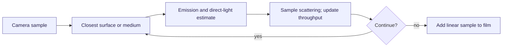

# 07 — The Rendering Equation and Path Probabilities

[[Chapter Edition/02 - Graphics Vision and XR/00 - Reading Map|Reading map]] · [[Chapter Edition/02 - Graphics Vision and XR/06 - From Material Data to GPU Bindings|Previous chapter]] · [[Chapter Edition/02 - Graphics Vision and XR/08 - Sampling Directions and Light Transport|Next chapter]]

The rendering equation expresses outgoing radiance as an integral over incoming directions. Monte Carlo paths estimate that integral, so probability and estimator structure are part of the rendering model.

**By the end:** Interpret path contributions and their probability weights in a Monte Carlo renderer.

**Recall question:** Why must the probability density accompany a sampled light-transport path?

<!-- Derived from Continuous Notes/University - Worlds, Images and Inference - Graphics, Vision and Photography.md; source lines 13372–16534; source-span SHA256 27d7e68f96a5b28c127ee0bc5089f16ea4f07496b55d08f017ecc90fb07f965f. -->

<!-- CHAPTER-SOURCE-BEGIN -->
## The rendering equation and light transport

## Follow one path without losing its probability

### Reconstruction checkpoint — isolate estimator invariants before tracing a scene

The path-transport chapter now has a small statistical witness independent of geometry. `tools/labs/monte_carlo_transport_lab.cpp` samples a cosine-weighted hemisphere and checks the analytic mean $E[\cos\theta]=2/3$; evaluates a Lambertian surface under a constant environment where $f\cos\theta/p$ cancels to the exact answer; runs a large deterministic Russian-roulette experiment and verifies survival compensation preserves expectation; and checks the balance-heuristic weight partition for two proposals.

This does not yet claim a complete path tracer, next-event estimator or participating-media renderer. It proves the sampling identities that a complete implementation depends on, so a later image disagreement can be separated into sampling math, scene intersection, BSDF evaluation, light PDFs and visibility. Use [[Multiple importance sampling]], [[Russian roulette path termination]] and [[Sampling support and missing strata]] for the compact failure-oriented derivations.


A ray query answers where a line segment or half-line meets geometry. A renderer uses many such queries to evaluate light transport. At a diffuse panel hit, the camera path can sample another direction. At the lamp, it can collect emission. At glass, it must also know which two media meet at the boundary. Reflection, transmission and medium absorption are different terms in that transport calculation.

The sampling density must match the integration measure. If a lamp point is sampled uniformly over area $A$, its area density is $1/A$. Seen from a shading point at distance $r$, that becomes directional density

$$
p_\omega=\frac{r^2}{A\lvert n_\ell\cdot(-\omega)\rvert}.
$$

If one of several lights is first chosen with probability $q_\ell$, multiply by $q_\ell$ as well. For $A=2\,\mathrm{m^2}$, $r=4\,\mathrm m$, light cosine $1/2$ and $q_\ell=1/3$, the final density is $16/3\,\mathrm{sr}^{-1}$. A density greater than one is valid; it is probability per unit solid angle. Omitting the discrete selection probability makes the result depend incorrectly on the number of lights.

[[Concepts/Multiple importance sampling|Multiple importance sampling]], or MIS, combines estimates produced by different sampling techniques. For one light sample and one BSDF sample, power weights use their squared densities at the same possible contribution. BSDF means bidirectional scattering distribution function; unlike BRDF, the wider term also includes transmission. Both techniques must contribute their estimators. Multiplying the light estimate by a weight below one and omitting the BSDF counterpart generally loses expected energy. When a BSDF-sampled continuation reaches an emitter, the renderer must use the complementary weight when the light technique could also have generated that path. A delta event, such as ideal mirror reflection, uses a separate discrete-event treatment rather than an ordinary finite solid-angle density. [PBRT's complete path integrator](https://pbr-book.org/4ed/Light_Transport_I_Surface_Reflection/A_Better_Path_Tracer)


#### First-use completion — construct the two estimators and prove what MIS preserves

At this hit point the desired reflected direct-light integral is
$$
I=\int_{\Omega}F(\omega)\,d\omega,\qquad
F(\omega)=L_i(\omega)\,f_s(\omega_o,\omega)\,
  |n\cdot\omega|\,V(\omega).
$$
Here $\omega$ is the incoming solid-angle direction, $L_i$ is incoming radiance in that direction, $f_s$ is the scattering function evaluated between the outgoing and incoming directions, $n$ is the surface normal, and $V$ is the visibility indicator (one if the sampled light path is unobstructed, zero otherwise). The absolute cosine is appropriate for a declared scattering domain that includes transmission; reflective-only code may instead use the positive hemisphere. Every probability density in the following formula is **per unit solid angle** at this same shading point. A light's area density cannot be compared numerically to a BSDF's directional density until the area-to-direction Jacobian has been applied.

Two algorithms can sample this integral. A **light sampler** chooses an emitter, a point on it, and the direction $\omega_L$; it must account for the discrete probability of selecting the emitter, area density on the chosen surface, and the change of measure from area to solid angle. A **BSDF sampler** chooses a direction $\omega_B$ based on the material's scattering distribution, and then traces that direction to discover whether it reaches a light. Their directional probability densities are $p_L(\omega)$ and $p_B(\omega)$. Neither technique needs to be uniformly good: light sampling helps with small visible emitters, while BSDF sampling helps with narrow glossy lobes.

With one independently generated sample from each technique, define complementary weights $w_L(\omega)$ and $w_B(\omega)$ such that $w_L+w_B=1$ wherever the integrand can contribute. The combined estimate is
$$
\widehat I=
 \frac{w_L(\omega_L)F(\omega_L)}{p_L(\omega_L)}
 +\frac{w_B(\omega_B)F(\omega_B)}{p_B(\omega_B)}.
$$
The essential derivation is an expectation, not an appeal to intuition:
$$
\begin{aligned}
\mathbb E[\widehat I]
&=\int p_L(\omega)\frac{w_L(\omega)F(\omega)}{p_L(\omega)}d\omega+
  \int p_B(\omega)\frac{w_B(\omega)F(\omega)}{p_B(\omega)}d\omega\\
&=\int [w_L(\omega)+w_B(\omega)]F(\omega)d\omega
=I.
\end{aligned}
$$
This cancellation assumes every nonzero contribution has support from at least one technique, densities are evaluated in a compatible measure, the chosen weights sum to one on supported paths, and the samples belong to the distributions claimed. A missing BSDF estimator breaks the second integral, so it is not enough to copy only the MIS weight into the light estimator. When the implementation uses one next-event-estimation sample and a BSDF-sampled continuation instead of explicitly drawing two samples in one function, the emitter-hit logic must still account for the *complementary* contribution at the correct path vertex.

A common **power heuristic** for one sample from each technique is
$$
w_L=\frac{p_L^2}{p_L^2+p_B^2},\qquad
w_B=\frac{p_B^2}{p_L^2+p_B^2}.
$$
The exponent 2 is a heuristic choice to suppress large weights from poorly matched samplers; it is not required by the unbiasedness proof. If the two techniques take $n_L$ and $n_B$ samples, the weights must account for their sample counts (for example by comparing $n_Lp_L$ and $n_Bp_B$), and each group is averaged with its corresponding sample count. The zero-density cases require an explicit policy: where $p_L=0$ but $p_B>0$, assign all weight to B. Where *both* densities are zero and $F\ne0$, neither estimator can represent the contribution and the sampling design is incomplete.

A small numerical check makes the measures and weights visible. On $x\in(0,1)$, let $F(x)=1$, $p_L(x)=2x$, and $p_B(x)=2(1-x)$. Both are normalized densities. At $x=0.25$, the densities are $0.5$ and $1.5$, so $w_L=0.1$ and $w_B=0.9$. A light-technique observation at this point contributes $0.1/0.5=0.2$; a BSDF-technique observation there contributes $0.9/1.5=0.6$. These are *per-sample terms*, not a demand that a single realization sum to one. Their expected values, integrated under their respective sampling densities, sum to the true $I=1$. The [first-use C++ witness](../../tools/labs/first_use_contract_lab.cpp) checks the same decomposition for $F(x)=x^2$, whose true integral is $1/3$, by independent quadrature of both expected contributions.

```text
direct_light_from_light_sample:
    choose emitter and point; compute direction, visibility, scattering
    convert emitter-selection × area PDF to solid-angle pL
    evaluate BSDF directional PDF pB for that same direction
    return F(direction) * power_weight(pL, pB) / pL

emission_from_bsdf_sample:
    trace a direction drawn from the BSDF PDF pB
    if it reaches a light also sampleable by NEE, evaluate pL for that path
    return F(direction) * power_weight(pB, pL) / pB
    # For unsupported competing techniques or delta events, apply the
    # separately declared event/measure policy rather than 0/0 weighting.
```

The pseudocode names the two probability contributions; it is not a drop-in path tracer. A real BSDF continuation carries throughput, medium state, visibility, path history, and an emission term that is already scaled consistently. For example, a perfectly specular delta event is a discrete probability mass and cannot be divided or compared as if it were an ordinary finite density over solid angle. A light directly visible from the camera, an environment emitter, and a path that reaches emission after several bounces need explicitly defined emission-handling branches to prevent both omission and double counting. Those implementation distinctions are required **here**, when MIS first affects the result, rather than being left as a promise of a future pass.

**Scope of the retained path-loop examples.** The supplied direct-light skeletons use `max(dot(normal, wi), 0)` and therefore implement reflective-hemisphere next-event estimation. A general BSDF with rough transmission can also contribute from the other hemisphere. It needs the appropriate absolute cosine, BSDF support, medium transition and visibility treatment. Keeping the reflective-only condition while advertising a complete transmissive estimator can omit light paths. The source code is retained for study, with this limitation made explicit.

Throughput $\beta$ stores the accumulated multiplicative transport weight along the camera path. At an ordinary sampled surface event it acquires $f\lvert N\cdot\omega\rvert/p_\omega$. For Lambert reflection sampled with cosine density, this simplifies to reflectance $\rho$. The cancellation is a useful implementation witness, not permission to omit densities for unrelated materials.

[[Concepts/Russian roulette path termination|Russian roulette]] chooses whether to continue a path. With survival probability $s>0$, multiply surviving throughput by $1/s$. Its conditional expectation is unchanged because $s(\beta/s)=\beta$. Roulette changes variance and cost; a hard bounce cap still removes longer paths and generally introduces truncation bias. Refractive transport additionally needs a consistent index-of-refraction convention and medium state. A medium stack describes properly nested closed volumes; overlapping non-nested boundaries need a more explicit policy.

### A missing region cannot be repaired by taking more samples there

Take the first five cells, in row-major order, of a jittered $3\times3$ pixel grid. Four cells are never visited. Let the pixel integrand be $g(x,y)=y$, with rows counted upward from zero. The first three selected cells have expected $y=1/6$, and the next two have expected $y=1/2$. Equal averaging therefore gives

$$
\mathbb E[\widehat I]=\frac{3(1/6)+2(1/2)}5=0.3,
$$

while the full pixel integral is $1/2$. More repeated samples in those same cells converge to $0.3$. The fix is a sampling design that covers the target domain with the appropriate weights, not simply more samples. This example corrects the supplied non-square-grid discussion.

![[Visual Recall/Integrated Geometry and Engine/rendering-representation-witnesses.png]]

The figure compares three distinct errors: interpolating the wrong projected quantity, averaging encoded light values, and omitting part of the sampling domain. Each panel uses the numerical witness derived above. The right panel numbers rows from bottom to top; another row orientation changes the biased value but does not restore full support.

For a reproducible renderer, associate random dimensions with pixel, sample and bounce identity rather than worker identity. Scheduling can then change without intentionally changing the sample set. Bitwise equality additionally requires a stable arithmetic and reduction order. A stochastic convergence plot should state its metric: ordinary finite-variance independent sampling gives mean-square error proportional to $1/N$ and root-mean-square error proportional to $1/\sqrt N$. A noisy reference, correlated samples or estimator bias can obscure those slopes.



The arrow from scattering back to the next interaction carries a ray, throughput, medium state and sampling history. Losing any of those can change the represented transport, even when every individual intersection test is correct.

Implementation-specific passages retain observations from the supplied Kairo/Maveb snapshot. They are not a fresh audit of those repositories. Source exercises and illustrative code are teaching material; only explicitly recorded checks have been executed here.

**Visibility queries become a renderer**

Once we know:

$$
\text{what surface a ray reaches},
$$

we can ask:

> How much radiance returns along that ray?

Define a function conceptually:

```cpp
Color TraceRay(Ray ray, int depth);
```

This is not merely intersection.

It is light transport.

Classic recursive ray tracing is usually associated with Turner Whitted's 1980 renderer.

---

**Whitted recursion**

For a camera ray:

$$
R_c.
$$

Find nearest hit.

If miss:

$$
L=L_{\text{environment}}.
$$

If hit:

- evaluate local/direct lighting;
- shoot shadow rays;
- if mirror, shoot reflection ray;
- if glass, shoot reflection and refraction rays;
- recurse.

Conceptually:

$$
\boxed{
L=
L_{\text{local}}
+
k_rL_{\text{reflect}}
+
k_tL_{\text{refract}}.
}
$$

Current Kairo's `TraceWhitted()` follows exactly this architecture.

---

**Current Kairo TraceWhitted structure**

Conceptually:

```cpp
Color TraceWhitted(
    Scene scene,
    Ray ray,
    uint32_t depth)
{
    if (depth > MaxDepth)
        return black;

    hit = scene.Intersect(ray);

    if (!hit)
        return environment;

    if (emissive)
        return emission;

    if (mirror)
        return Trace(reflectionRay);

    if (glass)
        return
            F * Trace(reflectionRay)
            +
            (1-F) * Trace(refractionRay);

    return DirectLighting(hit);
}
```

That is textbook Whitted recursion.

---

**Direct illumination**

For one point light:

$$
P_L.
$$

Surface hit:

$$
P.
$$

Light direction:

$$
L=
\frac{P_L-P}
{\|P_L-P\|}.
$$

Distance:

$$
d=
\|P_L-P\|.
$$

Lambert cosine:

$$
N\cdot L.
$$

Point-light attenuation:

$$
\propto
\frac1{d^2}.
$$

So a simple contribution can be:

$$
\boxed{
L_o
=
\rho
L_{\text{light}}
\frac{
\max(N\cdot L,0)
}{
d^2
}
}
$$

for a non-normalized historical Lambert model, or physically:

$$
\boxed{
L_o
=
\frac{\rho}{\pi}
L_i
(N\cdot L).
}
$$

Current Whitted Kairo path is intentionally a simpler local Lambert-style model, while the PBR integrator contains the normalized BRDF machinery.

---

**Why inverse square appears for point lights**

A point source emits power over spherical area:

$$
A=4\pi r^2.
$$

If total flux is fixed, power per area scales as:

$$
\frac1{4\pi r^2}.
$$

Hence:

$$
\boxed{
E\propto\frac1{r^2}.
}
$$

This is not radiance attenuation along one free-space ray.

It is geometric spreading of a point emitter's total power over a growing sphere.

That distinction from Pass 3 matters.

---

**Shadow rays**

Without a shadow query, the shader knows geometric relation to a light but not whether light actually reaches the surface.

Define:

$$
R_s(t)=P'+tL.
$$

For point light:

$$
t_{\max}=d-\epsilon.
$$

If any geometry intersects within this segment:

$$
V(P,L)=0.
$$

Otherwise:

$$
V(P,L)=1.
$$

Then:

$$
\boxed{
L_o
=
V(P,L)
f_r
L_i
(N\cdot L).
}
$$

Visibility is therefore multiplicative.

A shadow is not fundamentally “darkness painted onto the surface.”

It is:

$$
\boxed{\text{zero contribution from an occluded light transport path}.}
$$

---

**Kairo's shadow query**

Current Whitted point-light code:

$$
\texttt{shadow origin}
=
P+\epsilon N
$$

then:

$$
\texttt{Occluded(ray,d-\epsilon)}.
$$

Current directional-light query uses:

$$
t_{\max}\approx\infty
$$

because directional lights are treated as infinitely distant.

That is the correct distinction.

---

**Mirror reflection ray**

Incoming travel direction:

$$
I.
$$

Surface normal:

$$
N.
$$

Reflection:

$$
\boxed{
R=
I-2(I\cdot N)N.
}
$$

Then:

$$
R_r(t)
=
P'+tR.
$$

For a perfect mirror, local diffuse lighting is not used.

Returned radiance comes from whatever that reflected ray reaches:

$$
\boxed{
L_o(P,V)
=
F\,L_i(P,R)
}
$$

in the idealized mirror direction.

Kairo's mirror path recursively traces the reflected ray and multiplies by material albedo/tint.

---

**Refraction ray**

From Pass 4:

$$
\eta=
\frac{\eta_i}{\eta_t}.
$$

With normalized incoming travel direction $I$ and appropriately oriented normal $N$:

$$
c_i=-N\cdot I.
$$

Then:

$$
\boxed{
T=
\eta I+
(\eta c_i-c_t)N
}
$$

where:

$$
c_t
=
\sqrt{
1-\eta^2(1-c_i^2)
}.
$$

If square-root argument becomes negative:

$$
\boxed{\text{total internal reflection}.}
$$

Kairo's current glass path already detects absence of a valid refraction direction and sets Fresnel:

$$
F=1.
$$

---

**Glass branches into two recursive rays**

At an ideal dielectric interface, both reflected and refracted paths contribute.

Whitted rendering therefore evaluates:

$$
L_{\text{reflect}}
$$

and:

$$
L_{\text{refract}}.
$$

Then combines:

$$
\boxed{
L=
F L_{\text{reflect}}
+
(1-F)L_{\text{refract}}.
}
$$

Kairo does exactly this using Schlick Fresnel.

This is deterministic branching.

Later path tracing will often *sample* one branch probabilistically rather than recursively tracing both every time.

That difference matters enormously for complexity.

---

**Why recursion needs a depth limit**

Imagine two perfect parallel mirrors.

Ray reflects:

```text
mirror A
→ mirror B
→ mirror A
→ mirror B
→ ...
```

Infinite recursion.

Or glass can generate a branching tree.

If each bounce spawns two rays:

$$
N_d\approx2^d.
$$

At depth 20:

$$
2^{20}
=
1,048,576
$$

possible leaves for just one primary ray in the worst theoretical case.

Therefore Whitted renderers impose:

$$
\boxed{
d\le d_{\max}.
}
$$

Current Kairo returns black when:

$$
\texttt{depth > MaxDepth}.
$$

---

**A fixed recursion limit is biased**

Suppose we stop at depth 5.

There may still be nonzero radiance arriving from deeper paths.

We discard it.

Thus:

$$
\boxed{
\text{hard depth truncation introduces bias}.
}
$$

It may be tiny and acceptable for Whitted rendering.

Later path tracing often combines a minimum depth with **Russian roulette**, which probabilistically terminates paths while preserving expectation.

That comes in later passes.

---

**Why Whitted rendering looked revolutionary**

It naturally produces:

- hard shadows,
- mirror reflections,
- refraction,
- recursive reflective/refractive objects.

Those effects are difficult to express in basic local raster shading.

Ray tracing makes them geometrically direct:

```text
Want reflection?
Trace reflected ray.

Want shadow?
Trace ray to light.

Want refraction?
Trace transmitted ray.
```

This elegance is why ray tracing is conceptually so compelling.

---

**Whitted limitations**

The major limitation is which light paths it evaluates.

Whitted tracing efficiently follows:

$$
E
$$

camera/emission paths plus deterministic specular chains and explicitly sampled direct lights.

But it generally does not simulate arbitrary diffuse interreflection.

Imagine:

```text
light
→ red wall
→ white wall
→ camera
```

The white wall should receive red indirect bounce.

A standard Whitted renderer evaluates direct light at the white wall and misses this path.

Similarly, soft global illumination, complex glossy transport and many caustic/diffuse path combinations are absent.

Whitted's recursion structure is **hand-selected transport**, not a general solution to the rendering equation.

---

**The rendering equation**

The general local surface reflection equation is:

$$
\boxed{
L_o(x,\omega_o)
=
L_e(x,\omega_o)
+
\int_{\Omega^+}
f_r(x,\omega_i,\omega_o)
L_i(x,\omega_i)
(\mathbf n\cdot\omega_i)
\,d\omega_i.
}
$$

Every term deserves to be understood as a physical quantity rather than syntax.

This equation is the bridge from Whitted ray tracing to path tracing.

---

**Outgoing radiance**

$$
L_o(x,\omega_o)
$$

means:

> Radiance leaving surface point $x$ along outgoing direction $\omega_o$.

For the camera ray, $\omega_o$ typically points from the surface toward the camera.

Units:

$$
\frac{\mathrm W}
{\mathrm{m^2\,sr}}.
$$

The entire renderer ultimately estimates this quantity for each camera sample.

---

**Emitted radiance**

$$
L_e(x,\omega_o)
$$

is light generated by the surface itself.

Examples:

- glowing panel,
- area light,
- sun model,
- emissive geometry.

A nonemissive surface has:

$$
L_e=0.
$$

An emissive surface contributes even if no other light reaches it.

Thus:

$$
\boxed{
\text{outgoing radiance}
=
\text{emission}
+
\text{reflected incoming radiance}.
}
$$

---

**Incident radiance**

$$
L_i(x,\omega_i)
$$

means radiance arriving at $x$ from direction $\omega_i$.

Where does it come from?

Trace a ray from $x$ along $\omega_i$.

Suppose it first reaches point $y$.

Then, ignoring participating media:

$$
\boxed{
L_i(x,\omega_i)
=
L_o(y,-\omega_i).
}
$$

This is the recursive heart of global illumination.

Incident light at one surface is outgoing light from another.

Thus the rendering equation is recursive.

---

**The BRDF term**

$$
f_r(x,\omega_i,\omega_o)
$$

answers:

> Of the radiance arriving from $\omega_i$, how efficiently is it scattered toward $\omega_o$?

Units:

$$
\mathrm{sr}^{-1}.
$$

For Lambert:

$$
f_r=
\frac{\rho}{\pi}.
$$

For GGX:

$$
f_r=
f_d+
f_s.
$$

This term contains material scattering.

It does **not** contain visibility to another surface.

Visibility is embedded indirectly in $L_i$, because incoming radiance depends on what the ray in that direction actually sees.

---

**Cosine foreshortening**

The integral multiplies by:

$$
\boxed{
\cos\theta_i
=
N\cdot\omega_i.
}
$$

Why?

A surface patch of physical area $dA$ presents projected area:

$$
dA_\perp
=
dA\cos\theta.
$$

At grazing incidence, a beam hits less projected area.

Thus incoming irradiance is:

$$
dE
=
L_i
\cos\theta_i
d\omega_i.
$$

The cosine belongs to geometry, not the BRDF.

This is exactly the same projected-area reasoning from Pass 3.

---

**Hemisphere integral**

Why integrate over a hemisphere?

Only directions above the surface can contribute to ordinary reflection:

$$
N\cdot\omega_i>0.
$$

Thus:

$$
\Omega^+
=
\{
\omega:
N\cdot\omega>0
\}.
$$

In spherical coordinates:

$$
\theta\in[0,\pi/2],
$$

$$
\phi\in[0,2\pi).
$$

Differential solid angle:

$$
\boxed{
d\omega
=
\sin\theta\,d\theta\,d\phi.
}
$$

Therefore rendering equation can be written:

$$
L_o
=
L_e
+
\int_0^{2\pi}
\int_0^{\pi/2}
f_r
L_i
\cos\theta
\sin\theta
\,d\theta\,d\phi.
$$

That is a 2D integral over infinitely many incoming directions.

---

**Why we cannot evaluate the integral exactly**

For arbitrary scenes:

$$
L_i(x,\omega_i)
$$

is a highly complicated function.

Each direction may hit:

- different object,
- different material,
- emitter,
- environment,
- another reflective surface.

Analytic integration is generally impossible.

Even evaluating many regular directions quickly becomes prohibitively expensive.

We need numerical integration.

This is where Monte Carlo enters.

---

**Monte Carlo integration begins with expectation**

Suppose we want:

$$
I=
\int_D f(x)\,dx.
$$

Imagine sampling $X$ from uniform distribution over domain $D$.

If domain measure is:

$$
|D|,
$$

uniform density is:

$$
p(x)=\frac1{|D|}.
$$

Expectation:

$$
E[f(X)]
=
\int_D
f(x)p(x)\,dx.
$$

Substitute:

$$
=
\frac1{|D|}
\int_D f(x)\,dx.
$$

Therefore:

$$
I=
|D|E[f(X)].
$$

Approximate expectation with sample mean:

$$
E[f(X)]
\approx
\frac1N
\sum_{i=1}^{N}
f(X_i).
$$

Thus:

$$
\boxed{
I
\approx
\frac{|D|}{N}
\sum_i f(X_i).
}
$$

That is basic uniform Monte Carlo integration.

---

**General importance-sampled Monte Carlo derivation**

Now sample from any PDF:

$$
p(x)>0
$$

wherever:

$$
f(x)\neq0.
$$

Start:

$$
I=
\int_D f(x)\,dx.
$$

Multiply and divide by $p(x)$:

$$
I=
\int_D
\frac{f(x)}{p(x)}
p(x)\,dx.
$$

But this is exactly expectation under $p$:

$$
\boxed{
I=
E_p
\left[
\frac{f(X)}{p(X)}
\right].
}
$$

Estimate expectation with samples:

$$
\boxed{
\hat I_N
=
\frac1N
\sum_{i=1}^{N}
\frac{
f(X_i)
}{
p(X_i)
}.
}
$$

This is the general Monte Carlo estimator.

This equation is one of the most important formulas in all physically based rendering.

---

**Why divide by the PDF?**

Suppose you intentionally sample one region more frequently.

Without compensation, that region contributes too much merely because you visited it more often.

The factor:

$$
\frac1{p(x)}
$$

compensates for sampling frequency.

High-probability samples receive lower weight.

Low-probability samples receive higher weight.

That keeps the estimator unbiased.

Sampling strategy changes **variance**, not expected answer, assuming support and weights are correct.

---

**Rendering equation Monte Carlo estimator**

Define integrand:

$$
g(\omega_i)
=
f_r(\omega_i,\omega_o)
L_i(\omega_i)
(N\cdot\omega_i).
$$

Then:

$$
L_o
=
L_e+
\int_{\Omega^+}
g(\omega_i)
\,d\omega_i.
$$

Sample:

$$
\omega_i\sim p(\omega).
$$

Estimator:

$$
\boxed{
\hat L_o
=
L_e
+
\frac1N
\sum_{k=1}^{N}
\frac{
f_r(\omega_k,\omega_o)
L_i(\omega_k)
(N\cdot\omega_k)
}{
p(\omega_k)
}.
}
$$

This is the central path-tracing estimator.

Everything in the next few passes is largely about choosing better:

$$
p(\omega).
$$

---

**Probability density is not probability**

For continuous variables:

$$
p(x)
$$

is a **density**.

Probability of exactly one real-valued point is zero.

Probability over an interval:

$$
P(a\le X\le b)
=
\int_a^b
p(x)\,dx.
$$

Likewise directional PDF:

$$
p(\omega)
$$

has units:

$$
\mathrm{sr}^{-1}.
$$

Probability of sampling a small solid-angle patch:

$$
dP
=
p(\omega)d\omega.
$$

This distinction is critical.

---

**PDF normalization**

A valid PDF must satisfy:

$$
p(x)\ge0
$$

and:

$$
\boxed{
\int_Dp(x)\,dx=1.
}
$$

For directions over hemisphere:

$$
\boxed{
\int_{\Omega^+}
p(\omega)d\omega
=
1.
}
$$

Later, uniform hemisphere sampling will therefore have:

$$
p(\omega)
=
\frac1{2\pi}
$$

because hemisphere solid angle is:

$$
2\pi.
$$

That is Part 2031, technically next pass, but you can already see how it follows.

---

**PDF units matter**

Suppose:

$$
f_r
$$

has units:

$$
\mathrm{sr}^{-1}.
$$

Incoming radiance:

$$
L_i
$$

has:

$$
\mathrm{W\,m^{-2}\,sr^{-1}}.
$$

Cosine is dimensionless.

Directional PDF:

$$
p(\omega)
$$

has:

$$
\mathrm{sr}^{-1}.
$$

Estimator term:

$$
\frac{
f_rL_i\cos\theta
}{
p
}
$$

has:

$$
\frac{
(\mathrm{sr}^{-1})
(\mathrm{W\,m^{-2}\,sr^{-1}})
}{
\mathrm{sr}^{-1}
}
$$

which yields:

$$
\mathrm{W\,m^{-2}\,sr^{-1}}.
$$

Exactly radiance.

Units are a powerful way to catch missing PDF factors.

---

**Uniform sampling versus importance sampling**

Suppose integrand contains a tiny bright region.

Uniform sampling wastes most samples where contribution is near zero.

Instead choose:

$$
p(x)
\propto|f(x)|.
$$

Then more samples land where the integral has significant magnitude.

The theoretically ideal PDF for nonnegative $f$ is:

$$
p^*(x)
=
\frac{f(x)}
{\int f}.
$$

Then:

$$
\frac{f(x)}{p^*(x)}
=
\int f
$$

is constant and variance becomes zero.

Of course if we already knew:

$$
\int f,
$$

we would not need Monte Carlo.

But this tells us the principle:

$$
\boxed{
\text{sample proportional to expected contribution}.
}
$$

That principle drives:

- cosine hemisphere sampling,
- GGX sampling,
- light sampling,
- environment importance sampling,
- MIS.

---

**Variance**

Monte Carlo estimator is random.

Its variance for independent identically distributed samples decreases approximately as:

$$
\boxed{
\operatorname{Var}(\hat I_N)
=
\frac{
\operatorname{Var}(f(X)/p(X))
}{
N
}.
}
$$

Standard deviation therefore falls as:

$$
\boxed{
\sigma_N
\propto
\frac1{\sqrt N}.
}
$$

To halve noise standard deviation:

$$
\frac1{\sqrt{N_2}}
=
\frac12
\frac1{\sqrt{N_1}}
$$

so:

$$
N_2=4N_1.
$$

Thus:

$$
\boxed{
2\times \text{cleaner}
\approx
4\times\text{samples}.
}
$$

Monte Carlo convergence is slow.

That is why sampling quality matters so much.

---

**Why path tracing is recursive Monte Carlo**

At first bounce:

$$
L_i(x,\omega_i)
$$

is unknown.

Trace ray along:

$$
\omega_i.
$$

It hits:

$$
y.
$$

Then:

$$
L_i(x,\omega_i)
=
L_o(y,-\omega_i).
$$

But $L_o(y,\cdot)$ itself contains another integral.

So the estimator recursively samples:

$$
\text{camera}
\rightarrow
x_1
\rightarrow
x_2
\rightarrow
x_3
\rightarrow\cdots
$$

Each bounce accumulates factors:

$$
f_r
\frac{\cos\theta}{p}.
$$

That accumulated multiplicative value becomes path **throughput**.

We will derive that carefully in Pass 7.

---

**How Whitted and path tracing differ conceptually**

Whitted rendering asks:

```text
What special deterministic rays should I spawn?
```

For example:

- one mirror direction,
- one refraction direction,
- explicit rays to lights.

Path tracing asks:

$$
\boxed{
\text{How can I construct an unbiased stochastic estimator of the rendering equation?}
}
$$

That is a much deeper shift.

A mirror reflection still has a special delta-distribution treatment, but diffuse and glossy transport become samples of an integral rather than hand-coded effect branches.

---

**Whitted direct lighting as a special sampling strategy**

A point light occupies a delta direction from a surface:

$$
\omega_L.
$$

Whitted explicitly evaluates that direction.

For a diffuse material, it computes something like:

$$
f_r(\omega_L,\omega_o)
L_i(\omega_L)
(N\cdot\omega_L)
V.
$$

This can be understood as a specialized estimator for direct illumination.

So Whitted is not completely alien to rendering-equation thinking.

It evaluates a restricted set of path families explicitly.

Path tracing generalizes the sampling process to many more directions and transport events.

---

**One-bounce rendering equation example**

Suppose Lambertian surface:

$$
\rho=0.8.
$$

Uniform environment radiance:

$$
L_i=2.
$$

Then:

$$
f_r=
\frac{0.8}{\pi}.
$$

Rendering equation:

$$
L_o
=
\int_{\Omega^+}
\frac{0.8}{\pi}
(2)
\cos\theta
d\omega.
$$

Constants out:

$$
=
\frac{1.6}{\pi}
\int_{\Omega^+}
\cos\theta d\omega.
$$

We know:

$$
\int_{\Omega^+}
\cos\theta d\omega
=
\pi.
$$

Therefore:

$$
\boxed{
L_o=1.6.
}
$$

This is our ground truth.

Now sample uniformly over hemisphere:

$$
p=\frac1{2\pi}.
$$

A one-sample estimator is:

$$
\hat L_o
=
\frac{
(0.8/\pi)(2)\cos\theta
}{
1/(2\pi)
}.
$$

Simplify:

$$
\boxed{
\hat L_o
=
3.2\cos\theta.
}
$$

It varies wildly with sampled angle.

Expected value is still 1.6.

This variance motivates cosine-weighted sampling.

---

**Preview of cosine-weighted sampling**

If instead:

$$
p(\omega)
=
\frac{\cos\theta}{\pi},
$$

then:

$$
\hat L_o
=
\frac{
(\rho/\pi)L_i\cos\theta
}{
\cos\theta/\pi
}
$$

and everything cancels:

$$
\boxed{
\hat L_o
=
\rho L_i.
}
$$

For the constant environment:

$$
=
0.8\times2
=
1.6.
$$

Every sample gives exactly the same answer.

Zero variance for this idealized case.

That is why sampling distribution should resemble the integrand.

We derive how to generate these directions in Pass 7.

---

**Current Kairo already contains the future**

Interestingly, current `PathIntegrator.cppm` already has:

```cpp
CosineHemisphereDirection(...)
```

and a MIS power heuristic.

Its cosine sampler constructs:

$$
r=\sqrt{\xi_2},
$$

$$
\phi=2\pi\xi_1,
$$

$$
x=r\cos\phi,
$$

$$
z=r\sin\phi,
$$

$$
y=\sqrt{1-\xi_2}.
$$

That is exactly the cosine-weighted hemisphere distribution we will derive next pass.

So the codebase is ahead of the current theoretical boundary.

That is useful: the next pass lets us reverse-engineer why those exact square roots appear.

---

**A robust Ray API design**

The current generic `Ray` only stores:

```cpp
Origin
Direction
```

and query APIs separately pass max distance/bias semantics.

For a rendering-focused ray interface, I would prefer explicitly carrying the interval:

```cpp
struct Ray
{
    Vec3 Origin;
    Vec3 Direction;

    float TMin = 0.0f;
    float TMax =
        std::numeric_limits<float>::infinity();

    [[nodiscard]]
    Vec3 At(float t) const noexcept
    {
        return Origin +
               Direction * t;
    }

    [[nodiscard]]
    bool Contains(float t) const noexcept
    {
        return
            t >= TMin &&
            t <= TMax;
    }
};
```

Why?

Because the interval is a property of the **query**.

It makes impossible states harder to represent.

A shadow ray naturally carries:

$$
[\epsilon,d-\epsilon].
$$

A primary ray:

$$
[\epsilon,\infty).
$$

A closest-hit traversal can tighten `TMax`.

However, keeping the geometry ray type minimal and passing query ranges separately is also valid architecture. The important thing is that intervals exist somewhere explicit.

---

**Better hit record for future Kairo**

As path tracing becomes more advanced, I would evolve:

```cpp
struct SurfaceHit
{
    float T;

    Vec3 Position;

    // True orientation from geometry.
    Vec3 GeometricNormal;

    // Potentially interpolated / normal mapped orientation.
    Vec3 ShadingNormal;

    Vec2 UV;

    // Triangle barycentrics when applicable.
    Vec3 Barycentrics;

    uint32_t PrimitiveIndex;
    uint32_t MaterialIndex;

    bool FrontFace;
};
```

Then maintain invariant:

$$
N_s\cdot N_g\ge0.
$$

And use geometric normal for:

- side classification,
- robust origin offset,
- medium boundary decisions.

Use shading normal primarily for:

- BRDF evaluation.

This separation becomes important enough that it is worth designing early.

---

**BVH traversal skeleton**

A stripped-down closest-hit implementation:

```cpp
std::optional<Hit>
TraceClosest(
    const Ray& inputRay,
    const BVH& bvh)
{
    if (bvh.nodes.empty())
        return std::nullopt;

    Ray ray = inputRay;

    std::optional<Hit> closest;

    // Local stack avoids recursive function-call overhead.
    std::array<uint32_t, 64> stack{};
    uint32_t stackSize = 0;

    stack[stackSize++] = 0; // root

    while (stackSize > 0)
    {
        const uint32_t nodeIndex =
            stack[--stackSize];

        const BVHNode& node =
            bvh.nodes[nodeIndex];

        float nodeNear = 0.0f;

        if (!IntersectAABB(
                ray,
                node.bounds,
                nodeNear))
        {
            continue;
        }

        // Since ray.tMax shrinks whenever a closer primitive is found,
        // far nodes naturally become rejectable.
        if (nodeNear > ray.tMax)
            continue;

        if (node.IsLeaf())
        {
            for (uint32_t i = 0;
                 i < node.primitiveCount;
                 ++i)
            {
                const uint32_t primitiveIndex =
                    bvh.primitiveIndices[
                        node.firstPrimitive + i];

                auto hit =
                    IntersectPrimitive(
                        ray,
                        primitiveIndex);

                if (hit &&
                    hit->t < ray.tMax)
                {
                    closest = hit;

                    // Tighten the query.
                    ray.tMax = hit->t;
                }
            }

            continue;
        }

        float leftNear;
        float rightNear;

        const bool hitLeft =
            IntersectAABB(
                ray,
                bvh.nodes[node.left].bounds,
                leftNear);

        const bool hitRight =
            IntersectAABB(
                ray,
                bvh.nodes[node.right].bounds,
                rightNear);

        // Push farther child first because stack is LIFO.
        // The nearer child is processed immediately.
        if (hitLeft && hitRight)
        {
            if (leftNear < rightNear)
            {
                stack[stackSize++] =
                    node.right;

                stack[stackSize++] =
                    node.left;
            }
            else
            {
                stack[stackSize++] =
                    node.left;

                stack[stackSize++] =
                    node.right;
            }
        }
        else if (hitLeft)
        {
            stack[stackSize++] =
                node.left;
        }
        else if (hitRight)
        {
            stack[stackSize++] =
                node.right;
        }
    }

    return closest;
}
```

This is conceptually very close to your actual KairoSpatial traversal.

---

**Any-hit traversal skeleton**

Shadow query does not need any closest tracking:

```cpp
bool TraceAny(
    const Ray& ray,
    const BVH& bvh)
{
    std::array<uint32_t, 64> stack{};
    uint32_t stackSize = 0;

    stack[stackSize++] = 0;

    while (stackSize)
    {
        const BVHNode& node =
            bvh.nodes[
                stack[--stackSize]];

        if (!IntersectAABB(
                ray,
                node.bounds))
        {
            continue;
        }

        if (node.IsLeaf())
        {
            for (uint32_t i = 0;
                 i < node.primitiveCount;
                 ++i)
            {
                if (IntersectPrimitive(
                        ray,
                        node.Primitive(i)))
                {
                    // Nothing else matters.
                    return true;
                }
            }
        }
        else
        {
            stack[stackSize++] =
                node.left;

            stack[stackSize++] =
                node.right;
        }
    }

    return false;
}
```

This difference looks small in code.

Across billions of shadow queries it is enormous.

---

**The complete Whitted trace**

Now put M121 and M122 together:

```cpp
Color TraceWhitted(
    const Scene& scene,
    const Ray& ray,
    uint32_t depth)
{
    if (depth >= scene.maxDepth)
        return Color::Black();

    const auto hit =
        scene.IntersectClosest(ray);

    if (!hit)
        return scene.Environment(ray.Direction);

    const Material& material =
        scene.Material(hit->MaterialID);

    if (material.IsEmissive())
        return material.Emission;

    // ---------------------------------------------------------
    // Perfect mirror.
    // ---------------------------------------------------------
    if (material.IsMirror())
    {
        const Vec3 reflection =
            Reflect(
                ray.Direction,
                hit->GeometricNormal);

        Ray child =
            SpawnRay(
                *hit,
                reflection);

        return
            material.Reflectance *
            TraceWhitted(
                scene,
                child,
                depth + 1);
    }

    // ---------------------------------------------------------
    // Ideal dielectric.
    // ---------------------------------------------------------
    if (material.IsGlass())
    {
        const bool entering =
            hit->FrontFace;

        const float etaI =
            entering ? 1.0f : material.IOR;

        const float etaT =
            entering ? material.IOR : 1.0f;

        const Vec3 N =
            hit->FaceForwardNormal();

        const Vec3 reflection =
            Reflect(
                ray.Direction,
                N);

        const float F =
            Fresnel(...);

        Color result =
            F *
            TraceWhitted(
                scene,
                SpawnRay(
                    *hit,
                    reflection),
                depth + 1);

        auto transmission =
            Refract(
                ray.Direction,
                N,
                etaI / etaT);

        if (transmission)
        {
            result +=
                (1.0f - F) *
                TraceWhitted(
                    scene,
                    SpawnTransmissionRay(
                        *hit,
                        *transmission),
                    depth + 1);
        }

        return result;
    }

    // ---------------------------------------------------------
    // Local/direct surface shading.
    // ---------------------------------------------------------
    Color Lo =
        material.Emission;

    for (const Light& light :
         scene.Lights())
    {
        LightSample sample =
            light.Sample(hit->Position);

        if (sample.NdotL <= 0.0f)
            continue;

        Ray shadow =
            SpawnShadowRay(
                *hit,
                sample.Direction,
                sample.Distance);

        if (scene.Occluded(shadow))
            continue;

        const Color fr =
            EvaluateBRDF(
                material,
                *hit,
                -ray.Direction,
                sample.Direction);

        Lo +=
            fr *
            sample.Radiance *
            sample.NdotL;
    }

    return Lo;
}
```

This is already a respectable ray tracer.

But it is not yet a path tracer.

---

**Rendering equation as code**

The equation:

$$
L_o
=
L_e+
\int
f_rL_i\cos\theta\,d\omega
$$

maps conceptually to:

```cpp
Color IntegrateSurface(
    SurfaceHit hit,
    Vec3 wo)
{
    Color result =
        hit.material.Emission;

    for all incoming directions wi:
    {
        Color Li =
            TraceRayFromSurface(
                hit,
                wi);

        Color fr =
            hit.material.BRDF(
                wi,
                wo);

        result +=
            fr *
            Li *
            max(
                Dot(hit.normal, wi),
                0.0f)
            *
            dOmega;
    }

    return result;
}
```

The impossible phrase is:

```text
for all incoming directions
```

because there are infinitely many.

Monte Carlo replaces that infinite loop with random samples.

---

**Monte Carlo rendering equation as code**

```cpp
Color EstimateSurfaceRadiance(
    const SurfaceHit& hit,
    Vec3 wo,
    RNG& rng,
    uint32_t sampleCount)
{
    Color result =
        hit.Material.Emission;

    for (uint32_t s = 0;
         s < sampleCount;
         ++s)
    {
        DirectionSample sample =
            SampleIncomingDirection(
                hit,
                rng);

        const Vec3 wi =
            sample.Direction;

        const float pdf =
            sample.Pdf;

        if (pdf <= 0.0f)
            continue;

        const float cosine =
            std::max(
                Dot(
                    hit.ShadingNormal,
                    wi),
                0.0f);

        if (cosine <= 0.0f)
            continue;

        const Color fr =
            EvaluateBRDF(
                hit,
                wi,
                wo);

        Ray nextRay =
            SpawnRay(
                hit,
                wi);

        const Color Li =
            TracePath(nextRay, rng);

        result +=
            fr *
            Li *
            (cosine / pdf);
    }

    return
        result /
        static_cast<float>(
            sampleCount);
}
```

The most important line is:

```cpp
fr * Li * cosine / pdf
```

because it is literally:

$$
\boxed{
\frac{
f_rL_i(N\cdot\omega_i)
}{
p(\omega_i)
}
}.
$$

That is the rendering equation turned into an estimator.

---

**PDF and measure must match**

A subtle but critical future issue:

A PDF can be defined with respect to:

- area,
- solid angle,
- projected solid angle,
- length,
- discrete probability.

These are not interchangeable.

For example:

$$
p_A(y)
$$

in:

$$
\mathrm{m}^{-2}
$$

is not the same thing as:

$$
p_\omega(\omega)
$$

in:

$$
\mathrm{sr}^{-1}.
$$

When sampling an area light, we will need the transformation:

$$
\boxed{
p_\omega
=
p_A
\frac{r^2}
{|N_L\cdot(-\omega)|}
}
$$

in a later pass.

A huge fraction of path-tracing bugs are really **wrong measure/PDF bugs**.

---

**Discrete versus continuous PDF**

Suppose you choose one of four lights uniformly.

Discrete probability:

$$
P(L_i)=\frac14.
$$

Then sample a point on that selected area light using area density:

$$
p_A(x|L_i).
$$

The total sampling density is a product:

$$
\boxed{
p=
P(L_i)
p_A(x|L_i).
}
$$

Later, converting to solid angle adds another Jacobian.

This is why path tracing requires serious probability reasoning.

It is not “random rays until image appears.”

---

**Ray tracing cost multiplication**

Suppose:

$$
1920\times1080
$$

image:

$$
2.07\text{ million pixels}.
$$

At:

$$
64\text{ samples/pixel},
$$

primary samples:

$$
132.7\text{ million}.
$$

If average path length is 6:

$$
796\text{ million path segments}.
$$

Add direct-light shadow rays and you can exceed:

$$
1\text{ billion ray queries}.
$$

If every query tested:

$$
1\text{ million triangles},
$$

brute force would be on order:

$$
10^{15}
$$

primitive tests.

This is why:

$$
\boxed{
\text{sampling strategy}
+
\text{BVH quality}
+
\text{intersection throughput}
}
$$

are all first-class rendering concerns.

---

**Kairo's current acceleration statistics are extremely useful**

`RenderStats` tracks:

$$
\text{PrimaryRays},
$$

$$
\text{ShadowRays},
$$

$$
\text{ReflectionRays},
$$

$$
\text{BVHVisitedNodes},
$$

$$
\text{BVHTestedPrimitives}.
$$

Then derives:

$$
\boxed{
\text{PrimitiveTestsPerRay}
=
\frac{
\text{tested primitives}
}{
\text{total rays}
}
}
$$

and:

$$
\boxed{
\text{NodesVisitedPerRay}
=
\frac{
\text{visited nodes}
}{
\text{total rays}
}.
}
$$

These are exactly the kinds of metrics you need to compare:

- brute force,
- median BVH,
- SAH BVH,
- Morton ordering.

Do not judge acceleration structures on FPS alone.

---

**A BVH correctness experiment**

Kairo already has an `AccelerationDifference` render/debug mode.

The essential invariant is:

$$
\boxed{
\operatorname{ClosestHit}_{\text{BVH}}(r)
=
\operatorname{ClosestHit}_{\text{brute}}(r)
}
$$

for every ray.

For any-hit:

$$
\boxed{
\operatorname{AnyHit}_{\text{BVH}}(r,t_{\max})
=
\operatorname{AnyHit}_{\text{brute}}(r,t_{\max}).
}
$$

This should be tested with randomized rays through adversarial scenes:

- nearly parallel rays,
- rays originating inside boxes,
- degenerate/flat AABBs,
- triangles at large coordinates,
- rays hitting shared triangle edges.

Acceleration may change performance.

It must not change geometry truth.

---

**A camera-ray validation experiment**

For image center:

$$
u=v=0.5
$$

assert:

$$
D\approx F.
$$

For symmetric left/right pixels:

$$
D_L\cdot R
=
-
D_R\cdot R.
$$

For symmetric top/bottom:

$$
D_T\cdot U
=
-
D_B\cdot U.
$$

All directions should satisfy:

$$
\|D\|\approx1.
$$

This gives a deterministic proof of camera geometry.

---

**A triangle test suite**

For triangle:

$$
A=(0,0,-5),
$$

$$
B=(1,0,-5),
$$

$$
C=(0,1,-5),
$$

ray:

$$
O=(0.25,0.25,0),
$$

$$
D=(0,0,-1).
$$

Expected:

$$
t=5.
$$

Hit position:

$$
(0.25,0.25,-5).
$$

Barycentrics:

$$
\lambda_A=0.5,
$$

$$
\lambda_B=0.25,
$$

$$
\lambda_C=0.25.
$$

If your Möller–Trumbore implementation cannot reproduce that, stop before debugging path tracing.

---

**Ray bias validation**

Construct two coplanar/adjacent triangles.

Shoot primary ray onto first triangle.

Then spawn:

$$
+\epsilon N
$$

shadow/reflection ray.

Measure whether:

- self-hit disappears,
- genuine nearby geometry still intersects.

Sweep scene scale over:

$$
10^{-3},
1,
10^3,
10^6.
$$

A fixed epsilon will usually break somewhere.

Kairo's absolute+relative bias should be tested over that scale range.

That is much more meaningful than selecting `0.001` because a tutorial used it.

---

**Rendering equation versus Whitted in path notation**

A light transport path can be described:

$$
C
\rightarrow
S_1
\rightarrow
S_2
\rightarrow
\dots
\rightarrow
L
$$

where:

$$
C=\text{camera},
$$

$$
L=\text{light},
$$

and each $S_i$ is a surface interaction.

Whitted efficiently handles classes like:

```text
camera
→ diffuse surface
→ directly sampled light
```

and:

```text
camera
→ mirror
→ mirror
→ diffuse
→ light
```

where specular chains are deterministic.

But arbitrary:

```text
camera
→ diffuse
→ diffuse
→ diffuse
→ light
```

requires sampling indirect directions.

Path tracing exists to estimate all such transport families under the rendering equation.

---

**Important distinction: recursive ray tracing is not automatically path tracing**

Both may use a recursive function.

That is irrelevant.

Whitted:

```cpp
if mirror:
    recurse reflection

if glass:
    recurse reflection/refraction

otherwise:
    direct lighting
```

Path tracer:

```cpp
sample scattering event according to BSDF/PDF
update throughput
recurse/iterate
```

The distinction is mathematical:

$$
\boxed{
\text{Whitted = deterministic selected ray families}
}
$$

versus:

$$
\boxed{
\text{path tracing = stochastic estimator of light-transport integral}.
}
$$

---

**Important distinction: ray tracing is an intersection mechanism**

“Ray tracing” itself means geometric ray-scene querying.

You can build:

- Whitted renderer,
- path tracer,
- ray-traced shadows inside raster renderer,
- ray-traced reflections,
- BVH collision system,

all from ray intersection.

So:

$$
\boxed{
\text{ray tracing}
\neq
\text{path tracing}.
}
$$

Path tracing uses ray tracing as one of its core mechanisms.

---

**Current Kairo architecture audit**

| Concept | Current implementation |
|---|---|
| Ray representation | KairoGeometry `Origin + t Direction` |
| Direction convention | expected normalized |
| Camera model | pinhole |
| Camera ray mapping | FOV-derived unit film plane |
| Subpixel samples | renderer/sampler layer; camera accepts continuous $u,v$ |
| Ray interval | not stored directly in generic `Ray`; query-specific max distances/biases used |
| Self-hit prevention | absolute + relative ray bias |
| Sphere intersection | quadratic analytic |
| Triangle intersection | Möller–Trumbore |
| Triangle UV | barycentric interpolation |
| Vertex normal interpolation | yes |
| Separate geometric/shading normal in `SurfaceHit` | no |
| Front/back explicit field | no; inferred when needed |
| Brute-force traversal | retained as correctness oracle |
| BVH | KairoSpatial |
| BVH leaf size | 4 |
| BVH split options | median, SAH, Morton ordering |
| Closest-hit traversal | near-child-first, shrinks closest distance |
| Any-hit traversal | dedicated early-out path |
| Shadow ray | any-hit |
| Mirror recursion | yes |
| Glass reflection/refraction | yes |
| Fresnel | Schlick |
| TIR | handled |
| Recursion depth limit | yes |
| Basic path integrator | already exists |
| Cosine hemisphere sampler | already exists |
| MIS power heuristic | already exists |
| Full theory coverage | continues in Passes 7–8 |

---

**The central conceptual reconstruction**

You should now be able to start from one pixel:

$$
(i,j)
$$

and reconstruct:

$$
(i,j)
\rightarrow
(u,v)
\rightarrow
(x_f,y_f)
\rightarrow
D
\rightarrow
R(t)=O+tD
$$

then:

$$
R
\rightarrow
\text{BVH AABB traversal}
\rightarrow
\text{triangle intersection}
\rightarrow
t
\rightarrow
\text{barycentrics}
\rightarrow
P,N,UV,\text{material}
$$

then:

$$
\text{material}
\rightarrow
\text{direct light}
\rightarrow
\text{shadow ray}
$$

and if appropriate:

$$
\text{reflection/refraction ray}
\rightarrow
\text{recursive hit}.
$$

Then you should understand why that does **not** yet solve arbitrary indirect light.

The general solution begins with:

$$
L_o=
L_e+
\int_{\Omega^+}
f_rL_i\cos\theta\,d\omega.
$$

And computationally:

$$
\boxed{
\int f(x)\,dx
=
E
\left[
\frac{f(X)}{p(X)}
\right]
}
$$

so:

$$
\boxed{
\hat I_N
=
\frac1N
\sum_{k=1}^{N}
\frac{
f(X_k)
}{
p(X_k)
}.
}
$$

Those two boxed equations are the gateway from ray tracing into path tracing.

---

**PASS 6 RECALL SHEET**

| Concept | Reconstruction |
|---|---|
| Ray | $P(t)=O+tD$ |
| Unit direction | $t$ becomes distance |
| Pinhole camera | one origin, different film-plane directions |
| Film half-height | $\tan(FOV_y/2)$ |
| Film half-width | aspect × half-height |
| Pixel center | $(i+0.5,j+0.5)$ |
| Subpixel sample | $(i+\xi_x,j+\xi_y)$ |
| Ray interval | $t\in[t_{\min},t_{\max}]$ |
| Shadow max distance | light distance minus bias |
| Self-hit fix | offset origin + meaningful $t_{\min}$ |
| Sphere | quadratic in $t$ |
| Plane | $t=N\cdot(P_0-O)/(N\cdot D)$ |
| Triangle | Möller–Trumbore |
| Barycentric | $w=1-u-v$ |
| Geometric normal | true primitive orientation |
| Shading normal | interpolation/normal-map orientation |
| Front face | $D\cdot N_g<0$ |
| Brute force | $O(N)$ primitive tests/ray |
| AABB | three intersected slabs |
| BVH | hierarchy of cheap bounds |
| SAH | expected traversal/intersection-cost proxy |
| Closest hit | minimize valid $t$ |
| Any hit | stop on first blocker |
| Whitted | direct + deterministic reflection/refraction recursion |
| Shadow ray | explicit visibility to light |
| Mirror | $R=I-2(I\cdot N)N$ |
| Refraction | Snell-derived transmitted direction |
| TIR | no real transmitted direction |
| Hard recursion limit | finite but biased truncation |
| Rendering equation | $L_o=L_e+\int f_rL_i\cos\theta\,d\omega$ |
| $L_o$ | outgoing radiance |
| $L_e$ | emitted radiance |
| $L_i$ | incident radiance |
| BRDF | angular scattering density |
| Cosine | projected-area term |
| Hemisphere | directions above surface |
| MC estimator | $\frac1N\sum f(X)/p(X)$ |
| PDF | probability density, not point probability |
| Directional PDF units | $\mathrm{sr}^{-1}$ |
| Monte Carlo noise | standard deviation $\propto1/\sqrt N$ |

---

**Blank-page mastery gate**

Without looking back, derive the camera ray:

$$
D=
\operatorname{normalize}
\left[
F+
(2u-1)a\tan\frac{\theta}{2}R
+
(1-2v)\tan\frac{\theta}{2}U
\right].
$$

Then derive ray-sphere intersection from:

$$
\|O+tD-C\|^2=r^2.
$$

Then reconstruct Möller–Trumbore sufficiently to explain why:

$$
u\ge0,\qquad
v\ge0,\qquad
u+v\le1
$$

is the inside-triangle condition.

Then derive AABB slab intersection as:

$$
t_{\text{enter}}
=
\max(t_x^-,t_y^-,t_z^-),
$$

$$
t_{\text{exit}}
=
\min(t_x^+,t_y^+,t_z^+).
$$

Then explain why closest-hit BVH traversal benefits from near-first child ordering while shadow rays should use any-hit early termination.

Then write:

$$
L_o=
L_e+
\int_{\Omega^+}
f_rL_i(N\cdot\omega_i)d\omega_i
$$

and explain every term with units.

Finally start from:

$$
I=\int f(x)\,dx
$$

and derive:

$$
\boxed{
\hat I_N
=
\frac1N
\sum_i
\frac{f(X_i)}{p(X_i)}
}
$$

without memorizing it.

If you can do those derivations, you have crossed the key boundary from **“ray tracer implementation knowledge”** to **“light-transport reasoning.”**


<!-- CHAPTER-SOURCE-END -->

---

[[Chapter Edition/02 - Graphics Vision and XR/00 - Reading Map|Reading map]] · [[Chapter Edition/02 - Graphics Vision and XR/06 - From Material Data to GPU Bindings|Previous chapter]] · [[Chapter Edition/02 - Graphics Vision and XR/08 - Sampling Directions and Light Transport|Next chapter]]
