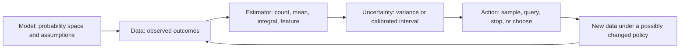

# 12 — Probability, Statistics and Uncertainty

[[Chapter Edition/02 - Graphics Vision and XR/00 - Reading Map|Reading map]] · [[Chapter Edition/02 - Graphics Vision and XR/11 - BVH Traversal and Deterministic Evidence|Previous chapter]] · [[Chapter Edition/02 - Graphics Vision and XR/13 - From View Space to Clip Space|Next chapter]]

Probability gives a language for possible observations; statistics summarizes the samples actually collected. The chapter separates counts, averages, spread and uncertainty so later sampling comparisons are interpretable.

**By the end:** Distinguish probability models from sample statistics and uncertainty estimates.

**Recall question:** What does a sample mean tell you, and what information does it leave out?

<!-- Derived from Continuous Notes/University - Worlds, Images and Inference - Graphics, Vision and Photography.md; source lines 27311–28319; source-span SHA256 2145b4ef36c2ada3b1fa46bdc9f061fbb18ad7012b6ec0ce432b1b7e1ea307b2. -->

<!-- CHAPTER-SOURCE-BEGIN -->
## From Random Samples to Deliberate Computation

A renderer, a vision system, and an interactive engine all make decisions with incomplete information. A renderer approximates a light integral using a finite set of random paths. A vision model estimates a scene quantity from a finite set of measurements. An engine chooses which query or simulation step to spend its next millisecond on. The word “uncertainty” can refer to several different things in these settings: randomness in the scene or sensor, lack of knowledge about a fixed scene parameter, variation in a numerical estimator, and uncertainty caused by a model that may be wrong. The first scientific step is to say which of these is being represented.

A useful mental pipeline is:



The feedback arrow is where ordinary estimation begins to differ from active sampling. If the next observation depends on what earlier observations suggested, the sampling policy becomes part of the data generating process. The estimator and its uncertainty statement must account for that process.

### A probability model is a space of possible observations

A probability space consists of a sample space $\Omega$, a collection of events $\mathcal F$ to which probabilities can be assigned, and a probability measure $P$. An outcome $\omega\in\Omega$ is one possible realization of the experiment. An event is a set of outcomes. The event collection is a sigma-algebra: it contains the whole sample space and is closed under complements and countable unions, so the probability statements built from these operations are defined. A random variable $X$ is a measurable function of the outcome, $X:\Omega\to\mathbb R$; it assigns a value to every possible outcome before the experiment is run. Measurability means, for example, that the outcomes satisfying $X\le a$ form an event in $\mathcal F$ for every real threshold $a$. The observed data $x$ are the value recorded after one outcome occurred. This distinction is more than capitalization: the random variable is the object whose distribution we reason about; the data are the realized evidence available to us.

For a camera measuring a noisy pixel, one possible model is $X=\mu+\epsilon$, where $\mu$ is the ideal pixel radiance and $\epsilon$ is measurement or sampling noise. If the observation is recorded as $x=0.43$, then $X$ was random under the model before sampling and $x$ is now fixed in the dataset. The model does not become true merely because it is written down. A clipped sensor, a wrong exposure model, correlated denoiser residuals, or a changing scene can violate it.

Independence is also a model statement. For events $A$ and $B$, independence means $P(A\cap B)=P(A)P(B)$. Two events can be disjoint yet dependent; disjoint events with positive probability cannot be independent. In graphics, two random samples generated from independent pseudorandom streams may be modeled as independent, while adjacent pixels filtered from shared samples are usually correlated. Reusing the same path samples across two frames can be useful for temporal stability, but the frame estimates are no longer independent replicates. The variance of a difference then depends on covariance, not merely on the two marginal variances.

For data $X_1,\ldots,X_n$, the familiar IID assumption says that these random variables are independent and identically distributed. Identical distribution means each draw has the same law; independence means observing one does not change the modeled law of another. A repeated stationary rendering experiment might satisfy this approximation if each path is drawn independently from the same sampling distribution and scene state. A sequence of adaptive samples generally does not have identical unconditional distributions: the algorithm changes its sampling distribution as its history changes. It may still have a well-defined conditional law at each step, but then the proof must use that conditional law.

A parameter such as the true mean radiance $\mu$ or a fixed click probability $p$ is usually treated as unknown but fixed in frequentist inference. Randomness describes what data the procedure would produce if repeated under the same conditions; the parameter itself does not fluctuate. Bayesian inference instead assigns a prior distribution to a parameter and updates it after seeing data. The likelihood is the probability or density of the observed data considered as a function of the parameter; it is not a probability distribution over parameter values by itself. Combining it with the prior and normalizing gives the posterior. That is a different probability model and a different interpretation of intervals. A posterior distribution is not a free upgrade to a confidence interval: its meaning depends on the prior and likelihood.

### Counts, means, and spread have distinct jobs

For a Bernoulli observation $X_i\in\{0,1\}$, success may represent a pixel path that hits a light source, a classifier that detects an object, or a user who clicks a recommendation. Let $X_i=1$ denote success and $X_i=0$ failure. If $P(X_i=1)=p$, then the success count $S=\sum_{i=1}^n X_i$ has mean $np$ and variance $np(1-p)$ under independent trials. The sample proportion $\hat p=S/n$ estimates $p$.

Consider the eight observed outcomes

$$
1,\ 1,\ 0,\ 1,\ 0,\ 0,\ 1,\ 0.
$$

There are four successes in eight observations, so $S=4$, $n=8$, and $\hat p=4/8=0.5$. If the observations are IID Bernoulli with mean $p$, then $E[\hat p]=p$; the estimator is unbiased at every fixed sample size. Its variance is $p(1-p)/n$, which is unknown because $p$ is unknown. Plugging in $\hat p$ gives estimated variance $0.5(0.5)/8=0.03125$ and estimated standard error $\sqrt{0.03125}\approx0.177$. This standard error describes repeated-sample variation under the Bernoulli model; it is not the uncertainty in the truth of an individual success.

The ordinary unbiased sample variance of the eight binary values is

$$
s^2=\frac{1}{n-1}\sum_{i=1}^{n}(X_i-\bar X)^2
=\frac{2}{7}\approx0.286.
$$

Each value is $0.5$ away from the mean, so the sum of squared deviations is $8(0.5)^2=2$. Dividing by $n-1$ estimates the population variance without bias under IID sampling; dividing by $n$ would produce the empirical second central moment $0.25$. For the standard error of the mean, use $s/\sqrt n=\sqrt{0.286/8}\approx0.189$. These two variance numbers answer different questions: $s^2$ estimates spread of one observation, while $s^2/n$ estimates variance of the sample mean.

Expectation is the distribution-weighted average. For a discrete variable, $E[X]=\sum_x xP(X=x)$; for a continuous variable with density $f$, it is $E[X]=\int xf(x)\,dx$. Variance is $\operatorname{Var}(X)=E[(X-E[X])^2]$ and measures squared spread. Standard deviation is the square root of variance and returns to the units of the measurement. Linearity of expectation does not require independence: $E[X+Y]=E[X]+E[Y]$. Variance of a sum does require attention to covariance: $\operatorname{Var}(X+Y)=\operatorname{Var}(X)+\operatorname{Var}(Y)+2\operatorname{Cov}(X,Y)$.

In rendering, averaging two correlated estimates can be less effective than averaging two independent ones. If the two estimates have equal variance $\sigma^2$ and correlation $\rho$, their average has variance $\sigma^2(1+\rho)/2$. At $\rho=0$, variance halves; at $\rho=1$, averaging gives no variance reduction. Temporal reuse deliberately introduces correlation to reduce flicker. That is a design choice whose image quality cannot be described by independent-sample formulas alone.

### Monte Carlo estimates an expectation by sampling

Suppose the quantity of interest can be written as an expectation $I=E[g(X)]$. Draw IID samples $X_1,\ldots,X_n$ from the modeled distribution and use

$$
\hat I_n=\frac{1}{n}\sum_{i=1}^n g(X_i).
$$

If $E|g(X)|<\infty$, then $E[\hat I_n]=I$: the estimator is unbiased. If $\operatorname{Var}(g(X))<\infty$, then $\operatorname{Var}(\hat I_n)=\operatorname{Var}(g(X))/n$. Under the law of large numbers, the estimate converges to $I$ in probability (and under standard IID integrability conditions, almost surely). Unbiasedness is a finite-sample expectation identity. Consistency is an asymptotic convergence property. Neither says that a particular finite estimate must be close to the answer; an unbiased estimator can have enormous variance.

A simple integral makes the construction visible. The target $I=\int_0^1 x\,dx=1/2$ equals $E[U]$ when $U\sim\operatorname{Uniform}(0,1)$. If ten independent uniform samples happen to be approximately

$$
0.05,\ 0.15,\ 0.25,\ 0.35,\ 0.45,\ 0.55,\ 0.65,\ 0.75,\ 0.85,\ 0.95,
$$

their mean is $0.50$. Their sample variance is approximately $0.0917$ and the estimated standard error of the mean is $\sqrt{0.0917/10}\approx0.096$. Treating those as random IID uniform draws, a large-sample normal interval using $1.96$ standard errors would be roughly $0.50\pm0.19$, or $[0.31,0.69]$. This is a noisy estimate even though the observed mean equals the exact integral. The sequence above is evenly spaced for arithmetic clarity, not evidence of independent random sampling; a randomized stratified estimator would need its own variance calculation.

For IID observations with finite variance, a central-limit approximation says the standardized sample mean approaches a standard normal distribution as $n$ grows. This motivates the approximate interval $\hat I_n\pm1.96\,s_g/\sqrt n$ for a nominal 95% interval, where $s_g$ is the sample standard deviation of $g(X_i)$. It is an approximation, not an exact finite-sample coverage guarantee. Heavy tails, very small sample sizes, correlated samples, adaptive stopping, and a misspecified sampling model can all invalidate the usual interval. There is no universal sample count such as “30” that repairs every distribution or dependence problem.

A rigorous finite-sample alternative follows from assumptions such as boundedness. If $Y_i\in[a,b]$ are independent with common mean $\mu$, Hoeffding's inequality gives

$$
P(|\bar Y_n-\mu|\ge\epsilon)\le2\exp\left(-\frac{2n\epsilon^2}{(b-a)^2}\right).
$$

Solving this bound yields a two-sided interval radius $(b-a)\sqrt{\log(2/\alpha)/(2n)}$ with coverage at least $1-\alpha$. For the Bernoulli example, $a=0,b=1,n=8,\alpha=0.05$, so the radius is $\sqrt{\log(40)/16}\approx0.480$. The resulting interval is approximately $[0.020,0.980]$, clipped to the parameter range $[0,1]$. It is much wider than a normal approximation at this small sample size, but its guarantee relies only on independent bounded observations and the stated mean model. Tighter intervals are possible with more assumptions or exact binomial methods.

### Confidence and credible intervals answer different questions

A frequentist $1-\alpha$ confidence procedure is a rule that maps random data to a random set $C(X)$. Its coverage statement is $P_\theta(\theta\in C(X))\ge1-\alpha$ for each parameter value $\theta$ in the model. Before observing data, the interval is random and the fixed parameter is covered with the stated long-run frequency. After one interval has been calculated, the frequentist statement does not assign probability $0.95$ to the fixed parameter lying inside that particular interval.

A Bayesian credible interval is calculated from a posterior distribution. Given observed data $x$, a $1-\alpha$ credible set $C(x)$ is chosen so that $P(\Theta\in C(x)\mid X=x)=1-\alpha$. Here $\Theta$ is modeled as random under the prior and likelihood. The statement is conditional on the observed data and depends on that prior/model. A 95% credible interval need not have 95% frequentist coverage across repeated datasets; frequentist coverage is a separate property to check.

For the eight Bernoulli observations above, a uniform prior $p\sim\operatorname{Beta}(1,1)$ gives posterior $p\mid x\sim\operatorname{Beta}(5,5)$. A Beta$(a,b)$ density on $0<p<1$ is proportional to $p^{a-1}(1-p)^{b-1}$. The four successes and four failures contribute likelihood $p^4(1-p)^4$, so multiplying prior and likelihood changes the two exponents from zero to four and produces the stated posterior. The posterior mean is $5/10=0.5$. A credible interval is obtained by taking posterior quantiles of that Beta distribution. The frequentist Hoeffding interval we just computed is instead derived from a sampling guarantee that holds for every fixed $p$. They may have different widths and interpretations while using the same observed count. Neither interval can be described correctly by its “95%” label alone.

A common failure is to calculate a posterior after choosing a prior but report it as a confidence interval without qualification. Another is to select a frequentist interval after many repeated looks and quote the single-look coverage as if nothing had been selected. Each procedure must include how the data were generated, how the interval was chosen, and whether optional stopping or multiple comparisons were part of that rule.

### Sampling selection changes the uncertainty story

Stopping when the data look favorable can bias a naïve summary. Let $X_i$ be IID Bernoulli$(p)$ trials. Observe one trial; stop immediately if it succeeds, otherwise observe exactly one more trial and then stop. The stopping time $N$ is therefore either one or two. The reported sample mean is $1$ after an immediate success, $1/2$ after failure then success, and $0$ after two failures. Its expectation is $p+(1-p)p/2$, which is $0.28$ when $p=0.2$, rather than $0.2$. The estimator is biased upward under this stopping rule. The reason is selection: the sample size and the reported data are linked by the success condition. The fixed-$n$ identity $E[\bar X_n]=p$ does not apply automatically to $\bar X_N$. If we instead stop at the first success with no two-trial cap, the stopped mean is $1/N$, not always one.

The same effect appears in adaptive systems. If a renderer keeps allocating paths to a pixel until its current estimate crosses a brightness threshold, then reports the stopped mean without an appropriate sequential method, the selected estimate can be biased. If a vision pipeline examines many candidate boxes and reports the one with the highest noisy score, that winning score is upward-selected even when each individual score estimator is unbiased. If an engine repeatedly checks a collision confidence interval and stops the first time it excludes zero, ordinary fixed-time coverage no longer automatically applies to the stopped interval.

Not every data-dependent policy destroys unbiasedness. Some carefully designed sequential estimators remain unbiased, and time-uniform confidence sequences provide coverage simultaneously over all sample counts under stated assumptions. But optional stopping cannot be ignored. The analysis has to match the actual stopping rule, not only the estimator that would have been used at a predetermined sample count.

Sample selection is also present in an adaptive query policy. An active vision system may inspect regions with high current uncertainty more often. A [[Concepts/Bandit exploration and regret|bandit]] may display the apparently better recommendation more frequently. These actions change which outcomes become observable. An offline average over the observed outcomes does not automatically estimate the average outcome under a different policy or over the full population. The missing observations require a model and, often, correction weights.

### Importance weighting corrects selection only with support

Suppose the target distribution over outcomes is $P$, but samples are drawn from a proposal distribution $Q$. If $Q$ assigns positive probability wherever $P$ assigns positive probability and the required expectation exists, then

$$
E_P[f(X)]=E_Q\left[f(X)\frac{p(X)}{q(X)}\right].
$$

The ratio $p/q$ is an importance weight. It corrects for how sampling differs from the target. The support condition matters: if $q(x)=0$ where $p(x)f(x)$ contributes nonzero mass, the target contribution is never observed and no finite weight can recover it. Tiny $q(x)$ preserves formal unbiasedness if nonzero, but can create huge weights and huge variance.

Use a two-point example. The target chooses $a$ or $b$ with probability $1/2$ each, and $f(a)=1,f(b)=0$, so the target expectation is $I=1/2$. Choose a proposal with $Q(a)=0.1,Q(b)=0.9$. The weighted sample is $Y=f(X)P(X)/Q(X)$: it equals $5$ with probability $0.1$ when $X=a$, and $0$ with probability $0.9$ when $X=b$. Then $E_Q[Y]=0.1(5)+0.9(0)=0.5$, exactly the target, but $E_Q[Y^2]=2.5$ and $\operatorname{Var}_Q(Y)=2.5-0.25=2.25$. One draw is usually zero and occasionally five. If $Q(a)$ were zero, the estimator would miss the whole nonzero target contribution and be biased.

In a bandit, suppose an arm's reward $r\in[0,1]$ is observed only when it is selected with conditional probability $q>0$. The importance-weighted observation $\hat r=\mathbf 1\{A=a\}r/q$ has conditional expectation $r$ when the reward is fixed for that round and the action is randomized according to $q$. Its second moment is $r^2/q$ and its variance is $r^2(1-q)/q$. Thus reducing the probability of an arm increases the variance of its counterfactual reward estimate. If $q=0$, there is no information about that arm from that round. Exploration probability is therefore not a cosmetic add-on: it controls the amount of information and the stability of weighted estimates.

For bounded logged rewards, inverse propensity weighting can give an unbiased estimate of a target policy's value when the logging probability is known, the target policy has support under the logging policy, and the relevant conditional model is correct. Large or misspecified propensity weights can make the estimate unusably noisy. Clipping weights may reduce variance but generally introduces bias. “We reweighted it” is not enough; report overlap, maximum weights, effective sample size, and the estimator's assumptions.

### Confidence bounds drive exploration under explicit assumptions

A stochastic $k$-armed bandit has $k$ actions, or arms. Each arm $i$ has a stationary reward distribution with mean $\mu_i$. At round $t$, the policy chooses $A_t$ using past observations, receives a reward $X_t$ from the selected arm, and does not observe the rewards that unselected arms would have produced. The optimal mean is $\mu^*=\max_i\mu_i$ and the gap of arm $i$ is $\Delta_i=\mu^*-\mu_i$. The expected cumulative regret through $n$ rounds is

$$
R_n=n\mu^*-E\left[\sum_{t=1}^n X_t\right]
=\sum_i\Delta_i E[T_i(n)],
$$

where $T_i(n)$ counts how often arm $i$ was selected. Regret is a measure of reward forgone while learning and acting; it is not the same as the probability of naming the best arm at the end.

For an arm with $T_i$ observations and empirical mean $\hat\mu_i$, a simple upper confidence index has the form

$$
U_i=\hat\mu_i+\sqrt{\frac{2\sigma^2\log(1/\delta)}{T_i}},
$$

when the centered reward noise is $\sigma$-subgaussian and the confidence event has been made valid for the relevant comparisons. If an arm has not been tried, its index is set to $+\infty$ or the policy explicitly samples each arm once. UCB chooses the arm with the largest index. A high index can come from a high observed mean or from a wide uncertainty bonus due to few samples.

A subgaussian variable is one whose moment-generating function has Gaussian-like upper growth: for centered $X$, $E[e^{\lambda X}]\le e^{\lambda^2\sigma^2/2}$ for all real $\lambda$. Independent subgaussian observations give an exponential tail bound for their sample mean. Bounded rewards are subgaussian with a scale related to their range, but finite variance alone does not imply the same tail behavior. Heavy-tailed observations need different robust estimators or concentration assumptions. A confidence formula used outside its distributional assumptions can be overconfident.

Here is a two-arm index calculation. Let $\delta=0.05$ and use the simple radius above with $\sigma=1$. Arm A has observations $1,1,0,1$, so $T_A=4$ and $\hat\mu_A=0.75$. Its bonus is $\sqrt{2\log(20)/4}\approx1.225$ and its index is about $1.975$. Arm B has one observation $0$, so $T_B=1$, $\hat\mu_B=0$, bonus $\sqrt{2\log(20)}\approx2.448$, and index $2.448$. Even though A's observed mean is higher, the policy selects B because its uncertainty is larger. After additional samples from B, the bonus shrinks and the evidence can favor A. The numerical radius is deliberately conservative and the two-arm example does not prove a full UCB guarantee.

There is a technical wrinkle: the number $T_i(t)$ of samples from an arm is random and chosen using past rewards. A fixed-sample concentration inequality cannot simply be applied once and assumed valid at every random time. Standard bandit analyses handle this by reasoning about the pre-generated reward sequence for each arm and taking a union bound over possible sample counts, or by using a time-uniform confidence sequence. The confidence level must also account for repeated decisions and arms. A single-look 95% interval does not automatically remain a 95% guarantee after hundreds of adaptive looks.

UCB-style analysis often proves that a suboptimal arm is played only while either its own empirical mean is unusually high or the optimal arm's index is unusually low. Once enough observations reduce the suboptimal arm's bonus, it should stop beating the optimal arm's index except on a low-probability event. The regret decomposition then converts expected suboptimal pulls into reward loss. The assumptions include a fixed reward distribution per arm, an appropriate tail bound, and a defined horizon or a valid horizon-free variant. When those assumptions change, the bound must change too.

For Bernoulli rewards, the variance depends on the mean. If rewards are near zero or one, a variance-aware confidence bound can be much tighter than a generic range-based bound. KL-UCB uses the Bernoulli relative entropy

$$
d(p,q)=p\log\frac pq+(1-p)\log\frac{1-p}{1-q}
$$

to define an upper confidence endpoint by solving $T_i\,d(\hat\mu_i,q)\le\log f(t)$ for the largest plausible $q$. Because this divergence is asymmetric, the interval width can differ above and below the observed mean. Such an improvement is earned by the Bernoulli model; it should not be applied to continuous HDR pixel values or arbitrary engine rewards without the corresponding likelihood model.

### Cumulative regret and best-arm identification are different goals

Suppose a diagnostic system can spend a fixed budget of 100 measurements deciding which of two sensors is more accurate. A cumulative-reward objective would reward it for repeatedly using the sensor with better expected performance while it learns. A best-arm identification objective instead rewards correctly naming the better sensor after exploration. The second may rationally sample both arms even near the end; the first may exploit one arm to harvest reward. The optimal allocation need not be the same.

Best-arm identification can be fixed confidence: stop at a data-dependent time and return an arm with error probability at most $\delta$, while trying to minimize the expected number of samples. Or it can be fixed budget: after $n$ samples, minimize the probability that the selected arm is suboptimal. Fixed-confidence algorithms such as track-and-stop combine an allocation rule with a stopping statistic that accumulates evidence against alternatives. Fixed-budget algorithms such as sequential halving repeatedly sample active arms and eliminate the lower half. These are pure-exploration tasks: there is no reward for early exploitation except insofar as it yields information.

The confidence level $\delta$ controls a probability of error under the specified environment class, not the probability that an arbitrary answer is correct in every possible world. A guarantee for Gaussian unit-variance arms does not automatically apply to skewed, drifting rewards or dependent observations. The stopping rule and allocation jointly determine the guarantee. If several arms are exactly tied, some formulations cannot stop with finite expected samples while retaining a uniform soundness guarantee over a rich class, because an arbitrarily small change could make another arm uniquely best.

Choosing among rendering strategies can be a pure-exploration task if the final output is a decision, such as which of two sampling distributions has lower estimated variance for a target class. But optimizing the decision criterion is not the same as estimating the final image without bias. A policy can correctly learn which strategy usually reduces a chosen loss while its output estimator remains biased due to incorrect weights, missing support, clamping, or data-dependent termination. The decision's utility and the image estimator's mathematical target must be specified separately.

### Stationarity and reproducibility are part of the experiment

A stationary bandit assumes that arm $i$ keeps the same reward distribution over time. A renderer that changes scene lighting mid-run, a sensor whose calibration drifts, or a vision stream with seasonal domain shifts violates stationarity. A standard UCB algorithm may then retain old observations that no longer predict current rewards. A useful alternative may be a sliding window, discounting, change detection, or a comparator that is allowed to switch arms. Each addresses a different drift model and adds its own assumptions.

For an environment with at most $m-1$ change points, tracking regret compares the learner to the best arm sequence with at most that many switches. Restarting UCB at known change points is conceptually simple; unknown change points require detecting change or forgetting old evidence. In a nonstationary world, “the best arm” is time-indexed and the comparator must be explicit. No-regret relative to one fixed arm can be a meaningless target if the optimal action changes halfway through the data.

Reproducibility requires more than a random seed. Record the scene and sensor version, data ordering, random-number generator and stream assignment, policy version, candidate set, stopping criterion, reward definition, and any rejected or missing observations. In adaptive experiments, also retain selection probabilities and decision history so weighted estimates can be audited. A fixed seed makes one run repeatable; it does not make a dependent sample sequence IID or prove that uncertainty intervals are calibrated.

### A compute budget needs a reward that matches the real goal

A bandit can allocate an engine's limited query budget among actions, but “reward” must have a defined operational meaning. Possible choices include reduction in mean squared image error, reduction in a task-specific detection loss, information gain about a parameter, improvement in expected frame time, or a utility that balances image quality against latency. These objectives can rank actions differently. A perceptual quality metric may reward edge detail differently from radiometric accuracy. A query that helps a collision classification may have no value to the final rendered image.

To use a bandit model, specify the actions, context, observable reward, horizon, and whether action rewards are stationary and conditionally independent. If the same query is evaluated by re-rendering with a fresh random seed, one can estimate its expected utility; if action choice changes the future data or cache state, the environment is structured and history-dependent. If context changes with the pixel, object, or time step, a contextual bandit may be more appropriate than a single global arm mean. If the metric is observed only for the selected action, counterfactual reward estimation needs support and propensity correction.

Most importantly, adaptive compute allocation does not automatically preserve an unbiased image estimate. Suppose pixels are divided into regions and a controller samples high-variance regions more often. At a predetermined sample count, if each correctly weighted contribution has conditional expectation equal to the target given the past, averaging those contributions is unbiased by iterated expectation. A random per-pixel stopping count requires an additional argument; the conditional-mean property alone does not make the stopped sample average unbiased. If the controller instead oversamples bright regions and pools all raw values as though they came from the target distribution, it estimates the proposal-weighted image, not the target image. If it stops each pixel when a noisy confidence interval looks narrow, fixed-budget error formulas may no longer apply. If it clamps rare high contributions, it trades bias for variance reduction.

A safer architecture separates two contracts. The estimator contract states the quantity being estimated, sampling distribution, weights, support conditions, stopping rule, and uncertainty calculation. The controller contract states how compute is allocated according to observed information and which utility it tries to improve. The controller can be adaptive while the estimator remains unbiased, but that requires a proof or a valid sequential estimator—not an assumption that “more samples where needed” is harmless. Online optimization and statistical correctness are connected, yet they are not identical problems.

### An experiment design checklist in the language of science

Before running an adaptive rendering, vision, or engine experiment, write down the target quantity $\theta$ and the population or scene distribution over which it is defined. State which variables are random and which are fixed unknown parameters. Describe how one observation is sampled, whether observations are independent, and what data are missing when an action is not chosen. Decide whether the goal is estimating a mean, reducing a variance, making a one-time choice, or repeatedly earning reward.

Then name the estimator and its finite-sample expectation. List the assumptions used for its variance and confidence interval. If there is a confidence interval, say whether it is exact, asymptotic, or a concentration bound, and whether the coverage is pointwise or uniform over parameters. If the policy adaptively changes samples or stops, use an analysis that covers those decisions. If importance weights are used, check support and weight tails. If the environment drifts, define a nonstationary comparator or a change model. Finally, log enough information to replay and audit the choices.

These steps are not paperwork around the algorithm. They define the result. “The estimate is unbiased” means its expected value equals the specified target under the specified law. “The interval is 95%” means a named coverage or posterior probability statement under a named model. “The policy learns the best action” means a particular regret or identification result under assumptions about reward distributions and observations. When those sentences are made precise, uncertainty becomes a usable engineering quantity: it tells us what evidence we have, what remains unknown, and what an additional query can legitimately improve.

### References for deeper source checks

- Larry Wasserman, *All of Statistics*, Chapters 1–8 and 11, for probability foundations, estimation, concentration, convergence, intervals, bootstrap, and Bayesian interpretation.
- Tor Lattimore and Csaba Szepesvári, *Bandit Algorithms*, Chapters 4–7, 10–11, 31, and 33, for stochastic bandit assumptions, confidence-based exploration, importance weighting, nonstationarity, and pure exploration.
- Eric Veach, *Robust Monte Carlo Methods for Light Transport Simulation* (1997 dissertation), especially the Monte Carlo integration chapter, for unbiasedness, importance sampling, adaptive sample placement, and rendering estimators: [Stanford dissertation](https://graphics.stanford.edu/papers/veach_thesis/).
- Peter Auer, Nicolò Cesa-Bianchi, and Paul Fischer, “Finite-time Analysis of the Multiarmed Bandit Problem” (2002), for a foundational finite-time UCB analysis: [publication record](https://www2.compute.dtu.dk/pubdb/pubs/2088-full.html).
- William R. Thompson, “On the Likelihood That One Unknown Probability Exceeds Another in View of the Evidence of Two Samples” (1933), an early sequential allocation treatment: [Biometrika record](https://academic.oup.com/biomet/article-abstract/25/3-4/285/200862).

### A worked image-budget example: allocate samples without changing the target

Imagine an image simplified to two equally important regions, A and B. Their true mean radiances are $0.2$ and $0.8$, so the target whole-image mean is $(0.2+0.8)/2=0.5$. A compute controller estimates that B is more interesting and samples region A with probability $q_A=0.1$ and region B with $q_B=0.9$. If it simply averages observed radiances, its expected output is $0.1(0.2)+0.9(0.8)=0.74$. This is not noisy around the target $0.5$; it converges to the wrong target because the sampling policy changed the region mixture.

The desired region distribution is $p_A=p_B=0.5$. An importance weight for an observation in region $j$ is $p_j/q_j$. Thus, an A observation is weighted by $0.5/0.1=5$, and a B observation by $0.5/0.9\approx0.556$. The one-sample weighted random variable is $Y=1.0$ with probability $0.1$ and $Y\approx0.444$ with probability $0.9$. Its expectation is $0.1(1.0)+0.9(0.444)\approx0.5$. The estimator recovers the original whole-image mean despite allocating most samples to B. This example assumes each region's value is fixed and observed without additional noise; a real renderer has within-region path variance as well, which contributes extra variance.

A stratified design can avoid some of the weight instability by reserving samples in each region and combining regional estimates with the known pixel-area weights: $\hat I=0.5\bar X_A+0.5\bar X_B$. With at least one correctly sampled observation from each region and unbiased regional sample means, the combined estimate is unbiased regardless of the unequal sample counts. Its variance is $0.25\operatorname{Var}(\bar X_A)+0.25\operatorname{Var}(\bar X_B)$ if the region samples are independent. Spending more samples in a region with larger variance can reduce the total variance efficiently, but the sample allocation itself must be included if it depends on observed values. Keeping a small exploration floor also prevents the controller from permanently abandoning a region whose early samples happened to look quiet.

This makes the roles clear. The estimator decides how observations represent the target image. The controller decides where another observation is worth its cost. A controller may use a bandit to learn which region tends to yield more error reduction per unit time, while the final pixel estimate still uses area-correct weights. If reward is defined as immediate reduction in a perceptual loss, however, that reward may be noisy, nonstationary, and dependent on prior denoising state. UCB's guarantee is about maximizing cumulative expected reward under its bandit model; it does not imply a radiometrically unbiased image, a calibrated pixelwise interval, or a globally optimal perceptual image.

The same separation applies in vision. If a system selects uncertain image patches for labeling, it can use the resulting data to improve a classifier, but naïvely averaging only the selected labels estimates the selected-patch distribution. Population-level metrics require either representative sampling, known inclusion probabilities with valid weights, or a justified model-based adjustment. If an engine prioritizes collision checks near suspected contacts, the hit rate among queried pairs is not the scene-wide collision rate. Active computation can improve decisions while making naïve descriptive summaries less representative.

A final nuance is that a reward itself can be estimated. Suppose action A costs 1 ms and reduces estimated error by $0.02$ with high variance, while action B costs 3 ms and reduces it by $0.05$ with low variance. “Maximize error reduction” selects B by mean reward; “maximize reduction per millisecond” may select A; “minimize error subject to a frame-time cap” is a constrained objective. If actions alter caches or future variance, their reward depends on history and may not be stationary. Naming the utility and horizon is part of the scientific model, not a presentation detail.

For reproducibility, preserve at least a replayable trace of chosen actions, conditional selection probabilities, reward observations, sample counts, stopping times, and estimator weights. With this trace, one can separately check the controller's decisions and recompute the estimator. A seed alone cannot reveal whether support was missing, whether confidence was repeatedly checked, or whether a renderer's next sample distribution depended on a previous noisy estimate.

## Numerical integration and Monte Carlo estimation

Numerical integration approximates transport quantities, and sampling choices determine bias, variance, and convergence.

### Variance reduction for rendering

Variance is the spread of estimates around their expected value. Bias is systematic error in that expectation. Consistency means estimates approach the target as sample count grows. An unbiased method can look noisy; a visually smooth method can be biased. Clamping rare bright samples may reduce visible fireflies but changes the expected image. The right question is both what result the method converges to and how quickly it converges. [[Chapter Edition/02 - Graphics Vision and XR/36 - Source Atlas and Reconstruction Checkpoints#CMU-19 - Variance Reduction|CMU-19]]

Uniform hemisphere sampling often misses a small bright light. Importance sampling chooses the light’s solid angle more frequently and divides by its density. BSDF sampling chooses directions favored by the material. [[Monte Carlo rendering estimators and variance|Multiple importance sampling]] combines both strategies with weights that sum to one, so a strategy that rarely finds a contribution is not trusted disproportionately. Bidirectional path tracing grows paths from light and camera and joins them. Metropolis light transport mutates high-contribution paths to explore nearby regions. These techniques target rare or important light paths that naive sampling may miss. [[Chapter Edition/02 - Graphics Vision and XR/36 - Source Atlas and Reconstruction Checkpoints#CMU-19 - Variance Reduction|CMU-19]]

Sample patterns change the spectrum of error. Stratified sampling divides the domain into cells and ensures each cell is represented. Low-discrepancy sequences spread points evenly in low dimensions. Blue-noise patterns avoid large clumps without a periodic grid. Poisson-disk sampling enforces minimum separation. CDF sampling maps uniform random numbers to an arbitrary distribution; alias tables accelerate repeated draws from discrete weights. Photon mapping stores light paths for local density estimation, while finite-element radiosity discretizes energy exchange among surface patches. Each method has different memory, bias, and convergence tradeoffs. [[Chapter Edition/02 - Graphics Vision and XR/36 - Source Atlas and Reconstruction Checkpoints#CMU-19 - Variance Reduction|CMU-19]]

The function being integrated has its own variance; a sampling method cannot change that function. What the renderer can change is the variance of its estimator: the randomness in the numerical answer across repeated runs or samples. This distinction is visible with a checkerboard function that is 0 on black cells and 1 on white cells. Over equal black and white area, its mean is $1/2$ and its variance is $1/4$. That variance belongs to the integrand. A different estimator can reduce uncertainty in the integral by guaranteeing representation of both cell colors. It cannot make the checkerboard itself less variable. [[Chapter Edition/02 - Graphics Vision and XR/36 - Source Atlas and Reconstruction Checkpoints#CMU-19 - Variance Reduction|CMU-19]]

Bias and consistency are separate tests. An estimator is unbiased when its expected result equals the true integral at a fixed sample count. It is consistent when the probability of a fixed-sized error tends toward zero as sample count grows. A fixed grid that is refined into smaller cells can converge to an image integral and thus be consistent, yet the grid estimate at any finite resolution is not a random variable centered on the exact answer. Conversely, picking one uniformly random image point and multiplying its color by image area is unbiased: averaging that estimator over many repeated trials gives the integral. But if the procedure permanently uses just one point, its estimate does not converge as its sample budget increases because it has no increasing budget. Standard Monte Carlo with more independent points is both. This vocabulary matters because consistency says the method can get there, while unbiasedness says it is centered correctly before it gets there. [[Chapter Edition/02 - Graphics Vision and XR/36 - Source Atlas and Reconstruction Checkpoints#CMU-19 - Variance Reduction|CMU-19]]

Importance sampling has an ideal limit that explains why matching the proposal to the integrand helps. For a nonnegative integrand $f(x)$ with integral $I$, the density $p(x)=f(x)/I$ makes every weighted sample $f(X)/p(X)$ equal to $I$. One sample would then suffice. But constructing that density requires knowing $I$, the unknown answer, so it is a useful ideal rather than a practical recipe. Rendering uses approximations: sample a glossy material near its reflected direction, use cosine weighting for diffuse response, or sample a point light exactly rather than hope a random hemisphere ray finds it. Area-light sampling and material sampling can succeed in different cases. Multiple importance sampling (MIS) combines them. With two proposal densities $p_1,p_2$, and fractions $n_1/N,n_2/N$ of the total samples, the balance heuristic divides a sample's integrand value by the combined density $(n_1/N)p_1(x)+(n_2/N)p_2(x)$. Contributions from both strategies then estimate the same integral without trusting a strategy that rarely reaches an important region. A scene grid spanning point-to-area lights and near-mirror-to-diffuse materials demonstrates why neither light-only nor material-only sampling is uniformly best. [[Chapter Edition/02 - Graphics Vision and XR/36 - Source Atlas and Reconstruction Checkpoints#CMU-19 - Variance Reduction|CMU-19]]

Some lighting paths are so narrow that ordinary eye-originating path tracing almost never finds them. In a glossy coffee-cup example, a bright source reflects from the curved cup and forms a caustic ring on a diffuse table. A path from the eye to the table to the mirror-like cup to a point source is valid, but after a random diffuse bounce the exact direction needed at a perfect mirror has zero probability under a continuous directional distribution; the subsequent point source also occupies zero solid angle. A real light and surface may be merely small and glossy rather than mathematical deltas, yet the same path may remain extremely rare. A disco-ball scene makes the compounding difficulty visible: a camera ray must find a tiny bright region on a wall, then a tiny region of the mirrored ball that reflects the source. Raising samples from 16 to 128 to 8,192 eventually reveals the caustic, but this spends work on paths that carry almost no light. [[Chapter Edition/02 - Graphics Vision and XR/36 - Source Atlas and Reconstruction Checkpoints#CMU-19 - Variance Reduction|CMU-19]]

Bidirectional path tracing samples partial paths from both ends. One subpath starts at the camera; another starts at a light. Connecting their endpoints can find transport arrangements that either one-sided strategy misses, such as a path that must reach a point source or a pinhole camera. Each connection needs a weight based on the probability of producing that same full path under the competing sampling strategies. Different combinations of camera-side and light-side path lengths reveal different effects; a glass egg may show its transmitted illumination for a particular split even when neighboring splits do not. Bidirectional tracing still has geometric failures: if the only path passes through a barely open door, most sampled endpoints connect through a wall and contribute zero. [[Chapter Edition/02 - Graphics Vision and XR/36 - Source Atlas and Reconstruction Checkpoints#CMU-19 - Variance Reduction|CMU-19]]

Metropolis light transport addresses rare but high-value regions by sampling dependent paths. From current path $x$, propose path $y$ with transition density $T(y\mid x)$ and accept it with probability

$$
\alpha(x,y)=\min\!\left(1,\frac{\pi(y)T(x\mid y)}{\pi(x)T(y\mid x)}\right),
$$

 where $\pi$ is the target path-contribution density. For symmetric proposals, the transition-density factors cancel, leaving the capped ratio of new to old target density; for an asymmetric proposal, omitting these factors biases the chain. Rejected proposals retain the current path. Repeated states spend more samples in high-contribution regions. This is a Markov chain, so consecutive samples are dependent; the mutation must be able to reach every relevant region (ergodicity), and an initial transient must not be mistaken for the target distribution. Gaussian local mutations with occasional global proposals can help the chain escape isolated regions, provided the proposal probabilities are included in $T$. The lecture illustrates the idea by walking over an image: visit bright pixels more often and accumulated counts reconstruct downtown Pittsburgh; in rendering, mutate a discovered bright light path to find nearby bright paths. This can lower variance for caustics such as light refracting into and out of a swimming pool, at the cost of chain setup and correlation. [[Chapter Edition/02 - Graphics Vision and XR/36 - Source Atlas and Reconstruction Checkpoints#CMU-19 - Variance Reduction|CMU-19]]

Sampling layout matters in addition to the probability density. Purely random points are uniform in distribution but can clump and leave large holes in a finite realization. Stratification divides the domain into $N$ bins and draws one random point in each. It keeps each region represented, and cannot have larger variance than the corresponding unstratified estimator under the stated partition because each bin's contribution is estimated separately. This works on intervals, image pixels, or a projected light patch on a hemisphere. Low-discrepancy samples instead try to make the fraction of points in each region match its area. Their discrepancy measures the worst mismatch over a chosen family of regions. Koksma's theorem relates integration error to sample discrepancy times the total variation of the integrand; discontinuities make this bound loose or infinite for some rendering integrands, so it is guidance rather than a blanket guarantee. Halton points use radical inverses: write an integer in a base and reflect its digits across the decimal point, using different prime bases for dimensions. Hammersley sequences add a coordinate $i/N$ and the remaining radical-inverse coordinates; they often look more even, but require knowing $N$ in advance. Regular grids have low discrepancy for many boxes yet can alias badly: shifting a grid relative to a sinusoid can change an average from nearly one to nearly zero. [[Chapter Edition/02 - Graphics Vision and XR/36 - Source Atlas and Reconstruction Checkpoints#CMU-19 - Variance Reduction|CMU-19]]

Blue-noise sample patterns seek good spatial and frequency behavior together. A pattern with no preferred direction is isotropic; one without strong periodic peaks avoids locking to features of a particular scale. In a Fourier spectrum, radius represents spatial frequency and angle represents direction. A square grid has strong spectral peaks at frequencies aligned with its axes. A blue-noise pattern has a ring associated with minimum point separation, while higher frequencies are more evenly represented. This helps a high-frequency zone-plate image average toward gray without visible directional bands, though no finite sample set eliminates every artifact. Poisson-disk sampling enforces a minimum distance by rejecting new points whose disks overlap existing samples. Lloyd relaxation moves sites toward centroids of their Voronoi cells, the regions closest to each site, and can produce an even more regular pattern; weighted cells allocate more samples to bright regions in an environment map. These methods cost preprocessing but can pay off when a sample pattern is reused across many pixels or frames. [[Chapter Edition/02 - Graphics Vision and XR/36 - Source Atlas and Reconstruction Checkpoints#CMU-19 - Variance Reduction|CMU-19]]

Large discrete distributions also need an efficient sampler. A cumulative distribution function (CDF) stores cumulative event weights; binary search draws one event in $O(\log n)$ time after preprocessing. An alias table transforms the distribution into $n$ equal-width columns, each containing at most two event labels and a threshold. Sampling chooses a column uniformly and makes one threshold comparison to select its primary or alias event, giving $O(1)$ work per draw after setup. This is useful for repeated environment-map sampling. Two other global-illumination methods illustrate different tradeoffs: photon mapping traces energy from lights and stores photon hits in a spatial structure such as a $k$-d tree, then gathers nearby photons at eye-visible points, which is effective for caustics and participating media but biased at finite photon radius/count; finite-element radiosity divides diffuse surfaces into patches and solves a linear system for equilibrium exchange, but cannot represent general glossy transport and needs suitable mesh elements. No finite sampling strategy can certify that an unseen bright path does not exist: an arbitrarily tiny opening can connect a dark camera room to an arbitrarily bright source. [[Chapter Edition/02 - Graphics Vision and XR/36 - Source Atlas and Reconstruction Checkpoints#CMU-19 - Variance Reduction|CMU-19]]

Russian roulette terminates paths randomly rather than truncating every path at the same bounce. If a contribution $C$ continues with probability $q$, a surviving path carries $C/q$. Expected contribution remains $q(C/q)+(1-q)0=C$, preserving expectation while reducing work. Too small a continuation probability creates large weights and can increase variance. [[Chapter Edition/02 - Graphics Vision and XR/36 - Source Atlas and Reconstruction Checkpoints#CMU-18 - Monte Carlo Rendering|CMU-18]] · [[Chapter Edition/02 - Graphics Vision and XR/36 - Source Atlas and Reconstruction Checkpoints#CMU-19 - Variance Reduction|CMU-19]]

### Error of quadrature

For a smooth function, midpoint and trapezoidal rules become more accurate as intervals shrink. Midpoint’s leading error depends on second derivative; Simpson’s rule uses pairs of intervals and a quadratic approximation, giving higher order accuracy when the function is sufficiently smooth. However, a visibility function can jump from 0 to 1 at a silhouette, and glossy reflections create narrow peaks. Smoothness assumptions matter. More quadrature samples in a uniform grid may waste most work away from a narrow peak.

In multiple dimensions, tensor-product grids grow exponentially. With $m$ positions along each of $d$ axes, the number of evaluations is $m^d$. Monte Carlo’s standard error depends roughly on $1/\sqrt{N}$ regardless of dimension under broad conditions, making it useful for high-dimensional paths. Quasi-Monte Carlo sequences can exploit low-dimensional regularity to improve convergence, but arbitrary high-dimensional integrands and discontinuities can reduce the advantage. The numerical method should match the domain structure. [[Chapter Edition/02 - Graphics Vision and XR/36 - Source Atlas and Reconstruction Checkpoints#CMU-17 - Numerical Integration|CMU-17]] · [[Chapter Edition/02 - Graphics Vision and XR/36 - Source Atlas and Reconstruction Checkpoints#CMU-18 - Monte Carlo Rendering|CMU-18]] · [[Chapter Edition/02 - Graphics Vision and XR/36 - Source Atlas and Reconstruction Checkpoints#CMU-19 - Variance Reduction|CMU-19]]

### Importance sampling and support

Sampling density $p(x)$ must have support everywhere the integrand contributes. If $p(x)=0$ where $f(x)\ne0$, the estimator cannot see that contribution and becomes biased. If $p$ is tiny where $f$ is large, a rare sample receives a huge weight $f/p$, producing high variance. Choosing $p$ proportional to $|f|$ is ideal for a nonnegative known integrand, but renderers only approximate it because full integrand values include unknown visibility and future bounces.

A cosine-weighted hemisphere sampler chooses directions with density $p(\omega)=\cos\theta/\pi$. Since Lambertian BRDF includes a cosine factor, the sample weight simplifies and variance drops relative to uniform directions. A light sampler instead chooses points on emitters, with area density converted to solid-angle density using distance and light-normal cosine. These two samplers are complementary. [[Chapter Edition/02 - Graphics Vision and XR/36 - Source Atlas and Reconstruction Checkpoints#CMU-18 - Monte Carlo Rendering|CMU-18]] · [[Chapter Edition/02 - Graphics Vision and XR/36 - Source Atlas and Reconstruction Checkpoints#CMU-19 - Variance Reduction|CMU-19]]

Multiple importance sampling with two techniques uses a weight such as

$$
w_j(x)=\frac{n_jp_j(x)}{n_1p_1(x)+n_2p_2(x)},
$$

where $p_j$ is technique $j$’s density and $n_j$ its sample count. The weights sum to one. If a light-sampled direction is unlikely under the BSDF sampler but likely under the light sampler, the light technique receives most of the weight. If a direction lies under both distributions, they share the contribution. This avoids choosing one strategy that performs well for one material-light configuration and poorly for another. [[Chapter Edition/02 - Graphics Vision and XR/36 - Source Atlas and Reconstruction Checkpoints#CMU-19 - Variance Reduction|CMU-19]]

### Variance is visible as image noise

For random variable $Y$, variance is $\operatorname{Var}(Y)=\mathbb E[(Y-\mathbb E[Y])^2]$. The sample mean of $N$ independent observations has variance $\operatorname{Var}(Y)/N$. An image estimator produces one such random estimate per pixel; neighboring estimates may be correlated if they share samples or paths. Noise appears as spatially varying error. A more efficient estimator reduces variance per unit computation, not only variance per sample.

Stratification reduces the chance that a whole part of the domain receives no sample. Low-discrepancy point sets reduce large-scale holes. Blue-noise distributions avoid both clumping and periodic structure. Importance sampling places samples based on expected contribution. MIS combines samplers. Russian roulette trades variable work for unbiased termination. Denoising can reduce visible noise by exploiting image structure, but if it changes the expected signal, it introduces bias. The design question is where the estimator’s error goes and what assumptions are used to suppress it. [[Chapter Edition/02 - Graphics Vision and XR/36 - Source Atlas and Reconstruction Checkpoints#CMU-19 - Variance Reduction|CMU-19]]

### Sampling a nonuniform probability distribution

Suppose a toy density on $[0,1]$ is $p(x)=3(1-x)^2$. Its cumulative distribution is

$$
F(x)=\int_0^x3(1-t)^2dt=1-(1-x)^3.
$$

Given uniform random number $U\in[0,1]$, set $U=F(x)$ and invert: $x=1-(1-U)^{1/3}$. Values concentrate near zero where density is higher. This inverse-CDF method transforms uniform random bits into samples from the target distribution. It also shows that a sampling method is a [[Probability density and change of measure|change of variables]]: the density and Jacobian must be accounted for when estimating an integral. [[Chapter Edition/02 - Graphics Vision and XR/36 - Source Atlas and Reconstruction Checkpoints#CMU-17 - Numerical Integration|CMU-17]]

### Bias and consistency in image estimators

An estimator that takes a fixed regular grid of $m\times m$ image samples and sums them can converge to the correct area integral as the grid is refined, yet a fixed coarse grid may systematically miss a thin feature. It is consistent in the limit but not an unbiased random estimate for one finite random draw. Conversely, choosing one random pixel sample and multiplying by image area is unbiased for the integral, but its variance may be high and it never becomes more informative if the sample count stays at one. These examples separate asymptotic convergence from finite-sample correctness. [[Chapter Edition/02 - Graphics Vision and XR/36 - Source Atlas and Reconstruction Checkpoints#CMU-19 - Variance Reduction|CMU-19]]

Point lights and perfect mirrors form a pathological case for some path-sampling strategies: important paths occupy an extremely small or zero-measure subset of direction space. A continuous random direction almost surely misses the exact mirror direction. Real systems approximate ideal sources and materials with finite distributions, but can still have sharp peaks. Better sampling, bidirectional path construction, or explicit handling of delta events is needed. [[Chapter Edition/02 - Graphics Vision and XR/36 - Source Atlas and Reconstruction Checkpoints#CMU-19 - Variance Reduction|CMU-19]]

### A sample-count budget comparison

Suppose a pixel estimate has standard deviation $\sigma=0.2$ with 100 independent samples. Its expected standard error is $0.2/\sqrt{100}=0.02$. To reach 0.01 with the same estimator, use about 400 samples. If importance sampling reduces per-sample standard deviation from 0.2 to 0.1, 100 samples give standard error 0.01. This comparison shows why algorithmic variance reduction can be more valuable than simply increasing sample count. It also shows the limit: the square-root law is gradual, so halving error by brute force quadruples work. [[Chapter Edition/02 - Graphics Vision and XR/36 - Source Atlas and Reconstruction Checkpoints#CMU-18 - Monte Carlo Rendering|CMU-18]] · [[Chapter Edition/02 - Graphics Vision and XR/36 - Source Atlas and Reconstruction Checkpoints#CMU-19 - Variance Reduction|CMU-19]]

### Reservoir resampling for direct-light estimates

*Connect to:* the rendering equation and light transport; Monte Carlo integration; importance sampling; temporal accumulation and visibility.

Direct illumination at a surface point can be written as an integral over the light-emitting surfaces. For a light point $x$ and shading point $y$, the integrand contains the surface response (the BSDF), emitted radiance, a geometry term with distance and cosine factors, and visibility:

$$L(y,\omega)=\int_A \rho(y,\overrightarrow{yx}\leftrightarrow\omega)\,L_e(x\to y)\,G(x\leftrightarrow y)\,V(x\leftrightarrow y)\,dA_x.$$

The hard part is that a sample can be bright before visibility and contribute nothing after a shadow ray finds an occluder. In a scene with thousands of lights, tracing a visibility ray to every source is too expensive. Importance sampling tries to draw more often from parts of the integral that matter. If a proposal density is $p(x)$, a Monte Carlo estimate is

$$\widehat L=\frac{1}{N}\sum_{i=1}^N\frac{f(x_i)}{p(x_i)},\qquad x_i\sim p.$$

The proposal must be nonzero wherever the integrand can be nonzero. A proposal that tracks the integrand well tends to reduce variance, but the ideal proposal includes visibility, which is costly to know before tracing the ray.

**Resampled importance sampling (RIS)** uses an easy proposal $p$ to generate a pool of $M$ candidates. Each candidate receives weight $w_i=\widehat p(x_i)/p(x_i)$, where $\widehat p$ approximates the target distribution. Pick one candidate with probability $w_i/\sum_jw_j$. The estimator is

$$\widehat L_{RIS}=\frac{f(y)}{\widehat p(y)}\left(\frac{1}{M}\sum_{j=1}^M\frac{\widehat p(x_j)}{p(x_j)}\right).$$

The selected sample $y$ is more likely to come from important regions. The average-weight term corrects for the fact that the selected sample only approximates the target distribution. With a valid proposal and target support, this estimator is unbiased: its expected value equals the integral, even though an individual frame may be noisy.

A **weighted reservoir** stores just one selected sample, the running sum of weights, and the number of candidates. For each new candidate, add its weight to the total and replace the stored sample with probability $w_i/w_{sum}$. After processing any prefix of the stream, each candidate has probability proportional to its weight of being the stored sample. This gives a compact implementation: memory does not grow with the candidate count, although generating and weighting candidates still costs work proportional to $M$.

The key reuse trick follows from the reservoir's state. To merge reservoirs, treat each reservoir's selected sample as one new candidate with weight equal to its accumulated weight. The resulting reservoir is equivalent to processing all original candidate streams together, even though those streams were discarded. Thus one pixel can reuse a sample selected for a neighboring pixel using only compact reservoir records. Repeating this across $k$ neighbors and $n$ rounds lets each pixel benefit from roughly $knM$ original proposals while the reuse work scales like $O(nk+M)$ per pixel.

Temporal reuse carries the final reservoir from a previous frame to a reprojected pixel in the current frame. Motion vectors estimate where the same surface point moved. Spatial reuse combines reservoirs from nearby pixels. Visibility reuse tests the chosen sample before sharing it; discarding an occluded sample can prevent its propagation across a local region. These operations exploit correlation between nearby pixels: adjacent points often have similar lighting and material response, so a useful light sample for one may be useful for another.

There is a catch: adjacent pixels do not necessarily have the same sampling distribution or even the same valid sample domain. A sample below one pixel's surface hemisphere can have zero probability there but be valid at its neighbor. An occluded sample may be discarded at one location but visible at another. If the standard RIS correction assumes every proposal distribution covers the whole target support, reusing samples with different support silently drops valid contributions and darkens the result.

The paper derives the problem explicitly. Let $p_i(x)$ be the proposal distribution that produced candidate $i$, and define $Z(y)=\{i:p_i(y)>0\}$. Under the standard mixed-candidate RIS weight, the conditional expected weight for output $y$ is

$$\mathbb{E}[W\mid y]=\frac{1}{p(y)}\frac{|Z(y)|}{M}.$$

If every candidate distribution is positive wherever the target is positive, then $|Z(y)|=M$ and the correction is right. If only some distributions support $y$, the factor is smaller than one, so the estimate is biased dark. A seemingly simple fix is to divide by the count of supporting distributions. That restores the expected value, but can have enormous variance when a proposal is nonzero yet extremely small in part of the domain.

Instead, the authors assign each proposal a mixture weight using the balance heuristic:

$$m_i(y)=\frac{p_i(y)}{\sum_j p_j(y)}.$$

These weights sum to one wherever the mixture has support, and they downweight proposals that are numerically tiny rather than treating every nonzero proposal equally. The unbiased reservoir-combination procedure must evaluate whether a reused sample is supported at each candidate's source pixel. When visibility forms part of that support test, checking it can require extra shadow rays. This is why the method includes both variants: the cheaper **biased** algorithm heuristically rejects neighbors with different depth or normal and accepts some darkening; the **unbiased** algorithm spends more time to evaluate support correctly.

The paper's implementation begins with 32 light candidates per pixel, samples emissive triangles by power and samples any environment map for 25% of candidates. It uses five random spatial neighbors within a 30-pixel radius, two spatial passes, and reprojects the previous frame for temporal reuse. The unbiased variant uses three neighbors and one spatial pass to keep cost comparable. The biased variant stores four reservoirs per pixel; temporal reservoir count is clamped so old history cannot grow without bound. These values describe the tested renderer, not universal defaults.

**Published evidence and limits.** The authors tested in Falcor on an RTX 2080 Ti (Titan RTX for their largest Amusement Park scene), with thousands to millions of emissive triangles. Against their high-sample reference, the paper reports one to two orders of magnitude lower error at comparable rendering budgets. On interactive budgets, the biased version generally has lower variance but visibly loses energy near shadow boundaries, highlights, and complex geometry. At longer render times, bias dominates and the unbiased version can become more accurate. Reuse is weakest at disocclusions, lighting boundaries, rapidly moving lights, and complex geometry. The original method targets direct lighting at the primary camera-hit surface; it does not automatically solve reuse for arbitrary multi-bounce paths. It is an algorithm for sampling contributions inside the renderer, not a post-process that averages final pixel colors.

**Source:** Bitterli et al., “Spatiotemporal [[Reservoir resampling and ReSTIR|Reservoir Resampling]] for Real-Time Ray Tracing with Dynamic Direct Lighting” (2020), full paper and appendices A–B, PDF pp. 1–17. [Primary PDF](https://benedikt-bitterli.me/restir/bitterli20restir.pdf).

### Reuse paths across geometry LoD changes

*Connect to:* multiscale geometry and level of detail; Monte Carlo path tracing; ReSTIR reservoirs; UV parameterization; temporal reprojection.

A distant object often needs a simpler mesh than a nearby one. A **level of detail (LoD)** is one of several representations of the same object, chosen according to viewing scale. LoD reduces geometric cost and can reduce subpixel detail that would otherwise cause aliasing and noisy path-tracing estimates. But changing LoD changes mesh topology. A temporal path-reuse method that identifies a surface point by triangle ID and barycentric coordinates then fails: triangle 240 on one mesh is not necessarily the same surface location as triangle 240 on another.

Real-Time Level-of-Detail Rendering with ReSTIR replaces that assumption with an explicit vertex map $\tau$ between surface points on two LoD meshes. The authors assume the meshes share a consistent UV texture space. With a non-overlapping UV map $\Phi_1$ on the source and $\Phi_2$ on the target, map a surface point by preserving its UV coordinate:

$$\tau(\mathbf{x})=\Phi_2^{-1}(\Phi_1(\mathbf{x})).$$

This uses the UV parameterization as a common address for corresponding locations. It does not require the two meshes to share vertices, triangle counts, or topology.

UV coordinates can overlap, however. A UV value may refer to several world-space points, such as the same texture reused on both sides of a symmetric object. A shift mapping used by ReSTIR needs a one-to-one correspondence over the points it reuses. The paper collects all surface points from each LoD that share a UV coordinate, then forms a partial matching. Its practical algorithm repeatedly pairs the closest unmatched points in world space and removes both from further matching. Unmatched points have no mapping, so reuse can fail for them. This is safer than treating one UV coordinate as a unique world point when it is not.

The mapping changes area and therefore sample density. Let $q=(u,v)$ be a UV coordinate, and let $\Phi_k^{-1}$ map UV coordinates to surface $S_k$, for $k\in\{1,2\}$. Define $\bar{\mathbf{u}}_k=\partial\Phi_k^{-1}/\partial u$ and $\bar{\mathbf{v}}_k=\partial\Phi_k^{-1}/\partial v$; these tangent vectors give world-space displacement per unit change in each UV coordinate. The surface-area Jacobian is

$$\left|\det\frac{\partial\tau}{\partial\mathbf{x}}\right|=\frac{|\bar{\mathbf{u}}_2\times\bar{\mathbf{v}}_2|}{|\bar{\mathbf{u}}_1\times\bar{\mathbf{v}}_1|}.$$

$$\left|\det\frac{\partial\tau}{\partial\mathbf{x}}\right|=\frac{|\bar{\mathbf{u}}_2\times\bar{\mathbf{v}}_2|}{|\bar{\mathbf{u}}_1\times\bar{\mathbf{v}}_1|}.$$

This ratio compares the world-space area represented by the same small UV patch on the two meshes. It multiplies the usual shift-mapping Jacobian for each mapped path vertex. Without this correction, a path could be over- or under-counted simply because one LoD allocates more surface area to that UV region.

In path reuse, a path has several vertices: the first surface hit, later scattering points, and a reconnection vertex where a shifted path rejoins the sampled path. During temporal reuse, 3DGUT-LOD first maps the previous frame's primary hit with $\tau$ and reprojects it into the current image. It then applies the existing hybrid shift to the rest of the path and uses $\tau$ for the reconnection vertex. The mapping data needed by the shift are stored in the path reservoir: object identity and UV coordinates for the primary hit and reconnection vertex. The Jacobian correction includes $|\partial\tau/\partial\mathbf{x}_i|$ for every vertex mapped across LoD. The paper finds that mapping only the primary hit or only the reconnection point increases noise; both roles need the LoD-aware correspondence.

Spatial reuse is simpler in their setup because every ray in one frame sees the same LoD for an object. The challenging transition occurs between frames. The authors implement the method in Falcor, render at 1920×1080 on an RTX 3090 with an AMD Ryzen 9 5900X, and compare against path tracing and reservoir splatting without the new mapping. Their tests include a rock with animated focus and four LoDs, Sponza statues, terrain, chess pieces, and a coastal cliff. At a LoD switch, ordinary reservoir splatting loses temporal history and becomes noisy; the new mapping allows reuse to continue with a smaller, brief quality loss. Path tracing has no reuse and remains noisier at the same time budget. The paper also tests mirrored and overlapping UVs; the one-to-one matching restores reuse where a naive UV inverse would give up.

**Limits.** This method depends on UV parameterizations that correspond across LoDs. Missing, inconsistent, heavily distorted, or degenerate UV maps can break the surface correspondence or lower image quality. The greedy world-space pairing is a practical matching heuristic, not a proof of semantic correspondence for arbitrary remeshes. Their implementation switches one LoD per object per frame; it does not choose a different LoD for every ray within one frame. The source demonstrates image-space sample reuse across mesh-topology changes, not a general guarantee that all coarse meshes preserve the same physical surface or material detail.

**Source:** Wang et al., “Real-Time Level-of-Detail Rendering with ReSTIR” (SIGGRAPH 2026), complete paper, PDF pp. 1–8. [Primary PDF](https://research.nvidia.com/labs/rtr/publication/wang2026levelOfDetail/wang2026levelOfDetail.pdf).

#### What the companion presentations add

The captioned 3D Gaussian Splatting presentation adds an accessible overview of the paper's pipeline: initialize from a structure-from-motion point cloud, optimize anisotropic Gaussians, and render the scene. It highlights that elongated splats can represent thin structures such as bicycle spokes. It also reports more than 100 frames per second in shown scenes, a 7,000-iteration run taking about six minutes, and an ablation using random rather than structure-from-motion initialization. These are claims made in the presentation and depend on its test setup; the paper's experiments remain the detailed evidence. [Presentation](https://www.youtube.com/watch?v=T_kXY43VZnk).

The 2D Gaussian Splatting presentation foregrounds the reason for a planar primitive: its normal is geometrically meaningful. It also walks through perspective-correct ray/disc intersection, a low-pass filter for small or oblique splats, ray-wise depth concentration, normal consistency, and depth-based mesh extraction. The automatic captions are imperfect, so the paper and its supplement carry the formal definitions and equations. [Presentation](https://www.youtube.com/watch?v=oaHCtB6yiKU).

The Instant Field-Aligned Meshes presentation shows the method as two coupled fields: an orientation field guides edge direction and a position field controls vertex placement. It briefly demonstrates feature alignment, point-cloud input, interactive orientation/position brushes, and very large remeshing. Its claim of processing a 372-million-triangle mesh in about nine minutes is a reported demo result, not an independent benchmark. [Presentation](https://www.youtube.com/watch?v=U6wtw6W4x3I).

### Figure U14 - A reservoir selects a candidate by its weight

![[Visual Recall/University Graphics and Vision/reservoir-selection.png]]

*The conditional selection probabilities match the displayed candidate weights. The picture explains reservoir selection only; correct lighting estimates also require the method normalization and support assumptions.*

## Rasterization, coverage, and depth

### Reconstruction checkpoint — make the coverage rule executable

`tools/labs/raster_reference_lab.cpp` is the small independent raster oracle for this chapter. It splits a square into two triangles and places samples exactly on their shared diagonal so the top-left tie rule must give each shared sample to exactly one triangle. It then traces barycentric coordinates, demonstrates that affine interpolation differs from the required reciprocal-w reconstruction when vertices have unequal clip w, and checks a hand-written depth ordering.

The program does not replace the full raster chapter: homogeneous clipping, multisample patterns, derivatives, stencil/blend state, conservative rasterization and GPU parity remain separate. Its purpose is to make the most failure-prone mathematical contracts rebuildable and testable before API state obscures them. See [[Perspective-correct interpolation]] and [[Reversed-Z depth contracts]] for the corresponding reconstruction notes.


## Decide which samples a triangle owns

A pixel is an image location. A sample is a position at which we test coverage or evaluate an image contribution. A fragment is candidate raster work produced by a primitive; tests can discard it, and blending can combine its result with an older value. These words describe different stages. The distinction explains why drawing two triangles can create more fragments than final pixels, and why a covered sample need not cause a stored color change. The Vulkan specification defines raster coverage in terms of sample locations. [Khronos rasterization specification](https://docs.vulkan.org/spec/latest/chapters/primsrast.html)

Start with the panel's triangle vertices. The vertex shader produces homogeneous clip coordinates $(x_c,y_c,z_c,w_c)$. Homogeneous means that coordinates carry a common scale: the eventual three-dimensional coordinate is obtained by dividing by $w_c$. Clip against the chosen volume before that division. An edge crossing $w_c=0$ would otherwise produce unbounded screen coordinates. For the usual Vulkan depth convention, the six clip inequalities include $0\le z_c\le w_c$; an alternative depth convention requires corresponding changes.

After clipping and projection, an edge function answers which side of each triangle edge contains a sample. For $A=(x_A,y_A)$, $B=(x_B,y_B)$ and sample $P=(x,y)$, choose

$$
E_{AB}(P)=(x_B-x_A)(y-y_A)-(y_B-y_A)(x-x_A).
$$

The sign is an orientation test. If a triangle is counterclockwise in this coordinate system, its interior lies on the nonnegative side of all three directed edges. A shared edge needs a consistent inclusion rule: otherwise adjacent triangles can both own a boundary sample or neither can own it. A top-left rule is one such tie-breaking convention. Its exact sign test depends on whether screen $y$ increases upward or downward. Do not transplant a code condition without that convention.

The same edge functions produce barycentric coordinates, which are weights describing position inside the triangle. For $A=(0,0)$, $B=(4,0)$, $C=(0,4)$ and $P=(1,1)$, the weights are $(1/2,1/4,1/4)$. They sum to one and reconstruct $P$. This is why coverage and interpolation share arithmetic.

Projection changes these weights. An attribute that varies linearly across the original triangle must be reconstructed using

$$
a(P)=\frac{\sum_i\lambda_i a_i/w_i}{\sum_i\lambda_i/w_i},
$$

where $\lambda_i$ are screen barycentrics and $w_i$ are the vertex clip coordinates. With two endpoints $u=(0,1)$ and $w=(1,4)$, the screen midpoint has $u=0.2$, not $0.5$. The division is the reason a checkerboard stays attached to a receding panel rather than sliding across it.

**Depth has a different interpolation contract.** The normalized depth values $z_{c,i}/w_i$ interpolate affinely in screen barycentrics. Do not take those already-divided depth values and apply the generic attribute formula a second time. Recovering camera distance from the stored depth is a separate inverse-projection operation. This distinction prevents a subtle software-rasterizer bug.

### Give depth an explicit meaning

Let $d>0$ be camera-axis distance, with near plane $n$ and far plane $f$. Conventional zero-to-one depth is

$$
z(d)=\frac{f}{f-n}-\frac{fn}{(f-n)d}.
$$

This maps $n$ to zero and $f$ to one. It does not store distance in metres. [[Concepts/Reversed-Z depth contracts|Reversed depth]] stores $1-z(d)$; with an infinite far plane it becomes $n/d$. Floating-point values become more closely spaced near zero, which pairs usefully with the reciprocal-distance mapping. Reversing a uniformly spaced fixed-point buffer alone does not create more precision. [Nathan Reed's depth precision analysis](https://developer.nvidia.com/blog/visualizing-depth-precision/)

For a reversed camera depth path, clear to zero and use the intended greater-depth comparison. A conservative occlusion pyramid then usually stores a region's minimum depth, rather than the maximum used in the corresponding conventional-depth construction. Empty samples, projected bounds crossing the near plane, and equality rules must remain conservative. An object should be culled only when the bound proves that every candidate sample fails; an uncertain bound must remain visible.


Read this diagram as a logical dependency chain. Hardware can overlap, combine, or move work where API rules permit it. It is not a promise that every GPU executes these boxes as six separate serial units.

Implementation-specific passages retain observations from the supplied Kairo/Maveb snapshot. They are not a fresh audit of those repositories. Source exercises and illustrative code are teaching material; only explicitly recorded checks have been executed here.


**SYSTEM QUESTION:** How does a GPU take a few indexed 3D vertices and deterministically decide **which framebuffer samples belong to which triangle, what values exist at those samples, and whether those samples survive depth testing?**

The original contract gives the exact chain: rasterization motivation → vertex/index records → topology and assembly → shader invocation → input layouts → MVP → clip position → homogeneous clipping → perspective division → NDC → viewport → triangle setup → edge functions → coverage → barycentrics → perspective interpolation → fragment derivatives → early/late depth → precision → reversed-Z.

---

**What rasterization is actually solving**

Suppose a triangle exists mathematically in continuous 3D space.

Its vertices might be

$$
P_0=(-1,-1,-5),\qquad
P_1=(1,-1,-5),\qquad
P_2=(0,1,-5).
$$

Your display, however, is not continuous. It might be a grid such as

$$
1920\times1080
$$

containing discrete pixel locations, and potentially several **samples per pixel** if multisampling is enabled.

There is therefore a fundamental conversion:

$$
\boxed{\text{continuous geometric primitive}
\longrightarrow
\text{discrete covered samples}}
$$

That conversion is rasterization.

A rasterizer does **not** fundamentally answer:

> “What color is this triangle?”

That is shading.

It answers something closer to:

> “For this projected triangle, which sample locations lie inside it, and what interpolated primitive data should each generated fragment receive?”

The logical pipeline we are constructing is:

$$
\text{vertex/index memory}
\rightarrow
\text{primitive assembly}
\rightarrow
\text{vertex processing}
\rightarrow
\text{clip coordinates}
\rightarrow
\text{clipping}
\rightarrow
\text{perspective divide}
\rightarrow
\text{NDC}
\rightarrow
\text{viewport}
\rightarrow
\text{triangle setup}
\rightarrow
\text{coverage}
\rightarrow
\text{interpolation}
\rightarrow
\text{fragment invocation}
\rightarrow
\text{depth test}.
$$

Keep four words separate throughout this phase:

| Term | Meaning |
|---|---|
| **Pixel** | A discrete image location/storage location. |
| **Sample** | A point where coverage/depth may be evaluated. One pixel can have multiple samples. |
| **Fragment** | Candidate rasterized work generated from a primitive for one pixel/sample region. |
| **Framebuffer value** | The value eventually stored after tests/blending/etc. |

A fragment is therefore not automatically a final pixel.

---

**Parts 1802–1814 — what enters the graphics pipeline**

A vertex should be mentally understood as an **attribute record**, not as “a position.”

A useful CPU representation is:

```cpp
struct Vertex
{
    Vec3 position;   // Geometry, object/local space.
    Vec3 normal;     // Surface direction.
    Vec2 uv;         // Texture parameterization.
    Vec3 color;      // Optional authored data.
};
```

A GPU vertex fetch operation conceptually receives an index $i$ and reads fields such as

$$
\text{position}[i],\quad
\text{normal}[i],\quad
\text{uv}[i].
$$

The position is only one member of a vertex record.

This distinction becomes extremely important when vertices share a geometric location but require different attributes. A cube has eight geometric corner positions, but a hard-edged textured cube commonly needs more than eight rendering vertices because one corner can require several different normals or UV coordinates.

So:

$$
\text{geometric point} \neq \text{rendering vertex}.
$$

---

**Indexed geometry and why indices exist**

Consider two triangles making a quad:

$$
v_0=(-1,-1),\;
v_1=(1,-1),\;
v_2=(1,1),\;
v_3=(-1,1).
$$

Without indices:

```text
Triangle 0: v0 v1 v2
Triangle 1: v0 v2 v3
```

Six complete vertex records must be referenced.

With indexing:

```cpp
vertices = { v0, v1, v2, v3 };

indices = {
    0, 1, 2,
    0, 2, 3
};
```

Now four vertex records plus six small integer references describe the mesh.

This provides two different savings.

The obvious saving is **memory/bandwidth**: shared vertices do not need duplicate attribute records.

The subtler saving is **vertex shader work**.

Modern hardware normally contains a small cache of transformed vertices. If index $2$ was recently processed and appears again, the previous vertex shader result may be reused instead of invoking the vertex shader again.

Conceptually:

```text
index stream
0 1 2 0 2 3
    │   │
    └───┴─ recently transformed vertices may be reused
```

This is the **post-transform cache** idea from Part 1804.

It is important not to form the wrong abstraction:

> Indexed rendering does not promise “the vertex shader executes exactly once per unique index for the entire draw.”

Cache capacity is finite. Reuse depends on locality and implementation.

The practical mesh-optimization goal is therefore often to reorder triangles so recently used vertices are referenced again soon.

---

**Index formats**

Typical index widths are:

$$
16\text{-bit} \quad \text{or} \quad 32\text{-bit}.
$$

A 16-bit unsigned index can address

$$
2^{16}=65536
$$

possible vertex indices.

Its major advantage is bandwidth.

For $3\,000\,000$ indices:

$$
3\,000\,000\times2 = 6\text{ MB}
$$

versus

$$
3\,000\,000\times4 = 12\text{ MB}.
$$

The index stream is consumed heavily during rendering, so this is not necessarily trivial.

The downside is obviously the maximum vertex range per indexed region.

Your current Kairo implementation chooses the straightforward 32-bit path.

`KairoRenderer/Mesh.cppm`, current main:

```text
23–29   MeshVertex contains Position, Color, Normal, TexCoord
39–46   Mesh owns vector<MeshVertex> and vector<uint32_t>
61      IndexBytes = indexCount * sizeof(uint32_t)
```

and `VulkanTriangle.cppm` currently binds:

```cpp
vkCmdBindIndexBuffer(..., VK_INDEX_TYPE_UINT32);
vkCmdDrawIndexed(...);
```

at approximately lines **716–718** of the current file.

So this is a concrete instance of:

$$
\boxed{\text{theory: indexed geometry}
\rightarrow
\text{Kairo: uint32 index buffer}
\rightarrow
\text{Vulkan indexed draw}}
$$

---

**Primitive topology**

An index stream alone does not say how indices form primitives.

The **topology** supplies that interpretation.

For a triangle list,

```text
0 1 2 | 3 4 5 | 6 7 8
```

means three independent triangles.

For a strip,

```text
0 1 2 3 4
```

constructs overlapping triangles:

$$
(0,1,2),\quad
(1,2,3),\quad
(2,3,4)
$$

with winding conventions adjusted appropriately.

Triangle strips historically saved vertex/index bandwidth, but indexed triangle lists are generally simpler to construct, reorder, cull, batch and process in modern engines.

Kairo currently explicitly uses

```cpp
VK_PRIMITIVE_TOPOLOGY_TRIANGLE_LIST
```

when creating its mesh pipeline.

That corresponds directly to Parts 1805–1808.

---

**Primitive assembly**

Suppose the index buffer contains

```text
12 27 31
```

for a triangle-list draw.

Primitive assembly conceptually performs

$$
i_0=12,\quad i_1=27,\quad i_2=31
$$

and associates the outputs of those vertex shader invocations into one triangle.

Primitive assembly therefore bridges:

$$
\text{independent processed vertices}
\rightarrow
\text{topological primitives}.
$$

This matters because later operations—clipping, culling and rasterization—operate on the **primitive**, not isolated vertices.

---

**Vertex buffer layouts**

There are two major memory organizations.

An interleaved or Array-of-Structures representation is:

```text
Vertex 0: position normal uv color
Vertex 1: position normal uv color
Vertex 2: position normal uv color
...
```

or in C++:

```cpp
struct Vertex
{
    Vec3 position;
    Vec3 normal;
    Vec2 uv;
    Vec3 color;
};

std::vector<Vertex> vertices;
```

A separate-stream / Structure-of-Arrays style representation is:

```text
positions: P0 P1 P2 P3 ...
normals:   N0 N1 N2 N3 ...
uvs:       U0 U1 U2 U3 ...
colors:    C0 C1 C2 C3 ...
```

Neither is universally superior.

If every shader consumes every attribute, interleaving gives convenient spatial locality.

If one pass needs only positions—for example a shadow/depth pass—separate streams can avoid dragging normals, UVs and colors through memory.

Modern engines therefore often use several streams:

```text
stream 0: position
stream 1: normal + tangent + UV
stream 2: skin weights/joints
```

rather than dogmatically choosing pure AoS or pure SoA.

Your Kairo mesh path currently uses an interleaved base vertex stream.

The actual current Vulkan declaration is:

```cpp
meshBinding.binding   = 0;
meshBinding.stride    = sizeof(MeshVertex);
meshBinding.inputRate = VK_VERTEX_INPUT_RATE_VERTEX;
```

with locations:

```text
0 -> R32G32B32 position
1 -> R32G32B32 color
2 -> R32G32B32 normal
3 -> R32G32    UV
```

in `VulkanTriangle.cppm` lines approximately **447–458**.

There is a second vertex stream when skinning data exists.

That is a good real example of a hybrid layout.

---

**Vertex input formats are interpretation contracts**

A GPU buffer is fundamentally bytes.

Suppose memory contains:

```text
00 00 80 3F ...
```

Those bytes do not intrinsically mean “1.0.”

The pipeline vertex format tells hardware how to interpret them.

For example:

```cpp
VK_FORMAT_R32G32B32_SFLOAT
```

means:

```text
three consecutive 32-bit IEEE float components
```

whereas a packed normalized 8-bit format could mean:

```text
four 8-bit integers
mapped into [0,1]
```

before being exposed to the shader.

Therefore vertex input consists of at least:

$$
\boxed{\text{buffer}+\text{stride}+\text{offset}+\text{format}+\text{location}}
$$

A classic corruption bug occurs when these contracts disagree.

For example:

```cpp
struct Vertex
{
    Vec3 position;   // offset 0
    Vec3 normal;     // offset 12
    Vec2 uv;         // offset 24
};
```

but Vulkan is told

```text
normal offset = 16
```

Then the GPU faithfully reads incorrect bytes.

There is no semantic notion of “normal” at this stage. Hardware sees offsets and formats.

---

**Parts 1815–1818 — the coordinate-space chain**

Now we reach the central transformation spine.

For a local/object-space position

$$
\mathbf p_o=
\begin{pmatrix}
x\\y\\z\\1
\end{pmatrix},
$$

the conventional transformation is

$$
\boxed{
\mathbf p_c
=
PVM\mathbf p_o
}
$$

assuming column-vector notation.

The spaces are:

$$
\boxed{
\text{object}
\xrightarrow{M}
\text{world}
\xrightarrow{V}
\text{view}
\xrightarrow{P}
\text{clip}
}
$$

Do not collapse these into “MVP transforms the vertex.”

Each transition answers a different question.

---

### Object → world

$$
\mathbf p_w=M\mathbf p_o.
$$

The model matrix places one object's authored coordinates into the common world.

A chair model may have a vertex

$$
(0.3,1.0,-0.2)
$$

relative to the chair's own origin.

After the model transformation it might occupy

$$
(12.3,1.0,-8.2)
$$

in the scene.

---

### World → view

$$
\mathbf p_v=V\mathbf p_w.
$$

The view transformation expresses the world relative to the camera.

Rather than thinking:

> “The camera moved.”

The matrix interpretation is usually easier:

> “Transform the world into the camera's coordinate frame.”

---

<!-- CHAPTER-SOURCE-END -->

---

[[Chapter Edition/02 - Graphics Vision and XR/00 - Reading Map|Reading map]] · [[Chapter Edition/02 - Graphics Vision and XR/11 - BVH Traversal and Deterministic Evidence|Previous chapter]] · [[Chapter Edition/02 - Graphics Vision and XR/13 - From View Space to Clip Space|Next chapter]]
