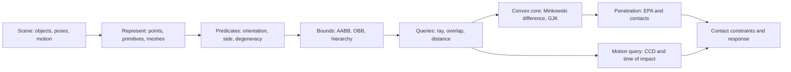

# 20 — Geometry Queries from Scene to Contact

[[Chapter Edition/02 - Graphics Vision and XR/00 - Reading Map|Reading map]] · [[Chapter Edition/02 - Graphics Vision and XR/19 - Textures as Sampled Surface Signals|Previous chapter]] · [[Chapter Edition/02 - Graphics Vision and XR/21 - Collision Implementations and Repository Comparison|Next chapter]]

A scene is only the beginning of a geometric query: transforms, representations, predicates and contacts each carry contracts. This chapter organizes collision work as a chain from scene data to a defensible answer.

**By the end:** Trace a collision query through geometry conversion, predicates and contact output.

**Recall question:** At which stages can a scene-level query become geometrically ambiguous?

<!-- Derived from Continuous Notes/University - Worlds, Images and Inference - Graphics, Vision and Photography.md; source lines 48180–50454; source-span SHA256 02d488cf8790503423359ecb13e3cc0aed279f2b317b86c0937cc7e554620d2d. -->

<!-- CHAPTER-SOURCE-BEGIN -->
## From a Scene to a Collision Answer: Geometry as a Chain of Contracts

A collision query begins with two meanings hidden behind one question. “Do these things touch?” may mean that their ideal mathematical surfaces share a point; that their filled solids overlap; that their conservative bounds overlap; or that a simulation should create a stable constraint before visible interpenetration occurs. Each answer is useful somewhere, but they are not interchangeable. A renderer may accept a conservative visibility result. A physics solver needs a normal and contact points with a consistent sign convention. A topology edit may require a mathematically correct orientation sign even when the visible difference is microscopic.

The reliable way to build such systems is to follow one scene through a sequence of representations. Keep the question and its contract explicit at every transition:



The arrows mean “provides an input contract to,” not “automatically guarantees correctness of.” A good broad phase cannot repair an invalid triangle. A robust orientation predicate cannot recover information already lost when large world coordinates were rounded to a coarse `float`. A Boolean overlap result cannot supply the contact manifold a solver needs.

### The scene is not yet geometry

A scene contains entities, transforms, motion, and policies. A rendered mesh may be only a visual approximation of a physical collider. A collider can be a sphere, capsule, box, convex hull, triangle mesh, or a compound of several shapes. Its transform maps local coordinates into world coordinates; a query may instead transform into local coordinates to reuse a simpler primitive test. Before any arithmetic, a query should establish which coordinate space each input and output uses, what units the ray parameter has, whether the shape is a surface or a filled solid, and whether touching counts as a hit.

For a ray written $x(t)=o+td$, the parameter $t$ is a distance only when $d$ is unit length. Transforming both $o$ and $d$ by an affine inverse preserves the same parameter if the transformed direction is left unnormalized. If code normalizes the local direction, it has changed the parameter scale; a reported local $t$ can no longer be treated as the original world distance without conversion. This small bookkeeping issue is a frequent source of bugs in picking, BVH traversal, and sweep queries.

A mesh itself has two structures. Geometry is the set of positions and derived quantities such as lengths, normals, and areas. Topology records which indexed vertices form edges and faces and which faces share an edge. Two coincident triangles with duplicated indices may look joined but be topologically disconnected; a shared index edge with zero-area triangles has connectivity but defective geometry. For mesh adjacency, half-edge traversal, winding, boundary loops, or manifold checks, the indices and their orientation matter as much as the coordinates. Botsch et al. introduce triangle meshes as piecewise-linear surfaces and distinguish their geometry from connectivity in *Polygon Mesh Processing*, especially the surface representation and mesh data structure chapters (printed pp. 1–28; inspected PDF pages 13–23 for triangle mesh and half-edge context).

The simplest useful representation is deliberately limited. A point is a location; a vector is a displacement. A segment joins two endpoints; a ray has a source and a permitted parameter interval; a plane is represented by a normal $n$ and offset $d$, with signed expression $n\cdot x+d$. A triangle is an ordered triple of positions. A convex polytope can be represented by its vertices (a V-representation) or by intersecting half-spaces (an H-representation). Neither representation is universally superior: vertices make support queries natural; planes make clipping and containment natural. A bounding volume is yet another representation, chosen to make a cheap rejection test possible, not to reproduce every detail of the object.

### Predicates are the decision points

A predicate classifies a geometric relation: left/right/on, inside/outside, overlap/separate, or positive/negative orientation. A construction computes a new value such as an intersection point, projection, normal, or contact witness. The distinction matters because a slightly inaccurate constructed point may remain usable, while a wrong predicate sign can send a whole algorithm down the wrong branch. CGAL documents this distinction explicitly and uses filtered predicates to certify decisions while allowing inexact constructions in some kernels.

For three planar points $A,B,C$, define

$$
\operatorname{orient2D}(A,B,C)=(B_x-A_x)(C_y-A_y)-(B_y-A_y)(C_x-A_x).
$$

The sign says whether $C$ lies left of, right of, or on the directed line $A\rightarrow B$ in the standard Cartesian orientation. Its magnitude is twice the signed triangle area. Reversing two arguments reverses the sign. For $A=(1,1)$, $B=(5,2)$, and $C=(3,5)$, the edge vectors are $(4,1)$ and $(2,4)$, so the determinant is $4\cdot4-1\cdot2=14>0$. The turn is counterclockwise and the area is $7$ square units. If instead $C=(3,3)$, the determinant is $4\cdot2-1\cdot2=6$, still positive. For $C=(3,1.5)$, it is $4\cdot0.5-1\cdot2=0$: exactly collinear in real arithmetic.

In three dimensions, four points define the signed scalar triple product

$$
\operatorname{orient3D}(A,B,C,D)=(B-A)\cdot((C-A)\times(D-A)).
$$

Its absolute value is six times the tetrahedron's volume. Its sign tells which side of the oriented plane $ABC$ contains $D$; zero means coplanar in exact arithmetic. Both determinant tests are predicates, although a floating-point implementation returns an approximation to the determinant before interpreting its sign.

That caveat is essential. Near zero, floating-point rounding can change a sign. Taking an arbitrary fixed epsilon and declaring all values within it “zero” is not a universal cure: orientation in 2D has units of length squared; orientation in 3D has units of length cubed; a squared-distance comparison has units of length squared. The same literal threshold cannot mean the same geometric tolerance for each. Worse, a tolerance deliberately changes the boundary convention, while a robust predicate tries to determine the sign of the represented input exactly.

Jonathan Shewchuk's adaptive predicates use a fast floating-point evaluation and an error bound. If the estimate is safely outside its error interval, its sign is certified. If not, additional precision is spent only on that difficult case. CGAL's exact-predicates/inexact-constructions kernel makes a related engineering trade explicit: decisions can be exact even when newly constructed coordinates are rounded. These mechanisms do not restore source measurements lost before the predicate sees them, and their guarantees depend on the arithmetic and compiler assumptions of the implementation. For simulation contacts, a small length-valued “slop” may be a sensible policy; for winding or mesh topology, substituting that slop for an orientation sign can create inconsistent connectivity.

Degeneracy should likewise be named by contract. A segment with identical endpoints is mathematically degenerate; an application may also choose to treat every segment shorter than a specified length as unusable. A triangle with exactly zero cross product has zero area; a skinny triangle with nonzero area may still be rejected as poor quality for a solver. These are different cases and require different handling. Degenerate geometry should select a documented fallback (for example, point-to-segment distance for a collapsed triangle), not silently fabricate a normal that is then exposed as a valid geometric normal.

### Bounds preserve possibilities

A bound is useful when it is cheap and guaranteed to contain the object. An axis-aligned bounding box (AABB) stores componentwise minima and maxima. A point is inside it when all three coordinates lie in their closed intervals. Two AABBs overlap if and only if their intervals overlap on every axis. This test is inexpensive and is excellent for rejecting pairs that cannot collide. It is not a statement that the enclosed shapes themselves intersect.

An oriented box (OBB) can fit a rotated object more tightly, but it carries axes and half-extents and therefore has more expensive overlap tests. A hierarchy of bounds lets a ray or shape query descend only into promising subtrees. The central broad-phase invariant is one-sided: pruning may leave extra candidates (false positives), but it must not discard a true hit (false negative). Surface area often predicts hierarchy traversal cost better than volume, because a ray intersects boundary area rather than volume; it remains a heuristic, not a guarantee of query speed.

Projection unifies a number of these ideas. Given a direction $n$, a convex shape $K$ projects to an interval whose maximum is $h_K(n)=\max_{x\in K}n\cdot x$ and minimum is $-h_K(-n)$. A support point is any point attaining the maximum. AABB plane classification, the Separating Axis Theorem (SAT), and [[Concepts/GJK and EPA|GJK]] support queries all ask for extreme projections, but use those values for different decisions.

For two convex polytopes, SAT checks candidate axes: if the projected intervals have a gap on any tested separating axis, the shapes are disjoint. For two 3D boxes, the complete candidate set is the three face normals of each box plus nine cross products of one edge direction from each box, for up to 15 axes. A zero cross product gives no direction and is skipped. A nearly zero cross axis is numerically ill-conditioned if normalized; for a Boolean interval separation test, one can compare unnormalized projected values because the common axis scale appears on both sides. If penetration depths are compared across axes, their lengths must be normalized or corrected for that axis scale. A best SAT axis estimates a minimum translation direction for suitable convex polyhedra, but does not itself generate a full contact manifold.

### Queries turn geometry into answers

A ray–plane query substitutes $o+td$ into the plane equation and solves one scalar equation. The denominator $n\cdot d$ identifies parallelism; the numerator measures signed offset. If $n\cdot d$ is small, a huge computed $t$ may be highly sensitive to rounding. A ray–sphere query substitutes the same parameterization into the squared-distance equation and obtains a quadratic. The discriminant distinguishes miss, tangent, and crossing, but the naïve quadratic formula can lose precision when subtracting nearly equal values; stable root evaluation and explicit handling of a ray starting inside are part of the query contract.

A ray–triangle test must combine a plane crossing with triangle containment. Barycentric coordinates express a point as $P=A+u(B-A)+v(C-A)$; for a point in the triangle, $u\ge0$, $v\ge0$, and $u+v\le1$, with boundary inclusion stated explicitly. Möller–Trumbore solves for the same quantities in one determinant-based system. Shared edges pose a special challenge: adjacent triangles should agree about whether a ray exactly on their common edge hits one, both, or neither. “Watertight” is a stronger property than passing ordinary interior-hit examples.

For a ray and AABB, the slab method intersects the parameter intervals induced by each coordinate's min/max planes. The final interval is the maximum of entry parameters and minimum of exit parameters, intersected with the ray's allowed interval. If a direction component is zero, the ray is parallel to that pair of planes: reject if the origin coordinate lies outside the slab, otherwise that axis imposes no finite bound. Blindly multiplying a zero displacement by an infinite reciprocal can produce NaNs. If the origin starts inside the box, the entry parameter may be zero while the exit is positive; whether that means “initial overlap” or “first boundary hit” must be stated, especially for normals.

At mesh scale, a primitive intersection is not yet a scene query. “Any hit” may stop at the first accepted hit; “closest hit” must keep the smallest valid parameter; “all hits” must collect every relevant crossing and may sort them. A BVH traversal must preserve the chosen semantics. Mesh containment by ray parity requires a complete, consistent set of crossings and a rule for shared edges and vertices; a mesh-level API that returns only one closest hit per collider is not enough. A generalized winding number offers another route, but has its own signed-orientation and open-mesh assumptions. Distinguish candidate enumeration from the local geometric test and from the public query result.

Likewise, distinguish overlap, distance, penetration, and time of impact. A Boolean overlap says only that the chosen solids intersect under the chosen boundary convention. A distance query returns a closest-point separation and often witnesses. Penetration depth asks how far one object must be translated to separate them, along a minimizing direction. Time of impact (TOI) asks for the earliest time within a motion interval at which the query shapes first touch. These results need different algorithms and API fields.

### Minkowski difference turns two shapes into one

For sets $A$ and $B$, their Minkowski difference is

$$
A-B=\{a-b\mid a\in A,\ b\in B\}=A\oplus(-B).
$$

It is not set subtraction $A\setminus B$. The origin belongs to $A-B$ exactly when there exist equal points in both shapes, so $A$ and $B$ intersect if and only if $0\in A-B$. If both original shapes are convex, their Minkowski difference is convex too: a convex combination of $a_1-b_1$ and $a_2-b_2$ is the difference between the same convex combinations in $A$ and in $B$.

A support query avoids constructing this potentially enormous difference explicitly:

$$
S_{A-B}(d)=S_A(d)-S_B(-d).
$$

The support point of a sphere centered at $c$ with radius $r$ is $c+r\,d/\|d\|$ for nonzero $d$. For an AABB, each coordinate chooses its minimum or maximum according to the corresponding direction sign. For a capsule (segment Minkowski-summed with a radius-$r$ ball), choose the segment endpoint with larger dot product and add the sphere support displacement. A zero direction is exceptional: every point maximizes the zero dot product, so a deterministic valid support may be returned, but it carries no useful search orientation.

#### Numeric witness: a complete 2D GJK separation trace

Let $A$ be the square with corners $(0,0),(2,0),(2,2),(0,2)$ and let $B$ be the square $(3,0),(4,0),(4,1),(3,1)$. Their true closest points are $(2,0)$ on A and $(3,0)$ on B, so the distance is $1$ and the shapes are disjoint. We compute support on $C=A-B$ with $S_C(d)=S_A(d)-S_B(-d)$.

Start with $d=(1,0)$. The A support can be $(2,2)$ (there is a tie on the right edge); the B support in $-d=(-1,0)$ is $(3,0)$ (tie on the left edge). Therefore $w_1=(-1,2)$. This is a point in the Minkowski difference, not the difference of the closest witnesses.

Choose next direction $d=-w_1=(1,-2)$, toward the origin from that point. The A support is $(2,0)$; the B support in $(-1,2)$ is $(3,1)$. Thus $w_2=(-1,-1)$. The segment from $w_1$ to $w_2$ lies on the left boundary of the difference square. The origin is outside it. Project $O$ onto the segment: with $A_s=w_2=(-1,-1)$ (newest point) and $B_s=w_1=(-1,2)$, $AB=B_s-A_s=(0,3)$ and $AO=(1,1)$. Then $AO\cdot AB=3>0$ and $t=(AO\cdot AB)/(AB\cdot AB)=3/9=1/3$. The closest point is $q=A_s+tAB=(-1,0)$; its distance to the origin is $1$. A distance-GJK implementation can return this distance and recover original-shape witnesses using the same barycentric weight $2/3$ on the pair that generated $w_2$ and $1/3$ on the pair that generated $w_1$.

The separating certificate is the support in direction $-q=(1,0)$. The current simplex has maximum projection $(-1,0)\cdot(1,0)=-1$, strictly below zero, so its convex hull—and therefore the full Minkowski difference, whose support in that direction is no smaller—cannot contain the origin. If shapes are tangent, the certified gap is zero; if a rounded dot product is only approximately zero, the code must distinguish a tolerance policy from a certified sign. This one trace ties the support formula, simplex closest point, separation test, distance, and witness interpolation together.

GJK repeatedly adds support points and retains the simplex feature nearest the origin. In 3D that feature can be a point, segment, triangle, or tetrahedron. For a line, project the origin onto the segment and discard an endpoint if its barycentric weight would be negative. For a triangle, test face and edge Voronoi regions or solve a constrained closest-point problem; retain only the active feature. For a tetrahedron, orient face tests consistently and determine whether the origin is inside or outside each face. The essential invariant is not “always keep four points”; it is “retain a simplex whose convex hull is the current closest region relevant to the origin.”

A simple intersection GJK and distance GJK have different stopping questions. A separated support plane can prove no intersection. A simplex containing the origin can establish overlap, but lower-dimensional contact needs careful treatment. Distance GJK instead reduces the closest point and checks progress or support improvement against a justified convergence condition. Repeated or nearly repeated support points, vanishing triple-cross directions, zero-area triangles, and near-zero tetrahedral volumes need explicit status handling. An iteration cap prevents hangs; reaching it is a failure/uncertain result, not a proof of separation. Tolerance must be tied to scale, units, and the specific comparison.

Gilbert, Johnson, and Keerthi introduced an iterative distance algorithm for convex sets; later implementations refine sub-simplex selection and robustness. The practical principle remains useful: the shape is hidden behind a support mapping, so the same loop works for many convex representations. But convexity is a precondition. A concave mesh must be decomposed into convex pieces or traversed through a hierarchy of triangles or convex proxies.

### EPA converts overlap into a displacement estimate

GJK answers overlap or distance, but penetration response needs direction and depth. The Expanding Polytope Algorithm (EPA) starts from a suitable origin-containing simplex in Minkowski-difference space, expands it into a polytope, selects the face nearest the origin, and queries support along that face's outward normal. If the new support lies only a small gap beyond the face, that face approximates the closest boundary of the Minkowski difference. The face normal gives a candidate translation direction; the distance from the origin to the face approximates the penetration depth.

For a triangular face with vertices $a,b,c$, compute $n=(b-a)\times(c-a)$ and orient it so the face's signed distance $n\cdot a/\|n\|$ is nonnegative under the chosen outward convention. The face's distance is measured to its plane, not to its nearest vertex. The closest face is selected, support is added, and faces visible from the new point are removed; the boundary between removed and retained faces is the horizon, which is stitched to form new faces. Directed-edge orientation and a closed, consistently wound polytope are structural invariants. Duplicate support, degenerate faces, nonmanifold horizons, and iteration exhaustion all need explicit failure outcomes.

EPA is an approximation procedure for penetration depth, not magic contact generation. It expects a valid seed enclosing the origin; a GJK overlap result with only a point, line, or triangle may require a controlled seed-expansion step or another method. Touching and deeply symmetric shapes are particularly awkward. The distance between the origin and the nearest face of an inner polytope is a lower bound on distance to the full Minkowski boundary; the support gap is an upper bound. Convergence is measured by their gap, not by claiming that a finite polytope has become the exact curved boundary. A failure should return an explicit status and, if the engine chooses a fallback normal or depth, mark that estimate as fallback.

EPA can interpolate the original support witnesses stored alongside each Minkowski vertex. On a selected face, barycentric weights $(\lambda_a,\lambda_b,\lambda_c)$ combine the A-side witness points and B-side witness points separately. This yields one pair of approximate contact witnesses. It does not necessarily yield the several spatially separated contacts needed for a stable box-on-box manifold. Feature clipping, persistent feature IDs, and manifold reduction are separate stages. The collision normal's orientation must be documented once—e.g. from A toward B—and held consistent through witnesses, solver impulses, and penetration signs.

### Motion changes the question

Discrete collision detection asks whether shapes overlap at sampled times. A fast object can pass through a thin obstacle between samples. [[Concepts/Continuous collision detection|Continuous collision detection]] asks whether a collision occurs anywhere along the motion interval and, if so, finds the earliest TOI. A swept bound can conservatively generate candidate pairs; it does not by itself calculate TOI.

For pure translation with fixed orientation, relative motion reduces the pair to one moving shape against a stationary one. Let $v=v_A-v_B$. For a sphere swept against another sphere, use relative position $p=c_A-c_B$ and combined radius $R=r_A+r_B$, then solve $\|p+tv\|^2=R^2$ over the step's interval. The first valid root is the TOI. For an AABB swept against another AABB, expand one box by the other's half-extents and sweep a point through the expanded box (Minkowski sum configuration-space reasoning). The face hit determines a normal, with care at initial overlap and corner ties.

For general convex bodies, conservative advancement repeatedly queries distance and moves time forward by a safe fraction based on the current separation and a bound on closing speed. If separation is $d$ and the maximum closing speed along the current separating direction is $v_c>0$, a step no larger than $d/v_c$ is conservative for the assumed motion model; practical algorithms include a safety factor and recompute distance after advancing. Rotating bodies require accounting for angular motion, often through a bound involving angular speed and a radius from the center of rotation. An algorithm that assumes linear translation cannot claim a rotational CCD guarantee.

The process terminates on an overlap/touching criterion, a time interval bound, or a declared iteration/precision limit. “No hit found before the cap” differs from a proof of no collision. CCD also belongs to simulation control: after TOI, the integrator must advance to impact, solve or constrain, then process any remaining time. A query returning a correct TOI is not alone evidence that the entire physics step prevents tunnelling.

### The final contract is observable

A dependable geometry library makes its decisions inspectable. A ray hit should expose its parameter and coordinate space, point, geometric normal validity, primitive/feature identity, and whether the result denotes initial overlap. A shape-pair query should separate overlap state, distance, penetration estimate, witnesses, and failure status instead of overloading a Boolean. A mesh query should state whether it is any-hit, closest-hit, or all-hit and whether results are per collider or per primitive. A CCD result should distinguish hit, no hit within interval, initial overlap, and numerical/iteration failure.

Tests should follow the same chain as the algorithms. Use hand-checkable numeric cases, then symmetry checks (swap A and B and reverse the normal), translation and uniform-scale metamorphic checks, degenerate and near-tangent families, shared-edge rays, and brute-force versus hierarchy comparisons. For optimized SAT/SIMD/BVH paths, retain a simple reference implementation and compare them over reproducible generated cases. Visual debug drawings should show the relevant intermediate state—bounds, candidate axes, simplex, support points, EPA horizon, hit interval, witness pair—and should label coordinate spaces. A picture is useful evidence of a trace, not proof of exhaustive robustness.

The chain is the teaching spine: scene policy determines representations; representation enables predicates; predicates maintain consistency; bounds remove impossible candidates; queries resolve remaining geometry; convex support lifts pairwise collision into origin geometry; GJK measures or classifies; EPA estimates penetration; CCD asks the query across time; and contacts feed the solver. Each layer has a narrow promise. Reliability comes from preserving those promises while moving between them.

### A short laboratory for the contracts

Take two AABBs, $A=[(0,0,0),(2,2,2)]$ and $B=[(1.5,1,2.4),(3,3,4)]$. Their overlap intervals are $[1.5,2]$ on $x$, $[1,2]$ on $y$, and empty on $z$ because $2.4>2$. The broad phase rejects the pair before any triangle or convex test. If the lower $z$ bound changes from $2.4$ to $2$, the boxes touch on a face. A closed-box convention reports overlap; a strict-interior convention reports no positive-volume overlap. Neither convention should be left implicit.

Now shrink the question to two planar triangles. Let $A=(0,0)$, $B=(4,0)$ and examine $C_1=(2,10^{-8})$ and $C_2=(2,-10^{-8})$. Their exact orientation values are $+4\times10^{-8}$ and $-4\times10^{-8}$, respectively, in square coordinate units. A fixed threshold `1e-6` applied to the determinant would collapse both into the same “on” class. It would erase a real side distinction even though the coordinate scale is only a few units. If the entire scene is uniformly scaled by $10^6$, the determinant scales by $10^{12}$, while the geometric turn has not changed. This demonstrates why a dimensional tolerance, an angular quality policy, and an exact-sign predicate answer three different questions.

For SAT, consider intervals $I_A=[-2,1]$ and $I_B=[0,3]$ on a candidate axis. They overlap by one unit; the signed center-distance formula has $|c_B-c_A|=2$ and projected radii $r_A=1.5,r_B=1.5$, so $2<3$. Move $B$ to $[1.1,4.1]$: now the gap is $0.1$ and $2.6>1.5+1.5$ only depending centers: centers are 2.6 and -0.5, separation 3.1, sum radii 3.0, correctly reject by 0.1. On an unnormalized axis $5n$, all projections and radii multiply by five and the Boolean result remains the same; a depth comparison must divide that gap by five. This is the scale consistency a handwritten SAT implementation should preserve.

These hand calculations make good first tests because the expected classification and intermediate values are visible. They do not replace adversarial tests over random rotations, shared edges, very large offsets, or non-finite input. Nor do they establish that a production collision pipeline is complete. They establish a small set of traceable examples against which implementations can be checked.

The geometry-processing book also cautions that mesh samples need consistent neighbourhood structure before they define a meaningful manifold surface. In collision work, this becomes a practical distinction: a set of triangles can be intersected independently without manifold topology, but inside/outside classification, connected surface traversal, and boundary-loop reasoning rely on stronger assumptions. An open sheet has no unambiguous “inside” in the same sense as a closed oriented shell; nonmanifold edges or bow-tie vertices undermine local neighborhood assumptions. Mesh repair is therefore not a cosmetic preprocessing step when later queries depend on topology.

Finally, every algorithm should expose uncertainty in a form callers can preserve. A three-state enum such as separated / touching-or-overlapping / uncertain is sometimes more honest than forcing a difficult near-zero calculation into a Boolean. A richer result can carry a reason: invalid input, degenerate simplex, exhausted iterations, unsupported motion, or a conservative bound. That is not needless API ceremony; it prevents a fallback or timeout from being mistaken for a geometric theorem.


![[Visual Recall/Integrated Geometry and Engine/triangle-nearest-edge.png]]

For $A=(0,0)$, $B=(4,0)$, $C=(1,3)$ and $P=(4,4)$, the unconstrained face coordinates place $P$ outside the triangle. Project onto edge $BC$: $t=((P-B)\cdot(C-B))/\|C-B\|^2=2/3$, so $Q=(2,2)$. The residual is perpendicular to the edge, and the squared distance is $8$. This is an edge solution rather than an interior-face solution.

Repository-specific passages below describe the supplied Kairo snapshot. They have not been revalidated against a current checkout; code fragments retain their stated surrounding context and are not all standalone tested programs. Numerical and contract explanations are taught independently of those implementation observations.

Phase 12 · Computational Geometry, Geometric Predicates, and Closest-Point Reasoning


System question: How does a graphics or physics engine convert mathematical geometry into reliable computational decisions, distances, nearest points, surface coordinates, and collision-query primitives?

This pass develops two connected systems. M067 establishes robust geometric reasoning and the foundational representations of rays, lines, segments, and planes. M068 builds spheres and triangles on top of those foundations, eventually deriving barycentric coordinates, point containment, and closest-point algorithms.

The important distinction throughout is that mathematical geometry describes exact objects, whereas computational geometry must make reliable decisions using finite-precision representations of those objects.

### Geometric Predicates, Rays, Lines, Segments, and Planes

**What computational geometry actually solves**

Imagine a rendering engine containing a camera, a triangular mesh, and a mouse cursor. The user clicks somewhere on the screen, and the engine needs to select the triangle underneath the cursor.

There are several mathematical questions hidden inside this apparently simple operation.

The camera generates a ray from the screen position. The engine asks whether that ray intersects a triangle. To answer, it must represent the ray, determine an intersection parameter, distinguish hits behind the camera from hits in front of it, classify the intersection relative to the triangle, and decide how to handle numerical uncertainty near an edge.

This same machinery appears in rigid-body collision detection, BVH traversal, mesh reconstruction, cloth simulation, Gaussian proxy geometry, scene editing, navigation, and spatial optimization.

The complete progression is:

Geometric representation

Points, vectors, lines, rays, planes, surfaces

Geometric predicates

Which side? Inside? Outside? Intersecting?

Geometric constructions

Projection, nearest point, intersection position

Algorithms and acceleration

Ray casting, collision detection, BVHs, contact generation

**Part 1101 — Geometric predicates versus constructions**

A geometric predicate answers a decision question about geometry. A geometric construction computes a geometric result.

For example, consider three points in two dimensions:

$$
A=(0,0),\quad B=(4,0),\quad C=(2,3)
$$

We want to determine whether $C$ lies to the left or right of the directed line $A\rightarrow B$.

Define:

$$
\operatorname{orient2D}(A,B,C)= (B_x-A_x)(C_y-A_y) - (B_y-A_y)(C_x-A_x)
$$

This expression is the determinant:

$$
\det \begin{pmatrix} B_x-A_x & B_y-A_y\\\ C_x-A_x & C_y-A_y \end{pmatrix}
$$

For our example:

$$
(4)(3)-(0)(2)=12
$$

A positive result indicates counterclockwise orientation, which means $C$ lies to the left of the directed line $A\rightarrow B$ under standard Cartesian-axis conventions.

A negative result indicates clockwise orientation; zero means collinearity.

Orientation is a signed decision. Reversing the order of two inputs reverses the sign.

The actual predicate returns a sign or orientation classification rather than requiring the caller to interpret an arbitrary numerical magnitude.

A construction, meanwhile, might compute the perpendicular projection of $C$ onto the line through $A$ and $B$, obtaining $(2,0)$.

This distinction matters because a small numerical error in a construction may produce a slightly inaccurate point, but a small numerical error in a predicate can reverse an entire algorithmic decision.

For example, a wrong orientation sign can reverse polygon winding, exclude a valid point from a triangle, choose the wrong feature in collision detection, or produce invalid mesh connectivity.

The [CGAL geometry-kernel documentation](https://cgal.geometryfactory.com/CGAL/doc/main/Kernel_23/index.html?utm_source=chatgpt.com) makes this distinction central to designing reliable geometric algorithms.&#x20;

[image](https://www.google.com/s2/favicons?domain=https://cgal.geometryfactory.com\&sz=32)

cgal.geometryfactory.com+1


**Generalizing orientation to 3D**

In three dimensions, four points determine a signed tetrahedral volume.

Let $A,B,C,D\in\mathbb{R}^3$. Define:

$$
\Delta = (B-A)\cdot\big((C-A)\times(D-A)\big)
$$

This is a scalar triple product, equivalent to a $3\times3$ determinant.

Its magnitude equals six times the tetrahedron's volume:

$$
V=\frac{|\Delta|}{6}
$$

Its sign identifies which oriented side of the plane through $A,B,C$ contains $D$.

Its zero value indicates that all four points are coplanar, assuming exact arithmetic.

Why does the factor six appear? A parallelepiped generated by three edge vectors has volume equal to the absolute scalar triple product. The corresponding tetrahedron occupies one-sixth of that parallelepiped.

A numerical determinant is therefore not merely an algebraic formula. Its sign controls orientation and topological decisions in mesh processing, tetrahedralization, collision detection, and spatial reconstruction.

**Part 1102 — Numerical robustness and the epsilon problem**

Now we encounter one of the most important ideas in computational geometry.

A mathematically exact zero and a floating-point value close to zero are different things.

Suppose three nearly collinear points are:

$$
A=(0,0),\quad B=(10^8,10^8),\quad C=(2\times10^8,2\times10^8+\delta)
$$

Their orientation determinant is:

$$
\Delta=10^8\delta
$$

If $\delta$ is sufficiently small, binary floating-point rounding may eliminate the displacement when the coordinates are represented.

Even if the displacement survives, determinant evaluation subtracts potentially large and nearly equal products. This introduces catastrophic cancellation: the resulting difference may have far fewer reliable significant bits than the original operands.

**Absolute versus relative errors**

An absolute-error comparison tests:

$$
|a-b|\le\epsilon_{\mathrm{abs}}
$$

This works when the units and characteristic scale are known.

A relative-error comparison tests:

$$
|a-b|\le\epsilon_{\mathrm{rel}} \max(|a|,|b|)
$$

This is useful across varying magnitudes, but it is inadequate near zero.

A combined comparison uses:

$$
|a-b| \le \epsilon_{\mathrm{abs}} + \epsilon_{\mathrm{rel}}\max(|a|,|b|)
$$

However, this is a numerical policy, not a universal definition of geometric equality.

If your geometry represents a microscopic object and a planetary-scale scene, the same absolute tolerance cannot reliably serve both.

Moreover, different geometric expressions have different physical dimensions.

For example:

| Expression                     | Units when coordinates are in metres |
| ------------------------------ | ------------------------------------ |
| $\|B-A\|$              | $\mathrm m$                      |
| $\|B-A\|^2$            | $\mathrm m^2$                    |
| $\|(B-A)\times(C-A)\|$ | $\mathrm m^2$                    |
| $\operatorname{orient2D}$  | $\mathrm m^2$                    |
| $\operatorname{orient3D}$  | $\mathrm m^3$                    |
| Triangle Gram determinant      | $\mathrm m^4$                    |

Comparing every one of these expressions against the same dimensionless `1e-6` is not mathematically meaningful.

**Numerical degeneracy versus geometric degeneracy**

A segment is mathematically degenerate if its endpoints coincide:

$$
A=B
$$

An approximate degeneracy policy might instead declare it too short to process:

$$
\|B-A\|\le \tau_L
$$

where $\tau_L$ has units of length.

These are different decisions. A segment of length $10^{-7}$ metres is not mathematically degenerate, even if the renderer deliberately treats it as such.

For a triangle, a scale-relative criterion can be constructed using:

$$
\begin{aligned} e_0&=B-A\\\ e_1&=C-A\\\ e_2&=C-B\\\ L^2&=\max(\|e_0\|^2,\|e_1\|^2,\|e_2\|^2) \end{aligned}
$$

Since $\|e_0\times e_1\|^2$ has units of length to the fourth power, a relative area test can use:

$$
\|e_0\times e_1\|^2 \le \tau_{\mathrm{rel}}^2L^4
$$

This is dimensionally consistent. It still represents an approximate policy, not an exact predicate.

A production implementation must additionally handle arithmetic overflow, underflow, non-finite input, and the possibility that subtraction itself loses the geometric information.

**Robust predicates using adaptive precision**

Jonathan Richard Shewchuk's work explains why ordinary fixed-precision determinant evaluation can produce incorrect orientation results and how adaptive arithmetic can avoid this problem.&#x20;

[image](https://www.google.com/s2/favicons?domain=https://www.cs.cmu.edu\&sz=32)

cs.cmu.edu+1


The essential strategy is:

1. Evaluate the determinant using ordinary floating-point arithmetic.
2. Calculate a rigorous bound on the possible rounding error.
3. If the magnitude is greater than the bound, the sign is reliable.
4. Otherwise, perform more precise arithmetic, often using floating-point expansions.
5. Return the reliably determined sign.

A floating-point expansion represents a numerical value as the unevaluated sum of several nonoverlapping floating-point components. This preserves information that would be lost in one ordinary floating-point number.

The efficiency comes from the fact that ordinary, well-separated geometry usually passes the fast first stage. Difficult nearly degenerate cases trigger the more expensive arithmetic.

An important condition is that the predicate implementation's assumptions about floating-point operations and compiler optimization must hold. Arbitrary fast-math transformations can violate those assumptions.

Our engineering distinction: scale-aware tolerances are useful for approximate geometry such as collision slop and editor picking. Exact or adaptively evaluated predicates are appropriate when the sign itself determines topology or a critical branch.

**Parts 1103–1107 — Rays and infinite lines**

A line and a ray share the same parametric equation, but they represent different sets of points.

Let $O$ be an origin, $D$ a direction vector, and $t$ a scalar parameter.

$$
\boxed{P(t)=O+tD}
$$

For an infinite line:

$$
t\in(-\infty,\infty)
$$

For a ray:

$$
t\in[0,\infty)
$$

A ray therefore has a distinguished starting point and extends in only one direction. An infinite line extends in both directions.

**Deriving the parametric equation**

At $t=0$, the position must be $O$.

At $t=1$, the position must be $O+D$.

At $t=2$, the position must be $O+2D$.

These requirements imply an affine relation:

$$
P(t)=O+tD
$$

Importantly, $O$ is a point, while $D$ is a displacement vector. Adding two points is not generally an affine-geometric operation; adding a vector to a point is.

This distinction motivates strongly typed point/vector APIs in large geometry libraries.

**Direction magnitude changes the meaning of $t$**

Consider:

$$
O=(1,2,3),\qquad D=(0,0,5)
$$

Then:

$$
P(2)=(1,2,13)
$$

The actual displacement from the origin has length $10$, not $2$.

In general:

$$
\operatorname{distance}(O,P(t))=|t|\|D\|
$$

Only when $\|D\|=1$ does $t$ measure Euclidean distance.

This matters for intersection results. A ray-triangle routine that returns `t=10` is returning ten parameter units, which are ten metres only if the direction is unit length and coordinates use metres.

Two common ray contracts are valid:

- General-direction ray: preserves arbitrary nonzero $D$; every query accounts for $\|D\|$.
- Unit-direction ray: enforces $\|D\|=1$; parameters represent physical distance.

Neither is universally superior. The first avoids unnecessary normalization and preserves some transformation conventions. The second simplifies distance-based operations.

The critical rule is to avoid mixing them.

**Part 1105 — Ray intervals**

Practical ray tracers often use:

$$
t\in[t_{\min},t_{\max}]
$$

This lets us exclude intersections too close to the origin or farther than a known closest hit.

For example, a shadow ray from point $P$ to a light $L$ should generally search only within the segment joining them, with appropriate endpoint handling.

If $D$ is a normalized direction toward the light:

$$
t_{\max}\approx\|L-P\|
$$

A lower endpoint may be excluded to prevent a surface from reporting an immediate self-hit. The actual treatment should be chosen with attention to geometric error bounds; blindly setting one global ray epsilon is unreliable at widely varying scales.

Ray intervals also permit hit pruning. Suppose a BVH traversal has already found a hit at $t=8$. Geometry farther away cannot improve the closest-hit result, so the traversal can reduce its current upper bound to $8$.

**Your repository: `KairoGeometry/Ray.cppm`**

I inspected the current default branch of [KairoGeometry/Ray.cppm](https://github.com/swayam8624/KairoGeometry/blob/master/Ray.cppm?utm_source=chatgpt.com).

The implementation represents a ray using two `Vector3<T>` values:

```
template<FloatingPoint T>
struct Ray final {
    Vector3<T> Origin = Vector3<T>::Zero();
    Vector3<T> Direction = Vector3<T>::Forward();

    constexpr Vector3<T> GetPoint(T distance) const noexcept {
        return Origin + Direction * distance;
    }
};
```

This is a simplified presentation of the repository's actual representation and evaluation logic.

The object contains no heap allocation, no pointer ownership, and no stored intersection history.

It also does not contain `tMin` or `tMax`. The ray is fundamentally an origin and direction; an intersection interval would need to be supplied by a separate API or query object.

The file's documentation expects a normalized direction for distance/intersection operations, but `FromOriginDirection()` and the direct constructor preserve the input direction. `NormalizeDirection()` is an explicit mutating operation.

There is a subtle API issue here: the representation allows non-unit directions while some API expectations assume unit directions.

A future refinement could make this distinction explicit with a validated unit-ray constructor or a separate ray-query type.

Another useful detail: `FromOriginTarget()` uses safe normalization with a fallback forward vector. That makes the operation total for coincident points, but it changes the semantic question from an undefined direction into a particular valid direction. That may be appropriate for editor tools and inappropriate for a strict geometric solver.

**Parts 1108–1112 — Finite segments, projection, and closest-point derivation**

A segment is defined by endpoints $A$ and $B$.

Set:

$$
D=B-A
$$

Every point on the infinite line through the endpoints is:

$$
Q(t)=A+tD
$$

The finite segment restricts:

$$
0\le t\le1
$$

This normalized parameter convention is especially valuable because it remains meaningful regardless of the segment's length.

**Deriving the closest point from first principles**

Given a query point $P$, find the point $Q(t)$ on the line that minimizes squared distance:

$$
f(t)=\|P-(A+tD)\|^2
$$

Define:

$$
W=P-A
$$

Then:

$$
f(t)=\|W-tD\|^2
$$

Expanding the dot product:

$$
f(t) =(W-tD)\cdot(W-tD)
$$

$$
f(t)=W\cdot W-2t(W\cdot D)+t^2(D\cdot D)
$$

Differentiate with respect to $t$:

$$
f'(t)=-2(W\cdot D)+2t(D\cdot D)
$$

Set the derivative to zero:

$$
-2(W\cdot D)+2t(D\cdot D)=0
$$

Therefore:

$$
\boxed{ t^*=\frac{(P-A)\cdot(B-A)}{\|B-A\|^2} }
$$

The second derivative is:

$$
f''(t)=2\|B-A\|^2
$$

For a nondegenerate segment, this is positive, proving that the stationary point is a minimum.

For an infinite line, $t^*$ is unrestricted.

For a ray beginning at $A$, use:

$$
t_{\mathrm{ray}}=\max(0,t^*)
$$

For a finite segment, use:

$$
\boxed{ t_{\mathrm{segment}}=\operatorname{clamp}(t^*,0,1) }
$$

The nearest point is:

$$
\boxed{ Q=A+t_{\mathrm{segment}}(B-A) }
$$

And the squared distance is:

$$
\boxed{ d^2=\|P-Q\|^2 }
$$

We usually calculate squared distance when comparing candidate points because taking a square root is unnecessary and the squared ordering is identical for finite nonnegative distances.

**Why clamping is mathematically valid**

The unconstrained squared-distance function is a convex quadratic.

Its minimum lies at $t^*$.

When the allowed domain is the interval $[0,1]$, three outcomes are possible:

- When $t^*<0$, the minimum over the interval lies at $t=0$, giving endpoint $A$.
- When $0\le t^*\le1$, the unconstrained minimum is feasible.
- When $t^*>1$, the interval minimum lies at $t=1$, giving endpoint $B$.

Thus clamping is not a heuristic. It is the exact solution to a convex optimization problem with an interval constraint.

**Worked numerical example**

Let:

$$
A=(1,1,0),\quad B=(5,1,0),\quad P=(4,4,0)
$$

Then:

$$
D=(4,0,0),\quad W=(3,3,0)
$$

$$
t^*=\frac{12}{16}=0.75
$$

The parameter is already within the segment's domain.

Therefore:

$$
Q=(1,1,0)+0.75(4,0,0)=(4,1,0)
$$

The distance is:

$$
d=\sqrt{(4-4)^2+(4-1)^2}=3
$$

If we instead choose $P=(9,4,0)$, then:

$$
t^*=\frac{32}{16}=2
$$

Clamping gives $t=1$, so the closest point is endpoint $B=(5,1,0)$, and the distance is $5$.

**Degenerate segments**

If $A=B$, then $D=0$ and the projection formula attempts division by zero.

The mathematically appropriate result is:

$$
Q=A,\qquad d^2=\|P-A\|^2
$$

This is why a geometry library must define the semantics of zero-length segments.

Your [Segment.cppm](https://github.com/swayam8624/KairoGeometry/blob/master/Segment.cppm?utm_source=chatgpt.com) explicitly permits `Start == End` and treats such a segment as a point.

Its `ProjectPointParameter()` computes the dot-product projection, checks for a very short direction using an epsilon-based threshold, and returns zero for the degenerate case. Its `ClosestParameter()` then clamps the result to $[0,1]$.

This is a coherent general-purpose design, although its fixed threshold on a squared length deserves scale-aware review.

**Parts 1113–1118 — Planes: representation, distance, projection, and classification**

A plane is an infinite, flat, two-dimensional surface embedded in three-dimensional space.

One convenient definition uses a point $P_0$ on the plane and a nonzero normal vector $N$.

Every point $X$ on the plane satisfies:

$$
\boxed{N\cdot(X-P_0)=0}
$$

Why? Every displacement vector lying inside the plane is orthogonal to its normal.

Expanding:

$$
N\cdot X-N\cdot P_0=0
$$

Define:

$$
d=-N\cdot P_0
$$

Then:

$$
\boxed{N\cdot X+d=0}
$$

For $N=(a,b,c)$ and $X=(x,y,z)$, this is the familiar plane equation:

$$
ax+by+cz+d=0
$$

The plane is therefore represented by four scalar coefficients $(a,b,c,d)$, although the same plane can be represented by any nonzero scalar multiple of those coefficients.

**Why normal magnitude matters**

The expression:

$$
N\cdot X+d
$$

is a signed algebraic residual.

It becomes a signed Euclidean distance only when $N$ has unit length.

For a general nonzero normal:

$$
\boxed{ s(X)=\frac{N\cdot X+d}{\|N\|} }
$$

For a unit normal $n$:

$$
\boxed{s(X)=n\cdot X+d}
$$

The sign has a geometrical interpretation:

- $s(X)>0$: point lies in the direction of the normal.
- $s(X)<0$: point lies on the opposite side.
- $s(X)=0$: point lies on the plane.

The words front and back are conventions, not universal mathematical facts. A graphics engine must define which orientation it uses.

**Deriving point projection onto a plane**

We want to find the closest point $Q$ on the plane to arbitrary point $P$.

The closest displacement is perpendicular to the plane, so it must be parallel to $N$.

Write:

$$
Q=P-\lambda N
$$

The projected point must satisfy the plane equation:

$$
N\cdot Q+d=0
$$

Substitute:

$$
N\cdot(P-\lambda N)+d=0
$$

Expand:

$$
N\cdot P-\lambda(N\cdot N)+d=0
$$

Rearrange:

$$
\lambda=\frac{N\cdot P+d}{N\cdot N}
$$

Therefore:

$$
\boxed{ Q=P-\frac{N\cdot P+d}{N\cdot N}N }
$$

When $N$ is unit length:

$$
\boxed{Q=P-(N\cdot P+d)N}
$$

Notice the connection to segment projection: in both cases, the optimal point is found by solving an orthogonality constraint.

**Constructing a plane from three points**

Let $A,B,C$ be three noncollinear points.

Construct the edge vectors:

$$
e_0=B-A,\qquad e_1=C-A
$$

The cross product:

$$
N=e_0\times e_1
$$

is perpendicular to both edges, so it is perpendicular to their entire span.

We can normalize:

$$
n=\frac{N}{\|N\|}
$$

and then compute:

$$
d=-n\cdot A
$$

Thus the plane is:

$$
n\cdot X+d=0
$$

This construction fails to define a unique plane if $A,B,C$ are collinear, because their cross product vanishes.

A reliable API should signal this failure, not silently assume an arbitrary normal when exact geometric meaning matters.

**Worked example**

Take a horizontal plane through $P_0=(0,2,0)$ with upward normal:

$$
N=(0,1,0)
$$

The plane equation is:

$$
y-2=0
$$

because $d=-2$.

For query point:

$$
P=(3,7,4)
$$

the signed distance is:

$$
s(P)=7-2=5
$$

The projected point is:

$$
Q=(3,7,4)-5(0,1,0)=(3,2,4)
$$

If the query point were $(3,-1,4)$, its signed distance would be $-3$, and the projection would still lie at $y=2$.

**Plane classification and tolerances**

In a numerical implementation, we often classify a point with a tolerance $\tau$ measured in world-space length units:

$$
\operatorname{classify}(P)= \begin{cases} \text{Positive}, & s(P)>\tau\\\ \text{Negative}, & s(P)<-\tau\\\ \text{OnBoundary}, & |s(P)|\le\tau \end{cases}
$$

This establishes a tolerance region around the plane, not exact mathematical coplanarity.

For robust topological classification, the sign of the corresponding orientation determinant may be preferable, particularly when the plane is itself constructed from input points.

**Your actual `Plane.cppm`**

Your [Plane.cppm](https://github.com/swayam8624/KairoGeometry/blob/master/Plane.cppm?utm_source=chatgpt.com) stores a normal vector and a scalar called `Distance`.

Its `FromPointNormal()` normalizes the supplied normal and derives the offset using the negative dot product.

Its projection method implements the unit-normal formula:

```
return point - Normal * SignedDistanceToPoint(point);
```

This is correct provided `Normal` is unit length.

But `FromNormalDistance()` directly preserves the supplied coefficients and the ordinary constructor also accepts them without normalization.

Consequently, the struct's public representation permits states in which `SignedDistanceToPoint()` is not a true Euclidean signed distance and `ProjectPoint()` is not an orthogonal projection.

There are at least three reasonable designs:

1. Enforce unit normals through validated constructors and preserve that invariant.
2. Permit arbitrary nonzero normals and use the general projection formula.
3. Distinguish an algebraic plane from a normalized-distance plane using separate types.

For a low-level engine, the first or third design is particularly attractive because they make assumptions more explicit.

Another issue: `FromPoints()` uses `SafeNormalize()` with a fallback up vector. For collinear points, the code creates a horizontal-oriented plane instead of reporting that the requested plane is undefined.

That is useful error tolerance for certain UI operations, but potentially dangerous for exact intersection or reconstruction algorithms.

Core result of M067: rays, lines, segments, and planes can all be understood as affine geometry subject to different constraints. Their closest-point algorithms emerge from orthogonality and minimization, while reliable classification requires a separate numerical decision policy.

### Spheres and Triangles

Original Parts 1119–1132

We now move from one-dimensional and infinite planar primitives to finite curved and polygonal geometry.

This is where the foundational mathematics starts becoming directly useful for collision detection, mesh processing, ray tracing, reconstruction, and physics.

**Parts 1119–1122 — Spheres, containment, closest points, and distance**

A sphere is one of the simplest useful geometric primitives because it is rotationally invariant: changing its orientation does not change its shape.

But a critical distinction must be made between the spherical surface and the filled solid ball.

Mathematically, for centre $C\in\mathbb R^3$ and radius $r\ge0$, the spherical surface is:

$$
S=\\{X\in\mathbb R^3:\|X-C\|=r\\}
$$

The closed solid ball is:

$$
B=\\{X\in\mathbb R^3:\|X-C\|\le r\\}
$$

In graphics-engine terminology, `Sphere` often represents the geometric sphere while point containment is interpreted as membership in its enclosed solid.

**Sphere representation in memory**

A conventional value representation is:

```
struct Sphere {
    Vec3 center;
    double radius;
};
```

Conceptually, this stores three coordinates and one radius.

Assuming `Vec3` contains three consecutive doubles without extra alignment padding, the mathematical payload is 32 bytes. Actual `sizeof(Sphere)` depends on the vector type's alignment, layout, and ABI.

There is no need to store a sphere's orientation.

For a valid geometric sphere, require:

$$
r\ge0,\qquad r\in\mathbb R,\qquad C_i\in\mathbb R
$$

In programming terms, these requirements should exclude negative radii, NaNs, and infinities unless the API deliberately uses special sentinel values.

A zero-radius sphere is a valid degenerate point sphere.

**Deriving sphere containment**

A point $P$ lies inside or on a closed sphere when:

$$
\|P-C\|\le r
$$

Both sides are nonnegative, so squaring preserves the comparison:

$$
\boxed{\|P-C\|^2\le r^2}
$$

In coordinates:

$$
(P_x-C_x)^2+ (P_y-C_y)^2+ (P_z-C_z)^2\le r^2
$$

Squared distances eliminate the square root and are often desirable in collision broadphases and containment queries.

However, the equivalence assumes a valid nonnegative radius and arithmetic without problematic overflow. For extreme finite inputs, independently squaring components can overflow even when a carefully scaled norm computation could remain finite.

**Closest point on the spherical surface**

Given $P$, define the centre-to-point vector:

$$
V=P-C
$$

For $P\ne C$, normalize:

$$
\hat V=\frac{V}{\|V\|}
$$

The nearest point on the spherical surface lies in this radial direction:

$$
\boxed{ Q=C+r\frac{P-C}{\|P-C\|} }
$$

Why?

Let any surface point be written:

$$
Q=C+ru
$$

where $u$ is a unit vector.

We wish to minimize:

$$
\|P-Q\|^2 =\|(P-C)-ru\|^2
$$

Expanding:

$$
\|P-C\|^2+r^2-2r(P-C)\cdot u
$$

The first two terms do not depend on $u$.

Therefore minimizing distance means maximizing:

$$
(P-C)\cdot u
$$

By the Cauchy–Schwarz inequality:

$$
(P-C)\cdot u\le\|P-C\|
$$

Equality occurs when $u$ points in the direction of $P-C$.

This derives the radial closest-point formula instead of assuming it from a diagram.

At the exact centre, $P=C$, the direction is undefined. If $r>0$, every point on the sphere is equally close, so the closest point is not unique.

A deterministic implementation might return:

$$
C+(r,0,0)
$$

This is a valid choice, but it is a convention rather than the unique mathematical answer.

**Three different distance functions**

This distinction is especially important for future physics and collision algorithms.

Let:

$$
\rho=\|P-C\|
$$

Then:

Signed distance to the sphere's boundary

$$
\boxed{d_{\mathrm{signed}}=\rho-r}
$$

Negative values indicate the interior, zero the boundary, and positive values the exterior.

Unsigned distance to the spherical surface

$$
\boxed{d_{\mathrm{surface}}=|\rho-r|}
$$

Even a point inside the sphere has a nonzero distance to the surface unless it lies on the boundary.

Distance to the filled solid ball

$$
\boxed{d_{\mathrm{solid}}=\max(0,\rho-r)}
$$

For points inside the filled ball, the nearest point in the solid is the point itself, so distance is zero.

For example, take a sphere of radius $5$ centred at the origin and query $P=(2,0,0)$.

We obtain:

$$
\rho=2
$$

Therefore:

$$
d_{\mathrm{signed}}=-3,\quad d_{\mathrm{surface}}=3,\quad d_{\mathrm{solid}}=0
$$

All three values are correct. They answer different questions.

**Sphere transformations**

Translations preserve shape and radius.

Uniform scaling by $s$ transforms the radius to:

$$
r'=|s|r
$$

But a general affine transformation, including nonuniform scale, does not necessarily preserve spheres.

For example:

$$
A= \begin{pmatrix} 2&0&0\\\ 0&1&0\\\ 0&0&1 \end{pmatrix}
$$

transforms a unit sphere into an ellipsoid with semiaxes $2,1,1$.

An engine that transforms a sphere's centre but leaves its radius unchanged will produce an incorrect world-space bounding shape under scale.

For conservative bounding under a general linear transform $A$, one may use:

$$
r'\ge r\|A\|_2
$$

where $\|A\|_2$ is the largest singular value of the linear transform. This yields a bounding sphere, not necessarily the smallest one for a transformed object with arbitrary existing geometry.

This is one useful connection to the singular-value decomposition material from the earlier linear-algebra phase.

**Your actual `Sphere.cppm`**

Your [KairoGeometry/Sphere.cppm](https://github.com/swayam8624/KairoGeometry/blob/master/Sphere.cppm?utm_source=chatgpt.com) uses the expected centre-and-radius representation.

Its `ContainsPoint()` checks squared distance against squared radius. `ClosestPoint()` chooses the positive X direction when the query is effectively at the centre, while `SignedDistanceToPoint()` computes distance from centre minus radius.

Its `DistanceToPoint()` clamps that signed distance at zero. Thus it computes distance to the filled solid sphere, not the unsigned distance to the spherical surface.

These semantics are coherent, but they should be clearly distinguished in callers. A constraint or surface-projection routine using `DistanceToPoint()` may need the surface distance instead.

The current `IsValid()` checks that the radius is nonnegative; it does not, by itself, verify that all stored values are finite. NaNs and infinities should be covered by explicit validity tests wherever untrusted geometry enters the system.

**Parts 1123–1126 — Triangle representation, edges, normals, and area**

Triangles are foundational in graphics because three noncollinear points define a plane and a bounded convex polygon.

A triangle is represented by vertices:

$$
A,B,C\in\mathbb R^3
$$

Its directed edge vectors include:

$$
e_{AB}=B-A
$$

$$
e_{AC}=C-A
$$

$$
e_{BC}=C-B
$$

The ordering matters because it determines the triangle's orientation.

**Deriving the geometric normal**

The cross product:

$$
N=(B-A)\times(C-A)
$$

is perpendicular to both edge vectors.

If the triangle is nondegenerate, the unit geometric normal is:

$$
\boxed{ n=\frac{(B-A)\times(C-A)} {\|(B-A)\times(C-A)\|} }
$$

Reversing the triangle's winding reverses the normal:

$$
(B-A)\times(C-A) = -\big((C-A)\times(B-A)\big)
$$

Therefore triangles $(A,B,C)$ and $(A,C,B)$ occupy the same geometric region but have opposite oriented normals.

This is important for face culling, surface orientation, normal consistency, volume computation, collision normal direction, and mesh topology.

**Deriving triangle area**

The magnitude of a cross product is:

$$
\|u\times v\|=\|u\|\|v\||\sin\theta|
$$

This equals the area of the parallelogram spanned by $u$ and $v$.

The triangle occupies half that area:

$$
\boxed{ \operatorname{Area}(ABC)= \frac12\|(B-A)\times(C-A)\| }
$$

For:

$$
A=(0,0,0),\quad B=(4,0,0),\quad C=(0,3,0)
$$

we have:

$$
(B-A)\times(C-A)=(0,0,12)
$$

Thus:

$$
\operatorname{Area}=\frac12(12)=6
$$

The area itself is unsigned.

A signed projected area can be computed relative to a chosen orientation. In the XY plane:

$$
A_{\mathrm{signed}}= \frac12\operatorname{orient2D}(A,B,C)
$$

For a spatial triangle, a chosen reference unit normal $n_{\mathrm{ref}}$ gives an oriented area scalar:

$$
A_{\mathrm{oriented}}= \frac12n_{\mathrm{ref}}\cdot ((B-A)\times(C-A))
$$

This may be positive, negative, or zero depending on the reference direction.

A standalone triangle in unrestricted 3D has no universal clockwise/counterclockwise sign without choosing a viewpoint or reference orientation.

**Geometric normals versus shading normals**

A geometric normal is calculated from the actual triangle edges.

A shading normal may instead be interpolated from authored vertex normals to simulate a smooth surface.

These need not agree.

For example, a faceted sphere may be represented by triangles with flat geometric normals but rendered with interpolated normals that approximate a smooth spherical surface.

Geometric normals should generally govern actual plane geometry, orientation decisions, and intersection sidedness. Shading normals are used to influence material-light interaction, subject to shading-normal consistency and energy-handling considerations.

Confusing them can produce errors such as a surface appearing to receive light from a direction incompatible with its actual geometry.

**Part 1127 — Triangle signed orientation**

For a triangle in 2D, orientation follows directly from the determinant:

$$
\Delta= (B_x-A_x)(C_y-A_y) - (B_y-A_y)(C_x-A_x)
$$

Positive means counterclockwise, negative means clockwise, and zero means collinear in exact arithmetic.

For triangles in 3D, the cross-product normal establishes orientation relative to a chosen reference frame or viewing direction.

Given unit reference normal $n_r$:

$$
s=n_r\cdot((B-A)\times(C-A))
$$

Then the sign of $s$ tells us whether the triangle winding agrees with the reference normal.

Consider a camera looking toward a triangle. Whether the winding appears clockwise or counterclockwise also depends on the camera coordinate system and projection conventions, including whether screen Y increases downward.

That is why graphics APIs specify front-face winding conventions.

An engine must not assume that a triangle classified as counterclockwise in world XY coordinates is automatically counterclockwise after arbitrary viewing, clipping, and viewport transformations.

**Part 1128 — Barycentric coordinates from first principles**

Barycentric coordinates are among the most important tools in geometry and rendering.

They express a point as an affine combination of the vertices of a triangle:

$$
\boxed{ P=uA+vB+wC }
$$

subject to:

$$
\boxed{u+v+w=1}
$$

The three coefficients are the barycentric coordinates of $P$ relative to the ordered triangle $(A,B,C)$.

Their importance is not merely mathematical elegance.

They allow us to interpolate:

- Vertex colors
- Texture coordinates
- Normals and tangents
- Surface positions
- Skinning attributes
- Motion vectors
- Custom material properties
- Per-vertex scientific measurements

**Why the coefficients must sum to one**

Suppose all vertex positions are translated by $T$.

The translated interpolated point is:

$$
P'=u(A+T)+v(B+T)+w(C+T)
$$

Expanding:

$$
P'=uA+vB+wC+(u+v+w)T
$$

For the interpolated point to translate by exactly $T$, we require:

$$
u+v+w=1
$$

This is the affine-invariance condition.

It distinguishes barycentric interpolation from an arbitrary linear combination.

**Barycentric coordinates as a basis change**

Let:

$$
e_0=B-A,\qquad e_1=C-A
$$

Since:

$$
u=1-v-w
$$

we can write:

$$
P=(1-v-w)A+vB+wC
$$

Rearranging:

$$
\boxed{P=A+ve_0+we_1}
$$

Thus barycentric coordinates express a point relative to the local two-dimensional basis generated by the triangle edges.

A nondegenerate triangle has linearly independent edge vectors, so every point in its affine plane has unique barycentric coordinates.

**Deriving barycentrics using dot products**

Define the query displacement:

$$
q=P-A
$$

For a point in the triangle's plane:

$$
q=ve_0+we_1
$$

Take the dot product with $e_0$:

$$
q\cdot e_0 = v(e_0\cdot e_0)+w(e_1\cdot e_0)
$$

Similarly:

$$
q\cdot e_1 = v(e_0\cdot e_1)+w(e_1\cdot e_1)
$$

Introduce:

$$
\begin{aligned} d_{00}&=e_0\cdot e_0\\\ d_{01}&=e_0\cdot e_1\\\ d_{11}&=e_1\cdot e_1\\\ d_{20}&=q\cdot e_0\\\ d_{21}&=q\cdot e_1 \end{aligned}
$$

Then:

$$
\begin{pmatrix} d_{00}&d_{01}\\\ d_{01}&d_{11} \end{pmatrix} \begin{pmatrix}v\\\w\end{pmatrix} = \begin{pmatrix}d_{20}\\\d_{21}\end{pmatrix}
$$

This is a two-variable linear system.

Its determinant is:

$$
D=d_{00}d_{11}-d_{01}^2
$$

Using the $2\times2$ inverse formula:

$$
\boxed{ v=\frac{d_{11}d_{20}-d_{01}d_{21}}{D} }
$$

$$
\boxed{ w=\frac{d_{00}d_{21}-d_{01}d_{20}}{D} }
$$

$$
\boxed{u=1-v-w}
$$

The determinant $D$ is the Gram determinant of the two edge vectors.

Because:

$$
D=\|e_0\times e_1\|^2
$$

a nondegenerate triangle has $D>0$ in exact arithmetic.

This connects the barycentric denominator directly to the triangle's area:

$$
D=4\operatorname{Area}^2
$$

When the triangle approaches degeneracy, the local edge basis becomes poorly conditioned and the barycentric calculation becomes numerically sensitive.

**Worked example**

Consider:

$$
A=(0,0),\quad B=(4,0),\quad C=(0,4)
$$

and:

$$
P=(1,1)
$$

Then:

$$
e_0=(4,0),\quad e_1=(0,4),\quad q=(1,1)
$$

We obtain:

$$
d_{00}=16,\quad d_{01}=0,\quad d_{11}=16
$$

$$
d_{20}=4,\quad d_{21}=4
$$

$$
D=16(16)-0=256
$$

Therefore:

$$
v=\frac{16(4)}{256}=0.25
$$

$$
w=\frac{16(4)}{256}=0.25
$$

$$
u=1-0.25-0.25=0.5
$$

So:

$$
\boxed{(u,v,w)=(0.5,0.25,0.25)}
$$

Reconstruct:

$$
P=0.5(0,0)+0.25(4,0)+0.25(0,4)
$$

$$
P=(1,1)
$$

This is an exact mathematical reconstruction.

Barycentric weights describe the point relative to all three triangle vertices, not merely its Cartesian axes.

**Area-based barycentric interpretation**

For a triangle with vertices $A,B,C$ and a point $P$ in its plane, the barycentric coordinates can also be expressed using signed subtriangle areas:

$$
u=\frac{[PBC]}{[ABC]}
$$

$$
v=\frac{[APC]}{[ABC]}
$$

$$
w=\frac{[ABP]}{[ABC]}
$$

Here the brackets denote consistently oriented area.

Why do these work? The areas of the three signed subtriangles add to the area of the original triangle, giving $u+v+w=1$.

These formulas extend algebraically to points outside the triangle, where one or more weights become negative.

For numerical implementations, division by a very small original area creates sensitivity. The exact choice between dot-product and oriented-area formulations depends on the surrounding computation and available robust predicates.

**A subtle 3D issue: barycentrics do not prove coplanarity**

Suppose our triangle is in the XY plane and the query point is:

$$
P=(1,1,100)
$$

The Gram-system barycentric calculation still returns:

$$
(0.5,0.25,0.25)
$$

Why?

Because the system measures dot products with the triangle's in-plane edge vectors. The perpendicular displacement contributes zero to those dot products.

The coordinates reconstruct:

$$
P_{\mathrm{projected}}=(1,1,0)
$$

rather than the original query point.

Therefore, to test whether a 3D point lies on a triangle, we need both:

1. A coplanarity condition.
2. A barycentric containment condition.

This distinction is essential for correctness.

**Barycentric interpolation in rendering**

Let each vertex carry texture coordinates:

$$
T_A=(0,0),\quad T_B=(1,0),\quad T_C=(0,1)
$$

The texture coordinate at barycentric position $(u,v,w)$ is:

$$
T=uT_A+vT_B+wT_C
$$

For our point:

$$
T=(0.25,0.25)
$$

However, a rasterizer cannot generally perform naïve linear interpolation of arbitrary vertex attributes in screen space after perspective projection.

Perspective-correct interpolation uses reciprocal clip-space $w$.

If screen-space barycentric weights are $\lambda_i$ and clip-space homogeneous coordinates have components $w_i^{\mathrm{clip}}$, then an attribute $a$ interpolates as:

$$
\boxed{ a(P)= \frac{ \sum_i\lambda_i a_i/w_i^{\mathrm{clip}} }{ \sum_i\lambda_i/w_i^{\mathrm{clip}} } }
$$

The denominator corrects for the nonlinear perspective division.

This is the connection to rasterization and homogeneous interpolation that will become central in Phase 19.

**Parts 1129–1130 — Point-in-triangle tests**

Once barycentric coordinates have been computed for a point known to lie in the triangle's plane, containment follows from convexity.

A point lies in the closed triangle exactly when:

$$
\boxed{u\ge0,\quad v\ge0,\quad w\ge0}
$$

with:

$$
u+v+w=1
$$

Why?

A convex combination of vertices lies in their convex hull. The triangle itself is precisely the convex hull of its three vertices.

If one weight is negative, the point lies outside the triangle.

If a weight is zero, the point lies on the edge opposite the corresponding vertex.

At a triangle vertex, one weight is one and the other two are zero.

**Edge-half-space containment**

A different formulation uses the orientation of a point relative to each triangle edge.

Let the triangle's oriented normal be:

$$
N=(B-A)\times(C-A)
$$

For a coplanar point $P$, compute:

$$
s_0=N\cdot((B-A)\times(P-A))
$$

$$
s_1=N\cdot((C-B)\times(P-B))
$$

$$
s_2=N\cdot((A-C)\times(P-C))
$$

For consistent winding, a point is in the closed triangle when:

$$
s_0\ge0,\quad s_1\ge0,\quad s_2\ge0
$$

This works because each oriented triangle edge defines an interior half-space.

The formulation is closely related to the edge functions used in triangle rasterizers.

**Why half-space tests are useful**

Barycentric calculations return useful continuous coordinates and therefore support interpolation.

Half-space tests can instead be efficient when we only need classification.

For rasterization, edge functions also support incremental evaluation across adjacent pixels.

For example, an edge equation in screen coordinates has the form:

$$
E(x,y)=ax+by+c
$$

Moving one pixel horizontally changes the value by $a$; moving vertically changes it by $b$.

This enables efficient incremental rasterization without recomputing a cross product for every fragment.

**Boundary conventions**

Should an edge count as inside or outside?

For a single geometric triangle, inclusive containment is often useful.

For two adjacent triangles in a rasterizer, including a shared edge in both triangles can produce double coverage, while excluding it in both can create a gap.

Rasterization therefore commonly uses a consistent ownership rule, such as a top-left edge convention, so shared boundaries are covered deterministically.

The broader lesson is that the inequality itself is only one part of an algorithm. Boundary ownership is part of the API's semantic contract.

**Coplanarity must come first**

For a nondegenerate triangle:

$$
n=\frac{N}{\|N\|}
$$

The signed distance from query point $P$ to the supporting plane is:

$$
s=n\cdot(P-A)
$$

If $|s|$ exceeds an explicitly chosen distance tolerance, the point should not be classified as lying on the triangle surface.

If the query is known to have already been projected onto the plane, this test can be omitted.

Otherwise, omitting it changes the question from:

> Is this point on the triangle?

to:

> Does this point's orthogonal projection lie inside the triangle?

Those questions have different answers.

**Part 1131 — Closest point from a point to a triangle**

This is where nearly everything from M067 and M068 comes together.

We know how to project a point onto a line, clamp that projection to a segment, construct a plane, and calculate barycentric coordinates.

The next problem is:

Given a triangle $ABC$ and any point $P\in\mathbb R^3$, find the point $Q$ belonging to the closed triangular region that minimizes:

$$
\boxed{ \min_{Q\in\triangle ABC}\|P-Q\|^2 }
$$

The answer might lie on the triangle's interior, one of its three edges, or one of its three vertices.

That gives us seven geometric regions.

Conceptual diagram of the triangle's seven nearest-feature regions: one face, three edges, and three vertices. Exact region boundaries extend into the plane perpendicular to the triangle.

These are called Voronoi regions of the triangle's features.

Each region consists of points whose nearest point on the triangle belongs to a particular feature.

**Deriving the vertex-A region**

Let:

$$
AB=B-A,\quad AC=C-A,\quad AP=P-A
$$

Suppose the closest point is vertex $A$.

For this to be true, moving a small distance from $A$ toward either adjacent edge must not decrease squared distance to $P$.

Along edge AB, consider:

$$
Q(t)=A+tAB,\quad t\ge0
$$

The squared distance function is:

$$
f(t)=\|P-A-tAB\|^2
$$

Its derivative at $t=0$ is:

$$
f'(0)=-2AP\cdot AB
$$

For movement away from A to be non-improving, we require:

$$
f'(0)\ge0
$$

Thus:

$$
AP\cdot AB\le0
$$

Applying the same argument to AC yields:

$$
AP\cdot AC\le0
$$

Therefore the vertex-A region satisfies:

$$
\boxed{ AP\cdot AB\le0,\qquad AP\cdot AC\le0 }
$$

This is exactly the first region test used in the conventional closest-point algorithm.

It is not an arbitrary collection of inequalities. It is the first-order optimality condition at a constrained vertex.

**Vertex B and C regions**

Define:

$$
BP=P-B,\qquad CP=P-C
$$

A point belongs to the vertex-B region if moving from B toward either A or C does not improve its distance.

The equivalent dot-product conditions used by the standard algorithm are:

$$
d_3=AB\cdot BP,\qquad d_4=AC\cdot BP
$$

and:

$$
\boxed{d_3\ge0,\quad d_4\le d_3}
$$

For vertex C, define:

$$
d_5=AB\cdot CP,\qquad d_6=AC\cdot CP
$$

The region conditions become:

$$
\boxed{d_6\ge0,\quad d_5\le d_6}
$$

These expressions come from testing the two feasible edge directions at each vertex.

**Edge regions**

For the AB edge, the nearest point must have the form:

$$
Q=A+vAB
$$

with:

$$
0\le v\le1
$$

From our segment-projection derivation:

$$
v=\frac{AP\cdot AB}{AB\cdot AB}
$$

Using the dot products already calculated:

$$
d_1=AB\cdot AP
$$

and:

$$
d_3=AB\cdot BP
$$

But $BP=AP-AB$, so:

$$
d_3=d_1-\|AB\|^2
$$

Therefore:

$$
d_1-d_3=\|AB\|^2
$$

giving:

$$
\boxed{v=\frac{d_1}{d_1-d_3}}
$$

This is the same projection calculation from M067, reused rather than reinvented.

The algorithm also tests whether the point lies in AB's Voronoi region rather than merely projecting onto AB's infinite supporting line.

It defines:

$$
v_c=d_1d_4-d_3d_2
$$

and selects AB when:

$$
v_c\le0,\quad d_1\ge0,\quad d_3\le0
$$

The first condition identifies the correct side of the relevant feature boundary, while the others constrain the projected point between the edge endpoints.

The AC and BC regions are handled similarly.

For AC:

$$
v_b=d_5d_2-d_1d_6
$$

If:

$$
v_b\le0,\quad d_2\ge0,\quad d_6\le0
$$

then:

$$
\boxed{ Q=A+\frac{d_2}{d_2-d_6}AC }
$$

For BC, define:

$$
v_a=d_3d_6-d_5d_4
$$

If:

$$
v_a\le0,\quad d_4-d_3\ge0,\quad d_5-d_6\ge0
$$

then the closest point is:

$$
\boxed{ Q=B+ \frac{d_4-d_3} {(d_4-d_3)+(d_5-d_6)} (C-B) }
$$

**Face region**

If none of the vertex or edge conditions applies, the closest point lies in the triangle's face region.

The intermediate quantities:

$$
v_a,\quad v_b,\quad v_c
$$

are proportional to the barycentric weights.

Let:

$$
D=v_a+v_b+v_c
$$

Then:

$$
u=\frac{v_a}{D},\quad v=\frac{v_b}{D},\quad w=\frac{v_c}{D}
$$

The closest point is therefore:

$$
\boxed{ Q=A+\frac{v_b}{D}(B-A)+\frac{v_c}{D}(C-A) }
$$

For the interior face region, this is the orthogonal projection of $P$ onto the triangle's supporting plane.

Thus the seven-region algorithm is really an efficient constrained-optimization solution that avoids computing a plane projection and then separately repairing every outside-triangle case.

**Full algorithmic execution order**

Closest point on triangle

The branch order selects a valid nearest feature.

1. Check whether P belongs to vertex A's region.
2. Check vertex B's region.
3. Check edge AB's region.
4. Check vertex C's region.
5. Check edge AC's region.
6. Check edge BC's region.
7. Otherwise, calculate the face-region barycentric point.

A properly implemented routine performs a constant number of dot products, vector operations, scalar comparisons, and divisions.

Therefore:

$$
T(n)=O(1),\qquad S(n)=O(1)
$$

for a single triangle query.

For an entire triangle mesh containing $N$ faces, naïvely repeating this operation for every triangle costs $O(N)$ per query. Spatial acceleration structures such as BVHs reduce the amount of geometry that must be examined; that is one of the central subjects of Phase 14.

**Worked closest-point example**

Use:

$$
A=(0,0,0),\quad B=(4,0,0),\quad C=(0,4,0)
$$

and query:

$$
P=(3,3,1)
$$

The point's plane projection is:

$$
P_{\mathrm{plane}}=(3,3,0)
$$

But this point is outside the triangle, since the line BC satisfies:

$$
x+y=4
$$

while the projected point has $x+y=6$.

The closest triangle feature is edge BC.

Parameterize BC:

$$
Q(t)=B+t(C-B)
$$

$$
Q(t)=(4,0,0)+t(-4,4,0)
$$

The projection parameter is:

$$
t=\frac{(P-B)\cdot(C-B)} {\|C-B\|^2}
$$

Now:

$$
P-B=(-1,3,1)
$$

$$
C-B=(-4,4,0)
$$

Thus:

$$
t=\frac{4+12}{16+16}=\frac12
$$

The closest point is:

$$
\boxed{Q=(2,2,0)}
$$

Its squared distance is:

$$
\|P-Q\|^2=1+1+1=3
$$

Therefore:

$$
\boxed{d=\sqrt3}
$$

Notice the conceptual difference: the point's closest location on the infinite plane is $(3,3,0)$, but its closest location on the finite triangle is $(2,2,0)$.

That distinction is fundamental to mesh collision detection.

**Part 1132 — Degenerate triangles**

A triangle is geometrically degenerate when its three vertices fail to span a two-dimensional region.

Common cases include two identical vertices, three identical vertices, three distinct but collinear vertices, or a triangle that is so small or skinny that the chosen floating-point representation cannot process it reliably.

For a mathematically degenerate triangle:

$$
(B-A)\times(C-A)=0
$$

Consequently:

$$
\operatorname{Area}=0
$$

and the barycentric Gram matrix becomes singular.

**Why degeneracy breaks algorithms**

A degenerate triangle does not have a unique geometric plane normal.

Its barycentric coordinates need not be unique because its edge vectors are linearly dependent.

Its plane-construction algorithm may divide by zero during normalization.

Its closest-point face calculation may divide by a vanishing denominator.

An orientation-based point-in-triangle test may lose the ability to distinguish an interior from an exterior.

Numerically, a very skinny but mathematically valid triangle can exhibit similar problems due to poor conditioning.

**Correct fallback for closest-point queries**

Consider:

$$
A=(0,0,0),\quad B=(2,0,0),\quad C=(4,0,0)
$$

The triangle has zero area.

Nevertheless, its closed geometric image is the line segment from $(0,0,0)$ to $(4,0,0)$.

The appropriate nearest-point fallback is to compute the closest point on each of the three edges:

$$
Q_{AB}=\operatorname{closest}(P,AB)
$$

$$
Q_{BC}=\operatorname{closest}(P,BC)
$$

$$
Q_{CA}=\operatorname{closest}(P,CA)
$$

Then choose the candidate with the smallest squared distance.

This also works when all vertices coincide.

More generally, the closest point of a degenerate triangle's convex hull can be recovered from its surviving segments or points.

**Scale-aware degeneracy**

Your code should distinguish exact mathematical degeneracy from practical numerical degeneracy.

Suppose we uniformly scale a valid triangle by $s$.

Its edge lengths scale by $|s|$, while its cross-product magnitude scales by $s^2$.

Its squared cross-product magnitude therefore scales by $s^4$.

A fixed comparison such as:

```
crossProduct.LengthSquared() <= 1e-12
```

will classify some small valid triangles differently from their larger geometrically similar counterparts.

A relative criterion based on the maximum squared edge length $L^2$ instead compares quantities having the same units:

$$
\boxed{ \|AB\times AC\|^2\le\tau^2(L^2)^2 }
$$

This is a better approximate criterion for detecting poor relative triangle quality.

It is not an exact degeneracy predicate, and even this formula needs numerical care if squared edge lengths overflow or underflow.

**Why a fallback normal is not the same as a valid normal**

Suppose a function computes:

```
return SafeNormalize(Cross(edgeAB, edgeAC), Vec3::Up());
```

For a degenerate triangle, the algorithm returns an up vector.

This avoids producing NaN, but it can also conceal the fact that the original geometry supplied no valid normal.

A debug visualization may benefit from such a fallback. A physical collision routine may instead need an explicit invalid-geometry status.

A stronger interface could return:

```
std::optional<Vec3> tryGeometricNormal(const Triangle& triangle);
```

Then the caller must decide what to do when the normal cannot be constructed.

This illustrates an important design principle: robustness is not equivalent to making every invalid input produce an ordinary-looking value.

<!-- CHAPTER-SOURCE-END -->

---

[[Chapter Edition/02 - Graphics Vision and XR/00 - Reading Map|Reading map]] · [[Chapter Edition/02 - Graphics Vision and XR/19 - Textures as Sampled Surface Signals|Previous chapter]] · [[Chapter Edition/02 - Graphics Vision and XR/21 - Collision Implementations and Repository Comparison|Next chapter]]
