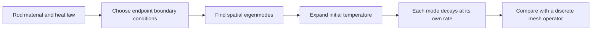
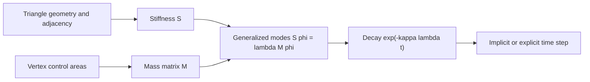

# 30 — Mesh Operators, Boundaries and Diffusion

[[Chapter Edition/02 - Graphics Vision and XR/00 - Reading Map|Reading map]] · [[Chapter Edition/02 - Graphics Vision and XR/29 - Acceleration Structures and Robust Queries|Previous chapter]] · [[Chapter Edition/02 - Graphics Vision and XR/31 - Learning a Visual Classifier|Next chapter]]

Discrete operators encode local geometry and boundary behavior on a mesh. Studying heat diffusion through modes shows how eigenstructure and boundary conditions shape the operator’s behavior.

**By the end:** Relate mesh operators, boundary conditions and diffusion modes.

**Recall question:** How do boundary conditions change the modes available to a discrete heat problem?

<!-- Derived from Continuous Notes/University - Worlds, Images and Inference - Graphics, Vision and Photography.md; source lines 74456–75310; source-span SHA256 c9b77ba5f5c3f1a527e4dfa9369989b58cf457f80a9f8b14bb6025242c26e391. -->

<!-- CHAPTER-SOURCE-BEGIN -->
## Heat on a rod: why boundaries, modes, and mesh operators belong together

Take a straight metal rod of length $L$. Its sides are insulated, its ends are held at prescribed temperatures, and someone briefly warms one small region near the middle. The temperature field $u(x,t)$ changes smoothly: the hot spot spreads and its peak falls. We want a model that tells us how the end conditions affect that spreading, how a triangle mesh can approximate it on a curved surface, and what numerical evidence would show that our computation is behaving as intended.

For a uniform rod with no internal heat source, the one-dimensional heat equation is

$$
\frac{\partial u}{\partial t}=\kappa\frac{\partial^2u}{\partial x^2},\qquad 0<x<L,
$$

where $u$ is temperature and $\kappa$ is thermal diffusivity. For a material with conductivity $k$, density $\rho$ and specific heat capacity $c$, $\kappa=k/(\rho c)$. Conductivity is measured in watts per metre per kelvin, volumetric heat capacity in joules per cubic metre per kelvin, so $\kappa$ has units $\mathrm{m^2/s}$. The second spatial derivative has units temperature per square metre; multiplying by diffusivity gives temperature per second, as required by the left side.

The differential equation describes the interior. It does not specify what the ends do. Those conditions are part of the model, because they determine which temperature patterns can persist and which can appear as independent modes. A simulation without its boundary conditions is an incomplete physical problem.

### Boundary conditions choose the modes

First hold both ends at a reference temperature and subtract that reference so the boundary values are zero: $u(0,t)=u(L,t)=0$. Seek one separable solution $u(x,t)=X(x)T(t)$. Substitution gives

$$
XT'=\kappa X''T
\quad\Longrightarrow\quad
\frac{1}{\kappa}\frac{T'}{T}=\frac{X''}{X}.
$$

The left side depends only on time; the right side depends only on position. For the equality to hold for every $x$ and $t$, each side must equal one constant. Choose it to be $-\lambda$ so that the spatial solutions can be oscillatory while the time solutions decay:

$$
X''+\lambda X=0,\qquad T'+\kappa\lambda T=0.
$$

The general spatial solution for $\lambda=\mu^2>0$ is $X=A\cos(\mu x)+B\sin(\mu x)$. The boundary at $x=0$ forces $A=0$; the boundary at $x=L$ then requires $\sin(\mu L)=0$. Nonzero solutions exist only when $\mu L=n\pi$ for positive integer $n$. Thus the allowed eigenvalues and eigenfunctions are

$$
\lambda_n=\left(\frac{n\pi}{L}\right)^2,
\qquad
X_n(x)=\sin\left(\frac{n\pi x}{L}\right),
\qquad n=1,2,\ldots
$$

and the matching time factor is $T_n(t)=e^{-\kappa\lambda_nt}$. A boundary condition has turned a continuum of possible spatial frequencies into a discrete family. The first mode has one broad arch; higher modes have more zero crossings and shorter wavelengths. Their decay rate grows like $n^2$: fine ripples disappear much faster than broad temperature differences.

The rod's initial temperature $f(x)=u(x,0)$ is expanded in this sine family:

$$
f(x)=\sum_{n=1}^{\infty}b_n\sin\left(\frac{n\pi x}{L}\right),
\qquad
b_n=\frac{2}{L}\int_0^L f(x)\sin\left(\frac{n\pi x}{L}\right)dx.
$$

Orthogonality makes this projection possible: the integral of the product of two different sine modes over $[0,L]$ is zero, while the squared norm of each mode is $L/2$. By linearity, the complete solution is

$$
u(x,t)=\sum_{n=1}^{\infty}b_n\sin\left(\frac{n\pi x}{L}\right)e^{-\kappa(n\pi/L)^2t}.
$$

Each term solves the same PDE and boundary conditions; adding solutions remains a solution because the equation is linear. The coefficients encode the initial pattern; the boundary-selected modes and exponential factors encode how it evolves. The series is not merely a symbolic trick: it says every resolved initial pattern is a weighted sum of independently decaying shapes.

Other endpoint physics changes the spectrum. If the ends are insulated, there is no heat flux through them, so $u_x(0,t)=u_x(L,t)=0$. The spatial modes become $X_n(x)=\cos(n\pi x/L)$ for $n=0,1,2,\ldots$, including a constant mode. That zero mode does not decay: in an insulated rod the average temperature stays fixed. If one end is held at zero and the other insulated, the eigenfunctions are shifted half-wave patterns such as $\sin((n+1/2)\pi x/L)$. Robin conditions, which model heat exchange with a surrounding medium, lead to a different eigenvalue equation. Boundary conditions therefore define the operator and its modes together.

The zero mode is not an annoying exception. It carries the conserved average under no-flux conditions. For a uniform rod, integrating the heat equation gives

$$
\frac{d}{dt}\int_0^L u(x,t)dx
=\kappa\int_0^L u_{xx}(x,t)dx
=\kappa\big[u_x(L,t)-u_x(0,t)\big].
$$

Insulated endpoints make the right side zero. The rod redistributes heat internally, but its total excess heat—and, for constant heat capacity and cross-section, its spatial average—does not change. Fixed-temperature ends can exchange heat with their reservoirs, so that same integral need not be conserved.

### Derivatives act on modes by multiplying their frequency

Why are sine waves so useful? Differentiation does not create a new spatial frequency. For a complex wave $e^{ikx}$,

$$
\frac{d}{dx}e^{ikx}=ik e^{ikx},
\qquad
\frac{d^2}{dx^2}e^{ikx}=-k^2 e^{ikx}.
$$

A derivative is therefore multiplication by $ik$ in the frequency representation, and the second derivative is multiplication by $-k^2$. For finite-interval Dirichlet modes, differentiating the sine once gives a cosine, then twice returns the original sine with multiplier $-(n\pi/L)^2$. That is exactly the spatial eigenvalue relation $X_n''=-\lambda_nX_n$. The heat equation consequently becomes a separate scalar decay equation for every mode: $\dot a_n=-\kappa\lambda_na_n$.

This makes the “high frequencies decay faster” statement precise. If the initial temperature contains only a low mode and a high mode, after elapsed time $t$ their amplitudes are multiplied by $e^{-\kappa k^2t}$. When the high mode has four times the wavenumber, it has sixteen times the decay exponent. Smoothing is thus a low-pass operation. It removes oscillations because second derivatives penalize rapid spatial variation.

A Fourier series describes periodic patterns; a sine expansion on $[0,L]$ can be understood by extending a function oddly outside the interval and then periodically. A cosine expansion corresponds to an even extension. The chosen extension matters at the endpoints. If the interior initial temperature does not agree with the fixed end values at $t=0$, the odd periodic extension has a jump. The series still represents the interior in a limiting sense, but convergence near that jump oscillates. This is one way that boundary assumptions show up as ringing rather than disappearing behind the algebra.

### From a mesh Laplacian to a heat operator

The mesh-topology spine introduced a cotangent Laplacian for vertex values. We can now give it a clear evolution meaning. Let $u_i(t)$ be a temperature stored at mesh vertex $i$. Build a stiffness matrix $S$ from the surface geometry and a mass matrix $M$ from the areas represented by the vertices. For a common cotangent convention, each interior edge $(i,j)$ has weight $w_{ij}=\tfrac12(\cot\alpha_{ij}+\cot\beta_{ij})$. Set $S_{ij}=-w_{ij}$ off the diagonal and choose $S_{ii}=\sum_{j\ne i}w_{ij}$. Then $S$ is symmetric and, for a suitable mesh, positive semidefinite. A lumped mass matrix is diagonal with $M_{ii}=A_i$, a local area; a consistent finite-element mass matrix can include off-diagonal terms.

With this positive stiffness convention, the discrete heat equation is

$$
M\dot{\mathbf u}=-\kappa S\mathbf u.
$$

If the previous mesh note uses $\Delta=-M^{-1}S$, this is the same statement $\dot{\mathbf u}=\kappa\Delta\mathbf u$. Signs vary across libraries, so test the constant field and a known mode before wiring a new matrix into an update. For a constant vector $\mathbf 1$, every edge difference vanishes, giving $S\mathbf 1=0$ when there is no imposed-temperature boundary. Thus an isolated closed surface or natural no-flux boundary has a zero mode, just like the insulated rod.

The mass matrix is not bookkeeping overhead. It turns an integrated stiffness balance into a rate per unit area or length. On a triangulated surface, $M$ has units square metres and cotangent entries in $S$ are dimensionless; therefore $M^{-1}S$ has units inverse square metres. Multiplying by surface diffusivity $\kappa$ in square metres per second gives a rate in inverse seconds. In a one-dimensional finite-element rod, the mass entries instead have units metres and the stiffness entries have units inverse metres, so $M^{-1}S$ still has units inverse square metres. The matrix dimensions depend on the domain dimension, but the discrete operator approximating a second spatial derivative always carries inverse-length-squared units.

Under a coordinate scaling by factor $s$, areas on a surface scale as $s^2$ while cotangent weights are invariant. Thus $M^{-1}S$ scales as $s^{-2}$. The diffusivity must be expressed in the same physical length units as the geometry. A mesh stored in millimetres paired with $\kappa$ in square metres per second is inconsistent until one representation is converted. Dimensional checks catch this error even when every number in the code looks plausible.

The generalized eigenproblem

$$
S\boldsymbol\phi_n=\lambda_nM\boldsymbol\phi_n
$$

is the mesh counterpart of the rod's spatial mode equation. Its eigenvectors are discrete temperature patterns; its eigenvalues measure how rapidly each pattern bends across the surface. The evolution of a mode amplitude is $a_n(t)=a_n(0)e^{-\kappa\lambda_nt}$. Because $S$ is symmetric and $M$ is positive definite, these modes can be chosen orthogonal in the mass-weighted inner product $\langle u,v\rangle_M=u^TMv$. This is the finite-dimensional version of the orthogonality that made the sine-series coefficients independent.

### Explicit steps have a mesh-dependent stability limit

For the standard centered second difference on a uniform 1D grid with spacing $h$, an interior value has discrete Laplacian

$$
(L_hu)_j=\frac{u_{j-1}-2u_j+u_{j+1}}{h^2}.
$$

Dirichlet endpoints are held fixed; consider the unknown interior values. A discrete sine mode $u_j=\sin(k\pi j/(N+1))$, with $h=L/(N+1)$, is an eigenvector of $L_h$ with eigenvalue

$$
\mu_k=-\frac{4}{h^2}\sin^2\left(\frac{k\pi}{2(N+1)}\right).
$$

The magnitude is largest for the most rapidly alternating grid pattern and approaches $4/h^2$. Forward Euler updates $u^{n+1}=u^n+\kappa\Delta t L_hu^n$. A mode is multiplied each step by $g_k=1+\kappa\Delta t\mu_k$. For no growth in magnitude we need $|g_k|\le1$ for every mode. The most restrictive eigenvalue gives

$$
0\le\frac{\kappa\Delta t}{h^2}\le\frac12,
\qquad\text{or}\qquad
\Delta t\le\frac{h^2}{2\kappa}.
$$

This is a stability bound for the stated standard 1D grid and explicit forward Euler scheme. It is not a universal bound for every mesh, boundary condition, or time integrator. In an unstructured mesh, use the largest eigenvalue of the mass-normalized stiffness operator or a proven bound for the chosen discretization; the spectral scale still behaves like inverse length squared.

A numerical witness makes the instability visible. Let $h=0.25\,\mathrm m$ and $\kappa=0.1\,\mathrm{m^2/s}$. The limit is $0.25^2/(2\cdot0.1)=0.3125\,\mathrm s$. If we take $\Delta t=0.375\,\mathrm s$, then $r=\kappa\Delta t/h^2=0.6$. For a unit-length rod with three interior vertices, the highest Dirichlet mode has $g=1-4(0.6)\sin^2(3\pi/8)\approx-1.048528$. Its sign flips and its magnitude grows by about $4.85\%$ per step. On an even periodic grid, the exact alternating mode instead has $g=1-4r=-1.4$, giving $40\%$ growth. Distinguish the finite-boundary eigenvalue from this limiting or periodic case. At the threshold $r=0.5$, that limiting mode has amplification $-1$: it does not grow, but it is not damped and remains a poor practical choice near the stability edge.

Implicit Euler uses the new-time temperature in the Laplacian:

$$
\frac{\mathbf u^{n+1}-\mathbf u^n}{\Delta t}=-\kappa M^{-1}S\mathbf u^{n+1},
\qquad
(M+\kappa\Delta tS)\mathbf u^{n+1}=M\mathbf u^n.
$$

For a generalized eigenmode with $\lambda_n\ge0$, its amplification is $1/(1+\kappa\Delta t\lambda_n)$, which lies between zero and one for any positive step. This gives unconditional linear stability for diffusion with a positive semidefinite stiffness and positive mass matrix. It requires a linear solve, and a large step can still erase detail or be inaccurate even though it does not blow up. Stability and fidelity are different questions.

On a 2D mesh with area mass matrix, the explicit stability limit is controlled by a largest eigenvalue of order $1/h^2$, where $h$ is a representative edge length. Refining edge length by two can therefore require roughly four times as many explicit steps for the same simulated duration. This cost is one reason implicit diffusion is attractive in geometry processing. It does not follow that every mesh flow should be implicit: intended feature behavior, accuracy, solver conditioning and cost still matter.

### A Green function is an impulse response

A Green function answers a concrete experiment: what field is produced by a unit point source, subject to the same boundaries as the original problem? For a linear operator $L$ with homogeneous boundary conditions, define $G(x,\xi)$ by

$$
L_xG(x,\xi)=\delta(x-\xi),
$$

where the subscript reminds us that $L$ differentiates in the observation coordinate $x$. A distributed source $f(\xi)$ is a superposition of point sources, so the solution is

$$
u(x)=\int G(x,\xi)f(\xi)\,d\xi.
$$

For time-dependent heat flow, the impulse response depends on elapsed time. With the rod's normalized Dirichlet eigenfunctions $\phi_n(x)=\sqrt{2/L}\sin(n\pi x/L)$, the heat kernel is

$$
H_D(x,\xi,t)=\sum_{n=1}^{\infty}\phi_n(x)\phi_n(\xi)e^{-\kappa(n\pi/L)^2t},\qquad t>0.
$$

A point of heat inserted at $\xi$ spreads according to $H_D$; an initial field evolves as $u(x,t)=\int_0^LH_D(x,\xi,t)u(\xi,0)d\xi$. A time-varying source $s(\xi,\tau)$ contributes through a space-time convolution, integrating $H_D(x,\xi,t-\tau)s(\xi,\tau)$ over earlier times $\tau$ and source positions $\xi$. This is the continuous analogue of repeatedly applying a linear diffusion update to source inputs.

The kernel is symmetric in $x$ and $\xi$ for a self-adjoint diffusion operator with the same homogeneous boundary conditions on both arguments. In the rod case this follows term by term because each factor is $\phi_n(x)\phi_n(\xi)$. More generally, Green-function reciprocity follows from self-adjointness and the boundary terms vanishing under the chosen domain and boundary conditions. If coefficients, boundary conditions, or the operator make the problem non-self-adjoint, do not assume $G(x,\xi)=G(\xi,x)$. For a weighted Sturm–Liouville problem, symmetry may be with respect to the appropriate weighted inner product or measure rather than plain coordinate integration.

There is a subtle zero-mode case. With insulated boundaries, the Laplacian has a constant eigenfunction with eigenvalue zero. The steady Poisson equation $-u_{xx}=f$ with pure Neumann conditions cannot have a solution for arbitrary nonzero-mean $f$: integrating both sides shows the source must satisfy the net-flux compatibility condition. Even when compatible, the solution is defined only up to an added constant until a mean or reference value is fixed. The transient heat kernel remains meaningful; the zero mode simply preserves the average instead of decaying. A numerical inverse that silently divides by a zero eigenvalue is not a valid Green-function construction.

### Sampling, truncation, and ringing

A continuous field becomes finite data only after sampling. On a regular 1D grid, the highest alternating mode is near the Nyquist frequency, roughly one half-cycle per sample spacing. Shorter wavelengths cannot be represented uniquely: they alias into lower-frequency patterns. On irregular triangle meshes there is no single global Nyquist number, but local edge length and element shape limit which oscillations are resolved. If the initial hot spot is narrower than the sampling scale, the mesh may miss its peak or encode it as a misleading pattern. Subsequent heat flow smooths the samples it received; it cannot reconstruct the lost sub-grid event.

A truncated Fourier or eigenfunction sum introduces another approximation. Keeping only the first $N$ modes reconstructs the broad structure well when the field is smooth, but a sharp jump needs many modes. Near a discontinuity, partial sums can overshoot and oscillate (Gibbs behavior); increasing $N$ narrows the affected region but does not remove the limiting overshoot at the jump. In heat flow, each mode is additionally multiplied by an exponential decay. At positive time, high-frequency terms are strongly damped, but at time zero the series must still represent the initial/boundary data correctly. If initial temperature and fixed endpoint temperatures disagree at a corner in space-time, a rapid boundary layer is physically implied, not a failure of the series method.

For a finite mesh, eigenvalue truncation and timestep are separate resolution controls. Dropping small-scale eigenvectors discards spatial detail; taking a large implicit-Euler step changes each mode's decay relative to the continuous evolution (its factor $1/(1+x)$ exceeds $e^{-x}$ for $x>0$); taking an unstable explicit step amplifies the highest modes. A visually smooth result is not proof of accuracy because excessive smoothing can hide aliasing, poor mesh quality, or a wrong boundary condition. Report sample spacing, kept modes or timestep, and error against a known field when making a quantitative claim.

### Manufactured fields make the solver testable

A manufactured solution gives an analytic answer for a problem with known boundaries and coefficients. For fixed-zero endpoints choose one sine mode

$$
u(x,t)=A\sin\left(\frac{\pi x}{L}\right)e^{-\kappa(\pi/L)^2t}.
$$

It satisfies both the PDE and $u(0,t)=u(L,t)=0$. With $L=1\,\mathrm m$, $\kappa=0.1\,\mathrm{m^2/s}$, $A=100\,\mathrm K$ and $t=1\,\mathrm s$, the center temperature is

$$
u(L/2,1)=100e^{-0.1\pi^2}\,\mathrm K\approx37.27\,\mathrm K.
$$

For a second, independently decaying mode at twice the wavenumber, the decay exponent is four times larger. A two-mode initial field tests that the solver handles superposition and does not accidentally mix modes in a uniform rod with homogeneous endpoints. Compare grid values to the analytic field at fixed physical times while halving $h$ and reducing $\Delta t$ consistently; measure error rather than relying on a plot.

For a no-flux test choose

$$
u(x,t)=20+5\cos\left(\frac{\pi x}{L}\right)e^{-\kappa(\pi/L)^2t}.
$$

Its derivative is zero at $x=0$ and $x=L$, and its spatial mean is $20$ at every time. A discrete solver should preserve the corresponding mass-weighted mean up to rounding and linear-solver tolerance. For fixed-temperature endpoints, instead measure boundary flux. Fourier’s law gives heat flux $q=-k u_x$; integrating the temperature equation yields the net heat change from inflow at one boundary minus outflow at the other. The rod’s interior energy need not be conserved when reservoirs hold its ends at fixed temperature.

On the mesh, the matching tests are: $S\mathbf1=0$ for a no-flux/closed setting; symmetry $S=S^T$; nonnegative generalized eigenvalues; exponential decay of each measured eigenmode at rate $\kappa\lambda_n$; and conservation of $\mathbf1^TM\mathbf u$ when no heat crosses the boundary and no source is present. For Dirichlet vertices fixed to a reservoir, remove or constrain those degrees of freedom and verify the change in total heat matches integrated boundary flux. A matrix can be symmetric and still have the wrong units, scale, boundary rows, or source signs, so keep the analytic rod and unit checks beside the structural matrix checks.

The rod story now carries through to a curved triangle mesh. Material and boundary conditions define a differential operator; its self-adjoint eigenmodes form a basis; spatial derivatives multiply modes by their squared frequencies; the mesh stiffness and mass matrices approximate that operator; and time integration advances its modes according to their decay rates. Green functions express how localized heat sources propagate under those same boundaries. Sampling and truncation set what detail can be represented, while manufactured solutions and flux balances tell us whether the computed field matches the stated model.

### What the boundary means to the discrete solver

Boundary data must be encoded in the discrete unknowns and matrix, not merely displayed as a condition in a comment. With fixed-temperature Dirichlet endpoints, the endpoint values are known and are removed from the unknown vector or incorporated into the right-hand side. If a known endpoint value is nonzero, its neighboring stencil contains a source contribution proportional to that value. A common error is to drop the endpoint neighbor term when constructing the reduced matrix, thereby solving a different rod with an insulated or shortened boundary.

For an insulated endpoint, the Neumann condition $u_x=0$ says the normal heat flux vanishes. A finite-volume view writes heat balance in terms of fluxes through cell faces; the boundary face contributes zero flux. A finite-difference view can use a ghost value reflected across the endpoint, such as $u_{-1}=u_1$, so the centered derivative $(u_1-u_{-1})/(2h)$ is zero. Either construction should leave the constant vector in the nullspace and conserve the weighted sum. Dirichlet and Neumann are not interchangeable “edge handling” options: one couples the rod to a reservoir; the other isolates it.

For a curved mesh, an open boundary has an analogous choice. A natural finite-element boundary on the diffusion problem usually represents zero flux unless a boundary term is supplied. Pinning boundary temperatures imposes a Dirichlet constraint. A Robin boundary can represent transfer to an ambient temperature, with flux proportional to the difference between the surface temperature and ambient. If the application actually intends a heat bath but the implementation leaves the natural no-flux condition, total mesh heat will be conserved incorrectly. Boundary semantics are part of the physics API.

Self-adjointness explains why a clean mode decomposition exists. For the one-dimensional operator $A=-d^2/dx^2$ with homogeneous Dirichlet conditions, integration by parts gives

$$
\int_0^L f^*Ag\,dx-\int_0^L(Af)^*g\,dx
=\left[-f^*g'+(f')^*g\right]_0^L=0.
$$

The boundary term vanishes because both functions are zero at each end. For homogeneous Neumann conditions, it vanishes because both derivatives are zero. Other boundary conditions may also yield a self-adjoint operator, but this must be checked rather than assumed. The eigenvalues are real, distinct-eigenvalue modes are orthogonal, and the operator can be diagonalized in that basis. This is the continuum reason the heat equation reduces to independent exponential decays.

The same fact has a discrete energy witness. If $S$ is symmetric positive semidefinite and $M$ is positive definite, then

$$
\frac{d}{dt}\left(\frac12\mathbf u^TM\mathbf u\right)
=\mathbf u^TM\dot{\mathbf u}
=-\kappa\mathbf u^TS\mathbf u\le0.
$$

This quadratic norm is not the total heat; it measures squared temperature variation around the chosen zero reference. It decreases under diffusion. Total heat in the no-flux case is instead $\mathbf1^TM\mathbf u$, and it stays constant because $S\mathbf1=0$. Keeping these two quantities separate prevents the false claim that “heat is conserved” means every norm or every boundary case is conserved.

### Spatial and temporal error have different signatures

For a smooth sine mode with wavenumber $k$, the centered difference approximates the second derivative by the discrete eigenvalue

$$
\mu_h=-\frac{4}{h^2}\sin^2\left(\frac{kh}{2}\right)
=-k^2+\frac{k^4h^2}{12}+O(h^4).
$$

The leading error is proportional to $h^2$ for a fixed resolved mode. Since $|\mu_h|$ is slightly less than $k^2$ at small but finite $kh$, the discrete mode decays a little more slowly than the continuum mode. Near the grid's highest frequency, the approximation is no longer close to $-k^2$; the grid cannot represent finer structure. This is spatial discretization error, distinct from the forward-Euler time error and its stability limit.

A convergence experiment should separate them. Fix a smooth analytic initial field, hold temporal error small while refining $h$, and compare at a fixed time to estimate spatial convergence. Then fix a sufficiently fine spatial grid and reduce $\Delta t$ to measure temporal convergence. Finally sweep the ratio $r=\kappa\Delta t/h^2$ toward the stability edge to verify the predicted highest-mode amplification. If both $h$ and $\Delta t$ change arbitrarily in one experiment, a smaller error cannot be attributed to either change.

A practical manufactured solution can include a source term as well. Choose a smooth field $u_*(x,t)$ satisfying the desired boundary values, then define

$$
s(x,t)=\partial_tu_*(x,t)-\kappa\partial_{xx}u_*(x,t).
$$

The field $u_*$ is now an exact solution of $u_t=\kappa u_{xx}+s$ by construction. For example, let $u_*=e^{-t}\sin(\pi x/L)+t\sin(2\pi x/L)$, whose endpoints remain zero. Differentiate it analytically to construct $s$. This tests the source assembly, boundary treatment, spatial operator and time stepping together without needing a complicated closed-form solution to an unrelated physical problem. Report a normed error, such as $\|u_h-u_*\|_M$, at stated times.

The mode formulas also support an impulse-response check. A sharply localized initial heat pulse can be projected onto the sine basis; its coefficient for mode $n$ is the pulse's inner product with $\phi_n$. At later times, each coefficient must be multiplied by $e^{-\kappa\lambda_nt}$. Compare direct time stepping against this truncated spectral reference on a fine grid. The two methods will not match exactly because one has grid and timestep error and the other has truncation error, but their discrepancy should shrink under the declared refinements. This test exercises the same linear evolution from two independent representations.

For a self-adjoint problem with a zero Neumann mode, the steady Green function for an inverse Laplacian is singular because constants are annihilated. One must project out the constant mode, enforce a zero-mean source, and choose a gauge such as zero-mean solution. For the transient heat kernel, the constant mode is retained: it is the long-time average left after all nonconstant modes decay. This distinction matters in mesh processing too. Solving a Poisson equation for geometry may need a pinned vertex or mean constraint; evolving heat on a closed surface should generally preserve the mean rather than accidentally delete it.

The continuous and discrete models therefore have matching but not identical contracts. In the continuum, the boundary condition defines the operator domain and Green identity. In the mesh, it determines constrained rows, boundary flux terms and the nullspace. In the spectrum, it selects modes and eigenvalues. In the time step, it controls stability and decay. Verifying one layer with the appropriate witness makes it possible to localize a bad result instead of compensating for it with an arbitrary damping factor or a smaller timestep.

## PDEs, fields, and discrete solvers

Fields and PDEs express spatial behavior; discretization and boundary conditions determine the numerical system.

### PDE discretization and variational structure

A partial differential equation includes derivatives along several spatial axes. The 2D Laplacian is $u_{xx}+u_{yy}$. A regular-grid finite difference approximates each second derivative from neighboring samples. On a mesh, a discrete Laplace operator uses connectivity and geometry weights. The heat equation moves a value toward neighboring values; the wave equation uses acceleration proportional to spatial curvature. Boundary conditions affect the solution everywhere because waves or diffusion interact with the boundary.

Explicit diffusion on a grid has a stability limit roughly proportional to $(\Delta x)^2/\kappa$, where $\Delta x$ is grid spacing and $\kappa$ diffusivity. Refining the grid by two can require about four times smaller time steps in 2D explicit schemes, rapidly increasing cost. Implicit discretization leads to a sparse linear system. Matrix sparsity reflects local neighborhood connectivity; numerical linear algebra is therefore part of the simulation pipeline.

Optimization connects to PDEs through energy minimization. A continuous energy functional $E[u]=\int L(x,u,u')dx$ is stationary when it satisfies the Euler-Lagrange condition

$$
\frac{\partial L}{\partial u}-\frac{d}{dx}\left(\frac{\partial L}{\partial u'}\right)=0.
$$

After discretization, the field becomes a finite vector and the functional becomes a finite objective. Its gradient can be minimized with the same methods used for curve fitting. The continuum equation and discrete optimizer are two views of one problem. [[Chapter Edition/02 - Graphics Vision and XR/36 - Source Atlas and Reconstruction Checkpoints#CMU-22 - Optimization|CMU-22]] · [[Chapter Edition/02 - Graphics Vision and XR/36 - Source Atlas and Reconstruction Checkpoints#CMU-23 - Physically Based Animation and PDEs|CMU-23]]

### The same field equation can describe very different behavior

A PDE describes a field $u(x,t)$ whose value depends on location $x$ and time $t$. The derivatives say how the field changes. For a ripple height, $u$ is vertical displacement at each point of a pond. For heat, it is temperature at each point of a surface. For smoke, it might be velocity, density, or vorticity. The equation is an implicit rule: it constrains the field, but the field must still be computed from initial data, boundary data, and a numerical method.

The Laplacian is $\Delta u=\nabla\cdot(\nabla u)$, the divergence of the gradient. Equivalently in Cartesian coordinates it is the sum of second derivatives, $u_{xx}+u_{yy}$ in 2D. A useful intuition is “difference from the local average”: it is near zero where the field matches its neighborhood and large where the field has a local bump or dip. The coordinate formula looks tied to axes, but the Laplacian itself is unchanged under a rigid rotation of coordinates.

Three equations provide contrasting mental models:

$$
\begin{aligned}
\text{Laplace:}\quad &\Delta u=0,\\
\text{Heat:}\quad &u_t=\kappa\Delta u,\\
\text{Wave:}\quad &u_{tt}=c^2\Delta u.
\end{aligned}
$$

The Laplace equation is elliptic. With boundary values fixed, it finds a harmonic field that smoothly interpolates them. The heat equation is parabolic: an initial temperature distribution spreads and smooths; at steady state, $u_t=0$, so it becomes the Laplace equation. Diffusion also acts as a model of damping or viscosity. The wave equation is hyperbolic: an initial bump propagates as a wave rather than simply disappearing. This matters numerically, because wave errors can travel for a long time instead of being averaged away. Burgers' equation, $u_t+u u_x=\alpha u_{xx}$, adds a nonlinear transport term and a diffusion term; transport can steepen a wave toward a shock while diffusion softens it. A PDE is linear when the unknown field and its derivatives appear linearly; products such as $u u_x$ or nonlinear functions of $u$ make it nonlinear. Its order is the highest derivative order present. [[Chapter Edition/02 - Graphics Vision and XR/36 - Source Atlas and Reconstruction Checkpoints#CMU-23 - Physically Based Animation and PDEs|CMU-23]]

### Discretize the space with a representation that fits

Finite differences replace derivatives by differences of samples. For equally spaced 1D samples separated by spacing $h$, the centered approximation to the second derivative follows by differencing neighboring first slopes:

$$
u''(x_i)\approx\frac{u_{i+1}-2u_i+u_{i-1}}{h^2}.
$$

In a regular 2D grid with equal horizontal and vertical spacing, the five-point Laplacian is

$$
(\Delta_h u)_{i,j}=\frac{u_{i+1,j}+u_{i-1,j}+u_{i,j+1}+u_{i,j-1}-4u_{i,j}}{h^2}.
$$

The center has weight $-4$ and each immediate neighbor has weight $+1$. The numerator is the sum of neighbor values minus four times the center value. It measures local non-flatness and gives a simple update for ripples or heat diffusion.

A grid is an Eulerian representation: values are stored at fixed spatial locations while material passes through them. A Lagrangian representation follows particles or mesh vertices as they move. Particle methods adapt naturally to moving material and unbounded domains, but a good particle distribution is difficult to maintain and local derivative estimates require neighbor searches. Fixed grids have regular, cache-friendly operations and straightforward finite differences, but they impose a domain and a resolution; fine features blur or alias when the grid is coarse. Hybrid methods such as FLIP, material point methods, and particle level sets mix moving samples with fixed grids to keep useful properties from both.

On a triangle mesh, the cotangent Laplacian replaces grid-neighbor weights with geometry-dependent weights. For scalar values $u_i$ at mesh vertices, a common unnormalized form is

$$
(\Delta_h u)_i\;\propto\;\sum_{j\in N(i)}(\cot\alpha_{ij}+\cot\beta_{ij})(u_j-u_i),
$$

where $N(i)$ is the set of vertices connected to $i$, and $\alpha_{ij},\beta_{ij}$ are the two angles opposite edge $ij$. Implementations may divide by a local area or mass matrix, so normalization conventions must be checked. On a regular triangulated grid, the cotangent construction agrees with the familiar grid stencil up to its chosen scale. The lesson is broader than this one formula: express the spatial operator in a representation appropriate to the problem, and the same time integrator can often be reused across a grid, a mesh, or a hybrid domain. [[Chapter Edition/02 - Graphics Vision and XR/36 - Source Atlas and Reconstruction Checkpoints#CMU-23 - Physically Based Animation and PDEs|CMU-23]]

### Boundary data is part of the equation

The Laplace equation alone does not determine a unique interpolated field. A constant is harmonic because its Laplacian is zero; indeed, on a periodic grid with no fixed values, both the all-zero field and every constant field solve $\Delta u=0$. To define an interesting solution, state what happens at the boundary.

Dirichlet boundary conditions fix the value of the field, such as temperature around a plate or height around a domain. Neumann conditions fix the derivative in the outward normal direction, $\partial u/\partial n=\nabla u\cdot n$, which is related to heat or fluid flux across the boundary. Robin conditions prescribe a linear combination of value and normal derivative. These choices are physically meaningful: fixed temperature, insulated boundary, or exchange with an environment are different problems.

Boundary values and derivatives cannot always be chosen independently. In 1D, a harmonic function satisfies $u''=0$, so it is a line $u(x)=ax+b$. Any pair of endpoint values determines a line, but two endpoint slope conditions must agree because a line has one slope. In a 2D harmonic Neumann problem, the divergence theorem gives a compatibility condition. Integrating the normal derivative around the boundary equals integrating $\Delta u$ over the interior. Since $\Delta u=0$, the net boundary flux must be zero:

$$
\int_{\partial\Omega}\nabla u\cdot n\,ds=0.
$$

Even with compatible flux, adding a constant leaves both the Laplacian and normal derivatives unchanged, so one value or a mean-value constraint must be fixed to choose a unique representative. This is a simple example of a well-posedness check: verify a solution exists and is sufficiently determined before trusting a numerical solver. After solving a linear system $Ax=b$, compute the residual $r=b-Ax$; a large residual may reveal a bad setup or incompatible boundary data, not merely a weak solver. [[Chapter Edition/02 - Graphics Vision and XR/36 - Source Atlas and Reconstruction Checkpoints#CMU-23 - Physically Based Animation and PDEs|CMU-23]]

### Turn the discretized equations into a solver

For a grid Laplace problem, the equation at each interior cell says that its value equals the average of its four neighbors. Repeatedly replacing each value with that average is Jacobi iteration. It eventually spreads boundary information inward, but it is slow on large grids: distant parts of the domain communicate only through many neighbor-to-neighbor updates. Instead, assign a single index to every unknown grid value and assemble all local equations into one matrix system $Au=b$. Each row has a small number of nonzero entries because each cell couples only to nearby cells. The resulting matrix is sparse; use a sparse linear solver rather than storing and multiplying all the zeros in a dense matrix.

For heat diffusion, explicit Euler updates the current field using the current Laplacian:

$$
u^{k+1}=u^k+\Delta t\,\kappa\Delta_h u^k.
$$

Each cell moves toward the neighborhood average. But explicit diffusion is conditionally stable: for a regular grid the safe step scales like $h^2/\kappa$. Halving the grid spacing can require about four times as many time steps in 2D, making fine grids expensive. An implicit step evaluates the diffusion at the new field and solves a sparse linear system; it allows larger stable steps at the cost of a solve.

The wave equation has a second time derivative. It can be rewritten with a velocity field $v=u_t$ as two first-order equations, $u_t=v$ and $v_t=c^2\Delta u$. Alternatively, a centered second difference uses two previous time slices:

$$
\frac{u^{k+1}-2u^k+u^{k-1}}{(\Delta t)^2}=c^2\Delta_h u^k.
$$

This needs an initial displacement and initial velocity (or two compatible initial frames). The spatial Laplacian may be the grid stencil or a [[PDE fields and discrete Laplacians|cotangent mesh operator]]. The same time-stepping code can therefore propagate a ripple on a regular grid or waves over a triangle mesh, provided the boundary and operator are correctly specified. A low-resolution thin-shell wave can also be upsampled with Loop subdivision for an interactive visual result; interpolation adds surface detail, but it does not replace the underlying simulation. [[Chapter Edition/02 - Graphics Vision and XR/36 - Source Atlas and Reconstruction Checkpoints#CMU-23 - Physically Based Animation and PDEs|CMU-23]]

### Discrete field equations and their stability conditions

#### From a PDE to a sparse system and a stable update

A partial differential equation (PDE) constrains a function that varies over space, time, or both. A numerical method must choose (1) what values represent the field, (2) how to approximate spatial derivatives, (3) how to advance in time if time is present, and (4) what boundary behavior is imposed. The same physical equation can therefore produce different algorithms on a fixed grid and on a moving triangle mesh. The examples below use the Laplace and heat equations to make each choice explicit. [[Chapter Edition/02 - Graphics Vision and XR/36 - Source Atlas and Reconstruction Checkpoints#CMU-23 - Physically Based Animation and PDEs|CMU-23]] (PDF pp. 30–46; video 00:36:00–00:54:00)

#### Derive the five-point grid stencil

For a one-dimensional function $u(x)$ sampled at equally spaced locations $x_i=ih$, the spacing $h$ is the distance between adjacent samples and $u_i$ means $u(x_i)$. A forward difference estimates the first derivative:

$$
u'(x_i)\approx\frac{u_{i+1}-u_i}{h}.
$$

Apply the same difference to the neighboring slopes. The change between the slope to the right and the slope to the left is

$$
u''(x_i)\approx\frac{(u_{i+1}-u_i)/h-(u_i-u_{i-1})/h}{h}
=\frac{u_{i+1}-2u_i+u_{i-1}}{h^2}.
$$

The center coefficient is $-2$ because the center value appears in both slopes. In two dimensions, add the horizontal and vertical second differences. If the horizontal and vertical spacing are both $h$, then

$$
(\Delta_h u)_{i,j}=\frac{u_{i+1,j}+u_{i-1,j}+u_{i,j+1}+u_{i,j-1}-4u_{i,j}}{h^2}.
$$

Here $i,j$ are integer grid indices, $u_{i,j}$ is the field at that grid location, and $\Delta_h$ is the finite-difference approximation to the Laplacian $\Delta=\partial_{xx}+\partial_{yy}$. The four neighbors each receive weight $1/h^2$ and the center receives $-4/h^2$. If all four neighbors equal the center, the stencil is zero. If the center is higher than its neighbors, the result is negative; if it is lower, the result is positive. This sign agrees with the continuous Laplacian’s role as local deviation from the average. [[Chapter Edition/02 - Graphics Vision and XR/36 - Source Atlas and Reconstruction Checkpoints#CMU-23 - Physically Based Animation and PDEs|CMU-23]] (PDF pp. 31–34; video 00:38:40–00:41:15)

#### Poisson and Laplace equations become sparse linear systems

The Poisson equation is $\Delta u=f$, where $f$ is a prescribed source field. Laplace’s equation is the special case $f=0$. For the common positive-diagonal matrix convention, multiply the stencil by $-h^2$:

$$
4u_{i,j}-u_{i-1,j}-u_{i+1,j}-u_{i,j-1}-u_{i,j+1}=-h^2f_{i,j}.
$$

This equation has one row for each unknown grid value. Each row touches only the center and its four immediate neighbors, so the matrix has mostly zeros: it is sparse. Number the unknown cells from $1$ to $N$, put the center coefficient $4$ on the diagonal, put $-1$ in a neighbor’s column for each grid neighbor, and put zero elsewhere. The right side holds $-h^2f$ plus contributions from any known boundary values. Then solve $Au=b$ with a sparse linear solver. If instead one defines the matrix to approximate $\Delta$ directly, its diagonal is negative and neighbor coefficients positive; both conventions are equivalent if the right side and signs are changed consistently.

For example, take one unknown interior cell with spacing $h=1$, zero on all four neighboring boundary cells, and constant source $f=-1$. The Poisson equation $\Delta u=-1$ becomes

$$
0+0+0+0-4u=-1,
$$

so $u=1/4$. The positive-diagonal form gives $4u=1$, the same answer. For a source-free Laplace cell with fixed neighbor values $1,2,3,2$, the equation is $4u=1+2+3+2$, hence $u=2$. The harmonic value is exactly the average of the four neighbors. The second trace is the local equation that Jacobi iteration applies: replace each unknown with its neighbor average, repeat, and allow boundary data to propagate inward. Jacobi is simple but may converge slowly on large grids because distant locations communicate only through repeated local updates. A sparse solve attacks all equations together. [[Chapter Edition/02 - Graphics Vision and XR/36 - Source Atlas and Reconstruction Checkpoints#CMU-23 - Physically Based Animation and PDEs|CMU-23]] (PDF pp. 34–36; video 00:43:00–00:49:00)

Boundary conditions are part of the mathematical problem, not a software afterthought. **Dirichlet** data fixes the field value at the boundary, such as a prescribed temperature. In matrix assembly, substitute that known value into the adjacent interior equation and move its contribution to the right-hand side; the boundary value is not an unknown. **Neumann** data fixes the derivative along the outward normal, which represents a flux. It changes the boundary stencil or supplies a flux contribution. **Robin** data combines a value and a normal derivative. Periodic wraparound is another choice: a neighbor on the right edge is identified with a cell on the left edge.

For a harmonic solution with Neumann boundary data, the net prescribed flux must be zero. Integrate $\Delta u=0$ over the domain and apply the divergence theorem:

$$
\int_\Omega \Delta u\,dA
=\int_{\partial\Omega}\nabla u\cdot n\,ds
=0.
$$

Here $\Omega$ is the 2D region, $dA$ is area measure, $\partial\Omega$ is its boundary, $ds$ is boundary length measure, and $n$ is the outward unit normal. Thus inward and outward flux must balance. There is a second issue: adding a constant to a harmonic function leaves its derivatives and Neumann data unchanged. The solution is therefore only defined up to a constant unless one value or the average is pinned. In a linear system this appears as a nullspace (a nonzero vector mapped to zero). Check compatibility and constrain the nullspace before solving. Afterward, compute the residual $r=b-Ax$; its norm measures how closely the computed vector $x$ satisfies the assembled equations. A small residual cannot prove the boundary model is correct, but a large residual can reveal an incompatible or poorly solved system. [[Chapter Edition/02 - Graphics Vision and XR/36 - Source Atlas and Reconstruction Checkpoints#CMU-23 - Physically Based Animation and PDEs|CMU-23]] (PDF pp. 36–43; video 00:49:00–00:58:00)

#### Explicit heat flow and its stability limit

The heat equation is $u_t=\alpha\Delta u$. The symbol $u_t$ means change of the field per unit time; $\alpha>0$ is thermal diffusivity, controlling how quickly heat spreads. Forward Euler estimates the time derivative by $(u^{k+1}-u^k)/\Delta t$, where $k$ is a time-step index and $\Delta t$ is the time interval. Combine it with the five-point stencil. With equal grid spacing $h$ in both directions, define $r=\alpha\Delta t/h^2$. Then

$$
u_{i,j}^{k+1}=u_{i,j}^{k}+r\left(u_{i+1,j}^{k}+u_{i-1,j}^{k}+u_{i,j+1}^{k}+u_{i,j-1}^{k}-4u_{i,j}^{k}\right).
$$

Every superscript $k$ denotes the old time, and $k+1$ denotes the new time. The center’s resulting coefficient is $1-4r$; each neighbor’s coefficient is $r$. If $r\le1/4$, all five coefficients are nonnegative and sum to one. The update is then a weighted local average, which avoids making a new value overshoot the current local range for this diffusion stencil. The standard 2D stability condition for this explicit scheme is therefore

$$
\frac{\alpha\Delta t}{h^2}\le\frac14
\qquad\text{or equivalently}\qquad
\Delta t\le\frac{h^2}{4\alpha}.
$$

For instance, with $h=0.1$ and $\alpha=1$, the time step must be at most $0.01/4=0.0025$. Halving the grid spacing to $0.05$ cuts the safe step to $0.0025/4=0.000625$. A finer grid resolves smaller spatial detail, but this explicit update then needs about four times as many steps over the same duration. If $r>1/4$, the center coefficient becomes negative; high-frequency grid patterns can grow instead of decay, producing numerical instability even though physical heat should smooth them. [[Chapter Edition/02 - Graphics Vision and XR/36 - Source Atlas and Reconstruction Checkpoints#CMU-23 - Physically Based Animation and PDEs|CMU-23]] (PDF pp. 44–45; video 00:58:00–01:05:00)

If horizontal spacing $h_x$ and vertical spacing $h_y$ differ, the discretization is

$$
(\Delta_hu)_{i,j}=
\frac{u_{i+1,j}-2u_{i,j}+u_{i-1,j}}{h_x^2}
+\frac{u_{i,j+1}-2u_{i,j}+u_{i,j-1}}{h_y^2}.
$$

The coefficients on the two pairs of neighbors are now different. Nonnegative weights require

$$
\alpha\Delta t\left(\frac{1}{h_x^2}+\frac{1}{h_y^2}\right)\le\frac12,
\qquad
\Delta t\le\frac{1}{2\alpha(1/h_x^2+1/h_y^2)}.
$$

Setting $h_x=h_y=h$ recovers $\Delta t\le h^2/(4\alpha)$. A narrow cell spacing imposes the smaller stable time step because the corresponding second derivative has the larger $1/h^2$ scale. An implicit heat step evaluates the Laplacian at the new time, producing a sparse linear solve; it costs more per step but avoids this explicit stability restriction for diffusion. [[Chapter Edition/02 - Graphics Vision and XR/36 - Source Atlas and Reconstruction Checkpoints#CMU-23 - Physically Based Animation and PDEs|CMU-23]]

#### The cotangent mesh Laplacian and what “positive” means

On a triangle mesh, vertices replace grid samples and connectivity replaces the four regular neighbors. For an interior edge $ij$ shared by two triangles, let $\alpha_{ij}$ and $\beta_{ij}$ be the angles opposite that edge. The cotangent weight is

$$
w_{ij}=\frac12(\cot\alpha_{ij}+\cot\beta_{ij}).
$$

The cotangent of an angle is adjacent-side length divided by opposite-side length, equivalently cosine divided by sine. For scalar vertex values $u_i$, define the stiffness matrix $C$ by off-diagonal entries $C_{ij}=-w_{ij}$ for adjacent vertices, zero for non-neighbors, and diagonal $C_{ii}=\sum_{j\in N(i)}w_{ij}$. Then

$$
(Cu)_i=\sum_{j\in N(i)}w_{ij}(u_i-u_j).
$$

This convention makes $C$ approximate the negative Laplacian contribution. With a diagonal lumped mass matrix $M$, whose diagonal entry $M_{ii}$ is the area assigned to vertex $i$ (often one third of each incident triangle’s area summed around the vertex), the pointwise operator is approximately

$$
\Delta_hu\approx -M^{-1}Cu.
$$

The mass division converts an area-integrated stiffness contribution into an area-normalized value. Other texts and libraries use the opposite sign, a different factor, or a different mass matrix; compare definitions before reusing a formula. [[Chapter Edition/02 - Graphics Vision and XR/36 - Source Atlas and Reconstruction Checkpoints#CMU-23 - Physically Based Animation and PDEs|CMU-23]] (PDF pp. 33–34; video 01:03:00–01:08:30)

For a single equilateral triangle of side length one, each angle is $60$ degrees and each cotangent is $1/\sqrt{3}$. A boundary edge has only one incident face, so its edge weight under the one-sided boundary convention is $w=1/(2\sqrt3)$. Each vertex has lumped area $M_{ii}=\frac13(\sqrt3/4)=\sqrt3/12$. Assign values $(u_0,u_1,u_2)=(0,1,0)$ to the three vertices. At vertex 0, only edge $01$ contributes a nonzero difference, so $(Cu)_0=w(0-1)=-1/(2\sqrt3)$. Therefore

$$
(\Delta_hu)_0\approx-\frac{(Cu)_0}{M_{00}}
=\frac{1}{2\sqrt3}\frac{12}{\sqrt3}=2.
$$

The positive value is consistent with vertex 0 being below its high-valued neighbor. This example also shows why normalization matters: without $M^{-1}$, the result scales with local area and is not a pointwise second derivative. Boundary edges have one opposite angle rather than two; the exact discrete boundary operator depends on the chosen boundary condition and mass convention. For a Neumann-like natural boundary, the missing exterior contribution is not invented as a second triangle. For a Dirichlet boundary, fixed boundary values are instead imposed in the linear system.

The matrix $C$ is symmetric positive semidefinite for the standard finite-element cotangent construction: its quadratic energy is a sum of nonnegative per-triangle gradient energies. It has a constant null vector on each connected component because a constant field has zero gradient. Individual cotangent weights need not all be nonnegative: an obtuse opposite angle has negative cotangent and can produce a negative edge weight. That does not by itself mean the whole stiffness matrix has negative energy; matrix positivity concerns the sum of all coupled contributions, not every entry separately. Negative weights can still affect local maximum-principle behavior or produce overshoot, so mesh quality and the particular application matter. This distinction is essential when interpreting cotangent stencils on irregular meshes. [[Chapter Edition/02 - Graphics Vision and XR/36 - Source Atlas and Reconstruction Checkpoints#CMU-23 - Physically Based Animation and PDEs|CMU-23]]

#### One spatial operator, different simulations

Once the spatial Laplacian is chosen, it can be reused with different time equations. For a wave, $u_{tt}=c^2\Delta u$ includes acceleration, so one may store height and velocity, update velocity from the Laplacian, then update height from velocity. On a grid the Laplacian is the five-point stencil; on a triangle surface it can be the cotangent operator. The course demonstration drops a stone by perturbing one grid height, then repeats velocity and height updates; replacing the grid operator with the mesh operator lets the same basic time-stepping idea create a wave over a fish-shaped triangle surface. This separation—representation, spatial operator, time update—makes the algorithm easier to reason about and port. [[Chapter Edition/02 - Graphics Vision and XR/36 - Source Atlas and Reconstruction Checkpoints#CMU-23 - Physically Based Animation and PDEs|CMU-23]] (video 00:05:30–00:09:30 and 01:05:00–01:11:30)

#### A wave needs two initial conditions and a different time update

Heat relaxes an initial field. A wave carries both a displacement and a velocity. For a scalar displacement $u(x,t)$, the one-dimensional wave equation is $u_{tt}=c^2u_{xx}$, where $c>0$ is propagation speed. Knowing the initial displacement alone cannot tell us whether a point is moving upward or downward, so we also supply $u_t(x,0)$. A grid stores both pieces of information, either as position and velocity or as two consecutive displacement fields.

Let $u_i^n$ approximate the displacement at position $x_i=i h$ and time $t_n=n\Delta t$. Centered differences in both time and space give

$$
u_i^{n+1}=2u_i^n-u_i^{n-1}+r^2(u_{i-1}^n-2u_i^n+u_{i+1}^n),\qquad r=\frac{c\Delta t}{h}.
$$

The number $r$ is the distance a disturbance travels during one time step, measured in grid spacings. Fourier analysis of this centered scheme gives the one-dimensional stability restriction $r\leq1$; practical choices keep a margin below the limit. This bound belongs to this centered update. It does not make forward Euler applied to an undamped oscillator stable. In two dimensions with spacings $h_x,h_y$, the corresponding condition is

$$
c^2\Delta t^2\left(\frac1{h_x^2}+\frac1{h_y^2}\right)\leq1.
$$

For equal spacing $h$ in $d$ dimensions, this becomes $c\Delta t/h\leq1/\sqrt d$. Finer spatial grids therefore require smaller time steps. Holding the old time step while refining a mesh can turn a convincing animation into an unstable one.

The first step needs special care because $u^{-1}$ was not supplied. Taylor expansion around the initial time, using initial velocity $v_i^0$ and the wave equation for the second derivative, yields

$$
u_i^1=u_i^0+\Delta t\,v_i^0+\frac{r^2}{2}(u_{i-1}^0-2u_i^0+u_{i+1}^0).
$$

As a trace, take five equally spaced samples with fixed zero endpoints, initial displacement $(0,0,1,0,0)$, zero initial velocity, and $r=1/2$. The first displacement field is $(0,1/8,3/4,1/8,0)$. The central peak falls as its neighboring samples begin to move; the initial velocity is still zero because the first step includes acceleration over the interval. With $r^2=1/4$, a later step uses the two saved fields and the spatial second difference. Boundary samples must be set by the chosen boundary condition rather than updated as if neighbors outside the domain had silently appeared. [[Chapter Edition/02 - Graphics Vision and XR/36 - Source Atlas and Reconstruction Checkpoints#CMU-23 - Physically Based Animation and PDEs|CMU-23]]

## Optical flow and motion from images

Optical flow infers image motion from brightness measurements, but local constraints often leave important directions ambiguous.

### Brightness constancy is a measurement equation, not a universal law

Assume a small image patch moves at velocity $(u,v)$ without changing its brightness pattern. **Brightness constancy** means

$$
E(x(t),y(t),t)=\text{constant}.
$$

The chain rule yields

$$
E_xu+E_yv+E_t=0,
$$

where $E_x=\partial E/\partial x$, $E_y=\partial E/\partial y$, and $E_t=\partial E/\partial t$. This is the optical-flow constraint equation. The spatial gradient $(E_x,E_y)$ gives one equation for two unknowns, $u$ and $v$. So one pixel cannot determine the full motion; it limits the answer to a line of possible velocities. This is the **aperture problem**: local brightness changes reveal motion across an edge but not along it. [[Chapter Edition/02 - Graphics Vision and XR/36 - Source Atlas and Reconstruction Checkpoints#MITV-02 - Image Formation, Perspective Projection, Time Derivative, Motion Field|MITV-02]] · [[Chapter Edition/02 - Graphics Vision and XR/36 - Source Atlas and Reconstruction Checkpoints#MITV-04 - Fixed Optical Flow, Optical Mouse, Constant Brightness Assumption, Closed Form Solution|MITV-04]] (notes pp. 10–20)

With many pixels in a patch and a constant-flow approximation, write one row $(E_{x_i},E_{y_i})$ per pixel $i$ and solve

$$
A\begin{bmatrix}u\\v\end{bmatrix}=\mathbf{b},\qquad A_i=(E_{x_i},E_{y_i}),\qquad b_i=-E_{t_i}.
$$

The least-squares estimate minimizes $\|A\mathbf{w}-\mathbf{b}\|^2$, where $\mathbf{w}=(u,v)^T$. If $A^TA$ is invertible, the solution is $\hat{\mathbf{w}}=(A^TA)^{-1}A^T\mathbf{b}$. It is informative only when the patch has gradients pointing in different directions. A uniform patch adds almost no constraint. A single straight edge gives a nearly rank-one matrix; textured corners tend to constrain both motion components. So adding pixels reduces noise only when they add independent directional evidence. [[Chapter Edition/02 - Graphics Vision and XR/36 - Source Atlas and Reconstruction Checkpoints#MITV-04 - Fixed Optical Flow, Optical Mouse, Constant Brightness Assumption, Closed Form Solution|MITV-04]]

An optical mouse turns this local-motion problem into a practical sensor: it images a textured surface repeatedly and estimates how the texture shifts relative to the device. Its output is displacement over time, not an absolute world position unless another reference is supplied. Brightness constancy fails under illumination changes, specular highlights, occlusion, motion blur, or large inter-frame displacement. Multiscale filtering helps with large shifts by first matching coarser, less detailed image versions, then refining at finer scales. Downsampling without low-pass filtering aliases high spatial frequencies into false coarse patterns. [[Chapter Edition/02 - Graphics Vision and XR/36 - Source Atlas and Reconstruction Checkpoints#MITV-04 - Fixed Optical Flow, Optical Mouse, Constant Brightness Assumption, Closed Form Solution|MITV-04]] · [[Chapter Edition/02 - Graphics Vision and XR/36 - Source Atlas and Reconstruction Checkpoints#MITV-05 - TCC and FOR MontiVision Demos, Vanishing Point, Use of VPs in Camera Calibration|MITV-05]] · [[Chapter Edition/02 - Graphics Vision and XR/36 - Source Atlas and Reconstruction Checkpoints#MITV-16 - Fast Convolution, Low Pass Filter Approximations, Integral Images (US 6,457,032)|MITV-16]]

### Noise gain and the shape of a good measurement

For a scalar relation $y=ax$, measurement error $\epsilon_y$ produces parameter error $\epsilon_x=\epsilon_y/a$. Small $|a|$ means large noise gain. In multiple dimensions the corresponding issue is singular values: directions associated with small singular values of $A$ are weakly observed. This linear-algebra view explains why camera geometry and lighting should be chosen to spread constraints across dimensions rather than cluster them. It also explains why a closed-form answer can be numerically poor even when a matrix is technically invertible. [[Chapter Edition/02 - Graphics Vision and XR/36 - Source Atlas and Reconstruction Checkpoints#MITV-03 - Time to Contact, Focus of Expansion, Direct Motion Vision Methods, Noise Gain|MITV-03]] · [[Chapter Edition/02 - Graphics Vision and XR/36 - Source Atlas and Reconstruction Checkpoints#MITV-06 - Photometric Stereo, Noise Gain, Error Amplification, Eigenvalues and Eigenvectors Review|MITV-06]]

### The brightness equation has one constraint per pixel

Perspective motion and brightness-based optical flow answer related but different questions. The perspective calculation predicts image motion from a known camera motion. Brightness constancy tries to infer image motion from a sequence of measured intensities. Let image brightness be $E(x,y,t)$ and let a tracked image point have coordinates $x(t),y(t)$. Its brightness along the trajectory is $E(x(t),y(t),t)$. If appearance is constant while it moves, the total derivative is zero:

$$
\frac{dE}{dt}=E_x u+E_y v+E_t=0,
$$

where $u=dx/dt$ and $v=dy/dt$ are the unknown horizontal and vertical image velocities, $E_x=\partial E/\partial x$, $E_y=\partial E/\partial y$, and $E_t=\partial E/\partial t$. The chain rule gives the equation. It is not a complete solution: at one pixel it is one linear constraint on two unknowns.

The lecture makes this underdetermination visible by plotting possible velocity pairs $(u,v)$ in velocity space. The admissible pairs lie on a line whose normal points along the brightness gradient $(E_x,E_y)$. This is the aperture problem in its most concrete form: a small window around a straight edge can reveal the component of motion perpendicular to that edge, while motion along the edge changes little or nothing in the local image. A line sensor is genuinely one-dimensional; there the unknown is a single image speed and the one brightness equation can determine it when the intensity slope is nonzero. Horn connects this case to conveyor inspection and scanning sensors on satellites. [[Chapter Edition/02 - Graphics Vision and XR/36 - Source Atlas and Reconstruction Checkpoints#MITV-02 - Image Formation, Perspective Projection, Time Derivative, Motion Field|MITV-02]] (video 00:36:49–00:40:56, 00:55:03–01:02:24)

The move from a single pixel to a region adds constraints, but only if their directions add information. For an optical mouse over textured wood, assume the viewed patch moves approximately as a rigid translation. For each sample $i$, write $E_{x,i}u+E_{y,i}v=-E_{t,i}$. Two samples produce a $2\times2$ linear system. Its determinant is $E_{x,1}E_{y,2}-E_{x,2}E_{y,1}$. If this is zero, the two gradient vectors are parallel, so the two velocity-space lines are parallel or coincident. The apparent count of two equations is misleading: the measurements supply only one independent constraint. The same issue appears across an extended patch if all its isophotes are parallel. A corner or curved isophote changes the gradient direction across samples and improves observability. [[Chapter Edition/02 - Graphics Vision and XR/36 - Source Atlas and Reconstruction Checkpoints#MITV-02 - Image Formation, Perspective Projection, Time Derivative, Motion Field|MITV-02]] (video 01:03:09–01:08:03, 01:13:50–01:19:06)

Differentiation itself can magnify measurement error. A spatial derivative is approximated from neighboring pixel differences, and a temporal derivative from corresponding pixels in adjacent frames. If a true brightness gradient is tiny, its finite difference may be dominated by quantization and sensor noise; dividing by that estimated slope then produces a very unstable velocity. The 1-D example makes the failure explicit: a uniform gray strip moving across a sensor gives no positional cue. In 2-D the analogous problem occurs in a textureless region, or in a patch with only one edge orientation. Least-squares combination across $N$ independent measurements can reduce standard deviation on the order of $1/\sqrt{N}$, but only when the samples are informative; identical edge directions do not create new independent constraints. This motivates the lecture’s weighted residual objective, which minimizes the sum of squared brightness-constraint residuals while rejecting or downweighting weak and redundant gradients. [[Chapter Edition/02 - Graphics Vision and XR/36 - Source Atlas and Reconstruction Checkpoints#MITV-02 - Image Formation, Perspective Projection, Time Derivative, Motion Field|MITV-02]] (video 00:42:26–00:49:00, 01:09:01–01:13:24)

The image sequence also has a useful geometric representation as a brightness volume $E(x,y,t)$. A moving image feature traces a curve through that three-dimensional volume. Ordinary frame differences sample only along the time direction; the total derivative follows the feature’s trajectory through both image coordinates and time. This picture explains why the brightness-constancy equation combines spatial and temporal derivatives, and why brightness changes at a fixed pixel are not themselves motion: the fixed sensor observes different scene points as the image moves. [[Chapter Edition/02 - Graphics Vision and XR/36 - Source Atlas and Reconstruction Checkpoints#MITV-02 - Image Formation, Perspective Projection, Time Derivative, Motion Field|MITV-02]] (video 00:49:01–00:54:54)

Finally, keep the equation’s assumption visible. Specular highlights can move over a stationary object, a changing light can alter intensity, occlusion can replace one surface point with another, and large displacements can break the local linear approximation. The lecture uses reflections of room lights in a phone to remind us that brightness constancy is a useful model with specific failure conditions. It is the physical and statistical quality of the measurements, together with the distribution of gradient directions, that determines whether the solved flow is meaningful. [[Chapter Edition/02 - Graphics Vision and XR/36 - Source Atlas and Reconstruction Checkpoints#MITV-02 - Image Formation, Perspective Projection, Time Derivative, Motion Field|MITV-02]] (video 00:35:48–00:37:19, 01:19:40–01:21:08)

### Eigenvectors expose directional noise gain

The 2-D flow fit supplies a real symmetric matrix $M$ whose inverse maps measured brightness changes into velocity. Determinant zero says the solve fails, but the eigenvectors show which direction fails and by how much. An eigenvector $\mathbf e_i$ and eigenvalue $\lambda_i$ satisfy $M\mathbf e_i=\lambda_i\mathbf e_i$. For an $n\times n$ matrix, nontrivial eigenvectors require $\det(M-\lambda I)=0$; expanding the determinant gives a degree-$n$ polynomial in $\lambda$. For a $2\times2$ symmetric matrix

$$
M=\begin{bmatrix}a&b\\b&c\end{bmatrix},
$$

the eigenvalues are

$$
\lambda_{\pm}=\frac{a+c\pm\sqrt{(a-c)^2+4b^2}}{2}.
$$

For each root, the rows of $M-\lambda I$ are perpendicular to the eigenvector. A convenient vector perpendicular to the first row $(a-\lambda,b)$ is $(b,\lambda-a)$; normalize it to unit length. When the eigenvalues differ, symmetry makes the two eigenvectors orthogonal. If they are repeated, choose any orthogonal basis for that eigenspace.

An orthonormal eigenbasis expands any measurement perturbation as $\delta\mathbf y=\sum_i \alpha_i\mathbf e_i$. Applying the inverse gives $M^{-1}\delta\mathbf y=\sum_i (\alpha_i/\lambda_i)\mathbf e_i$. Thus small $|\lambda_i|$ means large noise amplification along eigenvector $\mathbf e_i$. In the optical mouse, one direction aligns with the image gradient and has a useful constraint; the other aligns with the isophote and its eigenvalue is zero for an ideal straight edge. Near zero, that component is still unreliable even while perpendicular motion is measured accurately. This is a richer diagnosis than a single condition number or a binary “good/bad” flag. [[Chapter Edition/02 - Graphics Vision and XR/36 - Source Atlas and Reconstruction Checkpoints#MITV-06 - Photometric Stereo, Noise Gain, Error Amplification, Eigenvalues and Eigenvectors Review|MITV-06]] (video 00:09:10–00:19:18, 00:27:03–00:37:24)

### B. Is the optical-flow estimate constrained?

For each image sample, compute spatial gradient row $(E_x,E_y)$ and temporal derivative $E_t$. The local equation $E_xu+E_yv=-E_t$ describes a line of possible velocities. Stack a patch’s equations and inspect $A^TA$. If its eigenvalues are both substantial, two flow components are constrained. If one is near zero, flow along the corresponding eigenvector is poorly determined. Add a spatial prior or another cue only after stating it: brightness data alone did not supply that missing direction. [[Chapter Edition/02 - Graphics Vision and XR/36 - Source Atlas and Reconstruction Checkpoints#MITV-04 - Fixed Optical Flow, Optical Mouse, Constant Brightness Assumption, Closed Form Solution|MITV-04]]

### Flow: why one bright edge cannot reveal full motion

Suppose the local image is a straight vertical edge whose brightness varies with horizontal coordinate $x$ but not vertical coordinate $y$. Then $E_y=0$. The optical-flow equation reduces to $E_xu+E_t=0$, which determines $u$ if $E_x\ne0$, but it contains no $v$. Sliding the edge up or down leaves every local brightness value unchanged. This is a concrete aperture problem: the data constrain motion normal to the edge and say nothing about motion parallel to it. A patch with two differently oriented edges gives rows in $A$ that span more directions, so $A^TA$ may become invertible. The distinction is not “no motion versus motion”; the image contains real motion evidence, but only one component is observable. [[Chapter Edition/02 - Graphics Vision and XR/36 - Source Atlas and Reconstruction Checkpoints#MITV-04 - Fixed Optical Flow, Optical Mouse, Constant Brightness Assumption, Closed Form Solution|MITV-04]]

If each derivative observation has independent noise variance $\sigma^2$, the least-squares covariance under the simple linear model is proportional to $\sigma^2(A^TA)^{-1}$. When gradients point in nearly the same direction, one eigenvalue of $A^TA$ is small and the corresponding motion uncertainty grows. A useful implementation therefore reports a conditioning or confidence measure and may reject poorly textured patches. Smoothing can reduce derivative noise, but too much smoothing blurs edges and merges distinct motions. This is an estimation tradeoff, not a parameter that can be optimized without regard to scale.

### A compact focus-of-expansion calculation

Suppose a camera moves forward and a static feature lies at image coordinate $x=120$ pixels, while the focus of expansion is at $x_0=20$ pixels. If this feature moves outward at $\dot x=5$ pixels per second, the expansion ratio gives time to contact $\tau=(120-20)/5=20$ seconds. A second point at $x=70$ pixels moving at $2.5$ pixels per second gives the same $20$ seconds, as expected under the ideal common translation model. If it instead yields $8$ seconds, possible explanations include measurement noise, object-independent motion, rotation, or an incorrect FOE; averaging blindly would hide the model violation. The check compares multiple radial measurements against a shared motion hypothesis. [[Chapter Edition/02 - Graphics Vision and XR/36 - Source Atlas and Reconstruction Checkpoints#MITV-03 - Time to Contact, Focus of Expansion, Direct Motion Vision Methods, Noise Gain|MITV-03]]

### Lecture 3’s practical TTC estimator and its failure near impact

For a pure approach along the optical axis, define $C=1/\tau=-W/Z$, with sign chosen so approach makes $C>0$ and $\tau$ is positive time remaining. Then image velocities satisfy $u=Cx$ and $v=Cy$. Substitute these into brightness constancy to obtain

$$
CxE_x+CyE_y+E_t=0,
$$

or $C=-E_t/(xE_x+yE_y)$ at one location, when the denominator is nonzero. The quantity $xE_x+yE_y$ is a radial brightness derivative: it measures how brightness changes along the ray from the FOE (at the origin in this special axial case). A single-pixel ratio is fragile because it divides two noisy derivative measurements; instead fit one $C$ across many pixels by minimizing the sum of squared residuals. With lateral motion, the lecture adds two more low-dimensional parameters, named $A,B,C$ in the demonstration, to account for horizontal and vertical translation as well as expansion. This is a constrained motion model, not arbitrary optical flow. [[Chapter Edition/02 - Graphics Vision and XR/36 - Source Atlas and Reconstruction Checkpoints#MITV-03 - Time to Contact, Focus of Expansion, Direct Motion Vision Methods, Noise Gain|MITV-03]] (video 00:32:25–00:43:53)

The lecture’s mining-truck clip displays the estimated FOE as a circle that lands near the tire the camera is approaching. A bar labeled $C$ rises as $1/\tau$ increases. The second truck demonstration shows why a good midrange estimate can fail near contact: the lens goes out of focus, the expansion between frames becomes too large for a first-order derivative approximation, and neighboring-pixel differencing ceases to approximate continuous derivatives well. The proposed response is a scale pyramid. A 2-by-2 block average has one quarter the number of pixels and maps a given original displacement to half as many pixels along each dimension, allowing a coarse stage to handle larger image motion. Use fine resolution when the target is distant, then coarser levels as expansion accelerates. Low-pass before reducing resolution to avoid aliasing. [[Chapter Edition/02 - Graphics Vision and XR/36 - Source Atlas and Reconstruction Checkpoints#MITV-03 - Time to Contact, Focus of Expansion, Direct Motion Vision Methods, Noise Gain|MITV-03]] · [[Chapter Edition/02 - Graphics Vision and XR/36 - Source Atlas and Reconstruction Checkpoints#MITV-04 - Fixed Optical Flow, Optical Mouse, Constant Brightness Assumption, Closed Form Solution|MITV-04]] (video 00:52:56–00:57:08)

The full low-dimensional fit makes the geometry visible. Let $(U,V,W)$ be a feature’s translational velocity in camera coordinates, $F$ the focal length, and $Z$ its depth. Differentiating $x=FX/Z$ and $y=FY/Z$ gives $u=FU/Z-xW/Z$ and $v=FV/Z-yW/Z$. Define $A=FU/Z$, $B=FV/Z$, and $C=-W/Z$; then $u=A+Cx$ and $v=B+Cy$. With this convention, an approaching static scene point has $W<0$, so $C>0$ and $\tau=1/C>0$. The brightness constraint is

$$
AE_x+BE_y+C(xE_x+yE_y)+E_t=0.
$$

Each pixel contributes one linear equation in the three unknowns. Squaring and summing its residual across the image yields a quadratic least-squares objective. Setting its three partial derivatives to zero gives a symmetric $3\times3$ normal system. The six independent entries in its symmetric image-gradient coefficient matrix can be accumulated from spatial derivatives; three further sums couple those coefficients to temporal derivatives. After one image pass, solve the $3\times3$ system. Once $(A,B,C)$ are estimated, the zero-flow focus of expansion satisfies $A+Cx_0=0$ and $B+Cy_0=0$, so $x_0=-A/C$ and $y_0=-B/C$; time to contact is $1/C$ for positive approach. If the goal is only TTC, focal length cancels: expansion rate divided by image radius yields a ratio with time units. This is why the direct image computation can provide TTC without reconstructing metric distance and speed separately. [[Chapter Edition/02 - Graphics Vision and XR/36 - Source Atlas and Reconstruction Checkpoints#MITV-03 - Time to Contact, Focus of Expansion, Direct Motion Vision Methods, Noise Gain|MITV-03]] (video 01:13:17–01:17:58, 01:18:59–01:26:17)

The one-parameter axial estimator can be written in closed form. Define $G=xE_x+yE_y$ and minimize $J(C)=\iint (CG+E_t)^2\\,dx\\,dy$. Differentiation gives $dJ/dC=2\iint G(CG+E_t)\\,dx\\,dy=0$, hence

$$
\widehat C=-\frac{\iint GE_t\\,dx\\,dy}{\iint G^2\\,dx\\,dy}.
$$

This is not merely an abstract integral: in the demonstrated implementation the image is scanned once with two accumulators, one for $GE_t$ and one for $G^2$, then the ratio is computed. The denominator is a direct observability test. If every radial derivative vanishes, the image gives no evidence for expansion. A perfect pie chart centered on the FOE is a deliberately revealing failure example: each sector has constant brightness along radial rays, so scaling toward the center leaves the pattern unchanged. Fine texture or small surface marks can restore information if their contrast survives imaging. The code uses a graphical filter pipeline called Monty Vision: decode a video file, convert to gray, estimate derivatives, calculate TTC, and render measurements. In the live demonstration it reports safe/receding motion as a negative signed expansion and impending approach as positive, with first two bars for lateral image-translation components and the third for inverse TTC. [[Chapter Edition/02 - Graphics Vision and XR/36 - Source Atlas and Reconstruction Checkpoints#MITV-03 - Time to Contact, Focus of Expansion, Direct Motion Vision Methods, Noise Gain|MITV-03]] (video 00:46:16–00:50:47, 00:51:26–00:52:53, 00:59:02–01:00:28, 01:09:06–01:12:18)

This example also defines the limits of TTC as a safety cue. If the target’s size changes independently, if the object moves, if the camera rotates, or if focus changes the apparent edge pattern, the expansion parameter no longer means simple distance divided by approach speed. A negative estimate can indicate recession or motion away, rather than a negative physical duration. The visualized time estimate should therefore be interpreted together with model residuals, the FOE location, and whether the approach assumptions hold.

The first lecture also sets the scope of the subject. Horn describes the course as physics-based machine vision: rays travel through a lens, light interacts with a surface, and measurements follow from that image-formation process. The inverse step estimates scene quantities such as speed, contact time, or surface cover. This is distinct from image processing that transforms one image into another, and from a learned image classifier that labels an image as a cat or a poodle. Processing tools can support the vision system, but the course’s central goal is to recover a task-relevant description of the world. He even characterizes a lens as an analog computer that re-directs rays at light speed; computed tomography and MRI differ because their final image must be assembled computationally from sensor measurements. [[Chapter Edition/02 - Graphics Vision and XR/36 - Source Atlas and Reconstruction Checkpoints#MITV-01 - Introduction to Machine Vision|MITV-01]] (video 00:06:20–00:14:36)

Examples outline the range of evidence the later lectures formalize: monocular motion and optical-mouse displacement; time to contact for both an approaching vehicle and a landing fly; surface shape from one image; aerial photography to contour maps; and industrial systems that must work consistently enough for automated assembly. An industrial line can reject a method that is elegant on ideal data if small pixel errors make its pose estimate jump. The lecture’s definition of ill-posedness therefore includes no solution, infinitely many solutions, and sensitivity to small measurement changes. [[Chapter Edition/02 - Graphics Vision and XR/36 - Source Atlas and Reconstruction Checkpoints#MITV-01 - Introduction to Machine Vision|MITV-01]] (video 00:15:18–00:21:27)

The river photograph of snow-covered gravel braids north of Denali provides another teaching example: students can perceive grooves and slopes in a flat, unfamiliar image. Horn uses this to motivate the possibility of extracting 3-D structure without claiming that the image directly contains depth. He later gives the reason the inverse problem can be tractable for ordinary scenes: air transmits straight rays, and visible solid surfaces induce a two-dimensional correspondence from surface coordinates to image coordinates. The contrasting “colorful Jello” thought experiment fills the volume with dye, so many depths along a viewing ray overlap in one pixel and cannot be separated from one view. Multiple projections lead to tomography. This distinction separates surface vision from volumetric reconstruction and explains why ordinary image interpretation benefits from a strong scene-structure prior. [[Chapter Edition/02 - Graphics Vision and XR/36 - Source Atlas and Reconstruction Checkpoints#MITV-01 - Introduction to Machine Vision|MITV-01]] (video 00:21:27–00:22:32, 01:16:40–01:19:18)

### Figure U7 - Independent gradients resolve the aperture ambiguity

![[Visual Recall/University Graphics and Vision/flow-aperture-constraints.png]]

**Read the figure.** The axes are horizontal and vertical image velocity, $(u,v)$, measured in pixels per frame. Under brightness constancy, $I_xu+I_yv+I_t=0$. For a vertical edge with image gradient $(I_x,I_y)=(1,0)$ and temporal derivative $I_t=-0.8$, the equation fixes $u=0.8$ but leaves $v$ free. Its solutions form a vertical line in velocity space. An independent horizontal-edge constraint with gradient $(0,1)$ and $I_t=0.4$ fixes $v=-0.4$, so the intersection is the unique flow vector $(0.8,-0.4)$ pixels per frame. The figure isolates the local constraint geometry; it does not claim that arbitrary neighboring image patches provide independent measurements without noise, occlusion, or motion-boundary effects. The two gradient constraints come from different samples in a patch assumed to share one velocity; brightness constancy and the first-order small-displacement approximation are required.

## Edges, contours, and subpixel localization

Edges and contours provide geometric evidence whose localization, linking, and voting methods must account for noise and blur.

### Edges and blobs: image geometry without a full 3-D model

An edge is a rapid brightness transition. In one dimension, a simple model is a step from dark level $a$ to bright level $b$ at unknown position $x_0$. Differentiation produces a peak near $x_0$, but sampled pixels rarely land exactly on the physical transition. A subpixel estimate fits or interpolates the local response around the maximum. It can improve precision beyond one pixel spacing when the blur/noise model and sampling are adequate; it cannot restore detail lost through severe blur, aliasing, or low signal-to-noise ratio. [[Chapter Edition/02 - Graphics Vision and XR/36 - Source Atlas and Reconstruction Checkpoints#MITV-11 - Edge Detection, Subpixel Position, CORDIC, Line Detection (US 6,408,109)|MITV-11]] (notes pp. 59–65)

In two dimensions the gradient is $(E_x,E_y)$ and its direction estimates the local edge normal. Quantized direction bins cause orientation bias. The course discusses CORDIC, a shift-add procedure for estimating angles and vector rotations through a sequence of elementary rotations. Its appeal in hardware is that shifts and additions can be cheaper than general trigonometric operations. The line-detection patent example emphasizes calibrated edge measurement and line geometry as a deterministic industrial vision problem. A line is supported by many local edge points; its global parameters can be estimated more stably than treating every pixel independently.

The notes put a numerical scale on this engineering problem. The subpixel-edge patent cited in class claims accuracy as high as one-fortieth of a pixel for its apparatus. Its pipeline estimates gradients using local filters, converts Cartesian gradient components to magnitude and direction with CORDIC, selects neighbors along the estimated normal, performs non-maximum suppression, and interpolates the peak. A simple three-sample parabolic fit has three degrees of freedom and is described as reaching about one-tenth pixel. Better accuracy needs compensation for how gradient varies with position and for camera optics, sensor fill factor, focus, and smoothness of the edge transition. Thus a fractional-pixel output is meaningful only relative to an image-formation model and a calibration of systematic bias. [[Chapter Edition/02 - Graphics Vision and XR/36 - Source Atlas and Reconstruction Checkpoints#MITV-11 - Edge Detection, Subpixel Position, CORDIC, Line Detection (US 6,408,109)|MITV-11]] (notes pp. 60–63)

The lecture compares several derivative stencils rather than presenting one universal gradient filter. Roberts Cross estimates derivatives in axes rotated by 45 degrees using $2\times2$ neighborhoods. Sobel uses $3\times3$ neighborhoods with extra weight on the middle row or column; the averaging effect makes it more robust to noise but spreads the response. A “silver” operator is designed for a hexagonal grid, which has geometric advantages in some sampling arrangements but is incompatible with ordinary square-pixel cameras. Operator design must match the sampling lattice. The notes also point out that an ideal infinitely thin step has unbounded frequency content and cannot be sampled without aliasing; a soft sigmoid edge is a more realistic local model. For $u(x)=1/(1+e^{-x})$, the derivative peaks at the inflection point, and the second derivative crosses zero there. This gives two related edge-location criteria, though discrete noise and blur alter their estimators. [[Chapter Edition/02 - Graphics Vision and XR/36 - Source Atlas and Reconstruction Checkpoints#MITV-11 - Edge Detection, Subpixel Position, CORDIC, Line Detection (US 6,408,109)|MITV-11]] (notes pp. 60–64)

Thresholding an image creates a binary region, or blob. Its area and moments describe size, centroid, and orientation. For binary indicator $B(x,y)$, area is $A=\iint_\Omega B\,dxdy$; centroid coordinates are $\bar{x}=A^{-1}\iint_\Omega xB\,dxdy$ and $\bar{y}=A^{-1}\iint_\Omega yB\,dxdy$. Green’s theorem converts suitable area integrals to boundary integrals. This is useful when a clean contour is available and one wants shape statistics without summing every interior location. Connectivity conventions, holes, boundary noise, and threshold choice affect the blob. [[Chapter Edition/02 - Graphics Vision and XR/36 - Source Atlas and Reconstruction Checkpoints#MITV-12 - Blob Analysis, Binary Image Processing, Green's Theorem, Derivative and Integral|MITV-12]] (notes pp. 65–73)

For a positively oriented, simple closed boundary $C$, Green’s theorem says $\iint_\Omega(\partial Q/\partial x-\partial P/\partial y)\,dA=\oint_C(P\,dx+Q\,dy)$. Choosing $P=-y/2$ and $Q=x/2$ gives area $A=\frac12\oint_C(x\,dy-y\,dx)$. Choosing $P=0,Q=x^2/2$ yields the first moment about the $y$-axis, $M_y=\iint_\Omega x\,dA=\frac12\oint_Cx^2\,dy$; choosing $P=-y^2/2,Q=0$ yields $M_x=\iint_\Omega y\,dA=-\frac12\oint_Cy^2\,dx$. Then centroid is $(\bar{x},\bar{y})=(M_y/A,M_x/A)$. These formulas replace a pixel-by-pixel interior accumulation with a contour walk. For multiple disconnected components, sum the signed integrals around each component; hole boundaries have the opposite orientation. [[Chapter Edition/02 - Graphics Vision and XR/36 - Source Atlas and Reconstruction Checkpoints#MITV-12 - Blob Analysis, Binary Image Processing, Green's Theorem, Derivative and Integral|MITV-12]]

### Worked blob example from a rectangular contour

Take a rectangle with corners $(0,0),(4,0),(4,2),(0,2)$ traversed counterclockwise. Its area formula gives $A=4\cdot2=8$. The first moment $M_y=\iint x\,dA$ is $\int_0^2\int_0^4x\,dxdy=16$, so $\bar{x}=2$. Likewise $M_x=\iint y\,dA=\int_0^4\int_0^2y\,dydx=8$, hence $\bar{y}=1$. The boundary-integral version returns these same values by evaluating only four straight segments. This simple check is useful when implementing a contour algorithm: a sign mistake in contour orientation or swapped moment names often produces a negative area or a transposed centroid.

The lecture’s connection between derivatives, integrals, and convolution offers a common language for image operators. Differentiation can be expressed as convolution with a derivative kernel; smoothing is convolution with a low-pass kernel; cumulative sums are integrals in discrete form. Boundary conditions and discretization determine the actual behavior of the filter, so an ideal continuous operator and its pixel implementation should not be conflated.

### Subpixel edge localization as a complete industrial pipeline

The Cognex patent studied in class begins from a practical model: many parts have broad, nearly uniform regions, so a compact description of a part can be built from its boundaries. This is why semiconductor mask alignment and conveyor-belt measurement need reliable edge coordinates. A pixel-level boundary is not enough for precision metrology; the patent claims roughly $1/10$-pixel localization as attainable and describes pushing toward $1/40$ pixel after calibration. The overall pipeline has three linked stages: estimate the brightness-gradient magnitude and direction, suppress all but local maxima across that direction, then interpolate the surviving peak to a subpixel coordinate. [[Chapter Edition/02 - Graphics Vision and XR/36 - Source Atlas and Reconstruction Checkpoints#MITV-11 - Edge Detection, Subpixel Position, CORDIC, Line Detection (US 6,408,109)|MITV-11]] (video 00:04:50–00:06:54, 00:42:00–00:48:00)

Gradient operators are not interchangeable labels: their sample geometry determines where the estimate lives and how it responds to noise. Roberts’ cross operator uses two diagonal differences, at $45^\circ$ and $135^\circ$, sharing a common midpoint; it is cheap and high-resolution, but sensitive to noise. Sobel’s operator smooths across one axis while differencing along the other, gaining noise resistance at the cost of blur. The lecture also compares hexagonal-grid operators, which improve rotational symmetry modestly (a geometric gain around $4/\pi$) but never became common enough to justify the hardware change. On a hex grid, three directional differences contain redundancy because a 2-D gradient has only two components; two directions suffice, with spacing factors such as $\sqrt3$ correcting the different sample separations. [[Chapter Edition/02 - Graphics Vision and XR/36 - Source Atlas and Reconstruction Checkpoints#MITV-11 - Edge Detection, Subpixel Position, CORDIC, Line Detection (US 6,408,109)|MITV-11]] (video 00:11:10–00:16:01)

For a square image, the patent converts Cartesian components $(G_x,G_y)$ into magnitude $G_0=\sqrt{G_x^2+G_y^2}$ and direction $\theta=\operatorname{atan2}(G_y,G_x)$. The direction is essential: a ridge runs along an edge, while its gradient points across it. [[Edge localization and subpixel contours|Nonmaximum suppression]] compares $G_0$ with the two neighbors in the quantized gradient direction, retaining a point only if it is the local maximum across the edge. Eight compass directions are convenient on a square grid; six are natural on a hexagonal grid. Ties need an asymmetric rule: if equal values on both sides were always rejected, a flat-topped ridge could disappear; if both survive, the edge would be duplicated. A larger neighborhood, such as $5\times5$, allows finer direction quantization but increases work; it appears as an option rather than the implemented choice. [[Chapter Edition/02 - Graphics Vision and XR/36 - Source Atlas and Reconstruction Checkpoints#MITV-11 - Edge Detection, Subpixel Position, CORDIC, Line Detection (US 6,408,109)|MITV-11]] (video 00:20:49–00:23:22, 01:17:44–01:20:54)

Once the center sample is the maximum, take three magnitudes along the chosen direction: $G_{-1}$, $G_0$, and $G_{+1}$ at offsets $-1,0,+1$. A parabola $g(s)=as^2+bs+c$ is the simplest peak model with three free coefficients, so it is exactly determined by those samples. Its vertex offset is

$$
s=\frac{G_{-1}-G_{+1}}{2(G_{-1}-2G_0+G_{+1})},\qquad |s|\le\frac12.
$$

When both neighbors match, $s=0$; greater asymmetry shifts the estimated vertex toward the larger neighbor, with curvature in the denominator controlling how far it moves. The patent also presents a triangular profile whose two line segments have equal slope magnitude; it is useful under a different edge-shape assumption. Three samples cannot distinguish every physical blur profile, which is why the model is a calibrated approximation rather than a universal law. [[Chapter Edition/02 - Graphics Vision and XR/36 - Source Atlas and Reconstruction Checkpoints#MITV-11 - Edge Detection, Subpixel Position, CORDIC, Line Detection (US 6,408,109)|MITV-11]] (video 00:23:09–00:27:34, 01:20:55–01:25:00)

There is a second geometric ambiguity along the edge: one-dimensional suppression locates the cross-edge peak but does not fix the coordinate parallel to the edge. The patent’s plane-position construction combines the local gradient line with a point constraint and selects the nearest intersection, yielding one reported edge point without pretending the tangential coordinate was measured precisely. This resembles the aperture problem: a straight edge constrains motion or position normal to itself, while tangent displacement remains ambiguous. [[Chapter Edition/02 - Graphics Vision and XR/36 - Source Atlas and Reconstruction Checkpoints#MITV-11 - Edge Detection, Subpixel Position, CORDIC, Line Detection (US 6,408,109)|MITV-11]] (video 00:24:45–00:27:34)

Subpixel interpolation is biased when the true optical edge profile differs from the assumed parabola or triangle. The measured curve depends on the lens point-spread function, sensor fill factor, focus, and sampling. For example, a sharp physical step blurred by defocus becomes a smooth transition; a hard edge model and a parabola fit can place its peak systematically to one side. Rather than raise camera resolution at great cost, calibrate this systematic offset for the specific vision system. The patent’s correction uses a power-law adjustment near $|2s|^b$, with exponent $b$ fitted from known positions; the correction can also depend on gradient direction because diagonal neighbors are $\sqrt2$ farther apart than axial neighbors. This distinguishes random measurement noise from repeatable model bias. [[Chapter Edition/02 - Graphics Vision and XR/36 - Source Atlas and Reconstruction Checkpoints#MITV-11 - Edge Detection, Subpixel Position, CORDIC, Line Detection (US 6,408,109)|MITV-11]] (video 00:27:35–00:31:06)

The patent’s implementation choices reflect the hardware economics of its time. Magnitude and angle could be computed with square roots and arctangents, but at millions of pixels and high frame rates those operations mattered. A lookup table encodes quantized $(G_x,G_y)$ bits as an address and returns magnitude and angle, trading arithmetic for memory bandwidth and cache misses. CORDIC (coordinate rotation digital computer), developed for wartime analog/digital fire-control calculations, iteratively rotates a vector toward alignment using shifts, additions/subtractions, and absolute values rather than general multiplication or trigonometric functions. Each small rotation reduces the residual angle; accumulated signed rotations yield direction and the adjusted vector yields magnitude. Which strategy is fastest changes with the processor’s multiply hardware and cache. [[Chapter Edition/02 - Graphics Vision and XR/36 - Source Atlas and Reconstruction Checkpoints#MITV-11 - Edge Detection, Subpixel Position, CORDIC, Line Detection (US 6,408,109)|MITV-11]] (video 00:16:01–00:20:48)

Even the derivative filters are designed around sample placement. A centered finite difference uses values on either side of the target and has a second-order truncation error; a wider difference has the same error order but a larger error constant. The patent’s Roberts pair places both directional estimates at a shared midpoint, which makes magnitude and direction geometrically consistent. Sobel can be understood as a derivative followed by a small averaging filter: smoothing reduces noise but also lowers edge contrast. The lecture counts shared intermediate sums to reduce a per-pixel gradient calculation from six arithmetic operations to four; across several million pixels, this small saving matters. The same alignment issue appeared in optical flow: estimates of $E_x$, $E_y$, and $E_t$ should correspond to the same spatiotemporal location. [[Chapter Edition/02 - Graphics Vision and XR/36 - Source Atlas and Reconstruction Checkpoints#MITV-11 - Edge Detection, Subpixel Position, CORDIC, Line Detection (US 6,408,109)|MITV-11]] (video 00:58:40–01:16:36)

The patent document itself is part of the engineering lesson. Its abstract and drawings explain intent, but enforceable scope sits in the claims: a gradient estimator, a directional peak detector, and a subpixel interpolator form the broad independent claim. Later dependent claims add details such as the plane-position step and specific gradient-direction logic, preserving narrower fallback scope if the broad claim is challenged. Apparatus, means-plus-function, and method claims repeat the same pipeline in forms shaped by the patent law of that period. The lecture uses this not as current legal advice but to show why implementations and patent descriptions separate broad functional claims from one preferred numeric realization. [[Chapter Edition/02 - Graphics Vision and XR/36 - Source Atlas and Reconstruction Checkpoints#MITV-11 - Edge Detection, Subpixel Position, CORDIC, Line Detection (US 6,408,109)|MITV-11]] (video 00:32:07–00:50:53)

### What defocus does to an edge, and where interpolation bias comes from

Defocus turns a point into a blur disk. In the lecture’s simple geometric model, a point source would focus to one point in the image plane, but if that plane is displaced by $\delta$, rays from an aperture of diameter $D$ spread over a circle. Similar triangles give blur radius $R\approx D|\delta|/(2F)$, where $F$ is the lens-to-focus-plane distance. Conservation of light makes the point-spread function a uniform disk of value $1/(\pi R^2)$ inside radius $R$ and zero outside. This box-shaped 2D blur suppresses high spatial frequencies, so a physical black-to-white step becomes a smooth transition over approximately $2R$ pixels. The blur is useful: a perfect step sampled on a pixel grid can shift by almost a full pixel without changing any sample, making subpixel location unobservable. [[Chapter Edition/02 - Graphics Vision and XR/36 - Source Atlas and Reconstruction Checkpoints#MITV-12 - Blob Analysis, Binary Image Processing, Green's Theorem, Derivative and Integral|MITV-12]] (video 00:55:20–01:00:30)

For an ideal straight edge, the blurred brightness at offset $x$ is the fraction of the blur disk lying on the bright side. The circular-segment area gives, for $|x|<R$,

$$
E(x)=\frac{1}{\pi}\left[\arccos\left(-\frac{x}{R}\right)+\frac{x}{R}\sqrt{1-\frac{x^2}{R^2}}\right].
$$

It rises from zero to one between $-R$ and $R$ and is symmetric about $x=0$. Its first derivative is proportional to the chord length, $E'(x)=2\sqrt{R^2-x^2}/(\pi R^2)$, which peaks at the true edge; its second derivative changes sign there. Comparing this known profile with a three-sample parabola or triangle fit predicts a small systematic subpixel bias. Calibrating a simple power-law correction $s'=|s|^{1+B}$ (with sign retained) is usually sufficient; use separate $B$ values for axial and diagonal sampling because their neighbor distances differ. More elaborate calibration is not always better, since slight focus changes or a damaged part edge change the blur profile itself. [[Chapter Edition/02 - Graphics Vision and XR/36 - Source Atlas and Reconstruction Checkpoints#MITV-12 - Blob Analysis, Binary Image Processing, Green's Theorem, Derivative and Integral|MITV-12]] (video 01:00:32–01:08:39, 00:50:39–00:55:18)

The lecture then removes the patent’s eight-direction quantization in two ways. First, choose the two sampling points directly along the measured gradient direction and interpolate their brightness from the pixel grid. One-dimensional linear interpolation suffices along that line; cubic interpolation can use more samples for a smoother estimate. This puts the suppression and peak fit on the true normal direction and eliminates the later plane-position correction. It also makes sample spacing vary continuously, so the calibration curve must account for a continuum of distances; interpolation error itself matters at $1/40$-pixel targets. Second, sample at a fixed radius around the candidate point. The three samples then have a consistent physical spacing for every gradient direction, but off-grid values require two-dimensional interpolation. Bilinear interpolation is cheap but less accurate; bicubic interpolation uses a wider neighborhood (roughly a $5\times5$ support) and costs more. The patent’s quantized design is therefore a deliberate balance between geometric consistency, interpolation error, memory, and arithmetic. [[Chapter Edition/02 - Graphics Vision and XR/36 - Source Atlas and Reconstruction Checkpoints#MITV-12 - Blob Analysis, Binary Image Processing, Green's Theorem, Derivative and Integral|MITV-12]] (video 01:08:43–01:17:40)

The lecture also reviews how CORDIC turns Cartesian gradient components into magnitude and angle. Conceptually, rotate the vector until its vertical component is near zero; the accumulated rotation angle is the direction and the final horizontal component approximates the magnitude. General rotations require sine, cosine, and four multiplications. CORDIC chooses a sequence of progressively smaller angles $\theta_i=\arctan(2^{-i})$. Then $\sin\theta_i$ and $\cos\theta_i$ are close to powers of two, so multiplication becomes a bit shift; each step uses shifts and additions/subtractions, and accepts the sign that reduces the remaining vertical component. The fixed gain from the sequence of rotations is precomputed and corrected if absolute magnitude matters. First inspect signs and swap axes as needed to bring the vector into the first octant; then vectoring iterations converge rapidly. This explains both CORDIC’s historical appeal in fire-control computers and why the best choice depends on whether a modern chip’s multipliers or memory lookups are cheaper. [[Chapter Edition/02 - Graphics Vision and XR/36 - Source Atlas and Reconstruction Checkpoints#MITV-12 - Blob Analysis, Binary Image Processing, Green's Theorem, Derivative and Integral|MITV-12]] (video 01:18:43–01:27:05)

### Hough voting turns weak local evidence into a global hypothesis

The classical Hough transform was motivated by bubble-chamber photographs. A particle track appears as separated bubbles of unequal size and spacing, so ordinary edge linking cannot reliably trace one continuous contour. For a line $y=mx+c$, each observed point $(x_i,y_i)$ constrains possible parameters by $c=y_i-mx_i$—a line in slope-intercept parameter space. Every bubble votes along its parameter-space line; bubbles belonging to the same physical track produce votes that intersect near one common $(m,c)$. An accumulator array bins those votes, and peaks identify likely lines. One noisy point does not say which line is correct; it reduces the possibilities to a one-dimensional family. [[Chapter Edition/02 - Graphics Vision and XR/36 - Source Atlas and Reconstruction Checkpoints#MITV-14 - Inspection in PatQuick, Hough Transform, Homography, Position Determination, Multi-Scale|MITV-14]] (video 00:53:31–01:06:25)

The same construction generalizes. If a circle’s radius $r$ is known, a point $(x_i,y_i)$ says the center $(a,b)$ must lie on the circle $(a-x_i)^2+(b-y_i)^2=r^2$ in center-parameter space. The LTE time-advance example gives an intuitive ranging analogue: a measured round-trip delay fixes a phone-to-tower distance, so the unknown tower lies on a circle around that phone position; several measurements accumulate evidence at their common center. If radius is unknown too, the parameters $(a,b,r)$ form a three-dimensional space, and each measured point votes for a cone of possible circles. Noise spreads votes across neighboring bins, but a good hypothesis still collects more evidence than alternatives. The cost is that quantizing a high-dimensional parameter space requires a large accumulator, so Hough voting is most useful when local evidence is incomplete and the global parameterization is compact. [[Chapter Edition/02 - Graphics Vision and XR/36 - Source Atlas and Reconstruction Checkpoints#MITV-14 - Inspection in PatQuick, Hough Transform, Homography, Position Determination, Multi-Scale|MITV-14]] (video 01:07:04–01:17:30)

### Orthogonal line fitting is the right geometry for edge fragments

Represent a line by its unit normal angle $\theta$ and signed distance $\rho$ from the origin:

$$
x\sin\theta-y\cos\theta+\rho=0.
$$

This form has no infinite-slope singularity and its left side is a signed perpendicular distance. For measured points $(x_i,y_i)$, minimizing squared perpendicular errors is a coordinate-independent fit. Differentiating with respect to $\rho$ shows that the fitted line passes through the centroid $(\bar x,\bar y)$, so

$$
\rho=-\bar x\sin\theta+\bar y\cos\theta.
$$

Center the points, $X_i=x_i-\bar x$ and $Y_i=y_i-\bar y$. Then minimizing residual sum of squares reduces to choosing the normal angle that minimizes $\sum_i(X_i\sin\theta-Y_i\cos\theta)^2$. Differentiation yields the double-angle relation

$$
2\theta=\operatorname{atan2}\left(2\sum_iX_iY_i,\;\sum_iX_i^2-\sum_iY_i^2\right),
$$

with the equivalent line orientation selected consistently modulo $\pi$. This is the principal-component result: the line direction is the covariance eigenvector with greatest spread, and the normal is the least-spread direction. Ordinary least squares of $y=mx+c$ instead treats $x$ as error-free and minimizes only vertical residuals; rotating the same cloud changes that fit. Use it only when the measurement process truly gives $x$ a different, effectively exact status. [[Chapter Edition/02 - Graphics Vision and XR/36 - Source Atlas and Reconstruction Checkpoints#MITV-15 - Alignment, PatMax, Distance Field, Filtering and Sub-Sampling (US 7,065,262)|MITV-15]] (video 00:48:49–00:58:48)

## Recognition, templates, and industrial matching

Recognition compares image evidence against transformed templates, choosing scores and search spaces suited to expected variation.

### Industrial recognition: templates, transforms, and tolerances

Industrial machine vision often has a known object family, controlled lighting, and a need for reliable pose measurement. This is a different setting from unconstrained semantic classification. A binary template or edge template stores geometric evidence from a reference object. At runtime, the system searches for a transformation that aligns template evidence with image evidence. Normalized correlation compensates for scale/offset changes in measured intensity, while edge-based matching can be less sensitive to uniform brightness shifts. [[Chapter Edition/02 - Graphics Vision and XR/36 - Source Atlas and Reconstruction Checkpoints#MITV-13 - Object Detection, Recognition and Pose Determination, PatQuick (US 7,016,539)|MITV-13]] (notes pp. 73–78)

The course begins this topic with a careful contrast between raw image correlation and gradient-based matching. For template image $E_1$ and runtime image $E_2$, minimizing the squared difference $\iint(E_1(x-\delta_x,y-\delta_y)-E_2(x,y))^2\,dxdy$ is equivalent to maximizing cross-correlation when the two self-energy terms do not vary with translation. A first-order Taylor expansion for small shift $(\delta_x,\delta_y)$ leads back to the brightness-constancy flow residual. This makes local optical flow a small-displacement approximation to template alignment. Correlation handles larger translation searches directly, but global occlusion or missing object regions can badly affect the score. Mean subtraction removes intensity offset; dividing by the norms yields a normalized correlation that is less sensitive to contrast scaling. It still cannot make an occluded region informative. [[Chapter Edition/02 - Graphics Vision and XR/36 - Source Atlas and Reconstruction Checkpoints#MITV-13 - Object Detection, Recognition and Pose Determination, PatQuick (US 7,016,539)|MITV-13]] (notes pp. 74–76)

PatQuick is presented in the lectures as a fast, robust multidimensional object-detection and pose method. The key perspective is geometric: detection means finding a location and transformation whose predicted template features agree with measured features. Its industrial focus makes repeatability, inspection tolerances, and computational cost central. The method’s patent title is “Method for Fast, Robust, Multidimensional Object Detection and Pose Determination” (US 7,016,539), as named by the course. [[Chapter Edition/02 - Graphics Vision and XR/36 - Source Atlas and Reconstruction Checkpoints#MITV-13 - Object Detection, Recognition and Pose Determination, PatQuick (US 7,016,539)|MITV-13]] · [[Chapter Edition/02 - Graphics Vision and XR/36 - Source Atlas and Reconstruction Checkpoints#MITV-14 - Inspection in PatQuick, Hough Transform, Homography, Position Determination, Multi-Scale|MITV-14]]

PatQuick does not need to keep and rescan a full template image at every possible pose. Its training stage finds boundary points, connects neighbors with consistent directions into chains, removes short or weak chains, splits chains near high-curvature corners, and places evenly spaced probes along retained low-curvature segments. It stores probe positions, gradient directions, weights, pattern contrast, and a selectable granularity that defines the resolution below which image variation becomes unresolved. Probe points can lie between pixels. At runtime, transformed probes sample only selected image locations; the system accumulates their direction or magnitude agreement into a multidimensional score surface. A peak in that surface proposes object pose. This sparse evidence design trades exhaustive pixel comparison for a compact model, but its accuracy remains limited by pose-space quantization and probe placement. [[Chapter Edition/02 - Graphics Vision and XR/36 - Source Atlas and Reconstruction Checkpoints#MITV-13 - Object Detection, Recognition and Pose Determination, PatQuick (US 7,016,539)|MITV-13]] · [[Chapter Edition/02 - Graphics Vision and XR/36 - Source Atlas and Reconstruction Checkpoints#MITV-14 - Inspection in PatQuick, Hough Transform, Homography, Position Determination, Multi-Scale|MITV-14]] (notes pp. 75–80)

The pose search spans translation, rotation, scale, skew, and aspect ratio. In the lecture’s generalized affine view, $x'=a_{11}x+a_{12}y+a_{13}$ and $y'=a_{21}x+a_{22}y+a_{23}$ encode six independent 2-D affine degrees of freedom. More degrees of freedom make the match family more expressive while causing the configuration count to grow rapidly at fixed quantization. Coarse-to-fine search is therefore a computational strategy, not just a display convenience: coarse levels find candidate basins; finer levels spend effort where evidence supports a match. The notes describe hexagonal sampling and peak detection for translation; a hexagonal neighborhood improves spatial sampling efficiency over a square grid for comparable resolution, with tie-breaking rules needed to avoid ambiguous peaks. [[Chapter Edition/02 - Graphics Vision and XR/36 - Source Atlas and Reconstruction Checkpoints#MITV-14 - Inspection in PatQuick, Hough Transform, Homography, Position Determination, Multi-Scale|MITV-14]] (notes pp. 78–81)

Scoring itself has a statistical interpretation. Random background texture can coincidentally provide a probe gradient in the expected direction. The course computes a baseline random-match contribution and discusses subtracting it, rather than treating any high raw score as meaningful. Direction matching is often more robust than gradient magnitude because magnitude changes with contrast and lighting; magnitude can still be used with saturation and weights. Normalized scores cost more but reduce dependence on the number or strength of probes; raw weighted scores are cheaper for fine scanning after a coarse candidate is already found. The system also compensates for whether a transformation changes gradient direction: pure translation, rotation, and uniform scale preserve it, while shear and aspect-ratio changes transform isophote orientation. [[Chapter Edition/02 - Graphics Vision and XR/36 - Source Atlas and Reconstruction Checkpoints#MITV-14 - Inspection in PatQuick, Hough Transform, Homography, Position Determination, Multi-Scale|MITV-14]] (notes pp. 78–81)

The Hough transform handles noisy or incomplete local evidence by letting each observation vote for global parameter values consistent with it. For example, an edge pixel with a known normal may vote for line parameters; peaks in an accumulator indicate parameter combinations supported by many pixels. This trades direct combinatorial search for a discretized parameter-space histogram. Resolution matters: coarse bins merge distinct hypotheses; fine bins increase memory and sensitivity to noise.

A homography is a $3\times3$ projective matrix $H$ that maps homogeneous image coordinates between views of a plane: $\lambda\mathbf{x}'=H\mathbf{x}$, where $\lambda$ is a nonzero scale and $\mathbf{x},\mathbf{x}'$ are three-component homogeneous coordinates. It can represent planar perspective changes, but a single homography does not describe arbitrary 3-D scenes with parallax. Multi-scale search reduces cost by locating a candidate at a coarse resolution before refining translation, scale, or orientation at finer levels. [[Chapter Edition/02 - Graphics Vision and XR/36 - Source Atlas and Reconstruction Checkpoints#MITV-14 - Inspection in PatQuick, Hough Transform, Homography, Position Determination, Multi-Scale|MITV-14]] (notes pp. 78–84)

PatMax is another industrial alignment method emphasized through distance fields. Given template edges, compute for each image location the distance to the nearest observed edge (or an equivalent signed/unsigned distance representation). A transformed template can then be scored by summing those distances at its expected edge points. This makes small edge localization errors degrade the score smoothly instead of causing a hard pixel mismatch. The method still depends on sensible edge extraction, a good transform search, and a tolerance appropriate to the inspection task. It is not invariant to arbitrary deformation; the allowable transformations encode what “same part, different pose” means. [[Chapter Edition/02 - Graphics Vision and XR/36 - Source Atlas and Reconstruction Checkpoints#MITV-15 - Alignment, PatMax, Distance Field, Filtering and Sub-Sampling (US 7,065,262)|MITV-15]] (notes pp. 84–93)

PatMax is specifically positioned as a refinement stage after PatQuick. PatQuick searches a quantized pose space broadly and can start without an initial estimate; PatMax assumes an approximate pose and iteratively improves it without quantizing pose space, enabling subpixel refinement. Its training data include edge fragments and a vector field that attracts runtime edge evidence toward the template field. Unlike the earlier direction-quantized pipeline, PatMax avoids CORDIC and quantized gradient directions when high precision is the goal. A mechanical-spring analogy is more accurate than literal electrostatics: runtime dipoles experience forces, and a small set of allowed pose changes turns those forces into parameter updates. A 2-D translation contributes two degrees of freedom, rotation one, and scale one; affine refinement can add skew and aspect effects for six degrees total. Local linearization yields a weighted least-squares update, accumulated efficiently, but no general closed-form answer exists for all edge configurations. The cascade is therefore coarse global capture followed by local, continuous optimization. [[Chapter Edition/02 - Graphics Vision and XR/36 - Source Atlas and Reconstruction Checkpoints#MITV-15 - Alignment, PatMax, Distance Field, Filtering and Sub-Sampling (US 7,065,262)|MITV-15]] (notes pp. 84–89)

For the simplified line-fitting example, rotate image points by angle $\theta$ and shift the origin by signed distance $\rho$. The perpendicular residual of point $(x_i,y_i)$ is $r_i=x_i\sin\theta-y_i\cos\theta+\rho$. Minimize $J(\rho,\theta)=\sum_i r_i^2$. Setting $\partial J/\partial\rho=0$ gives $\rho=\bar{y}\cos\theta-\bar{x}\sin\theta$, so the fitted line passes through the point centroid. Centering the coordinates and setting $\partial J/\partial\theta=0$ gives

$$
\tan(2\theta)=\frac{2\sum_i x_i'y_i'}{\sum_i((x_i')^2-(y_i')^2)},
$$

where $x_i'=x_i-\bar{x}$ and $y_i'=y_i-\bar{y}$. This closed form chooses the principal axis direction that minimizes perpendicular squared error; the two-angle ambiguity and the correct normal-versus-line direction must be resolved from the objective and convention. It demonstrates how centroid and second moments encode line orientation, connecting Hough-style parameterization to inertia-based shape orientation. [[Chapter Edition/02 - Graphics Vision and XR/36 - Source Atlas and Reconstruction Checkpoints#MITV-15 - Alignment, PatMax, Distance Field, Filtering and Sub-Sampling (US 7,065,262)|MITV-15]] (notes pp. 89–92)

### From correlation to sparse, multidimensional pattern matching

The first alignment baseline is to slide a golden image $E_1$ over a runtime image $E_2$ and choose the displacement $(u,v)$ that minimizes squared difference,

$$
D(u,v)=\iint_\Omega [E_1(x,y)-E_2(x+u,y+v)]^2\,dx\,dy.
$$

Expanding the square shows why this is closely tied to correlation: the terms $\iint E_1^2$ and $\iint E_2^2$ are constant (or nearly constant if the overlap window changes), leaving the cross-product $\iint E_1(x,y)E_2(x+u,y+v)\,dx\,dy$. Thus minimizing squared error and maximizing correlation choose nearly the same translation. The catch is cost: with $N$ pixels and $M$ tested positions, the direct method is $O(NM)$, so adding rotation, scale, or skew multiplies the search burden. A constant brightness offset or contrast change can also make squared error look bad even when shape is aligned. [[Chapter Edition/02 - Graphics Vision and XR/36 - Source Atlas and Reconstruction Checkpoints#MITV-13 - Object Detection, Recognition and Pose Determination, PatQuick (US 7,016,539)|MITV-13]] (video 00:08:40–00:13:11, 00:18:29–00:20:14)

The normalized correlation used in the lecture subtracts each image patch’s mean and divides their inner product by the product of their centered Euclidean lengths:

$$
\rho(u,v)=\frac{\iint_\Omega (E_1-\bar E_1)(E_{2,u,v}-\bar E_{2,u,v})\,dx\,dy}{\sqrt{\iint_\Omega(E_1-\bar E_1)^2\,dx\,dy}\sqrt{\iint_\Omega(E_{2,u,v}-\bar E_{2,u,v})^2\,dx\,dy}}.
$$

The Cauchy–Schwarz inequality bounds $\rho$ between $-1$ and $1$. A perfect same-polarity match gives $1$, no linear correlation is near $0$, and a perfect contrast reversal gives $-1$. Removing the mean makes it invariant to an additive brightness offset; dividing by the two norms makes it insensitive to positive contrast scaling. Unlike unnormalized correlation, the value can be interpreted against an acceptance threshold (the lecture uses approximately $0.95$ as a strong-match illustration), rather than merely choosing the largest peak. However, every-pixel correlation is still expensive, and an occlusion or missing gear tooth contributes many mismatching pixels. High frame-rate optical mice illustrate the alternative: if frame-to-frame displacement is small, gradient-based local motion estimation can be cheaper than exhaustive correlation. [[Chapter Edition/02 - Graphics Vision and XR/36 - Source Atlas and Reconstruction Checkpoints#MITV-13 - Object Detection, Recognition and Pose Determination, PatQuick (US 7,016,539)|MITV-13]] (video 00:20:14–00:26:02, 00:13:12–00:18:15)

The Cognex-style model replaces the full image patch with a sparse set of **probes**. Training begins from a clean golden sample, computes and links subpixel boundary points, splits chains at sharp curvature changes, then redistributes probe locations to a chosen density. Each probe stores a position, expected gradient direction, and weight; the model also stores a useful coarsest granularity and expected contrast polarity. Runtime matching transforms the small model onto the precomputed gradient image and samples only at probe positions. That is efficient because a model may contain tens or hundreds of probes instead of millions of pixels. The runtime image remains untouched: transforming a few model coordinates is cheaper and avoids resampling or rotating the entire image. [[Chapter Edition/02 - Graphics Vision and XR/36 - Source Atlas and Reconstruction Checkpoints#MITV-13 - Object Detection, Recognition and Pose Determination, PatQuick (US 7,016,539)|MITV-13]] (video 00:27:43–00:31:51, 00:34:35–00:40:53, 00:47:18–00:48:39)

The direction of an edge gradient is generally more stable than its magnitude when illumination or material response changes. A direction score can therefore be flat within a tolerance and decline linearly outside it: the example accepts errors through $11.25^\circ$ fully, fades to zero by $22.5^\circ$, then wraps around the full circle. If the application permits contrast reversal, an additional acceptance lobe near $180^\circ$ is needed. That doubles the angular range in which unrelated edges can count as partial matches, so polarity invariance increases false evidence. If gradient magnitude is used, it can be ignored, used as a weight, or scored with saturation so very strong gradients do not dominate without bound. Summing weighted probe evidence over a pose gives a score surface; search peaks propose instances, while an end-stage threshold accepts or rejects each one. Weak edge fragments are retained through early stages and rejected only when they form too short or low-total-weight chains, postponing a fragile threshold until evidence accumulates. [[Chapter Edition/02 - Graphics Vision and XR/36 - Source Atlas and Reconstruction Checkpoints#MITV-13 - Object Detection, Recognition and Pose Determination, PatQuick (US 7,016,539)|MITV-13]] (video 00:28:18–00:29:10, 00:34:16–00:36:49, 00:40:53–00:42:57, 00:48:21–00:52:59, 01:11:38–01:15:43)

This representation also accommodates inspection. A probe with negative weight can penalize an expected edge that should be absent, such as the continuation of a rounded phone outline beyond its endpoint. Such probes can disambiguate a symmetric shape, but unlike positive probes extracted automatically from an edge chain, the negative ones require human-authored knowledge and were described as uncommon in automated use. A missing or occluded part lowers match score rather than necessarily destroying the match, allowing the same alignment to support defect inspection. A CAD outline can generate a model, but a real golden sample may be better when fabrication rounds corners or distorts the ideal design. [[Chapter Edition/02 - Graphics Vision and XR/36 - Source Atlas and Reconstruction Checkpoints#MITV-13 - Object Detection, Recognition and Pose Determination, PatQuick (US 7,016,539)|MITV-13]] (video 00:41:04–00:43:23, 01:05:57–01:10:40)

The search space is built from application-relevant degrees of freedom: image translations, cyclic rotation, logarithmic size change, and—only when the optics or object pose require it—shear and independent axis/aspect changes. A percentage size increment is better expressed logarithmically: a fixed increment in log scale yields a similar percentage change for small and large objects. Every added degree of freedom increases cost, so omit unsupported transformations. Search begins on coarse quantized pose grids, using efficient hexagon-centered translation patterns and tie-breaking rules for hexagonal neighborhoods, then refines around promising candidates with finer steps. Multiple local candidates should be kept because an early coarse peak may not be the global match. The approach is a strong initializer for a later continuous optimizer, but its final precision is limited by the pose-grid spacing. [[Chapter Edition/02 - Graphics Vision and XR/36 - Source Atlas and Reconstruction Checkpoints#MITV-13 - Object Detection, Recognition and Pose Determination, PatQuick (US 7,016,539)|MITV-13]] (video 00:53:03–01:01:53, 01:17:56–01:23:00)

The patent makes its abstraction explicit by defining “image,” “brightness,” “boundary,” “granularity,” “model,” “training,” and “pose,” even extending “image” beyond visible-light photographs to simulated data or quantities such as height and temperature. For computer vision, the useful lesson is that a detector’s model should state what evidence is stored, at what spatial scale, and which transformations count as the same object. The lecture’s older parallel-binary methods remain useful after another computation has already produced a reliable mask: connected components provide area, perimeter, centroid, and Euler number (components minus holes). Applying them directly to natural scenes requires thresholding too early, while sparse gradient probes retain graded evidence until the full pose score is assembled. [[Chapter Edition/02 - Graphics Vision and XR/36 - Source Atlas and Reconstruction Checkpoints#MITV-13 - Object Detection, Recognition and Pose Determination, PatQuick (US 7,016,539)|MITV-13]] (video 00:01:44–00:07:25, 01:02:02–01:07:43)

### The score is a design choice, and affine transforms act on normals

The industrial matcher does not have one universally best score. A normalized direction-only score can be written schematically as

$$
S_{1a}(T)=\frac{\sum_i w_i\,r(\Delta\theta_i(T))}{\sum_i w_i},
$$

where $T$ is a candidate pose, $w_i$ is probe $i$’s weight, $r$ is the angular agreement function, and $\Delta\theta_i$ is the wrapped difference between the trained direction and the runtime gradient direction. This score reaches $1$ for a perfect match and has an interpretable absolute scale. A faster variant keeps only positive-weight probes and tests whether each is within tolerance, avoiding per-probe multiplication. A background-noise-corrected version subtracts the expected random coincidence contribution $n$; the patent’s illustrative direction tolerance yields about $3/32$ chance agreement per probe, approximately $10\%$. If contrast reversal is allowed, the accepted angular interval doubles and so does that background term. A fine-scan score can multiply by gradient magnitude, but that makes the raw score depend on illumination; a normalized saturated magnitude score prevents one extremely strong edge from overwhelming all the others. Use the cheapest score that suffices during broad search, then spend more computation on normalized or magnitude-aware scores for the few final candidates. [[Chapter Edition/02 - Graphics Vision and XR/36 - Source Atlas and Reconstruction Checkpoints#MITV-14 - Inspection in PatQuick, Hough Transform, Homography, Position Determination, Multi-Scale|MITV-14]] (video 00:12:10–00:28:15)

An often-missed detail appears when the model undergoes a general affine warp. A gradient is a **normal** to an isophote (a curve of constant brightness), not a tangent direction, so it cannot be transformed as though it were an ordinary point vector. If image coordinates change by $\mathbf{x}'=A\mathbf{x}$, then the chain rule gives the transformed brightness gradient

$$
\nabla' E=A^{-\mathsf T}\nabla E.
$$

The inverse transpose preserves the fact that a gradient remains perpendicular to the warped isophote. An intuitive construction is: rotate the gradient by $90^\circ$ to get the isophote tangent; transform that tangent with $A$; then rotate the transformed tangent back by $90^\circ$ to recover the new normal. For a right-angle rotation, this reduces to swapping components and changing one sign, so the correction is cheap. But under shear or aspect-ratio change, simply applying $A$ to the gradient gives the wrong direction and weakens every probe comparison. [[Chapter Edition/02 - Graphics Vision and XR/36 - Source Atlas and Reconstruction Checkpoints#MITV-14 - Inspection in PatQuick, Hough Transform, Homography, Position Determination, Multi-Scale|MITV-14]] (video 00:29:00–00:32:05)

### PatMax: continuous pose refinement after coarse localization

PatQuick and PatMax solve complementary search problems. PatQuick makes a sparse probe model and searches a quantized pose space broadly enough to produce an initial match. PatMax assumes that initial pose lies in the correct capture basin, then iteratively improves position and orientation by minimizing a weighted least-squares-like alignment energy. The patent calls an update an attraction step and prefers four iterations as a practical stopping rule; a different system can stop when the update or residual is small. Because it never globally explores all poses, PatMax can refine more precisely but can converge to the wrong local match if initialization is too far away. [[Chapter Edition/02 - Graphics Vision and XR/36 - Source Atlas and Reconstruction Checkpoints#MITV-15 - Alignment, PatMax, Distance Field, Filtering and Sub-Sampling (US 7,065,262)|MITV-15]] (video 00:00:12–00:06:59, 00:31:45–00:36:57)

Training computes subpixel edge fragments from the golden image. PatMax calls these oriented fragments *dipoles*, but the course cautions that the name suggests the wrong physics: point charges or electric dipoles have singular or orientation-dependent interactions, unlike this algorithm. A mechanical spring analogy is closer. Imagine each runtime edge sample connected to the nearest compatible training edge by a spring; alignment reduces total spring energy. Since an edge measurement constrains position mainly across its normal and is ambiguous along its tangent, the target end should slide along the model edge like a carriage, rather than attach to an arbitrary point. [[Chapter Edition/02 - Graphics Vision and XR/36 - Source Atlas and Reconstruction Checkpoints#MITV-15 - Alignment, PatMax, Distance Field, Filtering and Sub-Sampling (US 7,065,262)|MITV-15]] (video 00:02:16–00:04:13, 00:24:16–00:25:22)

The model stores both oriented edge fragments and a dense two-dimensional attraction field. Field vectors encode distance and direction back toward nearby trained edges, but only out to a chosen cutoff. Beyond that, the cell is marked unknown so distant texture cannot provide misleading attraction. Propagation begins at known subpixel boundary seeds, then fills neighboring cells outward. Manhattan distance is simple to update exactly with axis steps but is not Euclidean; Euclidean distance requires more careful geometry, especially when each cell stores a direction vector as well as a length. Where fronts from two edge segments collide, similar proposals can be combined, but a large disagreement indicates a corner; mark the region so it cannot spuriously pull the alignment. This is a directed distance field, not merely a scalar distance transform. [[Chapter Edition/02 - Graphics Vision and XR/36 - Source Atlas and Reconstruction Checkpoints#MITV-15 - Alignment, PatMax, Distance Field, Filtering and Sub-Sampling (US 7,065,262)|MITV-15]] (video 00:13:22–00:24:15, 00:41:18–00:45:14)

At runtime, PatMax detects edges in the live image, maps those comparatively few dipoles back into the precomputed model field, and aggregates their local forces. This reverses PatQuick’s mapping direction: PatQuick moves a small trained model over a runtime gradient image; PatMax moves runtime edge samples through a trained field. In either case the whole image is not warped at every candidate pose. Translation follows the vector sum $\mathbf{F}=\sum_i w_i\mathbf{f}_i$. Rotation follows torque about a chosen center, $\tau=\sum_i w_i(\mathbf{r}_i\times\mathbf{f}_i)_z$, where the planar cross product contributes only its out-of-plane scalar. Scale can be estimated from radial forces, because a size mismatch stretches the spring-like displacements more strongly farther from the center. The chosen transformation parameters are coupled, so these sums form a local linearized least-squares system; solving it yields one update, not a closed-form global optimum. [[Chapter Edition/02 - Graphics Vision and XR/36 - Source Atlas and Reconstruction Checkpoints#MITV-15 - Alignment, PatMax, Distance Field, Filtering and Sub-Sampling (US 7,065,262)|MITV-15]] (video 00:25:25–00:31:26, 00:45:17–00:48:44)

The dense field and candidate edges support inspection in two directions. **Coverage** asks what fraction of trained model boundaries found a runtime match; **clutter** asks how much runtime edge evidence is unexplained by the trained object. A missing gear tooth can preserve a good pose but reduce coverage. An extra scratch or textured background can increase clutter. These metrics make positioning, recognition, and part inspection distinct outputs of one matcher. A client map first corrects rectangular or unequal camera pixel pitch so calculations occur in a Cartesian square grid. Multiscale training builds a separate model at each resolution: refine at a coarse level for speed, then use that pose to initialize finer edge geometry. [[Chapter Edition/02 - Graphics Vision and XR/36 - Source Atlas and Reconstruction Checkpoints#MITV-15 - Alignment, PatMax, Distance Field, Filtering and Sub-Sampling (US 7,065,262)|MITV-15]] (video 00:07:04–00:12:38, 00:27:22–00:28:34, 00:31:27–00:36:57, 00:40:11–00:41:15)

### C. How should an edge alignment score behave?

A raw binary overlap score changes abruptly when a predicted edge moves by one pixel. A distance-field score changes gradually: each transformed template point receives a penalty based on its distance to the nearest observed edge. That smoothness supports optimization and tolerance to quantization. However, overly broad distance penalties can let an incorrect nearby contour score well; the distance scale should reflect the inspection tolerance and expected edge uncertainty. [[Chapter Edition/02 - Graphics Vision and XR/36 - Source Atlas and Reconstruction Checkpoints#MITV-15 - Alignment, PatMax, Distance Field, Filtering and Sub-Sampling (US 7,065,262)|MITV-15]]

<!-- CHAPTER-SOURCE-END -->

---

[[Chapter Edition/02 - Graphics Vision and XR/00 - Reading Map|Reading map]] · [[Chapter Edition/02 - Graphics Vision and XR/29 - Acceleration Structures and Robust Queries|Previous chapter]] · [[Chapter Edition/02 - Graphics Vision and XR/31 - Learning a Visual Classifier|Next chapter]]
