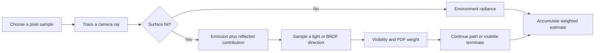
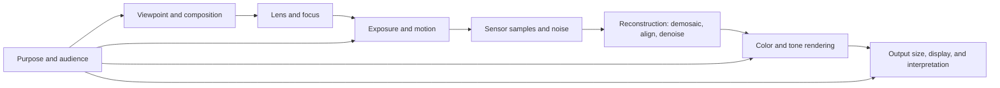

# 34 — Learned 3D Shapes and Scene Representations

[[Chapter Edition/02 - Graphics Vision and XR/00 - Reading Map|Reading map]] · [[Chapter Edition/02 - Graphics Vision and XR/33 - Projection Scale and Incidence Geometry|Previous chapter]] · [[Chapter Edition/02 - Graphics Vision and XR/35 - A Complete Renderer as an Executable Forward Model|Next chapter]]

Learned 3D systems depend on how shape and scene information are represented. This span surveys data and task choices before examining learned representations and their limits.

**By the end:** Compare 3D representations in relation to the tasks they support.

**Recall question:** How does the chosen 3D representation constrain the learning problem?

<!-- Derived from Continuous Notes/University - Worlds, Images and Inference - Graphics, Vision and Photography.md; source lines 77559–78469; source-span SHA256 82fb2193cb9627611c0b2754398c75529739a400d13e80c24155c9c474bcb3dc. -->

<!-- CHAPTER-SOURCE-BEGIN -->
## Learned representations of 3D shape and scenes

### 3D vision begins with representation choices

An image is a regular grid of pixels. A 3D object has geometry, and often also texture, material, and appearance. A computer must choose how to store the shape before a network can process it. No single representation is best for every task. Ask what operations the system needs: sampling surface points, checking whether a location is inside the object, rendering an image, editing the shape, or learning from incomplete scans.

A **point cloud** is a set of 3D coordinates, often stored as an $N\times3$ array. It may also include a surface normal at each point. Normals estimate which direction the surface faces and can help with lighting and rendering. Scanners and depth sensors often produce point clouds directly. They can be noisy or unevenly sampled; one region may have many points while a thin tail or hidden surface has few. Points alone do not say which points connect. The same point set can be consistent with different surface topologies, so the representation is incomplete for some geometry queries.

A **polygon mesh** stores vertices plus faces that connect them. Faces give surface connectivity, enabling rendering and many geometry operations. Meshes can be subdivided to add detail, simplified to reduce work, or regularized to make faces more uniform. Their variable connectivity makes them harder to feed to networks built for fixed-size grids. A high-quality mesh can also contain millions of vertices and faces, so simply making it denser is not free.

A **parametric representation** maps a lower-dimensional coordinate into 3D. A circle can be described by $(\cos t,\sin t)$; a surface can be described by a function $F(u,v)$ that maps two parameters to a point in space. Splines and Bézier surfaces use a small set of control points to describe smooth curves and surfaces. They are useful when the shape has structure and needs smooth editing, but one simple patch may not capture an arbitrary object. Several patches may be needed.

An **implicit representation** defines a function over 3D locations. The surface is the set of locations where the function meets a rule, often $f(x,y,z)=0$. For a unit sphere,

$$
f(x,y,z)=x^2+y^2+z^2-1,
$$

so a point is on the surface when $f=0$, inside when $f<0$, and outside when $f>0$. This makes point queries easy: evaluate the function. Sampling exact points on a complex surface can be hard because one must solve the equation. An **oriented distance function** adds a useful scale: the magnitude estimates distance to the surface, and the sign indicates inside or outside. Implicit functions can also be combined to form unions, intersections, or smooth blends of shapes.

A **voxel grid** stores values on a regular 3D lattice. It is like a 3D image: each cell records occupancy, density, or another quantity. A grid of $100\times100\times100$ contains one million cells. Doubling each side to $200$ multiplies storage by eight. Many cells may represent empty space, which wastes memory and compute. Voxels are nevertheless convenient for 3D convolutions because the data has a regular grid structure.

These choices expose a recurring trade-off. Explicit surface points are easy to sample, but do not directly answer every inside/outside query. An implicit function makes queries easy but may be costly to sample or evaluate repeatedly. Dense voxels are easy for standard convolutions but use memory on empty space. Meshes capture connectivity but are irregular. Choose a representation based on the operations and resolutions required.

### 3D data and tasks set the learning problem

3D tasks include shape classification, completion of partial scans, shape generation, reconstruction from one or more images, scene understanding, and editing. The output representation must match the task. Classification can use a categorical loss even when the input is a point cloud. Shape generation needs a way to compare the predicted geometry with the target. Reconstruction from images needs a rendering process that connects the 3D output to the observed pixels.

The lecture surveys shape datasets, real scans, object parts, and room scans. It highlights a lasting challenge: real 3D data is harder to collect at internet-image scale. Synthetic assets can provide many labeled objects, but may not match real-world geometry and appearance. Real scans are more realistic but expensive, incomplete, or noisy. Scene scans add more complexity because they include many objects and spatial relationships. Dataset counts and names in the lecture are historical snapshots; the important point is the scale and coverage gap between 2D and 3D data.

### Learning on grids, sets, and surfaces

One early approach renders a 3D model from several camera views and applies a 2D image network to each view. Pooling the view features gives a shape descriptor. This reuses strong image models and large image datasets. It can miss geometry hidden from the chosen cameras and depends on view selection and rendering quality.

Another early approach voxelizes the shape and applies 3D convolutions. This mirrors image CNNs, but the cubic memory cost makes high resolution expensive. An **octree** reduces that waste by recursively subdividing only regions that need more detail. Empty or uniform regions stay large; surface regions receive smaller cells. This adaptive grid can represent finer details under a similar memory budget, but the structure is more complex than a dense tensor.

Point-cloud networks must respect that points have no meaningful input order. If a permutation $\pi$ reorders the points, a shape classifier should return the same class. PointNet applies a shared pointwise feature map $h$, then uses a symmetric pooling function such as max or sum:

$$
g(\{x_i\}_{i=1}^{N})=\operatorname{MAX}_{i=1}^{N}h(x_i).
$$

A symmetric operation gives the same aggregate regardless of point order. A final classifier maps this global feature to class scores. This is simple and effective, but pooling can discard fine local relations; later methods use neighborhoods and graph-like message passing to capture how nearby points interact.

For point-cloud generation, compare sets without assuming a fixed point-to-point ordering. The **Chamfer distance** finds each point's nearest neighbor in the other set and sums or averages those distances in both directions. For sets $A$ and $B$, one common squared form is

$$
D_{\text{Chamfer}}(A,B)=\sum_{a\in A}\min_{b\in B}\|a-b\|_2^2+
\sum_{b\in B}\min_{a\in A}\|b-a\|_2^2.
$$

The **Earth Mover's Distance (EMD)** instead finds a low-cost one-to-one matching between points. For $A=\{0,2\}$ and $B=\{1,4\}$ on a line, nearest-neighbor matches cost $1+1$ from A to B and $1+2$ from B to A, totaling 5 in the unsquared bidirectional Chamfer form. The one-to-one EMD assignment costs $|0-1|+|2-4|=3$. Chamfer is cheaper but can let many points match the same neighbor; EMD enforces a balanced assignment but costs more. Both provide geometric objectives that can be differentiated or approximated for training.

A learned **surface patch** maps a small 2D parameter region into 3D. An MLP can learn the map $F_\theta(u,v)$, producing an ordered surface patch rather than an unordered set of points. Several patches can be combined to cover an object. This gives smoother surfaces than a raw point set, but requires choosing how patches are arranged and how their boundaries fit together.

### Neural implicit functions and NeRF

A neural implicit model uses a network as the function itself. Query a coordinate $\mathbf{x}=(x,y,z)$; the network may return occupancy, signed distance, density, or another geometric value. A signed distance function (SDF) returns an approximate distance to the nearest surface, with negative values inside and positive values outside. Instead of storing every grid cell, the model can answer queries at chosen locations. This is compact and resolution-flexible, but every query costs network evaluation, and extracting a mesh or uniformly sampling the surface requires additional work.

NeRF extends coordinate queries from geometry to appearance. Given a 3D location $\mathbf{x}$ and viewing direction $\mathbf{d}$, its network predicts color $\mathbf{c}$ and volume density $\sigma$. The viewing direction lets the model represent view-dependent effects such as highlights. A camera ray samples locations through the scene. For sample $i$, let $\Delta_i$ be the distance to the next sample. The opacity contribution and transmittance are commonly written

$$
\alpha_i=1-\exp(-\sigma_i\Delta_i),\qquad
T_i=\exp\left(-\sum_{j<i}\sigma_j\Delta_j\right),\qquad
w_i=T_i\alpha_i.
$$

Then the pixel color is approximately

$$
\hat{C}=\sum_i w_i\mathbf{c}_i+T_{\text{end}}\mathbf{c}_{\text{background}}.
$$

Early samples can absorb light and reduce the contribution of later samples. The rendering computation is differentiable, so rendered pixels can be compared with training photographs and gradients can update the scene representation. This enables reconstruction from images without a known 3D target mesh. It also requires many spatial samples along many camera rays, including points in empty space, which makes classic NeRF rendering slow.

### Gaussian splatting trades dense queries for explicit scene elements

**3D Gaussian Splatting** represents a scene with many spatial Gaussian blobs. Each blob has a location, shape, opacity, and color or appearance parameters. The renderer projects relevant blobs into the camera and blends them to form pixels. Because the scene elements are explicit and spatially localized, the system can skip large empty regions instead of querying a network uniformly along every ray. This can render much faster while producing comparable view-synthesis quality on the lecture's examples.

The trade-off is different from NeRF. NeRF stores a continuous neural field and evaluates it at sampled points. Gaussian splatting stores a large collection of explicit primitives and renders the visible ones. Splatting can be very fast, but depends on many learned primitives and their optimization; it is not the same compact continuous function as a neural field. The lecture's speed and quality figures are benchmark- and implementation-specific, not universal guarantees.

### Objects also have parts and relationships

A geometric representation can capture surface detail while missing structure. Chairs have seats, backs, bases, and legs. Some parts repeat or form symmetric pairs. A room also has relationships: a bed may be next to a wall, and a chair may sit by a table. Part hierarchies represent which pieces belong to which larger pieces; relational graphs can express alignment, symmetry, adjacency, and other constraints.

These structures help with generation and editing. A system can generate a chair while preserving the relation between its legs and seat, or change one part while keeping the rest coherent. The lecture points to program-like representations, where repeated components can be described with loops, and to language models that may generate semantic programs while a geometric representation supplies detailed shape. These are emerging approaches, not solved capabilities.

**Source:** SC-15, full original-English captions. The guest lecture moves from shape representations and data limits through voxel, point, surface, and implicit neural methods to NeRF, Gaussian splatting, and structured object parts. Benchmark sizes, project names, and speed comparisons are preserved only as lecture examples and should not be read as current rankings.

### From scene representations to research methods

#### A radiance field turns views into a continuous scene query

*Connect to:* cameras and calibration; volumetric image formation; numerical integration and Monte Carlo estimation; optimization.

A [[Radiance fields and Gaussian splatting|neural radiance field]] (NeRF) represents a scene by a function queried at a location and viewing direction. The original NeRF model maps a 3D point $\mathbf{x}$ and unit direction $\mathbf{d}$ to emitted color $\mathbf{c}$ and volume density $\sigma$:

$$F_\Theta(\mathbf{x},\mathbf{d})=(\mathbf{c},\sigma).$$

Density depends on position alone; color can depend on both position and direction. That split lets the field represent view-dependent appearance, such as a specular highlight that moves when the camera moves, while keeping the scene's estimated occupancy tied to 3D position. It does not make the representation a surface mesh: a ray can accumulate color through a continuous volume.

For a camera ray $\mathbf{r}(t)=\mathbf{o}+t\mathbf{d}$, the contribution at depth $t$ is attenuated by everything encountered earlier on the ray. Define transmittance

$$T(t)=\exp\left(-\int_{t_n}^{t}\sigma(\mathbf{r}(s))\,ds\right).$$

For a black background beyond the far bound, the rendered pixel is

$$C(\mathbf{r})=\int_{t_n}^{t_f}T(t)\,\sigma(\mathbf{r}(t))\,\mathbf{c}(\mathbf{r}(t),\mathbf{d})\,dt.$$

For a nonblack background with color $C_{bg}$, add the residual term $T(t_f)C_{bg}$; the remaining transmittance is the probability that the ray reaches that background without an earlier volume event.

The product $T(t)\sigma(t)$ is the probability density, in the volume-rendering model, that the ray's visible event occurs near $t$. A dense region has larger $\sigma$ and is more likely to contribute. But transmittance falls as the ray crosses density, so later regions receive less weight. This is the same visibility-and-contribution logic as front-to-back compositing, written continuously.

A computer evaluates the integral with samples. For sample interval length $\delta_i$ and density $\sigma_i$, define opacity

$$\alpha_i=1-\exp(-\sigma_i\delta_i),\qquad T_i=\exp\left(-\sum_{j<i}\sigma_j\delta_j\right),\qquad w_i=T_i\alpha_i.$$

For a black background, approximate the ray color by

$$\widehat C(\mathbf{r})=\sum_i w_i\mathbf{c}_i.$$

For a nonblack background $C_{bg}$, add $T_{n+1}C_{bg}$, where $T_{n+1}=\exp(-\sum_i\sigma_i\delta_i)$ is the transmittance left after the final interval.

For example, take three equal intervals with $\sigma_i=1$ and $\delta_i=0.5$. Each sample has opacity $1-e^{-0.5}\approx0.393$. The weights are about $0.393$, $e^{-0.5}(0.393)\approx0.239$, and $e^{-1}(0.393)\approx0.145$. The first sample matters most because it blocks part of the later ray. The remaining transmittance after all three is $e^{-1.5}\approx0.223$. The weights plus remaining transmittance sum to one, up to rounding. This gives a useful conservation check for an implementation.

Training uses calibrated images. A camera pose maps each observed pixel into a ray. The field is queried along that ray; the predicted color is compared with the measured pixel, and the error is differentiated back through the samples into the network. The network therefore learns by explaining many rays from known camera positions. A pose error can be mistaken for shape or appearance error, so camera calibration is part of the model's evidence, not a detail that can be ignored.

The original paper's **positional encoding** maps coordinates to sine and cosine features at multiple frequencies. Its purpose is to make a standard multilayer perceptron (MLP) respond to high spatial frequencies more readily. The field is trained with stratified samples: one sample is drawn from each subinterval along a ray. A coarse field first proposes where useful contributions are likely. The algorithm normalizes its ray weights into a piecewise probability distribution and draws additional fine samples from it. The fine network evaluates the union of coarse and fine samples. This concentrates work around visible contributions while retaining broad coverage.

The paper also derives a normalized device coordinate (NDC) parameterization for forward-facing captures. It shifts the ray origin to a near plane and reparameterizes distance so samples can be placed linearly in inverse depth. This concentrates samples closer to the camera, where nearby geometry changes more rapidly in image space. NDC is a capture-specific coordinate choice; it is not a general fix for arbitrary camera paths.

**Limits and interpretation.** NeRF's contribution is a learned, differentiable representation and renderer, but the original per-scene MLP requires many network evaluations along each ray. Training depends on many posed images and can take hours in the paper's setup. View-dependent color helps explain reflections but can also hide errors in geometry. The results are reported for the paper's scenes, camera calibration, architecture, and compute; they should not be read as a guarantee of the same quality for sparse views, moving scenes, or different cameras.

**Source:** Mildenhall et al., “NeRF: Representing Scenes as Neural Radiance Fields for View Synthesis” (2020), full paper and appendices A–D, PDF pp. 1–25. [Primary PDF](https://arxiv.org/pdf/2003.08934).

#### A multiresolution hash grid gives a small network local detail

*Connect to:* neural fields; spatial sampling; acceleration structures; numerical optimization; the NeRF volume renderer above.

Instant Neural Graphics Primitives (Instant-NGP) changes the input representation before changing the renderer. Instead of asking a large MLP to build every spatial frequency from raw coordinates, it looks up trainable feature vectors at several grid resolutions. A small MLP then combines those features into the task's output. The same input encoding can support image fitting, signed distance functions (SDFs), radiance caching, and NeRF.

An SDF gives each point a signed distance to a surface; its zero level set is the surface. For a 3D input, each grid level stores features at lattice corners. A point inside a cell obtains a feature by trilinearly interpolating its eight corner values. At coarse levels, lattice vertices map directly to stored entries. Fine levels can have more vertices than memory allows, so their integer coordinates are mapped through a spatial hash into a fixed table. A collision happens when two different grid vertices map to the same table slot. The method does not resolve every collision explicitly. Instead, all levels and their features are concatenated and passed to a learned MLP, which can often infer a useful representation from the combined context.

Let level $\ell$ have resolution $N_\ell$. The paper spaces resolutions geometrically:

$$N_\ell=\left\lfloor N_{min}b^\ell\right\rfloor,\qquad b=\exp\left(\frac{\ln N_{max}-\ln N_{min}}{L-1}\right),$$

where $L$ is the number of levels. This makes adjacent levels differ by a nearly constant scale factor. If the fine grid's vertices are hashed into a table of size $T$, a simple hash is

$$h(\mathbf{i})=\left(\bigoplus_{k=1}^{d}i_k\pi_k\right)\bmod T,$$

where $\mathbf{i}$ is an integer grid coordinate, $\pi_k$ are fixed integer multipliers, and $\oplus$ denotes bitwise XOR. Hashing reduces storage, but it introduces collisions. Coarse levels retain stable broad structure; finer levels encode smaller detail but have more collisions. The MLP receives the concatenation of the feature vectors from every level, not their sum, so it can use scale-specific clues separately.

A practical picture: imagine a coarse grid that stores broad color regions and a fine grid that stores edges and texture. If two fine vertices collide, their table slot must serve both positions. Other levels still tell the MLP where each point lies at coarser scales, so the resulting predictions may remain useful. But if fine-scale geometry is critical, the collision can create small artifacts. A hash table is a memory shortcut, not a guarantee that spatial detail is preserved perfectly.

The paper's default encoding uses 16 levels and two features per lookup. Its resolutions run from 16 to a task-dependent maximum; the hash table size balances memory, cache use, and quality. The authors report that tables above $2^{19}$ entries began to slow on their RTX 3090 because one level no longer fit in the GPU's 6 MB L2 cache. That threshold belongs to the reported hardware, not a universal rule. They also store table entries in half precision for speed and keep a full-precision master copy for stable updates.

For NeRF, the hash encoding feeds a density network and then a color network. The density network predicts density plus latent features from position; the color network combines those features with a spherical-harmonic encoding of view direction. The renderer still uses volume integration: the new encoding accelerates field queries, but does not replace visibility, transmittance, or ray compositing. A separate occupancy grid marks likely-empty cells. Ray marching skips cells marked empty, increases step length with distance in larger scenes, and stops once transmittance falls below $10^{-4}$. The occupancy grid is periodically refreshed from predicted density, so early estimates must be treated cautiously. The authors sample the whole scene more broadly during early training, then use a mixture of uniform and currently occupied cells to avoid a stale grid hiding new density.

The same encoding supports different output tasks. For a single SDF, training positions are a mix: one eighth uniform in the bounding cube, one half uniform over the mesh surface, and three eighths perturbed around the surface. This mixture teaches the network both the zero crossing and values away from it. Their SDF comparison exposes an important failure: random hash collisions leave fine-scale surface roughness. The intersection-over-union metric can still look strong because it checks inside/outside classification over many points, while shading magnifies small normal errors. A shape metric and a normal-sensitive image reveal different kinds of failure.

The authors report that hash-encoded NeRFs became competitive with the paper's selected NeRF baselines after seconds to minutes rather than hours. On some scenes with strong view-dependent reflections, mip-NeRF and NSVF scored better. The paper's ablation attributes speed and quality gains to the encoding and smaller MLP, but explicitly says more work is needed to isolate ray-marching contributions across implementations. The results are therefore evidence for that combined system and benchmark set, not a universal wall-clock ratio.

**Tradeoffs.** The hash representation is attractive when a task has low-dimensional spatial inputs and needs local, high-frequency detail. It is less attractive when one needs a smooth derivative everywhere, collision-free spatial values, or a generative model whose parameters should align with a regular grid. The paper suggests filtered lookup or smoothness losses as future directions for SDF microstructure. Its optional smoothstep interpolation makes first derivatives continuous, but the authors found that stronger smoothing could reduce reconstruction quality and did not use it by default.

**Source:** Müller et al., “Instant Neural Graphics Primitives with a Multiresolution Hash Encoding” (2022), full body and appendices A–E, PDF pp. 1–15. [Primary PDF](https://nvlabs.github.io/instant-ngp/assets/mueller2022instant.pdf).

#### Explicit Gaussian splats trade continuous querying for fast rasterization

*Connect to:* radiance fields and view synthesis; projected geometry; rasterization, coverage, depth, and alpha compositing; optimization.

3D Gaussian Splatting (3DGS) begins from sparse points reconstructed by structure from motion. Each point becomes an anisotropic Gaussian with a position, shape, opacity, and view-dependent color coefficients. “Anisotropic” means its spread can differ by direction. A Gaussian therefore models a small oriented volume rather than a round point. The scene is represented explicitly by many such elements; a renderer projects each element to the image and blends its contribution.

For position $\mathbf{x}$, mean $\boldsymbol\mu$, and covariance $\Sigma$, a Gaussian weight is

$$G(\mathbf{x})=\exp\left(-\frac{1}{2}(\mathbf{x}-\boldsymbol\mu)^T\Sigma^{-1}(\mathbf{x}-\boldsymbol\mu)\right).$$

The covariance controls orientation and scale. The paper factors it as

$$\Sigma=R S S^T R^T,$$

where $R$ is a rotation from a normalized quaternion and $S$ contains the learned axis scales. This factorization makes $\Sigma$ positive semidefinite; because the Gaussian response uses $\Sigma^{-1}$, its scales must be nonzero so that $\Sigma$ is positive definite. Camera projection maps a 3D Gaussian to an approximate 2D Gaussian. Let $W$ be the $3\times3$ linear part of the world-to-camera transform and let $J\in\mathbb{R}^{2\times3}$ be the local Jacobian from camera-space position to the two image coordinates. The projected covariance is

$$\Sigma'=J W\Sigma W^TJ^T,$$

where $W$ transforms from world to camera coordinates. The Jacobian is a local linear approximation. It is accurate when the splat is small enough that projection does not curve substantially across its support; large or extreme-perspective splats make that approximation weaker.

The renderer bins projected splats into image tiles, sorts them by depth within a tile, and composites front to back. For sorted splat $i$, let $\alpha_i$ include learned opacity and the Gaussian's weight at the pixel. Let $T_i$ be the transmittance left after earlier splats. Then

$$C=\sum_i T_i\alpha_i c_i,\qquad T_i=\prod_{j<i}(1-\alpha_j).$$

Example: two splats have colors $c_1=(1,0,0)$ and $c_2=(0,0,1)$ with opacities $0.4$ and $0.5$. The first contributes $0.4c_1$. It leaves transmittance $0.6$, so the second contributes $0.6(0.5)c_2=0.3c_2$. The remaining background weight is $0.3$. This order matters: the renderer is approximating visibility, not averaging colors symmetrically.

Optimization adjusts centers, scales, rotations, opacity, and spherical-harmonic (SH) color coefficients to match training images. The loss combines an $L_1$ color term with a structural similarity term. Adaptive density control responds to image-space position gradients. The method clones small splats in areas needing more representation and splits large splats into smaller ones; it prunes transparent or oversized splats and periodically resets opacity. This is a representation-growth strategy: allocate more elements where image error says the current set cannot explain detail well.

The tile renderer is central to speed. Each projected splat is duplicated into every overlapped tile, with its depth and tile identifier sorted together. The authors use 16 by 16 pixel tiles and cull outside a confidence ellipse. They process front to back and stop a pixel when accumulated opacity is effectively saturated. During the backward pass, they re-traverse the ordered list and reconstruct the necessary transmittance. This avoids repeatedly evaluating a full neural network at every ray sample, but memory grows with the number and size of splats and their tile overlaps.

**Failure modes and evidence.** Sparse or biased training views leave unseen regions unconstrained. The learned elements can become floaters, elongated blotches, or splotchy geometry. Culling and approximate ordering can cause popping. SH color can fit observed directions but cannot guarantee correct appearance from unseen directions. The paper reports strong speed and quality on its 13 scenes, with an A6000 GPU; those benchmark numbers are specific to its setup. The authors note substantial memory use and that the representation does not automatically become a clean mesh. A fast view synthesizer is not, by itself, a reliable surface reconstruction.

**Source:** Kerbl et al., “3D Gaussian Splatting for Real-Time Radiance Field Rendering” (2023), full paper and appendices A–D, PDF pp. 1–14. [Primary PDF](https://repo-sam.inria.fr/fungraph/3d-gaussian-splatting/3d_gaussian_splatting_low.pdf).

#### Flatten each Gaussian into a surface element and regularize its depth

*Connect to:* Gaussian splatting; perspective projection and camera rays; differential rendering; depth maps and surface normals; mesh extraction.

A 3D Gaussian is useful for view synthesis, but its volume can spread through space instead of following a thin surface. 2D Gaussian Splatting (2DGS) replaces each 3D blob with a flat elliptical disk in 3D. A disk has a center $\mathbf{p}$, tangent directions $\mathbf{t}_u,\mathbf{t}_v$, two scales $s_u,s_v$, opacity, and view-dependent color. Its normal is $\mathbf{t}_w=\mathbf{t}_u\times\mathbf{t}_v$. In local tangent coordinates $(u,v)$, the surface point and Gaussian weight are

$$\mathbf{P}(u,v)=\mathbf{p}+s_u\mathbf{t}_u u+s_v\mathbf{t}_v v,\qquad G(u,v)=\exp\left(-\frac{u^2+v^2}{2}\right).$$

The normal is available directly from the representation. The model can start with a sparse camera-calibrated point cloud, then optimize centers, tangent frames, scales, opacity, and appearance from posed images. The starting cloud does not need to provide dense ground-truth points or normals.

The renderer must find where a pixel ray hits the disk. A common shortcut projects the disk with a local affine approximation. It is fast near the center, but perspective makes the approximation less accurate farther away. 2DGS instead writes the pixel ray and the disk in homogeneous coordinates and intersects them explicitly. The method represents the ray as the intersection of two planes in screen space. It transforms those planes into the disk's local coordinates, solves two linear equations for $(u,v)$, and maps that point back to camera space to recover depth. This gives a perspective-correct ray-disk intersection while avoiding the direct inverse matrix that can become ill-conditioned when the disk is nearly edge-on.

A nearly edge-on disk projects to a thin line and could disappear from rasterization. 2DGS uses a low-pass floor: it takes the maximum of the true disk Gaussian value and a small screen-space Gaussian centered at the projected disk center. This keeps at least some pixel support and stabilizes optimization. It also means the rasterized footprint is not a perfect projection of the geometric disk in degenerate views; the filter is a practical regularizer for visibility and gradients.

The color renderer still uses front-to-back alpha compositing. For disk $i$, its weight on a pixel is $\omega_i=T_i\alpha_i\widehat G_i$, where $T_i$ is transmittance from earlier disks. Photometric loss alone can explain a pixel with several different depth arrangements. For example, two semitransparent disks at depths 2 and 4 may produce nearly the same color as a different pair at depths 2.5 and 3.5. The image loss alone does not tell the renderer which arrangement is the real surface.

The **depth-distortion loss** penalizes spread in the weighted depths along each ray:

$$L_d=\sum_{i,j}\omega_i\omega_j|z_i-z_j|.$$

If two equally weighted intersections lie at depths 2 and 4, their pairwise separation contributes in proportion to $|4-2|=2$. If optimization moves them closer, their colors can remain similar while the penalty falls. The regularizer therefore encourages the visible weight to concentrate into a thinner surface. It does not directly supply a ground-truth depth; it encodes the assumption that a surface should be locally concentrated along a ray.

The appendix maps depth to normalized device coordinates and gives an efficient one-pass form of a squared-distance variant. For transformed depths $m_i$, maintain prefix sums $A_i=\sum_{j\le i}\omega_j$, $D_i=\sum_{j\le i}\omega_jm_j$, and $D_i^{(2)}=\sum_{j\le i}\omega_jm_j^2$. Each new sample's pairwise contribution can then be computed from those accumulated sums instead of looping over every earlier pair. This reduces the cost of the nested sum while preserving the dependence of the intersection depths on the learnable disks. The published main text uses the absolute-separation form; the appendix's implementation details should not be silently substituted for that main-text equation.

**Normal consistency** joins two independent estimates of the surface orientation. The splats have normals $\mathbf{n}_i$ by construction. The rendered depth map gives a second normal: choose a representative surface point $\mathbf{p}_s$ at median accumulated opacity, estimate its image-space derivatives with finite differences, then compute

$$\mathbf{N}=\frac{\nabla_x\mathbf{p}_s\times\nabla_y\mathbf{p}_s}{\|\nabla_x\mathbf{p}_s\times\nabla_y\mathbf{p}_s\|}.$$

The loss is

$$L_n=\sum_i\omega_i(1-\mathbf{n}_i^T\mathbf{N}).$$

If the normals agree, their dot product is near 1 and the penalty is near zero. If they point in different directions, the penalty rises. The splat normal is oriented toward the camera for this comparison. This connects local surface orientation to the way neighboring depths change across the image; noisy depth or inconsistent splat normals makes the two descriptions disagree.

The combined training objective is

$$L=L_c+\alpha L_d+\beta L_n,$$

where $L_c$ combines an $L_1$ image loss and a structural-similarity loss. The paper sets $\beta=0.05$ and uses different depth-loss weights for bounded and unbounded scenes ($\alpha=1000$ and $100$, respectively). Those values depend on its loss scaling and implementation. The ablations support the role of both terms: removing normal consistency hurts orientation, while removing depth distortion blurs the estimated surface normals. The final model extracts a mesh by rendering training-view depth maps and fusing them with truncated signed-distance fusion (TSDF). The paper found median depth more robust than expected depth because expected depth is more affected by outliers.

**What the experiments do and do not establish.** On the paper's DTU benchmark, 2DGS reports lower mean Chamfer distance than its compared 3DGS and SuGaR runs, with about 5.5 minutes of training for its 15,000-iteration setting on an RTX 3090. Its Tanks and Temples mean score is below the listed Neuralangelo result but above its listed SuGaR and 3DGS results; therefore the result is not “best on every benchmark.” On Mip-NeRF360, it reports novel-view quality close to 3DGS, while the dataset lacks ground-truth geometry. The paper's own limitations are substantial: it assumes opaque surfaces, depth-fusion meshing struggles with glass, texture-driven densification can miss geometric detail, and regularization trades image fidelity against smooth geometry. These limits matter when using 2DGS as a reconstruction method rather than only as a view synthesizer.

**Source:** Huang et al., “2D Gaussian Splatting for Geometrically Accurate Radiance Fields” (2024; arXiv v3, 2025), complete paper and supplemental appendices A–D, PDF pp. 1–13. [Primary PDF](https://arxiv.org/pdf/2403.17888).

#### Project Gaussian splats through distorted cameras and trace secondary rays

*Connect to:* camera calibration and lens distortion; Gaussian splatting; sampling and projection; rasterization and ray tracing; reflections and refractions.

Standard 3D Gaussian Splatting projects a 3D Gaussian to the image with a first-order approximation to the camera projection. That approximation uses a Jacobian. It is efficient for a pinhole camera near the Gaussian's center, but it becomes less accurate as the projection becomes more nonlinear. Supporting each new lens model also means deriving its Jacobian. A rolling-shutter camera adds a harder complication: different rows are captured at different times, so each row can have a different camera pose.

3DGUT replaces that linearized projection with the **Unscented Transform** (UT). In three dimensions, select seven sigma points: the Gaussian mean and six points placed in opposite directions along the three covariance axes. In the paper's notation, with covariance factor $\Sigma=RSS^TR^T$,

$$\mathbf{x}_0=\boldsymbol\mu,\qquad \mathbf{x}_{i}=\boldsymbol\mu+\sqrt{3+\lambda}\,(RS)_{:,i},\qquad \mathbf{x}_{i+3}=\boldsymbol\mu-\sqrt{3+\lambda}\,(RS)_{:,i},$$

for $i=1,2,3$. Each point is passed through the camera's actual projection function, including distortion or its own row-dependent pose. The projected mean and covariance are then estimated by weighted sums:

$$\mathbf{v}_\mu=\sum_i w_i^\mu g(\mathbf{x}_i),\qquad \Sigma'=\sum_i w_i^\Sigma(g(\mathbf{x}_i)-\mathbf{v}_\mu)(g(\mathbf{x}_i)-\mathbf{v}_\mu)^T.$$

The central and off-center weights depend on $\lambda=\alpha^2(3+\kappa)-3$, with $\alpha$ setting the spread, $\kappa$ a scale parameter, and $\beta$ a prior-distribution parameter. The paper uses $\alpha=1$, $\beta=2$, and $\kappa=0$. UT is **derivative-free** with respect to the projection model: it samples the nonlinear mapping at carefully selected points instead of differentiating that mapping to obtain a Jacobian. This projected 2D Gaussian is used to estimate which image tiles a particle may affect. UT does not make the projected shape exactly Gaussian; it approximates it from a small set of samples.

The method also changes how a candidate Gaussian responds to a pixel ray. 3DGS evaluates a 2D projected conic. 3DGUT evaluates the 3D Gaussian at the point where its response is largest along the parameterized line $\mathbf{r}(\tau)=\mathbf{o}+\tau\mathbf{d}$. Differentiating the Gaussian exponent with respect to $\tau$ gives

$$\tau_{max}=\frac{(\boldsymbol\mu-\mathbf{o})^T\Sigma^{-1}\mathbf{d}}{\mathbf{d}^T\Sigma^{-1}\mathbf{d}}.$$

This is the covariance-weighted closest point on the line. The paper's closed form maximizes over unrestricted $\tau$; if a renderer restricts the ray to a finite interval, it must also enforce that interval. Evaluating in 3D avoids backpropagating through the camera projection approximation for the color/opacity response. The supplement derives a stable backward pass for the particle mean, scale, and rotation. The main text distinguishes **projected support** from **particle response**: UT estimates the screen-space footprint for culling and tiling; it does not replace the 3D response calculation.

$$\tau_{max}=\frac{(\boldsymbol\mu-\mathbf{o})^T\Sigma^{-1}\mathbf{d}}{\mathbf{d}^T\Sigma^{-1}\mathbf{d}}.$$

This point is the closest point on the ray to the Gaussian center in the covariance-weighted metric. Evaluating in 3D avoids backpropagating through the camera projection approximation for the color/opacity response. The supplement derives a stable backward pass for the particle mean, scale, and rotation. The main text distinguishes **projected support** from **particle response**: UT estimates the screen-space footprint for culling and tiling; it does not replace the 3D response calculation.

The response model can be composited front-to-back, but the sort order matters. 3DGS sorts particles by center depth for a whole tile; the true maximum-response depth may differ per ray. 3DGUT adds a per-ray multilayer alpha-blending (MLAB) strategy: it retains a bounded number of far hits (the paper usually uses $k=16$) and progressively blends the nearer ones. This improves the approximation to the ray's depth order. It is still a bounded approximation. The authors also discuss hybrid transparency, which keeps the nearest hits and blends the far ones, but its cost can be high without additional optimization.

Because the 3D particle evaluation is aligned with the tracing formulation in 3DGRT, one representation can support hybrid rendering. Rasterize primary camera rays, discard particles behind the first surface hit, then trace reflected or refracted secondary rays. The paper demonstrates reflections and refractions using a combination of primary-ray splatting and secondary-ray tracing. This capability comes from aligning the representation and response model; the paper does not claim the splatting pass alone can compute secondary light transport.

**Published results.** On the paper's Mip-NeRF360 pinhole benchmark, unsorted 3DGUT reports similar image quality to 3DGS at 265 versus 347 frames per second, while its sorted variant reports 200 FPS and supports the stronger rendering-order alignment. On the fisheye ScanNet++ scenes, sorted 3DGUT reports PSNR 29.11, SSIM 0.910, and LPIPS 0.252 versus the paper's FisheyeGS run at 28.15, 0.901, and 0.261, using 0.38 million rather than 1.07 million Gaussians. The comparison includes the paper's specified preprocessing and trained scenes. On Waymo's selected static scenes, 3DGUT with rolling-shutter and distortion-aware training reports PSNR 30.16 and SSIM 0.900; 3DGRT reports 29.99 and 0.897. The 3DGS comparison uses rectified images without rolling shutter and is not directly comparable. For UT quality, the supplement compares projected distributions with a 500-sample Monte Carlo reference using Kullback–Leibler (KL) divergence. It reports better projections than EWA under fisheye distortion and stable median KL as radial distortion or rolling-shutter motion increases.

**Limits.** UT is more expensive than the original 3DGS projection, so 3DGUT is somewhat slower in its own pinhole benchmark. Under strong distortion, the true projected particle may no longer resemble a 2D Gaussian, weakening tile culling and support estimates. The one-point maximum-response evaluation cannot accurately handle overlapping Gaussians in all cases. Per-ray sorting improves consistency but costs additional time. These are limits of the reported formulation, not solved problems.

**Source:** Wu et al., “3DGUT: Enabling Distorted Cameras and Secondary Rays in Gaussian Splatting” (CVPR 2025), complete main paper plus supplemental appendices A–F, PDF pp. 1–13; references pp. 14–15 excluded. [Primary paper and supplement](https://research.nvidia.com/labs/toronto-ai/3DGUT/res/3DGUT_full_resolution.pdf).

#### What the short presentations add

The captioned 3D Gaussian Splatting presentation adds an accessible overview of the paper's pipeline: initialize from a structure-from-motion point cloud, optimize anisotropic Gaussians, and render the scene. It highlights that elongated splats can represent thin structures such as bicycle spokes. It also reports more than 100 frames per second in shown scenes, a 7,000-iteration run taking about six minutes, and an ablation using random rather than structure-from-motion initialization. These are claims made in the presentation and depend on its test setup; the paper's experiments remain the detailed evidence. [Presentation](https://www.youtube.com/watch?v=T_kXY43VZnk).

The 2D Gaussian Splatting presentation foregrounds the reason for a planar primitive: its normal is geometrically meaningful. It also walks through perspective-correct ray/disc intersection, a low-pass filter for small or oblique splats, ray-wise depth concentration, normal consistency, and depth-based mesh extraction. The automatic captions are imperfect, so the paper and its supplement carry the formal definitions and equations. [Presentation](https://www.youtube.com/watch?v=oaHCtB6yiKU).

The Instant Field-Aligned Meshes presentation shows the method as two coupled fields: an orientation field guides edge direction and a position field controls vertex placement. It briefly demonstrates feature alignment, point-cloud input, interactive orientation/position brushes, and very large remeshing. Its claim of processing a 372-million-triangle mesh in about nine minutes is a reported demo result, not an independent benchmark. [Presentation](https://www.youtube.com/watch?v=U6wtw6W4x3I).

### Figure U12 - Volume compositing accumulates visible contributions

![[Visual Recall/University Graphics and Vision/volume-compositing.png]]

The color swatch is encoded for an sRGB display. The printed RGB values remain linear-light values.

*The checked weights sum to the visible contribution plus residual background transmittance for the illustrated ray. The diagram is a one-ray compositing example, not a full trained NeRF or a density-estimation guarantee.*

### Figure U13 - A local Gaussian covariance projects to an ellipse

![[Visual Recall/University Graphics and Vision/gaussian-screen-covariance.png]]

*The checked diagonal case maps the stated local covariance to screen covariance $\operatorname{diag}(1600,400)$. It illustrates first-order covariance propagation for that camera setup; it is not a general nonlinear-camera result.*

## Robot learning closes the perception-action loop

### Robot learning is a feedback problem

In supervised learning, a model maps an input $x$ to a target $y$. For example, an image classifier maps pixels to a category. In robot learning, an agent observes a state, chooses an action, and changes the world. The world then returns a new observation and possibly a reward. The next decision depends on what happened after the previous action. This makes robot learning a **sequential decision problem** rather than a single prediction problem.

A compact formulation is a state $s_t$, action $a_t$, transition $s_{t+1}$, and reward $r_t$. A policy $\pi(a\mid s)$ chooses actions from the current state. A goal or instruction helps define which outcomes are wanted. The objective is to choose a sequence of actions that gets a high total reward or low total cost. A familiar formal version is

$$
G_t=\sum_{k=0}^{H-1}\gamma^k r_{t+k},
$$

where $H$ is the planning horizon and $\gamma\in[0,1]$ discounts rewards that arrive later. This notation makes a delayed effect explicit: an early action can matter because it changes which future states are reachable. In a clothes-folding task, the state may include camera or depth observations, the action may move a gripper or open it, and reward may measure whether the final fold meets a chosen standard.

Reward design is part of the task definition. A fast drive might be rewarded for speed, but a safe and comfortable drive needs additional terms. A folded shirt can be scored by compact area, smoothness, or a human's preference. Different reward choices can favor different behaviors. A robot trained to optimize a poorly chosen proxy may succeed at the score while missing the intended goal.

The lecture contrasts this loop with static image prediction. The physical world is uncertain: the same push can rotate a box by different amounts because contact forces differ. Rewards may arrive only at the end of a long sequence, which makes it hard to assign credit to the action that helped or hurt. The environment often cannot be differentiated through, so a gradient cannot simply flow from a final reward through every physical interaction. Finally, actions change later observations. A small early error can move the robot into a state unlike the training data, where its next action may be worse.

### Perception must support action

Robot perception is not only a description of a scene. It should extract information that helps the next decision. A camera gives color and spatial layout. A depth sensor gives distance. Tactile sensors can help detect stable contact; sound can reveal contact or motion. Combining sensors can fill gaps, since no one sensor captures everything.

The physical scene can be incomplete or changing. Objects occlude one another; sensors are noisy; a grasp can fail and drop an object; clothes and other deformable materials change shape; people, pets, and other agents move through the scene. A robot therefore needs to cope with unexpected changes rather than assume one fixed image per task.

The robot can also act to improve what it knows. If an object may be one piece or several nested pieces, a gentle perturbation can reveal whether parts move independently. Moving a camera or head can reveal what was behind an obstacle. This is **active perception**: the system selects actions partly to obtain useful information. It is embodied because the robot has a physical body and sensors; active because it chooses what to sense; and situated because it must respond to the actual world at a particular time. For a local task such as fastening a button, the system may only need detailed perception around the button, not a perfect model of the entire room.

A useful design question is therefore: which facts about the world does the next action require? A full scene reconstruction can be wasteful if a local view suffices. On the other hand, using a single image-level label can be too coarse if the action needs an exact point, surface, or contact state.

### Reinforcement learning: learn from outcomes

**[[Perception feedback and robot learning|Reinforcement learning]] (RL)** trains an agent through interaction. It tries actions, observes the resulting states and rewards, and changes its policy toward actions that yield better future outcomes. In a game, the state may be screen pixels, the actions may be button presses, and reward may be score. For a robot arm, the state may include joint positions and camera observations, the actions may be motor torques, and reward may reflect task progress.

A value function estimates future reward. The action-value function is often written

$$
Q^\pi(s,a)=\mathbb{E}_{\pi}\left[\sum_{k=0}^{H-1}\gamma^k r_{t+k}\mid s_t=s,a_t=a\right].
$$

It asks: if the agent is in state $s$, takes action $a$, then follows policy $\pi$, how much reward should it expect? A greedy decision chooses the action with the largest estimated value, $a^*=\arg\max_a Q(s,a)$. In practice, an agent must also explore actions whose value is uncertain; repeatedly choosing only the current apparent best can miss better strategies.

The lecture uses Atari Breakout as an example of learning behavior through repeated play. Early play may miss the ball. Later the policy catches it more often; eventually it can discover a strategy such as opening a tunnel through one side of the bricks. That example illustrates why trial and error can discover a strategy that was not hand-coded. It also illustrates the resource requirement: extensive interaction can be expensive.

In simulation, RL can learn impressive locomotion. **Sim-to-real transfer** means using a policy trained in simulation on a physical robot. Randomizing friction, geometry, and other simulated parameters can help the policy handle a range of conditions, so the real world may fall within the simulated distribution even if every detail was not modeled. The lecture reports strong empirical success for locomotion, but warns that manipulation has harder cases. A box rotating by a few extra degrees may be tolerable; a grasp that slips or fails entirely may change the task qualitatively. Some mistakes in real-world exploration are unsafe or damaging.

The limits of model-free RL are substantial. It often needs many trials, can learn strange behavior during training, and may be difficult to interpret or correct. Game simulations can be reset cheaply. A physical robot cannot always repeat a dangerous or destructive action. A successful video also does not show how many trials failed or how much human intervention was required.

### Learn a world model, then plan with it

A **world model** predicts how the environment changes after an action. Given the current state and an action, a forward model predicts the next state:

$$
\hat{s}_{t+1}=f_\theta(s_t,a_t).
$$

Planning uses this model in the opposite direction. Given a current state and a target, choose actions whose predicted trajectory approaches the target. For an action sequence $a_{0:H-1}$, repeatedly apply the model to predict states, then minimize a cost such as

$$
J(a_{0:H-1})=\sum_{t=1}^{H} d(\hat{s}_t,s^*_t)+\lambda\sum_{t=0}^{H-1}\|a_t\|^2,
$$

where $s^*_t$ is the desired state and the action penalty discourages extreme commands. If the model is differentiable, gradients of this cost can help adjust the action sequence. If not, the planner can sample many possible sequences and compare their predicted outcomes.

A learned model will be imperfect. A common response is receding-horizon planning: execute only the first planned action, observe the real next state, then plan again. This feedback corrects some prediction error before it accumulates. GPUs make it possible to evaluate many candidate action sequences in parallel, but the quality still depends on the model and objective.

The representation of state matters. Pixel dynamics predict how an image changes. Keypoint dynamics track a small set of landmarks. Particle dynamics represent many local points, which can capture deformable objects such as dough or granular material. Coarser representations are easier to predict, but may miss details needed for contact or fine manipulation. Finer representations retain detail but increase the burden on learning and planning.

The lecture illustrates particle-based models with granular rearrangement and dumpling making. A robot can compare predicted dough shapes after using different tools with a target shape, then choose a tool and motion. High-level planning chooses the tool or task stage; low-level planning chooses the movement. Human disturbances can change the dough, so the robot observes the new shape and replans, sometimes returning to an earlier stage. The lecture says the learned real-interaction model predicted these deformations better than the compared physics simulator, even after parameter tuning. This is evidence for that task and comparison, not a claim that learned models always beat physics simulation.

### Imitation learning and cascading errors

**Imitation learning** learns actions from demonstrations. In behavior cloning, a policy maps observation to action and is trained on expert examples:

$$
\theta^*=\arg\min_\theta\mathbb{E}_{(o,a)\sim D}\left[\ell(\pi_\theta(o),a)\right].
$$

This can be much more sample-efficient than discovering every action through trial and error. A person can demonstrate how to fold, grasp, or place an object, and the model learns to reproduce those decisions.

But behavior cloning has a distribution shift problem. During training, the policy sees expert states. At deployment, one small mistake may take it to a state the expert demonstrations rarely contain. The policy then makes another mistake, moving farther from the demonstrated path. This **cascading error** can turn a small offset into a failed sequence.

A practical loop is: collect demonstrations, train a policy, run it, inspect failures, then collect corrective demonstrations in the states the policy actually reaches. Add those examples to the dataset and retrain. The expanded dataset covers more of the policy's own state distribution. This is why iterative data collection is often necessary for robust physical behavior.

Inverse reinforcement learning takes another route. Instead of directly copying actions, infer a reward function that could explain the demonstrations, then use RL to find a policy that optimizes that reward. This can capture the goal behind an action sequence, but inferring the intended reward is itself ambiguous: many reward functions can explain the same demonstrations.

Policies can also represent multiple plausible actions. A single regression output may average two valid strategies into one invalid action. Energy-based policies score candidate actions and search for a good one. Diffusion policies use a generative process to sample action sequences, which can represent several modes of behavior. The lecture presents these as active approaches; their reliability still depends on demonstration diversity, task coverage, and evaluation in the intended environment.

### Robotic foundation policies and their evidence limits

A robotic foundation policy maps an observation and a goal—often a language instruction—to an action or action sequence. Related labels include vision-language-action model and large behavior model. Unlike an explicit world model, a direct policy need not predict the environment before acting. Its promise is broad transfer across objects, tasks, and embodiments, but the word “foundation” alone does not prove such breadth.

A typical recipe begins with pretrained vision-language features, then trains on robot demonstrations and interaction data. Joint or co-finetuning can preserve semantic knowledge while adding action prediction. Post-training uses task-specific data to improve a base model for a particular setting. This leads to a useful evaluation split: test the base model on familiar tasks; test post-training on more difficult familiar tasks; and test separate tasks that were not part of pretraining. If performance improves only after task-specific examples, that is different evidence from zero-shot generalization.

The lecture notes that robot demonstrations are often collected by teleoperation: a person remotely controls the robot. This can be slower than using one's hands because the robot has a different body, the operator has a camera-mediated viewpoint, and occlusion makes precise timing difficult. Policies trained on slow demonstrations may also act slowly. A single policy may handle a long folding task but may not be sufficient to manage every household task. Higher-level planning or symbolic structure may still be needed to choose which task to do and in what order.

Evaluation is especially difficult. Real-world trials are expensive and noisy. Initial object positions, lighting, friction, and small setup differences can change the outcome. Training loss measures prediction on training examples, often one step at a time; it may not predict success over a long sequence of actions. A policy with a lower training loss can still fail more often over a full task. Simulated benchmarks can make testing cheaper, but their value depends on how well simulated contacts, deformable objects, assets, and disturbances match the physical world. A useful benchmark should correlate with real-world behavior, not merely be easy to score.

The lecture closes with **foundation world models** as a complementary direction. Large action-conditioned datasets contain information about how actions change the environment. Using them only to train a policy may discard useful dynamics knowledge. A learned world model could predict those changes, while a policy proposes actions; combining the two may improve planning. The lecture frames this as a research direction and lists open choices such as whether the model should be 3D, which structural priors to use, and how to relate learned predictions to physics and real measurements.

**Source:** SC-17, full original-English captions. The lecture is an overview with selected examples, not a full derivation of SAC, PPO, behavior cloning, or diffusion policies. The notes define the basic concepts and preserve the speaker's distinctions between demonstrated locomotion, harder manipulation, simulation-based transfer, learned dynamics, demonstrations, and broad robotic policies. Claims about particular demonstrations and systems remain lecture-period examples rather than universal performance guarantees.

## Human vision, accessibility, and augmentation

### Human vision shaped computer vision's early goals

This closing lecture shifts from algorithms to the human context of AI. Its first lens is **AI that sees what people see**: recognizing objects, understanding scenes, and describing images. The lecturer reviews a familiar historical arc. Early computer vision tried to build object recognition from hand-designed parts. Statistical machine learning then treated model parameters as things to learn from data. Benchmarks gave researchers shared ways to compare systems. Large labeled image collections, more computing power, and neural networks—especially convolutional networks—later combined to make large gains in object classification.

The lecture connects this history to psychology and neuroscience. People can recognize objects quickly, and human vision is sensitive to objects such as faces and places. These observations inspired computer vision, but copying human perception directly is not the same as building a useful machine system. A category label also does not explain a scene. “Person” and “horse” say what is present; they do not say who is riding whom.

A **scene graph** represents a scene as nodes and relations. Nodes can describe entities such as a person, horse, or cake; edges can describe relations such as riding, feeding, or wearing. Attributes can add details about an entity. The same object categories can form different scenes when the relations change. Once objects and relations are represented separately, a system can combine common pieces to describe a less common combination—such as a horse wearing a hat—even if that exact pairing is rare in the training data. This is a form of compositional generalization, though it depends on whether the model learned useful object and relation components.

Image captioning extends recognition to language. A vision encoder can extract image features and a language model can generate a sentence from them. Dense captioning tries to describe regions, not only the image as a whole. Video is harder because multiple actors move, interact, and may be seen by a moving camera. The lecture treats understanding who is doing what, where, and what may happen next as an open challenge, with consequences for robots that share spaces with people.

The field's progress came from the combination of data, compute, and learnable models. Psychology and neuroscience helped frame the questions, and AI can in turn provide tools for studying perception. This is a productive connection, but biological inspiration is not proof that a machine has humanlike understanding.

### AI can see more detail—and humans have limits

The second lens is **AI that sees what people may miss**. Humans are good at recognizing everyday objects, but are not equally good at thousands of fine categories. A fine-grained classifier may distinguish bird species or a car's make, model, and year. The lecture describes using vehicle categories in street images to study patterns across cities. Such measurements can reveal correlations with social variables, but correlation alone does not show that car choice causes education, income, or voting patterns. Data coverage, region, time, and classification errors all affect those conclusions.

Human attention is selective. The **Stroop effect** occurs when a word's meaning interferes with naming its ink color—for example, reading the word “blue” printed in red ink. **Change blindness** occurs when a visible change between two scenes goes unnoticed, especially when attention is drawn elsewhere. These effects show that people do not process every visual detail with equal care. In high-stakes settings, a missed item can matter. The lecturer shows a research demonstration for counting objects in a surgical scene, but explicitly distinguishes it from a deployed clinical system.

This suggests a helpful role for AI as a second observer: track objects, count items, or flag a possible mismatch. It does not mean that AI should replace the people responsible for a clinical decision. A demo is not deployment evidence. Real use would require validation in the intended environment, clear escalation when the system is uncertain, and a way for clinicians to check the evidence.

Human perception also carries assumptions. A checkerboard shadow illusion makes two equal-gray squares look different because the visual system interprets lighting and shadow. Learned systems can also inherit biases from their data and training process. If facial recognition works better for some skin tones or genders than for others, the error distribution can create unequal consequences in security, transport, or health settings. Measuring only one average score can hide those differences. The lecture emphasizes continuing to test for such harms; attention to bias is not the same as solving it.

Sometimes the desired system should deliberately see less. Privacy-preserving sensing may blur or mask faces, reduce detail, keep data local, or use encryption. These choices can also remove useful information. The lecture describes a hardware-and-software approach that designs a lens to retain motion cues while making faces and bodies harder to reconstruct. The goal is to recognize an activity without collecting a conventional identifiable video. This is a design trade-off that needs testing: a privacy filter should be checked both for what it protects and for whether its retained signal still supports the task.

### AI that helps people see and act

The third lens is **AI that helps people achieve what they value**. The lecture places this discussion in the context of work and labor. Technology can change jobs, sometimes painfully, while AI may also help where care systems lack enough staff. The speaker argues for augmentation: use sensing to help people notice important events and respond sooner. That framing is a goal, not a guaranteed social outcome; systems can also shift burdens or replace tasks, so their effects should be measured with affected workers and communities.

In healthcare, ambient sensors can monitor activity without requiring a person to watch every room continuously. One project uses depth information to detect hand hygiene near a sink. A proximity badge alone cannot tell whether someone actually washed their hands; depth-based activity recognition attempts to observe the action more directly. Another project monitors movements such as getting into or out of bed or a chair in an intensive care unit. A further use case is aging in place: detecting changes in mobility, sleep, diet, or possible infection can help a person remain at home safely.

These examples illustrate sensing as support for clinical attention, not autonomous diagnosis. A depth camera may reduce exposure of visual details, but it still collects information about movement in a private space. Patients and staff need meaningful notice and control, secure data handling, and clear rules about who receives alerts. The system also needs to be evaluated for missed events and false alarms. If the detection is wrong, the human workflow must make it possible to correct it.

Sensing alone cannot carry water or help a patient move. **Embodied AI** connects perception to physical action through a robot. Robots still struggle with speed, dexterity, and generalization. Many successful demonstrations use short tasks and carefully selected conditions. A video of a robot opening a drawer does not show whether it can handle other handles, avoid nearby objects, recover from a failed grasp, or work without a human choosing the route.

One approach combines language models, vision-language models, and motion planning. A language model can turn “open the top drawer” into a sequence of named goals. A visual model can locate the drawer and handle. A planner can use positive and negative spatial maps to approach the handle while avoiding a vase. New instructions can update the map, and the robot can replan. The system's parts have distinct jobs, which makes the chain easier to inspect than a single opaque action. But each model can still mislabel an object or produce a poor plan; physical execution needs checks and recovery behavior.

### Ask people what tasks robots should do

A benchmark should reflect tasks people actually want help with, not only tasks researchers find convenient. The lecture reports a survey in which people rated everyday activities. Respondents often welcomed help with cleaning, but were less interested in delegating emotionally or socially meaningful activities such as choosing a wedding ring or opening a holiday gift. Preferences differ; a task is not “useful” just because it can be automated.

The lecture describes a household benchmark project that combined a large task list, human preference survey, scans of real environments, and many object assets in a simulated setting. The aim was to create diverse, interactive tasks and a shared way to measure progress. It also reports that current systems struggled on the benchmark's challenging tasks unless given privileged information or simplifying assumptions. This is valuable evidence about the tested setup, but benchmark scores still depend on task selection, simulator quality, and what information the robot is allowed to use.

Simulation can make repeated testing cheaper and safer, but it must capture the properties that matter: object articulation, deformation, contact, visibility, and disturbances. Sim-to-real transfer remains an open question. The lecture's example of a robot making mistakes while cleaning a room underscores why a polished short demo cannot establish reliable household autonomy.

Human-centered evaluation asks at least three questions: Does the system work? Does it work across the people and conditions that matter? And is this a task people actually want the system to perform? In healthcare and home settings, users should also have a say in privacy, consent, oversight, and what happens when the system fails.

### Human augmentation includes accessibility

The closing demonstration uses non-invasive EEG signals to select pre-trained robot actions such as lift, place, or drop. The robot is not reading arbitrary thoughts; the control is based on signals mapped to a limited set of trained commands. The lecturer presents this as a research direction that may support people with severe paralysis. That potential calls for careful evaluation with the intended users, including comfort, reliability, fatigue, and the user's control over each action.

The lecture's final message is that AI should be developed with both technical and human questions in view. A system may extend human perception, miss what matters, amplify a bias, expose private information, or help someone act. Whether it is beneficial depends on the task, evidence, people affected, and safeguards. “Can the model do it?” is only one part of the design question; “Who wants it, who benefits, and who carries the risk?” also matter.

**Source:** SC-18, full original-English captions. This talk offers historical perspective, research examples, and the speaker's values; it is not an algorithm lecture or a clinical deployment report. Medical, labor, demographic, and benchmark claims are bounded to the examples described and require independent evaluation before use as current population-wide facts.

## Photographic composition, history, and communication

A photograph carries information through deliberate choices of viewpoint, framing, sequence, and context; those choices affect how viewers interpret its evidence.

### Composition, history, and the uses of photographs

Composition is not a list of rules so much as control over attention. Lines can direct the eye; forms can balance one another; repeated patterns can establish rhythm; texture can become a subject; tone and color can separate planes. Symmetry can communicate stability, while counterpoint and off-center weight create tension. Framing can simplify a crowded scene. Negative space gives a subject room. Triangles, diagonals, and S-curves can lead attention through the frame. The rule of thirds is a useful starting grid, but it is not a law; a centered portrait, a deliberately empty horizon, or a strong diagonal can be more appropriate. The practical question is which relationships should be noticed first and what can be removed. [[Chapter Edition/02 - Graphics Vision and XR/36 - Source Atlas and Reconstruction Checkpoints#PHOTO-05 - Photography session 05|PHOTO-05]] · [[Chapter Edition/02 - Graphics Vision and XR/36 - Source Atlas and Reconstruction Checkpoints#PHOTO-16 - Photography session 16|PHOTO-16]]

The history lectures show that photographic form changes with tools and social use. Early processes required long exposures and careful staging. Daguerreotypes, calotypes, wet plates, and collodion processes each changed reproduction, exposure, and portability. Dry plates separated exposure from processing; roll film and Kodak’s camera made photography casual and repeatable by selling an integrated system of camera, film, processing, and return service. Faster emulsions required practical shutters. Halftone printing converted tonal images into reproducible dots, bringing photographs into newspapers at scale. These are not isolated inventions: an imaging practice becomes widespread when capture, processing, distribution, and viewing all work together. [[Chapter Edition/02 - Graphics Vision and XR/36 - Source Atlas and Reconstruction Checkpoints#PHOTO-02 - Photography session 02|PHOTO-02]] · [[Chapter Edition/02 - Graphics Vision and XR/36 - Source Atlas and Reconstruction Checkpoints#PHOTO-05 - Photography session 05|PHOTO-05]] · [[Chapter Edition/02 - Graphics Vision and XR/36 - Source Atlas and Reconstruction Checkpoints#PHOTO-14 - Photography session 14|PHOTO-14]]

Photography has served as art, evidence, science, commerce, memory, and persuasion. Muybridge’s sequential exposures answered a question about a horse’s gait and became a basis for motion study. Eadweard Muybridge and Étienne-Jules Marey made movement visible as sampled time; their devices and image sequences also anticipated cinema. Photographs documented railways, bridges, canals, buildings, industrial labor, medical procedures, and landscapes. A record can demonstrate achievement, preserve a site before it changes, or make an invisible process inspectable. Technical constraints shape the evidence: a wet-plate camera is poorly suited to an instantaneous athletic event; a rapid roll-film camera can record a fleeting action but may sacrifice tonal control or stability. [[Chapter Edition/02 - Graphics Vision and XR/36 - Source Atlas and Reconstruction Checkpoints#PHOTO-09 - Photography session 09|PHOTO-09]] · [[Chapter Edition/02 - Graphics Vision and XR/36 - Source Atlas and Reconstruction Checkpoints#PHOTO-14 - Photography session 14|PHOTO-14]]

The social-documentary examples complicate the idea that photographs simply “speak for themselves.” Jacob Riis used flash photography and publication to expose tenement conditions. Lewis Hine documented child labor for reform campaigns. The Farm Security Administration hired photographers including Dorothea Lange and Walker Evans during the Depression and Dust Bowl, creating images that helped make rural hardship visible to distant audiences. Lange’s “Migrant Mother” became an iconic image, but its meaning also depends on caption, publication, policy context, and later cultural memory. Images can support change while still framing people through an outsider’s decisions about pose, sequence, and interpretation. Caption accuracy and provenance matter. [[Chapter Edition/02 - Graphics Vision and XR/36 - Source Atlas and Reconstruction Checkpoints#PHOTO-14 - Photography session 14|PHOTO-14]]

Photography’s status as art has also been contested. Pictorialists manipulated focus, printing, and composition to align photographs with painting. Modernist photographers emphasized straight printing, geometry, industrial surfaces, and unconventional viewpoints. Dada photomontage and photograms challenged the camera’s presumed objectivity by cutting, combining, or exposing objects directly on paper. Later artists such as Cindy Sherman used self-staging and serial images to make identity itself the subject. Documentary images, composites, staged scenes, and digital edits differ in how they were made, but their ethics depend on claims made about them. A technically plausible composite can still mislead when presented as unaltered evidence. [[Chapter Edition/02 - Graphics Vision and XR/36 - Source Atlas and Reconstruction Checkpoints#PHOTO-09 - Photography session 09|PHOTO-09]] · [[Chapter Edition/02 - Graphics Vision and XR/36 - Source Atlas and Reconstruction Checkpoints#PHOTO-11 - Photography session 11|PHOTO-11]] · [[Chapter Edition/02 - Graphics Vision and XR/36 - Source Atlas and Reconstruction Checkpoints#PHOTO-18 - Photography session 18|PHOTO-18]]

A careful photographer therefore asks two kinds of questions. The first is optical and computational: where is the viewpoint, what light reaches the sensor, which details are resolved, what data was clipped or inferred, and what transformations were applied? The second is human: whose moment is shown, what has been excluded, what story does the composition imply, and what kind of truth is the image being offered as? Craft cannot answer every ethical question, but it makes the mechanics legible. A photograph is always a designed sample of the world, and understanding that design helps us make stronger images and read other images more critically. [[Chapter Edition/02 - Graphics Vision and XR/36 - Source Atlas and Reconstruction Checkpoints#PHOTO-05 - Photography session 05|PHOTO-05]] · [[Chapter Edition/02 - Graphics Vision and XR/36 - Source Atlas and Reconstruction Checkpoints#PHOTO-09 - Photography session 09|PHOTO-09]] · [[Chapter Edition/02 - Graphics Vision and XR/36 - Source Atlas and Reconstruction Checkpoints#PHOTO-14 - Photography session 14|PHOTO-14]] · [[Chapter Edition/02 - Graphics Vision and XR/36 - Source Atlas and Reconstruction Checkpoints#PHOTO-18 - Photography session 18|PHOTO-18]]

### Making a process visible

Muybridge’s horse experiment turned a question about a fleeting gait into a sequence of exposures. Trip wires or electrical triggering synchronized cameras with the animal’s position, converting temporal motion into spatially arranged records. The images answer a narrow question—whether all four hooves leave the ground—but their presentation as a sequence invites viewers to infer continuous motion. This anticipates the sampling issue: the observed event is continuous, while the record consists of discrete moments. If the frame interval is too long, a decisive phase can be missed; if the display repeats frames at the right rate, apparent motion emerges. [[Chapter Edition/02 - Graphics Vision and XR/36 - Source Atlas and Reconstruction Checkpoints#PHOTO-07 - Photography session 07|PHOTO-07]] · [[Chapter Edition/02 - Graphics Vision and XR/36 - Source Atlas and Reconstruction Checkpoints#PHOTO-09 - Photography session 09|PHOTO-09]] · [[Chapter Edition/02 - Graphics Vision and XR/36 - Source Atlas and Reconstruction Checkpoints#PHOTO-14 - Photography session 14|PHOTO-14]]

Marey’s photographic gun and chronophotographic studies made similar tradeoffs visible. A limited number of exposures per disc constrained how long an event could be recorded. Eakins used sequential studies to examine athletic motion and anatomy. These devices are ancestors of sports burst modes, yet even 10 or 14 frames per second can miss a water-polo contact or a soccer header. Higher capture rates consume sensor readout bandwidth, buffer capacity, card speed, and shutter lifetime. A machine-vision system could detect a ball approaching a player and trigger full-resolution capture, but it needs a lower-resolution preview, prediction, and storage for pre-event frames. [[Chapter Edition/02 - Graphics Vision and XR/36 - Source Atlas and Reconstruction Checkpoints#PHOTO-11 - Photography session 11|PHOTO-11]] · [[Chapter Edition/02 - Graphics Vision and XR/36 - Source Atlas and Reconstruction Checkpoints#PHOTO-14 - Photography session 14|PHOTO-14]]

### Reproduction changes who can see

The Kodak system linked a simple camera, roll film, mail-in processing, and a return service. Its contribution was not only a smaller camera; it relocated chemical expertise and darkroom work to a service network. A user could press a button without knowing how to coat or develop a plate. This mirrors a broader product lesson: technology adoption depends on a complete pathway from capture to usable output. Digital photography repeated the pattern with sensors, image processors, memory cards, software, printers, screens, cloud storage, and sharing platforms. A device’s user experience is a chain, and a bottleneck in development, transfer, or display can limit the value of a better sensor. [[Chapter Edition/02 - Graphics Vision and XR/36 - Source Atlas and Reconstruction Checkpoints#PHOTO-02 - Photography session 02|PHOTO-02]] · [[Chapter Edition/02 - Graphics Vision and XR/36 - Source Atlas and Reconstruction Checkpoints#PHOTO-14 - Photography session 14|PHOTO-14]]

Halftone printing similarly joined photography to industrial reproduction. The image was inverted, optically screened, blurred, thresholded into dots, then etched into a plate that could print many copies. Tone became dot size and distribution. This is conceptually close to digital halftoning, where a grid of printer marks approximates gray through spatial density. The printed page is not a literal continuous image; it is a sampling strategy tuned to the distance at which a viewer combines the dots. The technique broadened the circulation of photographs and therefore their political and cultural influence. [[Chapter Edition/02 - Graphics Vision and XR/36 - Source Atlas and Reconstruction Checkpoints#PHOTO-07 - Photography session 07|PHOTO-07]] · [[Chapter Edition/02 - Graphics Vision and XR/36 - Source Atlas and Reconstruction Checkpoints#PHOTO-14 - Photography session 14|PHOTO-14]]

### Portraits are designed relationships

Karsh’s portraits show how lighting and composition can characterize a sitter. A dark suit against a dark background with selective light on face and hands creates “light accents on dark.” A pale backdrop with a face slightly darker than it reverses that relation. Asymmetric treatment of eyes can create emphasis or unease. These choices are not merely exposure: they direct the viewer’s attention and shape the portrait’s reading. A three-quarter turn changes which cheek receives the key; the fill ratio controls whether facial structure remains gentle or dramatic; a rim light separates the subject from a dark field. [[Chapter Edition/02 - Graphics Vision and XR/36 - Source Atlas and Reconstruction Checkpoints#PHOTO-11 - Photography session 11|PHOTO-11]] · [[Chapter Edition/02 - Graphics Vision and XR/36 - Source Atlas and Reconstruction Checkpoints#PHOTO-16 - Photography session 16|PHOTO-16]]

A portrait in available light can still have a designed fill. A white wall or card opposite a window reflects light into a shadow cheek. A photographer may use the room’s geometry as a modifier instead of adding equipment. Avidon’s outdoor white-screen portraits make another deliberate choice: they remove environmental context, print at life size, and confront the viewer with the sitter’s face, clothing, and skin. The background is technically simple but conceptually powerful. [[Chapter Edition/02 - Graphics Vision and XR/36 - Source Atlas and Reconstruction Checkpoints#PHOTO-16 - Photography session 16|PHOTO-16]]

Lighting can narrate as well as reveal. In Caravaggio’s Calling of Saint Matthew, a shaft of light functions as an actor in the scene. A photographic slash of light can similarly imply that a person is chosen, isolated, or threatened. A blue background gel in a scientific portrait can invoke a cultural association with technology. The photographer controls not only luminance but also convention. A dutched camera angle, inherited from expressionist cinema, can make a calm interview feel unstable. Image reading depends on visual history. [[Chapter Edition/02 - Graphics Vision and XR/36 - Source Atlas and Reconstruction Checkpoints#PHOTO-16 - Photography session 16|PHOTO-16]]

### Archives, evidence, and editorial framing

Photographs of buildings under construction preserve the sequence of an engineering project. The Eiffel Tower images make an unprecedented structure legible by showing repeated stages from a similar viewpoint. Panama Canal photographs document scale and labor. Industrial photographers such as Margaret Bourke-White and Charles Sheeler made factories and dams both factual subjects and designed geometric compositions. In these cases, the camera records evidence, but the selection of viewpoint, exposure, and sequence turns that evidence into an argument about progress, labor, or national ambition. [[Chapter Edition/02 - Graphics Vision and XR/36 - Source Atlas and Reconstruction Checkpoints#PHOTO-14 - Photography session 14|PHOTO-14]]

Reform photography shows how context affects an image’s force. Hine’s child-labor photographs were commissioned for advocacy; captions identified age, location, and working conditions. Riis’s flash-lit tenement images made interiors visible to an audience that might otherwise never enter them. FSA images during the Dust Bowl documented migration, drought, abandoned farms, and poverty; federal distribution gave these images a path into public discussion. A close crop may emphasize a child’s face; a wider view may show machinery or a crowded room. The caption can tell the viewer whether a scene is posed, where it was taken, or what policy issue it represents. That information changes interpretation and should be preserved when known. [[Chapter Edition/02 - Graphics Vision and XR/36 - Source Atlas and Reconstruction Checkpoints#PHOTO-14 - Photography session 14|PHOTO-14]]

Walter Benjamin’s account of mechanical reproduction raises a related question about originals and copies. A sculpture carries a physical location, material history, and restricted encounter; a photograph can be copied and distributed widely. The copy may democratize access, but it also removes some context of scale, texture, and provenance. Digital images intensify that tension: a file can be cloned without visible generational loss, altered invisibly, and detached from the circumstances of capture. Photography’s reproducibility is both an artistic medium and an evidentiary challenge. [[Chapter Edition/02 - Graphics Vision and XR/36 - Source Atlas and Reconstruction Checkpoints#PHOTO-14 - Photography session 14|PHOTO-14]] · [[Chapter Edition/02 - Graphics Vision and XR/36 - Source Atlas and Reconstruction Checkpoints#PHOTO-18 - Photography session 18|PHOTO-18]]

### Quick checks for image critique

When an image feels wrong, diagnose the layer before changing a slider:

- **Perspective feels wrong:** check camera position, lens field of view, and whether a panorama or correction changed projection. [[Chapter Edition/02 - Graphics Vision and XR/36 - Source Atlas and Reconstruction Checkpoints#PHOTO-01 - Photography session 01|PHOTO-01]] · [[Chapter Edition/02 - Graphics Vision and XR/36 - Source Atlas and Reconstruction Checkpoints#PHOTO-18 - Photography session 18|PHOTO-18]]
- **The subject feels flat:** inspect source direction, size, key-to-fill ratio, and whether specular reflections reveal a frontal light. [[Chapter Edition/02 - Graphics Vision and XR/36 - Source Atlas and Reconstruction Checkpoints#PHOTO-15 - Photography session 15|PHOTO-15]] · [[Chapter Edition/02 - Graphics Vision and XR/36 - Source Atlas and Reconstruction Checkpoints#PHOTO-16 - Photography session 16|PHOTO-16]]
- **The background feels distracting:** use framing, viewpoint, focus distance, aperture, or tonal separation; do not assume a wider aperture is always the answer. [[Chapter Edition/02 - Graphics Vision and XR/36 - Source Atlas and Reconstruction Checkpoints#PHOTO-03 - Photography session 03|PHOTO-03]] · [[Chapter Edition/02 - Graphics Vision and XR/36 - Source Atlas and Reconstruction Checkpoints#PHOTO-05 - Photography session 05|PHOTO-05]]
- **The shadows look noisy:** ask how many photons were collected, whether exposure was lifted, and whether aligned frame averaging is possible. [[Chapter Edition/02 - Graphics Vision and XR/36 - Source Atlas and Reconstruction Checkpoints#PHOTO-08 - Photography session 08|PHOTO-08]] · [[Chapter Edition/02 - Graphics Vision and XR/36 - Source Atlas and Reconstruction Checkpoints#PHOTO-10 - Photography session 10|PHOTO-10]] · [[Chapter Edition/02 - Graphics Vision and XR/36 - Source Atlas and Reconstruction Checkpoints#PHOTO-17 - Photography session 17|PHOTO-17]]
- **Fine patterns look colored or wavy:** suspect aliasing, insufficient optical prefiltering, demosaicing, or resizing. [[Chapter Edition/02 - Graphics Vision and XR/36 - Source Atlas and Reconstruction Checkpoints#PHOTO-07 - Photography session 07|PHOTO-07]] · [[Chapter Edition/02 - Graphics Vision and XR/36 - Source Atlas and Reconstruction Checkpoints#PHOTO-08 - Photography session 08|PHOTO-08]]
- **Colors differ across screens or prints:** check embedded profile, primaries, white point, display mode, printer profile, and viewing light. [[Chapter Edition/02 - Graphics Vision and XR/36 - Source Atlas and Reconstruction Checkpoints#PHOTO-13 - Photography session 13|PHOTO-13]]
- **HDR looks artificial:** inspect local contrast, halos, saturation, and whether shadow lifting erased the scene’s dark adaptation cues. [[Chapter Edition/02 - Graphics Vision and XR/36 - Source Atlas and Reconstruction Checkpoints#PHOTO-17 - Photography session 17|PHOTO-17]]
- **A stitched scene has doubled objects:** check parallax, scene motion, exposure mismatch, and whether the camera pivoted around its center of projection. [[Chapter Edition/02 - Graphics Vision and XR/36 - Source Atlas and Reconstruction Checkpoints#PHOTO-18 - Photography session 18|PHOTO-18]]
- **A documentary image’s meaning is unclear:** recover caption, date, author, publication context, and whether the image was staged or altered. [[Chapter Edition/02 - Graphics Vision and XR/36 - Source Atlas and Reconstruction Checkpoints#PHOTO-09 - Photography session 09|PHOTO-09]] · [[Chapter Edition/02 - Graphics Vision and XR/36 - Source Atlas and Reconstruction Checkpoints#PHOTO-14 - Photography session 14|PHOTO-14]]

These checks connect engineering to visual judgment. The goal is not to remove every defect. A flare streak, blur, grain, clipped highlight, long perspective, or rough composite can be part of the intended image. The goal is to know which physical or computational process produced it, so that the choice is deliberate and the claim made about the image is honest. [[Chapter Edition/02 - Graphics Vision and XR/36 - Source Atlas and Reconstruction Checkpoints#PHOTO-04 - Photography session 04|PHOTO-04]] · [[Chapter Edition/02 - Graphics Vision and XR/36 - Source Atlas and Reconstruction Checkpoints#PHOTO-09 - Photography session 09|PHOTO-09]] · [[Chapter Edition/02 - Graphics Vision and XR/36 - Source Atlas and Reconstruction Checkpoints#PHOTO-11 - Photography session 11|PHOTO-11]]

### Photograph as composition, not inventory

A camera frame is a bounded rectangle. The edges are active: they cut objects, create implied continuation, and determine whether the viewer sees a stable subject or an accidental crop. A horizon near the center can divide the image into equal fields; a high horizon emphasizes foreground texture, while a low horizon gives greater weight to sky. A diagonal line can move the eye through depth; a curve can lead it in a slower path. Repetition establishes rhythm, while a break in repetition becomes a point of emphasis. Symmetry can feel ceremonial or static; an offset subject can feel more dynamic if another form balances it. [[Chapter Edition/02 - Graphics Vision and XR/36 - Source Atlas and Reconstruction Checkpoints#PHOTO-05 - Photography session 05|PHOTO-05]] · [[Chapter Edition/02 - Graphics Vision and XR/36 - Source Atlas and Reconstruction Checkpoints#PHOTO-16 - Photography session 16|PHOTO-16]]

Negative space is not unused image area. It separates forms, sets a subject’s scale, and can make direction or isolation legible. Simplifying a background can be achieved by moving the camera, changing focal length from a new position, opening aperture, waiting for the subject to move, or changing the light ratio. Each operation changes a different property. A shallow depth of field may dissolve a distracting background but also remove useful context. A high-contrast background may overpower the subject even when blurred. The photographer should decide whether the place is part of the story or merely competing detail. [[Chapter Edition/02 - Graphics Vision and XR/36 - Source Atlas and Reconstruction Checkpoints#PHOTO-03 - Photography session 03|PHOTO-03]] · [[Chapter Edition/02 - Graphics Vision and XR/36 - Source Atlas and Reconstruction Checkpoints#PHOTO-05 - Photography session 05|PHOTO-05]]

Photography’s historical examples offer a way to practice this reading. Compare a documentary portrait that includes a worksite with a close crop of a worker’s face. The first frames labor and environment; the second emphasizes expression or identity. Compare an FSA image with the caption and without it; the same visual facts can point to a different cause or policy. Compare a staged composite to a single exposure; lighting, shadows, reflections, and perspective may be the clues that reveal construction, but the accompanying claim remains decisive. Visual analysis starts with what is present in the frame and then asks what evidence supports the story we infer. [[Chapter Edition/02 - Graphics Vision and XR/36 - Source Atlas and Reconstruction Checkpoints#PHOTO-09 - Photography session 09|PHOTO-09]] · [[Chapter Edition/02 - Graphics Vision and XR/36 - Source Atlas and Reconstruction Checkpoints#PHOTO-14 - Photography session 14|PHOTO-14]]

### Processes shape which events can be photographed

The earliest photographic processes make capture constraints concrete. Niépce’s bitumen-on-plate process required hours of exposure. The daguerreotype recorded a unique image on a polished, silvered plate; its appearance changes with viewing angle and it has no negative from which identical prints can be made. Talbot’s calotype used a paper negative to produce multiple positives, trading some fine detail for reproducibility. Wet-plate collodion later gave sharp, reproducible negatives but required the plate to be coated, exposed, and developed while wet, so photographers brought a portable darkroom into the field. Dry-plate gelatin emulsions could be prepared and stored before exposure, reducing the time pressure at the scene; roll film then made multiple exposures practical. Process choices changed not only image quality but which subjects, locations, and social practices were possible. [[Chapter Edition/02 - Graphics Vision and XR/36 - Source Atlas and Reconstruction Checkpoints#PHOTO-02 - Photography session 02|PHOTO-02]] · [[Chapter Edition/02 - Graphics Vision and XR/36 - Source Atlas and Reconstruction Checkpoints#PHOTO-05 - Photography session 05|PHOTO-05]] · [[Chapter Edition/02 - Graphics Vision and XR/36 - Source Atlas and Reconstruction Checkpoints#PHOTO-14 - Photography session 14|PHOTO-14]]

A later extreme was the rapatronic camera for photographing nuclear detonations. Its Faraday shutter used a brief magnetic pulse to rotate the polarization of light passing through glass between polarizers. This opens an optical gate without mechanically moving a shutter blade. [A participant’s MIT interview](https://infinite.mit.edu/video/charles-wyckoff-working-doc%E2%80%99-edgerton-1995-interview/) describes the coil-and-glass mechanism; [the Smithsonian’s example](https://americanhistory.si.edu/collections/object/nmah_1393360) records an exposure of one ten-millionth of a second, or 100 nanoseconds. Polarizers reject most light, but the technique makes an otherwise impossibly brief event recordable. It illustrates a recurring pattern in photography: a specialized capture system may sacrifice light, convenience, or normal color rendition to isolate a time interval ordinary shutters cannot reach. [[Chapter Edition/02 - Graphics Vision and XR/36 - Source Atlas and Reconstruction Checkpoints#PHOTO-02 - Photography session 02|PHOTO-02]]

Dutch still-life painting offers a useful visual lesson for photographers. A highlight’s shape and movement can reveal the reflecting environment: windows appear as bright structured reflections in glass or polished metal, while a rough surface breaks them into broader patches. Vanitas still lifes use skulls, clocks, extinguished candles, and decaying food as symbols of mortality. When photographing a reflective object, change the shape and position of the source or reflector to control the highlight; a small bright spot often records the source geometry more clearly than the object’s color. These handout examples connect source geometry, material appearance and deliberate symbolism with photographic composition. [[Chapter Edition/02 - Graphics Vision and XR/36 - Source Atlas and Reconstruction Checkpoints#PHOTO-11 - Photography session 11|PHOTO-11]] · [[Chapter Edition/02 - Graphics Vision and XR/36 - Source Atlas and Reconstruction Checkpoints#PHOTO-16 - Photography session 16|PHOTO-16]]

### Motion and the mechanics of photography

An early shutter converted image making from long exposure toward action capture. Muybridge’s horse sequences used carefully timed shutters, trip wires, and multiple cameras; the image series answered a focused question about gait and made motion analyzable as samples. In the late nineteenth century, dry plates and roll film became more sensitive, increasing the need for reliable shutters. Leaf shutters open near the lens and can synchronize flash across much of their speed range; focal-plane shutters expose a traveling slit at high speeds, which can distort fast motion because different sensor rows see different moments. These designs are engineering compromises among speed, flash synchronization, cost, and geometric distortion. [[Chapter Edition/02 - Graphics Vision and XR/36 - Source Atlas and Reconstruction Checkpoints#PHOTO-05 - Photography session 05|PHOTO-05]] · [[Chapter Edition/02 - Graphics Vision and XR/36 - Source Atlas and Reconstruction Checkpoints#PHOTO-09 - Photography session 09|PHOTO-09]] · [[Chapter Edition/02 - Graphics Vision and XR/36 - Source Atlas and Reconstruction Checkpoints#PHOTO-14 - Photography session 14|PHOTO-14]]


## Photographic workflow and integrated decisions

With the physical, computational, and interpretive pieces in place, workflow decisions can be traced from scene conditions to the final image.

### Cross-cutting habits and coverage record

For each graphics quantity, identify what it means, its units, and its coordinate frame. Distinguish a point from a vector, linear light from display encoding, radiance from irradiance, and probability from probability density. Identify the continuous quantity being approximated and the finite samples or mesh used. Ask what a method preserves: a rotation preserves lengths, filtering should preserve a suitable average, a mesh edit should preserve required topology, and an unbiased estimator preserves expectation. Separate systematic error from random error. These questions make derivations and implementations easier to check.

The evidence package has one ledger row for each of the 25 playlist entries. The 23 technical videos match the Fall 2020 schedule and have exact corresponding official CMU slide PDFs, page counts, and page-delimited text extractions. The welcome video is orientation material. The student showcase is not a technical lecture and its examples must come from direct frame inspection rather than its title. Captions have been normalized for the available lectures, with exact caption status recorded per source. Dynamics has no caption track in metadata and is analyzed from its exact Fall 2020 slides. [[Chapter Edition/02 - Graphics Vision and XR/36 - Source Atlas and Reconstruction Checkpoints#CMU-WELCOME - Course welcome and learning workflow|CMU-WELCOME]] · [[Chapter Edition/02 - Graphics Vision and XR/36 - Source Atlas and Reconstruction Checkpoints#CMU-01 - Course Overview|CMU-01]] · [[Chapter Edition/02 - Graphics Vision and XR/36 - Source Atlas and Reconstruction Checkpoints#CMU-23 - Physically Based Animation and PDEs|CMU-23]] · [[Chapter Edition/02 - Graphics Vision and XR/36 - Source Atlas and Reconstruction Checkpoints#CMU-SHOWCASE - Student creations and project outcomes|CMU-SHOWCASE]]

### Light spectra and surface reflectance

Illumination can change the wavelengths a surface returns. Under a blue-heavy source, a red-looking object can appear dark because little energy arrives in the wavelengths its reflectance returns most strongly. This is why color appearance changes with illumination and why a three-number material color is a convenient approximation rather than a full spectral material model.

The spectral view also explains metamer failure. Suppose two reflectance functions give the same cone responses under illuminant $E_1$. Under a different illuminant $E_2$, the products $R_1E_2$ and $R_2E_2$ can yield different cone responses. A camera may also have response curves unlike the standard observer’s cones. Color management is therefore a chain of calibrated transforms, not a universal table of named colors. [[Chapter Edition/02 - Graphics Vision and XR/36 - Source Atlas and Reconstruction Checkpoints#CMU-14 - Color|CMU-14]]

### Horizontal roadmaps

The image-generation workflow can be read left to right; each stage changes representation and supplies quantities needed by the next stage.


The light-transport workflow makes the numerical estimation point explicit.



The diagrams omit many implementation details but show the dependency structure: visibility, material response, probability density, and filtering all contribute to the final pixel. A failure in one stage can look like a failure in another, so tracing data through the pipeline is often the fastest route to diagnosis.

### A final synthesis through four questions

When a renderer maps a texture onto a receding triangle, ask four questions. What is the representation? A surface point maps to texture coordinates. What is the continuous target? The average texture radiance over a pixel footprint. What is the discrete method? Perspective-correct coordinates, a mip level, and a reconstruction filter. What error remains? Aliasing, blur, or anisotropic distortion. This frames a visual artifact as a mismatch between target and approximation.

When a path tracer shows bright speckles, ask similarly. What quantity is estimated? A light-transport integral. What is the sampling density? Perhaps uniform over a hemisphere. Does it place samples where the contribution is large? If not, rare samples receive large weights and variance increases. What can be changed? [[Monte Carlo rendering estimators and variance|Importance sampling]], MIS, stratification, more samples, or a more robust path strategy. The image is noisy for a mathematical reason that can be named.

When an animated character’s hand misses a target, ask whether the forward transform chain is correct, whether the inverse-kinematics objective matches the desired pose, whether the Jacobian is conditioned, and whether joint constraints are encoded. When a mesh smooths into a smaller shape, ask which discrete Laplacian is used, which frequency modes it attenuates, and what feature constraints should remain. Across rendering, animation, and geometry, the useful sequence is representation, target, approximation, and error. It keeps the computation attached to the phenomenon it is meant to model.

### Limits and a practical checklist

Before claiming a visual quantity has been recovered, ask:

- What forward image-formation or projection model was assumed?
- Which variables are measured, known, or estimated?
- Does the system have enough independent constraints, and how well-conditioned are they?
- Which ambiguities remain: absolute scale, albedo/light, edge tangent motion, symmetry, occlusion, or unknown pose?
- What failures violate the measurement assumptions: brightness change, specularity, aliasing, blur, outliers, or lens distortion?
- Is the output local (a normal, edge, or flow vector) or global (a surface, object pose, or camera trajectory)? What integration or consistency step connects those levels?
- Was the evidence inspected in the source itself? Titles and topic labels identify a likely subject but do not establish an example or a timestamp.

This checklist captures the course’s central method: let geometry and physics explain what the pixels can constrain; use numerical algorithms only after those constraints are understood; make ambiguity and noise visible rather than hiding them behind a single answer.

### Algorithm comparisons that should remain distinct

| Method | Evidence and unknown | Search or solve strategy | Main strength | Main limitation |
|---|---|---|---|---|
| Optical flow | Local brightness derivatives; 2-D image velocity | Solve linear constraints over a neighborhood | Fine local motion under small displacement | Aperture problem and brightness-constancy violations |
| Photometric stereo | Brightness under known lights; scaled normal | Per-pixel linear system | Separates local orientation from height integration | Needs independent lighting and reflectance assumptions |
| Shape from shading | Single image brightness; height/slope field | Nonlinear PDE and characteristics | Uses one view when material/light are modeled | Ambiguous, boundary-dependent, sensitive to model error |
| PatQuick | Sparse template probes; object pose | Quantized multidimensional score search | Broad capture range and efficient candidate search | Quantization and combinatorial pose cost |
| PatMax | Edge field around initial pose | Continuous iterative attraction/least squares | Subpixel local refinement | Needs a good initial pose and can converge locally |
| Stereo | Corresponding rays from two views; depth | Epipolar match and triangulation | Metric depth with known baseline | Texture, occlusion, disparity sensitivity, calibration |
| Bundle adjustment | Many image observations; cameras and 3-D points | Sparse nonlinear least squares | Jointly enforces global consistency | Gauge freedoms, initialization, local minima, model bias |
| [[Surface orientation from image brightness\|Extended Gaussian image]] | Surface normal distribution; shape family | Accumulate normals on sphere | Compact, pose/translation-tolerant descriptor | Loses position and spatial arrangement |

This table is a distinction guide, not a ranking. A production pipeline can combine stages, such as PatQuick proposal followed by PatMax refinement, or feature matching followed by RANSAC and bundle adjustment. The stages answer different questions and should retain their own diagnostics.

### A compact field workflow

1. **Choose the viewpoint before the lens.** Walk to the position that gives the intended foreground-background relations; then choose focal length and framing. Keep the viewpoint fixed if you want to compare focal lengths. [[Chapter Edition/02 - Graphics Vision and XR/36 - Source Atlas and Reconstruction Checkpoints#PHOTO-01 - Photography session 01|PHOTO-01]]
2. **Decide which motion may blur.** Set a shutter time for the subject and camera stability. Stabilize the camera when it helps, but remember it cannot freeze a moving subject. [[Chapter Edition/02 - Graphics Vision and XR/36 - Source Atlas and Reconstruction Checkpoints#PHOTO-01 - Photography session 01|PHOTO-01]] · [[Chapter Edition/02 - Graphics Vision and XR/36 - Source Atlas and Reconstruction Checkpoints#PHOTO-10 - Photography session 10|PHOTO-10]]
3. **Choose aperture for depth of field, then evaluate diffraction.** Focus on the plane that carries the most important detail. If deep focus is necessary, consider focus stacking or a different viewpoint rather than stopping down without limit. [[Chapter Edition/02 - Graphics Vision and XR/36 - Source Atlas and Reconstruction Checkpoints#PHOTO-03 - Photography session 03|PHOTO-03]] · [[Chapter Edition/02 - Graphics Vision and XR/36 - Source Atlas and Reconstruction Checkpoints#PHOTO-04 - Photography session 04|PHOTO-04]]
4. **Protect highlight information and collect enough photons.** Use raw capture when later adjustment matters. Raise gain only after considering whether more exposure, aperture, lighting, or frame accumulation is possible. [[Chapter Edition/02 - Graphics Vision and XR/36 - Source Atlas and Reconstruction Checkpoints#PHOTO-06 - Photography session 06|PHOTO-06]] · [[Chapter Edition/02 - Graphics Vision and XR/36 - Source Atlas and Reconstruction Checkpoints#PHOTO-08 - Photography session 08|PHOTO-08]] · [[Chapter Edition/02 - Graphics Vision and XR/36 - Source Atlas and Reconstruction Checkpoints#PHOTO-10 - Photography session 10|PHOTO-10]]
5. **Read the light.** Infer source size and direction from shadows, estimate the key-to-fill relation, and decide whether bounce, diffusion, a flag, or flash will help. Match flash color to ambient light if both appear in the frame. [[Chapter Edition/02 - Graphics Vision and XR/36 - Source Atlas and Reconstruction Checkpoints#PHOTO-15 - Photography session 15|PHOTO-15]] · [[Chapter Edition/02 - Graphics Vision and XR/36 - Source Atlas and Reconstruction Checkpoints#PHOTO-16 - Photography session 16|PHOTO-16]]
6. **Treat color as illumination plus reflectance plus rendering.** Choose a neutral reference deliberately, preserve raw data if uncertain, and view through a known color space and display when accuracy matters. [[Chapter Edition/02 - Graphics Vision and XR/36 - Source Atlas and Reconstruction Checkpoints#PHOTO-12 - Photography session 12|PHOTO-12]] · [[Chapter Edition/02 - Graphics Vision and XR/36 - Source Atlas and Reconstruction Checkpoints#PHOTO-13 - Photography session 13|PHOTO-13]]
7. **Use computation where repeated measurements are compatible.** Burst averaging suits stable scenes; exposure bracketing suits static high-range scenes; panorama stitching requires a common center of projection; each method needs alignment and artifact checks. [[Chapter Edition/02 - Graphics Vision and XR/36 - Source Atlas and Reconstruction Checkpoints#PHOTO-10 - Photography session 10|PHOTO-10]] · [[Chapter Edition/02 - Graphics Vision and XR/36 - Source Atlas and Reconstruction Checkpoints#PHOTO-17 - Photography session 17|PHOTO-17]] · [[Chapter Edition/02 - Graphics Vision and XR/36 - Source Atlas and Reconstruction Checkpoints#PHOTO-18 - Photography session 18|PHOTO-18]]
8. **Inspect the final viewing size.** Depth of field, aliasing, sharpening, tone mapping, and color all depend on output scale and display context. A crop or enlargement can expose flaws that were invisible in a small preview. [[Chapter Edition/02 - Graphics Vision and XR/36 - Source Atlas and Reconstruction Checkpoints#PHOTO-03 - Photography session 03|PHOTO-03]] · [[Chapter Edition/02 - Graphics Vision and XR/36 - Source Atlas and Reconstruction Checkpoints#PHOTO-07 - Photography session 07|PHOTO-07]] · [[Chapter Edition/02 - Graphics Vision and XR/36 - Source Atlas and Reconstruction Checkpoints#PHOTO-17 - Photography session 17|PHOTO-17]]
9. **State what the image represents.** Distinguish direct capture, staged image, composite, and computational reconstruction when those distinctions matter to the audience. [[Chapter Edition/02 - Graphics Vision and XR/36 - Source Atlas and Reconstruction Checkpoints#PHOTO-09 - Photography session 09|PHOTO-09]] · [[Chapter Edition/02 - Graphics Vision and XR/36 - Source Atlas and Reconstruction Checkpoints#PHOTO-11 - Photography session 11|PHOTO-11]] · [[Chapter Edition/02 - Graphics Vision and XR/36 - Source Atlas and Reconstruction Checkpoints#PHOTO-14 - Photography session 14|PHOTO-14]]



### Putting the system together

The most useful habit is to move through the imaging chain in causal order. First identify the intended viewpoint and subject relation. Then decide which distances should be sharp and which motion should remain visible. Estimate the light, choose exposure controls, and leave headroom for important highlights. Consider whether the sensor is sampling enough detail and whether repeated captures can reduce noise or extend range. After capture, treat white balance, tone, denoising, sharpening, and compression as transformations with specific assumptions. Finally, inspect the result at its intended size and ask whether its visual claim matches its method.

For example, a night street portrait may need the photographer to move close enough to separate the subject from a lit storefront, but a very wide lens from that close position exaggerates facial perspective. A longer lens from farther back can preserve a more natural face, though the photographer must account for traffic and background. A fast shutter freezes expression; a large aperture admits light and softens the storefront; a nearby flash can lift the face but may create a hard shadow. Bouncing the flash from a wall or using a small diffuser changes its apparent source size. A warm gel can bring the flash closer to tungsten signage. Raw capture leaves room to balance the mixed sources, but the correct balance may preserve some warm color rather than neutralize every lamp. [[Chapter Edition/02 - Graphics Vision and XR/36 - Source Atlas and Reconstruction Checkpoints#PHOTO-01 - Photography session 01|PHOTO-01]] · [[Chapter Edition/02 - Graphics Vision and XR/36 - Source Atlas and Reconstruction Checkpoints#PHOTO-03 - Photography session 03|PHOTO-03]] · [[Chapter Edition/02 - Graphics Vision and XR/36 - Source Atlas and Reconstruction Checkpoints#PHOTO-13 - Photography session 13|PHOTO-13]] · [[Chapter Edition/02 - Graphics Vision and XR/36 - Source Atlas and Reconstruction Checkpoints#PHOTO-16 - Photography session 16|PHOTO-16]]

A star photograph asks for different choices. A wide aperture gathers light, but lens aberration may distort stars near the frame edge. A longer exposure gathers more photons but stretches stars because Earth rotates. Tracking the sky counters that motion but blurs an untracked foreground; compositing tracked sky with a separate foreground image solves one geometric problem by introducing a composite and alignment problem. Stacking many short exposures reduces random noise but requires registration, rejection of satellites or hot pixels, and careful handling of moving clouds. Every technique is strongest when its assumptions are explicit. [[Chapter Edition/02 - Graphics Vision and XR/36 - Source Atlas and Reconstruction Checkpoints#PHOTO-02 - Photography session 02|PHOTO-02]] · [[Chapter Edition/02 - Graphics Vision and XR/36 - Source Atlas and Reconstruction Checkpoints#PHOTO-04 - Photography session 04|PHOTO-04]] · [[Chapter Edition/02 - Graphics Vision and XR/36 - Source Atlas and Reconstruction Checkpoints#PHOTO-08 - Photography session 08|PHOTO-08]] · [[Chapter Edition/02 - Graphics Vision and XR/36 - Source Atlas and Reconstruction Checkpoints#PHOTO-09 - Photography session 09|PHOTO-09]] · [[Chapter Edition/02 - Graphics Vision and XR/36 - Source Atlas and Reconstruction Checkpoints#PHOTO-10 - Photography session 10|PHOTO-10]]

A landscape panorama adds yet another chain. The photographer selects a projection and pivot, captures sufficient overlap, avoids nearby motion, aligns features, estimates the transform, blends seams, crops to a meaningful field, and renders a perspective view suited to the display. More pixels alone do not guarantee a readable picture. A carefully framed wide image can be more expressive than an indiscriminate full rotation; conversely, a navigable spherical image may be the right record of a place even if no single flat crop can show it all. [[Chapter Edition/02 - Graphics Vision and XR/36 - Source Atlas and Reconstruction Checkpoints#PHOTO-05 - Photography session 05|PHOTO-05]] · [[Chapter Edition/02 - Graphics Vision and XR/36 - Source Atlas and Reconstruction Checkpoints#PHOTO-18 - Photography session 18|PHOTO-18]]

These examples return to the course’s central idea: photography joins physical optics, computation, visual perception, artistic choices, and social meaning. The photographer is not a passive recorder and the processor is not a neutral afterthought. Good practice comes from knowing what each stage measures, what it assumes, and what it changes. That knowledge makes it possible to choose tradeoffs deliberately, to explain how an image was made, and to distinguish a useful transformation from a misleading one. [[Chapter Edition/02 - Graphics Vision and XR/36 - Source Atlas and Reconstruction Checkpoints#PHOTO-01 - Photography session 01|PHOTO-01]] · [[Chapter Edition/02 - Graphics Vision and XR/36 - Source Atlas and Reconstruction Checkpoints#PHOTO-09 - Photography session 09|PHOTO-09]] · [[Chapter Edition/02 - Graphics Vision and XR/36 - Source Atlas and Reconstruction Checkpoints#PHOTO-14 - Photography session 14|PHOTO-14]] · [[Chapter Edition/02 - Graphics Vision and XR/36 - Source Atlas and Reconstruction Checkpoints#PHOTO-18 - Photography session 18|PHOTO-18]]

## A laboratory that connects images back to measured quantities

The following Python 3 program uses only the standard library. Save the whole block as `integrated_checks.py` and run `python3 integrated_checks.py`. Its inputs are finite, small, deliberately scaled teaching examples. The elimination routine rejects small relative pivots; it is a compact traceable solver rather than an estimated condition-number test.

The stereo cameras share focal length, principal-point origin, orientation, and vertical image coordinates; the second camera is displaced horizontally by 0.12 m. A world point at (0.32, 0.15, 4) m produces horizontal measurements 80 and 50 pixels with a focal length of 1000 pixels. Their 30-pixel disparity reconstructs the original four-meter depth. Rotating one camera or using uncorrected lens distortion would invalidate this simple formula.

The photometric experiment removes known source strengths and the Lambertian factor: $b_i=\pi L_{o,i}/E_i^\perp$, where $E_i^\perp$ is the source irradiance on a patch perpendicular to its direction. Then $b_i=\rho\,\mathbf s_i^\mathsf T\mathbf n$ and $\mathbf g=\rho\mathbf n$. The independent lights recover both albedo and normal. The coplanar lights give exactly the same measurements for two different third components, demonstrating ambiguity with actual numbers.

The flow experiment constructs measurements obeying brightness constancy. A corner patch recovers both velocity components; a straight-edge patch is rejected because one component is unmeasured. The remaining checks compare perspective and affine interpolation, linear-light and encoded-value blending, a fitted subpixel peak, and the RANSAC sampling bound. They test stated examples and failure cases; they do not certify a complete vision library.

```python
"""Small independent checks for the graphics/vision teaching volume; Python 3."""
from math import ceil, isclose, log1p, sqrt

def close(a, b, tol=1e-10):
    return isclose(a, b, rel_tol=tol, abs_tol=tol)

def project(point, focal_pixels, camera_x=0.0):
    x, y, z = point
    if z <= 0 or focal_pixels <= 0:
        raise ValueError('This pinhole model requires positive focal length and depth')
    return focal_pixels * (x - camera_x) / z, focal_pixels * y / z

def rectified_depth(left_x, right_x, focal_pixels, baseline):
    disparity = left_x - right_x
    if min(focal_pixels, baseline, disparity) <= 0:
        raise ValueError('Require positive focal length, baseline, and disparity')
    return focal_pixels * baseline / disparity

def solve3(matrix, rhs):
    """Partial-pivot elimination for this small, scaled laboratory."""
    if len(matrix) != 3 or len(rhs) != 3 or any(len(r) != 3 for r in matrix):
        raise ValueError('Expected a 3 by 3 system')
    a = [[float(x) for x in row] + [float(b)] for row, b in zip(matrix, rhs)]
    scale = max(abs(x) for row in matrix for x in row)
    if scale == 0:
        raise ValueError('No measured directions')
    for k in range(3):
        pivot = max(range(k, 3), key=lambda i: abs(a[i][k]))
        if abs(a[pivot][k]) <= 1e-12 * scale:
            raise ValueError('Singular or unsafe pivot for this laboratory')
        a[k], a[pivot] = a[pivot], a[k]
        for i in range(k + 1, 3):
            factor = a[i][k] / a[k][k]
            for j in range(k, 4):
                a[i][j] -= factor * a[k][j]
    x = [0.0] * 3
    for i in range(2, -1, -1):
        x[i] = (a[i][3] - sum(a[i][j] * x[j] for j in range(i + 1, 3))) / a[i][i]
    return x

def dot(a, b):
    return sum(x * y for x, y in zip(a, b))

def estimate_flow(measurements):
    """Rows are (image_x_derivative, image_y_derivative, time_derivative)."""
    a = sum(ix * ix for ix, iy, it in measurements)
    b = sum(ix * iy for ix, iy, it in measurements)
    c = sum(iy * iy for ix, iy, it in measurements)
    rx = -sum(ix * it for ix, iy, it in measurements)
    ry = -sum(iy * it for ix, iy, it in measurements)
    det = a * c - b * b
    if det <= 1e-12 * (a + c) ** 2:
        raise ValueError('Insufficient independent image-gradient directions')
    return (c * rx - b * ry) / det, (a * ry - b * rx) / det

def perspective_attribute(weights, attributes, clip_w):
    if any(w <= 0 for w in clip_w):
        raise ValueError('This example assumes a clipped triangle with positive w')
    denominator = sum(l / w for l, w in zip(weights, clip_w))
    return sum(l * a / w for l, a, w in zip(weights, attributes, clip_w)) / denominator

def srgb_decode(s):
    return s / 12.92 if s <= 0.04045 else ((s + 0.055) / 1.055) ** 2.4

def srgb_encode(linear):
    return 12.92 * linear if linear <= 0.0031308 else 1.055 * linear ** (1 / 2.4) - 0.055

def peak_offset(a, b, c):
    denominator = a - 2 * b + c
    if denominator >= 0:
        raise ValueError('Require a concave peak for this three-sample fit')
    return (a - c) / (2 * denominator)

def ransac_trials(inlier_fraction, sample_size, success_probability):
    if not 0 < inlier_fraction <= 1 or not 0 < success_probability < 1 or sample_size < 1:
        raise ValueError('Invalid probability or sample size')
    if inlier_fraction == 1:
        return 1
    return ceil(log1p(-success_probability) / log1p(-(inlier_fraction ** sample_size)))

# One world point seen by two calibrated, parallel cameras.
point, focal, baseline = (0.32, 0.15, 4.0), 1000.0, 0.12
left, right = project(point, focal), project(point, focal, baseline)
assert close(left[0], 80) and close(right[0], 50)
assert close(left[1], right[1]) and close(left[1], 37.5)
assert close(rectified_depth(left[0], right[0], focal, baseline), 4)

# Calibrated Lambertian brightness: b_i = pi * L_o,i / E_i,perpendicular.
lights = [[1, 0, 0], [0, 1, 0], [0, 0, 1]]
g_true = [0.3, 0.4, 0.5]
brightness = [dot(light, g_true) for light in lights]
g = solve3(lights, brightness)
albedo = sqrt(dot(g, g))
normal = [x / albedo for x in g]
assert all(close(x, y) for x, y in zip(g, g_true))
assert close(albedo, sqrt(0.5)) and close(dot(normal, normal), 1)

# Three coplanar light directions fail to measure the third component.
coplanar = [[1, 0, 0], [0, 1, 0], [1 / sqrt(2), 1 / sqrt(2), 0]]
assert all(close(dot(l, [0.3, 0.4, 0.2]), dot(l, [0.3, 0.4, 0.7])) for l in coplanar)
try:
    solve3(coplanar, [dot(l, g_true) for l in coplanar])
except ValueError:
    pass
else:
    raise AssertionError('A rank-deficient lighting system was accepted')

# Brightness constancy gives enough independent equations in a corner patch.
u, v = estimate_flow([(1, 0, -2), (0, 1, 1), (1, 1, -1), (-1, 2, 4)])
assert close(u, 2) and close(v, -1)
try:
    estimate_flow([(1, 0, -2), (2, 0, -4), (3, 0, -6)])
except ValueError:
    pass
else:
    raise AssertionError('An aperture-degenerate edge patch was accepted')

# The same interpolation weights mean different things before/after projection.
correct = perspective_attribute([0.5, 0.25, 0.25], [0, 1, 0], [1, 2, 4])
assert close(correct, 2 / 11) and not close(correct, 0.25)
linear_blend_encoded = srgb_encode((srgb_decode(0.0) + srgb_decode(1.0)) / 2)
assert close(linear_blend_encoded, 0.7353569830524495)
assert close(srgb_decode(0.5), 0.21404114048223255)

# Known quadratic peak and independent random-sampling success bound.
parabola = lambda x: 7 - 2 * (x - 0.2) ** 2
assert close(peak_offset(parabola(-1), parabola(0), parabola(1)), 0.2)
assert ransac_trials(0.5, 3, 0.99) == 35
print('PASS: stereo, lighting rank, optical flow rank, interpolation, color, edge fit, RANSAC')
print(f'left={left}, right={right}, depth=4 m, albedo={albedo:.8f}, normal={normal}')
```

### Runnable standard-library checks

This standard-library Python lab checks small numerical witnesses for array addressing, projection multiplicities, volume compositing, projected covariance, reservoir selection, contact-barrier shape, and derivative calculations. The checked run reported 8 passing checks. These checks validate only the stated examples and formulas; they do not train a vision model, compile a GPU renderer, or prove performance on a graphics device.

```python
"""Small numerical experiments, not a GPU renderer or trained vision system."""
import math, random, struct, json

def sigmoid(z):
    return 1/(1+math.exp(-z)) if z >= 0 else math.exp(z)/(1+math.exp(z))

def loss_and_gradient(p, data, hidden=4):
    loss, grad = 0., [0.]*len(p)
    for x,y in data:
        h=[math.tanh(p[3*j]*x[0]+p[3*j+1]*x[1]+p[3*j+2]) for j in range(hidden)]
        z=p[-1]+sum(p[3*hidden+j]*h[j] for j in range(hidden))
        loss += max(z,0)-z*y+math.log1p(math.exp(-abs(z)))
        dz=sigmoid(z)-y
        grad[-1]+=dz
        for j in range(hidden):
            grad[3*hidden+j]+=dz*h[j]
            da=dz*p[3*hidden+j]*(1-h[j]*h[j])
            grad[3*j]+=da*x[0]
            grad[3*j+1]+=da*x[1]
            grad[3*j+2]+=da
    n=len(data)
    return loss/n, [g/n for g in grad]

def predict(p,x,hidden=4):
    h=[math.tanh(p[3*j]*x[0]+p[3*j+1]*x[1]+p[3*j+2]) for j in range(hidden)]
    return sigmoid(p[-1]+sum(p[3*hidden+j]*h[j] for j in range(hidden)))

def weighted_reservoir(items,rng):
    chosen,total=None,0.
    for item,weight in items:
        if weight<0:raise ValueError('Weights must be nonnegative')
        total+=weight
        if weight>0 and rng.random()*total<weight:chosen=item
    if total==0:raise ValueError('At least one positive weight is required')
    return chosen,total

def barrier(d,threshold=1.):
    if threshold<=0 or d<=0:raise ValueError('Positive distance and threshold required')
    return -(d-threshold)**2*math.log(d/threshold) if d<threshold else 0.

def main():
    checks=[]
    vertices=[(0,0,0,1,0,0),(1,0,0,0,1,0),(0,1,0,0,0,1)]
    buffer=b''.join(struct.pack('=6f',*v) for v in vertices)
    assert len(buffer)==72
    assert struct.unpack_from('=3f',buffer,2*24+12)==(0.,0.,1.)
    checks.append('packed float32 vertex fetch')
    grid=[(i,j) for i in range(4) for j in range(4)]
    assert [len({round(a*x+b*y,10) for x,y in grid}) for a,b in [(1,0),(1,1),(1,math.sqrt(2))]]==[4,7,16]
    checks.append('exact finite-grid projections')
    image=[[1,2,3],[4,5,6],[7,8,9]];kernel=[[1,0,-1],[2,0,-2],[1,0,-1]]
    correlation=sum(image[i][j]*kernel[i][j] for i in range(3) for j in range(3))
    convolution=sum(image[i][j]*kernel[2-i][2-j] for i in range(3) for j in range(3))
    assert (correlation,convolution)==(-8,8)
    checks.append('correlation versus flipped mathematical convolution')
    data=[((0.,0.),0.),((0.,1.),1.),((1.,0.),1.),((1.,1.),0.)]
    rng=random.Random(7);p=[rng.uniform(-1,1) for _ in range(17)];base,gradient=loss_and_gradient(p,data)
    errors=[];epsilon=1e-6
    for i in range(len(p)):
        plus=p[:];minus=p[:];plus[i]+=epsilon;minus[i]-=epsilon
        numeric=(loss_and_gradient(plus,data)[0]-loss_and_gradient(minus,data)[0])/(2*epsilon)
        errors.append(abs(numeric-gradient[i]))
    assert max(errors)<1e-7
    for _ in range(3000):
        _,g=loss_and_gradient(p,data);p=[v-.7*dv for v,dv in zip(p,g)]
    probabilities=[predict(p,x) for x,_ in data]
    assert probabilities[0]<.05 and probabilities[3]<.05 and probabilities[1]>.95 and probabilities[2]>.95
    checks.append('all 17 MLP derivatives checked; XOR learned')
    scores=[1/math.sqrt(2),0.];exps=[math.exp(s-max(scores)) for s in scores];attention=[e/sum(exps) for e in exps]
    result=[2*attention[0],3*attention[1]]
    assert math.isclose(sum(attention),1) and 1.33<result[0]<1.35 and .98<result[1]<1.
    checks.append('scaled attention with two keys')
    alpha=[.2,.5,.4];transmittance=1.;weights=[]
    for a in alpha:weights.append(transmittance*a);transmittance*=1-a
    assert all(math.isclose(a,b) for a,b in zip(weights,[.2,.4,.16]))
    assert math.isclose(sum(weights)+transmittance,1)
    assert all(math.isclose(a+transmittance,b) for a,b in zip(weights,[.44,.64,.4]))
    checks.append('front-to-back compositing and remaining background')
    items=[('A',2.),('B',1.),('C',3.)];counts=dict.fromkeys('ABC',0);rng=random.Random(19);n=100000
    for _ in range(n):
        kept,total=weighted_reservoir(items,rng);counts[kept]+=1
    assert total==6
    assert all(abs(counts[k]/n-w/6)<.004 for k,w in items)
    checks.append('streaming reservoir empirical weighted selection')
    d=.3;numeric=(barrier(d+epsilon)-barrier(d-epsilon))/(2*epsilon)
    analytic=-2*(d-1)*math.log(d)-(d-1)**2/d
    assert math.isclose(numeric,analytic,rel_tol=1e-7)
    assert barrier(1)==0 and barrier(2)==0 and barrier(1e-9)>barrier(.001)>barrier(.1)>0
    try:barrier(0)
    except ValueError:pass
    else:raise AssertionError('Invalid distance accepted')
    checks.append('barrier derivative and positive-distance domain')
    return {'checks':checks,'gradient_max_error':max(errors),'xor_probabilities':probabilities,'attention':result,'reservoir_counts':counts,'errors':[]}

if __name__=='__main__':print(json.dumps(main(),indent=2))
```

<!-- CHAPTER-SOURCE-END -->

---

[[Chapter Edition/02 - Graphics Vision and XR/00 - Reading Map|Reading map]] · [[Chapter Edition/02 - Graphics Vision and XR/33 - Projection Scale and Incidence Geometry|Previous chapter]] · [[Chapter Edition/02 - Graphics Vision and XR/35 - A Complete Renderer as an Executable Forward Model|Next chapter]]
