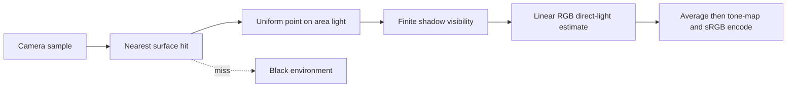

# 35 — A Complete Renderer as an Executable Forward Model

[[Chapter Edition/02 - Graphics Vision and XR/00 - Reading Map|Reading map]] · [[Chapter Edition/02 - Graphics Vision and XR/34 - Learned 3D Shapes and Scene Representations|Previous chapter]] · [[Chapter Edition/02 - Graphics Vision and XR/36 - Source Atlas and Reconstruction Checkpoints|Next chapter]]

A complete renderer makes the forward graphics model executable from camera and geometry through light estimation. The chapter’s value is the end-to-end connection and the evidence it exposes.

**By the end:** Trace a renderer from scene inputs to image output and identify its evidence limits.

**Recall question:** Which components must agree for a rendered image to test the intended forward model?

<!-- Derived from Continuous Notes/University - Worlds, Images and Inference - Graphics, Vision and Photography.md; source lines 78470–80438; source-span SHA256 a92312308b64040223dbede4936d717bedd43ae4edd61aa5a1113d2b83372026. -->

<!-- CHAPTER-SOURCE-BEGIN -->
## A complete renderer makes the forward model executable

This lab is a small, original teaching implementation that joins camera geometry, ray intersections, visibility, Monte Carlo integration, and color output in one runnable Python script. It is an independent example; it is not course project code, a reconstruction of a student project, or a production renderer.

Run it with Python 3 and no installed packages:

```sh
python3 renderer_lab.py
```

The default run writes a 96 by 64 P6 PPM image to `renderer-lab.ppm`. FFmpeg can convert it to PNG for a quick preview:

```sh
ffmpeg -y -i renderer-lab.ppm renderer-lab.png
```

The image has a black background because the renderer models no environment illumination. It shows two matte spheres above a matte plane, lit by a rectangular emitter. Shadows are computed by testing finite rays from each visible surface point to sampled points on the light. The script deliberately supports one surface interaction: a camera ray hits a surface, then that point receives direct illumination from the area light. It does not bounce light between objects, so it has no indirect fill, color bleeding, glass, or mirror reflections. A black shadow therefore means “no direct ray from this light reached the surface,” not “no light exists in a real room.”

For a larger, less jagged preview, run:

```sh
python3 renderer_lab.py --width 384 --height 256 --spp 8 --light-samples 16 --seed 178 --output renderer-lab-large.ppm
ffmpeg -y -i renderer-lab-large.ppm renderer-lab-large.png
```



#### Camera and geometry

A camera ray starts at the pinhole and passes through a position on the image plane. The script builds an orthonormal camera frame from the camera position, look target, and world-up direction. The image-plane coordinates use aspect ratio and a 48-degree vertical field of view. Each pixel receives four jittered primary rays by default; averaging them is a simple supersampling strategy that softens jagged edges. A fixed random seed makes the run repeatable. Increasing `--spp` gives more camera samples per pixel, while `--light-samples` controls the number of area-light samples at each camera hit:

```sh
python3 renderer_lab.py --width 192 --height 128 --spp 8 --light-samples 32 --seed 178
```

Spheres use the quadratic ray intersection. Since ray directions are normalized, the quadratic coefficient for $t^2$ is one, and the nearer root is normally the visible entry point. If the ray begins inside a sphere, that entry root is negative, so the code tries the farther positive exit root. The plane is the equation $y=0$: a ray parallel to it has no intersection, otherwise its parameter is the vertical distance to the plane divided by the ray’s vertical direction. All accepted hits must have $t$ greater than a small positive threshold and less than the current nearest hit. Here $t$ is a distance in scene units because the ray direction has unit length.

The scene occupies roughly six units across, so `EPS = 0.0001` is a small scale-relative offset. After a surface hit, the shadow-ray origin moves by `EPS` along the surface normal to avoid immediately intersecting the surface it just left. Keep two rays conceptually distinct: the lighting integral uses $\omega_i=(y-x)/\|y-x\|$ and $r=\|y-x\|$ from the true surface point $x$, while visibility starts at the offset point $x_\epsilon=x+\epsilon n$. For that visibility segment, the code recomputes $\omega_s=(y-x_\epsilon)/\|y-x_\epsilon\|$ and its length, so the ray aims exactly at the sampled emitter point. The maximum segment parameter ends just before that point. An object behind the emitter must not shadow it. Too large an epsilon can detach shadows from contact points; too small an epsilon can cause numerical self-intersections. The startup assertions exercise the sphere exit root, nearest-hit ordering, an actual finite shadow segment, offset-to-target segment geometry, and linear-to-sRGB endpoint behavior.

#### Area-light estimate

The rectangular light is described by a center and two half-edge vectors. Its area is four times the area of the half-edge parallelogram. The cross product of those half-edges gives the emitter normal, which points down toward the scene. The sampler chooses two independent uniform values in $[-1,1]$ and maps them across the rectangle. That is uniform **area** sampling with probability density $p_A=1/A$; it is not a solid-angle PDF.

For a Lambertian surface with RGB diffuse reflectance $\rho$, the BRDF is $f_r=\rho/\pi$. If $x$ is a surface point, $y$ a sampled point on the light, $r=\|y-x\|$, $\omega_i=(y-x)/r$, and $V(x,y)$ is one when the segment is visible and zero when blocked, direct outgoing radiance is

$$
L_o(x)=\int_A \frac{\rho}{\pi} L_e(y) V(x,y)
\frac{\cos\theta_x\cos\theta_y}{r^2}\,dA.
$$

The two cosines are clamped to zero when either surface faces away from the other. Replacing the integral with $n$ uniform area samples gives the estimator

$$
\widehat L_o(x)=\frac{\rho}{\pi}L_e\frac{A}{n}
\sum_{j=1}^{n} V_j\frac{\cos\theta_{x,j}\cos\theta_{y,j}}{r_j^2}.
$$

The implementation accumulates each RGB channel separately. The $A/n$ factor converts the sample average back to an area integral; omitting it or treating $1/A$ as a solid-angle density would give the wrong scale. The inverse-square factor and both cosines arise from converting an emitting area element into the irradiance arriving at the receiving surface. Larger lights subtend a wider angle and usually create softer shadow boundaries, which these samples resolve as some points on the emitter are visible while others are occluded.

#### Color and display

The material reflectances are dimensionless RGB values between zero and one. Light radiance is stored as linear RGB values in common relative units; values are chosen for this demonstration and are not calibrated physical measurements. If the channels were calibrated radiometric bands, multiplying by dimensionless reflectance and the geometric integral would preserve radiance units. In either case, the code must do lighting and averaging in linear light: encoded display values are not proportional to energy.

After all camera samples for a pixel have been averaged, a fixed two-times exposure is applied, followed by a Reinhard curve $c'=c/(1+c)$ to map nonnegative, unbounded radiance to display range. The result is encoded with the piecewise sRGB transfer function and rounded to 8-bit channel values. Tone mapping happens after averaging, because clipping or compressing each noisy sample first would bias the average. The output is a binary P6 PPM: an ASCII header followed by three bytes per pixel in row-major RGB order. It is intentionally easy to write and inspect.

This miniature leaves out many real-renderer concerns: indirect illumination, physically calibrated spectral color, texture filtering, acceleration structures, anti-aliasing beyond jitter, variance reduction, [[Monte Carlo rendering estimators and variance|multiple importance sampling]], adaptive sampling, denoising, and robust scale-independent intersection tolerances. It is useful precisely because the direct-light estimator and its geometry fit in one small file. Each assumption is visible, testable, and connected to the image it produces.

### Figure U5 - A direct-light renderer makes the pipeline executable

![[Visual Recall/University Graphics and Vision/renderer-direct-light.png]]

**Read the image.** Each pixel averages jittered camera rays and area-light samples in linear RGB. Finite visibility rays produce soft shadows. The saved preview uses 384 by 256 pixels, eight camera samples, and sixteen light samples; the script defaults to a smaller fast example. The black environment and direct-light-only model are stated restrictions of this exercise.

Save this complete block as `renderer_lab.py`. The default output is `renderer-lab.ppm` in the current directory.

```python
#!/usr/bin/env python3
"""A deterministic, direct-lighting teaching renderer. Standard library only."""
import argparse
import math
import random
PI = math.pi
EPS = 1.0e-4  # Scene units; scene spans roughly six units.

def add(a, b): return (a[0] + b[0], a[1] + b[1], a[2] + b[2])
def sub(a, b): return (a[0] - b[0], a[1] - b[1], a[2] - b[2])
def mul(a, s): return (a[0] * s, a[1] * s, a[2] * s)
def dot(a, b): return a[0] * b[0] + a[1] * b[1] + a[2] * b[2]
def cross(a, b):
    return (a[1]*b[2] - a[2]*b[1], a[2]*b[0] - a[0]*b[2], a[0]*b[1] - a[1]*b[0])
def length(a): return math.sqrt(dot(a, a))
def unit(a):
    n = length(a)
    if n == 0.0: raise ValueError("cannot normalize a zero vector")
    return mul(a, 1.0 / n)

# Sphere tuple: (center, radius, diffuse RGB reflectance). Plane is y=0.
SPHERES = [
    ((-0.68, 0.72, 0.05), 0.72, (0.78, 0.20, 0.10)),
    ((0.62, 0.48, -0.36), 0.48, (0.12, 0.38, 0.82)),
]
FLOOR_ALBEDO = (0.62, 0.64, 0.67)
LIGHT_CENTER = (0.0, 3.25, -0.10)
LIGHT_HALF_U = (1.25, 0.0, 0.0)
LIGHT_HALF_V = (0.0, 0.0, 0.90)
LIGHT_NORMAL = unit(cross(LIGHT_HALF_U, LIGHT_HALF_V))  # Faces down.
LIGHT_AREA = 4.0 * length(LIGHT_HALF_U) * length(LIGHT_HALF_V)
LIGHT_RADIANCE = (5.5, 4.8, 4.0)  # Linear RGB radiance, relative units.

def sphere_hit(origin, direction, sphere, t_max=float("inf")):
    center, radius, _ = sphere
    oc = sub(origin, center)
    half_b = dot(oc, direction)  # Direction is normalized, so a=1.
    c = dot(oc, oc) - radius * radius
    disc = half_b * half_b - c
    if disc < 0.0: return None
    root = math.sqrt(disc)
    # Test the entry root, then the exit root: rays may start inside a sphere.
    for t in (-half_b - root, -half_b + root):
        if EPS < t < t_max:
            point = add(origin, mul(direction, t))
            return (t, point, unit(sub(point, center)), sphere[2])
    return None

def plane_hit(origin, direction, t_max=float("inf")):
    if abs(direction[1]) < 1.0e-10: return None  # Parallel to y=0.
    t = -origin[1] / direction[1]
    if EPS < t < t_max:
        point = add(origin, mul(direction, t))
        return (t, point, (0.0, 1.0, 0.0), FLOOR_ALBEDO)
    return None

def scene_hit(origin, direction, t_max=float("inf")):
    nearest = None
    for sphere in SPHERES:
        hit = sphere_hit(origin, direction, sphere, t_max)
        if hit and (nearest is None or hit[0] < nearest[0]): nearest = hit
    hit = plane_hit(origin, direction, t_max)
    if hit and (nearest is None or hit[0] < nearest[0]): nearest = hit
    return nearest

def occluded(origin, direction, distance):
    # A finite segment ends just before the sampled emitter point.
    return scene_hit(origin, direction, max(EPS, distance - 2.0 * EPS)) is not None

def sample_area_light(rng):
    # Uniform area PDF = 1/A: independent uniform coordinates on the rectangle.
    a, b = rng.uniform(-1.0, 1.0), rng.uniform(-1.0, 1.0)
    return add(LIGHT_CENTER, add(mul(LIGHT_HALF_U, a), mul(LIGHT_HALF_V, b)))

def direct_radiance(point, normal, albedo, rng, light_samples):
    total = [0.0, 0.0, 0.0]
    shadow_origin = add(point, mul(normal, EPS))
    for _ in range(light_samples):
        light_point = sample_area_light(rng)
        delta = sub(light_point, point)
        distance2 = dot(delta, delta)
        distance = math.sqrt(distance2)
        wi = mul(delta, 1.0 / distance)
        cos_surface = max(0.0, dot(normal, wi))
        cos_emitter = max(0.0, dot(LIGHT_NORMAL, mul(wi, -1.0)))
        if cos_surface == 0.0 or cos_emitter == 0.0: continue
        shadow_delta = sub(light_point, shadow_origin)
        shadow_distance = length(shadow_delta)
        shadow_direction = mul(shadow_delta, 1.0 / shadow_distance)
        if occluded(shadow_origin, shadow_direction, shadow_distance): continue
        # Uniform-area Monte Carlo estimate of the Lambertian area integral.
        weight = (LIGHT_AREA * cos_surface * cos_emitter / distance2
                  / (PI * light_samples))
        for k in range(3): total[k] += albedo[k] * LIGHT_RADIANCE[k] * weight
    return tuple(total)

def camera_ray(x, y, width, height):
    origin = (0.0, 1.35, 4.55)
    forward = unit(sub((0.0, 0.72, 0.0), origin))
    right = unit(cross(forward, (0.0, 1.0, 0.0)))
    up = unit(cross(right, forward))
    aspect = width / height
    scale = math.tan(math.radians(48.0) / 2.0)
    sx = (2.0 * x / width - 1.0) * aspect * scale
    sy = (1.0 - 2.0 * y / height) * scale
    return origin, unit(add(forward, add(mul(right, sx), mul(up, sy))))

def linear_to_srgb(v):
    v = max(0.0, v)
    return 12.92 * v if v <= 0.0031308 else 1.055 * (v ** (1.0 / 2.4)) - 0.055

def render(width, height, spp, light_samples, seed):
    rng = random.Random(seed)
    pixels = bytearray()
    for y in range(height):
        for x in range(width):
            average = [0.0, 0.0, 0.0]
            for _ in range(spp):
                # Jittered primary rays supersample each pixel.
                origin, direction = camera_ray(x + rng.random(), y + rng.random(), width, height)
                hit = scene_hit(origin, direction)
                radiance = direct_radiance(hit[1], hit[2], hit[3], rng, light_samples) if hit else (0, 0, 0)
                for k in range(3): average[k] += radiance[k] / spp
            # Average in linear light, apply 2x Reinhard exposure, then encode sRGB.
            for value in average:
                exposed = 2.0 * value
                mapped = exposed / (1.0 + exposed)
                encoded = linear_to_srgb(mapped)
                if not math.isfinite(encoded): raise ArithmeticError("non-finite pixel")
                pixels.append(max(0, min(255, int(encoded * 255.0 + 0.5))))
    return bytes(pixels)

def checks():
    inside = sphere_hit((0, 0, 0), (1, 0, 0), ((0, 0, 0), 1, (1, 1, 1)))
    assert inside is not None and abs(inside[0] - 1.0) < 1e-9  # Exit root.
    ray = unit((0, -0.2, -1))
    front = sphere_hit((0, 1, 3), ray, ((0, 0.7, 0), 0.5, (1, 1, 1)))
    floor = plane_hit((0, 1, 3), ray)
    assert front is not None and floor is not None and front[0] < floor[0]  # Nearest hit.
    blocker = ((0, 0, 0), 0.4, (1, 1, 1))
    SPHERES.append(blocker)
    assert not occluded((0, 0, 2), (0, 0, -1), 1.0)  # Blocker beyond segment.
    assert occluded((0, 0, 2), (0, 0, -1), 3.0)  # Same ray reaches blocker.
    SPHERES.pop()
    start, end = (0.1, 0.0, 2.0), (0.0, 0.0, 0.0)
    delta = sub(end, start); distance = length(delta); direction = unit(delta)
    assert length(sub(add(start, mul(direction, distance)), end)) < 1e-12
    assert linear_to_srgb(0.0) == 0.0 and abs(linear_to_srgb(1.0) - 1.0) < 1e-12

def positive_int(value):
    result = int(value)
    if result < 1: raise argparse.ArgumentTypeError("must be a positive integer")
    return result

def main():
    checks()
    parser = argparse.ArgumentParser(description=__doc__)
    parser.add_argument("--width", type=positive_int, default=96)
    parser.add_argument("--height", type=positive_int, default=64)
    parser.add_argument("--spp", type=positive_int, default=4, help="camera supersamples per pixel")
    parser.add_argument("--light-samples", type=positive_int, default=16)
    parser.add_argument("--seed", type=int, default=178)
    parser.add_argument("--output", default="renderer-lab.ppm")
    args = parser.parse_args()
    payload = render(args.width, args.height, args.spp, args.light_samples, args.seed)
    assert len(payload) == args.width * args.height * 3
    with open(args.output, "wb") as image:
        image.write(f"P6\n{args.width} {args.height}\n255\n".encode("ascii"))
        image.write(payload)
    print(f"wrote {args.output} ({args.width}x{args.height}, {args.spp} camera spp, {args.light_samples} light spp)")

if __name__ == "__main__": main()
```


---

# XR systems closure — from a rendered eye image to a stable spatial computer

The earlier XR material establishes optics, perception, sampling, stereo geometry and foveation. The remaining system-level lesson is that XR is not a stereo renderer with a headset attached. It is a continuously estimated, predicted, calibrated, composited and human-observed closed loop. Every stage carries uncertainty, age, coordinate-frame meaning and a deadline.

## XR is a spectrum of scene ownership

Virtual reality, augmented reality and mixed reality differ mainly in how much of the final view comes from reconstructed physical reality, how much comes from synthetic content, and who owns composition.

In fully synthetic VR the application may render nearly every visible surface, but the runtime still owns tracking interfaces, lens correction, composition and presentation timing. In optical see-through AR, real light reaches the eye directly, so virtual content must be aligned to a world the display cannot overwrite. In video see-through MR, cameras capture the physical world and a compositor combines that view with synthetic imagery. This gives stronger control over occlusion, exposure, color and depth-aware effects, but makes camera latency and reconstruction error part of the visible experience.

OpenXR formalizes an application-runtime boundary. The application supplies swapchain images and composition layers; the runtime owns device-facing details such as tracking integration, composition and final presentation. OpenXR 1.1 also promotes important ideas such as local-floor reference spaces and stereo foveated rendering into core functionality. An engine therefore should not encode one headset's pose conventions deep inside gameplay.

## Coordinate spaces are contracts about meaning and lifetime

A pose is not merely a position and quaternion. It is a transform from one named space to another at a specific time.

A useful XR system distinguishes view/head space, local or stage-like world spaces, floor-aligned spaces, action spaces attached to hands/controllers/gaze/tools, persistent anchors, and application world space. If a runtime reports a transform from B to A at time t, composition must preserve that meaning:

\[
{}^AT_C(t) = {}^AT_B(t)\,{}^BT_C(t).
\]

This notation prevents a destructive XR bug: multiplying matrices whose source and destination frames do not match.

Space lifetime matters. A local space can remain useful while global localization is weak. A persistent anchor can relocalize or be refined. A hand joint can disappear when confidence falls. Engine pose records therefore need validity, confidence and timestamp beside the transform rather than silently freezing the last good value.

## The frame loop is organized around predicted display time

Desktop rendering is often summarized as update, render, present. XR requires a more precise timeline because the pose used for rendering should correspond to when photons from the frame reach the eye.

A runtime-oriented frame is conceptually:

1. wait for the runtime to schedule a frame;
2. receive the predicted display time;
3. locate views and action spaces for that future time;
4. simulate or interpolate application state;
5. render each requested view into runtime-provided swapchain images;
6. submit composition layers with their spaces and optional depth;
7. let the compositor perform late correction, lens processing and presentation.

The important quantity is the age of information at display, not CPU frame time alone. If gaze was sampled 12 ms ago, head pose was predicted for a different timestamp and the compositor presents later, visible error depends on the whole chain.

For a scalar or vector state,

\[
\hat{x}(t+\Delta t)=x(t)+\dot{x}(t)\Delta t.
\]

For orientation, prediction belongs on the rotation manifold:

\[
R(t+\Delta t)\approx R(t)\exp([\boldsymbol\omega]_\times\Delta t).
\]

Prediction helps only when its model error is smaller than the error from stale state. Abrupt motion can make aggressive prediction overshoot.

## Reprojection corrects a finished frame; it does not rerender the world

The compositor may warp an already-rendered frame using a newer head pose. Rotational timewarp corrects orientation but cannot reveal correct disoccluded content and does not fix translational parallax. Positional reprojection can use submitted depth to approximate translation. Motion-aware methods can use motion vectors to extrapolate moving content.

Meta's compositor documentation makes this hierarchy explicit: time warp updates head rotation; positional time warp uses depth for translation; App Spacewarp uses motion vectors for moving content.

Therefore:

- orientation-only warp has no scene depth;
- depth-aware warp inherits depth error;
- motion-vector warp inherits velocity error;
- no warp can reconstruct arbitrary newly visible geometry without additional information.

Black borders, stretched disocclusions, doubled edges and motion-vector disagreement are consequences of asking a warp to synthesize information absent from the source frame.

## Optics make the pre-lens image intentionally distorted

The image written to a headset panel is often not a geometrically correct flat-monitor image. The lens warps rays, so the renderer or compositor applies an approximate inverse warp.

A simple radial model is

\[
x_d=x(1+k_1r^2+k_2r^4+k_3r^6), \qquad
y_d=y(1+k_1r^2+k_2r^4+k_3r^6).
\]

Real devices can use asymmetric, per-channel, mesh-based or proprietary calibration. Chromatic aberration exists because wavelengths refract differently, so one geometric warp need not align every color channel.

Runtime-provided view and projection data must therefore be treated as calibration data. Varjo's OpenXR documentation illustrates this concretely: a headset may expose quad views, eye tracking, foveation, MR, depth submission and multiple composition layers through a combination of core and extensions.

## Display timing is more than FPS

A headset display has refresh period, persistence, scanout behavior, brightness/contrast, pixel structure and optical MTF. If refresh rate is \(f_r\),

\[
T_r=\frac{1}{f_r}.
\]

At 90 Hz, one nominal refresh is about 11.11 ms, but motion-to-photon latency depends on tracking, queueing, rendering, compositor work and scanout. Reporting only 90 FPS hides the distribution that matters to head-coupled perception.

## Tracking is state estimation under calibration and observability limits

An IMU provides high-rate angular velocity and specific force. Cameras provide visual constraints at lower rate. Integrating IMU bias causes drift; vision can fail under blur, low texture, repeated texture, extreme exposure or occlusion.

A visual-inertial state may contain

\[
\mathbf{x}=(R,\mathbf{p},\mathbf{v},\mathbf{b}_g,\mathbf{b}_a),
\]

representing orientation, position, velocity and sensor biases. VIO propagates with inertial data and corrects with visual evidence. SLAM additionally maintains a map, loop closure and relocalization so old places can constrain drift.

<!-- Bible-final-pass: XR planar VIO EKF -->
### Make the visual correction small enough to inspect: an eight-state planar EKF

The previous state list names orientation, position, velocity and sensor biases, but does not yet show how a camera observation changes them. Begin with a deliberately constrained model whose entire covariance update can be checked: a horizontal world plane, yaw-only rotation, gravity already removed from horizontal acceleration, and bearings to surveyed landmarks. This is an EKF witness for that model; it is not full 3-D VIO or SLAM.

For this experiment, the camera coordinate frame $C$ is known to coincide with the planar body frame $B$: the optical center is at the body origin, camera forward is body $+x$, and the in-plane camera rotation is zero. Thus the fixed camera-to-body extrinsic $T_{BC}$, which maps camera coordinates into body coordinates, is $I$, with zero lever arm and aligned axes. This is a stated identity-extrinsic assumption, not an estimated calibration result. The bearing equation below is valid because the camera and body origins and orientations coincide.

Use the state

$$
\mathbf{x}=(p_x,p_y,v_x,v_y,\psi,b_g,b_{ax},b_{ay})^T,
$$

where positions are metres, velocities are metres per second, yaw $\psi$ and gyro bias $b_g$ are radians and radians per second, and accelerometer biases are metres per second squared. Position and velocity are world-horizontal; accelerometer samples are body-horizontal. The rotation $R(\psi)$ maps body vectors into world axes. Gyroscope measurement is $\omega_m=\dot\psi+b_g+n_g$; specific-force measurement is $\mathbf{a}_m=R^T\mathbf{a}_w+\mathbf{b}_a+\mathbf{n}_a$. Here the simulation's horizontal channel has gravity removed by construction.

For a zero-order hold over interval $\Delta t$, subtract the estimated biases, rotate acceleration with the interval-start yaw, then integrate constant acceleration:

$$
\begin{aligned}
\mathbf{a}_w &= R(\psi_k)(\mathbf{a}_{m,k}-\mathbf{b}_{a,k}),\\
\mathbf{p}_{k+1} &= \mathbf{p}_k+\mathbf{v}_k\Delta t+\tfrac12\mathbf{a}_w\Delta t^2,\\
\mathbf{v}_{k+1} &= \mathbf{v}_k+\mathbf{a}_w\Delta t,\\
\psi_{k+1} &= \operatorname{wrap}(\psi_k+(\omega_{m,k}-b_{g,k})\Delta t).
\end{aligned}
$$

The transition Jacobian $F=\partial f/\partial\mathbf{x}$ propagates uncertainty as $P_{k+1}=FP_kF^T+Q$. Sensor noise enters through a first-order map $G$; bias random walks add their variance per sample. A surveyed landmark $\mathbf{L}$ gives camera bearing

$$
h(\mathbf{x})=\operatorname{wrap}\!\left(\operatorname{atan2}(L_y-p_y,L_x-p_x)-\psi\right).
$$

For $d_x=L_x-p_x$, $d_y=L_y-p_y$, and $r^2=d_x^2+d_y^2$, its nonzero Jacobian entries are $H_{p_x}=d_y/r^2$, $H_{p_y}=-d_x/r^2$, and $H_\psi=-1$. As a hand check, at $\mathbf{p}=(0,0)$ looking at $\mathbf{L}=(6,4)$, they are $(0.1,-0.15,-1)$ in radians per metre and radians per radian.

The wrapped innovation $\nu=\operatorname{wrap}(z-h(\mathbf{x}))$ avoids treating bearings just across $-\pi/\pi$ as almost a full revolution apart. With $S=HPH^T+R_z$, reject a gross mismatch when $\nu^2/S$ exceeds the one-degree-of-freedom 99% chi-square threshold $6.635$. Otherwise use $K=PH^T/S$, correct the state by $K\nu$, wrap yaw, and update covariance in Joseph form: $P^+=(I-KH)P(I-KH)^T+KR_zK^T$. Joseph form better preserves symmetry and positive semidefiniteness under finite precision.

The complete source below fixes the clock at 50 Hz, uses three surveyed landmarks, injects one deliberately wrong correspondence, finite-differences every column of both analytic Jacobians, and checks covariance eigenvalues through a deterministic replay. Its 0.25 m final-position bound belongs only to this generated 4.8-second planar trajectory. It does not estimate camera intrinsics/extrinsics, time offset, roll/pitch, gravity direction, map structure, delayed observations, or human-head motion.


~~~python
#!/usr/bin/env python3
"""Deterministic planar visual-inertial EKF, not full 3-D VIO or OpenXR.

State is (px, py, vx, vy, yaw, bg, bax, bay): metres, metres/second,
radians, radians/second, and metres/second squared. Position/velocity are in a
gravity-free horizontal world frame; yaw is body-to-world; measured planar
acceleration is body-frame specific force after gravity has been removed.
Gyroscope and accelerometer biases are constant in the synthetic truth, while
the filter models small bias random walks. The camera observes bearings to
three surveyed world-frame landmarks. Its camera frame C is known to coincide
with planar body frame B: the camera optical center is at the body origin, its
forward axis is aligned with body +x, and its in-plane rotation is zero, so
the fixed extrinsic transform T_BC (camera coordinates into body coordinates)
is identity. This removes lever-arm and camera-to-body alignment effects by
assumption, not by estimation. Requires NumPy.
"""
import math
import numpy as np

DT = 0.02
LANDMARKS = (np.array([6.0, 4.0]), np.array([-3.0, 5.0]), np.array([4.0, -6.0]))
N = 240
PX, PY, VX, VY, YAW, BG, BAX, BAY = range(8)
BIAS = np.array([0.025, 0.040, -0.020])
STD_ACC, STD_GYR = 0.025, 0.007
STD_BIAS_G, STD_BIAS_A = 0.0005, 0.001
STD_CAMERA = 0.012
CHI2_99_1DOF = 6.635

def wrap(angle: float) -> float:
    """Normalize bearings and corrections to shortest signed angular distance."""
    return (angle + math.pi) % (2.0 * math.pi) - math.pi

def rotation(theta: float) -> np.ndarray:
    c, s = math.cos(theta), math.sin(theta)
    return np.array([[c, -s], [s, c]], dtype=float)

def propagation(x: np.ndarray, gyro: float, a_sensor: np.ndarray) -> np.ndarray:
    """Propagate one dt interval using constant measured angular rate/specific force.

    ``gyro`` is rad/s and ``a_sensor`` is m/s^2. This zero-order-hold model
    treats the body acceleration as fixed during dt and rotates it using the
    interval-start yaw. It is a planar teaching model, not coning/sculling
    compensation or a continuous-time IMU integrator.
    """
    y = x.copy()
    R = rotation(x[YAW])  # Maps body-frame horizontal vectors into world axes.
    a_world = R @ (a_sensor - x[[BAX, BAY]])
    # Constant-acceleration kinematics integrate position and velocity over dt.
    y[[PX, PY]] += DT * x[[VX, VY]] + 0.5 * DT**2 * a_world
    y[[VX, VY]] += DT * a_world
    y[YAW] = wrap(x[YAW] + DT * (gyro - x[BG]))
    return y

def propagation_jacobian(x: np.ndarray, a_sensor: np.ndarray) -> np.ndarray:
    """Return F=df/dx for the same discrete transition used by propagation.

    Rows and columns follow the eight-state ordering above. Differentiating the
    exact discrete update keeps covariance propagation aligned with the state
    transition instead of mixing a continuous-time Jacobian with a discrete
    state step.
    """
    F = np.eye(8)
    R = rotation(x[YAW])
    J = np.array([[0.0, -1.0], [1.0, 0.0]])
    dacc_dtheta = R @ J @ (a_sensor - x[[BAX, BAY]])
    F[PX:PY+1, VX:VY+1] = DT * np.eye(2)
    F[PX:PY+1, YAW] = 0.5 * DT**2 * dacc_dtheta
    F[VX:VY+1, YAW] = DT * dacc_dtheta
    F[PX:PY+1, BAX:BAY+1] = -0.5 * DT**2 * R
    F[VX:VY+1, BAX:BAY+1] = -DT * R
    F[YAW, BG] = -DT
    return F

def process_covariance(x: np.ndarray) -> np.ndarray:
    """Map per-sample sensor noise into state units and add bias random walks.

    G is the first-order map from two horizontal acceleration noises (m/s^2)
    and one yaw-rate noise (rad/s) to state increments over DT. The bias terms
    are continuous random-walk spectral densities multiplied by DT; they are
    deliberately simple and do not model cross-axis sensor correlations.
    """
    G = np.zeros((8, 3))
    R = rotation(x[YAW])
    G[PX:PY+1, :2] = 0.5 * DT**2 * R
    G[VX:VY+1, :2] = DT * R
    G[YAW, 2] = DT
    sample_variance = np.diag([STD_ACC**2, STD_ACC**2, STD_GYR**2])
    Q = G @ sample_variance @ G.T
    Q[BG, BG] += STD_BIAS_G**2 * DT
    Q[BAX, BAX] += STD_BIAS_A**2 * DT
    Q[BAY, BAY] += STD_BIAS_A**2 * DT
    return Q

def camera_bearing(x: np.ndarray, landmark=LANDMARKS[0]) -> float:
    """Predict camera-relative azimuth (radians) with fixed identity extrinsics.

    The camera origin equals the planar body origin and camera +x equals body
    +x, so this model needs no lever-arm rotation or boresight offset.
    """
    dx, dy = landmark - x[[PX, PY]]
    if dx*dx + dy*dy < 1e-8:
        raise ValueError("undefined landmark bearing at zero range")
    return wrap(math.atan2(dy, dx) - x[YAW])

def camera_jacobian(x: np.ndarray, landmark=LANDMARKS[0]) -> np.ndarray:
    """Return the 1x8 derivative of wrapped bearing with respect to the state.

    Away from the wrap discontinuity the derivative is ordinary atan2 calculus;
    wrapping only chooses the shortest angular residual, not a different local
    Jacobian. The singular zero-range geometry is rejected explicitly.
    """
    dx, dy = landmark - x[[PX, PY]]
    r2 = dx*dx + dy*dy
    if r2 < 1e-8:
        raise ValueError("undefined bearing Jacobian at zero range")
    H = np.zeros((1, 8))
    H[0, PX], H[0, PY], H[0, YAW] = dy/r2, -dx/r2, -1.0
    return H

def camera_update(x: np.ndarray, P: np.ndarray, z: float, landmark=LANDMARKS[0]):
    """Correct state from one bearing, gating at 99% chi-square (1 degree of freedom).

    The normalized innovation squared is innovation^2 / innovation variance.
    Joseph form, (I-KH)P(I-KH)^T + KRK^T, better preserves symmetry and
    positive semidefiniteness in finite precision than the abbreviated update.
    The returned Boolean means accepted by this synthetic statistical gate;
    it is not proof that feature association is correct.
    """
    H = camera_jacobian(x, landmark)
    innovation = wrap(z - camera_bearing(x, landmark))
    variance = STD_CAMERA**2
    S = float((H @ P @ H.T)[0, 0] + variance)
    if innovation**2 / S > CHI2_99_1DOF:
        return x, P, False
    K = (P @ H.T)[:, 0] / S
    corrected = x + K * innovation
    corrected[YAW] = wrap(corrected[YAW])
    A = np.eye(8) - np.outer(K, H[0])
    next_cov = A @ P @ A.T + variance * np.outer(K, K)
    next_cov = 0.5 * (next_cov + next_cov.T)
    return corrected, next_cov, True

def require(condition: bool, message: str) -> None:
    """Keep validation active under python -O, which removes assert statements."""
    if not condition:
        raise AssertionError(message)

def check_jacobians_and_rejection():
    """Compare both Jacobians with wrapped central differences and test outlier rejection."""
    x = np.array([0.2, -0.1, 0.8, 0.1, 0.3, 0.02, -0.01, 0.03])
    a = np.array([0.4, -0.2])
    F, H = propagation_jacobian(x, a), camera_jacobian(x)
    eps = 1e-6
    for j in range(8):
        d = np.zeros(8)
        d[j] = eps
        plus = propagation(x + d, 0.12, a)
        minus = propagation(x - d, 0.12, a)
        derivative = (plus - minus) / (2 * eps)
        derivative[YAW] = wrap(plus[YAW] - minus[YAW]) / (2 * eps)
        np.testing.assert_allclose(F[:, j], derivative, atol=2e-8, rtol=1e-7)
        difference = wrap(camera_bearing(x + d) - camera_bearing(x - d))
        np.testing.assert_allclose(H[0, j], difference/(2*eps), atol=2e-8)
    P = np.diag([.02, .02, .02, .02, .02, .001, .001, .001])
    xx, PP, accepted = camera_update(x, P, camera_bearing(x) + 2.5)
    require(not accepted and np.array_equal(xx, x) and np.array_equal(PP, P),
            "a rejected outlier must leave state and covariance unchanged")

def simulate():
    """Replay a deterministic 4.8-second planar trajectory with noisy sensors.

    Camera bearings arrive every sixth 50-Hz propagation step. One injected
    2.5-radian correspondence error must be rejected while ordinary updates
    keep the final position error below the declared 0.25-m teaching bound.
    """
    rng = np.random.default_rng(20261112)
    truth = np.array([0., 0., 1., 0.1, 0.1, *BIAS])
    est = np.array([0.08, -0.08, 0.85, 0.05, -0.03, 0., 0., 0.])
    P = np.diag([.12, .12, .08, .08, .08, .004, .012, .012])
    accepted = rejected = 0
    for step in range(N):
        t = step * DT
        angular_rate = 0.14 + 0.02 * math.sin(0.7*t)
        true_body_acc = np.array([0.06 + 0.02*math.sin(t), .015*math.cos(t)])
        # Advance truth using exact synthetic bias; sensor noise only affects estimates.
        truth = propagation(truth, angular_rate + BIAS[0], true_body_acc + BIAS[1:])
        measured_gyro = angular_rate + BIAS[0] + rng.normal(0, STD_GYR)
        measured_acc = true_body_acc + BIAS[1:] + rng.normal(0, STD_ACC, 2)
        F = propagation_jacobian(est, measured_acc)
        Q = process_covariance(est)
        est = propagation(est, measured_gyro, measured_acc)
        P = F @ P @ F.T + Q
        if step % 6 == 0:
            for index, landmark in enumerate(LANDMARKS):
                z = camera_bearing(truth, landmark) + rng.normal(0, STD_CAMERA)
                if step == 60 and index == 0:
                    z += 2.5  # deliberately wrong feature correspondence
                est, P, ok = camera_update(est, P, z, landmark)
                accepted += int(ok)
                rejected += int(not ok)
        require(np.min(np.linalg.eigvalsh(P)) > -1e-10,
                "Joseph covariance update lost positive semidefiniteness")
    position_error = float(np.linalg.norm(est[[PX, PY]] - truth[[PX, PY]]))
    yaw_error = abs(wrap(est[YAW] - truth[YAW]))
    print(f"camera updates accepted={accepted}, rejected={rejected}")
    print(f"final planar position error={position_error:.4f} m")
    print(f"final yaw error={yaw_error:.4f} rad")
    require(rejected >= 1 and accepted > 100 and position_error < 0.25,
            "deterministic replay missed its update-count or position-error bounds")

if __name__ == "__main__":
    check_jacobians_and_rejection()
    simulate()
    print("PASS: Jacobians, outlier gate, PSD covariance and deterministic replay")
~~~

OpenVINS is a useful filter-based VIO reference. ORB-SLAM3 demonstrates visual, visual-inertial and multi-map SLAM with relocalization and map reuse. These are not interchangeable tracking libraries; their state models, assumptions and failure modes differ.

<!-- Bible-final-pass: XR 3D VIO spine -->
#### From raw 3-D IMU samples to the pose constraint used by VIO

The planar EKF above is useful because every state variable and Jacobian can be inspected. A real headset, however, rotates around all three axes and accelerates in three dimensions. We therefore need the next bridge: not a second list of VIO vocabulary, but the exact path from high-rate IMU samples to a constraint that a filter or sliding-window optimizer can use.

Keep the frame convention from the previous section. Let $R_i$ map body coordinates into world coordinates at keyframe $i$, with position $\mathbf p_i$ in metres, velocity $\mathbf v_i$ in metres per second, and gravity $\mathbf g$ in metres per second squared. The IMU reports

$$
\boldsymbol\omega_m=\boldsymbol\omega+\mathbf b_g+\mathbf n_g,
\qquad
\mathbf f_m=R^T(\mathbf a_{world}-\mathbf g)+\mathbf b_a+\mathbf n_a.
$$

The accelerometer measures specific force, not world acceleration. That one sentence explains a common debugging surprise: a level, stationary accelerometer can report roughly +9.81 m/s^2 along its upward body axis. After rotating that specific force into the world and adding world gravity, the net translational acceleration is zero.

If every IMU sample were integrated from the beginning of the trajectory each time an optimizer changed an old pose, optimization would be wasteful. **Preintegration** compresses all IMU samples between two keyframes into a relative motion summary.

For samples between $i$ and $j$, define a relative rotation $\Delta R_{ij}\in SO(3)$ and gravity-free increments $\Delta\mathbf v_{ij}$ (metres per second) and $\Delta\mathbf p_{ij}$ (metres), both expressed in frame $i$:

Under a zero-order-hold discretization with one sample interval dt,

$$
\begin{aligned}
\Delta R &\leftarrow \Delta R\,\operatorname{Exp}((\boldsymbol\omega_m-\mathbf b_g)\Delta t),\\
\mathbf a_i &\leftarrow \Delta R_{\mathrm{before}}(\mathbf f_m-\mathbf b_a),\\
\Delta\mathbf p &\leftarrow \Delta\mathbf p+\Delta\mathbf v\Delta t+\tfrac12\mathbf a_i\Delta t^2,\\
\Delta\mathbf v &\leftarrow \Delta\mathbf v+\mathbf a_i\Delta t.
\end{aligned}
$$

The order matters. The force sample for that interval is rotated by the relative orientation at the start of the interval in this simple discretization.

After the whole interval has been compressed, the later navigation state is predicted by

$$
\begin{aligned}
R_j &= R_i\Delta R_{ij},\\
\mathbf v_j &= \mathbf v_i+\mathbf g\Delta t+R_i\Delta\mathbf v_{ij},\\
\mathbf p_j &= \mathbf p_i+\mathbf v_i\Delta t+\tfrac12\mathbf g\Delta t^2+R_i\Delta\mathbf p_{ij}.
\end{aligned}
$$

Notice where gravity appears: not inside the stored preintegrated delta above, but when the delta is connected to the world state. This separation is what lets one relative IMU constraint be reused while the optimizer changes R_i, p_i, and v_i.

Two consecutive preintegrated intervals also compose without replaying the raw samples. If a is i->j and b is j->k,

$$
\begin{aligned}
\Delta R_{ik}&=\Delta R_{ij}\Delta R_{jk},\\
\Delta\mathbf v_{ik}&=\Delta\mathbf v_{ij}+\Delta R_{ij}\Delta\mathbf v_{jk},\\
\Delta\mathbf p_{ik}&=\Delta\mathbf p_{ij}+\Delta\mathbf v_{ij}\Delta t_{jk}+\Delta R_{ij}\Delta\mathbf p_{jk}.
\end{aligned}
$$

This is not merely an optimization trick. It is a testable algebraic contract. Integrating 200 samples in one pass should agree with integrating the first 100, integrating the second 100 in the intermediate frame, and composing the two deltas.

##### Bias changes the relative motion, so production preintegration carries bias sensitivity

The compact recurrence above assumes a particular gyro bias b_g and accelerometer bias b_a. If the optimizer later changes those bias estimates, the preintegrated delta is no longer exactly correct.

A production preintegrator therefore carries first-order Jacobians such as

$$
\frac{\partial\Delta R}{\partial\mathbf b_g},\quad
\frac{\partial\Delta\mathbf v}{\partial\mathbf b_g},\quad
\frac{\partial\Delta\mathbf v}{\partial\mathbf b_a},\quad
\frac{\partial\Delta\mathbf p}{\partial\mathbf b_g},\quad
\frac{\partial\Delta\mathbf p}{\partial\mathbf b_a}.
$$

and a covariance for the preintegrated measurement. Small bias changes can then correct the delta without replaying every IMU sample. Large changes may require reintegration. The exact Jacobian recurrence depends on the left/right perturbation convention and SO(3) Jacobians; copying formulas from a paper while using the opposite rotation convention is a reliable way to build a filter that looks plausible but is inconsistent.

The executable witness below intentionally stops one level before that production complexity. It verifies the 3-D geometry first: SO(3) exp/log, a stationary gravity-cancellation case, constant yaw integration, interval composition, and visible drift when a known gyro bias is ignored.


~~~python
#!/usr/bin/env python3
"""Deterministic 3-D IMU preintegration witness.

Scope:
- SO(3) exponential/logarithm
- zero-order-hold IMU preintegration over many high-rate samples
- composition of preintegrated intervals
- reconstruction of the later navigation state with gravity
- explicit gyro/accelerometer bias handling

This is not a complete VIO/SLAM estimator: it does not include visual residuals,
bias Jacobians, covariance propagation, marginalization, loop closure, or
camera/IMU calibration estimation.

Conventions: R_i maps body-i vectors into world coordinates; gyro samples are
rad/s, accelerometer samples are specific force in m/s^2, dt is seconds,
position is metres, and velocity is m/s. Gravity is a world-frame vector. Each
sample is held constant over its interval; force is rotated using the relative
orientation at the interval start. These choices define this discrete witness
and should not be silently substituted for midpoint or higher-order schemes.
"""
from __future__ import annotations
from dataclasses import dataclass
import math
import numpy as np

EPS = 1e-10
GRAVITY = np.array([0.0, 0.0, -9.81])


def hat(v: np.ndarray) -> np.ndarray:
    """Skew matrix [v]_x such that [v]_x w equals the 3-D cross product v x w."""
    x, y, z = v
    return np.array([[0.0, -z, y], [z, 0.0, -x], [-y, x, 0.0]])


def so3_exp(phi: np.ndarray) -> np.ndarray:
    """Map a rotation vector (axis times angle, radians) onto SO(3).

    The series branch avoids division by tiny angles; the general branch is
    Rodrigues' formula. The returned matrix actively rotates body coordinates
    into the next frame under the multiplication convention used below.
    """
    theta = float(np.linalg.norm(phi))
    W = hat(phi)
    if theta < 1e-8:
        return np.eye(3) + W + 0.5 * (W @ W)
    a = math.sin(theta) / theta
    b = (1.0 - math.cos(theta)) / (theta * theta)
    return np.eye(3) + a * W + b * (W @ W)


def so3_log(R: np.ndarray) -> np.ndarray:
    """Return the principal rotation vector; this compact lab excludes near pi."""
    cos_theta = float(np.clip((np.trace(R) - 1.0) * 0.5, -1.0, 1.0))
    theta = math.acos(cos_theta)
    if theta < 1e-8:
        return 0.5 * np.array([
            R[2, 1] - R[1, 2],
            R[0, 2] - R[2, 0],
            R[1, 0] - R[0, 1],
        ])
    if abs(math.pi - theta) < 1e-5:
        raise ValueError("compact logarithm intentionally excludes the near-pi branch")
    return theta / (2.0 * math.sin(theta)) * np.array([
        R[2, 1] - R[1, 2],
        R[0, 2] - R[2, 0],
        R[1, 0] - R[0, 1],
    ])


@dataclass
class Delta:
    """Relative motion in the starting body frame plus elapsed seconds."""
    dR: np.ndarray
    dv: np.ndarray
    dp: np.ndarray
    dt: float


def preintegrate(
    gyros: np.ndarray,
    accels: np.ndarray,
    dt: float,
    gyro_bias: np.ndarray,
    accel_bias: np.ndarray,
) -> Delta:
    """Compress equally spaced samples into gravity-free relative motion.

    ``dR`` is dimensionless, ``dv`` has m/s, ``dp`` has m, and ``dt`` has s.
    No gravity is inserted here: this keeps the relative measurement reusable
    when the optimizer changes the starting world pose or gravity estimate.
    """
    if gyros.shape != accels.shape or gyros.ndim != 2 or gyros.shape[1] != 3:
        raise ValueError("gyros and accels must both have shape (N,3)")
    if dt <= 0.0 or not np.isfinite(dt):
        raise ValueError("dt must be finite and positive")

    dR = np.eye(3)
    dv = np.zeros(3)
    dp = np.zeros(3)

    for wm, fm in zip(gyros, accels):
        omega = wm - gyro_bias
        specific_force = fm - accel_bias

        # The force during this interval is expressed through the orientation
        # at the start of the interval: a zero-order-hold discretization.
        a0 = dR @ specific_force
        dp = dp + dv * dt + 0.5 * a0 * dt * dt
        dv = dv + a0 * dt
        dR = dR @ so3_exp(omega * dt)

    return Delta(dR=dR, dv=dv, dp=dp, dt=len(gyros) * dt)


def compose(a: Delta, b: Delta) -> Delta:
    """Compose i->j and j->k deltas, rotating b's increments into frame i."""
    return Delta(
        dR=a.dR @ b.dR,
        dv=a.dv + a.dR @ b.dv,
        dp=a.dp + a.dv * b.dt + a.dR @ b.dp,
        dt=a.dt + b.dt,
    )


def apply_delta(
    R_i: np.ndarray,
    p_i: np.ndarray,
    v_i: np.ndarray,
    delta: Delta,
    gravity: np.ndarray = GRAVITY,
) -> tuple[np.ndarray, np.ndarray, np.ndarray]:
    """Recover state j, adding world gravity only at state reconstruction."""
    R_j = R_i @ delta.dR
    v_j = v_i + gravity * delta.dt + R_i @ delta.dv
    p_j = (
        p_i
        + v_i * delta.dt
        + 0.5 * gravity * delta.dt * delta.dt
        + R_i @ delta.dp
    )
    return R_j, p_j, v_j


def require(condition: bool, message: str) -> None:
    if not condition:
        raise AssertionError(message)


def main() -> None:
    """Run geometry, stationary-gravity, yaw, composition, and bias checks."""
    # 1. Exp/log and orthogonality are checked independently.
    phi = np.array([0.2, -0.1, 0.3])
    R = so3_exp(phi)
    np.testing.assert_allclose(R.T @ R, np.eye(3), atol=1e-12)
    np.testing.assert_allclose(so3_log(R), phi, atol=1e-11)

    # 2. A stationary, level IMU measures +g specific force in body z.
    # Gravity is added only when the preintegrated delta is applied.
    dt = 0.005
    n = 200
    gyros = np.zeros((n, 3))
    accels = np.tile(np.array([0.0, 0.0, 9.81]), (n, 1))
    zero = np.zeros(3)
    stationary = preintegrate(gyros, accels, dt, zero, zero)
    R1, p1, v1 = apply_delta(np.eye(3), zero, zero, stationary)
    np.testing.assert_allclose(R1, np.eye(3), atol=1e-12)
    np.testing.assert_allclose(v1, zero, atol=1e-10)
    np.testing.assert_allclose(p1, zero, atol=1e-10)

    # 3. Constant yaw rate integrates on SO(3), not by adding matrix entries.
    yaw_rate = 0.6
    gyros_yaw = np.tile(np.array([0.0, 0.0, yaw_rate]), (n, 1))
    yaw_delta = preintegrate(gyros_yaw, np.zeros_like(gyros_yaw), dt, zero, zero)
    expected = so3_exp(np.array([0.0, 0.0, yaw_rate * n * dt]))
    np.testing.assert_allclose(yaw_delta.dR, expected, atol=2e-12)

    # 4. Splitting an interval and composing it must agree with one full pass.
    half_a = preintegrate(gyros_yaw[:100], accels[:100], dt, zero, zero)
    half_b = preintegrate(gyros_yaw[100:], accels[100:], dt, zero, zero)
    joined = compose(half_a, half_b)
    full = preintegrate(gyros_yaw, accels, dt, zero, zero)
    np.testing.assert_allclose(joined.dR, full.dR, atol=2e-12)
    np.testing.assert_allclose(joined.dv, full.dv, atol=2e-12)
    np.testing.assert_allclose(joined.dp, full.dp, atol=2e-12)
    require(abs(joined.dt - full.dt) < EPS, "composed time interval must match")

    # 5. Bias is part of the state. Ignoring a known gyro bias creates drift.
    true_bias = np.array([0.0, 0.0, 0.03])
    biased_measurements = np.tile(np.array([0.0, 0.0, 0.2]) + true_bias, (n, 1))
    corrected = preintegrate(biased_measurements, np.zeros_like(biased_measurements), dt, true_bias, zero)
    uncorrected = preintegrate(biased_measurements, np.zeros_like(biased_measurements), dt, zero, zero)
    correct_angle = np.linalg.norm(so3_log(corrected.dR))
    wrong_angle = np.linalg.norm(so3_log(uncorrected.dR))
    require(abs(correct_angle - 0.2) < 1e-10, "bias-corrected yaw must match truth")
    require(wrong_angle - correct_angle > 0.02, "ignored gyro bias must create visible drift")

    print("3D IMU preintegration: 5 suites PASS")


if __name__ == "__main__":
    main()
~~~

##### How the preintegrated delta enters a sliding-window optimizer

A keyframe optimizer keeps several camera/IMU states. Between adjacent states it adds an IMU residual. In simplified form,

$$
\begin{aligned}
\mathbf r_R &= \operatorname{Log}(\Delta R_{ij}^{-1}R_i^TR_j),\\
\mathbf r_v &= R_i^T(\mathbf v_j-\mathbf v_i-\mathbf g\Delta t)-\Delta\mathbf v_{ij},\\
\mathbf r_p &= R_i^T(\mathbf p_j-\mathbf p_i-\mathbf v_i\Delta t-\tfrac12\mathbf g\Delta t^2)-\Delta\mathbf p_{ij}.
\end{aligned}
$$

The rotation residual is a three-vector in a tangent space, not nine elementwise matrix differences. Velocity and position residuals are expressed in the same local frame as the preintegrated quantities. Bias random-walk residuals connect b_g and b_a across the interval.

Stack those residuals with visual reprojection residuals. Then a Gauss-Newton or Levenberg-Marquardt iteration repeatedly:

1. evaluates residuals at the current state;
2. builds Jacobians using the declared perturbation convention;
3. whitens residuals using their covariance or information;
4. applies a robust loss where justified;
5. solves the sparse normal-equation or square-root system;
6. retracts rotation increments back onto SO(3);
7. repeats until a defensible stopping rule is met.

The word **factor graph** is simply a useful representation of this sparse dependency structure. Variable nodes hold unknown poses, velocities, biases, landmarks, calibration values, and possibly other states. Factor nodes hold measurements or priors that depend on a small subset of those variables. The graph does not solve the problem by itself; it exposes which blocks of the Jacobian can be nonzero.

##### Filter VIO and sliding-window VIO remove old information differently

An MSCKF-style filter keeps a state estimate and covariance, augments it with a short history of camera poses, and uses feature tracks without permanently adding every feature as a state. Unknown feature position can be eliminated from the measurement constraint, leaving a residual that updates the navigation state.

A sliding-window optimizer instead keeps a recent set of states and often selected landmarks, then jointly minimizes visual and inertial residuals. When the window grows, old variables are **marginalized**. Marginalization does not mean deleting them and forgetting their information; their local information is folded into a prior on the variables that remain.

That prior is tied to the linearization point used when marginalization happened. Repeatedly treating it as if it were a fresh nonlinear measurement can create inconsistency. This is one reason VIO papers discuss first-estimate Jacobians, observability, square-root marginalization, or other consistency choices.

##### Observability tells us which errors measurements can actually remove

With only inertial data, position and velocity drift because small bias errors integrate over time. Vision constrains relative motion, but not every global degree of freedom is automatically observable.

In a typical monocular visual-inertial system with gravity estimated, global translation and global yaw remain gauge freedoms unless an external reference fixes them. Scale becomes observable through the metric accelerometer only when motion provides enough excitation and the calibration/model is adequate. A stationary or weakly excited initialization can therefore be mathematically ambiguous even with perfectly written code.

This changes how we test the estimator. A singular direction caused by a real gauge freedom should not be “fixed” by secretly adding numerical damping and then presented as newly observed information. Choose a gauge explicitly, add a stated prior, or compare quantities invariant to that gauge.

##### SLAM adds map identity, loop closure, and relocalization

VIO answers: “How did I move recently?” SLAM also asks: “Have I been here before, and can old map evidence reduce accumulated drift?”

A loop-closure pipeline needs a place-recognition candidate, geometric verification, a constraint between distant poses, and an optimization strategy that can distribute the correction without tearing the local map apart. Relocalization is related but asks for the current camera pose in an existing map after tracking was lost.

A false loop is usually more damaging than a missed loop because it adds a strong incorrect global constraint. Descriptor similarity alone is therefore not enough; geometric verification and robust graph optimization are part of the correctness path.

##### XR adds one final state: the pose at display time

Even a mathematically consistent VIO estimate is usually an estimate at a sensor timestamp. The renderer needs a pose for predicted display time. Keep those operations separate:

~~~text
sensor samples
    -> estimator state at estimation time
    -> short-horizon prediction to display time
    -> render view
    -> optional later compositor reprojection
    -> photons
~~~

Prediction should propagate not only a pose value but also an age/uncertainty story. A six-millisecond prediction during smooth head motion is a different evidence regime from a long prediction during an abrupt turn. OpenXR's predicted display time is therefore part of the pose contract, not a convenience timestamp.

**Reconstruct without reading:** derive the three preintegration recurrences, derive the state reconstruction equations containing gravity, compose two preintegrated intervals, explain why bias Jacobians are needed, write the three simplified IMU residuals, and distinguish MSCKF elimination, sliding-window marginalization, loop closure, relocalization, and display-time prediction. If those five ideas collapse into the word “tracking,” the pipeline is not yet understood.

### Calibration errors can masquerade as rendering errors

Calibration includes camera intrinsics, distortion, camera-to-IMU extrinsics, eye-camera geometry, display-to-eye geometry and time offsets between clocks.

If a measurement timestamp is wrong by \(\delta t\), angular motion converts it into spatial error. At angular speed \(\omega\),

\[
\Delta\theta\approx \omega\delta t.
\]

At \(200^\circ/s\), a 5 ms timing error is about one degree. Clock synchronization is therefore part of geometry.

## AR and MR require a real-world reconstruction contract

To place a virtual cup behind a real table, the system needs more than camera color. It may need pose, depth, mesh geometry, semantic understanding and confidence.

A practical pipeline can produce passthrough color, depth/disparity, a spatial mesh, planes, semantic labels, anchors, lighting estimates and body/person masks. These representations answer different questions. A depth image is dense but view dependent. A mesh supports occlusion and collision but can lag behind moving objects. A plane is stable and compact but cannot represent arbitrary geometry. Semantics tell what something might be, not necessarily its exact surface.

Composition must state which depth source wins and what happens when estimates are stale.

## Input is a family of tracked signals

Controllers are only one modality. Modern XR can expose hand joints, eye gaze, head pose, voice, body pose, tracked tools and haptic outputs.

Hand tracking includes self-occlusion, joint ambiguity, temporary loss, latency and smoothing. Eye gaze includes calibration drift, blinks, saccades, confidence and privacy. A robust engine represents input with value/pose, timestamp, source, confidence and validity, then maps those samples to semantic actions.

## Spatial audio and haptics complete different loops

For a world-space source direction \(\mathbf d_w\) and world-to-head orientation \(R_{wh}\), head-relative direction is

\[
\mathbf d_h=R_{wh}^{T}\mathbf d_w.
\]

Spatial audio should use the same transform graph as vision. A stationary sound that rotates with the head breaks world stability.

Haptics range from simple vibrotactile pulses to force-feedback devices. The engine should separate high-level events such as impact, texture or detent from device-specific actuator waveforms.

## Locomotion and cybersickness connect graphics to physiology

Artificial locomotion can create visual motion without matching vestibular acceleration. This sensory conflict is one contributor to cybersickness, alongside latency, unstable frame rate, optical miscalibration and unexpected acceleration.

Teleportation, snap turning, reduced acceleration, comfort vignettes and stable references trade presence against comfort differently. A research report should record locomotion method, exposure duration, frame-time distribution, participant history and symptom instrument rather than calling a setup simply comfortable.

## Foveation is one instance of perceptual work allocation

XR can vary fragment shading rate, geometry detail, ray count, path depth, denoiser effort, shadow/reflection quality, neural reconstruction quality, streaming bitrate and even update rate.

A useful formulation is

\[
\min_{\{q_i\}}\sum_i D_i(q_i,\mathbf{s})
\quad\text{subject to}\quad
\sum_i C_i(q_i)\le B,
\]

where \(q_i\) is regional quality, \(D_i\) perceptual loss, \(C_i\) cost and \(\mathbf s\) contains gaze, motion and content.

Gaze is uncertain. If prediction error has covariance \(\Sigma_g\), the foveal safety margin should be related to a desired coverage probability rather than treated as one magic radius. During saccades or invalid tracking, policy can widen or fall back conservatively.

Mechanism is separate from policy. NVIDIA VRS changes fragment shading density; Varjo quad views provide focus and peripheral views; OpenXR exposes runtime-facing foveation paths; other systems may use rasterization-rate maps, density maps or software methods.

## XR engine architecture should expose services, not one monolithic headset object

A maintainable architecture separates:

- runtime adapter: session, swapchain, extensions, frame pacing and layer submission;
- tracking service: timestamped poses with explicit spaces and confidence;
- view service: per-view projection, viewport and quality metadata;
- input service: actions, hands, gaze and tracked objects;
- composition service: projection/depth/passthrough/overlay layers;
- spatial mapping: anchors, planes, meshes, depth and relocalization state;
- perceptual policy: quality allocation independent of API mechanism;
- instrumentation: sensor age, predicted display time, CPU/GPU timing, frame misses, gaze error and quality metrics.

This makes ILLIXR, a production OpenXR runtime and a synthetic replay harness alternate realizations behind the same contracts.

## ILLIXR is an inspectable research realization, not the definition of XR

ILLIXR is valuable because tracking, perception, rendering, audio and timing can be studied together. That makes it appropriate for experiments where a local change should be traced through the integrated pipeline.

The curriculum must remain broader:

\[
\text{XR theory}\rightarrow
\text{runtime contracts}\rightarrow
\text{ILLIXR as research realization}\rightarrow
\text{physical-device validation}.
\]

A replayed trace or software Vulkan path can establish algorithmic correctness and repeatability. It cannot by itself establish physical-headset latency, optical quality, human perception or hardware-VRS speedup.

## XR evaluation needs four evidence layers

Separate:

1. algorithmic correctness: transforms, projections, prediction and reconstruction;
2. systems performance: CPU/GPU time, queueing, sensor age, bandwidth and power;
3. image/scene quality: spatial error, temporal error, reprojection artifacts and reconstruction fidelity;
4. human outcome: task performance, threshold, comfort, presence, stereoacuity or sickness score.

A speedup is meaningful only if quality and task remain acceptable. A perceptual threshold is meaningful only under a specified display, task, eccentricity, motion regime and participant protocol.

---

# Neural rendering beyond NeRF and Gaussian splatting

NeRF and Gaussian splatting are landmarks, but neural rendering is a family of learned components embedded across forward and inverse graphics.

## Ask which part of the graphics pipeline is learned

A learned component can replace or augment geometry, appearance, lighting, visibility/transport, sampling, denoising, image reconstruction, compression, animation, editing or generation.

This classification predicts failure modes. A neural texture can preserve explicit mesh geometry while changing appearance. A radiance field can synthesize views with ambiguous surface location. A denoiser can remove Monte Carlo noise while smearing temporal detail.

<!-- Bible-final-pass: neural volume rendering -->
## A NeRF pixel is an integral before it is a neural-network output

The phrase “NeRF uses an MLP to synthesize new views” skips the part that makes the method understandable. The network does **not** directly have to output a finished pixel. It represents a field that is sampled along a camera ray, and a differentiable volume-rendering equation turns those samples into the pixel used by the loss.

Let a camera ray be

$$\mathbf r(t)=\mathbf o+t\mathbf d,$$

with origin $\mathbf o$ in metres, unit direction $\mathbf d$, and distance parameter $t$ in metres. At sample position $\mathbf x=\mathbf r(t)$, a basic NeRF-style field predicts density $\sigma(\mathbf x)\ge0$ in inverse metres and emitted/view-dependent RGB radiance $\mathbf c(\mathbf x,\mathbf d)$.

Density says how quickly light traveling along the ray is terminated. Color says what radiance is contributed if the ray terminates there.

### Continuous transmittance explains the discrete alpha formula

Suppose density along the ray is $\sigma(s)$. The fraction of radiance that survives from ray start $t_n$ to $t$ is the **transmittance**

$$T(t)=\exp\left(-\int_{t_n}^{t}\sigma(s)\,ds\right).$$

The rendered color is

$$\mathbf C(\mathbf r)=\int_{t_n}^{t_f}T(t)\sigma(\mathbf r(t))\mathbf c(\mathbf r(t),\mathbf d)\,dt+T(t_f)\mathbf C_{\mathrm{background}}.$$

This equation says something simple: a sample contributes strongly only if the ray first survives to that sample and then terminates there.

A computer uses finite intervals. If sample $i$ represents an interval of length $\Delta_i$ metres and density is constant over that interval, its dimensionless opacity is

$$\alpha_i=1-\exp(-\sigma_i\Delta_i).$$

The transmittance reaching sample $i$ and its rendering weight are

$$T_i=\prod_{j<i}(1-\alpha_j),\qquad w_i=T_i\alpha_i.$$

The discrete pixel is therefore

$$\mathbf C=\sum_iw_i\mathbf c_i+T_{\mathrm{end}}\mathbf C_{\mathrm{background}}.$$

The weights plus the surviving background transmittance sum to one, up to floating-point error. That gives us an immediate implementation invariant.

### Why density is not the same thing as opacity

Density sigma has units of inverse distance. Opacity alpha is dimensionless and depends on both density and interval length.

If the same density is sampled using a larger delta, alpha becomes larger. This is why changing ray-sampling spacing without changing the rendering equation changes the model. A paper that reports “128 samples per ray” is also telling us something about numerical integration and training cost.

The exponential form also keeps opacity in [0,1) for finite nonnegative density. Implementations often produce a raw neural value and map it through a nonnegative activation or another density parameterization rather than allowing negative physical density.

### The renderer is differentiable because every weight is a smooth chain of operations

For a scalar-color version of the ray, $C=\sum_iT_i\alpha_ic_i+T_{\mathrm{end}}c_{\mathrm{bg}}$.

The derivative with respect to color is especially clear:

$$\frac{\partial C}{\partial c_i}=w_i.$$

A color at a fully occluded sample receives almost no gradient because its weight is tiny.

Density is more interesting. Increasing sigma_i increases alpha_i, which makes sample i contribute more but makes every later sample and the background contribute less. Let C_after_i be the color the remaining tail would produce if its incoming transmittance were reset to one. Then

$$\frac{\partial C}{\partial\sigma_i}=T_i\Delta_i(1-\alpha_i)(c_i-C_{\mathrm{after},i}).$$

The sign has a physical interpretation. If the current sample is brighter than what lies behind it, increasing its density raises the pixel. If it is darker, increasing density hides a brighter tail and lowers the pixel.

This is the missing bridge between rendering and learning: the photometric loss sends gradients through transmittance into density, color, and eventually the field parameters.

The standalone witness below implements the compositing equation, checks the weight partition, derives analytic gradients, verifies every density/color derivative against finite differences, performs a tiny inverse-rendering optimization, demonstrates one-pixel non-identifiability, and builds a positional encoding. The optimization is an inspectable scalar inverse-rendering toy; it is not training NeRF, fitting calibrated multi-view images, benchmarking a neural field, or reconstructing geometry.


~~~python
#!/usr/bin/env python3
"""Small NeRF-style volume-rendering and inverse-rendering witness.

The lab isolates the part a paper often compresses into one equation:
density -> alpha -> transmittance -> sample weight -> pixel color.
It verifies analytic gradients with finite differences and runs a tiny inverse
problem.  It is not a neural-network trainer or a benchmark implementation.
"""
from __future__ import annotations
import math
import numpy as np

def require(condition: bool, message: str) -> None:
    """Keep experiment checks active when the interpreter runs with -O."""
    if not condition:
        raise AssertionError(message)


def volume_render(
    sigma: np.ndarray,
    color: np.ndarray,
    delta: np.ndarray,
    background: float = 0.0,
) -> tuple[float, np.ndarray, float]:
    """Composite one scalar-color ray from piecewise-constant density intervals.

    Density sigma is inverse metres; delta is metres; hence sigma*delta and
    alpha are dimensionless. ``weights[i]`` is the fraction of initial ray
    radiance assigned to interval i after surviving all earlier intervals.
    The returned T is residual visibility for the background.
    """
    if sigma.ndim != 1 or color.shape != sigma.shape or delta.shape != sigma.shape:
        raise ValueError("sigma, color and delta must be equal-length 1-D arrays")
    if np.any(sigma < 0.0) or np.any(delta <= 0.0):
        raise ValueError("density must be nonnegative and interval length positive")

    # Beer-Lambert survival over one constant-density segment is exp(-sigma*dt).
    # Opacity is the complementary fraction terminated inside that segment.
    alpha = 1.0 - np.exp(-sigma * delta)
    weights = np.empty_like(alpha)
    T = 1.0
    for i, a in enumerate(alpha):
        weights[i] = T * a  # Reach interval i, then terminate inside it.
        T *= 1.0 - a        # Only the surviving fraction reaches the next interval.
    pixel = float(np.dot(weights, color) + T * background)
    return pixel, weights, T


def analytic_gradients(
    sigma: np.ndarray,
    color: np.ndarray,
    delta: np.ndarray,
    background: float,
) -> tuple[np.ndarray, np.ndarray]:
    """Return exact dC/dsigma and dC/dcolor for this discrete compositor.

    The backward tail recurrence computes the color behind each interval with
    unit incoming transmittance. Increasing sigma trades visibility from that
    tail for the current interval, giving T_i*delta_i*exp(-sigma_i*delta_i)
    times (current_color - tail_color). This derivative is for fixed samples,
    fixed interval lengths and scalar color; it omits gradients through a
    learned sampler, camera, neural field, or multi-channel loss.
    """
    pixel, weights, _ = volume_render(sigma, color, delta, background)
    del pixel

    alpha = 1.0 - np.exp(-sigma * delta)

    # tail[i] is the color produced by samples strictly after i when their
    # incoming transmittance is reset to one.
    n = len(sigma)
    tail = np.empty(n)
    tail_color = background
    for i in range(n - 1, -1, -1):
        tail[i] = tail_color  # Strictly later samples plus background, reset to T=1.
        tail_color = alpha[i] * color[i] + (1.0 - alpha[i]) * tail_color

    d_color = weights.copy()
    d_sigma = np.empty(n)
    T = 1.0
    for i in range(n):
        # d alpha / d sigma = delta * exp(-sigma*delta)
        d_alpha = delta[i] * (1.0 - alpha[i])  # d alpha / d sigma in metres.
        d_sigma[i] = T * d_alpha * (color[i] - tail[i])
        T *= 1.0 - alpha[i]
    return d_sigma, d_color


def finite_difference(
    sigma: np.ndarray,
    color: np.ndarray,
    delta: np.ndarray,
    background: float,
    eps: float = 1e-6,
) -> tuple[np.ndarray, np.ndarray]:
    """Independent central-difference oracle, restricted to sigma >= 0."""
    gs = np.zeros_like(sigma)
    gc = np.zeros_like(color)
    for i in range(len(sigma)):
        plus, minus = sigma.copy(), sigma.copy()
        plus[i] += eps
        minus[i] -= eps
        # A central difference needs both sides; reject boundary probes instead
        # of silently switching to a one-sided derivative with different error.
        if minus[i] < 0.0:
            raise ValueError("finite-difference density probe crossed zero")
        a = volume_render(plus, color, delta, background)[0]
        b = volume_render(minus, color, delta, background)[0]
        gs[i] = (a - b) / (2.0 * eps)

        cp, cm = color.copy(), color.copy()
        cp[i] += eps
        cm[i] -= eps
        a = volume_render(sigma, cp, delta, background)[0]
        b = volume_render(sigma, cm, delta, background)[0]
        gc[i] = (a - b) / (2.0 * eps)
    return gs, gc


def positional_encoding(x: float, levels: int) -> np.ndarray:
    """Expose raw coordinate and dyadic Fourier features for a scalar input."""
    values = [x]
    for k in range(levels):
        f = (2.0**k) * math.pi
        values.extend((math.sin(f * x), math.cos(f * x)))
    return np.array(values)


def main() -> None:
    """Run compositor invariants, gradient oracle, inverse toy, and ambiguity check."""
    sigma = np.array([0.4, 1.2, 0.7, 0.3])
    color = np.array([0.1, 0.8, 0.4, 0.9])
    delta = np.array([0.2, 0.25, 0.15, 0.4])
    background = 0.05

    # 1. Weights plus surviving background transmittance form a partition.
    pixel, weights, T_end = volume_render(sigma, color, delta, background)
    np.testing.assert_allclose(np.sum(weights) + T_end, 1.0, atol=1e-12)
    require(0.0 <= pixel <= 1.0, "bounded samples and background must yield a bounded pixel")

    # 2. Analytic rendering gradients agree with independent finite differences.
    gs, gc = analytic_gradients(sigma, color, delta, background)
    fs, fc = finite_difference(sigma, color, delta, background)
    np.testing.assert_allclose(gs, fs, atol=3e-10, rtol=2e-7)
    np.testing.assert_allclose(gc, fc, atol=3e-10, rtol=2e-7)

    # 3. A tiny inverse problem can optimize density through the renderer.
    target_sigma = np.array([0.7, 1.5, 0.5, 0.8])
    target = volume_render(target_sigma, color, delta, background)[0]
    estimate = np.full(4, 0.55)
    initial_loss = None
    for _ in range(1500):
        pred = volume_render(estimate, color, delta, background)[0]
        residual = pred - target
        loss = 0.5 * residual * residual
        if initial_loss is None:
            initial_loss = loss
        dC_dsigma, _ = analytic_gradients(estimate, color, delta, background)
        estimate -= 1.0 * residual * dC_dsigma
        estimate = np.maximum(estimate, 1e-6)
    final_pred = volume_render(estimate, color, delta, background)[0]
    final_loss = 0.5 * (final_pred - target) ** 2
    require(final_loss < initial_loss * 1e-4, "tiny inverse-rendering loss did not decrease")

    # 4. One pixel cannot uniquely identify all densities/colors.
    # A single homogeneous slab has C = alpha*c on a black background.
    sigma_a, c_a, d = 1.0, 0.8, 0.5
    target_pixel = (1.0 - math.exp(-sigma_a * d)) * c_a
    sigma_b = 2.0
    alpha_b = 1.0 - math.exp(-sigma_b * d)
    c_b = target_pixel / alpha_b
    require(0.0 < c_b < 1.0, "alternate density must admit an in-range matching color")
    pixel_b = (1.0 - math.exp(-sigma_b * d)) * c_b
    require(abs(pixel_b - target_pixel) < 1e-12,
            "constructed ambiguous scene does not reproduce the target pixel")
    require(abs(sigma_a - sigma_b) > 0.5 and abs(c_a - c_b) > 0.1,
            "the two scenes should differ in both density and color")

    # 5. Positional encoding exposes multiple spatial frequencies explicitly.
    enc = positional_encoding(0.125, 4)
    require(enc.shape == (9,), "four Fourier levels must produce nine scalar features")
    require(np.all(np.isfinite(enc)), "positional encoding contains a non-finite feature")

    print("NeRF volume rendering: 5 suites PASS")


if __name__ == "__main__":
    main()
~~~

### One pixel is not enough to recover a unique scene

The witness deliberately constructs two different density/color pairs that produce the same pixel. This is not a bug in gradient descent. It is an **inverse-problem ambiguity**.

Real NeRF training reduces that ambiguity by using many calibrated images whose rays intersect the same scene from different viewpoints. Even then, the result depends on camera accuracy, coverage, appearance assumptions, regularization, network capacity, and the sampled training distribution. A model can reproduce training views while holding geometry that is poor for collision or relighting.

This is why image reconstruction quality and geometric correctness must be evaluated separately.

### Positional encoding changes the function class the network can learn efficiently

A plain coordinate MLP tends to learn low-frequency variation first. The original NeRF maps a coordinate through sinusoidal functions at multiple frequencies before the MLP sees it. In one dimension a simple form is

$$\gamma(x)=\left[x,\sin(\pi x),\cos(\pi x),\sin(2\pi x),\cos(2\pi x),\ldots\right].$$

The encoding does not create missing scene information. It gives the network basis features that make high-frequency spatial variation easier to represent.

Instant-NGP changes the parameterization again. Instead of a large fixed sinusoidal expansion feeding a deep MLP, it learns multiresolution grid features stored through hash tables and uses a much smaller network. The rendering equation can remain NeRF-like while the representation and training speed change dramatically.

This distinction is important:

~~~text
field quantity
    != field parameterization
    != ray sampler
    != volume compositor
    != training objective
~~~

A paper may innovate in one of these layers while leaving the others nearly unchanged.

### Sampling is part of both bias and cost

A basic ray sampler places points between near and far bounds. If important density lies between poorly chosen samples, the discrete integral can miss it.

Hierarchical sampling uses an earlier pass to estimate where ray weight is concentrated, then spends more samples there. Occupancy grids and empty-space skipping avoid querying regions believed to contain no useful density. Instant-NGP relies heavily on this systems side of the problem.

Mip-NeRF changes a different assumption: one pixel corresponds to a footprint, not an infinitesimal line. It integrates encoded features over a conical frustum region so distant high-frequency detail is prefiltered rather than point-sampled into aliasing.

No acceleration method earns correctness merely by reducing network evaluations. It must preserve the quantity the renderer is trying to estimate closely enough for the claim being made.

### A complete NeRF training loop has several contracts

A minimal research implementation needs to make each of these explicit:

1. **camera model:** intrinsics, extrinsics, distortion handling, near/far bounds;
2. **ray generation:** which world-space origin and direction correspond to each training pixel;
3. **sampling:** stratified, hierarchical, occupancy-guided, or another declared policy;
4. **field query:** position/view encoding and the mapping to density/color;
5. **compositing:** alpha, transmittance, weights, background policy;
6. **loss:** usually some photometric term plus any regularizers;
7. **optimization:** optimizer, learning-rate schedule, precision, batch/ray count;
8. **validation:** held-out views and metrics not used to choose every training decision;
9. **geometry claim:** separate surface/depth tests if the paper claims geometry;
10. **systems claim:** training time, memory, render latency, hardware, and precision.

If any one of those is hidden behind “we trained a NeRF,” reproduction becomes guesswork.

### 3D Gaussian Splatting changes the representation and rasterization path, not the need for training discipline

A 3-D Gaussian primitive stores a world-space mean, covariance/scale-and-rotation, opacity, and appearance coefficients such as spherical harmonics. Rendering projects the Gaussian into screen space, determines which pixels it overlaps, sorts or otherwise orders visible contributions, and alpha-composites them.

Training commonly begins from a Structure-from-Motion point cloud when available. Then gradient descent adjusts positions, anisotropic shape, opacity, and appearance so rendered training views match captured images.

The representation has a special problem: the right number and placement of primitives are not known in advance. **Densification** changes model structure during optimization. Underfit regions may clone or split Gaussians according to gradient/size criteria; useless or nearly transparent primitives may be pruned. Some implementations periodically reset or control opacity so early saturation does not permanently block useful gradients.

That means a faithful 3DGS reproduction needs more than the rasterizer. It needs the training lifecycle:

~~~text
camera/SfM initialization
 -> differentiable splat rasterization
 -> photometric loss
 -> parameter update
 -> densification / split / clone
 -> pruning / opacity policy
 -> repeat
 -> evaluate held-out views and geometry/system behavior
~~~

Changing the densification thresholds, schedule, opacity policy, image resolution, or initialization can change quality, memory, and training time. These are algorithmic parameters, not housekeeping.

The later 2DGS, Mip-Splatting, 3DGUT and surface-oriented families should now be read against this baseline. They change geometry bias, filtering, projection, or robustness, but they still need an explicit optimization and evaluation contract.

**Reconstruct without reading:** derive alpha from constant density over an interval; derive transmittance and w_i; explain why dC/dc_i equals w_i; explain why density affects all later samples; identify the ambiguity demonstrated by the lab; then write the ten contracts of a complete NeRF experiment and the training lifecycle of 3DGS. If you can only name architectures, you do not yet understand neural rendering as an algorithm.

## Radiance fields are representations, not necessarily MLPs

NeRF parameterized a radiance field with an MLP. The field itself can be stored differently. Plenoxels optimize sparse voxels without a neural network; TensoRF factorizes tensors; K-Planes uses feature planes; Instant-NGP combines multiresolution hash features with a small MLP.

So separate three questions:

1. what quantity is stored?
2. how is it parameterized?
3. how is it queried and integrated into an image?

Calling every view-synthesis field a NeRF erases useful design differences.

## Prefiltering remains necessary

A camera pixel covers a finite footprint. Point queries can alias when representation content changes faster than the pixel footprint. Mip-NeRF-style methods reason about a footprint/distribution rather than only one infinitesimal ray. Gaussian methods need scale-aware filtering too; Mip-Splatting is one response.

A continuous learned representation does not abolish sampling theory.

## View synthesis and surface reconstruction are different objectives

A model can reproduce images while containing geometry unsuitable for collision, editing, manufacturing or relighting.

Neural SDF families such as VolSDF and NeuS bias the representation toward a surface. 2DGS gives primitives geometric normals and adds depth/normal regularization. SuGaR regularizes Gaussians toward a surface for mesh extraction and editing.

Evaluation must match the claim:

- PSNR/SSIM/LPIPS for image reproduction;
- Chamfer/F-score/normal consistency for geometry;
- relighting error for material-light separation;
- temporal consistency for dynamic scenes;
- frame time and memory for interactive deployment.

## Dynamic scenes create another ambiguity axis

Dynamic neural scenes can add time, deformation fields, trajectories, object structure or time-varying Gaussian parameters. Motion can be explained by moving geometry, changing appearance, lighting variation or camera error. A method should state what can deform and what is held fixed.

## Relighting requires disentangling geometry, material and illumination

Directly predicted view-dependent color can bake illumination into appearance. Inverse rendering instead seeks geometry \(G\), material \(M\) and light \(L\):

\[
I\approx\mathcal R(G,M,L;\text{camera}).
\]

This is underconstrained: a dark pixel can mean dark albedo, weak light, occlusion or orientation change. Multiple lighting conditions and physical priors reduce ambiguity.

Recent Gaussian work such as DR-GS extends this direction to deformable, relightable splats. The important lesson is the movement from captured-color memorization toward editable physical factors.

<!-- Bible-final-pass: score distillation -->
## Generative 3-D can borrow a 2-D diffusion prior without having a target photograph

View synthesis starts from captured images of one scene. Text-to-3-D asks a different inverse problem: find one 3-D scene whose rendered views look as though they belong to a text-conditioned image distribution.

That is the idea behind **score distillation sampling (SDS)**. Let $\theta$ denote the 3-D representation, $v$ a camera, and $R$ a differentiable renderer:

$$\mathbf x=R(\theta,v).$$

Encode the image as latent $\mathbf z$, choose diffusion time $t$, and add known Gaussian noise $\boldsymbol\epsilon$:

$$\mathbf z_t=\alpha_t\mathbf z+\sigma_t\boldsymbol\epsilon.$$

A frozen text-conditioned diffusion model predicts noise $\boldsymbol\epsilon_\phi(\mathbf z_t,y,t)$. An SDS-style parameter update is proportional to

$$w(t)(\boldsymbol\epsilon_\phi-\boldsymbol\epsilon)\,\frac{\partial\mathbf z}{\partial\mathbf x}\,\frac{\partial\mathbf x}{\partial\theta}.$$

The last factor is the differentiable renderer. It carries the 2-D prior back into the 3-D representation: density, Gaussian positions, mesh vertices, texture, or whatever theta stores.

This is not ordinary supervised image regression. There is no single target photograph. The diffusion model supplies a learned prior over plausible images.

### Why papers often describe SDS through its gradient

A diffusion score is related to the gradient of log probability in noisy image space. Differentiating the full denoiser would introduce a large network Jacobian. Practical SDS formulations use an approximation that treats the denoiser output as an image-update direction rather than differentiating through every internal denoiser derivative.

So when two papers both say “SDS,” inspect the actual implementation. They may differ in timestep weighting, latent versus RGB space, guidance, noise schedule, timestep range, gradient scaling, regularization, and whether extra score/Jacobian terms are retained.

### Classifier-free guidance changes the force applied to the 3-D scene

A common classifier-free guided prediction is

$$\boldsymbol\epsilon_{guided}=\boldsymbol\epsilon_{uncond}+s(\boldsymbol\epsilon_{cond}-\boldsymbol\epsilon_{uncond}).$$

The guidance scale s changes the optimization direction. Larger is not automatically better: strong guidance can increase semantic pressure while also causing saturation, instability, or reduced diversity.

### A 2-D prior does not automatically enforce one coherent 3-D object

This is the central failure mode. Each rendered view can look individually plausible while all views together describe bad geometry. The familiar **Janus** failure gives an object several front-like faces because the 2-D prior likes a plausible front from many sampled directions.

Other failures include floating density, thin shells, duplicated structures, view-dependent texture tricks, or geometry that looks acceptable only from training cameras.

This leads to one of the best questions to ask while reading a text-to-3-D paper:

> **What forces different camera views to describe the same 3-D object?**

Possible answers include camera-distribution design, orientation-aware prompts, depth/normal priors, explicit surfaces, multiview diffusion models, geometric regularization, staged optimization, or later mesh refinement. None is a universal cure.

### The complete research system has more than the SDS equation

A reproducible text-to-3-D pipeline needs at least:

~~~text
3-D representation theta
 -> camera sampling
 -> differentiable renderer
 -> RGB/latent encoding
 -> frozen generative prior
 -> SDS or related gradient
 -> geometry/appearance regularizers
 -> parameter update
 -> surface extraction/refinement if required
 -> multiview and geometry evaluation
~~~

Record the diffusion checkpoint, prompt and negative prompt, guidance scale, timestep distribution, camera distribution, render resolution, representation initialization, optimizer schedule, seeds, regularizers, and extraction/refinement stage.

Text-image similarity alone cannot certify the result. Separate semantic alignment, multiview consistency, geometric quality when geometry is claimed, diversity across seeds, optimization time, memory, and failure rate. If the result is intended for an engine, also test mesh cleanliness, editability, collision suitability, animation compatibility, and runtime cost.

**Reconstruct without reading:** draw the gradient path from theta to rendered image to noisy latent to diffusion prediction and back to theta. Explain epsilon_hat minus epsilon, state where classifier-free guidance enters, and explain why several individually good 2-D views can still correspond to a bad 3-D object.

## Neural shading keeps an explicit renderer and learns a local function

Neural shading can retain triangles, rays, visibility and explicit lights while compact networks replace expensive appearance or shading functions.

NVIDIA's SIGGRAPH 2025 neural-shading course frames this as a real-time systems problem: compact networks, hardware-supported matrix operations, C++ deployment, neural texture compression and neural appearance models.

A neural shader still needs coordinate conventions, precision, LOD behavior, deterministic fallback, cache/residency policy and profiling.

## Neural radiance caching learns part of light transport

Neural Radiance Caching learns an approximation to indirect radiance online while a path tracer continues to trace rays and generate training targets:

\[
\hat L_i(\mathbf x,\omega)\approx L_i(\mathbf x,\omega).
\]

The key engineering question is whether network query/training overhead is lower than the transport work it replaces, and where learned bias is acceptable.

## Neural texture compression trades bandwidth for arithmetic

Traditional texture compression stores independently decodable blocks. Neural compression stores latent information plus a decoder. This is useful only when reduced bandwidth/storage outweighs decoder cost, latency and quality loss. Random access is essential because shaders request arbitrary texels.

## XR constrains neural rendering more harshly than offline view synthesis

Captured-world XR requires low pose-to-photon latency, metrically stable near-field depth, dynamic-object handling, distortion/rolling-shutter awareness, predictable memory and conservative treatment of uncertainty. Hallucinated geometry can be unsafe if it changes perceived free space.

A strong hybrid architecture often keeps explicit tracking and near-field geometry while using learned appearance/reconstruction where uncertainty is controlled.

## Neural-rendering experiments need systems ablations

Report representation size, reconstruction/training time, steady-state and tail render latency, peak memory, view quality, geometry quality where claimed, temporal stability, sensitivity to pose noise/blur/sparse views/distortion, editing/relighting behavior and hardware/precision.

A method can win PSNR and still be unusable for XR because of memory, latency, geometric instability or flicker.

---

# Python as a 3D graphics and research instrument

Python does not replace the real-time renderer. It makes reconstruction, experimentation, asset processing, analysis and validation inspectable.

## A 3D workflow must preserve representation meaning

A useful pipeline is

\[
\text{acquire}\rightarrow\text{clean}\rightarrow\text{register}\rightarrow
\text{represent}\rightarrow\text{analyze}\rightarrow
\text{reconstruct}\rightarrow\text{validate}\rightarrow\text{export}.
\]

The 3D Data Science material makes conversions among point clouds, voxels, meshes, rasters and parametric models explicit. They are not lossless bookkeeping. Mesh-to-point sampling loses connectivity; voxelization quantizes space; projection loses depth unless depth is stored; point-to-mesh reconstruction imposes a surface prior.

## Spatial data structures make local geometry affordable

Testing every pair of \(N\) points costs \(O(N^2)\). k-d trees, octrees and BVHs trade preprocessing/memory for faster neighborhood or intersection queries.

These structures support normal estimation, ICP correspondences, radius search, point picking, collision broad phase and reconstruction.

## PCA turns a point neighborhood into local shape evidence

For neighbors \(\mathbf x_i\), compute

\[
\bar{\mathbf x}=\frac1N\sum_i\mathbf x_i,
\qquad
C=\frac1N\sum_i(\mathbf x_i-\bar{\mathbf x})(\mathbf x_i-\bar{\mathbf x})^T.
\]

With eigenvalues \(\lambda_1\ge\lambda_2\ge\lambda_3\), the eigenvector of \(\lambda_3\) is a local normal candidate. Eigenvalue ratios indicate linear, planar or volumetric structure.

Neighborhood scale is part of the model. Too small follows noise; too large smooths corners and mixes surfaces.

## ICP is correspondence plus alignment repeated

Point-to-point ICP minimizes

\[
E(R,\mathbf t)=\sum_i\|R\mathbf p_i+\mathbf t-\mathbf q_i\|^2.
\]

Point-to-plane variants use target normals and often converge faster near a correct initialization. ICP is local optimization; poor initialization, repeated geometry, outliers or partial overlap can produce a wrong local minimum.

## RANSAC separates model evidence from outliers

For a minimal sample size \(s\), inlier probability \(w\) and desired success probability \(p\), the idealized iteration count is

\[
N\ge \frac{\log(1-p)}{\log(1-w^s)}.
\]

This explains why RANSAC becomes expensive when outliers dominate. Region growing solves a different problem: expand from seeds through neighboring points satisfying local smoothness criteria. Hybrid pipelines can use RANSAC for a model hypothesis and region growing for connected extent.

## Surface reconstruction chooses a prior

Ball Pivoting depends on a ball radius tied to sample density. Poisson reconstruction builds a global implicit surface from oriented points and often fills holes. Filling holes is useful only when the missing region plausibly represents an unobserved surface.

Research pipelines should preserve raw measurements, reconstruction parameters and validation back to source data.

## Python DCC scripting makes asset generation reproducible

The 3D Modeling and Printing source demonstrates Blender Python automation for procedural geometry and repeated transforms. In an engine pipeline the same principle supports batch normalization, LOD generation, coordinate conversion, collision proxies, camera generation, material remapping and deterministic export.

STL is a useful warning: its triangle facets are simple to parse but do not carry the scene semantics expected by a modern engine. Easy parsing is not the same as adequate interchange.

## pandas belongs after the renderer, not inside the frame loop

Graphics experiments naturally produce tables containing frame index, display prediction, CPU/GPU time, gaze error, quality setting, scene, participant and metrics.

Means are insufficient for latency. Preserve distributions and report percentiles and deadline misses. Joins must preserve experimental keys; accidental many-to-many joins can duplicate samples and create convincing but false averages.

## Jupyter is for exploration; the repository is the experiment

Notebooks are excellent for inspecting a cloud or plotting a histogram, but hidden cell state is poor provenance. Stable logic should move into modules and command-line tools. Record environment versions, seeds, dataset hashes, configs and output manifests so a paper figure can be regenerated from raw results.


## XR terminology has a history, and the history prevents sloppy category names

Ivan Sutherland's 1965 “The Ultimate Display” and 1968 head-mounted three-dimensional display are useful because they make a point that survives modern hardware: the display is an interface between a computed world model and human perception, while head tracking closes the loop by changing the generated view with the observer. The famous 1968 system combined head-mounted optics with mechanical and ultrasonic tracking. Historical descriptions often call the entire apparatus the “Sword of Damocles”; Steve LaValle's archive of the original photographs notes that the phrase more precisely refers to the overhead mechanical head-position sensor.

Milgram and Kishino's 1994 reality–virtuality continuum then gives a more careful language for systems that mix real and virtual content. Their taxonomy does not reduce the field to three marketing buckets. It asks how much the system knows about the physical world, how faithfully it reproduces that world, and how strongly it creates a presence metaphor. That is still useful today because two systems both sold as “mixed reality” can differ radically in mapping, display fidelity, occlusion and interaction.

Azuma's 1997 survey sharpens augmented reality around three properties that remain engineering tests rather than branding: real and virtual content are combined, the system is interactive in real time, and the augmentation is registered in 3D. It also identifies registration and sensing error as central problems. A floating label composited over a video feed may be useful, but without world registration it is not solving the same problem as a spatially anchored AR object.

These historical frameworks should not be treated as immutable definitions. Later work revisits the continuum and points out that current multisensory systems blur its endpoints. Their value here is conceptual discipline: describe what the system senses, models, renders and mixes rather than relying on product labels alone.

## Eye tracking is a privacy surface, not only a rendering optimization

Gaze can drive interaction, avatar animation, attention analysis, foveated rendering and foveated streaming. The same signal can reveal identity or sensitive behavioral information.

Recent privacy work shows three distinct threat levels.

First, raw or lightly processed gaze trajectories can support re-identification. Privacy-preserving XR datasets have therefore been studied with k-anonymity, plausible deniability and differential-privacy mechanisms, showing that utility and identification risk trade against one another.

Second, a permission boundary around the gaze API is not the end of the problem. EyeSpy, accepted at IEEE Security and Privacy 2026, demonstrates a side channel in dynamic foveated rendering: because work near the fovea can change GPU timing, an attacker can probe rendering cost and infer gaze without direct eye-tracking API access. The reported attacks span Quest Pro, Varjo XR-4 and desktop configurations. The broader lesson is architectural: a secret can leak through any observable computation that depends on it.

Third, privacy mechanisms have to be evaluated in interactive tasks. A mechanism that makes a gaze trace statistically anonymous can still damage targeting, selection, reading or foveated rendering. Privacy evaluation therefore belongs beside latency and perceptual-quality evaluation, not in a detached policy appendix.

For a research engine, the gaze contract should explicitly state:

- whether raw samples ever leave the tracking subsystem;
- whether logs store gaze, derived foveal regions or only aggregate metrics;
- which plugins can observe GPU timing and quality maps;
- whether samples are retained across sessions;
- whether experiments require consent for gaze-derived behavioral analysis;
- what perturbation, aggregation or access control is applied before publication.

This is directly relevant to foveated-rendering research because the optimization signal itself can become an information channel.

## Neural-scene representations form a continuum between dense grids and learned functions

The existing NeRF, Instant-NGP and Gaussian-splatting material can be placed in a wider representation family.

TensoRF represents a radiance field as a factorized tensor rather than a large coordinate MLP. Its low-rank decompositions trade a dense 4D tensor for compact vector/matrix factors. K-Planes extends the same spirit to arbitrary dimensions by factorizing a d-dimensional field into 2D planes, making time and varying appearance explicit dimensions rather than special cases hidden inside a monolithic network.

Zip-NeRF returns to the sampling problem. Grid acceleration is fast, but a point lookup does not know the pixel's footprint. Zip-NeRF combines grid-based speed with scale-aware anti-aliasing so fine content does not shimmer or disappear when the view scale changes. The conceptual bridge to classic graphics is exact: representation acceleration must not discard prefiltering.

Mip-Splatting applies that lesson to 3D Gaussian Splatting. A splat representation can still alias when its learned primitives become too small or when training and testing occur at different sampling rates. The method adds 3D smoothing and 2D mip-like filtering so the learned scene respects a sampling bound across scale. The general lesson is that a differentiable renderer is not exempt from Nyquist.

Neuralangelo illustrates the surface-reconstruction branch: rather than optimizing only view reproduction, it targets high-fidelity surfaces with neural signed-distance representations and numerical derivatives. SuGaR takes a different route from the Gaussian side by encouraging Gaussians to align with a surface, extracting a mesh and optionally binding Gaussians to that mesh so editing and relighting can use conventional surface structure.

Dynamic scenes widen the representation dimension. 4D Gaussian Splatting combines 3D Gaussian primitives with a time-dependent deformation representation so one scene can be queried at multiple timestamps. K-Planes similarly shows how time can be introduced as a first-class coordinate. These methods solve different pieces of the same question: how much temporal behavior should be explicit, factorized or learned?

The correct curriculum map is therefore not “NeRF then 3DGS.” It is:

\[
\text{dense explicit field}
\leftrightarrow
\text{factorized explicit field}
\leftrightarrow
\text{hybrid encoded field}
\leftrightarrow
\text{implicit neural field}
\leftrightarrow
\text{explicit learned primitives},
\]

with independent axes for surface bias, time, appearance, lighting, compression and filtering.


## 3D interaction is its own design space, not a byproduct of hand tracking

Tracking a hand gives coordinates. It does not answer how a user should select, manipulate, scale, inspect or navigate a world.

A useful decomposition is **selection, manipulation and navigation**.

For selection, direct touch is natural when the object is within reach, but distant objects need another mapping. Ray casting projects a pointing ray from a controller, hand or gaze origin and chooses an intersected target. It is efficient but becomes difficult for tiny or densely packed targets because angular error grows with distance. Cone- or aperture-based techniques enlarge the selection volume, after which disambiguation can choose among candidates.

Manipulation then maps tracked motion into object motion. A one-to-one virtual hand preserves spatial intuition but cannot reach beyond the user's physical arm. The classic Go-Go technique solves this with a nonlinear reach function: nearby motion remains approximately direct, while motion beyond a threshold produces increasing virtual extension. HOMER-style interaction instead uses a ray to acquire a distant object and then changes to hand-centered manipulation. These are examples of a broader rule: **selection mapping and manipulation mapping do not have to be the same function**.

Worlds-in-Miniature provides another solution by giving the user a manipulable miniature copy of the environment. The miniature acts as a second coordinate system in which distant objects become physically reachable. It can support selection, manipulation, path planning and navigation without making the user's virtual arm arbitrarily long.

The engineering implication is that an XR engine should not hard-code “grab = attach object to hand.” An interaction technique is a mapping

\[
\mathcal I:
(\text{tracked state},\text{task state},\text{world state})
\rightarrow
(\text{selection},\text{transform command},\text{feedback}).
\]

Different tasks need different mappings. Precision placement, large-object manipulation, UI selection and game combat do not have the same error tolerance.

### Interaction fidelity is not always maximal naturalism

A physically literal interface can be slower, less precise or more tiring than an abstract one. A virtual keyboard need not reproduce every physical resistance force to be useful. A distant object may be easier to select with a ray than by walking to it. Snap turning is less physically natural than smooth turning but can be more comfortable for some users.

Therefore evaluate interaction by task metrics such as completion time, error, throughput, fatigue, learnability and subjective workload rather than by asking only whether the technique “feels natural.”

## Locomotion couples interaction, tracked-space geometry and perception

Locomotion methods include physical walking, joystick/smooth translation, teleportation, walking-in-place, arm-swinging, vehicle metaphors and redirected walking.

Physical walking gives strong proprioceptive and vestibular agreement but is bounded by the tracked space. Redirected walking exploits perceptual tolerance by applying small transformations to the virtual world so the user's physical path bends while the perceived virtual path remains different. The 2001 Razzaque, Kohn and Whitton work is foundational because it turns locomotion into a control problem: steer the user away from physical boundaries without making the redirection perceptually obvious.

Teleportation avoids continuous optic flow during translation but introduces discontinuity in spatial updating. Smooth locomotion preserves continuous motion but can create strong visual-vestibular mismatch. The correct choice depends on task, space, user population and exposure duration.

An engine that supports room-scale locomotion should treat the safe physical boundary as part of runtime state. Navigation algorithms should not assume that a virtual path implies a feasible physical path.

## Presence, comfort and sickness are measurements, not adjectives

“Immersive,” “comfortable” and “present” are not sufficient experimental results.

The Simulator Sickness Questionnaire (SSQ) was designed to quantify symptom clusters associated with simulator exposure. It is one instrument, not a perfect universal measure, but it is much more informative than asking participants whether they felt fine.

Motion-to-photon latency should also be measured rather than inferred from engine frame time. Sensor sampling, runtime prediction, render queues, compositor work and scanout can all contribute. Modern measurement work emphasizes that consumer VR systems used for sensorimotor experiments need their latency verified as scientific instruments.

Presence is similarly multidimensional. A system can have high visual fidelity but weak interaction consistency, or low graphical realism but strong sensorimotor contingency. Research should define the operational measure being used instead of treating “presence” as synonymous with polygon count.

<!-- Bible-final-pass: XR human study design -->
## An XR user study is an experiment with people, not a benchmark loop with extra columns

Frame time, pose error, image metrics, and memory can be measured without participants. They cannot by themselves prove that a foveation change is invisible, that one locomotion method is more comfortable, or that a display improves pointing. Those are human-subject claims, so the study design becomes part of the technical evidence.

Start by naming the **experimental unit**. If one participant tries both method A and method B, those observations are paired within that person. Ten thousand rendered frames from one participant are not ten thousand independent participants.

### Within-subject and between-subject designs trade different sources of variance

In a **within-subject** study, each participant experiences multiple conditions. This controls for large person-to-person differences in acuity, reaction time, gaming experience, or sickness susceptibility.

The cost is carryover. Participants can learn the task, become tired, adapt to VR, remember scenes, or remain sick from an earlier condition.

In a **between-subject** study, different participants receive different conditions. Carryover is smaller, but natural differences between people increase variance, so more participants may be required.

Neither design is universally better. The choice should follow the claim and the practical constraints.

### Counterbalancing stops condition order from becoming a hidden treatment

If every participant uses the baseline first and the new method second, an apparent improvement may simply be practice. An apparent degradation may be fatigue.

With two conditions, split orders across AB and BA when practical. With many conditions, testing every possible order grows factorially. Latin-square or balanced-Latin-square schedules can distribute condition positions and preceding-condition effects more economically when their assumptions fit the study.

Randomization and counterbalancing are related but not identical. Randomization supports an assignment/inference model. Counterbalancing deliberately spreads order effects.

### Practice trials and measured trials should not be silently mixed

If the first minute of using a new selection technique is included in the final speed metric, the study may measure onboarding rather than steady performance.

Define practice trials, the rule for starting measured trials, rest periods, and failed-trial handling before looking at the result. If learnability is itself the question, model performance over time instead of averaging learning away.

### Each dependent variable needs an operational definition

“Comfort” and “immersion” are not single measurements. Possible outcomes include task completion time, target-selection error, throughput, head/hand path length, gaze behavior, SSQ symptoms, presence scales, NASA-TLX workload, dropout, and measured motion-to-photon latency.

Each answers a different question. Lower task time with higher sickness is not a universal win.

For repeated conditions, the analysis must preserve the repeated structure. Paired tests, repeated-measures models, mixed-effects models, or appropriate randomization tests may be used depending on the outcome and design. Treating every trial from every participant as independent can make uncertainty look much smaller than it really is.

The Computing Foundations volume already develops effect sizes, confidence intervals, paired sign-flip tests, bootstrap reasoning, power, and multiple-comparison control. The XR-specific rule is simple:

> **The statistical analysis must preserve the design that generated the data.**

### Exclusions and stopping rules belong in the protocol before the result is known

Tracking failure, calibration failure, inability to complete the task, excessive sickness, or violation of vision requirements can justify exclusion. But deciding those rules after seeing which exclusions improve significance invites bias.

State participant criteria, trial/participant exclusions, primary outcomes, intended comparisons, sample-size or power reasoning, and stopping policy before data collection when the study is confirmatory. Label post-hoc analyses as exploratory.

A participant who stops because of sickness may itself be evidence about tolerability. Silently deleting that participant can reverse the story.

### The apparatus is part of reproducibility

Report the headset/display, refresh rate, resolution, runtime, tracking system, controller or eye tracker, eye-tracking calibration, IPD handling, application frame rate, scene/task geometry, physical tracked area, and latency measurement method.

For gaze-contingent work also report sampling rate, filtering, confidence rejection, blink handling, prediction, foveal-region definition, and how calibration drift was checked.

If two techniques run at different frame rates, the user study compares both the algorithm and that systems difference unless the design controls or models it.

### Ethics and privacy are technical constraints too

Human studies normally require the applicable institutional ethics process, informed consent, safe stopping, and careful treatment of identifiable data. Gaze, voice, body motion, and room scans can be sensitive even when screenshots look anonymous.

Collect only what the study needs, define access and retention, de-identify where appropriate, and make released data consistent with the consent that was obtained.

### A clean study pipeline

~~~text
research question
 -> primary hypothesis and meaningful effect
 -> participant population
 -> within/between-subject design
 -> randomization/counterbalancing
 -> apparatus calibration
 -> practice protocol
 -> measured trials
 -> predefined exclusions/stopping
 -> paired or repeated-measures analysis
 -> effect + uncertainty + raw distribution
 -> limitations and generalization boundary
~~~

**Reconstruct without reading:** design a comparison of two foveated-rendering policies. State the study design, order counterbalancing, practice protocol, primary outcome, experimental unit, exclusion policy, minimum effect worth detecting, and the system variables that must be controlled or reported.

## Spatial audio is a geometry-and-filtering pipeline

A point sound source does not become spatial merely because its left and right channel volumes differ.

For headphone rendering, a head-related transfer function describes how sound arriving from a direction is filtered by the listener's head, torso and outer ears before reaching each eardrum. For source signal \(s(t)\) and direction-dependent left/right impulse responses \(h_L,h_R\),

\[
y_L(t)=s(t)*h_L(t),\qquad
y_R(t)=s(t)*h_R(t).
\]

The convolution carries interaural time difference, interaural level difference and direction-dependent spectral cues. Head motion is especially valuable because the auditory scene should remain world-stable while the filters update with the listener's orientation.

Generic HRTFs do not match every listener's anatomy, which can cause front-back confusion or poor externalization. Current research includes HRTF individualization using measurements, anthropometric prediction and machine learning. Real-time engines may also use ambisonics for scene-based sound fields and room models for early reflections and reverberation.

The audio renderer therefore has its own approximation stack:

\[
\text{source} \rightarrow
\text{propagation/occlusion} \rightarrow
\text{room response} \rightarrow
\text{spatial encoding} \rightarrow
\text{head-relative decoding}.
\]

Visual geometry can help with acoustic occlusion, but visual material parameters are not automatically acoustic material parameters.

## Display architectures attack different perceptual limitations

A fixed-focus stereoscopic HMD can present binocular disparity for many virtual depths while the eye's accommodation remains tied to one optical focal distance. That is the vergence-accommodation conflict already derived earlier.

A **varifocal** display changes focal distance, usually using gaze or depth information, so accommodation demand can better follow the intended virtual target. A **multifocal** display provides several focal planes. A **light-field** or holographic approach attempts to reproduce a richer set of rays so focus cues emerge more naturally. Each architecture trades optical complexity, brightness, resolution, eye-box size, calibration and latency differently.

A 2026 AR study using a custom varifocal display found improved 3D pointing performance overall relative to fixed-focus viewing while also reporting substantial individual differences. That is a useful reminder that solving an optical cue conflict should be evaluated in tasks, not only with ray diagrams.

## Foveated rendering has a research lineage before modern VRS

Guenter et al.'s 2012 foveated 3D graphics work used gaze-contingent multiresolution image layers and perceptual acuity models to reduce shading work. Patney et al. 2016 then studied foveated rendering specifically for gaze-tracked VR, combining peripheral filtering, contrast preservation and temporal methods with user studies.

Modern hardware VRS, quad views and runtime foveation extensions are mechanisms that make these ideas more practical; they are not the origin of the perceptual principle. This distinction matters when designing experiments. A paper evaluating a VRS implementation should compare its policy and perceptual assumptions separately from the hardware mechanism used to realize them.


## A return map for the key terms

Use this map to find the developed explanation, then test it with the chapter example. These terms connect this independent course series to the existing vault; they do not advance the numbered curriculum.

| Term | Core mechanism | Teaching chapter |
|---|---|---|
| [[Camera view and clip-space pipeline]] | Extend the existing transform pipeline with the clipping and depth-precision decisions that make projection robust. | [[Chapter Edition/02 - Graphics Vision and XR/01 - From Worlds to Images and Inference#A scene description becomes an image|Full explanation]] |
| [[Homogeneous coordinates and perspective division]] | Extend the existing account with the geometric reason for the final divide. | [[Chapter Edition/02 - Graphics Vision and XR/01 - From Worlds to Images and Inference#Coordinate frames, transformations, and pose|Full explanation]] |
| [[Barycentric coordinates and interpolation]] | Extend the existing interpolation note with the geometric meanings that make triangle rasterization and camera calibration easier to reason about. | [[Chapter Edition/02 - Graphics Vision and XR/12 - Probability, Statistics and Uncertainty#Rasterization, coverage, and depth|Full explanation]] |
| [[Color encoding and linear-light operations]] | Extend the existing color note with why image-processing arithmetic must distinguish encoded values from light. | [[Chapter Edition/02 - Graphics Vision and XR/04 - Sampling, Filtering and Reconstruction#Color perception, encoding, and display|Full explanation]] |
| [[Convolution and filter footprints]] | Extend the current convolution note from a sliding kernel to image formation and resampling. | [[Chapter Edition/02 - Graphics Vision and XR/03 - Lens Optics and Image Formation#Sampling continuous signals and image formation|Full explanation]] |
| [[Fourier analysis and spectral phase]] | Extend the existing frequency-domain treatment with visual interpretation and filtering consequences. | [[Chapter Edition/02 - Graphics Vision and XR/03 - Lens Optics and Image Formation#Sampling continuous signals and image formation|Full explanation]] |
| [[Reflectance and rendering equation]] | Extend the existing light-transport note with the distinction between a material’s directional response and the incident illumination it receives. | [[Chapter Edition/02 - Graphics Vision and XR/04 - Sampling, Filtering and Reconstruction#Reflectance, BRDFs, and shading|Full explanation]] |
| [[Reflection refraction and shading directions]] | Extend the existing direction note by separating geometric surface orientation from optical ray behavior. | [[Chapter Edition/02 - Graphics Vision and XR/03 - Lens Optics and Image Formation#Lens optics, focus, and image formation|Full explanation]] |
| [[Quaternion rotation and double cover]] | Extend the existing quaternion note with interpolation and sign handling in animation. | [[Chapter Edition/02 - Graphics Vision and XR/01 - From Worlds to Images and Inference#Coordinate frames, transformations, and pose|Full explanation]] |
| [[Singular value decomposition]] | Extend the existing factorization note with its role in estimation, conditioning, and geometry. | [[Chapter Edition/02 - Graphics Vision and XR/32 - Pose Estimation and Robust Fitting#Pose estimation, transforms, and robust fitting|Full explanation]] |
| [[Spline bases and curve evaluation]] | A spline is a piecewise polynomial curve whose neighboring pieces join under explicit continuity constraints. | [[Chapter Edition/02 - Graphics Vision and XR/01 - From Worlds to Images and Inference#Curves as controllable functions|Full explanation]] |
| [[Manifold polygon meshes and boundary structure]] | A polygon mesh is a combinatorial surface made of vertices, edges, and faces plus an embedding that assigns each vertex a position. | [[Chapter Edition/02 - Graphics Vision and XR/02 - Surfaces, Topology and Parameterization#Surfaces, patches, topology, and parameterization|Full explanation]] |
| [[Half-edge mesh connectivity]] | A half-edge data structure stores each undirected edge as two opposite directed records. | [[Chapter Edition/02 - Graphics Vision and XR/02 - Surfaces, Topology and Parameterization#Meshes, connectivity, and geometry processing|Full explanation]] |
| [[Subdivision surface masks]] | Subdivision refines a control mesh and updates old and newly inserted vertices with local masks, producing a sequence that approaches a smooth limit surface. | [[Chapter Edition/02 - Graphics Vision and XR/02 - Surfaces, Topology and Parameterization#Meshes, connectivity, and geometry processing|Full explanation]] |
| [[Quadric error mesh simplification]] | Quadric error simplification greedily collapses the edge with the least predicted geometric error. | [[Chapter Edition/02 - Graphics Vision and XR/02 - Surfaces, Topology and Parameterization#Meshes, connectivity, and geometry processing|Full explanation]] |
| [[Triangle rasterization and coverage tests]] | Rasterization converts triangle geometry into a finite set of image samples. | [[Chapter Edition/02 - Graphics Vision and XR/01 - From Worlds to Images and Inference#A scene description becomes an image|Full explanation]] |
| [[Depth buffering and visibility order]] | A depth buffer stores the nearest depth seen so far for each image sample. | [[Chapter Edition/02 - Graphics Vision and XR/12 - Probability, Statistics and Uncertainty#Rasterization, coverage, and depth|Full explanation]] |
| [[Ray-triangle intersection]] | A ray is a parametric half-line $r(t)=o+td$, where $o$ is its origin, $d$ is its direction, and only $t\ge0$ lies ahead of the ray. | [[Chapter Edition/02 - Graphics Vision and XR/28 - Visibility Queries and Ray Intersections#Visibility queries and ray intersections|Full explanation]] |
| [[Bounding volume hierarchies]] | A bounding volume hierarchy (BVH) organizes primitives into a tree of enclosing boxes. | [[Chapter Edition/02 - Graphics Vision and XR/29 - Acceleration Structures and Robust Queries#Acceleration structures and robust queries|Full explanation]] |
| [[Lens optics and depth of field]] | A pinhole camera maps every scene point to one image point through a single center, but a real lens has a finite aperture. | [[Chapter Edition/02 - Graphics Vision and XR/03 - Lens Optics and Image Formation#Lens optics, focus, and image formation|Full explanation]] |
| [[Exposure and sensor response]] | A camera sensor converts arriving photons into electrical measurements. | [[Chapter Edition/02 - Graphics Vision and XR/03 - Lens Optics and Image Formation#Exposure, sensors, and dynamic range|Full explanation]] |
| [[Probability density and change of measure]] | A probability density describes probability per unit of a chosen measure, not probability at a point. | [[Chapter Edition/02 - Graphics Vision and XR/04 - Sampling, Filtering and Reconstruction#Light measurement and radiometry|Full explanation]] |
| [[Monte Carlo rendering estimators and variance]] | Monte Carlo integration estimates an integral by averaging random samples with importance weights. | [[Chapter Edition/02 - Graphics Vision and XR/12 - Probability, Statistics and Uncertainty#Numerical integration and Monte Carlo estimation|Full explanation]] |
| [[Optical flow and time to contact]] | Optical flow is the apparent 2D motion of image features between frames. | [[Chapter Edition/02 - Graphics Vision and XR/30 - Mesh Operators, Boundaries and Diffusion#Optical flow and motion from images|Full explanation]] |
| [[Edge localization and subpixel contours]] | An edge is a rapid image-intensity change, often associated with a material or depth boundary. | [[Chapter Edition/02 - Graphics Vision and XR/30 - Mesh Operators, Boundaries and Diffusion#Edges, contours, and subpixel localization|Full explanation]] |
| [[Hough transform and geometric voting]] | The Hough transform detects a parametric shape by letting each image feature vote for compatible shape parameters. | [[Chapter Edition/02 - Graphics Vision and XR/30 - Mesh Operators, Boundaries and Diffusion#Edges, contours, and subpixel localization|Full explanation]] |
| [[Template matching and distance transforms]] | Template matching searches an image for a known pattern by comparing a small reference patch at candidate positions. | [[Chapter Edition/02 - Graphics Vision and XR/30 - Mesh Operators, Boundaries and Diffusion#Recognition, templates, and industrial matching|Full explanation]] |
| [[Camera calibration and bundle adjustment]] | Camera calibration estimates parameters that map 3D points to image coordinates. | [[Chapter Edition/02 - Graphics Vision and XR/03 - Lens Optics and Image Formation#Cameras, projection, and calibration|Full explanation]] |
| [[Stereo correspondence and epipolar geometry]] | Stereo reconstruction uses two or more views to infer depth from corresponding image features. | [[Chapter Edition/02 - Graphics Vision and XR/32 - Pose Estimation and Robust Fitting#Stereo, relative orientation, and reconstruction|Full explanation]] |
| [[Determinants orientation and volume]] | Computational geometry often decides whether points are left or right of a directed line, whether three points are collinear, or whether a point lies inside a circle. | [[Chapter Edition/02 - Graphics Vision and XR/32 - Pose Estimation and Robust Fitting#Pose estimation, transforms, and robust fitting|Full explanation]] |
| [[PDE fields and discrete Laplacians]] | A partial differential equation constrains a field through spatial and temporal derivatives. | [[Chapter Edition/02 - Graphics Vision and XR/30 - Mesh Operators, Boundaries and Diffusion#PDEs, fields, and discrete solvers|Full explanation]] |
| [[ODE integration and stability]] | An ordinary differential equation gives the rate of change of a state over time. | [[Chapter Edition/02 - Graphics Vision and XR/29 - Acceleration Structures and Robust Queries#Dynamics, forces, and numerical integration|Full explanation]] |
| [[Constrained optimization and inverse kinematics]] | Optimization chooses parameters to minimize an objective while satisfying constraints. | [[Chapter Edition/02 - Graphics Vision and XR/29 - Acceleration Structures and Robust Queries#Optimization, constraints, and inverse kinematics|Full explanation]] |
| [[Surface orientation from image brightness]] | Shape-from-illumination methods infer surface orientation or depth from how light changes across an image. | [[Chapter Edition/02 - Graphics Vision and XR/32 - Pose Estimation and Robust Fitting#Surface orientation from illumination|Full explanation]] |
| [[Light spectra and radiometry]] | Radiometry distinguishes total radiant flux $\Phi$ in watts, irradiance $E$ in watts per square metre, radiant intensity $I$ in watts per steradian, and radiance $L$ in watts per square metre per steradian measured with projected source area. | [[Chapter Edition/02 - Graphics Vision and XR/04 - Sampling, Filtering and Reconstruction#Light measurement and radiometry|Full explanation]] |
| [[Sampling aliasing and reconstruction]] | Sampling records measurements of a continuous signal on a discrete grid. | [[Chapter Edition/02 - Graphics Vision and XR/03 - Lens Optics and Image Formation#Sampling continuous signals and image formation|Full explanation]] |
| [[GPU vertex specification]] | Vertex input turns buffer bytes into shader attributes through component format, byte offset, byte stride, and captured buffer binding. | [[Chapter Edition/02 - Graphics Vision and XR/12 - Probability, Statistics and Uncertainty#Rasterization, coverage, and depth|Full explanation]] |
| [[Homogeneous clipping and perspective interpolation]] | Clip primitives in homogeneous coordinates before divide, then interpolate perspective attributes using reciprocal-w weights. | [[Chapter Edition/02 - Graphics Vision and XR/12 - Probability, Statistics and Uncertainty#Rasterization, coverage, and depth|Full explanation]] |
| [[Automatic differentiation and backpropagation]] | Automatic differentiation composes local chain-rule rules; reverse-mode VJPs compute scalar-loss gradients efficiently. | [[Chapter Edition/02 - Graphics Vision and XR/31 - Learning a Visual Classifier#Learning a visual classifier from examples|Full explanation]] |
| [[Learned image features and CNNs]] | CNNs learn shared local filters whose feature maps combine into task-specific image representations. | [[Chapter Edition/02 - Graphics Vision and XR/31 - Learning a Visual Classifier#Convolutional models preserve image neighborhoods|Full explanation]] |
| [[Attention and visual transformers]] | Scaled query-key scores weight value vectors so each image token can mix context from other tokens. | [[Chapter Edition/02 - Graphics Vision and XR/31 - Learning a Visual Classifier#Sequence models and attention|Full explanation]] |
| [[Contrastive vision and image-language alignment]] | Contrastive training pulls paired image and text embeddings together while separating mismatched batch pairs. | [[Chapter Edition/02 - Graphics Vision and XR/31 - Learning a Visual Classifier#Self-supervision and evaluation|Full explanation]] |
| [[Latent-variable models and generative flows]] | VAEs, GANs, and flows learn data generators using distinct likelihood, adversarial, and invertible-density objectives. | [[Chapter Edition/02 - Graphics Vision and XR/31 - Learning a Visual Classifier#Generative models learn distributions and samplers|Full explanation]] |
| [[Radiance fields and Gaussian splatting]] | NeRFs integrate learned density and color along rays; Gaussian splatting blends projected anisotropic primitives. | [[Chapter Edition/02 - Graphics Vision and XR/34 - Learned 3D Shapes and Scene Representations#Learned representations of 3D shape and scenes|Full explanation]] |
| [[Reservoir resampling and ReSTIR]] | Reservoirs retain one weighted sample and normalization data so candidates can be reused for rendering estimates. | [[Chapter Edition/02 - Graphics Vision and XR/12 - Probability, Statistics and Uncertainty#Numerical integration and Monte Carlo estimation|Full explanation]] |
| [[Collision barriers and continuous detection]] | Barrier energies repel near-contact geometry while continuous tests detect contact anywhere during a time step. | [[Chapter Edition/02 - Graphics Vision and XR/29 - Acceleration Structures and Robust Queries#Dynamics, forces, and numerical integration|Full explanation]] |
| [[Exceptional projections and dimension]] | Exceptional directions create unusually large projection fibers, revealing geometric structure under stated dimension and spacing assumptions. | [[Chapter Edition/02 - Graphics Vision and XR/32 - Pose Estimation and Robust Fitting#Finite-field projections turn image size into collision counts|Full explanation]] |
| [[Additive energy and approximate structure]] | Additive energy counts repeated pair sums; high counts can force a structured large subset under quantitative hypotheses. | [[Chapter Edition/02 - Graphics Vision and XR/33 - Projection Scale and Incidence Geometry#Additive structure explains repeated coincidences|Full explanation]] |
| [[Local rigidity and mesh orientation fields]] | ARAP preserves local edge shapes approximately, while orientation fields guide consistent surface remeshing. | [[Chapter Edition/02 - Graphics Vision and XR/02 - Surfaces, Topology and Parameterization#Meshes, connectivity, and geometry processing|Full explanation]] |
| [[Perception feedback and robot learning]] | Robot learning closes a loop from sensed observations through action to new states and future observations. | [[Chapter Edition/02 - Graphics Vision and XR/34 - Learned 3D Shapes and Scene Representations#Robot learning closes the perception-action loop|Full explanation]] |

<!-- CHAPTER-SOURCE-END -->

---

[[Chapter Edition/02 - Graphics Vision and XR/00 - Reading Map|Reading map]] · [[Chapter Edition/02 - Graphics Vision and XR/34 - Learned 3D Shapes and Scene Representations|Previous chapter]] · [[Chapter Edition/02 - Graphics Vision and XR/36 - Source Atlas and Reconstruction Checkpoints|Next chapter]]
