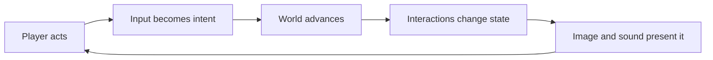
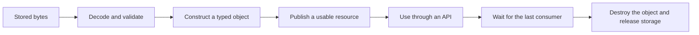
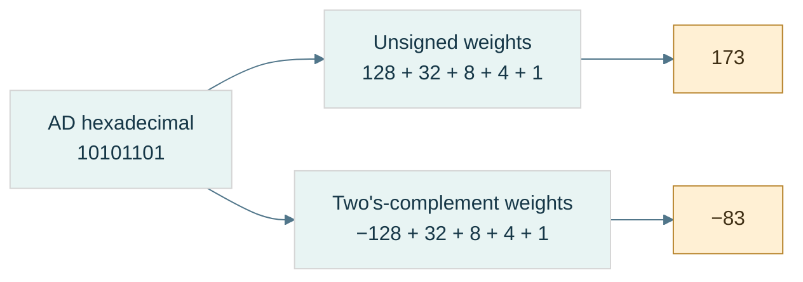
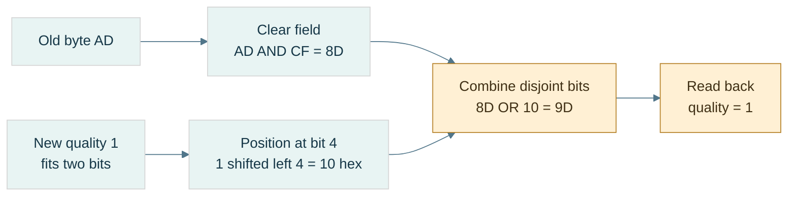
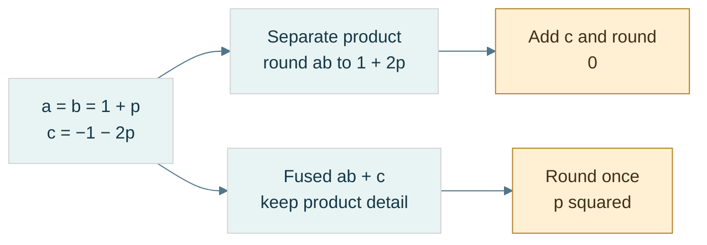

# 01 — A game promise becomes bytes and running state

[[Chapter Edition/03 - Game Engine/00 - Reading Map|Reading map]] · [[Chapter Edition/03 - Game Engine/02 - How bytes become programs, objects, and resource references|Next chapter]]

A small player action gives the volume a concrete contract: input changes a world and the player can see the result. This opening follows the data through representation, object lifetime, CPU work, and the first rendering boundary.

**By the end:** Explain how a player-visible feature depends on data representation, object lifetime, and a sequence of engine services.

**Recall question:** Trace one player action from input to a changed, visible world state; where can its meaning be lost?

<!-- Derived from Continuous Notes/Game Engine - From First Frame to Living Worlds.md; source lines 1–1284; source-span SHA256 2f3f3aa727ccf2b3ccd8dd7b6cd48867018ad27d7191d98c7039299c996e1d2b. -->

<!-- CHAPTER-SOURCE-BEGIN -->
# Game Engine — From First Frame to Living Worlds

Imagine a small workshop game. A player walks toward a crate, picks it up, carries it onto a pressure plate, and watches a door open. You can describe that experience in one sentence. Making it happen repeatedly, saving it, editing it, and diagnosing a failure requires several cooperating systems.

The keyboard produces a message. The player interprets it as an intention to move. The world advances. A collision prevents the player walking through the crate. The crate's position changes. The plate detects its weight. The door changes state. A camera chooses a view. The **renderer**, the part that turns scene data into an image, builds a **frame**, one displayed image in the ongoing sequence. The sound system plays the latch. The player sees and hears the result, then makes another choice.

The **CPU** is the main processor executing the application; the **GPU** is a processor used for highly parallel graphics and other computation. The engine coordinates their work rather than assuming everything completes in one function call.

An **engine** is the reusable machinery that supports that cycle. The game supplies particular rules, characters, and content. The boundary is a decision: a small game may keep the engine and game in one program, while a larger project separates reusable services from a particular game. We learn the boundary by following actual work, rather than declaring dozens of empty systems before anything happens.

This is the cumulative home for game-engine teaching in this vault. Future supplied engine lessons belong in this same volume, woven into the relevant explanation. Existing curriculum part numbers remain their own source records; independent video and book study does not manufacture missing curriculum coverage. [[Supplementary/Game Engine - Sources and Coverage|The source ledger]] records the enumerated videos, caption availability, reading status, book passages, and remaining gaps.

Read a concept where it first helps solve a problem. If a word is unfamiliar, its first useful appearance should supply enough explanation to continue. Mathematics, C++ and systems now share [[Chapter Edition/01 - Computing Foundations/00 - Reading Map|the Computing Foundations book]]; the explanation needed to follow this Engine narrative still belongs here.


> [!info] Source coverage
> 746 selected videos are inventoried; 448 English YouTube caption tracks are saved: 448 fully read and 0 sampled. Separately, 8 local ASR transcripts are fully read. 290 selected candidates remain unreviewed. Reading covers transcript text; it does not establish video/frame/code inspection, engine execution, or full-book coverage. The all-source pass remains incomplete.

Read by the problem you need: [[Chapter Edition/03 - Game Engine/13 - Portable startup, windows, events, and input#Let one input produce one intended change|input and time]] · [[Chapter Edition/03 - Game Engine/14 - Application clocks and stable input identity#Keep identity, storage, and ownership in agreement|identity and memory]] · [[Chapter Edition/03 - Game Engine/18 - ECS contracts, diagnostics, and GPU handoff#Give the renderer a clear job, then meet the graphics API|rendering]] · [[Chapter Edition/03 - Game Engine/27 - Preparing and publishing runtime content#Prepare and publish content before promising it is ready|assets]] · [[Chapter Edition/03 - Game Engine/31 - Spatial-index serialization and query evidence#Make a world that can be authored, saved, and run|editor and scenes]] · [[Chapter Edition/03 - Game Engine/33 - Versioned scenes and transactional loading#Let motion and contact answer the same world rules|physics]] · [[Chapter Edition/03 - Game Engine/42 - From cartridge bytes to a reproducible machine#Reconstruct the working loop and test its contracts|runnable laboratory]].

## Start with an observable promise

Our first promise is small: starting the program creates a world, one update changes a known value, and closing it releases the resources it acquired. A **resource** is something with a limited lifetime that the program must manage: memory, an open file, a window, an audio device, or a GPU allocation. A **lifetime** is the interval during which that thing is valid to use.

Before drawing, write down what success would look like. The player moves one metre after a measured simulation interval. A closed door blocks passage. Saving and reloading preserves the crate's identity. Asking for an absent texture produces a visible fallback and an error record. These are **contracts**: conditions the implementation promises to maintain and that a test or person can observe.

A **subsystem** is a group of related work with an agreed boundary. Rendering produces images; physics advances motion and resolves interactions; an asset service prepares reusable content. The important question is not how many subsystems exist. Ask what each receives, what it changes, who owns the result, and how failure reaches its caller.



For the pressure plate, the input is not “play door animation.” Input is the player's attempted action. A world rule decides whether the crate actually reaches the plate. Only then does the plate's state change and the door respond. Keeping those steps distinct prevents a beautiful animation from claiming success when the underlying game state never changed.

The first engineering exercise is to trace one action through the entire cycle. Record the input, the decision, the state change, and the visible result. If the door opens twice from one crate contact, find the duplicated transition. If it opens visually but remains blocking, find the disagreement between the door's appearance and its collision state. The useful architecture is the one that makes these disagreements visible and repairable.

#### Centralize subsystem lifecycle without hiding order

A system manager can centralize memory sizing, initialization, update, and shutdown callbacks, but it does not eliminate dependencies. The Kohi migrations expose several ordering failures: a resize arrives before event callbacks are registered; jobs stop loading after the manager is added because its update loop never runs systems; shader resources must be released before the renderer/device; and a local console system record is initialized but never copied into persistent manager storage. [Kohi system-manager migrations](https://www.youtube.com/watch?v=l6QDHJ7_rPk) · [Lifecycle callback manager](https://www.youtube.com/watch?v=vOrkxRPWDVA)

Make each lifecycle phase observable and order teardown against actual ownership, usually releasing dependents before the systems they use. Some systems need staged initialization because application configuration is not ready at the first startup point. The episodes use hand-authored order, leave static system state in place, and report one platform framebuffer-size bug unresolved; they do not implement dependency-graph ordering or complete rollback after partial startup.

## Why the engine begins with bytes, objects, lifetimes, and CPU work

The workshop world above is a contract that a machine must execute. A saved material is meaningless without an encoding, a pointer is unsafe without a lifetime, and a scheduled frame is not correct merely because its C++ compiles. The existing full computing-foundations chapter now lives directly in this engine narrative, following one scene asset through representation, object ownership, APIs, CPU architecture and algorithms. Its original headings and code are retained so each derivation remains reconstructable without a fourth teaching book.

# Computing Foundations — From Bits to C++ and Systems APIs

## One byte travels from a file to a running world

Imagine a small editor with a metal panel in its viewport. You change the panel's material, save the scene, close the editor, and reopen it. The surface looks the same. That simple result depends on several different agreements.

The scene file must encode a stable material reference. The importer must recognize the referenced source asset and produce a usable runtime artifact. The executable must contain compatible code for reading that artifact. A resource manager must keep the uploaded texture alive while the renderer uses it. The panel's entity identifier must continue to name the intended entity even if component storage moves.

We will follow this single journey through the combined foundations volume. First we establish how bits encode values and how arithmetic can change their meaning. Then we establish how a C++ program gives objects types, lifetimes, and ownership. Finally we explain how modules, APIs, builds, and persistent formats let independently developed pieces agree. The graphics and engine books use those agreements to answer their own questions: what does the scene look like, and how does the running world change?

An **agreement** here is a set of assumptions that two pieces of a system must share. Some agreements are checked by the compiler. Others are checked by a file reader, a runtime assertion, a synchronization rule, or a test. A system becomes easier to debug when each agreement has an identifiable owner and an observable failure.



This is why the byte story and the C++ story belong in one book. A hexadecimal dump can show the bytes of a handle, but it cannot prove the handle still names a live entity. An address can identify storage, but it cannot by itself establish that a suitable object occupies that storage. A successful function call can submit GPU work, but it does not mean that the GPU has finished reading the submitted resource.

### Give every identifier a scope

Suppose a scene saves the integer `17` as its material reference. During the next run, slot 17 may hold a completely different texture. The integer has survived; its meaning has not.

A **persistent identifier** is intended to survive processes and saves. A **runtime handle** identifies an object inside a particular runtime's management scheme. A **pointer** gives an address with language-level rules about what may be accessed there. A **dense index** identifies a position in a storage arrangement that may change. These are different jobs even when all four happen to use integers internally.

For example, the saved panel may contain a stable asset identifier. The asset database resolves that identifier to an imported artifact. The runtime cache loads the artifact and returns a generational texture handle. A rendering pass resolves that handle into a backend resource reference while enforcing the manager's lifetime rules. The draw packet need not expose the scene's persistent identifier or the manager's entire internal table.

Here is the complete failure trace to keep in mind. An editor command records a pointer into a component vector. Another edit grows that vector. The command later dereferences its old pointer. Even if the entity itself remains alive, the pointer's storage contract has failed. Recording an entity handle and resolving the component when the command executes can avoid that particular relocation problem. It does not solve concurrent destruction, generation wrap, or an API that returns another unprotected pointer. Each step still needs a stated validity interval.

[[Concepts/ABI and object layout|Object layout]] helps explain how a value is represented. [[Concepts/RAII and resource handles|Resource ownership]] explains who is responsible for keeping an object usable. The engine volume extends the same reasoning to entity identity, component relocation, asset publication, and asynchronous work.


### From Signals to Meaning: Bits, Numbers, and Memory

**state → interpretation → arithmetic → representation choice → placement → external bytes → investigation**.

A **trace** shows intermediate states. An **invariant** remains true across a procedure. A **contract** states valid inputs, promised output, and failure conditions. These are tools for reasoning, not instructions to trust a result because it worked once.

Examples use eight-bit octets and a C++23 laboratory baseline. Address diagrams are teaching models. Hardware behavior, language validity, operating-system policy, and external schemas stay separate. Reported repository excerpts remain unverified unless explicitly marked otherwise.

## The route through the story

- [[Chapter Edition/03 - Game Engine/01 - A game promise becomes bytes and running state#Prologue - How a physical state became a byte|Why a physical state needs an encoding]]
- [[Chapter Edition/03 - Game Engine/01 - A game promise becomes bytes and running state#From a signal to an interpretation|Counts and negative values]]
- [[Chapter Edition/03 - Game Engine/01 - A game promise becomes bytes and running state#Bits become decisions and compact fields|Decisions, masks, and fields]]
- [[Chapter Edition/03 - Game Engine/01 - A game promise becomes bytes and running state#Arithmetic becomes a policy|Finite arithmetic and expression types]]
- [[Chapter Edition/03 - Game Engine/01 - A game promise becomes bytes and running state#A stretching ruler for real-valued quantities|Floating representation]]
- [[Chapter Edition/03 - Game Engine/01 - A game promise becomes bytes and running state#When arithmetic meets uncertainty|Rounding, error, and reproducibility]]
- [[Chapter Edition/03 - Game Engine/01 - A game promise becomes bytes and running state#Choosing what information to keep|Fixed point, small floats, and quantization]]
- [[Chapter Edition/03 - Game Engine/02 - How bytes become programs, objects, and resource references#Where the bytes live|Placement, virtual memory, and lifetime]]
- [[Chapter Edition/03 - Game Engine/02 - How bytes become programs, objects, and resource references#Bytes become a durable agreement|Serialization, integrity, and dumps]]
- [[Chapter Edition/03 - Game Engine/02 - How bytes become programs, objects, and resource references#The complete journey - Encode, compute, store, and investigate|The complete experiment and diagnosis]]

## Prologue - How a physical state became a byte

### Start with the problem, not the vocabulary

Suppose a machine must remember whether a lamp is on. It needs two reliably distinguishable states, not necessarily the symbols “0” and “1.” A closed/open switch, a charged/discharged storage element, or two ranges of voltage can represent the distinction.

>The engineer defines which physical condition means which logical state.

Now ask the same machine to remember a count. One yes/no state is not enough. Combine independent states: two bits distinguish four patterns, three distinguish eight, and eight distinguish 256. To interpret a pattern as a number or character, give it an encoding rule.

>**Encoding** is the agreed mapping from meaning to representation; **decoding** is the reverse operation.

Binary is useful because broad low/high signal ranges can be distinguished despite small disturbances. It is not a claim that physics has only two possible values, or that computers cannot process decimal numbers. The digital abstraction deliberately ignores small differences within each permitted range. That tolerance is a **noise margin**: room for a disturbance without changing the logical interpretation. Exact voltage thresholds depend on the circuit; the examples here do not prescribe a CPU's supply voltage.

### A short historical frame

The word **byte** grew out of early computer design, where convenient groups of bits were used for characters and transfers; it was not eternally defined as eight bits. The Computer History Museum associates the term with Werner Buchholz and describes earlier six-bit groupings as well as eight-bit usage. This history matters because a unit name can reflect an engineering convention rather than a mathematical necessity. [Computer History Museum: Werner Buchholz](https://www.computerhistory.org/tdih/october/24/)

IBM's System/360, introduced in 1964, made the eight-bit byte part of an influential compatible computer family. Compatibility meant that software could target an architectural contract across members of that family, rather than be rewritten for every new machine. Eight-bit grouping became an enduring convention, not a law saying that every useful processor operation must be eight bits wide. [IBM: System/360 history](https://www.ibm.com/history/system-360)

The modern term **octet** removes the ambiguity: it means exactly eight bits. A C++ byte is the language's addressable storage unit; `sizeof(char)` is one, while `CHAR_BIT` tells how many bits that unit contains. The concrete file formats here require `CHAR_BIT == 8`. A **word** is a processor or architecture grouping whose width must be stated. “Byte,” “word,” and “character” are not interchangeable: an encoded text character may require multiple bytes.

### Four questions that keep the whole volume honest

1. **State:** which bits exist?
2. **Meaning:** which rule interprets those bits?
3. **Placement:** in which order and at which locations are they stored?
4. **Validity:** may this program access them now?

The pattern `10101101` can mean unsigned 173, signed -83, or several packed flags. Its bits do not announce the interpretation. Likewise, `78 56 34 12` can encode the value `0x12345678` under one byte-order rule, but not under every rule. A live object, a dead object's old bytes, and file bytes can look identical in a dump yet permit different operations.

A **memory dump** is a display of stored bytes. It is evidence about representation, not a complete explanation of type, ownership, lifetime, or permissions. The rest of the volume gives those missing rules.

**Source orientation:** the physical-state motivation was cross-read with the local CPU course, Part 1, PDF pages 2-6. The engine text's data/memory sections and the C++ tour provide useful teaching perspectives, but their older platform examples are not adopted as current universal guarantees. Exact local references are listed at the end.

## From a signal to an interpretation

A stable signal lets us remember a yes/no answer. To remember a count, we need several bits and positional weights. To remember a direction or debt, we need a rule for negative values. We will change the interpretation without pretending the physical bits changed.

### One bit, several bits, and an interpretation

A [[Bit|bit]] is one logical choice between two states, written 0 or 1. **Logical** means the abstract rule the program reasons about; **physical** means the device condition used to realize it. A gate calculates from inputs; storage retains a state. These are different jobs even if both use binary signals.

A byte of eight independent bits has $2^8=256$ possible patterns. That counts patterns, not the largest numeric value. If the unsigned values start at zero, the final value is 255. A pattern may instead label colors, characters, permissions, or compressed codes. An [[Interpretation contract|interpretation contract]] specifies width, type, order, and allowed meanings.

**Board example:** let a two-bit state encode movement: 00=stop, 01=left, 10=right, 11=reserved. All four patterns exist, but only three are accepted by this schema. A **schema** is the declared structure and meaning of encoded fields. Representable does not automatically mean valid for the application.

### Position gives a digit its weight

Decimal 472 means $4(100)+7(10)+2$. [[Positional notation|Binary]] uses the same positional idea with base two. The **base** tells how many digit values exist and how the weight grows between neighboring positions. In binary the digits are 0/1 and each step left doubles the weight.

For N bits, index i counts from zero at the rightmost position. Let $b_i$ be the digit at that position. The unsigned value V is:

$$
V=\sum_{i=0}^{N-1}b_i2^i.
$$

The summation symbol means “add the listed contribution for every i.” **Least significant bit (LSB)** is position zero, weight one; **most significant bit (MSB)** is the highest position, with the greatest weight. These describe significance, not yet memory address order.

Trace `10101101` without a calculator:

| Bit position i | 7 | 6 | 5 | 4 | 3 | 2 | 1 | 0 |
|---|---|---|---|---|---|---|---|---|
| Weight | 128 | 64 | 32 | 16 | 8 | 4 | 2 | 1 |
| Digit | 1 | 0 | 1 | 0 | 1 | 1 | 0 | 1 |
| Contribution | 128 | 0 | 32 | 0 | 8 | 4 | 0 | 1 |

Sum 128+32+8+4+1=173. Nothing in this calculation says where the bytes live.

For [[Binary conversion|decimal-to-binary conversion]], divide by two, record the remainder, and repeat on the quotient. **Quotient** is the whole-number division result; **remainder** is what is left. The relation $n=2q+r$, with r=0 or 1, explains why the remainder is the current low bit.

| Current n | Quotient q | Remainder r |
|---|---|---|
| 173 | 86 | 1 |
| 86 | 43 | 0 |
| 43 | 21 | 1 |
| 21 | 10 | 1 |
| 10 | 5 | 0 |
| 5 | 2 | 1 |
| 2 | 1 | 0 |
| 1 | 0 | 1 |

Remainders arrive low-weight first. Reverse them to write `10101101` high-weight first. Zero needs an explicit representation “0”; a loop that never runs must not accidentally produce an empty numeral.

A second decoder, **Horner decoding**, avoids writing powers explicitly. Read left-to-right and update $v\leftarrow2v+b$. Starting from zero, the successive values for `10101101` are 1,2,5,10,21,43,86,173. Each step moves the old prefix one binary position left and adds the next digit. The two decoders agree because they reconstruct the same positional rule.

### Hexadecimal, octal, byte, and word

[[Hexadecimal]] is base 16. Digits 0-9 and A-F represent values 0-15. Four bits have exactly 16 patterns, so one group of four bits corresponds to one hexadecimal digit. Such a four-bit group is a **nibble**.

Split `10101101` into `1010 1101`. The groups are 10 and 13, written A and D: `0xAD`. The prefix `0x` announces hexadecimal notation in C++. It does not allocate a different kind of storage.

[[Octal]] is base eight and groups three bits. Pad the high end with zeros: `010 101 101` gives digits 2,5,5, so the octal numeral is 255. Decimal 255 and octal 255 have different values; always state the base. In a C++ integer literal, a leading zero requests octal: `0255` means decimal 173.

[[Byte and octet|An octet]] holds eight bits; two hexadecimal digits display one octet. [[Machine word|A machine word]] may be 32 or 64 bits in a particular discussion. Pointer width, native arithmetic width, file field width, and byte width answer different questions. Do not infer all four from “64-bit computer.”

### The same bits can mean different integers

An **encoding** is the rule that assigns a bit pattern to a value. Eight bits give 256 patterns, not a maximum value of 256. In [[Unsigned modular arithmetic|unsigned interpretation]], all weights are positive, giving 0 through 255. A signed interpretation spends some patterns on negative values. To **invert** a pattern, exchange every zero and one within its declared width; the detailed bitwise rules follow in the decisions-and-fields section.

| Eight-bit scheme | Meaning of negative 5 | Zero patterns | Range |
|---|---|---|---|
| [[Signed magnitude]] | `10000101`: sign 1, magnitude 5 | positive and negative zero | −127 through 127 |
| [[One's complement]] | `11111010`: invert positive 5 | all zeros and all ones | −127 through 127 |
| [[Two's complement]] | `11111011`: invert, then add 1 | all zeros only | −128 through 127 |

These are different contracts, not alternative spellings you can mix during an operation. One's-complement addition needs **end-around carry**: a carry leaving the high end is added back at the low end. In signed magnitude, signs and magnitudes need separate treatment.

For an $N$-bit two's-complement pattern, the top bit has weight $-2^{N-1}$, while the remaining weights stay positive:

$$
v=-b_{N-1}2^{N-1}+\sum_{i=0}^{N-2}b_i2^i
$$

If $u$ is the unsigned interpretation of those same bits, decode them as follows:

$$
v=
\begin{cases}
u,&u<2^{N-1}\\
u-2^N,&u\ge 2^{N-1}
\end{cases}
$$

Our earlier byte `AD` has unsigned value 173. Its high bit is set, so its signed eight-bit value is $173-256=-83$. Nothing moved in memory; only the interpretation changed.

### Figure B1 - One pattern, two integer readings



**Read the figure:** the branches change the interpretation, never the stored pattern. The high position contributes either $+128$ or $-128$ at this eight-bit width. Equivalently, the signed branch subtracts 256 from unsigned 173. **Limit:** this is a fixed-width integer example; floating fields and packed application flags follow different decoding rules. Reconstruct both answers before opening [[Visual Recall/01 - Bits, Numbers and Memory - Visual Recall#Figure-linked pocket notes|the pocket notes]].

### Why invert-and-add-one works

A **residue** is the representative left after division by a modulus. At width $N$, retaining only the low bits is arithmetic modulo $2^N$. For positive $x$, its negative residue is $2^N-x$. Since an all-ones word has value $2^N-1$:

$$
2^N-x=(2^N-1-x)+1=\operatorname{NOT}_N(x)+1
$$

Here $\operatorname{NOT}_N$ means complement exactly $N$ bits, not whatever width a programming-language promotion happens to choose.

Trace negative 13 at eight bits:

| Step | Bits | Unsigned pattern value |
|---|---|---|
| Positive 13 | `00001101` | 13 |
| Invert eight positions | `11110010` | 242 |
| Add one | `11110011` | 243 |
| Signed decode | $243-256$ | −13 |

Check: $13+243=256$, whose low eight bits are zero. Negating zero similarly produces all ones plus one and leaves zero. There is no second zero.

The [[Minimum signed value|minimum signed value]] is asymmetric. At eight bits, −128 exists but +128 does not. The pattern `10000000` complements and increments back to itself. That is valid residue arithmetic; it does **not** mean a signed language operation may return −128 as the mathematical negation of −128. For an `int` at its minimum, same-type negation, `abs`, and division by −1 cannot represent the answer. Narrow values can promote to a larger type first; always identify the actual operation type.

## Bits become decisions and compact fields

The same bits can now represent numbers, but not every byte is one number. Some store independent decisions or several small fields. Boolean rules tell us how to inspect and update them without damaging neighboring meanings.

### Boolean reasoning and control flow

A [[Boolean algebra|Boolean]] value is false or true. [[Logical versus bitwise operators|A bit pattern operation]] returns a pattern; a logical condition returns a truth value. With integer x=2 and y=1, `x & y` is zero, but `x && y` is true because each operand is nonzero.

Built-in logical AND/OR [[Short-circuit evaluation|short-circuit]]: the second operand is evaluated only if the first does not already determine the answer. That is why `p != nullptr && *p == 5` can avoid dereferencing a null pointer. Bitwise AND does not supply that control-flow guarantee.

[[De Morgan's laws]] describe what happens when NOT crosses AND or OR:

$$
\neg(A\land B)=\neg A\lor\neg B,\qquad
\neg(A\lor B)=\neg A\land\neg B.
$$

The symbols mean NOT/AND/OR, respectively. Check all four input pairs from the truth table. “Not both” means at least one is absent; “neither” means both are absent. Those are different predicates. Apply the identities lane-by-lane to fixed-width bit vectors only after fixing complement width.

### A mask selects positions

A [[Bit mask|mask]] is a pattern used to select or change specified positions. It is not a special hardware material. The operators [[Bitwise AND|AND]], [[Bitwise OR|OR]], [[Bitwise XOR|XOR]], and [[Bitwise NOT|NOT]] describe one-bit truth rules; **bitwise** operations apply them independently at each corresponding position.

| A | B | AND | OR | XOR |
|---|---|---|---|---|
| 0 | 0 | 0 | 0 | 0 |
| 0 | 1 | 0 | 1 | 1 |
| 1 | 0 | 0 | 1 | 1 |
| 1 | 1 | 1 | 1 | 0 |

NOT exchanges zero and one. AND keeps a bit only if the mask has one there; OR forces masked positions to one; XOR toggles them (one becomes zero, zero becomes one). XOR means **exclusive OR**: true when inputs differ, not when both are true.

Take the octet AD:

- `AD & 07 = 05` retains low positions 0-2.
- `AD | 40 = ED` sets position 6.
- `AD ^ 08 = A5` toggles position 3; repeating the toggle restores AD.
- Eight-bit NOT of `0F` is `F0`. The width matters: complementing a wider representation changes more positions.

C++ uses `&`, `|`, `^`, and `~` for these operations. The teaching model is a fixed-width unsigned pattern. Executable C++ first applies type rules; a narrow operand may become int before NOT. “Invert one byte” therefore requires a deliberate width, not merely the character `~`.

**Any versus all:** if m selects several flags, `(x & m) != 0` means at least one is set; `(x & m) == m` means all selected flags are set. With m=0, the first is false and the second true. Decide whether an empty selection is meaningful in the API.

### Shifts move significance

A **shift** relocates positions. [[Shift operations|A logical right shift]] fills new high positions with zero; an arithmetic right shift replicates the sign bit. A left shift introduces zeros at the low end. Shifting is not rotating: discarded positions do not reappear at the other end.

For an unsigned fixed-width pattern, a left shift by k corresponds to multiplication by $2^k$ followed by the width's truncation; a right shift corresponds to whole-number division by $2^k$ rounded down. **Truncation** here means discarding bits that cannot fit.

At eight-bit width, `00101101 << 1` gives `01011010`, value 90. But `10000000 << 1` leaves low eight bits zero; mathematical 256 needs nine bits. If the goal was an exact product, widening must occur before the shift.

For a negative signed value, arithmetic right shift and integer division can round differently. In C++23, -3 shifted right once is -2, while -3 divided by 2 is -1. **Floor** rounds down toward negative infinity; truncation of signed division rounds toward zero. Also validate the shift count: a negative count or one at least the promoted operand width is invalid. Use an unsigned carrier and check the width when manipulating representations.

### Fields: select, normalize, replace

A [[Bit field|bit field]] in this lesson means a schema-owned range of positions, not automatically a C++ language bit-field member. Its **offset** s is the first position; its **width** w is the number of positions. **Normalize** means move the extracted value down so its lowest field bit has weight one.

Let an unsigned N-bit word x contain a w-bit field beginning at s. Require $1\le w\le N$, $s\ge0$, $s+w\le N$. The low mask L and positioned mask M are:

$$
L=2^w-1,\qquad M=L\,2^s,\qquad f=(x\gg s)\mathbin{\&}L.
$$

Subtracting one from $2^w$ produces w low ones. For w=2, L=3 (`11₂`). For s=4, M=48 (`0x30`). Extract quality from AD: shifting right four gives A; AND with 3 gives 2. Masking AD with 30 alone gives 20 hexadecimal, still weighted at its original position, not normalized value 2.

Replacing requires clearing the old field before inserting the new value. At exactly N bits, $\operatorname{NOT}_N$ means width-limited complement:

$$
x'=(x\mathbin{\&}\operatorname{NOT}_N(M))
\mathbin{|}((v\mathbin{\&}L)\ll s).
$$

A checked API rejects v if it does not fit; a truncating API keeps only low bits. State which behavior is intended.

Trace quality 2→1:

```text
old word                 AD = 10101101
field mask               30 = 00110000
eight-bit NOT(mask)       CF = 11001111
clear: AD & CF            8D = 10001101
new field: 1 << 4         10 = 00010000
write: 8D | 10            9D = 10011101
readback: (9D >> 4) & 3    1
```

Outside-mask bits remain equal: `AD & CF = 9D & CF = 8D`. That is the preservation invariant. OR-only insertion fails whenever the new field needs to clear an old one; it cannot perform replacement generally.

### Figure B2 - Replace a field without damaging its neighbors



**Read the figure:** the destination field mask is `30` hexadecimal, so its eight-bit complement is `CF`. Clear first, insert second. The invariant is `AD AND CF = 9D AND CF = 8D`: all outside positions survive. **Limit:** the figure assumes a validated two-bit value and an eight-bit unsigned model; actual C++ promotions and legal shift counts still need checking. Extraction and replacement formulas appear immediately above.

### Packing several meanings and unpacking them

[[Bit packing|Packing]] places several small values in one carrier. Give every field an allowed range and disjoint positions before combining them. **Disjoint** means no shared positions; overlapping fields need a separate explicit meaning.

Our running control byte stores mode (0-7) at 0-2, visible at 3, quality (0-3) at 4-5, locked at 6, dirty at 7:

```text
mode=5       -> 00000101
visible=1    -> 00001000
quality=2    -> 00100000
locked=0     -> 00000000
dirty=1      -> 10000000
OR together  -> 10101101 = AD
```

Unpacking reverses the schema. Each recovered value must equal the validated input. A **round trip** is encoding followed by decoding; agreement is necessary but not sufficient, because two matching bugs could agree on the wrong external format. Also check expected bytes independently.

For an LSB-first logical-bit array, bit i goes into byte $\lfloor i/8\rfloor$, position $i\bmod8$. The floor symbol means take the whole-number quotient. Array `[1,0,1,1,0,1,0,1]` packs to AD; its element zero is the low bit even though printed binary puts the high bit on the left.

Packing n bits needs $\lceil n/8\rceil$ octets. A ceiling rounds upward. In finite size arithmetic, use `n/8 + (n%8 != 0)` rather than blindly computing `(n+7)/8` when n+7 could overflow. Check requested unpack count against source capacity before reading. Define whether unused final padding bits must be zero or are ignored.

### Test the packed meaning

**Question:** Can one byte hold the five declared meanings while updating one without changing neighbors?

Use the field/packing implementations in the code companion. Begin with the shown values and predict AD before running. Extract every field; replace quality by one and expect 9D. Then attempt quality=4: a two-bit checked field must reject it. Attempt a field extending beyond the carrier: reject it before shifting. Pack the eight-bit array and check the literal expected octet as well as the round trip.

**Observable checks:** extracted values equal inputs; outside-mask bits remain unchanged; a second identical set has no further effect; a second identical toggle restores the original; the final packed length is the rounded-up capacity. These are checks of mechanism, not a performance benchmark.

**Cost and trade-off:** a fixed field operation takes bounded work. Packing n bits processes n logical inputs and stores about n/8 octets; it saves footprint but adds work and can make concurrent updates to neighboring fields contend on the same storage. We have not yet studied the synchronization required for such shared writes.

**Teach-back:** explain why zero has a representation, why 256 patterns stop at unsigned value 255, why XOR toggles, and why the array's first element can be the printed numeral's last bit. If any answer is only “because binary,” rebuild the actual weights or truth rule.

**Companions, not missing steps:** [[Chapter Edition/01 - Computing Foundations/11 - C++ Const, Borrowing, and CPU–GPU Buffering#M001 - Positional value, masks, fields, and De Morgan|Full proofs]] · [[Supplementary/Code Snippets#M001 - Width-safe fields and LSB-first bit packing|Checked C++ implementations]].

## Arithmetic becomes a policy

Boolean gates can build an adder, but an adder only produces a finite-width result. The next question is whether that result answers the intended signed, unsigned, bounded, or checked problem. Then C++ adds a further layer: the expression's type may not be the stored operand's type.

### From logic gates to an adder

An **ALU**, or arithmetic and logic unit, is hardware that computes arithmetic and bitwise results. A [[Half adder]] adds two one-bit inputs $A,B$. Its sum bit is XOR; its carry bit is AND. A [[Full adder]] also takes incoming carry $c$:

$$
S=A\oplus B\oplus c,\qquad
c_{\mathrm{out}}=(A\land B)\lor(c\land(A\oplus B))
$$

The sum records odd parity: it is 1 when an odd number of inputs are 1. Carry records a **majority**: at least two inputs are 1.

Trace four-bit $13+7$, reading from the least-significant column:

| Position $i$ | $A_i$ from 1101 | $B_i$ from 0111 | Carry in | Sum | Carry out |
|---|---|---|---|---|---|
| 0 | 1 | 1 | 0 | 0 | 1 |
| 1 | 0 | 1 | 1 | 0 | 1 |
| 2 | 1 | 1 | 1 | 1 | 1 |
| 3 | 1 | 0 | 1 | 0 | 1 |

Read sum bits high-to-low: `0100`, or 4. Including final carry gives `10100`, or 20. A [[Ripple-carry addition|ripple-carry adder]] passes each carry to the next stage; a long dependency chain increases circuit delay.

For [[Carry-lookahead and parallel-prefix adders|faster carry networks]], define **generate** $g_i=A_i\land B_i$ and **propagate** $p_i=A_i\oplus B_i$. Then $c_{i+1}=g_i\lor(p_i\land c_i)$. Groups can combine these facts without waiting for every single stage. “Parallel prefix” means combining summaries of preceding groups in a tree-like network. This is a circuit-depth issue, not a claim that fixed-width host addition is a loop over bits.

[[Subtraction through addition]] reuses the adder:

$$
A-B \equiv A+\operatorname{NOT}_N(B)+1\pmod{2^N}
$$

At eight bits, $5-7$: NOT(7)=248; $5+248+1=254$; signed decoding gives −2. A processor's [[Carry and borrow|borrow convention]] must be stated. In binary 6502-style SBC, $A+\operatorname{NOT}_8(B)+C=A-B-(1-C)$, so carry set means **no borrow**. This is an architecture-specific example, not a universal flag convention.

### Flags answer different questions

[[Carry, overflow, negative, and zero flags|C/V/N/Z]] are separate observations of a finite-width result: **C** is unsigned carry-out, **V** is signed overflow, **N** is the high result bit, and **Z** is whether all result bits are zero. With eight-bit binary addition and incoming carry zero:

| Inputs | Exact unsigned sum | Low result | C | V | N | Z | Signed reading |
|---|---|---|---|---|---|---|---|
| `7F + 01` | 128 | `80` | 0 | 1 | 1 | 0 | 127+1 cannot fit |
| `FF + 01` | 256 | `00` | 1 | 0 | 0 | 1 | −1+1=0 fits |
| `80 + 80` | 256 | `00` | 1 | 1 | 0 | 1 | −128−128 cannot fit |

For addition, signed overflow occurs when equal-sign operands produce the opposite-sign result. Carry is not a signed overflow test. The N flag describes the stored high bit; after overflow it does not recover the sign of the exact mathematical answer.

### Multiplication and division as reconstructible algorithms

[[Shift-and-add multiplication]] adds one shifted copy of the multiplicand for each set bit of the multiplier. For $13\times11$, multiplier $11=1011_2$:

| Multiplier position | Bit | Contribution | Accumulator |
|---|---|---|---|
| 0 | 1 | $13\times1=13$ | 13 |
| 1 | 1 | $13\times2=26$ | 39 |
| 2 | 0 | 0 | 39 |
| 3 | 1 | $13\times8=104$ | 143 |

Both partial products and accumulator need sufficient width. Two unsigned $N$-bit values may need $2N$ bits for their exact product.

[[Binary long division]] reads dividend bits from high to low. Append the next bit to the partial remainder by doubling and adding that bit; if it reaches the divisor, subtract the divisor and emit quotient bit 1, otherwise emit 0. For $13/3$, dividend `1101`:

| Incoming bit | Trial remainder | Quotient bit | Remainder after subtraction |
|---|---|---|---|
| 1 | 1 | 0 | 1 |
| 1 | 3 | 1 | 0 |
| 0 | 0 | 0 | 0 |
| 1 | 1 | 0 | 1 |

Quotient `0100` is 4; remainder is 1. The final check is $13=4\times3+1$. Generally, for dividend $D$, positive divisor $d$, quotient $Q$, and remainder $R$:

$$
D=Qd+R,\qquad 0\le R<d
$$

This is the **invariant** that makes the unsigned algorithm testable. Signed division needs an additional sign policy; C++ integer division truncates toward zero. Reject divisor zero and signed minimum divided by −1 when the operation type cannot hold the answer.

### Choose the overflow policy before calculating

**Overflow** means the exact mathematical answer does not fit the intended range. There are several possible [[Arithmetic policies|policies]], and they produce different programs.

| Policy for eight-bit unsigned $250+20$ | Result | Intended use |
|---|---|---|
| Wrap modulo 256 | 14 | residue counters, emulated register arithmetic |
| [[Saturating arithmetic\|Saturate]] at the upper bound | 255 | bounded intensities or controls |
| Check and reject | no value; report failure | sizes, allocation counts, external input |
| Widen the carrier | 270 in a wider type | preserve the exact intermediate result |

A **carrier** is the type or register holding the representation. Widen *before* an operation when the old carrier cannot hold its intermediate result. Casting an already-overflowed signed expression afterward cannot repair it.

C++ unsigned arithmetic uses modulo arithmetic at the width of the operation's unsigned type. [[Signed integer overflow]] is [[Undefined behavior]]: the language does not assign it a result that the program may rely on. CPU wraparound and C++ signed overflow are different contracts. These rules are described in the [C++ draft's fundamental types section](https://eel.is/c++draft/basic.fundamental).

For a buffer of `size` bytes, testing `offset + length <= size` can fail if the addition wraps. With unsigned sizes, use:

```text
offset <= size && length <= size - offset
```

Short-circuit evaluation protects the subtraction from an invalid offset. Example: size 100, offset 90, length 15. The first test passes, but $15\le 100-90$ fails. An offset greater than 100 fails before subtracting.

**Underflow**, when discussing integer range here, means falling below the lower endpoint; it is not the same technical condition as floating-point underflow. Unsigned `0 - 1` wraps. An unsigned reverse loop whose condition is `i >= 0` never terminates by that condition. Start from the count, test that it is nonzero, decrement, then index.

Saturation also changes algebra. With signed eight-bit saturation, $(100+100)+(-100)$ becomes $127-100=27$, but $100+(100-100)=100$. Saturating addition is not associative. Do not clamp an intermediate just because the final output has a bounded range.

### Follow C++'s types through the expression

[[Fixed-width integer types|Exact-width types]], such as `std::uint32_t`, specify an exact bit width when the implementation provides them. **Least-width** types guarantee at least the requested width; **fast-width** types pursue efficient operations while meeting that minimum. `std::size_t` represents sizes; `std::ptrdiff_t` represents pointer differences. Plain `char` can be signed or unsigned.

[[Integral promotion|Promotion]] is an automatic conversion of a small integer type to `int` if `int` represents all its values, otherwise to `unsigned int`. [[Usual arithmetic conversions]] then find the common operation type. **Rank** is the language's ordering of integer types for these decisions; it is not simply the number of bits.

On an ordinary host with eight-bit `uint8_t` and an `int` able to represent 0–255:

| Stage | Expression/value | Type and consequence |
|---|---|---|
| Stored operands | 250 and 10 | `uint8_t` |
| Promotion | 250 and 10 | `int` |
| Addition | 260 | `int`; no eight-bit addition has happened |
| Destination conversion | 4 | assigning to `uint8_t` reduces modulo 256 |

Likewise, `~uint8_t{0}` normally complements an `int` zero and produces `int` −1, not a byte object containing 255. The [draft promotion rules](https://eel.is/c++draft/conv.prom) explain why.

For [[Mixed signedness|mixed-sign comparisons]], do not assume the signed operand stays signed. In `-1 < 1u`, −1 converts to `unsigned int` and the comparison is false. A valid index still needs `index >= 0` *and* a value less than the count. Checked comparison helpers such as `std::cmp_less` avoid surprising conversion comparisons; `std::in_range<T>` checks whether conversion to `T` is representable. These tools do not establish that a pointer is live or that an index belongs to a particular container.

### Integer laboratory and teaching checkpoint

Before implementing a small ALU, write its contract: width, encoding, carry convention, decimal/binary mode, flags, and output policy. A **guest** is the simulated machine; the **host** runs the simulator. Host types must safely carry guest intermediate results.

Lab: enumerate all 256×256 input pairs for an eight-bit addition model, then repeat for both carry inputs. Compare low result with the widened sum modulo 256; compare carry with whether the widened sum reaches 256; derive overflow independently from signed mathematical bounds. That is [[Exhaustive finite-state testing|exhaustive testing]] of this bounded domain, not proof of a complete CPU.

A learner should now be able to explain why `AD` can mean −83, trace an adder, distinguish carry from overflow, reconstruct 13×11 and 13/3, and track the four expression stages above. Proofs and reusable implementation stay in [[Chapter Edition/01 - Computing Foundations/11 - C++ Const, Borrowing, and CPU–GPU Buffering#M002 - Signed representations, adders, and arithmetic policies|the derivation companion]] and [[Supplementary/Code Snippets#M002 - Exhaustive 8-bit addition oracle and saturation|the code companion]]; the meaning needed to teach them is already here.

## A stretching ruler for real-valued quantities

Integer counts and signed directions are exact within their ranges. Fractions require another interpretation. We first study a movable scale because it covers a wide span of magnitudes; later, a fixed scale will offer a different bargain for a bounded domain.

### A movable binary point

[[IEEE-754 floating point|Floating point]] distributes a finite set of bit patterns across a wide range of values. It does not represent every real number. **Dynamic range** describes the span of magnitudes available; **precision** describes how finely values can be distinguished within that span. They are different resources.

A fixed-point encoding might interpret an integer carrier $I$ as $I/2^{16}$. Its spacing is always $2^{-16}$. More fractional positions improve that spacing but reduce the largest magnitude for a fixed carrier width. Floating point instead uses binary scientific notation: a [[Significand and hidden bit|significand]] supplies significant digits and an exponent moves their scale. In $1.010101_2\times2^3$, the significand is $1.010101_2$ and the exponent is 3.

Picture a toy format retaining only three significant binary bits:

| Exponent | Representable values in that exponent interval | Spacing |
|---|---|---|
| 0 | 1, 1.25, 1.5, 1.75 | 0.25 |
| 1 | 2, 2.5, 3, 3.5 | 0.5 |
| 2 | 4, 5, 6, 7 | 1 |

Each scale has the same number of significant positions, but the ruler stretches. Normal floating values have roughly constant *relative* precision, not constant absolute spacing. **Relative** means measured as a proportion of the value; **absolute** means measured in the original units.

IEEE-754 includes formats, special values, arithmetic and rounding rules, and exception conditions—not only a field layout. A conceptual arithmetic pipeline unpacks fields, handles classes, computes with extra information, normalizes, rounds, and repacks. An **FPU**, floating-point unit, is hardware performing these operations. Addition also needs exponent alignment; The arithmetic story below develops that machinery.

### The two formats and their interpretation

[[Binary32]] uses 32 bits; [[Binary64]] uses 64. These are format names. C++ `float` and `double` commonly use them, but names alone do not prove the representation. Our laboratory checks the host's width, radix, precision, exponent range, and IEC-559 support, plus golden bit patterns.

| Property | binary32 | binary64 |
|---|---|---|
| Sign position | 31 | 63 |
| Exponent positions | 30–23: 8 bits | 62–52: 11 bits |
| Fraction positions | 22–0: 23 bits | 51–0: 52 bits |
| Normal significand precision $p$ | 24 bits | 53 bits |
| [[Exponent bias\|Bias]] $B$ | 127 | 1023 |
| Normal exponent $e$ | −126 through 127 | −1022 through 1023 |
| Smallest positive normal | $2^{-126}$ | $2^{-1022}$ |
| Smallest positive subnormal | $2^{-149}$ | $2^{-1074}$ |

Let $S$ be the sign bit, $E$ the unsigned stored exponent, and $F$ the integer formed by the fraction field. For a normal finite number with $t$ stored fraction bits:

$$
x=(-1)^S\left(1+\frac{F}{2^t}\right)2^{E-B}.
$$

Use $t=23,B=127$ for binary32 and $t=52,B=1023$ for binary64. This formula defines the encoded value **exactly**; rounding happens when choosing which encoded value to store, not when interpreting an existing finite pattern.

The sign is a separate factor, unlike two's-complement integer negation. `1.0f` is `0x3F800000`; changing only the high bit gives `0xBF800000`, or −1. Do not invert every bit and add one.

The bias translates the normal exponent into a nonnegative field: $E=e+B$, so $e=E-B$. Binary32 exponent −2 stores 125; exponent 0 stores 127; exponent 3 stores 130. The chosen bias for $k$ exponent bits is $2^{k-1}-1$. Field zero and field all-ones have reserved interpretations: do not blindly subtract the bias for them.

**Normalize** here means move the binary point so a normal positive magnitude has the form $1.f_2\times2^e$. The first nonzero binary digit must be 1, so it need not be stored. That **implicit leading one**, or hidden bit, gives normal binary32 24 significant bits from 23 stored fraction bits. It is not present for subnormals.

| Stored exponent | Fraction | Class | Leading significand bit |
|---|---|---|---|
| 0 | 0 | signed zero | 0 |
| 0 | nonzero | subnormal | 0 |
| 1 through 254 (binary32) | any | normal finite | 1 |
| 255 (binary32) | 0 | signed infinity | not a finite significand |
| 255 (binary32) | nonzero | NaN | not a finite significand |

For binary64 replace 254/255 by 2046/2047. Classify first, decode second. Physical byte order is a separate layer: fields describe significance positions in a representation word, not which byte appears first at increasing addresses. **Little endian** places the least-significant byte first at increasing addresses; **big endian** places the most-significant byte first. The storage story later reconstructs both rules in detail.

### Encode 10.625, then decode −13.25

[[Floating-point encoding and decoding|Encoding]] starts with a value and chooses fields. For 10.625, the integer portion is $10=1010_2$. Convert the fractional portion by repeated doubling; each whole-number part becomes the next bit after the point.

| Remaining fraction | Multiply by 2 | Emit bit | New remaining fraction |
|---|---|---|---|
| 0.625 | 1.25 | 1 | 0.25 |
| 0.25 | 0.5 | 0 | 0.5 |
| 0.5 | 1.0 | 1 | 0 |

Thus $10.625=1010.101_2=1.010101_2\times2^3$. Set $S=0$, $E=3+127=130=10000010_2$. Drop the leading one; pad the fraction to 23 positions:

```text
sign | exponent | fraction
0    | 10000010 | 01010100000000000000000
grouped hex: 0100 0001 0010 1010 0000 0000 0000 0000
representation word: 0x412A0000
little-endian octets: 00 00 2A 41
```

The fraction integer is `0x2A0000`. Check $F/2^{23}=0.328125$; $(1+0.328125)\times8=10.625$. No rounding was needed because the finite binary expansion fits.

For decoding `0xC1540000`:

| Step | Result |
|---|---|
| Extract sign | $S=1$ |
| Extract exponent | $E=130$; class is normal |
| Remove bias | $e=3$ |
| Extract fraction | `0x540000`; fraction bits begin `101010` |
| Restore hidden bit | $1.10101_2=1+1/2+1/8+1/32=1.65625$ |
| Scale and sign | $-1.65625\times8=-13.25$ |

The decoder in the code companion uses `std::ldexp` to multiply a significand by a power of two. Its numerical reconstruction is not a NaN-payload-preserving conversion.


### Zero, infinity, and an unordered result

[[Signed zero]] retains a sign even when $E=F=0$. Positive zero is `0x00000000` and negative zero `0x80000000`. Numerically they compare equal. `std::signbit` distinguishes them; `x<0` does not distinguish negative zero. `std::copysign(0.0,-1.0)` constructs it deliberately.

Under the stated IEEE environment, reciprocal of +0 is +infinity and reciprocal of −0 is −infinity, with divide-by-zero status for finite nonzero numerators. Zero sign can therefore preserve directional information. This is floating arithmetic, not permission to divide an integer by zero.

[[Floating-point infinities|Infinity]] has all-one exponent and zero fraction. `0x7F800000` is positive infinity, `0xFF800000` negative infinity. Infinity is not the largest finite value: that is `0x7F7FFFFF`, $(2-2^{-23})2^{127}$, approximately $3.40\times10^{38}$.

| IEEE operation | Result | Reason to notice |
|---|---|---|
| Positive infinity plus finite | positive infinity | finite addition does not reduce unbounded magnitude |
| Positive infinity minus positive infinity | NaN | indeterminate difference |
| Zero times infinity | NaN | invalid operation |
| Finite value divided by infinity | signed zero | sign still matters |
| Infinity divided by infinity | NaN | invalid operation |

[[NaNs and payloads|NaN]] means “not a number”: all-one exponent with nonzero fraction. **Unordered** means ordinary ordered comparisons with NaN do not identify a less/equal/greater numerical relationship. Under ordinary IEEE semantics, `nan==nan` is false, `nan!=nan` true, and `nan<5`, `nan>=5` false. Detect it with `std::isnan`, not equality against a manufactured NaN.

A **quiet NaN** generally propagates through ordinary arithmetic without signaling invalid solely because it is quiet. A **signaling NaN** is intended to signal invalid when consumed by suitable operations and is commonly quieted. Actual traps, quieting, and payload handling depend on the environment and operation. A **payload** is representation information in the fraction that may carry diagnostics; NaN has no ordinary numerical positive/negative sign.

The laboratory's raw-word classifier uses fraction bit 22 as the quiet indicator in its stated IEEE binary interchange encoding. `0x7FC00001` is a quiet pattern; `0x7F800001` is a signaling pattern. Inspect these as integer words without feeding signaling patterns to arithmetic. A float-by-value inspection or print can already involve implementation behavior; it is not a guaranteed signaling-payload preservation experiment.

[[Floating-point exception flags|Exception flags]] are floating-environment status, not C++ `throw` exceptions. Invalid, divide-by-zero, overflow, underflow, and inexact are different conditions. Inexact says an exact result needed rounding. A tiny exactly representable subnormal does not automatically signal underflow; underflow signaling involves tininess and loss of accuracy under the relevant rules. Overflow handling depends on sign and rounding direction: nearest can produce infinity, while a direction toward finite magnitudes can produce the largest finite value.

### Filling the gap to zero

[[Subnormals and gradual underflow|Subnormals]] use $E=0,F\ne0$, with no implicit one and effective exponent fixed at the smallest normal exponent:

$$
x=(-1)^S\frac{F}{2^{23}}2^{-126}=(-1)^S F2^{-149}
$$

for binary32. For binary64 the corresponding value is $(-1)^S F2^{-1074}$. This changes the significand from $1.f$ to $0.f$ so values extend below the normal minimum.

| Positive binary32 word | Exact value |
|---|---|
| `0x00000001` | $2^{-149}$ |
| `0x007FFFFF` | $(2^{23}-1)2^{-149}=2^{-126}-2^{-149}$ |
| `0x00800000` | $2^{-126}$ |
| `0x00800001` | $2^{-126}+2^{-149}$ |

The subnormal-to-normal boundary has no abrupt jump in spacing: the last two gaps shown are both $2^{-149}$. That is **gradual underflow**. Subnormal spacing is constant in absolute units, so relative precision worsens toward zero; it is not the ordinary constant-relative normal regime.

[[Flush-to-zero and denormals-are-zero|FTZ]] means flushing certain tiny results to zero; **DAZ** means treating subnormal inputs as zero in environments offering that mode. Availability, cost and exact behavior vary. Do not assume every GPU or SIMD operation preserves gradual underflow, nor that subnormals always cost extra. Our strict host test verifies the behavior it observes, not every target mode.

### Epsilon is one spacing, not a tolerance

[[Machine epsilon]] for these binary formats is the difference from 1 to the next representable value above it: binary32 $2^{-23}$, binary64 $2^{-52}$. It is not the smallest positive number and is not a universal error estimate.

| C++ numeric-limits property | Meaning for binary32 |
|---|---|
| `min()` | smallest positive normal, $2^{-126}$ |
| `denorm_min()` | smallest positive subnormal, $2^{-149}$ |
| `lowest()` | most negative finite value |
| `max()` | largest positive finite value |
| `epsilon()` | upward spacing at 1, $2^{-23}$ |

[[ULP and representable spacing|ULP]], unit in the last place, describes a local significant-position scale. A **binade** is an interval $[2^e,2^{e+1})$ with a common normal exponent. For precision $p$, spacing *inside* that binade is exactly:

$$
\Delta(e)=2^{e-(p-1)}.
$$

Binary32 uses $p=24$, so its spacing is $2^{e-23}$. At 1024 it is $2^{-13}=0.0001220703125$; around one billion, $e=29$, so it is 64. Under nearest rounding, adding 1 to the exactly represented `1'000'000'000.0f` stores the same float because there is no representable neighbor one unit away.

At a power of two, state which direction you mean. Immediately above 1 the gap is $2^{-23}$; immediately below it the gap is $2^{-24}$. `std::nextafter(x,direction)` asks for a particular adjacent value. At the maximum finite value its upward neighbor is infinity; that gap is not an ordinary finite-binade spacing.

[[Unit roundoff]] under nearest rounding is conventionally $u=2^{-p}$, half epsilon for these formats. The usual relative-error model is scoped to correctly rounded normal-range results without overflow; do not extend its relative bound unchanged into subnormals.

[[ULP distance policies|ULP distance]] counts representation steps under a stated ordering policy. Reject NaNs and infinities for this lab and identify +0/−0 as one location. The supplied complement-key trick places the zeros at two keys; merely special-casing a comparison of the zeros still overcounts intervals *crossing* them. Our replacement collapses zero in the key itself: negative smallest subnormal to positive smallest subnormal has distance 2, not 3. A small ULP distance is a testing policy, not proof of correctness in physical units.

### Choosing a neighbor

[[Rounding to nearest ties to even|Nearest-even rounding]] chooses the closest representable neighbor. At an exact midpoint, select the candidate whose retained significand integer has an even low bit. “Even” does not mean that a fractional real value is an even decimal integer.

Use the three-significant-bit toy format:

| Exact value | Lower neighbor | Upper neighbor | Tie-even choice |
|---|---|---|---|
| 1.125 | `1.00₂` = 1 | `1.01₂` = 1.25 | 1: retained low bit 0 |
| 1.375 | `1.01₂` = 1.25 | `1.10₂` = 1.5 | 1.5: retained low bit 0 |
| 1.875 | `1.11₂` = 1.75 | `1.00₂ × 2` = 2 | 2; rounding renormalizes |

[[Guard round and sticky bits|Guard, round, and sticky]] summarize discarded information. Guard $G$ is the first discarded bit; round $R$ the next; sticky $T$ is the OR of all remaining discarded bits. Let $L$ be the last retained bit. For this binary rounding step:

$$
\operatorname{increment}=G\land(R\lor T\lor L).
$$

Guard zero is below half; guard one with later nonzero bits is above half; guard one with all later bits zero is a tie, resolved by $L$. Incrementing can carry out of the significand and require renormalization.

[[Directed rounding modes]] move toward positive infinity, negative infinity, or zero. Upward means toward larger signed values, not larger magnitude. For an integer-valued rounding demonstration:

| Input | Nearest-even | Upward | Downward | Toward zero |
|---|---|---|---|---|
| 2.5 | 2 | 3 | 2 | 2 |
| −2.5 | −2 | −2 | −3 | −2 |
| 2.1 | 2 | 3 | 2 | 2 |
| −2.1 | −2 | −2 | −3 | −2 |

For format rounding, substitute adjacent representable floating neighbors for adjacent integers. `std::round(2.5)` instead returns 3: halfway cases go away from zero, independently of the current direction. `std::nearbyint` follows the current rounding direction; unlike `rint` it does not raise inexact for the rounding operation.

[[Floating-point environment and compiler modes|The floating environment]] includes rounding direction and exception status. A demonstration must check whether changing direction succeeds and restore the **previous** mode, not blindly force nearest afterward. Compiler flags and optimizations matter. The lab uses Clang strict floating-point behavior, checks four modes, and avoids fast-math; see [Clang's floating-point controls](https://clang.llvm.org/docs/UsersManual.html#controlling-floating-point-behavior).

[[Interval arithmetic]] uses a lower and upper value to enclose an exact result; downward-rounded lower calculations and upward-rounded upper calculations can preserve bounds when the whole algorithm honors the required assumptions. It is not enough to switch a global mode around an arbitrary formula and declare a proof.

## When arithmetic meets uncertainty

A stored floating value is an exact point on its grid. The difficulty is whether it matches the intended quantity and how later rounded operations change it. Representation, operation error, sensitivity, and application policy are different causes; treating them as one global epsilon hides the real problem.

### The stored value is exact; its intended meaning may not be

Once a representation is chosen, follow a computation: desired real inputs become stored values; each operation can round again; those rounded results feed later operations. Keep **input representation error**, **operation rounding**, and **application policy** separate.

A [[Terminating fractions and dyadic rationals|rational number]] is a ratio $p/q$ of integers, with $q>0$. In **lowest terms**, the numerator and denominator share no factor greater than one. A finite base-$B$ fractional expansion has the form $m/B^k$ for some integers $m,k$. Therefore its reduced denominator must divide a power of $B$. Equivalently, every prime factor of that denominator must divide the base.

Decimal base ten contains factors 2 and 5, so $1/10$ terminates in decimal. Binary base two has only factor 2, so a terminating binary denominator must be a power of two. A **dyadic rational** is an integer divided by a power of two. Every finite binary floating value is dyadic; $1/10$ is not.

To produce binary fraction digits without already rounding them in a float, track the remainder as an integer over denominator ten:

| Remainder numerator before doubling | Doubled numerator | Digit | New numerator |
|---|---|---|---|
| 1 | 2 | 0 | 2 |
| 2 | 4 | 0 | 4 |
| 4 | 8 | 0 | 8 |
| 8 | 16 | 1 | 6 |
| 6 | 12 | 1 | 2 |

Remainder 2 repeats. Thus $0.1_{10}=0.0001100110011\ldots_2$. This is a base property, not a defective processor.

Nearest binary32 one tenth has word `0x3DCCCCCD` and exact value:

$$
\widehat{x}=\frac{13421773}{134217728}
=0.100000001490116119384765625.
$$

Its absolute error relative to exact $1/10$ is $1/671088640$, approximately $1.49\times10^{-9}$. The *stored* value is that exact rational; the approximation is the choice of it as a representation of one tenth.

On our checked host, `0.1f` is binary32, while `0.1` is binary64 with word `0x3FB999999999999A`. Binary64 is closer, not exact. Hexadecimal floating notation makes binary values explicit: `0x1.99999ap-4` means hexadecimal significand times $2^{-4}$; the `p` exponent is a power of two, not sixteen.

For ordinary binary64 nearest arithmetic, runtime `0.1+0.2` has word `0x3FD3333333333334`, whereas `0.3` has `0x3FD3333333333333`. Input rounding and addition rounding explain the different paths. Do not generalize that exact inequality to every type, literal suffix, or evaluation environment.

### Align the binary points before adding

[[Floating-point addition and absorption|Exponent alignment]] rewrites both significands at a common scale. Take $1.5=1.1_2\,2^0$ and $0.15625=1.01_2\,2^{-3}$. Right-shift the second significand by three positions:

```text
common exponent: 0
  1.10000
+ 0.00101
---------
  1.10101 = 1.65625
```

The conceptual pipeline is classify → unpack → compare exponents → align with guard/round/sticky information → add or subtract significands → normalize → round → handle range → pack. Opposite signs require a subtraction of magnitudes; leading zeros can require shifting left and decreasing the exponent. These are teaching stages, not a claim that every FPU has an identical internal design.

**Absorption** means a nonzero addend makes no change after rounding at the larger operand's scale. At $2^{24}=16{,}777{,}216$, binary32 upward spacing is 2:

| Exact sum | Neighbor candidates | Nearest-even stored answer |
|---|---|---|
| $2^{24}+1$ | $2^{24}$ and $2^{24}+2$ | $2^{24}$: even retained low bit |
| $2^{24}+2$ | exact representable value | $2^{24}+2$ |

The addend is mathematically real, but the destination grid has no point at the first exact sum. Shifting it into discarded positions must preserve enough information to round correctly; simply dropping all shifted bits is not a correct general addition algorithm.

This also explains the representation lesson one-billion-plus-one example. It does not imply floating addition is useless: the resolution must match the problem's scale.

### Cancellation can expose errors made earlier

[[Cancellation and loss of significance|Cancellation]] occurs when nearly equal magnitudes subtract, leaving a small difference. **Catastrophic** describes severe loss of relative accuracy when existing operand uncertainty dominates that difference.

Let intended operands be $a,b$, stored approximations $\widehat a=a(1+\delta_a)$ and $\widehat b=b(1+\delta_b)$, and true difference $d=a-b\ne0$. Before any final subtraction rounding:

$$
\widehat a-\widehat b=d+a\delta_a-b\delta_b.
$$

If both relative input errors are bounded by $\eta$, triangle inequality gives:

$$
\frac{|(\widehat a-\widehat b)-d|}{|d|}
\le\eta\frac{|a|+|b|}{|a-b|}.
$$

The sensitivity factor grows when the denominator shrinks. Measurement uncertainty behaves similarly: subtract two roughly million-sized readings each uncertain by 0.05 to estimate a difference of 0.1, and that difference can have order-one relative uncertainty.

**Loss of significance** means common leading digits cancel, leaving the low-order region to determine the result. A rough count is $\log_2(\max(|a|,|b|)/|a-b|)$ canceled leading bits; it is not an automatic theorem about how many digits the result is wrong.

Corrected exact binary trace from the attachment:

```text
a = 1.1011011001₂ = 1753 / 1024
b = 1.1011010111₂ = 1751 / 1024
a-b = 2 / 1024 = 2^-9
    = 0.000000001₂ = 1.0₂ × 2^-9
```

The attachment's longer difference pattern and exponent −7 do not match these operands. Their subtraction is exact; common digits disappearing is not itself evidence of new rounding.

[[Sterbenz lemma|Sterbenz's lemma]] makes the distinction precise: for nonnegative stored floating values $x,y$ in the same radix format, if $x/2\le y\le2x$, their difference is representable exactly under the appropriate gradual-underflow arithmetic assumptions. Same-sign negative cases reduce to magnitudes. FTZ and other changed arithmetic models need separate handling. The lemma concerns the **stored operands**, not the real quantities they approximate.

Example: the desired decimal $a=1.00000006$ rounds above 1 to its next binary32 neighbor under nearest-even. Stored subtraction from 1 yields exactly $2^{-23}$, approximately $1.19209\times10^{-7}$, although the desired difference was $6\times10^{-8}$. Exact subtraction can faithfully expose a large relative input error.

[[Stable reformulation|Reformulation]] changes the computational path while preserving the mathematical function. For $x\ge0$:

$$
\sqrt{x+1}-\sqrt{x}
=\frac{1}{\sqrt{x+1}+\sqrt{x}}.
$$

Multiplying by the conjugate cancels the numerator algebraically *before* floating evaluation. At binary64 $x=10^{16}$, even `x+1` rounds to `x`; the direct square-root difference is zero, while the rationalized form gives a useful result near $5\times10^{-9}$. The reformulation avoids subtracting rounded near-equal roots, but is not an exact-real oracle or a universal fix for every range/domain.

For cross products, each component is a difference of products. The source's vectors $(10^8,10^8,0)$ and $(10^8,10^8+1,0)$ have real cross-component $10^8$. But binary32 near $10^8$ has spacing 8, so the `+1` is already lost when that component is converted to float. Widening the stored float later cannot recover it. Product rounding is a second possible failure mechanism, not the first one in this example.

### Range events are observable, but not interchangeable

[[Floating-point exception flags|Overflow]] concerns results exceeding finite representable range under the applicable rounding rules; intermediates may overflow even when a final mathematical answer fits. Under nearest, maximum finite binary32 times two becomes infinity, with overflow/inexact status in our strict environment.

At the small end, exact $2^{-126}\times1/2=2^{-127}$ is a representable subnormal. It need not raise underflow or inexact. But $2^{-149}\times1/2=2^{-150}$ is an exact midpoint between zero and the smallest positive subnormal; nearest-even gives zero, with tiny/inexact behavior.

The lab executes these at runtime, clears flags between cases, observes them, and restores the incoming floating environment. These host observations are not a portable claim about every compiler mode, trap configuration or GPU. FTZ/DAZ can change the model. Never use a compile-time-folded expression as proof that a runtime status flag was set.

### Error, conditioning, and a budget

[[Absolute and relative error|Absolute error]] is $|\widehat x-x|$, in the same units as $x$. Relative error is $|\widehat x-x|/|x|$ for $x\ne0$, dimensionless. An absolute error of 1 at a million is $10^{-6}$ relative; an absolute error of $10^{-12}$ on a true value $10^{-12}$ can be 100% relative. Near exact zero, relative error alone is undefined.

[[Forward and backward error|Forward error]] asks how far the output is from the exact desired output. **Backward error** asks what perturbation of the input would make the computed output exact. **Stability** concerns the algorithm's introduced errors; [[Conditioning and singularity|conditioning]] concerns the mathematical problem's sensitivity. A backward-stable method can still have large forward error on sensitive inputs.

For correctly rounded normal-range arithmetic in nearest mode, the standard local model is:

$$
\operatorname{fl}(a\circ b)=(a\circ b)(1+\delta),\qquad |\delta|\le u.
$$

Here $\circ$ is a specified operation and $u$ unit roundoff; exclude overflow and special values, and treat subnormal error separately. An exact zero result is handled directly rather than dividing by it.

[[Accumulated rounding error|Repeated rounding]] often uses $\gamma_n=nu/(1-nu)$ for $nu<1$. This bounds relevant products of rounding factors under stated assumptions; it does **not** promise that every arbitrary $n$-operation algorithm has relative error at most $\gamma_n$.

For sequential summation of $n$ inputs without range failures, a common absolute bound is $\gamma_{n-1}\sum_i|x_i|$. If positive and negative terms cancel, dividing by the tiny true sum can produce a large relative bound. A count of operations without magnitudes, dependency paths and conditioning is not an error analysis.

### Representation lessons applied to numerical APIs

[[Numerical tolerance policies|A tolerance]] is an allowed discrepancy chosen for a task. Machine epsilon is dimensionless spacing near one. If vector components measure meters, a minimum usable norm needs a units/scale policy; swapping meters for kilometers changes a raw absolute numeric cutoff. A vector $(10^{-8},0)$ is nonzero and normally representable in binary32; a length cutoff at epsilon rejects it by policy, not because binary32 cannot store it.

[[Robust norm and intermediate range|Intermediate range]] matters independently of the final answer. For $(10^{20},10^{20})$, each component fits binary32 but squaring gives about $10^{40}$, beyond its finite range. A naive square/sum/square-root pipeline can produce infinity, then division by infinity produces zero components. The exact norm $\sqrt2\,10^{20}$ fits.

Scale first: $m=\max(|x|,|y|)$; for finite inputs and $m>0$, compute $m\sqrt{(x/m)^2+(y/m)^2}$. The squared ratios are at most one; this avoids unnecessary overflow from squaring the original components. It does not make an out-of-range final answer fit, and its special-value policy still needs defining. `std::hypot` supplies a standard range-aware alternative. The lab reproduces the naive failure and checks a finite hypot result; it is not a benchmark.

A hybrid equality test often allows absolute difference near zero and a relative difference at large scale. With policy $10\epsilon_{32}$ and magnitude $10^8$, the allowed absolute difference is about 119.2, while local spacing is 8. This is a chosen tolerance, not “the accuracy of float.”

**Check non-finite operands before applying the relative formula.** For the scalar excerpt in the supplied lesson, equal infinities produce `inf-inf → NaN` and compare false. More seriously, finite versus infinity and opposite infinities can compare true because the final condition becomes `inf <= inf`. The teaching lab reproduces all three outcomes for that exact excerpt-shaped formula, then tests an explicit policy that accepts exact equal infinities, rejects all other non-finite pairs and invalid tolerances, and compares finite floats in a widened domain.

[[Conditioning and singularity|Conditioning]] describes how sensitive a mathematical problem is to perturbations; it is not just whether a determinant is small. A **matrix** represents a linear transformation here; the **identity matrix** $I$ leaves its input unchanged. An **inverse** undoes a transformation when one exists. A square matrix's **determinant** is a scalar whose nonzero status characterizes invertibility in exact arithmetic. The **Euclidean norm** is the square root of summed squared components; the associated matrix **2-norm condition number** compares its largest and smallest stretching factors.

For $A=10^{-4}I$ in two dimensions, $\det A=10^{-8}$ and $A^{-1}=10^4I$. Both stretching factors equal $10^{-4}$, so the condition number is 1. An absolute determinant-vs-float-epsilon cutoff rejects this invertible, well-conditioned matrix by a scale-sensitive policy. Uniformly scaling a 2×2 matrix by nonzero $c$ scales its determinant by $c^2$ but leaves its condition number unchanged. General conditioning and reliable inversion methods remain future linear-algebra topics.

**Repository evidence boundary:** the attachment reports these shapes in KairoMath Vector/Matrix and raw-bit serialization in KairoAssets. Their paths, line ranges and claims are recorded in Sources and Code Anchors as **To verify**. The reproductions prove behavior of the supplied formulas on this host, not the current repositories. The matrix excerpt includes an assertion before an identity fallback: an assertion-enabled build may stop rather than reach that fallback.

[[Floating-point canonicalization|Canonicalization]] chooses a common encoding for equivalent cases. Raw serialization keeps +0/−0 and different NaN payloads distinct; a canonical format might collapse both zeros and use one NaN word. Either policy is possible, but changing it changes the byte contract. Our raw-word encoder uses the explicit byte-order lesson explicit little-endian codec without pretending arithmetic preserves every signaling payload.

### A tolerance is a semantic rule, not an equality relation

[[Numerical tolerance policies]] need separate absolute tolerance $\tau_a$ and relative tolerance $\tau_r$:

$$
|a-b|\le\max\!\left(\tau_a,\tau_r\max(|a|,|b|)\right).
$$

Absolute tolerance has the compared quantity's units; relative tolerance is dimensionless. They need not be numerically equal. The float-specific validated comparison already supplies validated tolerances, explicit non-finite handling, and widened finite arithmetic; reuse it rather than copying the attachment's unchecked generic “production” function.

An exact `==` test is appropriate when the intended question is *numeric exact equality*, such as whether a value stayed zero. It is **not raw representation equality**: signed zeros compare equal, and NaNs do not compare equal even to the same encoding. Use raw representation words for a byte-identity contract.

Validate tolerances before an exact-equality shortcut. Reject negative/non-finite tolerances; state a useful allowed relative range. NaNs are not numerically close; same-sign infinities may compare equal only by an explicit policy. A generic expression that overflows both difference and allowed tolerance to infinity can accidentally accept `inf<=inf`; “finite operands” alone does not prevent this.

Approximate closeness is generally **not transitive**. With absolute tolerance 1, 0 is close to 0.75 and 0.75 to 1.5, but 0 is not close to 1.5. It is unsuitable as a drop-in equivalence relation for ordered containers, hashing, or deduplication without additional design.

Why no global epsilon? Positions, angles, times and determinants have different units; world scales differ; algorithms have different error histories; conditioning differs; types differ. A normalization cutoff asks whether a direction is usable, not whether two numbers are equal. A determinant criterion asks about invertibility/sensitivity, not ordinary closeness.

The reported Kairo hybrid formula uses one epsilon parameter for an absolute regime and a relative regime. That is a policy choice, not machine epsilon proving the correct physical cutoff. the representation lesson infinity regressions still apply. At $10^9$, choose distinct stored neighbors separated by 64 for a float comparison example; `10^9+32` is a midpoint that can round back to the same float.

### One rounding rather than two

[[Fused multiply-add|FMA]] computes $\operatorname{fl}(ab+c)$ with one final rounding, rather than $\operatorname{fl}(\operatorname{fl}(ab)+c)$ with an intermediate product rounding.

Let $p=2^{-23}$, $a=b=1+p$, and $c=-(1+2p)$, all exact binary32 inputs:

| Path | Computation | Result |
|---|---|---|
| Exact algebra | $(1+p)^2-(1+2p)$ | $p^2=2^{-46}$ |
| Separate binary32 | product $1+2p+p^2$ rounds to $1+2p$, then subtract | 0 |
| FMA | retain product information through addition, then round | exactly $2^{-46}$ |

The laboratory explicitly stores the product and disables contraction for the separate path. `std::fma` specifies the fused operation deliberately. A source multiply/add may be contracted according to build settings, so it is not enough to count visible `*` and `+` tokens.

FMA can help dot products, interpolation, and Horner polynomial evaluation. It is not a universally correctly rounded multi-term dot product: other products/additions may still round, and poor input data/conditioning remain. FMA policy is also a reproducibility choice because a better answer can differ bitwise from the unfused reference.

### Figure B3 - Rounding points change the answer



**Read the figure:** here $p=2^{-23}$ and all inputs are exact binary32 values. The exact product is $1+2p+p^2$. Separate binary32 multiplication discards $p^2$; FMA retains it until the addition cancels $1+2p$, leaving exactly $2^{-46}$. **Limit:** the separate path assumes an actual intermediate binary32 rounding with contraction disabled. FMA does not recover inaccurate input data or make a general dot product exact. The preceding example gives the full arithmetic contract.

### Algebra changes when rounding points move

[[Floating-point reassociation|Reassociation]] changes grouping. In binary32, choose $a=10^{20}$, $b=-a$, $c=3.14f$:

| Grouping | Intermediate | Stored result |
|---|---|---|
| $(a+b)+c$ | opposite equal stored magnitudes give zero | `3.14f` |
| $a+(b+c)$ | small c is absorbed in b | zero |

These are different rounded computations even though real addition is associative.

Distributivity also fails. Let exact binary32 $a=10^{10}$, $b=1+2^{-23}$, $c=-1$. Then $a(b+c)$ stores approximately 1192.0928955078125. But rounding $ab$ near $10^{10}$ uses spacing 1024, so separately computed $ab+ac$ gives 1024. The independent stored products matter; contraction can change the second graph.

[[Compensated and pairwise summation|Naive summation]] adds every input to one running result. **Kahan compensation** tracks an estimate of low bits lost in earlier additions:

```text
y = input - compensation
next = sum + y
compensation = (next - sum) - y
sum = next
```

Toy binary32 trace for inputs $[2^{24},1,1]$: naive gives $2^{24}$; after the first 1, Kahan records compensation −1; the next adjusted input becomes 2 and the stored sum becomes $2^{24}+2$. It improves this example, but is not order-independent or universally exact; severe cancellation can still defeat it.

**Pairwise summation** fixes a balanced tree of partial sums. Depth grows roughly logarithmically instead of the long serial chain, improving useful error bounds under their assumptions. It does not always outperform another method on every data set. The implementation fixes the split at `size/2`, independent of scheduling, using $O(n)$ additions and $O(\log n)$ recursive stack depth without copying the input.

Strict compiler settings constrain unsafe reassociation; fast modes can permit numerical changes. The lab uses explicit strict behavior and `-ffp-contract=off` for the unfused paths. These settings are documented by [Clang's floating-point controls](https://clang.llvm.org/docs/UsersManual.html#controlling-floating-point-behavior).

### Repeatable is not accurate, and atomic is not ordered

[[Numerical reproducibility|Repeatability]] means the same defined program/environment/input repeats a result. **Bitwise reproducibility** means representation identity across an explicitly specified set of environments. **Numerical stability** is a different accuracy property.

A [[Deterministic reduction tree|fixed reduction tree]] requires a fixed input order, partitioning and merge order. Scheduling may vary if it cannot change that tree. Atomics make updates indivisible/race-free under their contract; they do not necessarily choose one global order. Since additions do not associate, different permitted atomic update orders can differ.

Record precision, reduction topology, contraction/FMA, rounding direction, FTZ/DAZ, compiler options, hardware and relevant math-library behavior. A fixed tree alone does not promise CPU/GPU or cross-library bit identity. Exact or binned accumulators can offer stronger contracts at additional complexity; they remain a future design topic.

[[Mixed-precision state updates]] use wider intermediates but narrow persistent state. A finite binary32 value promotes exactly to binary64, but widening does not reconstruct lost bits. Repeated storage back to float rounds after each update.

The source-reported Maveb excerpt concerns a **TSDF**, truncated signed distance function: a stored distance-to-surface estimate with sign and a truncated/normalized range. A **voxel** is one cell of a three-dimensional sampled volume. A weighted observation has distance $d$ and influence weight $w$.

Before saturation, ideal weighted state updates are:

$$
D'=\frac{DW+dw}{W+w},\qquad W'=W+w.
$$

With exact arithmetic and uncapped exact totals this is the weighted mean of all observations. The reported implementation instead stores D/W in float after double arithmetic, so update order can change rounding.

[[Capped weighted updates|A weight cap]] changes the mathematics, not just precision. The supplied recurrence chooses $W'=\min(W_{\max},W+w)$, contribution $c=\min(w,W')$, retained history $r=W'-c$, and $D'=(Dr+dc)/W'$, assuming positive valid weights.

With cap 2 and unit weights, observations [0,1,−1] produce distances 0 → 0.5 → −0.25. Reordering to [0,−1,1] gives 0 → −0.5 → +0.25. All intermediate values are exactly binary-representable. This proves genuine history dependence, not floating error. Replacing it with a batch weighted mean would change the algorithm.

[[Numerical decision boundaries]] turn continuous perturbations into discrete choices. Projected image position near $n+0.5$ can select a different pixel under `llround`'s halfway-away-from-zero policy; a TSDF value changing sign near zero can change a surface-extraction case. **Topology** means connectivity/structure of the extracted surface, not just vertex displacement.

The reported interpolation ratio $t=a/(a-b)$ also has a denominator cutoff and clamping policy. Double promotion preserves stored float values exactly; near unit magnitude distinct floats differ by much more than $10^{-12}$, but near zero very fine float spacing is available. Do not equate “small denominator” with “the inputs were equal.”

**Repository boundary:** Kairo Dot/Cross/NearlyEqual and Maveb integration, pixel selection and interpolation are source-reported excerpts. Their current revisions/call paths were not inspected during this notes merge. The laboratory tests simplified excerpt-shaped mechanisms, not those repositories. No production numerical API or accumulation order was changed.

### Laboratory, reconstruction, and next step

Before running the code, predict `0x412A0000`, `0xC1540000`, the three subnormal-boundary words, and the gaps on both sides of 1. Then check:

- Golden words and independently expected little-endian bytes—not just matching encode/decode bugs.
- Raw classification of both zeros, finite boundaries, infinities, and quiet/signaling NaN words without signaling arithmetic.
- Finite reconstruction against host conversion for boundary words and 10,000 seeded raw patterns.
- Zero-collapsed ULP distances, including intervals crossing zero, and rejection of non-finite inputs.
- Nearest-even versus `round`, all directed integer-rounding demonstrations, and restoration of the initial rounding mode.
- Separate tiny-vector cutoff, huge-vector intermediate overflow, and infinity-comparison failures.

These are representation and policy tests. They do not validate a complete floating-point implementation, all four billion patterns, Kairo repositories, shader modes, performance, or cross-platform NaN transport.

Teach-back: derive why 23 stored fraction bits give 24 normal precision bits; explain why $E=0$ does not mean exponent −127; decode both worked numbers; explain why epsilon is neither a minimum nor a universal tolerance; resolve the two toy ties; and trace how a valid finite vector can become zero by two different mechanisms.

[[Chapter Edition/01 - Computing Foundations/11 - C++ Const, Borrowing, and CPU–GPU Buffering#M004 - Floating-point fields, spacing, and rounding|Extended derivations]] · [[Supplementary/Code Snippets#M004 - Binary interchange inspection and strict rounding laboratory|Reusable implementation and tests]] · [[Supplementary/Worked Traces#M004 - From fields to values and failure paths|Further traces]].

With the representation understood, we can follow the arithmetic and its error history.

### Laboratory and teaching checkpoint

Predict each outcome before running:

- The exact rational behind `0.1f` and the binary64 words for the sum and literal 0.3.
- Exact aligned addition and absorbed midpoint addition.
- Corrected binary subtraction; subtraction after an operand was rounded.
- Overflow status, exact subnormal without underflow, and midpoint-to-zero with underflow/inexact in the strict host environment.
- Separate versus fused result, both association trees, and both distributive graphs.
- Naive versus Kahan on the three-input toy case; fixed pairwise behavior on a chosen tree.
- Capped weighted updates in the two orders, and float-state rounding versus a wider-state toy mean.
- Pixel choices just below/above a midpoint and closeness failing transitivity.

These are explicit regression demonstrations, not benchmarks, full FPU validation, mesh reconstruction experiments or proof of cross-platform reproducibility. Error measurements need an independent reference and declared units; a wider implementation is useful but is not automatically an exact oracle.

[[Chapter Edition/01 - Computing Foundations/11 - C++ Const, Borrowing, and CPU–GPU Buffering#M005 - Representation error, cancellation, and rounding graphs|Extended derivations]] · [[Supplementary/Worked Traces#M005 - Rounding paths and update history|Expanded traces]] · [[Supplementary/Code Snippets#M005 - Strict arithmetic and state-update laboratory|Reusable code and tests]].

The representation-choice discussion below brings these rounding and state contracts into fixed point, low precision and serialized data.

## Choosing what information to keep

Floating point solved wide dynamic range, not every storage or application constraint. Now deliberately return to the representation decision: perhaps the domain needs a constant step, perhaps sixteen bits are sufficient, or perhaps data-specific codes are worth an irreversible approximation. The previous arithmetic lessons remain the tests every choice must pass.

### A fixed ruler for fractional values

Unsigned integers answered “how many?”; signed integers added direction. Floating point added a ruler that stretches with magnitude. None of these choices removed finite storage. If a distance always stays inside a known world region, a stretching ruler may be unnecessary: a constant millimeter-like step can be a better contract.

[[Fixed-point representation|Fixed point]] interprets an integer raw value $I$ with an externally agreed scale $S>0$:

$$
x=\frac{I}{S}.
$$

**Scale** is the conversion factor between integer codes and the quantity's units. The integer object does not carry a binary point by itself. Binary fixed point uses $S=2^F$, where $F$ is the number of fractional positions. Decimal fixed point, such as $S=1000$, is possible too. State storage width, signed encoding, units, scale, rounding, and overflow behavior; the label “Q16.16” is ambiguous because conventions differ about counting the sign bit.

For a two's-complement 32-bit carrier and $F=16$, encode $3.25$ as $I=3.25(65536)=212992$, word `0x00034000`. Decode by dividing by 65536. Negatives use the carrier's two's-complement rule—not an independent sign-and-magnitude split. Every step is $2^{-16}$, and the exact range is:

$$
-32768\le x\le32768-2^{-16}.
$$

This representation answers a problem floating point did not: constant absolute resolution over a declared interval. It still cannot represent every real number, and it still overflows. More fractional positions make steps finer by spending range.

### Choose a scale from requirements, not a fashionable name

[[Fixed-point range and resolution|Resolution]] is the distance between adjacent decoded codes. Let $\Delta_{\mathrm{req}}>0$ be the largest acceptable step and $M>0$ the required symmetric magnitude. For a signed $N$-bit carrier, the positive endpoint is the tighter endpoint for a symmetric requirement:

$$
2^{-F}\le\Delta_{\mathrm{req}},
\qquad
M2^F\le2^{N-1}-1.
$$

With an integer, nonnegative $F$, these give a feasible interval:

$$
F_{\min}=\max\!\left(0,\left\lceil-\log_2\Delta_{\mathrm{req}}\right\rceil\right),
\qquad
F_{\max}=\left\lfloor\log_2\frac{2^{N-1}-1}{M}\right\rfloor.
$$

The ceiling rounds upward; the floor downward. These inequalities concern a requested step, not a maximum rounding error: nearest rounding without clipping has error at most half a step. For 32 bits, a step no larger than 0.001 requires $F\ge10$. A range including $\pm10^6$ requires $F\le11$. Both $F=10$ and $F=11$ work; $F=12$ does not fit that world.

If the interval is empty, change width, range, or resolution. A local coordinate origin can reduce the magnitude that one field must represent, but then the origin becomes additional state with its own contract. It is not extra precision obtained for free.

**Book bridge:** Game Engine Architecture, PDF pages 121–122 (printed 99–100), connects integers, fixed point, and floating point. Its fixed-point illustration uses sign/magnitude fields; our implementation instead uses a two's-complement scaled integer. Its figure caption and body also disagree about the fraction-bit count. The teaching rule is to reconstruct a format from explicit fields, not assume one textbook example defines all fixed point.

### Multiplication changes the scale; rescaling is another rounding decision

Adding two raw values works directly only when their scales and units match. For $A=aS$ and $B=bS$, multiplication produces $AB=abS^2$, not an output already at scale $S$. [[Fixed-point rescaling|Rescale]] before storing:

$$
I_{\mathrm{product}}=\operatorname{roundPolicy}\!\left(\frac{AB}{S}\right),
\qquad
I_{\mathrm{quotient}}=\operatorname{roundPolicy}\!\left(\frac{AS}{B}\right),\quad B\ne0.
$$

A **wide intermediate** is a carrier large enough for an operation before the final range reduction. With signed 32-bit raw operands, their product fits signed 64-bit arithmetic, but it may still exceed the *destination* range after rescaling. For our $F=16$ quotient, multiplying a 32-bit raw numerator by 65536 also fits signed 64 bits. Those proofs do not extend automatically to arbitrary widths or scales.

Trace $F=8$, $S=256$:

| Stage | Stored or intermediate quantity | Meaning |
|---|---|---|
| Encode 1.5 | $A=384$ | $384/256$ |
| Encode 2.25 | $B=576$ | $576/256$ |
| Multiply wide | $AB=221184$ | product at scale $256^2$ |
| Rescale | $221184/256=864$ | product at scale 256 |
| Decode | $864/256=3.375$ | expected real product |

For a negative value, right shift and integer division do not necessarily implement the same rounding policy. At scale 2, $-3/2$ truncates toward zero to −1, while arithmetic right shift gives −2. Nearest-even gives −2 on that tie; on other cases a blanket shift still implements floor, not nearest. Define a rounding algorithm using quotient and remainder, including negative ties.

The laboratory uses unsigned magnitude arithmetic to handle signed minimum safely, nearest-even for multiplication/division, and checked narrowing. It does not negate `INT64_MIN`, add a half-scale that might overflow, or multiply in 32 bits and widen afterward. Conversion rejects NaN and infinities before integer casting. Conversion from double explicitly uses halfway-away-from-zero; that differs from the arithmetic rescaling rule and is documented rather than hidden.

### A constant grid changes error, not the existence of error

Nearest encoding with no clipping gives:

$$
\left|x-\frac{\operatorname{round}(xS)}{S}\right|\le\frac{1}{2S}.
$$

For $F=16$, the bound is $2^{-17}$. It has the quantity's units. Relative error can still be large near zero. At a value smaller than half a step, nearest encoding can erase it completely.

With signed 16-bit raw storage and $F=8$, the range is $[-128,128-2^{-8}]$. Value 200 needs raw 51200 and cannot fit. Wrap, saturation, and rejection remain different policies. “Uses integers” does not authorize C++ signed overflow.

Fixed point can remove variability caused by floating contraction, subnormal modes, and floating evaluation precision when its operations are fully specified. It does not make capped updates or saturation associative, remove races, or guarantee deterministic input order. The previous questions about algorithm and scheduling still hold.


### Two sixteen-bit bargains: keep detail or keep range

Sometimes a stretching ruler is still desirable, but 32-bit storage is too costly. **Bandwidth** is the amount of data transferred per unit time; cutting a representation's size may reduce traffic, but speed depends on the actual computation and hardware. A storage choice is not a benchmark result.

[[Binary16|IEEE binary16]], often called FP16, uses one sign bit, five exponent bits and ten stored fraction bits. Its bias is 15; normal precision is 11 bits. For a normal word:

$$
x=(-1)^S\left(1+\frac{F}{2^{10}}\right)2^{E-15},
\qquad 1\le E\le30.
$$

Zero/subnormal and all-one exponent classes follow the same conceptual classification as larger IEEE binary formats. With exponent zero and nonzero fraction, the value is $(-1)^SF2^{-24}$.

Encode 1.5: $1.1_2\,2^0$ gives sign 0, exponent 15, fraction 512. The word is `0x3E00`. The highest finite binary16 value is $(2-2^{-10})2^{15}=65504$. The smallest positive normal is $2^{-14}$; the smallest subnormal is $2^{-24}$. A value $10^5$ is outside finite range. Loss scaling addresses tiny gradient visibility in some training schemes; blindly increasing a scale is not a remedy for already-too-large values and can cause overflow.

[[Bfloat16]] spends the same sixteen bits differently: one sign, eight exponent bits, seven fraction bits. Its bias is 127, normal precision eight bits, and normal-value formula is:

$$
x=(-1)^S\left(1+\frac{F}{2^7}\right)2^{E-127},
\qquad1\le E\le254.
$$

Its ideal interchange subnormal spacing is $2^{-133}$, but actual target operations can flush small values; specify that policy separately. Its largest finite value is $(2-2^{-7})2^{127}$, slightly less than binary32's largest finite value—not identical range in every detail.

| Resource | binary16 | bfloat16 |
|---|---|---|
| Sign/exponent/fraction | 1/5/10 | 1/8/7 |
| Normal precision | 11 bits | 8 bits |
| Normal exponent interval | −14 through 15 | −126 through 127 |
| Spacing immediately above 1 | $2^{-10}$ | $2^{-7}$ |
| Maximum finite | 65504 | approximately $3.39\times10^{38}$ |

FP16 buys more detail near a given magnitude; BF16 buys a much wider exponent range. Neither restores the detail of binary32. Around 2048, FP16 spacing is 2; near 1, BF16 spacing is approximately 0.78% of one.

### Conversion must round, classify, and declare its NaN policy

Dropping the low sixteen binary32 bits gives a truncating BF16 conversion, not nearest-even. Let $L$ be the lowest retained bit. For finite binary32 words, adding `0x7FFF + L` before shifting right sixteen implements the nearest-even decision, including carries into the exponent. A rounded finite value can overflow to infinity.

NaNs need a separate branch: a tiny payload confined to discarded bits must not become infinity. The laboratory deliberately canonicalizes any input NaN to one quiet BF16 NaN word, `0x7FC0`; it preserves signed zeros and infinities. This policy changes payload/sign information by design. It is not a promise about every device converter.

For an exact tie above 1, input word `0x3F808000` lies midway between BF16 words `0x3F80` and `0x3F81`; even chooses `0x3F80`. The next tie `0x3F818000` chooses `0x3F82`. Reconstruct a BF16 finite value by placing its word in the high sixteen binary32 positions on a checked compatible host.

Low-precision storage does not force a low-precision accumulator. Wider accumulation delays additional rounding, but cannot recover bits already lost when operands were converted. This is the same persistent-state distinction encountered in arithmetic: conversion, product, accumulation, and final storage are four separately chosen stages. [NVIDIA's BF16 conversion documentation](https://docs.nvidia.com/cuda/cuda-math-api/cuda_math_api/group__CUDA__MATH____BFLOAT16__MISC.html) explicitly distinguishes conversion rounding modes; it is a target reference, not proof that every device follows our scalar codec's payload or subnormal policy.


### A smaller codebook tailored to the data

Floating formats distribute codes using exponent fields. Fixed point fixes one ruler. [[Affine quantization and zero point|Quantization]] generalizes the choice: map values to a finite **codebook**, the set of reconstructible values. A uniform affine quantizer uses a positive step $s$, integer **zero point** $z$, and an integer code interval:

$$
q=\operatorname{clamp}\!\left(\operatorname{round}(x/s)+z,q_{\min},q_{\max}\right),
\qquad
\widehat x=s(q-z).
$$

**Clamp** means replace an out-of-range result by the nearest endpoint. **Dequantize** means reconstruct a value from its code and metadata; it is not an inverse recovering all original information. Code $z$ reconstructs zero exactly. Inside the unclipped range, ideal nearest rounding gives $|x-\widehat x|\le s/2$. Scale rounding and finite arithmetic are additional errors; outside the range, clipping can greatly exceed this bound.

To initialize a range fit, choose $s=(r_{\max}-r_{\min})/(q_{\max}-q_{\min})$ and round an ideal zero point $q_{\min}-r_{\min}/s$. Require nondegenerate ranges and finite valid metadata. Rounding $z$ can move the decoded endpoints, so an unsigned 8-bit affine fit to $[-1,1]$ cannot promise both endpoints and zero are simultaneously exact. There are 256 codes but 255 equal intervals. Encoding is a declared approximation, not magic.

**Calibration** is choosing quantizer parameters from data or requirements. Per-tensor uses one scale for everything; per-row, per-channel, or per-group uses more local scales. A **channel** is one feature/component axis, such as a color component or model output feature. The shape and axis convention must be specified. Local adaptation costs metadata.

### An INT4 group, from numbers to nibbles and back

[[Groupwise quantization and metadata|Groupwise INT4]] stores four-bit codes plus a scale per group. In the supplied NanoQuant excerpt, an ordinary non-tiny group chooses $s=\max_i|x_i|/7$, making the intended signed values symmetric in $[-7,7]$. The helper permits $[-8,7]$ and stores offset code $c=q+8$ in $[0,15]$.

This is [[Offset-binary coding|offset-binary]] nibble storage, not a two's-complement nibble. A four-bit two's-complement −3 is binary 1101; this offset code for −3 is binary 0101. “INT4” alone does not define the byte contract.

| Input $x$ | Nearest code $q$, scale 1 | Stored nibble $c=q+8$ | Reconstruction | Reconstruction minus input |
|---|---|---|---|---|
| −7 | −7 | 1 | −7 | 0 |
| −3.2 | −3 | 5 | −3 | +0.2 |
| 0 | 0 | 8 | 0 | 0 |
| 2.9 | 3 | 11 | 3 | +0.1 |
| 6.8 | 7 | 15 | 7 | +0.2 |

Place the first code in the low nibble and the next in the high nibble. The five codes pack to `51 B8 0F`. The final high nibble is zero padding and must not be decoded as another element; the element count supplies the boundary. As a second example, codes 5 and 11 pack to `B5`, which reconstructs −3 and +3 at scale one.

Packing is lossless for valid discrete codes; quantization is where information was thrown away. Do not blame a byte packer when the reconstructed weight was already changed by the scale/code choice.

The reported source uses `lrint`, which follows the floating rounding direction; it is not an unconditional halfway-away or nearest-even operator. A standalone safe demonstration defines its rounding explicitly and validates finite input before conversion. The reported tiny-group rule also chooses scale 1 when max magnitude is at most float epsilon, which is a heuristic, not a universal physical zero threshold.

### One outlier can spend the whole group's resolution

An **outlier** is an unusually large or otherwise unrepresentative observation. For group $[-100,1,1,1]$, max-absolute calibration gives $s=100/7\approx14.2857$. Each 1 maps to zero. This is expected under that codebook, not necessarily a packing error.

Smaller groups may isolate an outlier and improve local resolution, but monotonic quality improvement is not guaranteed across changed grouping/calibration policies. They also store more scales. For $N$ values and group size $G>0$, with float32 scales:

$$
B_{\mathrm{payload}}=
\left\lceil\frac N2\right\rceil
+4\left\lceil\frac NG\right\rceil.
$$

For large groups with exact divisibility, this is $4+32/G$ bits per value, not simply four. At $G=32$, five effective payload bits give approximately $32/5=6.4$ times compression relative to FP32, before file headers. For $N=5,G=32$, the actual payload is three code bytes plus four scale bytes: seven bytes, or 11.2 bits per value. Small partial groups make the asymptotic slogan especially misleading.

### A one-bit label can select two learned reconstruction values

[[One-bit centroid quantization|A centroid]] is the mean of a chosen group of samples. The source's one-bit row codec records positive and negative means per row, then one sign label per element. It is not automatically the codebook $\{-1,+1\}$.

For row $[-1,-3,2,4]$, the negative mean is −2 and nonnegative mean 3. Labels `0 0 1 1` reconstruct $[-2,-2,3,3]$. Declare which side receives zero and what reconstruction value an empty side uses. With two binary32 centroids and $C$ columns, the asymptotic metadata cost is $1+64/C$ bits per element before padding/header—not exactly one bit.

[[Quantization error metrics|RMSE]], root mean square error, is $\sqrt{\sum_i(x_i-\widehat x_i)^2/N}$ for $N>0$. **MAE**, mean absolute error, is $\sum_i|x_i-\widehat x_i|/N$. Maximum absolute error is the largest observed discrepancy. The example row has four squared errors of one, hence RMSE=MAE=max error=1. Square terms weight large errors more strongly.

For binary32 reference/candidate arrays, promote operands before subtraction if the metric is meant to avoid float subtraction overflow: `double(reference)-double(candidate)`, not `double(reference-candidate)`. A finite scalar error still does not establish application quality; inference accuracy, surface decisions, or image appearance may need task-specific measures.

### Normalized graphics integers are another codebook

[[UNORM and SNORM|UNORM]] means unsigned normalized integer. An $n$-bit code represents $x=q/(2^n-1)$ in $[0,1]$. UNORM8 code 128 gives $128/255\approx0.5019608$, not exactly 0.5. The nearest ideal encoding step is $1/255$, with half-step error inside the range.

**SNORM**, signed normalized integer, commonly decodes a signed $n$-bit carrier with:

$$
x=\max\!\left(\frac{q}{2^{n-1}-1},-1\right).
$$

At eight bits, both −128 and −127 decode to −1; +127 decodes to +1. API conversion details and supported usages remain format-specific. These mappings are described in [Vulkan's normalized conversions](https://docs.vulkan.org/spec/latest/chapters/fundamentals.html#fundamentals-fixedfpconv); our lab fixes nearest-even for its own encoder rather than assuming every hardware halfway choice matches it.

A **texel** is one element of a texture image; a **shader** is a program executed in the graphics pipeline. RGBA8 UNORM uses four eight-bit channels, totaling 32 bits per texel. Sampling converts codes to values, but **sRGB** color conversion is a distinct nonlinear interpretation—not synonymous with linear UNORM.

A **normal vector** describes surface orientation; a tangent-space normal uses coordinates in a local surface-aligned basis. Quantizing components can change unit length. Renormalization divides by a valid nonzero norm, but cannot restore lost directional information; handle the zero vector explicitly. Compact storage buys bandwidth at a declared distortion cost.


### Choose the contract before choosing the type

The sequence is not a ladder where every new format makes the previous one obsolete. Each solves a different constraint and keeps earlier limitations that it does not address.

| Representation | What it buys | What still needs a policy |
|---|---|---|
| Unsigned integer | exact nonnegative code/count domain | finite width, modular wrap, valid IDs |
| Two's-complement signed integer | negative direction with a shared integer adder | asymmetric minimum, checked signed range |
| IEEE binary32/binary64 | broad dynamic range and useful relative precision | rounding, cancellation, subnormals, special values, reproducibility |
| Fixed point | constant absolute step in a bounded domain | scale/units, rescaling, overflow, near-zero relative error |
| Binary16 | floating scale in sixteen bits, finer precision than BF16 | narrower finite range and accumulation policy |
| Bfloat16 | wide exponent range in sixteen bits | coarse precision, conversion and target tiny-value policy |
| Affine/groupwise integer quantization | small data-adapted codebook | calibration, clipping, metadata and task accuracy |
| UNORM/SNORM | compact normalized domain | endpoint/rounding semantics, color-space or normal reconstruction |

Ask in order: what does the quantity mean; what range must it cover; what error is acceptable in its units; what operations and intermediates are needed; what storage/traffic budget exists; and what reproducibility/identity contract must hold? A representation may satisfy one row of requirements and fail another.

This choice also separates **storage precision** from **compute precision**. A texture may store UNORM8 and sample into a floating shader value; a model may store INT4 but accumulate wider; a simulation may use checked fixed-point state. Decode/compute/re-encode boundaries need explicit rounding and overflow policies. A format alone never establishes the correctness of the complete algorithm.

<!-- CHAPTER-SOURCE-END -->

---

[[Chapter Edition/03 - Game Engine/00 - Reading Map|Reading map]] · [[Chapter Edition/03 - Game Engine/02 - How bytes become programs, objects, and resource references|Next chapter]]
