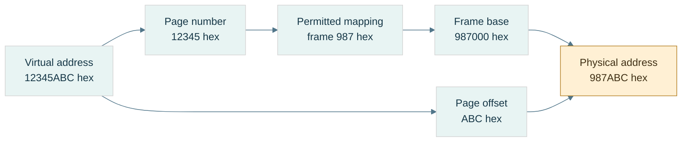
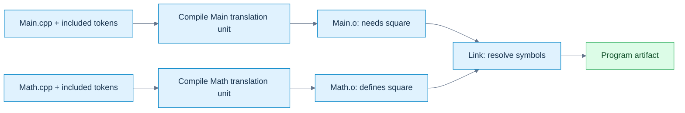

# 02 — How bytes become programs, objects, and resource references

[[Chapter Edition/03 - Game Engine/00 - Reading Map|Reading map]] · [[Chapter Edition/03 - Game Engine/01 - A game promise becomes bytes and running state|Previous chapter]] · [[Chapter Edition/03 - Game Engine/03 - Object representation, lifetime, and enforceable promises|Next chapter]]

The opening representation story now needs durable rules: a byte sequence must survive storage and become the right live object. This chapter follows encoding, compilation, initialization, and identity so that later systems can rely on the same meaning.

**By the end:** Reconstruct the path from serialized bytes to typed state and identify the lifetime and identity rules at each boundary.

**Recall question:** Given a stored resource record, how do you validate it, construct its runtime object, and keep references valid as storage changes?

<!-- Derived from Continuous Notes/Game Engine - From First Frame to Living Worlds.md; source lines 1285–3594; source-span SHA256 d198eacf85f288faf66d682427fb0c6afae9d28b0aa69c80cf5ffa0ba6d36870. -->

<!-- CHAPTER-SOURCE-BEGIN -->
## Where the bytes live

A good numeric interpretation is not yet usable storage. Representations must be placed at addresses, inside valid objects and mappings. Byte order, alignment, memory translation and ownership answer different questions; solving one does not automatically solve the rest.

### A value is not its address order

An **address** identifies a location in an address space. In our octet-based examples, consecutive addresses name consecutive eight-bit bytes. **Significance** means the positional weight of a byte in a multi-byte number. [[Endianness]] is the contract connecting significance to increasing addresses. It does not reverse the bits inside each byte.

Store the 32-bit unsigned value `0x12345678` at address `0x1000`:

| Address | [[Little endian\|Little-endian]] byte | [[Big endian\|Big-endian]] byte |
|---|---|---|
| `0x1000` | `78` — lowest significance | `12` — highest significance |
| `0x1001` | `56` | `34` |
| `0x1002` | `34` | `56` |
| `0x1003` | `12` — highest significance | `78` — lowest significance |

The value remains 305,419,896. Reading the little-endian bytes with a big-endian decoder instead produces `0x78563412`: an interpretation mismatch, not random corruption.

For unsigned value $x$ stored in $n$ octets, with byte index $i$ starting at zero:

$$
b_i^{\mathrm{LE}}=\left\lfloor x/256^i\right\rfloor\bmod256,\qquad
b_i^{\mathrm{BE}}=\left\lfloor x/256^{n-1-i}\right\rfloor\bmod256
$$

Each byte is a base-256 digit. Big-endian decoding uses the same Horner idea as positional decoding: start at zero, multiply by 256, add the next byte.

| Byte read | Decimal accumulator |
|---|---|
| `12` = 18 | 18 |
| `34` = 52 | $18\times256+52=4660$ |
| `56` = 86 | $4660\times256+86=1193046$ |
| `78` = 120 | $1193046\times256+120=305419896$ |

For little endian, add each byte with its weight: $120+86\times256+52\times256^2+18\times256^3$ gives the same answer.

[[Serialization]] means encoding data into a specified external byte sequence; **deserialization** reads and validates that sequence. A **wire format** is such a contract for transmission, though the same idea applies to files. Specify field widths, byte order, field order, version, valid values, and length limits. Do not rely on the native arrangement of a C++ object.

[[Byte swapping and network order|Byte swapping]] reverses the significance-byte order of a value. A host-to-network conversion swaps only if the host and required format differ. “Network order” conventionally refers to big endian in relevant Internet fields; it does not make every network protocol big endian. Treat each format as authoritative.

Lab: encode `0x12345678` both ways, decode with the matching rule, deliberately decode with the wrong rule, and write down all four resulting byte/value pairs. A correct round trip alone cannot prove the external format is correct: two consistently wrong functions can undo each other's mistake.

### Alignment is a placement requirement

[[Alignment and padding|Alignment]] $A$ means an object's start must lie at an address divisible by $A$. **Padding** is space inserted to satisfy placement or stride requirements; it is not an additional data member. In C++, `alignof(T)` reports the type's alignment and `sizeof(T)` its complete-object size in C++ bytes. `alignas` can request a supported stronger alignment. An [[ABI and object layout|ABI]], or application binary interface, specifies concrete conventions used when compiled components interact, including layout and calling conventions.

For numeric byte offset $p$ and positive alignment $A$, upward rounding is:

$$
\operatorname{alignUp}(p,A)=A\left\lceil p/A\right\rceil
$$

The ceiling $\lceil q\rceil$ is the smallest integer not less than $q$. For $p=13,A=8$, the next multiple is 16, so three bytes are skipped. If $p$ is already 16, it stays 16. A safe implementation can compute the remainder, determine the needed increment, then check that the increment fits before adding. For power-of-two $A$, `(p & (A-1)) == 0` tests alignment; the common `(p+A-1)&~(A-1)` shortcut still needs an overflow check and the power-of-two precondition.

Consider a record containing byte, 32-bit integer, byte, under explicitly assumed size/alignment pairs 1/1, 4/4, 1/1 and record alignment 4:

| Step | Cursor before placement | Required alignment | Member offset / occupied bytes | Cursor afterward |
|---|---|---|---|---|
| First byte | 0 | 1 | offset 0 / byte 0 | 1 |
| Integer | 1 | 4 | offset 4 / bytes 4–7 | 8 |
| Last byte | 8 | 1 | offset 8 / byte 8 | 9 |
| Finish record | 9 | 4 | tail padding bytes 9–11 | 12 |

Bytes 1–3 are [[Internal and tail padding|internal padding]]. Bytes 9–11 are **tail padding**. Why keep the tail? An array places the next record 12 bytes later; its integer then begins at $12+4=16$, still four-aligned. Without tail padding, a stride of 9 would misalign later members.

Six payload bytes therefore occupy twelve record bytes under this layout contract. This is a worked ABI example, not a universal language promise that every such record has these exact offsets. Observe `sizeof`, `alignof`, and `offsetof` on a suitable standard-layout type on the actual target. The language's general placement rules are in the [C++ alignment section](https://eel.is/c++draft/basic.align).

### Smaller records are not always faster records

[[Field reordering and AoS versus SoA|Field reordering]] can reduce holes. Assume fields with size/alignment 1/1, 8/8, 1/1, and 4/4. In that order, offsets are 0,8,16,20, ending at 24. Put the 8-byte field first, then the 4-byte field, then both bytes: offsets 0,8,12,13; end 14 rounds to 16. For one million records, that example reduces record storage from 24 MB to 16 MB in decimal units.

But reordering an exposed record can break an ABI, a file format, or positional initialization assumptions. Do not silently change a public contract for a size win.

**AoS**, array of structures, stores complete records next to each other. **SoA**, structure of arrays, stores one array per field. If a loop reads only positions from a position/color/id record, SoA can avoid loading irrelevant fields. If it reads every field of one object, AoS may suit the access pattern. **Locality** means nearby or repeatedly used data can be served efficiently; it is about the access pattern, not merely the smallest `sizeof`.

[[Packed structures and misaligned access|Packing directives]] are implementation extensions that can reduce or remove padding. They can place a member at an address that fails its ordinary alignment requirement. A **misaligned access** is an access at such an unsuitable boundary. Hardware may handle it slowly, tolerate it cheaply, or fault, depending on the instruction and platform. Crossing a cache-line or page boundary can add work. Hardware tolerance does not grant unrestricted valid C++ typed access.

A **cache line** is a block of nearby memory transferred and tracked by a data cache; its size is a target property. A packed structure is still not a portable wire format: packing does not specify endian order, version, or validation.

For external bytes, reconstruct an integer explicitly or copy a suitable representation into an existing aligned, trivially copyable object under the appropriate rules. **Trivially copyable** identifies types whose object representation can be copied in the ways C++ permits; it does not mean arbitrary bytes are a valid value of every type. Copying does not normalize endian order. Avoid casting an arbitrary byte-buffer address to a typed pointer and assuming that alignment, object lifetime, bounds, and representation are all solved.

### A pointer is more than an integer location

[[Pointer arithmetic and provenance|A pointer]] is a typed means of referring to an object or array position, subject to bounds, lifetime, and alignment rules. **Provenance** concerns its association with the storage/object from which the pointer originates; knowing a numeric address alone does not establish legal access.

Within an array, `p+i` advances $i$ elements, not $i$ bytes. For a four-byte element type, moving from element 0 to element 3 spans twelve bytes. The **one-past** pointer may be formed for valid array operations, but must not be dereferenced. **Dereference** means accessing the object through the pointer.

Separate four questions when checking an access:

1. Is the storage mapped and permitted by the machine/OS?
2. Is the location within the correct C++ object's or array's bounds?
3. Is a suitable object currently alive there?
4. Is the pointer/type/alignment valid for the intended operation?

A successful hardware load does not, by itself, answer the last three.

### Virtual memory translates page identity

[[Addresses and virtual memory|Virtual memory]] gives a process its own address-space view. A **process** is an executing program with an operating-system-managed context and resources. A virtual address is interpreted within that context; a physical address identifies backing memory at the hardware level in our simplified model.

[[Process isolation and page permissions|Isolation]] prevents one process from freely accessing another's private mappings. Process A's virtual address `0x400000` might select frame 27, while process B's same virtual number selects frame 913. Deliberate shared mappings can instead select the same frame. **Permissions** specify allowed access, such as read, write, execute, and user access.

A [[Pages and page offsets|page]] is a fixed-size block of virtual addresses; a **frame** is a corresponding physical-memory block. Page size is a system/configuration property. Use 4 KiB here as an example: **KiB** means 1024 bytes, so 4 KiB is 4096 bytes, not 4000.

For page size $P=2^k$, split virtual address $VA$ into virtual page number $VPN$ and byte offset $o$. If the mapping selects physical frame number $PFN$:

$$
VPN=\left\lfloor VA/P\right\rfloor,\qquad
o=VA\bmod P,\qquad
PA=PFN\,P+o
$$

Translation changes the page identity but preserves the offset. For $P=4096=2^{12}$:

| Stage | Value |
|---|---|
| Virtual address | `0x12345ABC` |
| Low 12 bits: offset | `0xABC` = 2748 |
| Remaining bits: VPN | `0x12345` |
| Example page-table result | PFN `0x987`, access permitted |
| Frame base | `0x987000` |
| Physical address | `0x987000 + 0xABC = 0x987ABC` |

[[Page tables and MMU|Page tables]] record mappings, permissions, and state. The **MMU**, memory management unit, is the hardware translation/protection mechanism. The [[TLB]], translation lookaside buffer, is a cache of translations. It is not a cache of the program's data bytes.

**Page-table walking** means consulting mapping structures to resolve a translation. Real systems commonly use multiple levels rather than one enormous flat table; the exact bit split is architecture-specific. A TLB hit can provide a cached translation. A TLB miss may cause a successful walk without any fault. A data-cache miss is yet another event: the address can already be translated while its contents are not cached.

[[Virtual and physical contiguity|Contiguous]] means adjacent without gaps in the relevant address space. A vector's contiguous virtual buffer can occupy consecutive virtual pages backed by scattered physical frames. Do not infer physical adjacency from `data()[i+1]` being the next element.

A useful scaling quantity is **TLB reach**: the approximate memory span represented by $E$ translation entries of page size $P$, namely $EP$ for a uniform-page simplified model. [[Huge pages and TLB reach|Larger pages]] can increase that span, but trade mapping granularity and allocation flexibility. No universal speedup follows.

### Figure B4 - Translation preserves the offset



**Read the figure:** assume 4-KiB pages, a present mapping, and permitted access. Replace the page identity with its physical frame identity and retain the low 12 offset bits. The arithmetic is $\mathtt{0x987000}+\mathtt{0xABC}=\mathtt{0x987ABC}$. **Limit:** frame 987 is an example mapping, not a prediction about a real process. A TLB caches translations; the data cache holds contents. Neither this translation nor a mapped address establishes C++ object lifetime or valid typed access.

### A fault is a request for intervention, not necessarily a crash

A [[Page faults and demand paging|page fault]] means the current translation/protection state cannot complete the access normally and requires operating-system handling. **Demand paging** supplies backing when first needed. A valid first access may allocate a zero-filled page or load file-backed data, then retry the instruction. Some faults require no disk I/O.

[[Copy-on-write]] lets mappings initially share data; a write that needs a private copy can fault, allocate/copy a frame, update permissions/mapping, and retry. In contrast, an unmapped address or forbidden write may be rejected and reported as a program failure.

Trace the distinction:

```text
access virtual address
→ cached translation available? if not, resolve translation
→ mapping present and access permitted? complete access
→ otherwise invoke fault handling
→ legitimate demand/COW case? establish mapping and retry
→ invalid/prohibited access? report failure
```

This is a teaching model; exact ordering and mechanisms vary. The important separation is **TLB miss ≠ page fault ≠ disk read ≠ program crash**.

[[Memory-mapped files]] connect file-backed storage to a virtual mapping, often lazily. The mapping is not simply “the file in RAM,” and modifying mapped bytes is not automatically proof of crash-durable publication.

### Storage, lifetime, ownership, and placement are different axes

[[Storage duration and object lifetime|Storage duration]] describes how long storage is available. **Object lifetime** describes when a particular object exists in that storage. **Ownership** identifies who is responsible for releasing a resource. **Placement** is where an implementation puts it. They answer different questions.

| Example | Duration / owner | Typical placement, not a language guarantee | Failure to watch |
|---|---|---|---|
| Local scalar | automatic duration | stack slot or register; possibly optimized away | pointer used after lifetime ends |
| Local vector object | automatic object; owns dynamic buffer | small control object separate from allocated elements | reallocation invalidates views |
| Dynamic allocation | lasts until released by owner | allocator-managed region, often called heap | leak, double release, stale pointer |
| Namespace/static object | static duration | data/zero-fill regions when storage is emitted | initialization-order assumptions |
| Thread-local object | thread duration | implementation-managed thread-local storage | use after owning thread/lifetime ends |

A [[Call stack and stack frames|call stack]] conventionally manages nested calls in LIFO order: **last in, first out**. A **frame** holds return information, saved state, spill slots, and some locals. A **spill** is a value stored to memory when it cannot remain in a register. Downward stack growth is a convention, not a universal law. Returning a pointer to a local does not preserve the local's lifetime just because its old bytes remain.

[[Dynamic allocation and heap|An allocator]] divides larger memory regions into blocks for requests with variable lifetimes. **Metadata** is bookkeeping about those blocks. [[Allocator fragmentation|Internal fragmentation]] is unused capacity inside an allocated block: requesting 37 bytes in a 48-byte size class leaves 11 bytes of slack. **External fragmentation** is separated free space that cannot satisfy a particular contiguous request: two free 16-byte holes are not necessarily a usable 24-byte block. Total free bytes alone do not determine allocation success.

[[Static storage and initialization|Static data]] commonly separates initialized writable data from zero-fill regions such as BSS. **BSS** is a conventional zero-initialized-storage region name; the executable need not contain one literal zero byte for every byte that will be zero-filled. Static duration does not mean initialization has no runtime work.

[[Read-only data and code|Text]] conventionally names instruction storage; read-only regions often hold literals/constants. These region names and exact layouts are platform choices. `const` is a C++ access/type constraint, not a command to put every const local in read-only memory. Modifying a string literal is undefined behavior. **W^X**, writable-or-executable policy, restricts mappings that are simultaneously writable and executable; details vary by platform. [[ASLR]], address-space layout randomization, varies mapping locations, so a textbook memory diagram is not a fixed address map.

[[Ownership and non-owning views|A span]] is a non-owning view of elements; it neither copies the buffer nor extends its lifetime. If the owner dies or the vector reallocates, the view can dangle. **Dangling** means it refers to storage/object state no longer valid for that access.

Finally, [[Atomic publication and durability|atomic publication]] makes a replacement visible as one namespace operation under the relevant platform contract. **Durability** means the required data survives a crash under a defined persistence protocol. Correct byte encoding, atomic replacement, and durable storage are three separate checks.

### Memory laboratory and teaching checkpoint

Use the code companion to run three experiments: byte-order round trips including unaligned *byte-buffer offsets*; checked numeric alignment; and reported object offsets/sizes. Unaligned byte decoding is not permission to make misaligned typed accesses.

Then classify these failures before fixing them:

| Observation | First distinction to investigate |
|---|---|
| `0x12345678` comes back as `0x78563412` | byte-order contract |
| An array member becomes misaligned | record stride, padding, ABI |
| A first access faults but then succeeds | valid demand/COW handling |
| A span fails after vector growth | ownership and invalidation |
| A complete file disappears after a crash | persistence protocol, not just serialization |

For a teaching demonstration, draw byte addresses, record padding, and page translation separately before connecting them. Ask the learner to derive the 12-byte record, explain why the page offset stays `ABC`, and distinguish a TLB miss from a fault. Further proof and tested code remain in [[Chapter Edition/01 - Computing Foundations/11 - C++ Const, Borrowing, and CPU–GPU Buffering#M003 - Byte order, layout, and translation|the derivation companion]] and [[Supplementary/Code Snippets#M003 - Explicit byte codecs and checked alignment|the code companion]].

## Bytes become a durable agreement

An object's native bytes belong to one program environment. A file must carry enough agreement for a reader on another day or machine. We separate copying a representation, specifying the external schema, validating a parser, detecting changed content, and interpreting a dump.

### Representation copying and numeric conversion answer different questions

A value is now chosen, but the file needs bits. [[Bit casting and representation|Bit casting]] copies a suitable object representation into another same-sized trivially copyable type; **numeric conversion** asks for a value in a new numeric domain.

On the checked binary32 host, converting `1.0f` numerically to uint32 gives 1. Copying its representation with `std::bit_cast<uint32_t>` gives `0x3F800000`. Neither operation changes the memory address order by itself. Encoding that integer word little-endian gives `00 00 80 3F`; big-endian gives `3F 80 00 00`.

The C++ constraints include matching size and trivially copyable source/destination, but padding, invalid target representations and uninitialized storage still require care. The [bit-cast draft section](https://eel.is/c++draft/bit.cast) is a current working draft; this lab uses a C++23 baseline and fully initialized scalar representations, not arbitrary-class reinterpretation.

Accessing a float through a uint32 pointer does not become valid because the pointer sizes match. Copy bytes using bit_cast or an appropriate memcpy into an existing suitable object; then apply the external byte-order codec. Neither grants arbitrary typed access to a byte buffer.

**Book bridge:** Game Engine Architecture, PDF pages 129–130 (printed 107–108), explains why members must be endian-converted field by field. It also shows older pointer/union-punning techniques. We retain the field-contract insight, not those techniques as a portable modern C++ implementation.

### A file is a promise to a reader you have not met yet

[[Binary format contracts|A binary format contract]] declares field widths/order, integer signed interpretation, byte order, float format, valid values, lengths, padding, versioning, and any integrity coverage. An **ABI** tells compiled components how native objects interact; an external schema is a different agreement. Saving a whole struct makes its layout/padding/platform assumptions part of the file unless you explicitly constrain and validate them.

**Magic** is a fixed identifying byte sequence, not a secret. **Version** selects a declared schema revision. They do not authenticate a sender, detect every payload change, or validate dimensions. A **payload** is the represented content after or within the container's metadata. A file's offsets are positions in that byte sequence, not automatically live pointers.

The NanoQuant source excerpt describes a regular tensor header with eight magic bytes, uint32 version, uint64 rows and uint64 columns: 28 bytes when written field by field. Its scalar helper writes native bytes, and its payload writes native floats. This is a source-reported portability risk, not a fresh audit of the repository. A clear field order can coexist with unspecified cross-endian behavior.

A portable teaching format can explicitly choose little-endian integers and IEEE binary32 words. It must additionally state whether it preserves all zero/NaN encodings or canonicalizes them. A checksum/hash over bytes sees different NaN payloads as different content; a numeric equality policy can see two zeros as equal. Decide the identity contract first.

For an INT4 container, the source reports 52 header bytes followed by binary32 scales and packed codes. Verify scale count against dimensions/group size, code count against shape, finite positive scales where required, and the final padding convention. A magic match is not permission to trust every following field.

### Validate lengths before performing the arithmetic they request

[[Checked binary parsing|Parsing]] is interpreting an encoded sequence under a schema. An untrusted file can contain dimensions chosen to make a size calculation wrap. “Check the final size” is too late if you computed the wrong wrapped size.

For uint64 factors $a,b$, validate $a=0$ or $b\le\mathrm{MAX}/a$ before multiplying. For a byte span of size $L$, check $o\le L$ and $n\le L-o$ before a read. For payload bytes $P$ after header $H$, first require $H\le L$, then compare $P$ with $L-H$. Check representability in size_t and a practical resource limit before allocating.

A declared maximum tensor size is a **resource limit**: a policy limiting memory/time even if the mathematical shape fits uint64. Reject zero dimensions if the format disallows them. Decide whether trailing bytes are an error, an extension, or another record; the teaching parser requires exact length.

A file mapping avoids a copying decode loop only when its representation, alignment, bounds, permissions and object-access/lifetime rules permit that use. Offset 28 being divisible by four addresses only one condition under a conventional page-aligned mapping and four-aligned float. It does not alone create a C++ float array, normalize endianness, validate its length, or extend the mapping's lifetime.

### Correct decoding is not proof that the bytes survived

[[Checksums CRCs and hashes|Integrity]] asks whether content matches a declared reference. An additive checksum $\sum_i b_i\bmod256$ cannot distinguish `01 02` from `02 01`; equal and opposite byte changes also cancel.

A **CRC**, cyclic redundancy check, treats a bit sequence as coefficients of a polynomial over **GF(2)**, the two-element field where addition/subtraction are XOR. Dividing a shifted message polynomial by a generator leaves a remainder. A specified CRC includes polynomial, initialization, bit reflection/order, final XOR, and covered byte range. “CRC32” alone is incomplete. Error-detection guarantees depend on those parameters and message length; it is not an adversarial authentication mechanism.

The lab implements CRC-32/ISO-HDLC: reflected polynomial `0xEDB88320`, initial all ones, final XOR all ones, reflected byte processing. The independent check string `123456789` must give `0xCBF43926`. [RFC 1952's CRC sample](https://www.rfc-editor.org/rfc/rfc1952#section-8) provides an independent algorithm reference for this reflected convention. This is an error-detection demonstration; no CRC field is retroactively claimed to exist in NanoQuant's source format.

A **hash** maps content to a fixed-size digest. Noncryptographic hashes prioritize fast useful fingerprints; a **cryptographic hash** has security goals such as making preimage/collision search impractical. A **preimage** is an input producing a specified digest. A **collision** is two different inputs with the same digest. A **threat model** declares which mistakes or adversary actions the system intends to resist.

[[Integrity and authenticity|Even a cryptographic digest is not authenticity]] by itself if an attacker can replace both file and digest. A trusted digest, a **MAC** (message authentication code under a secret key), or a **digital signature** verified under a trusted public key supplies an additional trust mechanism. SHA-256 is defined in [NIST's Secure Hash Standard](https://csrc.nist.gov/pubs/fips/180-4/upd1/final); this lab does not implement a cryptographic hash, MAC, or signature.

All finite digests have collisions for unrestricted input lengths: there are more possible messages than digest values. For an ideal $h$-bit hash, a *specific independent* accidental match has probability about $2^{-h}$; among many samples, birthday-style collision risk grows with the number of pairs. Those are models, not guarantees for arbitrary checksum algorithms.

Specify coverage: payload only, header plus payload, or canonical logical content. If dimensions are unprotected, a changed shape can reinterpret an unchanged payload. State how the digest field itself is excluded or zeroed for calculation. Integrity, schema validity, semantic correctness, authenticity, atomic publication and crash durability remain separate questions.

### Read a dump by reversing the contract

[[Memory dump interpretation|A hex dump]] displays byte offsets, hexadecimal octets, and optionally printable characters. It does not label a region as an object or prove that typed access would be legal. Establish a trusted schema hypothesis, validate it, then decode.

Our source-shaped demonstration chooses explicit little endian and a 2×3 binary32 payload $[1,-2,0.5,3.25,0,10]$:

| Offset | Bytes | Interpretation under this schema |
|---|---|---|
| 0000 | 4E 51 54 4E 53 52 30 31 | ASCII magic NQTNSR01 |
| 0008 | 01 00 00 00 | uint32 version 1 |
| 000C | 02 00 00 00 00 00 00 00 | uint64 rows 2 |
| 0014 | 03 00 00 00 00 00 00 00 | uint64 columns 3 |
| 001C | 00 00 80 3F | word 3F800000, value 1 |
| 0020 | 00 00 00 C0 | word C0000000, value −2 |
| 0024 | 00 00 00 3F | word 3F000000, value 0.5 |
| 0028 | 00 00 50 40 | word 40500000, value 3.25 |
| 002C | 00 00 00 00 | positive zero |
| 0030 | 00 00 20 41 | word 41200000, value 10 |

Header length is 28 (hex 1C), payload length $2(3)(4)=24$, and total length 52 (hex 34). ASCII, American Standard Code for Information Interchange, maps these selected byte values to characters; it is not a universal text decoder for every file.

Decode the first payload word: sign 0, exponent 127, fraction zero give $1\cdot2^0=1$. For `40500000`, exponent 128 gives scale two; fraction gives $1.101_2=1.625$, so value is 3.25. For `41200000`, exponent 130 and significand 1.25 give 10. All six payload values can be checked independently against the diagram.

The same `00 00 80 3F` bytes are unsigned octets [0,0,128,63], little-endian uint32 1065353216, or binary32 1. As two little-endian uint16 fields they give [0,16256]. None is “the meaning” without an interpretation contract.

Flip payload byte 80 to 00: binary32 1 becomes 0.5 while file length, version and magic stay plausible. Structural validation does not detect this numeric substitution. An independently stored CRC over the original bytes distinguishes this particular change, but matching CRC is not proof that every possible corruption or attack was excluded.
## The complete journey - Encode, compute, store, and investigate

Return to the lamp at the beginning. Its physical ranges became a logical bit; a group of bits acquired a schema. A count became an unsigned integer, a direction needed signed values, and fractions forced a choice between a fixed and stretching ruler. Arithmetic exposed finite range, rounding and sensitivity. Smaller codebooks traded recoverable detail for storage. Placement then added addresses, alignment, mappings and lifetime. Serialization made an external promise; integrity and debugging let us investigate whether that promise survived.

Take one weight −3.2 at scale one. Quantization chooses signed level −3, offset coding gives nibble 5, pairing with code 11 gives byte B5. A file must also preserve the scale, shape, packing order and count. The parser validates these, unpacks 5 and 11, subtracts eight, and reconstructs −3 and 3. Packing and parsing can be exact while the original −3.2 is not recovered. That loss happened upstream, by design.

For teaching, reconstruct one route completely before comparing it to another. Use the diagrams and hand traces here, the derivation companion for proofs, and the code companion for observable checks. The coverage ledger records where source material came from; it is not the order in which someone must teach.

### A laboratory that tests the contracts, not just matching functions

The cumulative program retains the earlier fields, ALU, byte-layout, floating representation and arithmetic experiments. Its new laboratory adds:

- Fixed conversion of 3.25 to raw 212992; feasible range/step choices; positive/negative ties; multiplication/division, zero-divisor and destination-overflow rejection.
- INT4 nibble pairs against independent expected bytes, odd counts and invalid codes; group reconstruction and outlier-induced zeros.
- UNORM/SNORM endpoints; binary16 decoding; BF16 midpoint conversion, zeros, infinities and canonical NaN handling.
- The complete 52-byte 2×3 image against a manually specified byte array, decode from an odd byte-buffer offset, and raw special-value word preservation.
- Wrong magic/version, truncated files, enormous wrapped-shape attempts, zero dimensions, resource-limit rejection and trailing bytes.
- CRC check string, additive-checksum collision, and the one-payload-bit example that structural checks miss.

Property-style checks supplement these examples: all 256 nibble pairs; every finite binary16 and BF16 word reconstructed/re-encoded under the lab's stated conventions; a seeded set of fixed products checked against an independent reference; and bit/byte corruption checks on the finite teaching image. Their finite scopes are explicit; they are not exhaustive validation of every C++ program, device, parser or cryptographic protocol.

### Diagnose the layer before changing the implementation

| Observation | First hypothesis to test |
|---|---|
| A count becomes negative when its high bit changes | signed versus unsigned interpretation |
| Fixed multiplication fails only at large operands | intermediate width before rescaling |
| Small weights vanish beside one outlier | calibration/codebook resolution, not packing |
| Byte 128 samples near 0.502 | expected UNORM8 reconstruction |
| A half-format value becomes infinity | range versus precision allocation |
| Repeated updates disagree | rounding tree, persistent narrowing, or mathematically history-dependent policy |
| A file swaps 12345678 into 78563412 | byte-order mismatch |
| A plausible same-size file contains a changed value | integrity coverage, not merely structural validation |
| A pointer reaches mapped memory but is invalid | object bounds, lifetime, alignment and permitted access |

A useful future experiment changes one representation policy while holding input/task constant: vary group size, record actual bytes including metadata, error metrics and a task result, then separately measure execution time under a declared machine/build. Those experiments are proposed, not performed in the teaching merge.

The next subject is C++'s object model: how declarations and definitions turn into a program, how names and objects acquire identity, and how lifetimes and value categories constrain use. The bytes learned here are necessary evidence, but they are not the whole language contract.


## Reading provenance and enrichment

The supplied M001–M006 texts define the accepted curriculum content. Explanatory bridges, original traces, and the prologue were added to make that content teachable. Sources below inform the explanation; they are not reproduced as textbook passages. All source-reported repository findings remain source-reported claims; independent wording checks, canonical-code tests and merge corrections are recorded in Sources and Code Anchors.

- **Integrated 180-chunk planning PDF**, page 15: M001–M006 cover Parts 1–100 with exact ranges retained in the coverage ledger. Pages 16–17 divide C++ Parts 101–300 into twelve chunks across two phases. The PDF is a planning reference, not an instruction source.
- **Game Engine Architecture**, iCloud `Game/Game Engine Architecture.pdf`, PDF pages 127–130 (printed 105–108), 136–138 (114–116), and 143–147 (121–125): byte order, memory regions, layout and alignment. Its older machine-specific examples are not universal rules; this volume states layout assumptions and separates language validity from hardware behavior.
- **Bjarne Stroustrup, A Tour of C++ (2014)**, iCloud `CPP/A Tour of C++ - Bjarne Stroustrup (Addison-Wesley, 2014)(193p).pdf`, PDF pages 16–22 (printed 5–11): types, arithmetic, narrowing, scope, pointers and references. Used for teaching structure, not as authority for every current C++23 detail.
- Local course notes **Part 1: CPU — From Electricity to Working CPU**, PDF pages 2–6, and **Part 7: Virtual Memory, Page Tables, TLBs, Page Faults**, pages 1–6, in iCloud `MATHCPUGPU`: secondary background for physical/logical state and translation. These are course notes, not claimed as independently verified textbook authority.
- History: [Computer History Museum's Buchholz entry](https://www.computerhistory.org/tdih/october/24/) and [IBM's System/360 history](https://www.ibm.com/history/system-360). The prologue gives a short contextual history, not an exhaustive claim about the first binary machine or first eight-bit design.
- C++ language checks: the linked draft sections in the story, plus [storage duration](https://eel.is/c++draft/basic.stc) and [endianness facilities](https://eel.is/c++draft/bit.endian). Platform layout values remain observations to measure, not draft guarantees.

Exact source records, code commands and verification limitations are maintained in [[Supplementary/Sources and Code Anchors]]. Existing longer traces remain reusable in [[Supplementary/Worked Traces]]; none is required to supply a missing foundational explanation in this volume.

- **Additional book enrichment:** Game Engine Architecture, PDF pages 121–122 (printed 99–100), and 129–130 (107–108), read during the narrative rewrite. The scaled-integer versus sign/magnitude distinction, field-by-field serialization insight, and outdated punning caveats are explained at their points of use. The page 122 figure/body discrepancy is not silently inherited.


> Volume 02 · accepted sources M007–M010, Parts 101–160 · 4 of 12 planned chunks (M007–M018, planned Parts 101–300). The revised M007 deepens existing coverage; it is not counted twice. This is a growing subject narrative, not a completed C++ course. Coverage beyond Part 160 remains pending.

## Prologue - Bytes need rules before they become a program

The previous volume taught us to encode, calculate, place and preserve information. Now ask why a buffer full of plausible bits can still be illegal to access in C++. Hardware can calculate an address; the language must establish what object exists there, which operation its type permits, and whether its lifetime is still active. A compiler optimizes against those rules, not against our hope that the bits look right.

C++ grew from C's low-level facilities while adding user-defined types and abstraction. It keeps separate compilation: a caller can know an interface without compiling every implementation into the same source file. That choice creates our first problem—how independently processed files agree about names and entities. Once they agree, a second problem begins—how the resulting process creates, uses and destroys objects. Layout is where those two stories finally meet the bytes again.

An **entity** is a language-level thing such as a type, function, object or template. An **object** has storage, type, lifetime and state; a function is an entity but not an object. A **variable** is introduced by a declaration of an object or reference; a reference is not itself an object. A **type** establishes a set of possible values and permitted operations. The **abstract machine** is the language's behavioral model; a real compiler may rearrange or remove physical storage when the required observable behavior is preserved.

This volume keeps independent examples inline. Short `cpp` fragments illustrate a local rule and may rely on the named surrounding declarations; they are not all independent programs to concatenate. Complete runnable examples are explicitly marked as laboratories. Project excerpts remain in the existing companion. We will revise and weave the whole twelve-source volume as the later material arrives; no numbered part is a teaching chapter.

## What we bring from the byte story

this opening chapter assumes M001, M003, and M005. That means I will assume you already understand bits/bytes and integer representations; addresses, alignment, padding, memory regions and virtual address spaces; and floating-point representation/error. The three prerequisite ideas you specifically need active in your head are:

| Dependency | What this opening chapter needs from it |
|---|---|
| M001 | A value ultimately has some machine representation in bits, but the **type** determines what those bits mean. |
| M003 | An address names a location in an address space; objects have alignment requirements; structures may contain padding. |
| M005 | `float`/`double` are machine representations with implementation/platform properties, not mathematical real numbers. |

Now we add the missing layer:

> **C++ is not a language where “variables are bytes in RAM.” C++ defines entities, objects, lifetimes, types, storage, identities and permitted operations. The compiler maps that abstract machine onto bytes and instructions.**

That distinction is the heart of Phase 2.

## The journey from text to a live object

Think of this opening chapter as this pipeline:

```text
SOURCE TEXT
    │
    ├── preprocessing / module dependency processing
    │
    ▼
C++ TRANSLATION UNIT / MODULE UNIT
    │
    ├── declarations establish names and types
    ├── lookup determines what names mean
    ├── definitions provide complete entities
    ├── ODR determines which definitions may coexist
    │
    ▼
COMPILER
    │
    ├── type checking
    ├── template instantiation
    ├── semantic analysis
    ├── optimization
    ├── code/data generation
    │
    ▼
OBJECT FILES
    │
    ├── machine code
    ├── symbols
    ├── relocation records
    ├── static data
    │
    ▼
LINKER
    │
    ├── resolves symbols
    ├── lays out executable sections
    ├── fixes references/relocations
    │
    ▼
EXECUTABLE / SHARED LIBRARY
    │
    ▼
RUNNING PROCESS
    │
    ├── storage becomes available
    ├── objects begin lifetime in that storage
    ├── names/references/pointers may designate objects
    ├── objects have identities and representations
    ├── class layouts determine member locations
    │
    ▼
OBJECT LIFETIME ENDS
    │
    └── storage may disappear OR may remain/reuse
```

The critical distinctions we will maintain throughout the chunk are:

| Concept | Question it answers |
|---|---|
| **Scope** | Where can this *name* be found? |
| **Name lookup** | Given this spelling here, which declaration does it refer to? |
| **Linkage** | Can declarations in different places denote the same entity? |
| **Storage duration** | For how long does the storage exist? |
| **Object lifetime** | During what interval does a typed object actually exist in that storage? |
| **Identity** | Which particular object is this? |
| **Address** | Where is it currently located? |
| **Value** | What state does it currently contain? |
| **Layout** | Where do its members/bytes occur relative to one another? |
| **Module visibility/reachability** | Which declarations can an importer see/use? |

These are **not synonyms**. Most difficult C++ bugs happen because two of them are mentally collapsed into one.

## Giving a program a buildable shape

### Figure CPP-01 - Two build lanes meet at the linker



**Read the picture:** the caller compiles against a declaration; the linker connects its unresolved call to the separately supplied definition. A missing declaration/type normally fails during translation; a missing required definition commonly fails at linking. **Limit:** this depicts the traditional example below, not a mandatory compiler implementation. Modules additionally need interface dependency ordering; a successful link does not prove ODR or runtime correctness. [[Visual Recall/02 - C++ - Objects, Ownership and Lifetime - Visual Recall#Four figure briefs|Recall this figure]].

The classic separate-compilation model lets clients compile against an interface while implementations are compiled separately. That sentence sounds elementary. The implications are not.

### The traditional translation model

Suppose you have:

```cpp
// Math.hpp
#pragma once

float square(float x);
```

```cpp
// Math.cpp
#include "Math.hpp"

float square(float x)
{
    return x * x;
}
```

```cpp
// Main.cpp
#include "Math.hpp"
#include <iostream>

int main()
{
    std::cout << square(3.0f) << '\n';
}
```

A simplified build is:

```text
Math.cpp
   │ preprocess
   ▼
Math translation unit
   │ compile
   ▼
Math.o
                         ┐
                         │
Main.cpp                 │
   │ preprocess          │
   ▼                     │
Main translation unit    ├── linker ──> executable
   │ compile             │
   ▼                     │
Main.o                   ┘
```

The classic separate-compilation model lets clients compile against an interface while implementations are compiled separately. Conceptually, commands might look like:

```bash
clang++ -std=c++23 -c Math.cpp -o Math.o
clang++ -std=c++23 -c Main.cpp -o Main.o
clang++ Main.o Math.o -o app
```

The first two commands **compile** independently. The third **links**. That distinction explains two major categories of errors.

### Compile-time error

```cpp
int main()
{
    UnknownType x;
}
```

The compiler cannot establish the semantics of the [[Translation units and linking|translation unit]].

### Link-time error

```cpp
int f(int);   // declaration

int main()
{
    return f(10);
}
```

This can compile perfectly. The compiler knows:

```text
f:
    accepts int
    returns int
```

It can generate a call instruction containing a symbol reference. But if nobody defines `f`, the linker eventually sees:

```text
Main.o needs symbol f(int)
No object/library provides symbol f(int)
```

and reports something like:

```text
undefined reference to f(int)
```

or Apple's equivalent:

```text
Undefined symbols for architecture arm64
```

That is why “my code compiled” and “my program built” are not identical statements.

### What preprocessing actually is

In traditional source code:

```cpp
#include "Math.hpp"
#define COUNT 16
#if DEBUG_MODE
...
#endif
```

these are processed before normal C++ semantic analysis. The [[Preprocessing and macro boundaries|preprocessor]] largely manipulates **tokens**, not C++ types. If you write:

```cpp
#define SQUARE(x) x * x
```

then:

```cpp
SQUARE(a + b)
```

may become:

```cpp
a + b * a + b
```

not:

```cpp
(a + b) * (a + b)
```

The preprocessor does not think:

> “I am invoking a mathematical function.”

It performs token replacement. Even the safer macro:

```cpp
#define SQUARE(x) ((x) * (x))
```

still has:

```cpp
int i = 3;
int result = SQUARE(++i);
```

which expands conceptually into:

```cpp
((++i) * (++i))
```

and now you have duplicated evaluation and undefined behavior here: the two increments are unsequenced relative to each other. Modern C++ tries to move as much work as possible out of the preprocessor and into typed language mechanisms:

```cpp
constexpr int square(int x)
{
    return x * x;
}
```

That gives type checking, scope, debugger visibility, normal evaluation rules, and compiler diagnostics.

### What `#include` really means

A traditional include is approximately textual inclusion.

```cpp
#include "Vector.hpp"
```

does not mean:

> “Dynamically connect to an independently existing Vector interface.”

Conceptually it means:

```text
Take tokens from Vector.hpp
insert them here
continue preprocessing
```

If twenty `.cpp` files include a 20,000-line template header, the frontend may process much of that interface twenty times. This is one major reason C++ build systems became expensive. Header guards:

```cpp
#ifndef VECTOR_HPP
#define VECTOR_HPP

// declarations

#endif
```

or:

```cpp
#pragma once
```

prevent repeated inclusion **within a translation unit**. They do **not** solve program-wide ODR mistakes. That distinction becomes important in the connected explanation.

### What compilation produces

An object file usually contains much more than raw instructions:

```text
.text        machine instructions
.rodata      constants/read-only data
.data        initialized writable static data
.bss         zero-initialized static data, conceptually
symbols      names known to the linker
relocations  places the linker must repair
debug info   when requested
unwind info
metadata
```

Exact sections depend on the object format:

```text
ELF      Linux and many Unix-like systems
Mach-O   macOS/iOS
COFF/PE  Windows
```

The C++ standard does not prescribe those formats. They are platform/toolchain concerns.

### What the linker actually does

Suppose `Main.o` contains a call to `square(float)`. The compiler does not necessarily know the final numerical address of `square`. It can emit something conceptually like:

```text
CALL <square symbol>
```

with a relocation record saying:

```text
When the final binary is laid out,
replace this placeholder with whatever address/offset
square ends up at.
```

The linker builds the final symbol graph:

```text
Main.o:
    requires square(float)

Math.o:
    defines square(float)

resolve
    ↓

Main call → Math definition
```

It also discovers impossible programs:

```text
Main.o needs f()
No definition
```

or:

```text
A.o defines x
B.o defines x
Both claim the same externally-linked entity
```

That second case takes us directly into the ODR.

### Name mangling

C++ supports:

```cpp
void process(int);
void process(float);
void process(const char*);
```

The machine linker does not understand C++ overload resolution. Therefore the compiler commonly encodes type information into symbol names. Conceptually:

```text
process(int)          → some mangled symbol A
process(float)        → some mangled symbol B
process(char const*)  → some mangled symbol C
```

The exact scheme is ABI-specific. This is why two compilers—or two versions configured with incompatible ABIs—can sometimes fail to link even when the C++ source-level declaration “looks identical.” It also explains why `extern "C"` exists:

```cpp
extern "C" void vulkan_callback(...);
```

It selects C language [[Linkage and entity ownership|linkage]], typically suppressing normal C++ name mangling for interoperability. Full C/C++ ABI interoperation comes later, but the root begins here.

## A compiled interface rather than repeated text

A named [[C++ modules and reachability|module]] communicates declarations through a compiler-produced interface. A **module unit** is a translation unit belonging to a module; an **interface unit** supplies its public interface. A **BMI** is a binary module interface: compiler-specific semantic information, not a portable object-file format. It helps the importer compile; an object file supplies code/data for linking. Supplying one does not substitute for the other.

`module;` starts a **global module fragment**, where traditional includes can appear before `export module Math;`. An export declaration exposes declarations to importers. Some implementation details must be reachable for interpreting an exported type or template without becoming freely findable by ordinary [[Scopes and name lookup|name lookup]]. Visibility (finding a declaration) and reachability (using its semantic information) are related, not identical.

A named-module import does not textually paste a header and generally does not import its macros. Header units are different: they can make macros available. Build order must make a suitable compiled interface available before compiling importers. Compiler options and versions must match the toolchain's compatibility requirements. The exact BMI construction and naming are build-system matters; never teach a PCM as a cross-compiler interchange format. The complete standalone Math example appears under **Following one call through the build** below. Project-specific Kairo fragments belong in [[Supplementary/Code Snippets#Source-reported C++ project excerpts|the project excerpt companion]], not in this independent example.

### Modules versus `#include`

This distinction matters enormously:

```cpp
#include "foo.hpp"
```

is essentially preprocessing/textual inclusion.

```cpp
import foo;
```

means the compiler imports a module interface. The importer generally does not receive arbitrary macros from the imported module. That is deliberate. Macros are preprocessing state. Modules try to give you a language-level dependency boundary. This helps with:

```text
build scalability
macro isolation
interface ownership
dependency correctness
ODR hygiene
```

You will study modules much more deeply in the later generic-programming chapters, but this opening chapter gives you the underlying translation reason they exist.

## Promises become definitions

This distinction must become instinctive. Consider:

```cpp
int f(int);
```

This tells the compiler:

```text
There exists an entity named f.
It is a function.
Parameter: int.
Result: int.
```

It does not say how `f` works. That is a **declaration**. Now:

```cpp
int f(int x)
{
    return x * 2;
}
```

This provides the function body. That is a **definition**. And because it also introduces/describes the function, every definition is also a declaration.

### Objects

```cpp
extern int frameCount;
```

declaration only. Somewhere:

```cpp
int frameCount = 0;
```

definition. The definition causes the program to have an object named `frameCount`. An interesting special case:

```cpp
extern int frameCount = 0;
```

Despite `extern`, the initializer makes this a **definition**. Do not memorize `extern = declaration`. Understand the rule.

### Classes

```cpp
struct Renderer;
```

declares an incomplete class type. The compiler knows:

```text
Renderer is a type.
```

It does not yet know:

```text
sizeof(Renderer)
members
alignment
complete layout
```

So this works:

```cpp
Renderer* renderer;
Renderer& getRenderer();
```

because these declarations do not require a complete Renderer. A reference need not be implemented as a separate pointer-sized object. This does not:

```cpp
Renderer renderer;
```

because the compiler must know how much storage the object requires. Later:

```cpp
struct Renderer
{
    int width;
    int height;
};
```

defines it. This is why forward declarations reduce compile dependencies.

### Enumerations

This is legal:

```cpp
enum class TextureState : std::uint8_t;
```

This opaque enum declaration fixes the underlying type and makes the enum a complete type, despite not yet listing its enumerators. Unlike a forward-declared class, its size is already known. Later:

```cpp
enum class TextureState : std::uint8_t
{
    Unloaded,
    Loading,
    Ready,
    Failed
};
```

defines it.

### Templates complicate the old declaration/implementation split

You may think:

```cpp
// Header
template<class T>
T add(T, T);

// cpp
template<class T>
T add(T a, T b)
{
    return a + b;
}
```

works like a normal function. Usually it does not for arbitrary `T`. When another translation unit instantiates:

```cpp
add<float>(1.f, 2.f)
```

the compiler typically needs the template definition available. That is one reason templates traditionally live in headers. Modules give us a better distribution mechanism, but template instantiation semantics still exist. We will go fully into this during the later generic-programming chapters.

## Many files must describe one coherent program

The **[[One Definition Rule|One Definition Rule]]**, ODR, is where declarations, translation units and linking meet. Suppose we allowed:

```cpp
// A.cpp
int gravityScale()
{
    return 2;
}
```

and:

```cpp
// B.cpp
int gravityScale()
{
    return 17;
}
```

and both are meant to be the same externally linked function. Now:

```cpp
gravityScale()
```

has no coherent program meaning. Which definition is *the function*? The ODR prevents this semantic fracture.

### The common program-wide rule

For ordinary non-`inline`, non-template externally linked functions/objects, you want a single program definition. For example:

```cpp
// Renderer.hpp

extern int gFrameIndex;
```

```cpp
// Renderer.cpp

int gFrameIndex = 0;
```

Every user may see the declaration. Exactly one implementation file owns the definition.

### The classic header mistake

Bad:

```cpp
// Config.hpp

int gDebugMode = 1;
```

Then:

```cpp
// Renderer.cpp
#include "Config.hpp"
```

and:

```cpp
// Physics.cpp
#include "Config.hpp"
```

Textual inclusion creates conceptually:

```text
Renderer translation unit:
    int gDebugMode = 1;

Physics translation unit:
    int gDebugMode = 1;
```

Now there are two definitions. Header guards do not save you. They prevent:

```text
Config.hpp
Config.hpp
Config.hpp
```

from being processed repeatedly **inside the same translation unit**. They do not stop a different translation unit from independently receiving the definition.

### Two modern solutions

One traditional solution is:

```cpp
// Config.hpp
extern int gDebugMode;

// Config.cpp
int gDebugMode = 1;
```

A C++17+ solution, when a genuine globally accessible variable is appropriate:

```cpp
inline int gDebugMode = 1;
```

An inline variable may have equivalent definitions in multiple translation units under the ODR rules. Important:

> `inline` in C++ does not fundamentally mean “the CPU call will be replaced by the body.”

That meaning is historical. The optimizer may inline a function without the `inline` keyword and decline to inline one with it. At the language level, `inline` is substantially about **multiple definition semantics and entity identity**.

### Why class definitions may live in headers

The multi-translation-unit exceptions have conditions, not only matching-looking syntax: matching tokens and relevant name lookup must agree, with specified exceptions. Definitions attached to named modules do not simply inherit the traditional header permission. Some ODR violations require no diagnostic; a successful link is not proof of validity.

You have seen:

```cpp
struct Vec3
{
    float x;
    float y;
    float z;

    float lengthSquared() const
    {
        return x*x + y*y + z*z;
    }
};
```

included by many source files. Why does this not immediately violate the ODR? Because the language specifically permits certain entities—such as class definitions, templates, and inline entities—to have matching definitions in multiple translation units under strict conditions. It is not:

> “ODR means literally every C++ definition can occur once in all source text.”

That would make headers impossible. The deep form is closer to:

> The program must maintain **one coherent definition of an entity**, while the language permits certain equivalent definitions to occur in multiple translation units.

### The evil ODR bug: definitions that look like the same header but aren't

Consider:

```cpp
// Behavior.hpp

inline int behavior()
{
#ifdef FAST_MODE
    return 1;
#else
    return 2;
#endif
}
```

Compile:

```text
A.cpp with FAST_MODE
B.cpp without FAST_MODE
```

After preprocessing:

```cpp
// A translation unit
inline int behavior()
{
    return 1;
}
```

versus:

```cpp
// B translation unit
inline int behavior()
{
    return 2;
}
```

The source filename is the same. The effective definitions are not. You have fractured the ODR. Some ODR violations require no diagnostic. That means:

```text
compiler: okay
linker: maybe okay
program: semantically invalid
```

This is one of C++'s nastier classes of bugs.

### Why modules help

A named module interface is compiled as a module interface rather than textually reconstructed independently in every importer. That removes many opportunities for:

```text
same header + different macro environment = different declaration
```

It does not abolish the ODR, but it gives the compiler a stronger semantic module boundary. This is one reason your move toward `.cppm` in Kairo is technically meaningful rather than merely stylistic.

### Linkage is related to ODR, but is not ODR

Traditional example:

```cpp
namespace
{
    int helper()
    {
        return 42;
    }
}
```

`helper` is translation-unit-private. Another old form is:

```cpp
static int helper()
{
    return 42;
}
```

for a namespace-scope function. Modern C++ usually favors unnamed namespaces for TU-private namespace entities. C++20 modules add an additional idea, **module linkage**, for certain names attached to named modules. So do not reduce linkage to:

```text
internal vs external forever
```

because an illustrative codebase is C++23 and module-based.

## A spelling needs a place and a meaning

Lookup comes before overload resolution: first determine which declarations a spelling finds, then choose among viable candidates. A derived `draw(float)` can hide all base overloads named `draw`, including `draw(int)`; `using Base::draw;` restores those base declarations to the derived overload set. A **candidate** is a function considered for the call; a **viable** candidate satisfies the call's argument constraints. Hiding is not the same as overriding.

The name's point of declaration also matters. In a local `int x=x;`, the right-hand name finds the newly declared local, not a hidden outer `x`. In C++23, reading that local's uninitialized integer value is undefined behavior. This is a bad example to diagnose, not execute; different C++26 uninitialized-value wording must not be silently retrofitted into the C++23 lab.

The classic separate-compilation model lets clients compile against an interface while implementations are compiled separately. The easiest mistake here is believing:

> “scope = lifetime.”

No. Consider:

```cpp
int* p = nullptr;

void f()
{
    static int x = 10;
    p = &x;
}
```

`x` has **block scope**. Its name `x` is inaccessible outside the block. But it has **static [[Storage duration and object lifetime|storage duration]]**, so the object persists until program termination. Scope concerns the **name**. [[Object construction and storage reuse]] explains how lifetime differs from backing storage.

### Block scope

```cpp
void render()
{
    int frame = 10;

    {
        int sample = 4;
    }

    // sample unavailable here
}
```

`sample`'s name belongs to the inner block.

### Name hiding

```cpp
int x = 1;

void f()
{
    int x = 2;

    std::cout << x;    // local x = 2
    std::cout << ::x;  // global x = 1
}
```

The local declaration **hides** the outer declaration. It did not delete the global object. It changed what unqualified lookup finds. This distinction is extremely useful when debugging large engine systems.

### Class scope

```cpp
struct Camera
{
    float nearPlane;
    float farPlane;

    float depthRange() const
    {
        return farPlane - nearPlane;
    }
};
```

Unqualified lookup for:

```cpp
nearPlane
```

inside `depthRange()` finds the class member. The compiler effectively understands it relative to the current object, roughly:

```cpp
this->nearPlane
```

although the language semantics are richer than textual rewriting.

### Namespace scope

```cpp
namespace kairo::render
{
    struct Camera {};
}
```

Outside:

```cpp
kairo::render::Camera c;
```

That is **qualified lookup**. Inside a suitable context:

```cpp
using kairo::render::Camera;

Camera c;
```

you've introduced a declaration into consideration for unqualified usage.

### `using namespace` versus using declaration

This:

```cpp
using namespace kairo::render;
```

makes many names candidates during lookup. This:

```cpp
using kairo::render::Camera;
```

specifically introduces `Camera`. The second is usually less polluting. Putting a broad using-directive in a public textual header alters consumer lookup. Module exports and reachability are not textual inclusion: do not claim every directive in a module automatically leaks into every importer. Prefer narrow declarations and explicit qualification at public boundaries.

### Argument-dependent lookup — ADL

Suppose:

```cpp
namespace math
{
    struct Vec3 {};

    float Dot(Vec3, Vec3);
}
```

Then:

```cpp
math::Vec3 a;
math::Vec3 b;

float d = Dot(a, b);
```

may find `math::Dot` even though you did not write:

```cpp
math::Dot
```

Why? Because arguments belong to namespace `math`, and **argument-dependent lookup** considers associated namespaces/classes. This is central to idiomatic generic C++. For example, this pattern:

```cpp
using std::swap;
swap(a, b);
```

allows normal lookup to see `std::swap` while [[Argument-dependent lookup|ADL]] can discover a type-specific `swap` in the type's own namespace. We will revisit this deeply during templates because template name lookup creates another dimension: some names are looked up when the template is defined, while dependent names may participate in lookup at instantiation.

### Modules add visibility/reachability, not a replacement for scopes

Your module contains:

```cpp
export module Kairo.ECS.Entity;

export namespace kairo::ecs
{
    struct Entity { ... };
}
```

Then a consumer can:

```cpp
import Kairo.ECS.Entity;

kairo::ecs::Entity e;
```

There are two separate questions:

```text
Is Entity exported/reachable from this module?
```

and:

```text
Given "kairo::ecs::Entity", which declaration does lookup find?
```

Modules affect availability. Scopes and lookup still determine meaning.

## A name does not decide how long storage lasts

Now we enter the part of C++ that unlocks pointers, RAII and ownership. **Storage duration is about storage.** It answers:

> How long is the region capable of containing this object retained?

The four major categories are:

| Storage duration | Typical source | Lifetime of storage |
|---|---|---|
| automatic | ordinary block local / parameters | associated block/call execution |
| static | namespace objects, local `static`, static data members | entire program |
| thread | `thread_local` — [[Thread-local storage]] | duration of the corresponding thread |
| dynamic | allocation functions / `new` | until explicitly released |

Do not automatically translate those into:

```text
automatic = stack
dynamic = heap
```

Those are common implementation strategies. The language specifies **semantics**, not a mandatory physical memory architecture.

### Automatic storage duration

```cpp
void update()
{
    Entity e;
}
```

`e` normally has automatic storage duration. A typical implementation reserves its storage in the function's stack frame. Conceptually:

```text
enter update
    reserve/identify storage for e
    construct e
    use e
    destroy e
    storage ceases to be reserved for e
leave update
```

The optimizer can eliminate the physical stack slot altogether if observable program behavior remains equivalent. So saying:

> “A local variable is on the stack”

is often practically useful, but **not the C++ semantic definition**.

### Static storage duration

Namespace object:

```cpp
int frameCount = 0;
```

has static storage duration. So does:

```cpp
void f()
{
    static int calls = 0;
    ++calls;
}
```

The *name* `calls` has block scope. The *storage* persists for the whole program. The local static is initialized the first time execution reaches its declaration, unless it can undergo earlier initialization under language rules. Since C++11, initialization of a function-local static is synchronized: concurrent first calls do not independently construct multiple copies. That makes patterns like:

```cpp
Renderer& renderer()
{
    static Renderer instance;
    return instance;
}
```

much safer than they were historically. But it does not solve every architectural problem with global state.

### The static initialization order problem

Suppose:

```cpp
// A.cpp
Renderer renderer{device};
```

and:

```cpp
// B.cpp
Device device;
```

If `renderer` needs `device` during dynamic initialization, their initialization order across translation units can be problematic. This is the classic **static initialization order fiasco**. A function-local static can defer construction until actual use:

```cpp
Device& device()
{
    static Device d;
    return d;
}
```

But in engines, an even cleaner design is often explicit ownership:

```text
Engine
 ├── Device
 ├── Renderer
 ├── AssetSystem
 └── PhysicsWorld
```

with deterministic initialization and shutdown order. This will come back hard during RAII and engine architecture.

### `constinit`

C++20 provides:

```cpp
constinit int value = 42;
```

`constinit` requires static initialization. It is useful when you care about avoiding dynamic initialization ordering. Do not confuse it with `const`. This is valid conceptually:

```cpp
constinit int counter = 0;

void increment()
{
    ++counter;
}
```

`counter` can still be mutable. `constinit` concerns initialization timing.

### Thread storage duration

```cpp
thread_local int commandBufferIndex = 0;
```

Each thread gets its own instance. Conceptually:

```text
Thread A:
    commandBufferIndex_A

Thread B:
    commandBufferIndex_B

Thread C:
    commandBufferIndex_C
```

This can be useful for:

```text
per-thread allocators
scratch arenas
profiling state
temporary command-building state
thread-specific random engines
```

But it is not automatically free. TLS access has ABI/runtime costs, and thread-local destructors/initialization can complicate shutdown.

### Dynamic storage duration

```cpp
Entity* p = new Entity{};
```

There are **two objects to reason about**:

```text
p
└── pointer object
    automatic storage duration

*p
└── Entity object
    dynamic storage duration
```

This is one of the first mental separations I want permanently burned in:

```text
pointer lifetime != pointed object's lifetime
pointer storage != pointee storage
```

Then:

```cpp
delete p;
```

ends the `Entity` lifetime and releases its dynamically allocated storage. But:

```cpp
p
```

may still physically contain the old address. The pointer object itself remains alive until its scope ends. Its **value is now dangling**. This is the bridge into the borrowing and invalidation story below.

## Storage is a place; an object is its occupant

This is one of the deepest ideas in C++. Consider a parking space.

```text
storage = the parking space
object  = the particular car currently occupying it
```

You can have:

```text
parking space exists
no car exists
```

or:

```text
parking space exists
Car A lives there
Car A leaves
same parking space remains
Car B arrives
```

The location did not change. The object identity did. That is almost exactly what low-level C++ storage reuse does.

### Raw storage is not automatically a live object of arbitrary type

Consider:

```cpp
#include <cstddef>

alignas(64) std::byte storage[64];
```

You have storage. You do **not** automatically have:

```cpp
Renderer
Texture
Matrix
Entity
```

living in it. Storage has:

```text
address
size
alignment
```

An object adds:

```text
type
lifetime
identity
value/state
language-permitted operations
```

### Construction starts a lifetime

A canonical advanced example:

```cpp
#include <cstddef>
#include <memory>

struct Particle
{
    float x;
    float y;
};

alignas(Particle) std::byte storage[sizeof(Particle)];

Particle* p =
    std::construct_at(
        reinterpret_cast<Particle*>(storage),
        Particle{1.0f, 2.0f}
    );
```

Conceptually:

```text
before construct_at:

storage:
+-----------------------+
| raw bytes             |
+-----------------------+
^
suitably aligned address

no Particle lifetime


after construct_at:

storage:
+-----------------------+
| Particle{x=1, y=2}    |
+-----------------------+
^
Particle object lifetime active
```

Then:

```cpp
std::destroy_at(p);
```

ends the `Particle` lifetime. The byte array's storage itself remains. This exact separation powers:

```text
object pools
arena allocators
std::vector internals
std::optional
std::variant
ECS component storage
small-buffer optimization
allocator implementations
lock-free structures
```

So object lifetime is not academic lawyering. It is an engine programming primitive.

### `new` actually combines operations

When you write:

```cpp
auto* p = new Particle{1, 2};
```

conceptually you get:

```text
1. obtain suitably sized/aligned storage
2. construct Particle in that storage
3. return pointer to the object
```

Similarly:

```cpp
delete p;
```

conceptually performs:

```text
1. destroy object
2. release storage
```

Custom allocators split those steps apart intentionally.

### A dangerous misconception

After:

```cpp
std::destroy_at(p);
```

the bytes may still look exactly like:

```text
00 00 80 3F 00 00 00 40
```

which could encode 1.0f and 2.0f on a little-endian IEEE binary32 target (not a universal byte representation). But the old `Particle` object is dead. The persistence of bytes does not imply persistence of object lifetime. This is why:

> **Memory containing plausible bits does not prove that a live C++ object exists there.**

That principle will explain many undefined behaviors later.

### Lifetime beginning and ending more precisely

For an ordinary class object, lifetime generally begins after appropriately aligned storage exists and its initialization completes. For class objects, lifetime ends when destruction begins or when its storage is released/reused according to the language rules. C++ has advanced exceptions involving:

```text
unions
implicit-lifetime types
allocators
storage reuse
subobjects
placement construction
```

so “constructor begins lifetime, destructor ends lifetime” is a good first model but not the entire standard. In a later lifetime chapter, when we cover placement construction and lifetime restart, we will explore the hard rules such as transparent replacement and the rare situations where `std::launder` enters the picture.

### Modern implicit-lifetime objects

Modern C++ deliberately permits some low-level operations to implicitly begin lifetime for **implicit-lifetime types**, because otherwise routines using allocation/memory blocks would be unnecessarily impossible to express. That does **not** mean:

```text
bytes always automatically become whatever type you cast them to
```

This remains wrong thinking:

```cpp
SomeHugeComplexType* p =
    reinterpret_cast<SomeHugeComplexType*>(randomBytes);
```

A cast changes how an expression is interpreted. It does not magically satisfy every object-lifetime precondition.

## Values, occupants and addresses tell different stories

Two copies of an entity handle are different C++ handle objects, even when their index/generation values identify the same application entity. The handle's own address is not the entity's identity. Conversely, a stable entity identity does not guarantee a stable address for its current component storage. Keep C++ object identity, application identity, and storage location on separate lines of the diagram.

Now distinguish:

```text
value
identity
address
```

Suppose:

```cpp
struct Particle
{
    int health;
};

Particle a{100};
Particle b{100};
```

Their values are equal. Their identities are not.

```text
a:
value = {100}
identity = object A
address = perhaps 0x1000

b:
value = {100}
identity = object B
address = perhaps 0x2000
```

Changing:

```cpp
a.health = 50;
```

changes `a`'s value. It does not turn `a` into a different object. Identity survives ordinary mutation.

### Address is often useful as identity, but is not identity itself

During a normal object's lifetime, its address is often a useful way of designating it. But the general equation:

```text
identity == numerical address
```

is false. Why? Because storage can be reused.

```text
Time t0:
address 0x1000 → Enemy A

destroy A

Time t1:
address 0x1000 → Enemy B
```

Same numerical address. Different lifetime. Different object identity. This is the exact conceptual reason stale pointers are dangerous.

## A handle remembers which occupant was intended

An [[Object identity and generation handles|index-and-generation handle]] stores a slot number and a reuse counter, rather than relying on an address. Slot 42 at generation 7 is not slot 42 at generation 8. An ECS (entity-component system) is a design where entities identify collections of components; the handle identifies a logical entity while component objects may move.

A valid-looking index is not a live entity check. Resolving a handle must check bounds, occupancy and generation against an owning registry. A generation counter eventually wraps; choose a width/reuse policy and document the collision horizon. Handles also need registry ownership: slot 42 in two worlds does not mean the same entity. These are system-identity constraints, not automatic properties of a C++ struct. The source-reported Kairo record is retained separately; the self-contained laboratory below verifies a small illustrative handle.

### Multiple things can even share an address

Several C++ mechanisms weaken “different thing = different numerical address.” A union stores different members over overlapping storage:

```cpp
union U
{
    int i;
    float f;
};
```

Both members begin at the union's address. Only the appropriate active-member/lifetime rules make accesses valid. Empty base optimization can place an empty base subobject at an address shared with other structural parts of a complete object under ABI rules. C++20 also has:

```cpp
[[no_unique_address]]
```

which permits certain empty member subobjects to overlap storage. So a raw address is better thought of as:

> a coordinate in storage, not a complete description of object identity.

### `std::addressof`

C++ permits overloading `operator&`. Therefore:

```cpp
&object
```

can theoretically invoke user-defined behavior. When generic low-level code truly wants the actual object address, use:

```cpp
std::addressof(object)
```

This bypasses overloaded `operator&`. That is a niche tool, but it reveals an important C++ theme:

> Surface syntax and object-model meaning are not always identical.

## Choose a type for its promise, not its familiar size

Native `bool` is a language value type, not a portable one-byte GPU/file field. Use an explicitly defined wire integer encoding, such as zero/one, validate received codes, and convert to bool by a value operation. Do not deserialize arbitrary bytes directly into a bool and assume every representation valid. Similarly, Unicode character types express code-unit intent, not automatic decoding into characters.

`float`, `double` and `long double` do not portably mean binary32, binary64 and binary128. If a protocol needs binary32, check its stated assumptions: size in bytes, CHAR_BIT, numeric_limits precision/exponent properties and representation requirements. `is_iec559` alone does not specify one exact IEEE format. A wire decoder must still establish byte order and valid field interpretation.

Your first machine-level assumption must be destroyed:

> `int` does **not** mean “32-bit integer” in the C++ language.

The major fundamental categories include:

| Category | Examples |
|---|---|
| void | `void` |
| null pointer type | `std::nullptr_t` |
| Boolean | `bool` |
| ordinary character/integer | `char`, `signed char`, `unsigned char`, `short`, `int`, `long`, `long long`, unsigned forms |
| Unicode character | `char8_t`, `char16_t`, `char32_t` |
| wide character | `wchar_t` |
| floating | `float`, `double`, `long double` |
| implementation-defined extended types | implementation/compiler dependent |

### What the standard does guarantee

This is always true:

```cpp
sizeof(char) == 1
```

But the unit of `sizeof` is a **C++ byte**, and a byte is at least 8 bits. Check:

```cpp
#include <climits>

std::cout << CHAR_BIT;
```

Most systems you will use report:

```text
8
```

But:

```text
C++ byte == exactly 8 bits
```

is not a universal language guarantee.

### Integer relative sizes

The language guarantees a nondecreasing capacity relationship roughly:

```text
signed char
   ≤ short
   ≤ int
   ≤ long
   ≤ long long
```

with minimum widths traditionally corresponding to at least:

```text
signed char : 8 bits
short       : 16
int         : 16
long        : 32
long long   : 64
```

Common modern platforms choose more. For example, typical 64-bit ABIs differ:

```text
LP64
    int       32
    long      64
    pointer   64

LLP64
    int       32
    long      32
    long long 64
    pointer   64
```

macOS/Linux commonly use LP64. 64-bit Windows uses LLP64. Therefore this code is broken as a portability assumption:

```cpp
static_assert(sizeof(long) == sizeof(void*));
```

even though it works on one family of systems.

### Exact-width integer types

For binary formats, handles, GPU structs, hashes and network protocols, you commonly want:

```cpp
#include <cstdint>

std::uint8_t
std::uint16_t
std::uint32_t
std::uint64_t
```

A handle can express its fields using these types:

```cpp
std::uint32_t index;
std::uint32_t generation;
```

That gives a clear representation contract:

```text
index      = 32-bit unsigned if uint32_t exists
generation = 32-bit unsigned if uint32_t exists
```

Important subtlety: The exact-width aliases such as `std::uint32_t` are **optional** in the standard. An implementation provides them only if it has a corresponding integer type with exactly that width and required representation constraints. On all mainstream systems relevant to your work, they exist.

### `least` and `fast`

C++ also provides:

```cpp
std::uint_least32_t
std::uint_fast32_t
```

`least` means:

> smallest available integer type with at least that many bits.

`fast` means:

> implementation-selected type intended to be fast while having at least that many bits.

Do not assume:

```cpp
uint_fast32_t == uint32_t
```

Its width can be larger. For serialized formats, use exact-width types when exact width is part of the format. For pure computation, `fast`/native types can sometimes make sense.

### `std::size_t`

`sizeof` returns std::size_t. A container returns its own size_type, commonly size_t for standard configurations; do not make that equivalence a rule for every container. A checked conversion from a serialized count must separately establish representability and a practical allocation/resource limit.

Expressions such as:

```cpp
sizeof(T)
vector.size()
```

use an unsigned size type usually represented by `std::size_t`. Its purpose is not:

```text
some particular 64-bit integer
```

Its purpose is:

> an unsigned integer type capable of representing the size of any object.

On a common 64-bit system it is usually 64-bit. Do not serialize `size_t` directly as a stable file-format field if the format must be portable across ABIs. Use something explicit:

```cpp
std::uint64_t count;
```

and validate conversion into `std::size_t` at runtime.

### `char` signedness

Plain:

```cpp
char
```

is a distinct type from:

```cpp
signed char
unsigned char
```

Whether plain `char` behaves as signed or unsigned for values outside the common positive range is implementation-defined. Therefore don't do protocol arithmetic relying on:

```cpp
char byte;
if (byte < 0) ...
```

Use:

```cpp
std::uint8_t
```

for an 8-bit integer quantity when appropriate, or:

```cpp
std::byte
```

when you mean **raw byte data rather than number**. This semantic distinction is excellent:

```cpp
std::byte header[16];
```

says:

> these are bytes.

while:

```cpp
std::uint8_t samples[16];
```

says:

> these are 8-bit integer values.

### `numeric_limits`

Instead of assumptions:

```cpp
int max = 2147483647;
```

query the type:

```cpp
#include <limits>

auto maxInt = std::numeric_limits<int>::max();
auto minInt = std::numeric_limits<int>::lowest();

auto eps = std::numeric_limits<float>::epsilon();
auto inf = std::numeric_limits<float>::infinity();
```

A handle's invalid-index sentinel can use:

```cpp
std::numeric_limits<std::uint32_t>::max()
```

for `Entity::InvalidIndex`. Good. Representation properties belong to the type, not to folklore.

## Give a domain its own vocabulary

An integer is often too permissive. Imagine:

```cpp
std::uint8_t state;
```

and:

```text
0 = created
1 = destroyed
2 = component added
3 = component removed
```

Nothing prevents:

```cpp
state = 218;
```

Nothing tells readers what `2` means. So C++ provides enumerations.

### Old unscoped enums

```cpp
enum Color
{
    Red,
    Green,
    Blue
};
```

Historically, names such as:

```cpp
Red
Green
Blue
```

enter the surrounding scope. And enumerators readily convert into integral values. That leads to:

```cpp
enum Color { Red, Green };
enum Error { None, DiskFull };

Color c = Red;

if (c == 1)
{
    ...
}
```

or namespace pollution:

```cpp
enum Status { Unknown };
enum Result { Unknown }; // collision
```

### Scoped enums

Use:

```cpp
enum class Color
{
    Red,
    Green,
    Blue
};
```

Then:

```cpp
Color c = Color::Red;
```

not:

```cpp
Color c = Red; // normally no
```

and:

```cpp
int x = Color::Red; // no implicit conversion
```

This is exactly the kind of restriction we want.

<!-- CHAPTER-SOURCE-END -->

---

[[Chapter Edition/03 - Game Engine/00 - Reading Map|Reading map]] · [[Chapter Edition/03 - Game Engine/01 - A game promise becomes bytes and running state|Previous chapter]] · [[Chapter Edition/03 - Game Engine/03 - Object representation, lifetime, and enforceable promises|Next chapter]]
