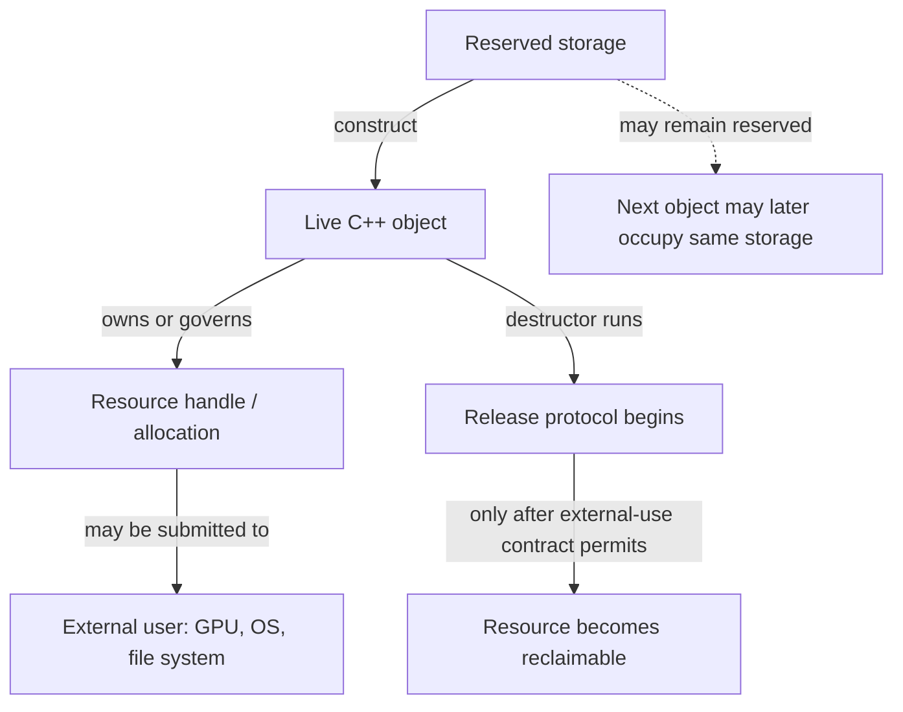
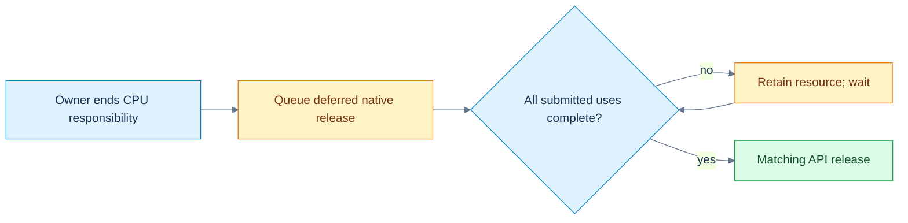
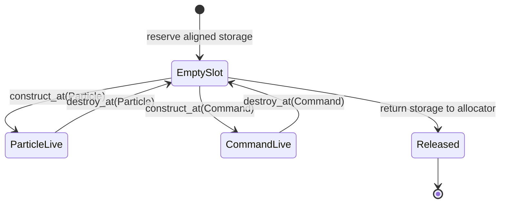

# 04 — Resource ownership, failure paths, and review practice

[[Chapter Edition/03 - Game Engine/00 - Reading Map|Reading map]] · [[Chapter Edition/03 - Game Engine/03 - Object representation, lifetime, and enforceable promises|Previous chapter]] · [[Chapter Edition/03 - Game Engine/05 - Generic asset pipelines with stable identity|Next chapter]]

The object model becomes useful when an application owns real resources and can fail halfway through setup. This chapter turns ownership into a working review method before expanding to many asset types and backends.

**By the end:** Follow a resource through acquisition, use, replacement, failure, and shutdown while keeping claims tied to demonstrated evidence.

**Recall question:** If resource creation fails after three of five steps, what remains owned, what must be rolled back, and what evidence confirms cleanup?

<!-- Derived from Continuous Notes/Game Engine - From First Frame to Living Worlds.md; source lines 5497–7080; source-span SHA256 6111f6662a3f214086addccbc2d1d02b45f9bbcf4b7509e44ccc374cfb8bec7d. -->

<!-- CHAPTER-SOURCE-BEGIN -->
## The laboratory and the teaching desk

### Complete runnable value-transfer laboratory

This standard-library-only C++23 program owns initialized bytes, deep-copies, copy-and-swaps, steals storage on move, releases prior move-assignment resources, and documents a preserving self-move policy. A single-threaded failure hook injects bad_alloc before the copy-assignment commit. It verifies independent storage, rollback, empty/moved-from copying and zero outstanding allocations. This is an educational raw owner, not a production allocator or a recommendation to replace vectors.

The independent Probe then measures three sink call forms with spare capacity. It checks const-source copying, destructor-suppressed dedicated movement, move_if_noexcept result types, and direct construction of an immovable result. Only the named-return move count is observational; it is not fixed by a portable assertion.

```cpp
#include <algorithm>
#include <cassert>
#include <cstddef>
#include <iostream>
#include <new>
#include <type_traits>
#include <utility>
#include <vector>

class OwnedByteBlock {
    std::size_t size_=0;
    std::byte* data_=nullptr;
    static std::byte* allocate(std::size_t n) {
        if (!n) return nullptr;
        if (std::exchange(fail_next,false)) throw std::bad_alloc{};
        auto* result=new std::byte[n]{}; // initialize every copied byte
        ++live_allocations;
        return result;
    }
    void release() noexcept {
        if (data_) { delete[] data_; --live_allocations; }
        data_=nullptr;
        size_=0;
    }
public:
    // Single-threaded laboratory instrumentation, not a production allocator.
    inline static bool fail_next=false;
    inline static int live_allocations=0;
    explicit OwnedByteBlock(std::size_t n=0):size_(n),data_(allocate(n)) {}
    ~OwnedByteBlock() { release(); }
    OwnedByteBlock(const OwnedByteBlock& other):OwnedByteBlock(other.size_) {
        if (size_) std::copy_n(other.data_,size_,data_);
    }
    OwnedByteBlock& operator=(const OwnedByteBlock& other) {
        if (this!=&other) {
            OwnedByteBlock replacement(other); // prepare; failure leaves *this intact
            swap(replacement);                // non-throwing commit
        } // replacement releases former target
        return *this;
    }
    OwnedByteBlock(OwnedByteBlock&& other) noexcept
        :size_(std::exchange(other.size_,0)),
         data_(std::exchange(other.data_,nullptr)) {}
    OwnedByteBlock& operator=(OwnedByteBlock&& other) noexcept {
        if (this!=&other) {
            release();
            size_=std::exchange(other.size_,0);
            data_=std::exchange(other.data_,nullptr);
        }
        return *this;
    }
    void swap(OwnedByteBlock& other) noexcept {
        std::swap(size_,other.size_);
        std::swap(data_,other.data_);
    }
    std::size_t size() const noexcept { return size_; }
    const std::byte* data() const noexcept { return data_; }
    std::byte& operator[](std::size_t i) { assert(i<size_); return data_[i]; }
    const std::byte& operator[](std::size_t i) const {
        assert(i<size_); return data_[i];
    }
};

struct Probe {
    inline static int copies=0, moves=0;
    int value;
    explicit Probe(int v=0):value(v) {}
    Probe(const Probe& p):value(p.value) { ++copies; }
    Probe(Probe&& p) noexcept:value(std::exchange(p.value,-1)) { ++moves; }
    static void reset() { copies=moves=0; }
};
struct Suppressed { Probe part; ~Suppressed()=default; };
struct ThrowingMove {
    ThrowingMove()=default;
    ThrowingMove(const ThrowingMove&) {}
    ThrowingMove(ThrowingMove&&) noexcept(false) {}
};
struct MoveOnly {
    MoveOnly()=default;
    MoveOnly(const MoveOnly&)=delete;
    MoveOnly(MoveOnly&&) noexcept(false) {}
};
struct Immovable {
    Immovable()=default;
    Immovable(const Immovable&)=delete;
    Immovable(Immovable&&)=delete;
};
Immovable direct() { return Immovable{}; }
Probe named_result() { Probe local(8); return local; }

int main() {
    static_assert(std::is_nothrow_move_constructible_v<OwnedByteBlock>);
    static_assert(std::is_nothrow_move_assignable_v<OwnedByteBlock>);
    static_assert(std::is_move_constructible_v<Suppressed>);
    static_assert(std::is_same_v<decltype(std::move_if_noexcept(
        std::declval<ThrowingMove&>())),const ThrowingMove&>);
    static_assert(std::is_same_v<decltype(std::move_if_noexcept(
        std::declval<MoveOnly&>())),MoveOnly&&>);
    {
        OwnedByteBlock a(4);
        a[0]=std::byte{7};
        OwnedByteBlock b=a;
        assert(a.data()!=b.data());
        b[0]=std::byte{9};
        assert(a[0]==std::byte{7});
        OwnedByteBlock& same=a;
        a=same;
        assert(a[0]==std::byte{7});

        const auto* old=b.data();
        const int live_before=OwnedByteBlock::live_allocations;
        OwnedByteBlock::fail_next=true;
        bool failed=false;
        try { b=a; } catch (const std::bad_alloc&) { failed=true; }
        assert(failed && !OwnedByteBlock::fail_next);
        assert(b.data()==old && b.size()==4 && b[0]==std::byte{9});
        assert(OwnedByteBlock::live_allocations==live_before);

        OwnedByteBlock c(std::move(a));
        assert(a.size()==0 && a.data()==nullptr && c[0]==std::byte{7});
        OwnedByteBlock empty_copy(a); // empty/moved-from source: no range traversal
        assert(empty_copy.size()==0 && empty_copy.data()==nullptr);
        b=std::move(c); // must release b's old allocation
        assert(c.size()==0 && c.data()==nullptr && b[0]==std::byte{7});
        OwnedByteBlock& self=b;
        b=std::move(self); // this type's documented preserving self-move
        assert(b.size()==4 && b[0]==std::byte{7});
        b=OwnedByteBlock{};
        assert(b.size()==0 && b.data()==nullptr);
    }
    assert(OwnedByteBlock::live_allocations==0);

    std::vector<Probe> stored;
    stored.reserve(4); // exclude growth work from these counts
    auto sink=[&](Probe p) { stored.push_back(std::move(p)); };
    Probe source(1);
    Probe::reset();
    sink(source);
    assert(Probe::copies==1 && Probe::moves==1 && source.value==1);
    Probe::reset();
    sink(Probe{2});
    assert(Probe::copies==0 && Probe::moves==1);
    Probe::reset();
    sink(std::move(source));
    assert(Probe::copies==0 && Probe::moves==2 && source.value==-1);

    const Probe fixed(5);
    Probe::reset();
    Probe copied(std::move(fixed));
    assert(copied.value==5 && Probe::copies==1 && Probe::moves==0);
    Suppressed original;
    Probe::reset();
    Suppressed fallback(std::move(original));
    assert(Probe::copies==1 && Probe::moves==0);
    (void)fallback;

    Immovable token=direct(); // must work even with optional elision disabled
    (void)token;
    Probe::reset();
    Probe returned=named_result();
    assert(returned.value==8 && Probe::copies==0);
    std::cout << "named return observed moves=" << Probe::moves << '\n';
    std::cout << "value-transfer laboratory: all assertions passed\n";
}
```

Compile with assertions enabled at debug and optimized settings. Also run with `-fno-elide-constructors`: that compiler option can disable optional NRVO, but cannot undo the language's guaranteed direct prvalue construction. The immovable result remains valid, while the named Probe return can reveal its move fallback. Constructor counts here explain semantics under controlled conditions; they are not allocation/timing benchmarks for a texture engine.

### Observe construction, failure and reverse cleanup

This separate complete program uses a fixed event buffer, so recording destructor events does not allocate. Positive IDs mark construction/body entry; negative IDs mark cleanup. It checks ordinary constructor-body failure, successful whole-object destruction, and the distinct delegating-body failure case. It also checks initialized defaults and copy-constructible-but-not-copy-assignable reference/const-member records. It never reads an uninitialized scalar.

```cpp
#include <array>
#include <cassert>
#include <iostream>
#include <stdexcept>
#include <type_traits>

struct Events {
    inline static std::array<int,16> values{};
    inline static std::size_t count=0;
    static void add(int v) noexcept { assert(count<values.size()); values[count++]=v; }
    static void reset() noexcept { count=0; }
};
struct Member {
    int id;
    explicit Member(int n):id(n) { Events::add(id); }
    ~Member() { Events::add(-id); }
};
struct Whole {
    Member first{1};
    Member second{2};
    explicit Whole(bool fail) {
        Events::add(3);
        if (fail) throw std::runtime_error("body failed");
    }
    ~Whole() { Events::add(-3); }
};
struct Delegated {
    Member member{4};
    Delegated() { Events::add(5); }
    explicit Delegated(int):Delegated() {
        Events::add(6);
        throw std::runtime_error("delegating body failed");
    }
    ~Delegated() { Events::add(-5); }
};
struct NonUserProvided { int n; NonUserProvided()=default; };
struct MemberDefault { int n=0; MemberDefault() {} };
struct Binding { int& value; };
struct ConstRecord { const int id; };

int main() {
    Events::reset();
    bool caught=false;
    try { Whole object(true); } catch (const std::runtime_error&) { caught=true; }
    assert(caught && Events::count==5);
    const std::array failed{1,2,3,-2,-1};
    for (std::size_t i=0;i<failed.size();++i) assert(Events::values[i]==failed[i]);
    Events::reset();
    { Whole object(false); }
    const std::array success{1,2,3,-3,-2,-1};
    assert(Events::count==success.size());
    for (std::size_t i=0;i<success.size();++i) assert(Events::values[i]==success[i]);
    Events::reset();
    caught=false;
    try { Delegated object(1); } catch (const std::runtime_error&) { caught=true; }
    const std::array delegated{4,5,6,-5,-4};
    assert(caught && Events::count==delegated.size());
    for (std::size_t i=0;i<delegated.size();++i) assert(Events::values[i]==delegated[i]);

    NonUserProvided a{};
    MemberDefault b{};
    assert(a.n==0 && b.n==0); // no uninitialized member is read
    static_assert(std::is_copy_constructible_v<Binding>);
    static_assert(!std::is_copy_assignable_v<Binding>);
    static_assert(std::is_copy_constructible_v<ConstRecord>);
    static_assert(!std::is_copy_assignable_v<ConstRecord>);
    int number=7;
    Binding first{number};
    Binding second=first;
    second.value=9;
    assert(number==9 && &first.value==&second.value);
    std::cout << "construction laboratory: all assertions passed\n";
}
```

Explain the event arrays before running the program. In the ordinary failing constructor, no -3 event appears because Whole never completed. On normal destruction, -3 comes before -2/-1. In the delegating case the target completed, so -5 appears before -4 after the delegating body fails. Copying Binding preserves the association to number; it does not create another referent.

### Value-transfer diagnostic and reconstruction desk

Compile these independent rejected-program exercises separately. They are not additions to either passing laboratory:

```cpp
struct Token { Token()=default; Token(const Token&)=delete; Token(Token&&)=delete; };
Token named() { Token token; return token; }
int main() {}
```

```cpp
struct Binding { int& value; };
int main() { int x=1,y=2; Binding a{x},b{y}; a=b; }
```

```cpp
#include <utility>
struct CopyOnly { CopyOnly()=default; CopyOnly(const CopyOnly&)=default; CopyOnly(CopyOnly&&)=delete; };
int main() { CopyOnly a; CopyOnly b(std::move(a)); }
```

```cpp
struct Token { Token()=default; ~Token()=delete; };
Token direct() { return Token{}; }
int main() {}
```

For each rejection, name the missing guarantee: non-guaranteed named-return fallback, reference-member assignment, best overload explicitly deleted, or required usable destruction. Removing optional elision is not necessary to make the named immovable return invalid.

Reconstruct the value story without the page:

1. Draw the separate objects/resources for lvalue, xvalue and prvalue calls to a value sink; add growth costs separately.
2. Reset a pointer parameter, then a reference-to-pointer parameter; distinguish which caller state changes.
3. Compute the exposure-reference alias trace for distinct arguments and one aliased argument.
4. Explain direct construction with both copy and move deleted, then explain why returning a named local differs.
5. State an object's invariant before writing its constructor. Which parts of input validation do the toy examples leave unimplemented?
6. Distinguish no initializer, aggregate braces, a first-declaration defaulted constructor and an empty user-provided constructor. Never prove the bad case by reading uninitialized memory.
7. Put a provider member before its dependent member. Draw both construction and destruction order.
8. Reconstruct ordinary constructor failure versus throwing after a delegating target completed.
9. Decide whether copying a handle, byte owner, view and scene graph should duplicate, share, remap or reject resources.
10. Rebuild the copy-assignment prepare/commit/cleanup transaction; inject failure before commit and predict both owners.
11. Move into a new owner, then an existing owner. Identify the old destination resource and the surviving source state.
12. State the exact self-copy/self-move policy; distinguish a documented empty source from an unspecified library value.
13. Derive move_if_noexcept's selected path and identify where strong rollback may become unavailable.
14. Explain why move-constructible can mean copied from an rvalue, and why a defaulted destructor changes generation.
15. Rebuild the three/five operations, then replace the raw owner with composed members where semantics allow. Which domain invariants still need a design decision?
16. Distinguish move from relocation without claiming a byte copy of arbitrary objects legal.

### Complete runnable borrow laboratory

Save this independent block as `borrows.cpp`. It uses only the standard library and C++23; no engine headers are needed. It checks aliasing, converted-reference snapshots, category deduction, array boundaries, typed null deletion, const span behavior, a live slot's changed logical owner, safe temporary getters, owning captures, and a synchronized mutable cache. Assertions are the expected results. No dangling reference is dereferenced and no invalid pointer arithmetic is executed.

```cpp
#include <cassert>
#include <cstddef>
#include <functional>
#include <iostream>
#include <mutex>
#include <optional>
#include <span>
#include <string>
#include <thread>
#include <type_traits>
#include <utility>
#include <vector>

struct Slot { int entity; int value; };

class Named {
    std::string name_;
public:
    explicit Named(std::string name) : name_(std::move(name)) {}
    std::string& Name() & { return name_; }
    const std::string& Name() const & { return name_; }
    std::string Name() && { return std::move(name_); }
    std::string Name() const && { return name_; }
};

int category(int&) { return 1; }
int category(int&&) { return 2; }
template<class T>
int relay(T&& item) { return category(std::forward<T>(item)); }

class Cache {
    mutable std::mutex mutex_;
    int source_ = 3; // restricted laboratory inputs: 3 or 4
    mutable std::optional<int> square_;
public:
    void Set(int value) {
        assert(value == 3 || value == 4);
        std::scoped_lock lock(mutex_);
        source_ = value;
        square_.reset();
    }
    int Get() const {
        std::scoped_lock lock(mutex_);
        if (!square_) square_ = source_ * source_;
        return *square_;
    }
};

int choose(int) { return 1; }
int choose(int*) { return 2; }

int main() {
    int a = 2, b = 9;
    int& alias = a;
    alias = b;
    b = 20;
    assert(a == 9 && b == 20 && std::addressof(alias) == &a);
    int* selected = &a;
    int*& pointer_alias = selected;
    pointer_alias = &b;
    assert(selected == &b);

    int count = 10;
    const int& live = count;
    const double& snapshot = count;
    count = 50;
    assert(live == 50 && snapshot == 10.0);

    int&& rr = 7;
    static_assert(std::is_same_v<decltype(rr), int&&>);
    static_assert(std::is_same_v<decltype((rr)), int&>);
    static_assert(std::is_same_v<decltype(std::move(rr)), int&&>);
    assert(relay(count) == 1 && relay(4) == 2);

    int array[3]{10, 20, 30};
    int (&whole)[3] = array;
    static_assert(sizeof(whole) == sizeof(array));
    int* end = array + 3;
    assert(end - array == 3); // no dereference of end

    int* absent = nullptr;
    delete absent;
    assert(choose(0) == 1 && choose(nullptr) == 2);

    std::span<int> elements(array);
    const std::span<int> descriptor = elements;
    descriptor[0] = 12;
    std::span<const int> readonly = elements;
    static_assert(std::is_same_v<decltype(readonly[0]), const int&>);
    assert(readonly[0] == 12);

    std::vector<Slot> pool{{11, 100}, {22, 200}, {33, 300}};
    std::size_t epoch = 0;
    Slot* cached = &pool[0];
    const auto borrowed_epoch = epoch;
    pool[0] = std::move(pool.back());
    pool.pop_back();
    ++epoch;
    assert(epoch != borrowed_epoch); // reject old logical borrow before use
    // Separate demonstration: cached designates a live first Slot, now owner 33.
    assert(cached == &pool[0] && cached->entity == 33);
    pool.reserve(pool.capacity() + 1); // invalidates cached; never use it again
    assert(pool[0].entity == 33); // reacquire via the container

    Named owner{"persistent"};
    const std::string& borrowed = owner.Name();
    assert(borrowed == "persistent");
    std::string owned = Named{"temporary"}.Name();
    assert(owned == "temporary");
    static_assert(std::is_same_v<decltype(std::declval<const Named&&>().Name()),
                                 std::string>);
    const Named const_owner{"const value"};
    std::string const_result = std::move(const_owner).Name();
    assert(const_result == "const value");

    std::string label = "frame";
    auto snapshot_job = [saved = label] { return saved.size(); };
    label.clear();
    assert(snapshot_job() == 5);
    auto counter = [n = 0]() mutable { return ++n; };
    assert(counter() == 1 && counter() == 2);

    Cache cache;
    const Cache& access = cache;
    assert(access.Get() == 9);
    cache.Set(4);
    assert(access.Get() == 16);
    {
        std::jthread reader([&] {
            for (int i = 0; i < 1000; ++i) {
                const int result = access.Get();
                assert(result == 9 || result == 16);
            }
        });
        std::jthread writer([&] {
            for (int i = 0; i < 1000; ++i) cache.Set(i % 2 ? 3 : 4);
        });
    } // both threads joined before cache is destroyed
    std::cout << "borrow laboratory: all assertions passed\n";
}
```

The epoch in this program is a local single-threaded witness, not a complete reusable borrow wrapper. The cache is separately synchronized and tested with concurrent calls; that short test does not prove arbitrary concurrent programs safe. Run with assertions enabled. Successful checks establish these examples on the recorded compiler, not every ABI or container implementation.

### Observe destruction without reading a dangling referent

This second complete program counts live Watch objects. A lifetime-ended reference can exist; using it to access its former object is the forbidden step. The intentionally dangling holder/new/call-return paths below are never dereferenced. The compiler may warn about the new-initializer reference member; that is useful evidence, not an invitation to suppress the warning. The unused escaped declaration can also produce a warning.

```cpp
#include <cassert>
#include <iostream>

struct Watch {
    inline static int live = 0;
    Watch() { ++live; }
    ~Watch() { --live; }
};
struct Holder { const Watch& value; };
const Watch& pass(const Watch& item) { return item; }

int main() {
    assert(Watch::live == 0);
    {
        const Watch& direct = Watch{};
        (void)direct; // alive throughout this block
        assert(Watch::live == 1);
    }
    assert(Watch::live == 0);
    {
        Holder kept{Watch{}};
        assert(Watch::live == 1);
        Holder lost(Watch{}); // deliberately dangling after this statement
        assert(Watch::live == 1); // only kept's Watch remains
        // Never read lost.value.
        (void)kept;
        (void)lost;
    }
    assert(Watch::live == 0);
    Holder* heap = new Holder{Watch{}}; // member temporary dies at semicolon
    assert(Watch::live == 0);
    delete heap; // default Holder destruction does not read the member
    const Watch& escaped = pass(Watch{});
    assert(Watch::live == 0);
    // escaped is dangling; do not evaluate it.
    std::cout << "temporary laboratory: live count = " << Watch::live << '\n';
}
```

At the parenthesized declaration, the count temporarily rises from one to two, then returns to one at the semicolon. Braced kept survives until its enclosing block ends. The heap holder outlives its temporary referent; allocation changes the holder's duration, not the reference-member exception. Passing through pass likewise gives no new extension. These observed counts support the language explanation on the tested compiler without reading freed or lifetime-ended objects.

### Rejected-program exercises

These are independent rejected-program exercises, not additions to the passing laboratory:

```cpp
// Expected rejection: reference binding would discard const.
int main() { const int value=3; int& wrong=value; }
```

```cpp
// Expected rejection: unsafe qualification injection.
int main() { int* p=nullptr; int** pp=&p; const int** wrong=pp; }
```

```cpp
// Expected rejection: operand type is nullptr_t, not an object-pointer type.
int main() { delete nullptr; }
```

Predict the diagnostics, then explain the mechanism without quoting the diagnostic. Other bad examples in the narrative are deliberately not executed: a program exhibiting undefined behavior is not a reliable demonstration of its supposed outcome.

### Reconstruct the access story at the board

1. Bind an integer reference, assign another integer through it, then change the other integer. Draw the final referent and values.
2. Explain why `decltype(rr)` and `decltype((rr))` differ, and why neither evaluates `rr`.
3. Compare a same-type const reference with a converting const reference; show the live value and snapshot after mutation.
4. Draw a temporary through a parameter-returning identity function. Mark the exact destruction point and explain why the receiving reference does not extend it.
5. Distinguish `Holder{7}`, `Holder(7)` and `new Holder{7}` without dereferencing a dangling member.
6. Show why `std::move` alone changes no resources and why const can change which constructor is viable.
7. Deduce `T` for an lvalue/rvalue passed to `T&&`; reconstruct collapsing and forwarding.
8. Give three independent ways a non-null pointer can be unsuitable for access.
9. Compare vector reallocation, last-element destruction, and first-slot repurposing. Which one can fool a sanitizer while remaining a logical bug?
10. Explain why a validated entity handle and a previously cached component reference answer different questions.
11. Reconstruct the rejected `int**` conversion as a const-pointer injection attack; explain the intermediate const fix.
12. Compare `const span<int>` with `span<const int>`, and explain why neither owns storage.
13. Design both const and non-const temporary getter policies; find the missing `const &&` hole.
14. State the mutable-cache invariant, protect source and cache together, and justify returning a snapshot rather than a borrowed result.

These questions test reconstruction, not the presence of a completed checkbox. The earlier object/build laboratory follows; both are part of this same story.

### Reproduce the compile and link distinction

Save the three preceding module blocks as Math.cppm, MathImpl.cpp and App.cpp. With a compatible Clang installation, from that directory:

```bash
clang++ -std=c++23 --precompile Math.cppm -o Math.pcm
clang++ -std=c++23 -c Math.pcm -o Math.o
clang++ -std=c++23 -fprebuilt-module-path=. -c MathImpl.cpp -o MathImpl.o
clang++ -std=c++23 -fprebuilt-module-path=. -c App.cpp -o App.o
clang++ App.o Math.o MathImpl.o -o modules
./modules
```

App exits0 when twice(21) equals42. Now omit MathImpl.o from only the final link: the importer still compiled, but the link needs the implementation of twice. This intentionally produces an undefined symbol. Restoring MathImpl.o repairs this demonstration. A production build system manages dependency scanning and compatible module options; these explicit commands are a small experiment, not a replacement for its build graph.

### Complete runnable object laboratory

This program is independent of Kairo. Every header and declaration it needs is included here; save only this block as `objects.cpp`. Assertions test lookup, enum validation, handle reuse, aggregate traits, initialization forms, correct array views, construction/destruction counts and two successive occupants at one storage location. The byte buffer survives both Tracked objects. Use the new construction result rather than assuming every old pointer remains usable after replacement.

```cpp
#include <array>
#include <cassert>
#include <climits>
#include <cstddef>
#include <cstdint>
#include <iostream>
#include <limits>
#include <memory>
#include <optional>
#include <span>
#include <type_traits>
#include <utility>
#include <vector>

enum class ResourceKind : std::uint8_t { Buffer, Texture, Pipeline };
std::optional<ResourceKind> decode_kind(std::uint8_t raw) {
    switch (raw) {
    case 0: return ResourceKind::Buffer;
    case 1: return ResourceKind::Texture;
    case 2: return ResourceKind::Pipeline;
    default: return std::nullopt;
    }
}
enum class Access : unsigned { None=0, Read=1, Write=2 };
constexpr Access operator|(Access a, Access b) {
    return static_cast<Access>(std::to_underlying(a) | std::to_underlying(b));
}
constexpr bool contains(Access set, Access flag) {
    return (std::to_underlying(set) & std::to_underlying(flag))
        == std::to_underlying(flag);
}
struct ResourceHandle {
    static constexpr std::uint32_t invalid =
        std::numeric_limits<std::uint32_t>::max();
    std::uint32_t index = invalid;
    std::uint32_t generation = 0;
    constexpr bool valid_shape() const { return index != invalid; }
    friend constexpr bool operator==(ResourceHandle, ResourceHandle) = default;
};
struct Slot { bool occupied{}; std::uint32_t generation{}; };
bool alive(ResourceHandle h, const std::array<Slot,1>& slots) {
    return h.index < slots.size() && slots[h.index].occupied
        && slots[h.index].generation == h.generation;
}
namespace geometry {
struct Pair { int x, y; };
constexpr int dot(Pair a, Pair b) { return a.x*b.x + a.y*b.y; }
}
struct NamedVector {
    float x{}, y{}, z{};
    float& at(std::size_t i) {
        assert(i < 3); // precondition remains required in release
        switch (i) { case 0: return x; case 1: return y; default: return z; }
    }
    const float& at(std::size_t i) const {
        assert(i < 3);
        switch (i) { case 0: return x; case 1: return y; default: return z; }
    }
    constexpr std::array<float,3> to_array() const { return {x,y,z}; }
};
struct ArrayVector {
    std::array<float,3> elements{};
    std::span<float,3> view() { return elements; }
};
struct ConstructedVector {
    float x,y,z;
    constexpr ConstructedVector(float a,float b,float c):x(a),y(b),z(c){}
};
struct Material { float roughness=0.5f; float metallic=0; bool double_sided{}; };
struct Padded { char a; double b; char c; };
struct Reordered { double b; char a; char c; };
struct Vertex { float x,y,z; std::uint32_t color; };
// This laboratory intentionally targets octet + IEEE binary32 platforms.
static_assert(CHAR_BIT == 8);
static_assert(sizeof(float)==4 && std::numeric_limits<float>::is_iec559);
static_assert(std::is_aggregate_v<ResourceHandle>);
static_assert(!std::is_aggregate_v<ConstructedVector>);
static_assert(std::is_standard_layout_v<Vertex>);
static_assert(std::is_trivially_copyable_v<Vertex>);
static_assert(offsetof(Vertex,x)==0 && offsetof(Vertex,color)==12);
static_assert(sizeof(Vertex)==16);
struct Tracked {
    inline static int constructions=0, destructions=0;
    int value;
    explicit Tracked(int n):value(n) { ++constructions; }
    ~Tracked() { ++destructions; }
};
constinit int mutable_counter=0;
thread_local int thread_counter=0;
int& persistent_count() { static int calls=0; return calls; }

int main() {
    geometry::Pair a{1,2}, b{3,4};
    assert(dot(a,b)==11); // ADL finds geometry::dot
    assert(decode_kind(1)==ResourceKind::Texture);
    assert(!decode_kind(199));
    const auto access=Access::Read | Access::Write;
    assert(contains(access,Access::Read) && contains(access,Access::Write));
    std::array<Slot,1> slots{{Slot{true,7}}};
    const ResourceHandle old{.index=0,.generation=7};
    assert(alive(old,slots));
    slots[0].occupied=false; assert(!alive(old,slots));
    slots[0]={true,8};
    assert(old.valid_shape() && !alive(old,slots));
    const ResourceHandle fresh{.index=0,.generation=8};
    assert(alive(fresh,slots) && old!=fresh);
    assert(!alive(ResourceHandle{},slots));
    NamedVector named{1,2,3};
    named.at(1)=9;
    const NamedVector& read_only=named;
    assert(read_only.at(1)==9);
    auto copy=named.to_array();
    copy[1]=8; assert(named.y==9); // copy, not a live view
    ArrayVector array{{1,2,3}};
    auto view=array.view(); view[1]=8;
    assert(array.elements[1]==8); // view aliases a real array
    const Material material{.roughness=0.8f};
    assert(material.metallic==0 && !material.double_sided);
    const std::vector<int> count_values(10,20), listed_values{10,20};
    assert(count_values.size()==10 && listed_values.size()==2);
    alignas(Tracked) std::byte storage[sizeof(Tracked)];
    const void* location=static_cast<void*>(storage);
    Tracked* first=std::construct_at(reinterpret_cast<Tracked*>(storage),7);
    assert(first->value==7 && static_cast<void*>(first)==location);
    std::destroy_at(first);
    // No Tracked member access here: lifetime ended, storage remains.
    Tracked* second=std::construct_at(reinterpret_cast<Tracked*>(storage),8);
    assert(second->value==8 && static_cast<void*>(second)==location);
    std::destroy_at(second);
    assert(Tracked::constructions==2 && Tracked::destructions==2);
    auto* dynamic=new Tracked{9};
    assert(dynamic->value==9);
    delete dynamic;
    dynamic=nullptr; // clears this pointer only, not other copies
    assert(dynamic==nullptr && Tracked::destructions==3);
    ++mutable_counter; ++thread_counter; ++persistent_count();
    ++persistent_count();
    assert(mutable_counter==1 && thread_counter==1 && persistent_count()==2);
    std::cout << "C++ object laboratory passed\n"
              << "Padded: size=" << sizeof(Padded) << " align=" << alignof(Padded)
              << " offsets=" << offsetof(Padded,a) << ','
              << offsetof(Padded,b) << ',' << offsetof(Padded,c) << '\n'
              << "Reordered: size=" << sizeof(Reordered) << '\n';
}

```

Compile with `clang++ -std=c++23 -Wall -Wextra -Wpedantic -Werror -fsanitize=address,undefined objects.cpp -o objects`, then run `./objects`. Repeat with `-O2`. The layout numbers printed are target measurements, not universal constants. The Vertex assertions are explicit requirements of this demonstration's upload format; they are not deductions from standard-layout alone. Sanitizers detect some bad executions, not all object-model violations. This program never executes the invalid named-member indexing example.

The thread-local counter is used on the main thread only; this laboratory does not test concurrency or thread shutdown. Local-static initialization synchronization protects initialization, not unsynchronized later mutation. Every generation comparison assumes one registry and no counter wrap during the test. These limits belong beside the code because an example should not silently promise more than it demonstrates.

## Where these foundations matter

Here is the full mapping.

| Source ledger entry | Engine consequence |
|---|---|
| 101 translation model | Why changing an exported module can rebuild dependents; why link failures differ from compile failures; why shader/native libraries need ABI boundaries. |
| 102 declaration vs definition | Public engine API versus implementation; forward declarations; reducing dependency exposure. |
| 103 ODR | Prevent duplicate renderer globals, mismatched inline/template definitions and macro-dependent UB. |
| 104 lookup | Namespaces, extension functions, generic algorithms, ADL and modular API hygiene. |
| 105 storage duration | Frame locals, singleton/static systems, per-thread scratch allocators, dynamically allocated resources. |
| 106 lifetime vs storage | ECS pools, arenas, `vector`, `optional`, `variant`, render-resource pools, placement construction. |
| 107 identity/address | Entity handles, GPU resource handles, generation counters, stale pointer prevention. |
| 108 fundamental widths | File formats, Vulkan structs, network protocols, IDs, GPU buffers, cross-platform engine builds. |
| 109 enums | Render states, resource states, component change kinds, shader modes, error states. |
| 110 aggregates | Descriptor records, vertices, configuration types, messages, ECS events. |
| 111 struct/class | Transparent math/data records versus invariant-owning systems/resources. |
| 112 layout | Vertex buffers, uniform/storage buffers, serialization, SIMD, cache usage, C ABI and GPU ABI matching. |

This entire chunk is therefore directly relevant to your graphics/engine path.

## Classifying a failure before debugging

When you see:

| Symptom | First mechanism to suspect |
|---|---|
| “undefined symbol” | declaration exists, definition absent/not linked, linkage mismatch |
| “duplicate symbol” | ODR violation or duplicate externally linked definition |
| same header behaves differently in two files | macro/preprocessor-dependent ODR issue |
| variable exists but name inaccessible | scope/lookup issue |
| object appears to retain bytes after destruction | confusing storage persistence with object lifetime |
| random crash from cached pointer | object lifetime ended / storage reused |
| old ECS handle affects new object | identity reused without generation validation |
| binary works macOS but fails Windows | implementation-defined widths/ABI assumption |
| state enum receives nonsense | external value not validated |
| aggregate initialization suddenly stops compiling | type ceased being aggregate, often due constructor/access change |
| GPU buffer looks scrambled | CPU structure layout != GPU ABI layout |
| `Vec3::operator[]` “works but sanitizer/compiler gets weird” | pointer arithmetic across separate member objects |
| size unexpectedly larger | alignment/padding/tail padding |

A strong C++ engineer does not begin with:

> “The compiler is weird.”

They classify the failure into the correct language mechanism first.

## Reconstructing a compact resource record

Write this without copying once this chapter settles:

```cpp
#include <cstddef>
#include <cstdint>
#include <type_traits>
#include <utility>

enum class ResourceKind : std::uint8_t
{
    Buffer,
    Texture,
    Pipeline
};

struct ResourceHandle
{
    static constexpr std::uint32_t InvalidIndex = 0xFFFFFFFFu;

    std::uint32_t index = InvalidIndex;
    std::uint32_t generation = 0;

    [[nodiscard]]
    constexpr bool valid() const noexcept
    {
        return index != InvalidIndex;
    }
};

struct GPUVertex
{
    float x;
    float y;
    float z;
    std::uint32_t packedColor;
};

static_assert(std::is_aggregate_v<ResourceHandle>);
static_assert(std::is_standard_layout_v<ResourceHandle>);
static_assert(std::is_trivially_copyable_v<ResourceHandle>);

static_assert(std::is_standard_layout_v<GPUVertex>);
static_assert(std::is_trivially_copyable_v<GPUVertex>);

static_assert(offsetof(GPUVertex, x) == 0);
```

Now you should be able to explain every statement not syntactically, but semantically:

```text
why uint32_t?
why enum class?
why uint8_t?
why aggregate?
what lifetime does a local handle have?
does handle address define resource identity?
what does standard-layout guarantee?
what does it NOT guarantee?
why might GPUVertex still need a backend-specific upload structure?
what happens if a constructor is added?
what entity does InvalidIndex define?
what is its storage duration?
what linkage does it have?
why doesn't offsetof prove shader compatibility?
```

If any of those feel like vocabulary questions instead of mechanical questions, that area needs reconstruction.

## Questions for teaching without looking at the page

This is the one list I want you to use as the actual chapter test:

1. Draw the complete path from `Vector.cppm` source text to a function executing in the final program, including preprocessing/global-module-fragment work, BMI/interface information, object generation and linking. Then explain what compilation error versus link error means.

2. Given `extern int x;`, `int x;`, `int f(int);`, `int f(int x){ return x; }`, `struct A;`, and `struct A{int n;};`, classify every declaration and definition and explain why every definition is also a declaration.

3. Explain why `#pragma once` does **not** solve `int global = 3;` being defined in a header included by two different translation units. Then give the `extern` solution and the `inline` variable solution.

4. For `void f(){ static int x; int y; thread_local int z; auto* p = new int; }`, separately identify name scope, storage duration and approximate object lifetime for `x`, `y`, `z`, `p`, and `*p`.

5. Explain why an object's bytes can remain physically unchanged after its lifetime ends, and why that does not permit continued use of the object.

6. Suppose an object at address `0x1000` is destroyed and another same-type object is constructed at `0x1000`. Explain why numerical address alone does not encode identity. Then connect this to `Entity{Index, Generation}`.

7. Explain why `int` is not necessarily 32-bit, why `std::uint32_t` is a better representation field for an ECS index, and why even `uint32_t` does not by itself give you a portable serialized format.

8. Explain why `enum class StructuralChangeKind : std::uint8_t` is safer than both `int Kind` and an old unscoped enum. Then explain why a byte read from disk must still be validated.

9. Determine whether `the illustrative ResourceHandle` and `the constructor-bearing Vec` are aggregates and explain precisely why their brace initialization can invoke different language mechanisms.

10. Explain all actual language differences between `struct` and `class`, including default base-class access.

11. Assuming `char=1` alignment and `double=8` alignment, manually lay out `struct X { char a; double b; char c; };`, calculate typical offsets/size, then reorder the members to reduce padding.

12. Explain why all four of these can be independently meaningful: `std::is_aggregate_v<T>`, `std::is_standard_layout_v<T>`, `std::is_trivially_copyable_v<T>`, and `sizeof(T)`. Reconstruct [[Standard-layout and trivial copyability]] without equating the traits.

13. Prove why `NamedVector` being standard-layout, trivially copyable, and exactly 12 bytes still does **not** make `(&x)[1]` valid array indexing.

14. Explain why `sizeof(NamedVector)==12` does not prove compatibility with an arbitrary Vulkan/Metal shader-side three-component vector structure.

15. From memory, rewrite a standards-safe `Vector3::operator[]` for the existing `x/y/z` representation and explain what would have to change if `Data()` truly needs to expose an N-element contiguous array.

If you can answer those under repeated “**why?**” questioning, then chapter is actually owned rather than merely read.

## What remains open

Ownership means deciding who is responsible for destruction and resource release. Parameter contracts, copy/move operations, constructor invariants, cleanup, direct result construction and Rule-Zero composition now extend the story through Parts147. The raw-owner laboratory develops a narrow strong-guarantee transaction, not complete subsystem exception safety. Smart-pointer ownership patterns, explicit lifetime restart, allocator design, polymorphic cleanup and broader container/concurrency guarantees remain future depth.

A useful future experiment compares raw address APIs with checked generation handles under repeated create/destroy/reuse workloads. Count stale-access attempts, validation failures, bytes per handle and lookup/frame cost. State the workload and lifetime contract before claiming a reliability or performance advantage. A handle is not automatically safer if callers bypass its registry checks.

**Coverage update after M010:** the ownership questions that were still open at the M009 boundary are now developed in [[Chapter Edition/03 - Game Engine/04 - Resource ownership, failure paths, and review practice#From a live object to responsible resource ownership|the next story chapter]]. The future experiment above remains open; the existence of a written treatment does not demonstrate learner mastery.

No written 'depth gate passed' proves learner mastery. Try the recall questions under repeated why-questioning, then reconstruct the laboratories without copying.

## Retrieval sheet - The whole opening story

Source text becomes tokens and translation units; declarations let callers compile; definitions let a program execute. Lookup finds a declaration, linkage relates declarations, and ODR requires coherent definitions. Modules change how interfaces are communicated, not the need for implementation code.

Names have scopes. Storage has automatic, static, thread or dynamic duration. Objects have lifetimes inside storage. A pointer's own lifetime does not keep its pointee alive. Equal values do not mean one object; reusing an address does not preserve the old occupant. Generation handles identify a logical occupant only when the registry validates them.

Ordinary integer widths are not portable constants. Scoped enums constrain accidental conversions, not hostile input. Braces may initialize aggregate elements or select a constructor; initializer-list constructors can change their meaning. Struct and class differ only in default member and base access.

Alignment creates holes and tail padding. Standard-layout, trivially-copyable and aggregate are different promises. Adjacent named fields are not an array. CPU layout, file format and shader layout need separate verified contracts.

Reference binding need not select the object we first imagined: conversion can create a snapshot temporary. Local lifetime extension is not transitive through function calls. An rvalue cast changes category, not ownership or lifetime. A vector borrow may dangle after reallocation or keep reaching a live slot whose logical owner has changed. Const describes an access path; shallow constness and mutable caches do not supply synchronization. A temporary-aware accessor returns an owning result or rejects rvalue callers.

Value parameters create objects; reference parameters borrow; pointer parameters copy pointer values. Construction establishes initial invariants, assignment replaces existing state, and destruction closes an ownership interval. Copy follows semantic member contracts; move may transfer resources while its source survives. NRVO is optional, same-type prvalue direct construction is not a required hidden move. Non-throwing properties constrain transfer policy. The Rule of Zero composes responsibility rather than proving arbitrary domain invariants.

[[Supplementary/Foundations#M007 - Parts 101-112|Opening coverage]] · [[Supplementary/Foundations#M008 - Parts 113-126|Borrowing coverage]] · [[Supplementary/Foundations#M009 - Parts 127-147|Value-transfer coverage]] · [[Supplementary/Foundations#M010 - Parts 148-160|Resource ownership coverage]] · [[Keyword Index]] · [[Dependency Map]] · [[Supplementary/Sources and Code Anchors#M010 - Resource ownership|Current sources, corrections and verification]]

## From a live object to responsible resource ownership

The Rule of Zero was the right destination for ordinary application types: compose members that already know how to copy, move, and clean up. But composition does not make responsibility disappear. Somewhere, a layer must acquire a file, allocation, lock, operating-system handle, graphics object, or other finite resource; keep it valid while needed; then release it exactly once and at a safe time. This chapter follows that responsibility downward—from a C++ object's lifetime to the external thing it controls—and then back upward to the smart pointers and containers most programs should use.

### Four lifetimes that can overlap without becoming one

Keep four questions separate:

1. **Storage:** Which bytes have been reserved, and for how long are they available?
2. **Object lifetime:** Which typed object has been initialized in those bytes, and when does its lifetime begin and end?
3. **Ownership:** Which object or protocol is responsible for arranging cleanup?
4. **External use:** Is another system—such as a GPU queue—still using the resource?

They often overlap, but they are not synonyms. A stack-allocated `BufferOwner` may own a Vulkan allocation. Destroying that wrapper can release the allocation, but only if the graphics API says the GPU is finished with it. A byte arena may remain allocated after a `Particle` lifetime ends. A `shared_ptr` control block may remain after the managed object has already been destroyed, because weak observers still refer to the ownership group.



**Caption — The resource stack:** object destruction is a useful cleanup trigger, not proof that every external consumer has stopped. In a renderer, a fence, timeline value, deferred-deletion queue, or other API-specific completion rule may be part of the resource protocol.

### Why lifetime-bound cleanup is more reliable than remembering every exit

[[RAII and resource handles|RAII]] expands to **Resource Acquisition Is Initialization**. Read the name as a design cue: put a resource's responsibility into an object with a well-defined lifetime. Acquisition is associated with establishing the owner's usable state; destruction performs the matching release. The owner can be a small local guard, a standard-library type such as `std::unique_ptr` or `std::lock_guard`, or a domain wrapper around a non-memory handle.

Suppose a function opens a file, acquires a lock, validates data, and then writes. If each return path must remember `close` and `unlock`, adding one early return or throwing operation can leak the file or leave the mutex locked. A scope guard changes the proof: when stack unwinding leaves the scope, fully constructed automatic objects are destroyed in reverse construction order. Therefore the cleanup pairing is attached to scope exit rather than duplicated at each branch. This works for ordinary returns as well as exception unwinding.

RAII does **not** mean “everything is allocated on the stack,” “every constructor must acquire a resource,” or “the destructor can always succeed.” It means responsibility is represented by an object whose lifetime and cleanup protocol are explicit. A wrapper may acquire through a factory, adopt an already-created handle, or defer acquisition until an operation. A destructor should normally be non-throwing; if release can report failure, the design needs a separate explicit `close`/`flush` operation or error-reporting path, because throwing during stack unwinding can terminate the program.

The practical invariant is: **after successful construction, the owner knows exactly what it owns and how to release it.** If construction fails halfway, already-constructed members clean themselves up. This is why a raw handle stored in a class is not enough. The class must either make itself the complete owner, or immediately place that handle in a member that already provides ownership.

```cpp
#include <utility>

class LockGuard {
public:
    explicit LockGuard(Mutex& mutex) : mutex_(&mutex) {
        mutex_->lock();
    }

    ~LockGuard() noexcept {
        if (mutex_)
            mutex_->unlock();
    }

    LockGuard(const LockGuard&) = delete;
    LockGuard& operator=(const LockGuard&) = delete;

    LockGuard(LockGuard&& other) noexcept
        : mutex_(std::exchange(other.mutex_, nullptr)) {}

private:
    Mutex* mutex_; // non-owning pointer to the mutex; guard owns the unlock duty
};
```

Here `Mutex` is an illustrative interface with `lock()` and `unlock()`; the standard-library equivalent for an ordinary mutex is `std::lock_guard` or `std::unique_lock`.

The example's pointer does not own the `Mutex`; the guard owns the *responsibility to unlock it*. This is a useful correction to the overly narrow idea that RAII means “a smart pointer owns heap memory.” Ownership can be a duty to release a lock, close a file, unmap a region, or destroy a native handle. The guard also must not outlive its mutex: the pointer is a borrow, and the mutex's lifetime remains a precondition.

### Ownership is a responsibility contract, not pointer syntax

An **owner** is the entity responsible for ending a resource's use or lifetime according to its protocol. A **borrow** is temporary access that carries no such responsibility. [[Ownership and non-owning views|A raw pointer and reference are commonly used for non-owning access]] in modern C++; their spelling alone does not keep an object alive. A raw pointer can still be an owner in legacy or explicitly documented code, but then the contract is invisible to the type system and fragile at API boundaries.

Before choosing a pointer type, ask who owns the object and how many independent owners are required:

| Relationship | Usual representation | Meaning and limit |
|---|---|---|
| One owner; no ownership transfer at this call | `T&`, `T*`, or a view type | Borrow only; caller keeps the owner alive and respects invalidation rules. |
| One exclusive owner | `std::unique_ptr<T>` or a domain-specific move-only handle | One owner controls disposal; moving transfers that duty. |
| Several owners genuinely share one lifetime | `std::shared_ptr<T>` | A shared ownership group retains the object until its last strong owner releases it. |
| Need to observe shared ownership without extending it | `std::weak_ptr<T>` | Does not keep the object alive; `lock()` attempts to obtain a temporary strong owner. |
| A resource is not an ordinary `delete`-managed object | A purpose-built owner / custom deleter | Release must call the API and allocator that created the resource. |

Do not promote a borrow to `shared_ptr` merely because the lifetime feels uncertain. First find the actual owner and define the boundary where it remains alive. Shared ownership has real semantics and cost; it can also obscure architecture and create cycles. If an API needs only to inspect an object during the call, use a borrow. If it consumes ownership, say so with a move-only owner or clearly documented sink. If it retains shared lifetime, the shared pointer in the interface should express that intentional relationship.

### Exclusive ownership: `unique_ptr` makes transfer visible

[[Exclusive and shared smart-pointer ownership|`std::unique_ptr<T, D>`]] is a move-only owner: at most one such pointer in a given ownership chain is responsible for invoking its deleter. Its destructor, `reset`, or move assignment can trigger disposal. Copying is disabled because copying would create a second owner without a defined sharing policy. Moving transfers the ownership duty; it does not make the object itself move to a different address.

```cpp
#include <memory>

auto texture = std::make_unique<Texture>(device, description);
Render(*texture);                    // borrow for this call
QueueForUpload(std::move(texture));  // explicit transfer; texture is now empty
```

`std::make_unique<T>(args...)` constructs the object and returns its owner as one expression. It is the normal choice for dynamic exclusive ownership. A `unique_ptr` can also own a non-memory resource when supplied a deleter that performs the correct release, but a dedicated `Buffer` or `File` wrapper often gives a clearer interface and can store related context such as the owning device.

A raw pointer returned by `get()` is a **borrowed view**. It does not transfer ownership and must not be passed to `delete`. `release()` is different: it empties the smart pointer and returns the raw pointer, transferring responsibility to the caller, who must immediately establish another owner or perform the required release. Those verbs are not interchangeable.

Custom deleters encode the matching release operation. Their type is part of the `unique_ptr` type, so a capturing/stateful deleter may affect the owner's representation and move behavior. For an opaque C handle, the deleter may need both the handle and its device/context. For polymorphic deletion, deleting `Derived` through `Base*` requires a suitable virtual destructor, unless the deleter retains the concrete type and destroys it correctly. `unique_ptr<Derived>` can convert to `unique_ptr<Base>`, but the default deleter then sees `Base`; a non-virtual base destructor makes that conversion unsafe for destruction.

Arrays have an explicit `std::unique_ptr<T[]>` specialization and pair with array deletion. For ordinary growable sequences, `std::vector<T>` is usually the safer, more expressive owner: it records size and manages element construction/destruction. Do not mix `new[]` with scalar `delete`, or scalar `new` with `delete[]`.

### Shared ownership: one object, a group of owners, and a separate control block

Use [[Exclusive and shared smart-pointer ownership|`std::shared_ptr<T>`]] only when several independent parts of the program must each keep the same object's lifetime going. Copies join the same **ownership group**; destroying or resetting one copy removes only that owner's share. When the last strong owner goes away, the managed object is destroyed. The bookkeeping that coordinates owners lives in a **control block**, which commonly stores a strong-owner count, weak-observer count, deleter and allocator state. The standard specifies behavior, not a particular byte layout or exact performance cost.

```text
renderer ─┐
cache    ─┼──> shared ownership group ──> Texture lifetime
scene    ─┘             ↑
                 weak observers do not
                 keep Texture alive
```

`std::make_shared<T>(args...)` usually combines object and control-block storage into one allocation, though the standard does not promise a particular allocation strategy. This can reduce allocation overhead. It can also mean a long-lived `weak_ptr` keeps the combined allocation reserved after the managed object's destructor has run; the object and the control block have different lifetimes. Do not rely on a particular size or allocation count unless measured for the implementation in use.

An important subtlety: a `shared_ptr` stores a pointer value for access and participates in an ownership group. These need not denote the same address. The aliasing constructor can share ownership of one object while storing a pointer to a subobject. Likewise, a custom deleter may manage a native resource different from `get()`'s pointee. Never infer the complete disposal rule from the stored raw pointer alone.

Copying a `shared_ptr` generally updates shared bookkeeping. That operation is not free, and heavy cross-thread copying can contend on shared cache lines. Moving an existing `shared_ptr` transfers its local handle without creating a new owner. More importantly, shared-pointer thread safety is limited: separate `shared_ptr` objects sharing one control block may be manipulated concurrently under the library's guarantees, but this does **not** make concurrent mutation of the pointed-to `T` safe. The pointee still needs its own synchronization or immutability policy. `use_count()` is an observation, not a lock or a safe exclusivity test in concurrent code.

### Weak observation breaks cycles without pretending an object is alive

If two objects own each other with `shared_ptr`, neither strong count can reach zero. The result is a **reference cycle**: memory remains retained even when the rest of the application no longer needs the objects. Change one direction to [[Weak observation and ownership cycles|`weak_ptr`]] when that relationship is observational rather than lifetime-owning—often parent-to-child ownership with child-to-parent observation, or a cache entry that should not keep its value alive.

```cpp
if (auto parent = child.parent.lock()) {
    parent->Notify(child);
} else {
    // No strong owner remained when lock() was attempted.
}
```

`weak_ptr::lock()` is the safe operation that either obtains a temporary `shared_ptr` or returns empty. Avoid `if (!weak.expired()) { use(weak.lock()); }`: another thread or scope can release the last strong owner between the check and the attempted acquisition. Check the result of `lock()` itself. A weak pointer neither owns the object nor guarantees it will still exist at the next line unless a successful strong result is kept alive.

`std::enable_shared_from_this<T>` lets an already-shared-owned object produce another `shared_ptr` in the same ownership group. Its precondition is that a `shared_ptr` has already established that group. Constructing `std::shared_ptr<T>(this)` instead creates an independent control block and can cause double deletion. Calling `shared_from_this()` in the constructor is too early: the factory has not yet completed the shared-owner connection. Prefer a factory that first creates the `shared_ptr`, then performs any post-construction registration that needs shared self-ownership. `weak_from_this()` is useful when a non-owning self-observer is appropriate, but it does not manufacture ownership.

### Exceptions, partial construction, and the strong proof

RAII and exception safety meet at partial construction. When a constructor throws, the complete object's destructor is not called because that object never finished construction. However, each fully constructed base and member is destroyed automatically in reverse order. Therefore, put each acquired responsibility into a member owner as soon as it exists. A constructor that first acquires three raw handles and only later wraps them has a leak window if the second or third acquisition fails.

The useful guarantee here is not that “exceptions are safe” in the abstract. It is that every acquisition has a matching owner immediately, so every exit—including failed construction—has a defined cleanup path. For transactional operations, build a replacement under RAII, validate it, and only then publish or swap it into the long-lived state. This protects the existing state if preparation fails. It does not by itself roll back external side effects already committed to a file, GPU queue, or network peer; those require their own transaction or compensation protocol.

For asynchronous GPU work, destructor timing must respect **completion**, not merely CPU scope. If a command buffer refers to a buffer, destroying the C++ wrapper at the end of a function may be too early even though the wrapper's RAII is correct in isolation. The owner can enqueue the native object for deferred destruction tagged with a fence/timeline completion value. The release protocol then has two stages: logical ownership ends, and physical reclamation waits until submitted work can no longer access the resource. RAII makes the chosen protocol automatic; it does not choose the correct graphics synchronization rule for you.

### Figure CPP-04 - CPU cleanup can precede GPU reclamation



**Read the picture:** the destructor can transfer the release duty to a deferred-deletion queue. A fence or timeline condition covering every submitted use then permits native reclamation. **Limit:** this is a renderer policy, not behavior supplied by C++ or smart pointers. The queue, allocator and device must remain valid, and the backend must establish the correct completion condition. [[Visual Recall/02 - C++ - Objects, Ownership and Lifetime - Visual Recall#Four figure briefs|Recall this figure]].

### Custom allocation separates obtaining bytes from constructing objects

Ordinary `new T(args...)` is a **new-expression**: conceptually it obtains appropriately sized/aligned storage and initializes a `T` there. `delete p` calls the object's destructor and the matching deallocation function when `p` denotes a suitable object created by a matching allocation protocol. The expression manages a pair of operations; it is not merely a call to `operator new`.

An **allocation function** such as `::operator new(size)` obtains raw storage. It does not, by itself, create an arbitrary `T` object in that storage. An **object lifetime** begins only when the language's construction or implicit-lifetime rules say it does. This distinction matters in arenas and pools, where an allocator reserves a block and a container or caller constructs objects inside it. The allocator owns storage management; the object-aware layer must still construct and destroy the occupants correctly.

Modern code should normally keep explicit allocation centralized in a standard container, allocator-aware container, or carefully designed owner. `malloc`/`free` do not call C++ constructors/destructors. `new (std::nothrow) T` changes allocation-failure reporting for the corresponding new-expression, but it does not remove constructor exceptions or make every memory failure impossible. Alignment is a real precondition: storage must satisfy `alignof(T)`, as well as have enough size. Over-aligned types and custom pools need explicit support.

### Arrays carry a count and a destruction protocol

`new T[n]` creates an array of `n` elements (subject to allocation and construction succeeding); `delete[]` must destroy the constructed elements and release storage with the matching array deallocation protocol. The count is semantically important even when an implementation stores it in hidden overhead. If constructing a later array element throws, already-constructed earlier elements are destroyed and storage is released as required by the new-expression rules.

This is why inventing an array by allocating `n * sizeof(T)` bytes and pretending it is automatically a `T[n]` is not a generic safe shortcut. You need correct overflow checks, alignment, object construction for each element, tracking of how many constructions succeeded, reverse destruction, and matching deallocation. Let `std::vector<T>`, `std::unique_ptr<T[]>`, or a proven allocator/container abstraction carry that protocol unless you are implementing such a layer deliberately.

### Placement construction reuses storage; it does not allocate it

Sometimes an engine has reserved a pool slot or arena block and needs to begin a new object's lifetime there. [[Placement construction and explicit lifetime management|Placement new]] is the traditional spelling for constructing into an address supplied by the caller. In current C++, `std::construct_at(p, args...)` is usually a clearer library interface for this operation when its preconditions are met. Neither form obtains the underlying storage. The caller must already have enough correctly aligned storage, and must track the lifetime and eventual destruction of the object.

```cpp
#include <cstddef>
#include <memory>
#include <new>

alignas(Widget) std::byte slot[sizeof(Widget)];
Widget* item = std::construct_at(
    reinterpret_cast<Widget*>(slot), constructor_argument);

Use(*item);
std::destroy_at(item); // ends Widget lifetime; slot bytes still exist
```

This sketch demonstrates the distinction, not a complete general-purpose arena. A production slot abstraction should encapsulate size, alignment, occupancy, exception cleanup, and whether it is currently legal to reuse the storage. Calling `std::destroy_at` does not free `slot`; returning the slot to the arena is a separate allocator action. Conversely, reusing storage can end an existing object's lifetime, so existing references and pointers need the language's object-replacement rules, not just the same numeric address.

`std::launder` is not a generic “make this pointer valid” spell. It can obtain a pointer to an object already within its lifetime at an address when specific reachability and type conditions are met. It does not allocate storage, construct an object, fix alignment, revive a destroyed lifetime, or make an out-of-bounds pointer legal. Modern lifetime facilities—including `construct_at`, `start_lifetime_as` where applicable, and implicit-lifetime rules—have precise scopes; choose the operation that matches the intended object-creation semantics instead of treating raw bytes as universally interchangeable with objects.

### A union or arena slot has one occupant at a time

A union lets multiple members reuse storage, but only the active member's lifetime and value can be used under the applicable rules. When switching between non-trivial members, destroy the current member as needed, then construct the next one. A `std::variant` is often preferable for ordinary tagged alternatives because it tracks which alternative is active and handles construction/destruction; a manually managed union is a lower-level tool with a larger correctness burden.

The same reasoning applies to an arena slot: at one moment it may hold a `Particle`; later, after that lifetime ends, it may hold a `Command`. Bytes can remain at the same address while the object identity and valid operations change. **Transparent replacement** permits old names, pointers, or references to refer to a replacement object only when the standard's conditions are met; do not assume same address and same type always settle every case. If a pointer cannot automatically designate the replacement, a narrowly justified `std::launder` may be relevant after construction—but it still does not replace correct destruction, construction, alignment, and type checks.

Ordinary automatic objects should not be manually destroyed and then allowed to undergo their usual automatic destruction again. That risks using an object outside its lifetime and double destruction. Explicit destruction is appropriate in a controlled storage-management abstraction that also takes responsibility for exactly one construction and exactly one destruction per occupant. A tagged union or arena should track its state so the code knows which destructor is valid.



**Caption — Storage is not the occupant:** every transition has a precondition. Never construct the next occupant while a non-trivial current occupant still needs destruction; never read a member merely because the bytes at its former address still look familiar.

### A compact laboratory: choose the owner before the pointer

When reviewing a resource path, write a tiny ledger before looking at syntax:

| Question | Example answer for a GPU buffer |
|---|---|
| What is acquired? | Native buffer handle plus bound device memory. |
| Who creates it? | Device/resource factory with a specific allocator. |
| Who owns release responsibility? | A move-only `GpuBuffer` value. |
| Who merely borrows it? | A command-recording function during a documented valid interval. |
| What ends CPU-side ownership? | Destruction/reset of the `GpuBuffer`. |
| What delays actual release? | Completion fence/timeline for every submitted use. |
| What if creation of the second native object fails? | The first acquisition is already held by a cleanup owner and is released. |
| Can copying duplicate responsibility? | No; the owner is non-copyable and movable. |

Then test four failure paths: failure before acquisition, failure after the first of two acquisitions, early return after validation, and normal completion with work still in flight. A passing test should observe the matching release exactly once and only after the external-use condition is satisfied. Unit tests can verify wrapper behavior with a fake API; only the real backend can verify its actual synchronization and native-handle protocol.

### The teaching summary: ask “who, until when, by which release?”

The story now extends the object model. Storage answers where bytes are available. Lifetime answers which object occupies them. Ownership answers who must end the resource's use. External synchronization answers when release is actually safe. RAII connects the owner's object lifetime to its cleanup protocol; smart pointers are standardized ownership policies, not general-purpose pointer decorations. `unique_ptr` answers “one owner”; `shared_ptr` answers “a genuine shared lifetime”; `weak_ptr` answers “observe without keeping alive.” A raw pointer or reference usually answers only “borrow access.”

When bytes must be managed below the level of containers, allocation, object construction, destruction, and storage release are separate operations. Placement construction begins an object in already-provided storage. Explicit destruction ends that object's lifetime, not necessarily the storage's. Reuse creates a new occupant and requires the language's lifetime and replacement rules. None of these low-level tools removes the need for an owner ledger.

**Board test:** draw the four-level lifetime diagram, then pick one file, lock, unique resource, shared resource, and arena slot. For each one, say who owns it, who borrows it, what event ends use, what operation releases it, and what can make release too early or too late. If those answers are concrete, the vocabulary has become an operational model.

[[Visual Recall/02 - C++ - Objects, Ownership and Lifetime - Visual Recall|Open the C++ visual-recall board]] · [[Supplementary/Foundations#M010 - Parts 148-160|M010 coverage ledger]] · [[Keyword Index]] · [[Dependency Map]]


## From one owned resource to many requests and a replaceable backend

The previous chapter established that a resource has an owner, an object lifetime, and sometimes an external user that can outlive the local C++ scope. That solves one class of problems. It does not yet tell us how a renderer should represent different *kinds of work*, or how the same calling code can send that work to a Vulkan implementation, a Metal implementation, or a test implementation without rebuilding every scene system.

Imagine that the editor has three actions waiting for the renderer. First it clears the background to a color, then draws mesh 17 with material 4, and finally uploads 4,096 bytes of texture data. The renderer must remember **which kind of request each record represents**; otherwise the number 17 might be mistaken for a byte count or a color component. And the editor should not need to know which graphics API is responsible for carrying out the requests. These two requirements are related but different: a request is *one value chosen from a known set of shapes*; a backend is *one implementation chosen from a set that may be selected at runtime*. We will solve the first problem with a tagged alternative, and the second with a carefully owned interface. Along the way, we will encounter the C++ rules that make this safe or dangerous.

### Why reusing memory does not identify the object stored there

Suppose the first version of a command buffer saves space by allocating one record large enough for either a color or a mesh identifier. In C++, a `union` can give distinct members overlapping storage:

```cpp
union Cell {
    std::uint32_t meshIndex;
    float opacity;
};

Cell cell{.meshIndex = 17};  // meshIndex begins as the active member
cell.opacity = 0.5f;         // for this trivial member, assignment begins its lifetime
// Reading cell.meshIndex here is not a valid way to recover the old mesh index.
```

A union is not a magic box in which every member simultaneously exists. Its members share storage; the *active member* determines which object can be accessed under the applicable lifetime rules. For nontrivial members, changing the occupant may require explicitly destroying the old object and constructing the new one. In contrast to a formatted file, the raw union does not carry a trustworthy external tag saying which interpretation the next reader should use. A handwritten tagged union therefore needs a separate discriminant, a complete set of valid states, correct constructors, destruction, copying and moving, and recovery if a constructor throws. The challenge is not allocating enough bytes; it is preserving the link between bytes, object lifetime, and the *meaning* of the active value.

If the request alternatives are known at compile time, `std::variant` gives us that link without requiring an engine author to implement the union's state machine by hand:

```cpp
#include <cstdint>
#include <variant>

struct Clear { float red, green, blue; };
struct DrawMesh { std::uint32_t meshId, materialId; };
struct Upload { std::uint64_t byteCount; };

using Request = std::variant<Clear, DrawMesh, Upload>;
Request request = DrawMesh{17, 4};

if (auto* draw = std::get_if<DrawMesh>(&request)) {
    // A non-null pointer proves this is presently the DrawMesh alternative.
    DrawMesh selected = *draw;
    (void)selected; // the example only demonstrates the checked read
}
```

The alternative type and the currently active index are separate ideas. `std::holds_alternative<T>` asks which alternative is active; `std::get_if<T>` returns a pointer only when that type is active; `std::get<T>` throws `std::bad_variant_access` if the selection is wrong. `std::visit` selects the operation corresponding to the actual alternative, allowing a renderer to handle each command without inventing a dangerous integer-to-struct cast. The visitor's result type and alternative handling must still be coherent: for a non-generic visitor, adding a new alternative requires updating the visitor. A `variant` can also become `valueless_by_exception()` in certain throwing replacement operations; code that relies on `visit` must decide how to treat that exceptional state rather than assuming it is impossible. It is a *type-safe representation*, not a promise that user inputs, bounds or resource readiness are valid.

Follow the three requests as values. The first object is a `Clear` containing three floating-point color components; the second is a `DrawMesh` containing two unsigned identifiers; the third is an `Upload` containing a 64-bit byte count. A visitor reads the first as color, the second as mesh/material identity, and the third as a byte quantity. It never attempts to read a mesh index from an active `Upload`. Changing from `DrawMesh` to `Upload` changes the active alternative and ends the prior alternative's lifetime according to the variant operations. The type itself expresses that exactly one of the listed command forms is present at a time.

This is a good use of a *sum type*—a value with one of several explicitly listed forms. It is not automatically an efficient GPU command format: the object's layout is a C++ library representation, not a stable wire format or shader ABI, and `std::variant` can carry size, alignment and dispatch costs. If requests must be serialized or uploaded to a device, define a separate, versioned binary record and validate conversion into the in-memory alternative. That follows directly from the earlier lesson that an object's C++ layout is not a file or GPU contract.

### The request has a known shape; the backend has a runtime identity

The editor can now represent work, but it still should not contain an `if` statement for every graphics backend at every call site. A base class can specify a common operation, and a derived class can provide its implementation. This is an *is-a* relationship only when every derived object truly satisfies the base's observable contract; inheritance is not an appropriate shortcut just to reuse a few lines of implementation. For ordinary implementation sharing, composition—a member object containing another object—is often simpler and safer.

Consider the smallest meaningful backend interface:

```cpp
class Backend {
public:
    virtual ~Backend() = default;
    virtual void submit(const Request& request) = 0;
};

class CountingBackend final : public Backend {
public:
    void submit(const Request& request) override {
        // Count commands through std::visit without pretending to execute GPU work.
    }
};
```

The word `virtual` means that when `submit` is called through a `Backend` reference or pointer, C++ can select the final override appropriate to the object's dynamic type. The static type is what the expression is declared to be—`Backend&`, for example. The *dynamic type* identifies the actual polymorphic object, which could be `CountingBackend`. A pure virtual declaration, marked `= 0`, makes the base abstract: it cannot be instantiated as a complete object while it retains an unimplemented pure virtual operation. An abstract interface specifies a minimum useful contract, not a guarantee that every implementation behaves correctly. The derived `override` keyword asks the compiler to diagnose a signature that fails to override, and `final` disallows further derivation or override as applicable.

Many compilers implement virtual calls using a hidden table of function pointers and a per-object pointer or equivalent metadata, usually called a *vtable* and *vptr*. That is a useful performance and layout model, **not a layout mandated by the C++ language**. A virtual call may involve an indirect branch, and an optimizer may remove that indirection when it can prove the target. You must not serialize a polymorphic object by copying its bytes, assume its first machine word is a vptr, or calculate its size by casually adding a pointer to its named fields. Actual layouts, thunks and adjustment rules depend on the compiler and its application binary interface.

Why is the virtual destructor necessary? The renderer factory might return `std::unique_ptr<Backend>` while constructing a concrete `CountingBackend`. When the owner is destroyed, its default deleter calls deletion through the `Backend*`. A suitable virtual base destructor ensures that the derived object is destroyed through the polymorphic deletion path, then its base subobjects. Deleting a derived object through a base pointer that lacks an appropriate virtual destructor is unsafe in the ordinary default-delete pattern. A base intended for polymorphic ownership should make its destructor policy explicit, normally public and virtual. A custom deleter that retains the concrete destruction protocol can be an exception, but it needs its own proof rather than an assumed shortcut.

The lab uses borrowed references to a `Counts` record and a destruction counter. The test creates the backend inside a scope and confirms the derived destructor runs once as the `unique_ptr<Backend>` leaves that scope. The references must remain alive for the backend's entire use; virtual dispatch does not turn them into owners. Likewise, a real backend's destructor must respect GPU completion and deferred retirement rules established in the previous chapter. The virtual destructor selects the correct C++ cleanup behavior—it does not implicitly wait for device queues.

### A derived object contains a base subobject, not an interchangeable base value

When a `CountingBackend` is constructed, there is a `Backend` base subobject within the complete object. A base pointer or reference can refer to that subobject while virtual dispatch preserves access to the derived behavior. But copying a derived object into a *base value* constructs only a base object, discarding the derived portion. This is **object slicing**.

The runnable lab demonstrates slicing with a non-abstract `NamedObject` base and a `MeshObject` derived class. Calling `kind()` through a `NamedObject&` bound to the original mesh returns `"mesh"`. Copying the same mesh into a new `NamedObject` value gives that new object the base's dynamic type, so its virtual `kind()` returns `"base"`. The source object has not changed. What changed is which complete object the caller is asking about. An interface with pure virtual functions cannot itself be sliced into a standalone instance because abstract classes cannot be instantiated, but non-abstract polymorphic bases can still suffer this problem. Prefer references, pointers or owning polymorphic wrappers when dynamic identity matters.

Multiple inheritance extends this picture. A derived class can implement two independent interfaces, perhaps `IRenderBackend` and `IDiagnostics`. It then contains the corresponding base subobjects; conversion to each base view may involve a pointer adjustment, and unrelated base names can become ambiguous. Two separate paths may also reach the same ancestor, producing the *diamond* shape. Ordinary repeated inheritance may give two ancestor subobjects. Declaring the shared ancestor as a **virtual base** makes its subobject shared within the most-derived object; the most-derived class is responsible for initializing that virtual base. The lab constructs `Diamond : Left, Right` with both paths virtually inheriting `Root` and verifies that conversion through either path yields the same `Root` subobject. This illustrates identity, not a promised pointer offset or byte layout.

Multiple inheritance is therefore not automatically wrong, but it increases the reasoning burden. Independent pure interfaces are a common defensible use; complex concrete inheritance diamonds often signal that composition would communicate ownership and responsibilities more clearly.

### A cast cannot manufacture a valid object

When the caller holds a base pointer, there may be a genuine need to discover the concrete implementation for diagnostics. `dynamic_cast<CountingBackend*>(backend.get())` checks a runtime relationship for polymorphic types and returns null for an incompatible pointer cast. A failed reference cast throws `std::bad_cast`. This can be useful at debugging or integration boundaries, but repeated downcasts often suggest that the base interface is missing a required operation or that the design has become dependent on a particular implementation. Availability also depends on build settings that support the required runtime type information.

A `static_cast` converts between related types when the language permits it, but it does not perform that same dynamic check. A base-to-derived `static_cast` needs a proof that the actual object is compatible; a syntax-valid cast is not such a proof. Converting a derived pointer to a base pointer is a normal, safe upcast within its lifetime and access rules. A `const_cast` can remove `const` or `volatile` qualification from an access path, but writing through it is undefined when the underlying object was genuinely declared const. It does not grant ownership or synchronize threads.

A `reinterpret_cast` can reinterpret particular pointer or integer representations under language rules, but it neither constructs the new object nor makes an unrelated type legally alias the same bytes. This is a frequent source of misleading engine code. To inspect bytes, use the appropriate byte-view or copy operation; for supported equal-sized trivially copyable representations, `std::bit_cast` expresses a representation conversion much more clearly than treating a typed object as a live unrelated type. Endianness, padding and format versioning remain separate concerns. No cast eliminates alignment, bounds, provenance or lifetime obligations.

### Equality is an engine promise, not merely a convenient operator

A command system needs identities. A resource handle composed of `slot=7` and `generation=3` is different from `slot=7` and `generation=4`, even if both refer to storage at the same index at different times. We can make this meaning explicit through a value type:

```cpp
struct AssetId {
    std::uint32_t slot;
    std::uint32_t generation;
    auto operator<=>(const AssetId&) const = default;
};

static_assert(AssetId{7, 3} == AssetId{7, 3});
static_assert(AssetId{7, 3} != AssetId{7, 4});
```

The defaulted three-way comparison uses the declared members in order and can also enable a synthesized equality operator under the relevant rules. For these unsigned integer fields, this gives a *strong ordering*: two IDs compare consistently by their stored values. That is a useful deterministic order for keys, but it is **not** a statement about resource age, importance or current validity. A handle remains invalid if its registry does not contain the matching live generation, even when its fields compare equal to an old recorded handle. An equality operator must represent the intended semantic equivalence; it should not casually compare memory bytes that may contain padding or unrelated bookkeeping.

C++20's `<=>` reports an ordering category rather than always returning a Boolean. Strong ordering is appropriate for identities with a meaningful total order; weak ordering can represent equivalent values that need not be identical under the application relation; partial ordering includes values that cannot be compared in the usual way. Floating-point NaN illustrates partial ordering: comparing NaN with a finite value is unordered, not less, equal or greater. A defaulted comparison for a record containing floating-point fields can therefore have different semantic consequences than the integer-only `AssetId`. Using such records as ordered-map keys requires an ordering relation that satisfies the container's strict weak ordering requirements, including an explicit policy for NaNs if relevant.

Operator overloading is useful when it keeps the domain meaning visible—for example, adding a duration to a timestamp, not adding two arbitrary resource handles. Operators should preserve the invariants of their value types, avoid hidden resource creation or unexpectedly expensive work, and agree with the ordinary interpretation of the operation. A custom `operator==` should be reflexive, symmetric and transitive over the domain in which it is used; exact floating-point equality is not a general approximate comparison policy. Contextual tolerances belong in explicitly named comparisons, not silently inside a container key's equality relation.

### The compiler chooses an overload before a virtual function chooses its implementation

Another decision occurs at the call site: a function name may refer to several overloads. C++ first performs name lookup to find candidate declarations, then decides which are viable for the provided arguments, and ranks allowed conversions. An exact match normally wins over a conversion; templates, user-defined conversions, constraints and visibility can complicate that choice. The return type alone does not ordinarily distinguish overloads of the same parameter list. If two viable candidates are equally good under the ranking rules, the call is ambiguous and the program is rejected rather than deciding unpredictably at runtime.

The lab's `classify(int)` and `classify(double)` are an intentionally small observable case. Passing `3` chooses the integer overload and produces `1`; passing `3.0` chooses the double overload and produces `2`. A cast can influence the static type passed to overload selection, but it should not be used to conceal a poorly specified API. Especially in generic engine code, signed/unsigned conversions, initializer-list constructors, implicit conversions, and similarly named overloads deserve compile-time tests because an innocent-looking literal can select a different operation.

Default function arguments create a subtler interaction with virtual calls. Consider:

```cpp
struct Base {
    virtual ~Base() = default;
    virtual int reserve(int n = 2) const { return n; }
};
struct Derived : Base {
    int reserve(int n = 7) const override { return n * 10; }
};

Derived concrete;
Base& baseView = concrete;
assert(baseView.reserve() == 20); // default argument 2 from Base, body from Derived
assert(concrete.reserve() == 70); // default argument 7 from Derived, same Derived body
```

The default argument is chosen from the declaration visible through the **static type at the call site**; the virtual function body is selected according to the **dynamic type at runtime**. These are two different decisions. Defaults are not inherited as a dynamic policy, do not form part of the function type, and can create surprising differences when an override supplies a different default. A safer public interface often provides one non-virtual wrapper that determines defaults and calls a protected virtual operation with all arguments explicit. This is a concrete reason to understand lookup and dispatch together instead of learning them as unrelated vocabulary.

### One trace through the complete model

Start with three `Request` values: a clear, a mesh draw, and an upload of 4,096 bytes. Each value's variant tag identifies its active alternative. A `std::unique_ptr<Backend>` owns a `CountingBackend`, while the three requests are borrowed by reference during `submit`. Virtual dispatch calls the concrete override; within that override, `std::visit` chooses behavior from the active request tag. The resulting counters are one clear, one draw, one upload and 4,096 accumulated bytes. Leaving the scope destroys the derived backend exactly once via a virtual destructor. No real GPU work was submitted; the test's purpose is the C++ choice-and-lifetime model.

Now alter the system deliberately. Change the second request from `DrawMesh` to `Upload` and verify the active tag changes, the counter changes and no draw-specific field is read. Try a checked downcast to a different backend type and verify it returns null. Copy a derived object into a non-abstract base value and observe slicing. Reach the same virtual base through both diamond paths. Call an overridden virtual function through different static types with different defaults. Compare two handles differing only in generation; then compare a NaN to a finite floating-point value and check the result is unordered. Each experiment isolates a rule that matters when the engine grows beyond one backend and one command.

**Runnable reference:** [[tools/labs/backend_choice_lab.cpp|`tools/labs/backend_choice_lab.cpp`]]. From the repository root, compile with:

```sh
c++ -std=c++20 -Wall -Wextra -Wpedantic -Werror \
  -fsanitize=address,undefined -fno-omit-frame-pointer \
  tools/labs/backend_choice_lab.cpp -o /tmp/backend_choice_lab
/tmp/backend_choice_lab
```

The reference run used GCC 14.2.0 on Linux with address and undefined-behavior sanitizers enabled and completed all the assertions. This is evidence for this standalone C++ model, not for an actual Vulkan/Metal implementation or current Kairo modules. Before attributing anything to `KairoRenderer/GraphicsBackend.cppm` or `KairoAI/AIProvider.cppm`, inspect the corresponding current repositories and cite exact declarations and call sites. No such external repository inspection is claimed by this chapter.

### Choose the mechanism by the question it solves

A `variant` is a natural fit when the supported alternatives are known and a value should always identify its active form. Virtual dispatch is a natural fit when a stable contract must be implemented by objects selected or extended independently at runtime. An overloaded function is a *compile-time selection* from declarations based on argument types and conversions, not a runtime substitute for a backend interface. A cast changes or checks how an expression views an existing object; it does not create the representation, ownership or dynamic behavior the system lacks. Equality and ordering define domain promises about values, not about the existence of live resources.

The cost comparison also needs evidence. Virtual calls can inhibit inlining when the target is unknown, but indirect calls are not automatically slower overall than a large `variant` visitor with poor locality. `variant` stores the largest appropriately aligned alternative and carries a discriminator; polymorphic objects have separate allocation and locality possibilities, depending on how they are owned. A useful controlled experiment compares the same sequence of commands under both representations: report object size, allocation count, branch predictability where measurable, instruction cost, cache behavior, and whether the compiler could devirtualize. Do not declare one abstraction universally faster without stating workload, compiler, architecture and optimization settings.

**Reconstruct without reading:** explain why a byte array is not automatically a live command; derive why three known request forms favor a checked tag; draw an owning interface and its derived object; identify where a base subobject exists; predict slicing and the default-argument example; state exactly what each cast does and does not prove; and describe why a generation-aware identifier needs both slot and generation in equality. Then rebuild the counting backend and test it from a blank file. When those actions work, the material has become implementable knowledge rather than a list of C++ terms.

**Coverage boundary:** this first additive narrative targets the original M011 Parts 161–180. It provides a coherent teaching route and a checked standalone laboratory, but it is not an independent audit of the user's external engine repositories, every possible C++ ABI, or learner recall. The separate evidence ledger records that boundary; no missing source segment is silently reclassified as received.

## From an accepted render request to a resource that survives failures and callbacks

Our last chapter established two independent decisions: a `std::variant` identifies what work was requested, and a virtual `Backend` interface identifies which implementation performs the work. That is not yet a complete resource pipeline. The editor can ask to upload a mesh; a worker may read its data later; a renderer may allocate a native handle; and a completion callback may run after the scene that requested it has closed. An invalid file, a failed allocation or an exception must not expose a half-created resource. The same problem forces us to understand conversions, callable objects, lambda captures, exception guarantees, object representation and safe native-resource ownership. We will not learn these as twenty unrelated pieces of vocabulary: we will follow one upload from the request boundary through validation, preparation, publication and notification.

The central contract is simple to state and difficult to maintain: **a published asset is complete, its owner is unambiguous, its data have a checked meaning, and failed preparation must not change previously published assets.** We must also distinguish the lifetime of a C++ object from its backing device resource and from a callback that might retain a reference to it. The actual C++20 reference is [[tools/labs/safe_asset_pipeline_lab.cpp|the safe asset pipeline laboratory]]. It is intentionally a deterministic fake native-device model, not an uninspected claim about any current Kairo, Vulkan or Metal implementation.

### The first bug is possible before we load a file: 4096 of what?

A function such as `upload(std::size_t amount)` accepts a numeric quantity but says nothing about its meaning. Mesh indices, texture IDs, byte counts and frame numbers might all use `std::size_t`. Their machine representation can be similar without making the quantities interchangeable. C++ overload resolution reasons about types and allowed conversions, not the intent behind an integer. An ordinary one-argument constructor can participate in *implicit conversion*, and a user-defined conversion operator can turn one class value into another type in certain contexts. Convenience is valuable for a genuinely interchangeable representation; it is dangerous when it silently changes units.

Give our operation its own small value type:

```cpp
struct ByteCount {
    std::size_t value;

    explicit constexpr ByteCount(std::size_t n) noexcept : value(n) {}
    explicit constexpr operator std::size_t() const noexcept { return value; }
};

ByteCount requested{4096}; // the unit conversion is visible
// ByteCount accidental = 4096; // intentionally rejected by explicit
auto rawNumber = static_cast<std::size_t>(requested);
```

`explicit` on a converting constructor prevents its use in ordinary implicit copy-initialization; it does not prohibit explicit direct construction. `explicit` on a conversion operator likewise controls which conversion contexts can use it. Contextual Boolean conversion is a special case—for example, a class may provide `explicit operator bool()` yet work in an `if` condition. An unqualified implicit conversion operator may also affect overloaded-function selection unexpectedly, so conversion policy must be considered together with the overload rules from the preceding chapter.

The laboratory checks the compiler's answer with `std::is_convertible_v` in both directions. The static assertions establish that a `std::size_t` does not implicitly become our `ByteCount` and vice versa. They do **not** establish that a count fits device capacity or is nonzero. Those are distinct runtime conditions, validated before native acquisition. The important lesson is not to wrap every scalar mechanically; it is to choose explicit types at boundaries where mixing meanings would violate an important contract.

### A worker needs a callable completion operation—and a way to know what state it may use

A *callback* is an operation passed to another component for invocation on its terms. If the callback runs immediately, it may borrow a local variable whose lifetime is known to cover that call. If it is stored for later execution, the same borrowed variable can disappear before invocation. The safety question is therefore not merely “does this type have parentheses?” but **what does its invocation need, and who keeps that state alive?**

A plain function pointer identifies a function with a compatible signature. It carries no automatically associated editor object. A C-style API frequently passes a second, opaque pointer back to the function:

```cpp
using RawReport = void (*)(void*, ByteCount);

void report_to_counter(void* context, ByteCount bytes) {
    // Contract: context points to a currently live, aligned std::size_t.
    auto& sum = *static_cast<std::size_t*>(context);
    sum += bytes.value;
}

std::size_t completedBytes = 0;
RawReport report = &report_to_counter;
report(&completedBytes, ByteCount{4096});
```

The `void*` context is a *borrow*: converting it back using `static_cast` does not check that it is the correct object type, still alive, or safe to access concurrently. The function pointer has no ownership power over `completedBytes`. If a worker stores the pointer beyond the local variable's lifetime, the callback eventually accesses a dangling object. If the callback is invoked from another thread while the editor changes the same counter without synchronization, the data race is a different correctness failure. The use of a C API does not exempt us from C++ lifetime and concurrency rules.

A pointer to a **non-static member function** is a different type of callable because a member operation requires a particular object. For example:

```cpp
struct Reporter {
    std::size_t bytes = 0;
    void report(ByteCount value) { bytes += value.value; }
};

Reporter reporter;
void (Reporter::*operation)(ByteCount) = &Reporter::report;
(reporter.*operation)(ByteCount{32});
```

The operation is associated with the `Reporter` class; calling it also requires `reporter`. The equivalent syntax for a pointer to a `Reporter` is `(pointer->*operation)(ByteCount{32})`. A pointer-to-member function is not generically interchangeable with an ordinary function pointer and is not guaranteed to be represented by one address-sized machine word. Virtual dispatch and multiple inheritance can change the implementation's member-pointer representation. A callback trampoline can bridge such an operation into a function-pointer-and-context API, but the context's lifetime remains an obligation.

A **function object** solves a related problem by keeping operation and state in one C++ object. It defines `operator()`:

```cpp
struct AddBytes {
    std::size_t* destination; // still a borrow, not ownership

    void operator()(ByteCount amount) const {
        *destination += amount.value;
    }
};

std::size_t total = 0;
AddBytes add{&total};
add(ByteCount{16});
```

Now a callback has a concrete object representation that can carry arguments, handles or other state. But the raw pointer inside it remains borrowed. Copying a callable copies its member fields according to their semantics; it does not automatically deep-copy their referents.

### A lambda is a created object, and its capture is a lifetime contract

A lambda expression creates an object of a unique, compiler-generated *closure type*. Its body becomes a callable operation. Its captures determine which state is stored in, or referred to by, that object. We can understand the behavior without guessing the compiler's closure layout.

```cpp
std::size_t changing = 10;
auto snapshot = [saved = changing] { return saved; };
auto liveView = [&changing] { return changing; };
changing = 20;

// snapshot() returns 10; it owns the captured numeric value.
// liveView() returns 20; it accesses the same still-live variable.
```

The distinction is not merely syntactic. A value capture of a `std::string_view` copies the *view*, not the characters it points at. A value capture of a raw pointer copies the pointer, not the object. A `[&scene]` capture makes the eventual invocation depend on a live `scene`. Capturing `this` allows member access but does not keep the pointed-to object alive. The `[=]` default capture in a member function must not be mistaken for automatically owning a copy of the entire object. When appropriate and copyable, `[*this]` creates a captured copy of the current object; that can be expensive or wrong when the original object represents unique engine identity.

Suppose a user closes a scene after starting a texture load. The worker completes, invokes a lambda holding `[&scene]`, and tries to publish the texture into a destroyed scene. That is a lifetime violation, typically **undefined behavior**, not an exception we can recover from. Three common valid designs make different promises: copy the small data that the callback truly needs; capture a `std::shared_ptr` to state whose lifetime is intentionally shared; or capture a `std::weak_ptr`, call `lock()` when invoked, and gracefully discard the result if the state no longer exists. A generational scene/request identity can also prevent obsolete results from being published, if the registry's lifetime and synchronization contracts are correct.

An owning capture is demonstrated in the lab. A callback captures a `std::shared_ptr<int>` and can safely run after the local shared pointer's scope ends. A `weak_ptr` observer verifies that the target stays alive while the callback owns it and expires when the callback target is released. This does **not** prove every use of `shared_ptr` is thread-safe; it controls object lifetime, not unsynchronized access to its mutable contents. Storing an owning callback inside an object it strongly owns can form a cycle. The correct ownership graph matters more than the apparent convenience of the capture syntax.

### Why a uniform callback interface still has a price

The editor may want a queue of callbacks all callable as `void(ByteCount)` while their real types differ. `std::function<void(ByteCount)>` is a *type-erased* callable wrapper: the consumer can invoke one public signature without knowing the stored function, lambda or functor's concrete type. The wrapper manages the target's lifetime, invocation and copying. It has its own failure state: invoking an empty `std::function` throws `std::bad_function_call`.

Type erasure hides the concrete type at a particular interface, **not** its runtime cost. A library may store small targets inline and allocate storage for others; no particular inline size is guaranteed for arbitrary user targets. Copying the wrapper copies the target and can therefore copy captures or increase shared ownership counts. `std::function` requires a copy-constructible callable target; a lambda that directly captures a move-only `std::unique_ptr` is not generally a valid target. C++23 adds `std::move_only_function` for move-only callable wrappers, while templates can preserve the callable type when runtime erasure is unnecessary.

For a synchronous low-level API, a function pointer plus context can be simpler. For a worker queue, a move-only task may better express ownership. For an event subscription that is copied, `std::function` may be appropriate. A custom small-buffer wrapper requires actual measurement and a careful lifetime implementation. None of these choices is automatically the fastest. Benchmark the same workload, measuring call overhead, allocation count, target size, cache behavior and contention on the target compiler and standard library before claiming an advantage.

### A decoded asset is not ready merely because its bytes exist

Our callback mechanisms can now notify the editor. But the actual upload needs a sound state transition. Imagine the scene already contains one valid mesh. It asks for a texture; the loader has data bytes, acquires a native resource handle, and then discovers an invalid asset field. If it has already inserted the partial record into the scene, the scene's published state is corrupted. If it forgets to release the native handle on failure, the resource leaks.

A correct *prepare-then-publish* transaction keeps the proposed result private while its parts are being constructed. It is made visible only after all required preparation succeeds. C++ exceptions make this easier when resources are held by properly constructed local owner objects. If an operation throws, automatic local objects constructed earlier are destroyed during **stack unwinding**. Their destructors execute the cleanup responsibility that they own. An exception does not, however, undo arbitrary external effects such as bytes already written to a file, a network message already sent or GPU commands already submitted.

We can specify three useful failure guarantees. The **basic guarantee** means that objects remain valid and resources do not leak, although published values may change. The **strong guarantee** means that a failed operation leaves the specified observable state as it was before the operation. The **no-throw guarantee** means no exception escapes that operation; it does not promise that it cannot report failure another way.

Let $S$ denote the store's published asset sequence, and let $P$ denote a private, fully prepared record. A successful publication changes the sequence according to:

$$
S_{\mathrm{new}} = S_{\mathrm{old}} \mathbin{\|} P,
$$

where $\mathbin{\|}$ is the append operation. The strong guarantee for a covered failure means:

$$
S_{\mathrm{after\ failure}} = S_{\mathrm{before}}.
$$

This equation does **not** mean no temporary memory was allocated or no resource was ever created during the attempt. It means that the declared visible state is unchanged. The resource acquired on a failed path must still be released, and a commit boundary must be specified separately from later notifications.

### Build an owner from an empty state, not from a hope that callers remember delete

The first phase's ownership chapter established why a destructor should control a matching release protocol. We now design a resource-owning type from an empty state. The fake device creates a native handle; a wrapper records the associated borrowed device and the unique handle. An empty wrapper has no release responsibility. A successfully constructed wrapper owns exactly one such responsibility.

```cpp
class Resource {
    FakeDevice* device_ = nullptr; // device lifetime must cover Resource
    std::size_t handle_ = 0;       // zero means no native handle
public:
    Resource(FakeDevice& device, ByteCount bytes)
        : device_(&device), handle_(device.acquire(bytes)) {}

    ~Resource() noexcept { reset(); }
    Resource(const Resource&) = delete;
    Resource& operator=(const Resource&) = delete;

    Resource(Resource&& old) noexcept
        : device_(std::exchange(old.device_, nullptr)),
          handle_(std::exchange(old.handle_, 0)) {}

    void reset() noexcept {
        if (device_ != nullptr) {
            device_->release(handle_);
            device_ = nullptr;
            handle_ = 0;
        }
    }
    // The complete lab also implements correct move assignment.
};
```

A constructor that successfully acquires the handle establishes the owner's invariant. Copying is forbidden because two owners with the same release duty would cause double release. Moving transfers the device association and handle, leaving the source empty. Move assignment must first release the destination's old resource, handle self-assignment correctly, then adopt the source. The device must outlive all of its resource wrappers; storing a pointer to it does not own or extend the device lifetime. If the constructor's `device.acquire` throws, the `Resource` object is not completely constructed, so its destructor is not run. The factory must itself guarantee no leaked partially acquired native pieces; a constructor's not-yet-existing complete owner cannot be expected to repair a factory that leaks before returning.

This example begins from a blank *owner object*, but a complete native GPU buffer has additional requirements: allocator association, memory residency, queue submission, fences or timeline values, and deferred release while external consumers still use it. The fake model tests C++ ownership and exception flow; it is deliberately not a GPU lifetime proof. An owner for raw allocated *storage* would separately need checked size/alignment, construction and destruction of its occupants, and the matching allocator/deallocator. These are the same object-lifetime distinctions from M010, now applied to a publication protocol.

### The important failure: after acquiring a resource but before publication

The lab's `AssetStore::upload` accepts owned metadata and bytes, validates the payload, and prepares a native resource in local storage. A complete `AssetRecord` then contains the byte count, resource owner, source bytes and label. Only one operation publishes it: `records_.push_back(std::move(ready))`. Before that line, consumers cannot observe the proposed record through the store.

Why is this strong guarantee credible? First, any failure while `Resource pending` is live destroys it and releases the newly acquired handle. Second, existing records are untouched during preparation. Third, `std::vector` may reallocate during `push_back`; the example checks that its `AssetRecord` is nothrow move-constructible, so moving old records during such reallocation cannot throw on the tested element type. Failure to allocate replacement vector storage leaves the existing vector intact. These are conditions of the argument, not a blanket claim that vectors or moves are always exception-safe. With an element that is not copyable and whose move can throw, some vector reallocation paths cannot provide the same unchanged-state guarantee.

The actual test does this sequence:

| Point in the transaction | Published records | Handles acquired | Handles released | Live handles |
|---|---:|---:|---:|---:|
| Initial store | 0 | 0 | 0 | 0 |
| First successful mesh upload | 1 | 1 | 0 | 1 |
| Second upload throws after acquiring handle | 1 | 2 | 1 | 1 |
| Third successful texture upload | 2 | 3 | 1 | 2 |
| Store leaves scope | — | 3 | 3 | 0 |

During the deliberate failure, the original record retains its label and native handle. The just-acquired handle is released once. Afterward a new upload still succeeds. When the store is destroyed, every remaining owner releases its native handle. The operation is not a full filesystem or GPU transaction: the test does not inject failure at every possible allocation, perform concurrent cancellation or establish atomicity for a callback that executes after publication.

The latter distinction is important. If we publish a resource and *then* call a user callback which throws, the resource is already visible. Unless our API has a separate rollback/compensation protocol, it cannot claim the strong guarantee across that notification. **Transaction commitment and notification are separate stages.** Define when commitment occurs, who may observe it, and how callback failure is handled.

### noexcept is a promise about escaping exceptions, not a magical error handler

A destructor normally needs a non-throwing cleanup policy. Declaring `reset() noexcept` specifies that an exception must not escape it; if one attempts to escape, `std::terminate` is invoked. It does not catch or ignore the error. Cleanup for resources that can fail meaningfully—for example a file's final flush—often needs a separate explicit operation returning an error, while the destructor performs the safe best-effort release protocol.

`noexcept(expression)` can inspect whether an expression is statically non-throwing; `noexcept(condition)` can conditionally mark a function as non-throwing. Container algorithms care about these properties because relocating stored objects by throwing moves can leave partially changed state. `std::move_if_noexcept` can prefer copying rather than a potentially throwing move when the type's traits allow that choice. It does not guarantee every move succeeds or that every container offers an unconditional strong guarantee.

The lab therefore checks concrete properties at compile time:

```cpp
static_assert(std::is_nothrow_move_constructible_v<Resource>);
static_assert(std::is_nothrow_move_assignable_v<Resource>);
static_assert(!std::is_copy_constructible_v<Resource>);
static_assert(std::is_nothrow_move_constructible_v<AssetRecord>);
```

Those assertions describe these C++ types on the test build. They cannot establish completion of work already submitted to a hardware queue, and they do not replace resource-retirement rules from the rendering chapters.

### Which failures are expected input, which are operational, and which break our program?

An empty payload is invalid input that we can detect before allocation. The lab returns `UploadError::EmptyPayload`. Exhaustion of the device's finite handle table is an operational failure. A deliberately injected exception after acquisition tests rollback and is translated into a typed result. At the public boundary, success or error is represented as `std::variant<AssetId, UploadError>`, carrying exactly one alternative. C++20 does not yet provide standardized `std::expected`; that vocabulary type is standardized in C++23, so the chosen result type makes this lab buildable in C++20 without a third-party dependency.

The example catches `std::bad_alloc` separately from `std::runtime_error`. Its deliberately small set of runtime-error sources allows the injection flag to distinguish the simulated failure from resource exhaustion. This is not a production-quality error classification architecture: a real engine should use typed internal errors, preserve diagnostics, and avoid inferring the cause from message text or an incidental Boolean. Catch only failures the boundary is prepared to handle. Exceptions such as `std::bad_alloc` that arise *before entering the function body* when by-value parameters are constructed are not caught by an internal `try` block; the call site's contract must also be clear.

An `assert` belongs to a different category: it states an internal programmer assumption. Assertions are commonly disabled with `NDEBUG`, so placing input validation or essential side effects only inside `assert` is unsafe. Invalid file sizes, user-provided identifiers and network bytes always need actual checks. In the test lab, a separate `verify` function throws on failed checks so its tests still operate in a release-style `-DNDEBUG` build. The fake device's release operation treats an impossible double release as an internal invariant failure, deliberately terminating rather than pretending the input was an ordinary user error. A production system might choose other diagnostics, but it still must define the boundary.

### A file is a sequence of bytes, not an object of the type we wish were there

The asset loader reads raw file bytes. It is tempting to write `reinterpret_cast<const Header*>(file.data())` and access fields immediately. That cast does not verify length, alignment, object lifetime, valid field values or byte order. C++ object access must obey the language's *type-access* and lifetime rules—often discussed as **strict aliasing**. These rules allow the optimizer to reason about which typed accesses can refer to the same underlying object. An aliasing violation may produce undefined behavior rather than an exception or a reliable diagnostic.

A C++ object's **object representation** consists of its storage bytes. Those bytes can include padding, and different systems can use different layouts or endian orders. A **trivially copyable** type supports certain representation-copy operations; a **standard-layout** type satisfies distinct layout restrictions, relevant to facilities such as `offsetof`. A **trivial** type or special member involves another set of rules, and an aggregate is a separate initialization category. None of these classifications alone defines a portable file format. For example:

```cpp
struct WireHeader {
    std::uint32_t marker;
    std::uint16_t version;
};

static_assert(std::is_standard_layout_v<WireHeader>);
static_assert(std::is_trivially_copyable_v<WireHeader>);

// These do NOT prove sizeof(WireHeader)==6 or that a disk file
// may be accessed by casting its first bytes to WireHeader*.
```

`std::bit_cast<To>(value)` provides a specific representation-based value conversion when the source and destination have equal size and are trivially copyable, with the applicable validity conditions for their bit patterns. Unlike reference reinterpretation, it constructs a result *value*; it does not create a live alias into the source object. The lab checks that `float` is the expected IEEE form, then bit-casts 1.0f to its 32-bit representation `0x3f800000` and back. Without that platform assumption, the numeric bit pattern must not be asserted. `std::memcpy` into an appropriate trivially copyable destination is another safe representation-copy technique, but neither bit casting nor byte copying automatically validates a structured external file.

Instead, define a six-byte wire-format header as **four little-endian marker bytes and two little-endian version bytes**. The serializer deliberately extracts each byte:

```cpp
void append_u32_le(std::vector<std::uint8_t>& wire, std::uint32_t value) {
    for (unsigned shift : {0u, 8u, 16u, 24u})
        wire.push_back(static_cast<std::uint8_t>((value >> shift) & 0xffu));
}

void append_u16_le(std::vector<std::uint8_t>& wire, std::uint16_t value) {
    for (unsigned shift : {0u, 8u})
        wire.push_back(static_cast<std::uint8_t>((value >> shift) & 0xffu));
}
```

The marker `0x12345678` followed by version `0x0302` yields the exact bytes `78 56 34 12 02 03` on every conforming implementation with the asserted integer widths. A decoder must check that the input contains at least six bytes before indexing, reject unknown markers or versions, and handle length arithmetic without overflow. Only after such checks does the external input become a trusted *domain value*. Type traits and `bit_cast` solve narrower language-level representation problems, not those validation obligations.

### The optimizer is allowed to trust language rules; don't diagnose UB from one lucky output

**Undefined behavior** means the language offers no usable guarantee for the execution that triggers it. It is not a requirement to throw, return garbage, or crash immediately. Dangling references, out-of-bounds accesses, certain invalid type accesses, signed overflow and unsynchronized data races can invalidate assumptions that appear reasonable if one reads source line by line. An optimizer can transform a valid program assuming those impossible cases do not occur. Therefore, a test that “works under -O0” does not establish language correctness, and a test that passes under `-O2` does not establish it either.

AddressSanitizer and UndefinedBehaviorSanitizer catch many important errors but do not prove the absence of every UB, aliasing, threading or lifetime defect. Correctness combines precise language reasoning, compiled examples, adversarial cases, multiple compiler modes and specific runtime tools. This lab deliberately executes **legal** alternatives rather than running UB to see what happens. Its unsafe examples are explanatory warnings, never claims based on an observed invalid-program result.

### The complete trace becomes one implementable mental model

The editor produces an upload request. The API turns the raw count into an explicit `ByteCount`, validates the payload, and treats source bytes as an external format rather than an already-live C++ record. A private `Resource` acquires exactly one native handle and owns the release duty while borrowing the device. A fully constructed `AssetRecord` is assembled using owned bytes and metadata. Publication is the one vector insertion that makes the record visible. Failure before publication destroys private owners and preserves old records under the proven conditions. A typed result communicates success or documented failure. A callback reports the outcome only under a defined ownership and scheduling contract; it does not acquire magical lifetime from the fact that it is a lambda.

The laboratory tests the difference between value and reference captures, an owning deferred capture, ordinary function pointers, member-function pointers, functors, an empty `std::function`, raw union-free representation conversion, explicit little-endian encoding, nothrow move properties, successful publication and rollback after a deliberately injected failure. Its captured ownership and device accounting are observable rather than merely asserted in prose.

**Actual reference command:**

```sh
g++ -std=c++20 -O1 -g -Wall -Wextra -Wpedantic -Werror \
  -fsanitize=address,undefined -fno-omit-frame-pointer \
  tools/labs/safe_asset_pipeline_lab.cpp -o /tmp/safe_asset_pipeline_lab
/tmp/safe_asset_pipeline_lab
```

This exact committed source has been checked against the locally executed Git blob, and it passed GCC 14.2 with AddressSanitizer/UndefinedBehaviorSanitizer, Clang 17 with warnings treated as errors, and a GCC release-style build with `-DNDEBUG -O2`. The checks establish representative behavior on those tested toolchains, not complete standards, hardware, concurrency or fault-injection coverage. They do not claim to inspect `KairoAssets/AtomicFile.cppm`, `KairoRenderer/VulkanDevice.cppm`, or current GPU code. Those are separate original curriculum project-repository targets and must be verified against their actual revisions.

**Rebuild from a blank screen:** Explain why bytes, asset IDs and byte counts are different domains even if their raw integers happen to match; define explicit conversion boundaries. Draw a function pointer plus borrowed context, a member-function pointer plus required object, and a closure that owns versus borrows state. Predict the behavior of a deferred callback after a scene closes, then choose an appropriate ownership or cancellation policy. Implement a move-only native resource from empty state through acquisition, transfer, failure and destruction. Trace the store's exact acquisition/release counts during a failed second upload. Explain when `vector` reallocation preserves the strong guarantee and why `noexcept` matters. Decode an external six-byte header without illegal aliasing or host-endian assumptions. Finally explain what a sanitizer pass proves and does not prove.

**Coverage status:** M012 original Parts 181–200 have an authored narrative and a runnable representative laboratory; this is **not** a received M012 source transcript, proof of personal mastery, a complete native backend test, or a verified current Kairo audit. The prior corpus and its outstanding source-review work remain unchanged.

<!-- CHAPTER-SOURCE-END -->

---

[[Chapter Edition/03 - Game Engine/00 - Reading Map|Reading map]] · [[Chapter Edition/03 - Game Engine/03 - Object representation, lifetime, and enforceable promises|Previous chapter]] · [[Chapter Edition/03 - Game Engine/05 - Generic asset pipelines with stable identity|Next chapter]]
