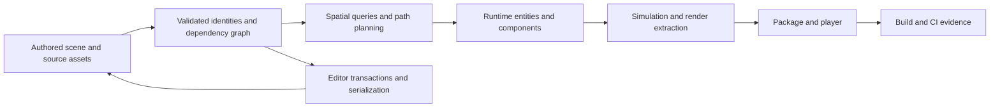
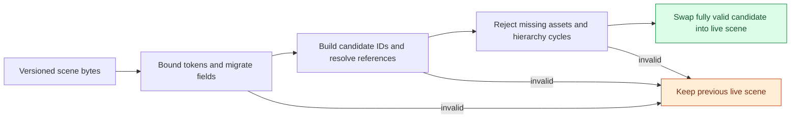
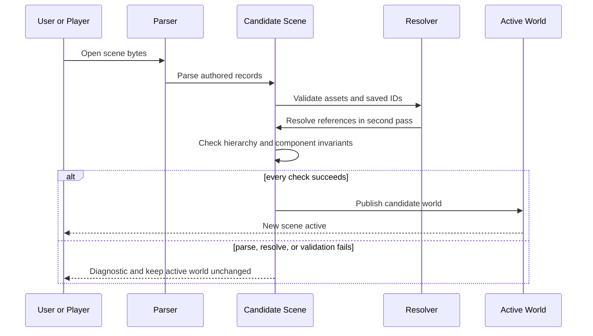

# 08 — Algorithms, application boundaries, and a first playable

[[Chapter Edition/03 - Game Engine/00 - Reading Map|Reading map]] · [[Chapter Edition/03 - Game Engine/07 - Typed APIs and measured CPU data structures|Previous chapter]] · [[Chapter Edition/03 - Game Engine/09 - Player choices, rules, and readable feedback|Next chapter]]

Correct data structures answer only part of an engine’s job; a game also needs platform services and a playable question. This chapter moves from graph and search algorithms through source evaluation and into a first project that tests the architecture.

**By the end:** Select algorithms for world queries and navigation, then connect them to a minimal application and a playable validation loop.

**Recall question:** How would you test that a chosen graph or spatial operation supports an actual player decision rather than only passing an isolated algorithm test?

<!-- Derived from Continuous Notes/Game Engine - From First Frame to Living Worlds.md; source lines 9744–10842; source-span SHA256 6108ecb33851f6e591b62ef7f35f4f588635a026750a60631e779b0e97ea78cf. -->

<!-- CHAPTER-SOURCE-BEGIN -->
## From an asset map to a correct navigable world — Phase 5, M028–M030, Parts 446–500

The editor's asset system now has logical identity, a measured memory budget and containers chosen for concrete operations. A connected simulation or game world needs more. Scene nodes form hierarchies; render passes form dependencies; paths connect navigation regions; physics bodies form contact graphs; a renderer sorts spatial keys, computes allocation offsets and caches repeated results. Each system can be understood as a graph or a sequence of transformations, but the correct algorithm depends on edge meaning, input assumptions and what must remain true after every update. Our next operation is therefore not "learn graph algorithms" as a dictionary entry. It is **take one world query, derive the data model, choose the algorithm and prove when its result is valid**.

The original Phase 5 assigns M028 to Parts 446–467 (graph structure and traversal, paths and spanning trees), M029 to 468–486 (searching, sorting, Morton ordering and prefix scans) and M030 to 487–500 (sliding windows, dynamic programming, randomized algorithms, caches and sparse-set/generation contracts). All 55 original titles in this interval have exact entries in the [[Supplementary/Foundations#Phase 5 algorithms and data-structure workload contracts — Parts 401–500|contract ledger]]. The [[tools/labs/phase5_algorithm_workload_lab.cpp|algorithm lab]] independently tests graph, scan, index and cache invariants and compares some shortest-path results to a distinct all-pairs oracle on deterministic randomly generated graphs. The lab does not implement every named algorithm; the narrative explains the mechanisms, their requirements and a path to additional proofs.

### A graph is a data model before it is an algorithm

A graph consists of vertices and edges, but the semantics of an edge must be declared. In a scene hierarchy, a parent → child edge expresses a dependency or ownership relation. In a navigation graph, an edge may represent traversable movement and carry a nonnegative distance or cost. In a physics contact graph, an undirected edge may connect bodies currently constrained by one another. In a renderer's pass graph, edges specify ordering and resource hazards. The same graph data structure cannot make all those meanings interchangeable.

An **adjacency matrix** for V vertices stores a V×V relation; its Θ(V²) memory cost makes edge existence lookup O(1) by index, while enumerating neighbors generally scans V positions. A dense weighted matrix can store a weight or sentinel for every ordered pair. An **adjacency list** stores the neighbors of each vertex and uses Θ(V+E) storage under a typical representation, allowing neighbor traversal proportional to degree. For sparse navigation or dependency graphs, the list usually avoids storing millions of absent edges. For dense small graphs, a bit matrix may have excellent locality and support word-level operations. These comparisons assume particular representations and exclude allocator overhead, indexing features and mutability.

A **directed** edge (u,v) does not automatically imply (v,u); an undirected edge does, or is represented by a pair of directed adjacency entries. A **weighted** graph associates a cost with an edge; "weight" is not automatically a physical length. It might represent travel time, CPU scheduling cost, probability-derived penalty or energy. Combining different units in one shortest-path objective without conversion is a modeling error. Negative weights can make sense in some abstract optimization graphs but are not automatically meaningful for physical movement distances.

### A queue discovers reachability one edge at a time

Suppose a unit moves through a grid in which every allowed step costs one. **Breadth-first search (BFS)** is appropriate. It begins at the source, marks its distance zero and places it in a FIFO queue. When a vertex at distance d is removed, all previously unseen neighbors are assigned distance d+1 and enqueued. Because all edges have equal unit cost and vertices are discovered in nondecreasing depth, the first discovery of each vertex yields its minimum hop count. The proof depends on queue order and equal edge costs; replacing the queue with an arbitrary stack breaks that property.

The Phase 5 laboratory stores a small directed graph with edges 0→1, 0→2, 1→2, 1→3 and 2→3. BFS from 0 gives hop distances [0,1,1,2] even though some weighted path lengths differ. This is the point: BFS minimizes edge count, not an arbitrary sum of edge weights.

**Depth-first search (DFS)** instead explores one branch as far as possible before returning. It can be written recursively, using call frames as the implicit stack, or iteratively with an explicit stack. A recursive implementation can overflow the program stack for a very long graph chain; an explicit stack lets the algorithm account for memory, order and limits. Both commonly run O(V+E) time for adjacency-list graphs when vertices/edges are processed in bounded ways.

Traversal colors or states help detect cycles. In a directed graph, an edge to a vertex currently on the active recursion stack is a back edge and indicates a directed cycle. An edge to an already completely processed vertex does not necessarily indicate a cycle. In an undirected graph, revisiting the immediate parent through the reverse edge is ordinary and must not be mistaken for a cycle; other visited-neighbor relationships may reveal one. Multigraphs and self-loops require stating how duplicate edges are represented.

### A render graph is an ordering proof, not simply a list of passes

A render graph often needs a **topological order**: every declared dependency A→B must place A before B. A directed graph has a topological ordering if and only if it is acyclic. One way to find that order is **Kahn's algorithm**. Count incoming edges for every vertex, enqueue vertices with indegree zero, remove a ready vertex, append it to the order, decrement its outgoing neighbors' indegrees, and enqueue any that become zero. If fewer than V vertices are emitted, a directed cycle remains.

The Phase 5 lab implements this algorithm and tests both a valid DAG and an added edge that creates a cycle. The source confirms the actual property: cycle detection is not based on whether the input "looks like" a sensible list of passes. Every new edge changes the dependence relation. A missing edge can be worse than a detected cycle because the graph may schedule unsafe resource access in an order the developer never intended.

A **strongly connected component (SCC)** is a maximal vertex set in which every vertex can reach every other through directed paths. Condensing each SCC into one supervertex produces an acyclic component graph. Algorithms such as Kosaraju or Tarjan find SCCs in O(V+E) time for adjacency-list graphs under standard assumptions. SCCs are useful for diagnosing cyclic modules, scene dependencies or feedback groups. They do not automatically make cyclic tasks executable: cycles may require a fixed-point solver, explicit delays, previous-frame state or a contract that rejects them. A topological sorter is allowed to reject cycles even when an application could intentionally solve a feedback system through a different algorithm.

### Shortest paths: the edge assumptions determine the proof

Now assign nonnegative weights to the same navigation graph: 0→1 costs 2, 0→2 costs 5, 1→2 costs 1, 1→3 costs 10, and 2→3 costs 1. The best path from 0 to 3 has weight 4 along 0→1→2→3, not the fewest-edge route 0→2→3, whose weight is 6.

**Dijkstra's algorithm** keeps the smallest discovered tentative distance to each vertex, repeatedly extracts the currently smallest tentative distance, and relaxes outgoing edges. If edge weight w(u,v) is nonnegative, then once a reachable vertex is extracted with the smallest unsettled distance, no detour through a not-yet-extracted vertex can later produce a shorter path to it. This is the critical invariant behind Dijkstra's correctness. Negative weights invalidate that argument.

A relaxation computes

\[
d(v)\leftarrow\min(d(v),\,d(u)+w(u,v)).
\]

The sum must be representable. An integer implementation should guard overflow; a floating implementation should specify how NaNs, infinities and negative values are handled. The lab uses a bounded integer infinity sentinel, checks positive-distance addition before performing it, rejects negative edge weights and ignores stale heap entries. With a binary heap and adjacency lists, an implementation that inserts an improved entry rather than decreasing an existing heap key typically has a bound on the order of O((V+E)log(V+E)) in a straightforward analysis, with variations from data structure and representation. Stating simply O(E log V) without identifying the queue and update strategy can hide assumptions.

**Bellman–Ford** relaxes all edges repeatedly. After at most V−1 rounds, every shortest *simple* path in a graph without reachable negative cycles has been considered, because such a path contains no more than V−1 edges. One more improving relaxation indicates a reachable negative cycle under the usual finite-distance interpretation. This algorithm allows negative edge weights, unlike Dijkstra, but costs O(VE) in a straightforward implementation. The lab checks one negative-edge graph and detects an intentionally created reachable negative cycle.

**Floyd–Warshall** computes all-pairs shortest paths by gradually allowing more intermediate vertices. Let D_k(i,j) be the shortest route from i to j whose intermediate vertices are drawn from the first k candidate vertices. The recurrence is

\[
D_k(i,j)=\min\!\left(D_{k-1}(i,j),
D_{k-1}(i,k)+D_{k-1}(k,j)\right).
\]

The algorithm follows from whether an optimal path uses intermediate k or not. A direct implementation costs O(V³) time and O(V²) storage, making it attractive as a small-graph *reference oracle* even when it is too expensive for a massive world graph. Negative cycles require explicit detection and interpretation. The Phase 5 lab uses bounded nonnegative generated weights and compares each Dijkstra row against Floyd–Warshall on 48 deterministic random six-vertex graphs. This is valuable differential testing, not proof for arbitrary graph size, negative weights or overflow.

### A* is Dijkstra informed by an admissible lower bound

In a large navigation world, we often want the shortest path to one target rather than the distances to all vertices. **A*** maintains the actual best-known cost g(n) from the start and a heuristic estimate h(n) of the remaining cost to the goal, ordering exploration by

\[
f(n)=g(n)+h(n).
\]

An **admissible heuristic** never overestimates the true remaining optimal cost h*(n), so h(n) ≤ h*(n). A **consistent heuristic** satisfies h(u) ≤ w(u,v)+h(v) for each edge and h(goal)=0, under the conventional nonnegative route-cost model. Consistency is a triangle inequality on heuristic potential and implies that f values behave nondecreasingly along improvements in a way that permits particularly simple closed-set handling. Admissibility and consistency are related but not synonymous.

A zero heuristic reduces A* to Dijkstra-like best-first expansion. A geometric Euclidean-distance heuristic is admissible only if actual path cost is guaranteed at least the corresponding straight-line travel cost in compatible units. If edge weights represent fuel cost, danger or arbitrary game-design penalties, Euclidean distance might not be a valid lower bound. A heuristic that "looks reasonable" can overestimate and sacrifice optimality.

The laboratory's A* allows improved entries to be re-enqueued and skips stale entries; it tests an explicitly supplied admissible set of estimates on the known four-vertex graph, producing 4. The code does not *verify admissibility* for a caller's arbitrary heuristic. It is a precondition whose source must be justified by the application and tested, not an automatically true property of a vector of numbers. A **greedy best-first search** might order solely by h(n), ignoring g(n); that can reach the goal quickly but is not guaranteed to minimize total path cost. A* is not simply greedy best-first with a fashionable name: the accumulated cost and heuristic bound are central.

For dynamic worlds, changed costs, temporary obstacles and agent-specific constraints require further thought. A previously optimal path can become invalid after an edge changes. Incremental planners and replanning strategies are separate systems; ordinary A* invocation does not update itself. The navigation component must also map continuous collision geometry to a graph whose edges represent traversable space.

### Minimum spanning trees solve a different global problem

A **minimum spanning tree (MST)** connects all vertices in a weighted undirected graph with no cycles and minimum total selected edge weight. It does not minimize the distance between every pair of vertices. The MST's objective is the *sum of selected edge weights*, not shortest paths from a source.

Kruskal's algorithm sorts edges by increasing weight and adds each edge only when it connects two distinct current components. A disjoint-set union detects whether adding an edge would close a cycle. The **cut property** justifies the greedy choice: under the standard MST conditions, a minimum-weight edge crossing a cut respecting the current partial forest is safe to add (with tie caveats concerning uniqueness). The Phase 5 lab computes a known four-vertex MST cost 1+2+3=6 and rejects a disconnected input rather than silently claiming a tree of all vertices.

Prim's algorithm grows a tree outward from the current connected set, repeatedly choosing the smallest edge crossing from the current tree into an unvisited vertex. It can use a priority queue and runs under different complexity bounds depending on adjacency representation and heap choice. Both find an MST for suitable connected undirected weighted graphs; neither is equivalent to Dijkstra or Bellman–Ford. A physics-island graph can use DSU connectivity without ever needing an MST, while an offline network-connection problem may require the MST objective. The abstract question determines the algorithm.

### Searching and sorting: the order of keys is itself a contract

Return to the editor's asset records. Finding one key in an unsorted vector requires **linear search**, O(n) comparisons in the worst case. Once a sequence is sorted according to a consistent comparator, **binary search** can discard half the remaining search interval per comparison, taking O(log n) comparisons for random-access iterators. But sorting the input costs work, and insertion or deletion may require moving data to maintain sorted order. A binary search on an unsorted sequence can silently return nonsense; the sorted-range precondition is not an optional hint.

**Lower bound** finds the first position at which the key could be inserted without violating order. For duplicates, it identifies the start of the equivalent range under the comparator, and upper bound identifies its end. These operations support asset lookups and compact grouping. **Exponential search** probes increasing distances (1,2,4,8,...) until the candidate range is bounded and then uses binary search; it can be useful when a target is close to the beginning of an ordered sequence with suitable random access. It is not a universal replacement for lower_bound.

Sorting algorithms have different contracts. **Selection sort** repeatedly selects the minimum of the remaining suffix, doing Θ(n²) comparisons even on favorable input in its straightforward form; it can minimize swaps in some contexts but is not a general high-performance choice. **Insertion sort** shifts elements into a sorted prefix, running O(n²) worst case but efficiently handling very small or nearly sorted arrays. **Bubble sort** repeatedly swaps adjacent out-of-order pairs; it also has quadratic worst-case behavior and offers little benefit in a production engine beyond illustrating local inversions and stability conditions.

**Merge sort** divides the input, sorts each half and merges them, giving Θ(n log n) comparisons under the standard implementation with O(n) auxiliary array storage; it can be stable by choosing the earlier equivalent element first. **Quicksort** partitions around a pivot and recursively sorts the partitions. Its average performance is typically good under appropriate pivot and input assumptions, but poor pivots can produce Θ(n²) time; its partition scheme and duplicate-key handling are part of correctness. **Heapsort** offers O(n log n) worst-case time with a typical in-place array implementation but does not preserve equal-key order.

**Introsort** begins with a fast quicksort-like strategy and switches to a worst-case-protected method such as heapsort when recursion depth suggests pathological behavior, often using insertion sort for small partitions. C++ standard-library std::sort has a complexity guarantee, but no standard mandate that every implementation use one exact textbook introsort variant. We can compare outputs and contracts without claiming the library's internal code path until the specific implementation is inspected.

**Counting sort** uses the bounded integer key range K to count occurrences and can run O(n+K) when its representation and output strategy suit the input. **Radix sort** processes keys digit by digit using a stable digit sort (for least-significant-digit variants) and has cost dependent on number of passes and digit range, not only n. They can outperform comparison sorting when keys are representable compact integers, but large key ranges, memory allocation, record movement and handling signed/floating keys introduce real tradeoffs.

A **stable sort** preserves the relative order of elements considered equal by its comparator. This matters when a renderer sorts by depth but wants earlier submission order among equal keys, or when multiple stable sorts establish a compound ordering. Stable does not mean deterministic across arbitrary parallel implementations with ambiguous floating-point keys: the comparator must satisfy a strict weak ordering and the execution must define any remaining tie policy. NaNs can violate the expected ordering model if floating comparisons are used without a consistent total-order policy.

### Morton keys turn 2D proximity into a sortable integer—within limits

Spatial grids often classify objects into cells with integer coordinates. **Morton ordering**, also called Z-order, interleaves coordinate bits so that points sharing high-order spatial bits tend to share prefixes of the key. For 16-bit x and y, put x bit i at key bit 2i and y bit i at bit 2i+1. The Phase 5 lab explicitly expands those bits and verifies Morton(1,2)=9. Sorting by these keys can improve locality of cells and serve spatial partitioning or LBVH construction.

However, Morton order is not a monotonic Euclidean distance ordering. Nearby points can cross a large key discontinuity, and distant points can share some prefixes. Coordinates must be quantized and clamped or rejected according to a declared domain, and out-of-range input can alias if high bits are discarded without checking. Sorting keys also costs time and memory movement. The correct question is whether spatially coherent traversal or BVH build cost improves for the target distribution.

### Prefix scans turn counts into a proof of nonoverlapping output

One of the most important bridges from CPU algorithms to GPU execution is the **prefix sum**, or scan. Suppose a GPU or CPU culling pass identifies per-cell counts c=[3,0,4,2]. An **exclusive scan** produces output offsets o=[0,3,3,7] with total 9. Cell i owns the half-open interval [o_i,o_i+c_i), yielding [0,3), [3,3), [3,7), [7,9). Every range is disjoint, and together they fill [0,9). This is more than a speed trick: it is an allocation and indexing correctness proof.

Formally,

\[
o_i=\sum_{j<i}c_j,\qquad
\mathrm{total}=\sum_{j=0}^{n-1}c_j.
\]

An **inclusive scan** instead outputs the sum through the current element, e.g. [3,3,7,9]. The two definitions differ by an index shift and identity element. Confusing them can make GPU scatter writes overlap or start one element too far into a buffer. The lab tests both the expected exclusive offsets and total and rejects unsigned-sum overflow before it can wrap. An empty input has total zero and no offsets.

A serial scan takes O(n) work and O(n) output space. A parallel scan can use an up-sweep/down-sweep tree, work-efficient block-local methods or hierarchical block aggregation, balancing total **work** against **span** and synchronization. A naive parallel algorithm may perform extra work or require a global barrier not available within one GPU workgroup. On GPUs, multi-dispatch scans and decoupled-lookback approaches involve device-specific synchronization and forward-progress assumptions; a portable CPU vector loop does not prove their correctness. This is exactly where Phase 4's task-dependency and memory-order reasoning becomes necessary.

### Windows, recursion, dynamic programming and greedy proofs are algorithmic choices

Many common engine operations are not named data structures at all; they are patterns for arranging computation. A **two-pointer algorithm** maintains two indexes with an invariant, such as advancing from both ends of a sorted collision-pair list until a target relationship is found. A **sliding window** maintains a contiguous active interval while extending its right boundary and removing expired left elements. If each pointer only moves forward O(n) times, the total work can be linear, despite a loop nested inside another loop. The proof depends on monotonic motion and the exact window predicate; arbitrary negative weights or nonlinear update rules can invalidate an easy window argument.

**Divide and conquer** solves a problem by splitting it into subproblems, solving them and combining results. For the recurrence T(n)=2T(n/2)+Θ(n), the recursion tree has log₂ n levels and O(n) work at each level, giving Θ(n log n), assuming balanced splits and the stated combination cost. That reasoning is the concrete mechanism behind common merge-sort complexity. A broad Master-Theorem phrase is less useful than constructing the recursion tree and checking assumptions.

**Dynamic programming (DP)** applies when subproblems overlap and the result can be composed from smaller optimal subproblem results. A DP state must contain enough information to make the recurrence valid. **Memoization** evaluates states on demand and caches their answers, often via recursion; **tabulation** fills a table in an order satisfying dependencies. They can compute the same recurrence but differ in reachability, recursion overhead, storage and traversal order. The Phase 5 lab finds the minimum number of coins to make total six from denominations {1,3,4}: two coins of value three. A naive greedy choice 4+1+1 uses three coins, showing that a locally largest denomination is not always globally optimal.

A **greedy algorithm** makes a locally preferred choice and commits without reconsidering it. It requires a correctness argument such as the MST cut property, an exchange argument or a matroid-like structure. "It worked on these examples" is not a proof of greediness. The counterexample above deliberately breaks a tempting greedy rule while dynamic programming remains correct.

### Randomization needs a probability proof as well as a seeded test

Randomized algorithms use random choices to affect expected cost or selection behavior. A reproducible pseudo-random generator with a fixed seed is useful for debugging and deterministic research reproduction, but it is not cryptographic entropy and does not make every sampling transformation unbiased.

**Reservoir sampling** can select one uniformly from a stream of unknown length without retaining all elements. Initially keep the first. At the i-th observed item (one-based), replace the reservoir with probability 1/i. By induction, an earlier element remains chosen after step i with probability (1/(i−1))×((i−1)/i)=1/i, while the newest element is selected with probability 1/i. Every item thus has equal probability when the stream ends. The proof assumes the random choice really implements the intended distribution.

**Fisher–Yates shuffle** visits positions and swaps with a uniformly selected eligible position, producing a uniformly random permutation under ideal uniform independent random choices. If the random-index procedure is biased, the permutation can be biased. The Phase 5 lab invokes std::shuffle with a seeded generator and checks that it preserves the input multiset; that does not empirically certify an exact uniform distribution. A rigorous implementation audit must also check index distribution, generator assumptions and seed handling.

### An LRU cache and a sparse set reconnect algorithms to engine ownership

The streaming system may keep only K active mesh descriptions in a memory cache. A **Least Recently Used (LRU)** cache evicts the entry that has not been accessed for the longest time under the cache's declared observation model. An ordered linked list can record recency, and a hash table can map keys to list iterators. On a hit, splice the existing node to the front; on insertion when full, remove the tail and erase its index entry. With appropriate hashing and container guarantees, lookup and recency adjustment are expected O(1). The laboratory exercises capacity two: access key one before inserting key three, then verify key two is evicted.

LRU is a cache policy, not a proof of optimal eviction. A sequential scan of many one-use resources can evict genuinely useful entries; LFU, segmented LRU, clock or application-defined priority may suit different workloads. Caches also need concurrency, invalidation, stale value policy and versioning. Returning an owned snapshot avoids dangling references but can still return stale data unless updates invalidate or version the cache.

A **sparse set** is valuable for entity IDs drawn from a sparse universe when most active components should be iterated densely. A sparse array maps an entity index to a dense position, while a dense array stores the active entity IDs and component values. Lookup checks bounds and verifies that the dense entry at the candidate position really belongs to the queried ID; otherwise an old sparse position can falsely report membership after swap-remove. Removing one entity often swaps the final dense element into the hole and updates its sparse index. This keeps iteration dense but invalidates positional references, explaining the need for logical handles.

**Generational-handle tables** add a generation check to physical slots so that a stale ID cannot silently refer to a newly created entity occupying the old slot. This continues M015/M018 rather than duplicating it into an unrelated "data structures" lesson. The API must still define generation wrap, instance/pool identity, concurrent readers, serialization and resource retirement. The current Phase 5 lab does not replace the existing tested M015/M018 generational registry; instead it relies on that earlier evidence and concentrates new tests on lookup, graph, scan and cache contracts.

### The final choice is an experiment grounded in an operation distribution

We can finally choose a structure without name recognition. The decision begins with the workload: how many assets exist, what fraction are inserted/deleted each frame, how frequently are exact lookups versus ordered range queries performed, how dense are graph edges, and what are the lifetime and synchronization requirements? We then identify correctness invariants and complexity bounds, build a representative input generator, measure relevant costs and validate against an independent oracle.

For exact name lookup with frequent mutation and no ordered iteration, a hash table might be appropriate; for ordered traversal and predictable worst-case comparisons, a balanced tree; for fixed small integer IDs, a bitset or direct-index table; for sparse components with dense iteration, a sparse set; for immutable spatial ordering, a sorted Morton-key array; for small, dense all-pairs routes, Floyd–Warshall; for large nonnegative weighted paths, Dijkstra or justified A*; for unweighted hop counts, BFS. Each choice includes memory footprint, cache behavior, invalidation and update cost, not just one asymptotic number.

A proper benchmark should vary n, load factor, hit/miss ratio, insertion/deletion rate, key distribution, graph density and spatial locality. Hash tables must be tested with collisions and tombstones; trees with adversarial insertion/removal order; graph algorithms with disconnected vertices, cycles and invalid weights; scans with zero counts, empty input and overflow; randomized methods with deterministic reference seeds and statistical checks; all algorithms with appropriate sanitizer and property tests. One medium-sized random workload is not enough to establish a production engine's requirements.

**Phase 5 authored content is now connected end to end, Parts 401–500.** The first half derived the cost and invariants of arrays, queues, hashing, trees, heaps and disjoint sets from the asset catalog. The second half used the same world to explain traversal, pathfinding, sorting, spatial keys, scans, DP and caching. The runnable lab checks selected algorithms, including deterministic randomized differential comparison between independently implemented shortest-path approaches. It is not a claim to have implemented every tree variant, every GPU scan or the current KairoSpatial classes. Those remaining validation requirements are recorded as such.

**Research/source comparison:** MIT OCW [6.006 algorithms lectures, 2020](https://ocw.mit.edu/courses/6-006-introduction-to-algorithms-spring-2020/video_galleries/lecture-videos/) explicitly includes BFS, DFS, Dijkstra, Bellman–Ford, heaps, hashing, dynamic arrays and DP. The older [2011 6.006 lectures](https://ocw.mit.edu/courses/6-006-introduction-to-algorithms-fall-2011/video_galleries/lecture-videos/) cover open addressing, table doubling and additional classical algorithm variants. We verified the course inventories, not complete captions. The supplied *Game Engine Architecture* and existing engine narrative motivate sparse sets, resource managers, scene graphs and navigable worlds. No claim about currently shipping KairoSpatial/AStar, BVHBuilder or NavigationGraph code is derived merely from those sources.

## An API is a promise about an operation

A programmer encounters an unfamiliar function:

```cpp
TextureHandle load_texture(std::string_view path);
```

The declaration gives useful information, but it leaves essential questions unanswered. Does the function finish the upload before returning? Is the path retained? Does a failed load return a distinguished handle, throw, or terminate? Which thread may call it? Who eventually releases the texture? Can a returned handle become invalid after hot reload?

An **application programming interface**, or **API**, is the exposed set of operations and the contracts that make those operations usable. Its spelling is only one part of the interface. A **contract** states what a caller must provide, what the operation promises, and what happens when the operation cannot deliver its normal result.

Start documentation with a caller's situation. For a texture loader, the caller wants a texture that can safely participate in a future draw. Explain whether the operation is synchronous or asynchronous, and define what “ready” means before introducing implementation classes. A CPU image decoded into memory, an upload submitted to a GPU queue, and a texture safe for a particular shader read are three distinguishable states.

### State the contract at the boundary

Use this order when teaching or documenting an operation:

1. Describe the intended result in one ordinary sentence.
2. Define the meaning, units, and validity of each input.
3. Identify ownership and the lifetime of any borrowed data.
4. Explain the successful result and the point at which it becomes usable.
5. Explain failure, cancellation, and partial side effects.
6. State thread, reentrancy, and synchronization requirements. Reentrant means another call is permitted before the earlier call finishes, for example through a callback; thread-safe means the stated concurrent uses are supported. Neither word supplies an unspecified ownership rule.
7. Give a small valid example and a changed-input failure trace.

These are parallel parts of the same contract, not a demand for seven boilerplate headings on every trivial accessor. A short function can have a short contract. A deferred operation involving files, memory, workers, GPU submission, and callbacks usually needs more explanation.

Consider the path argument. A `std::string_view` is a borrowed view of characters. If the loader stores the view for a worker that runs later, the caller's characters must still exist when that worker reads them. An API can instead copy the path into owned storage before returning. Its parameter type alone does not tell us which behavior it implements. A useful description says exactly which object retains the characters and for how long.

Failure guarantees are equally concrete. If decoding fails, does the cache remain unchanged? If decoding succeeds but GPU allocation fails, are temporary CPU bytes released? If uploading succeeds but [[Concepts/Interface contracts and publication|publication]] fails, who retires the GPU resource? “Returns an error” is incomplete when the operation can leave a half-published entry behind.

### Publication is the moment other code may rely on a result

**Publication** means making a result visible to its intended consumers under the required synchronization and validity rules. In a simple single-threaded loader, publication might be inserting a fully constructed texture into a resource table. In an asynchronous loader, it may require a completion message, a state transition, and a rule for when GPU consumers are allowed to read the uploaded data.

For a teaching implementation, imagine the states `Absent`, `Loading`, `Ready`, and `Failed`. A request changes `Absent` to `Loading`. A worker decodes the source image. The renderer's upload path creates the GPU resource. Only after the chosen readiness protocol has been established does the resource manager publish `Ready`. The exact readiness protocol depends on the backend; a Vulkan implementation must specify its execution and memory dependencies rather than relying on the word “upload.”

Cancellation introduces a race worth tracing. Request A starts for scene generation 12. The user closes the scene, destroying generation 12, and opens generation 13. A's worker finishes. If its completion callback blindly publishes into the new scene, cancellation has failed even though every allocation was released correctly. The completion path must validate the request's destination identity or carry an ownership mechanism that makes the obsolete destination unavailable. Cancellation is a state transition whose winner must be defined; it is not merely a Boolean checked at the beginning of a long job.


This same pattern appears in scene loading, shader compilation, pathfinding, image readback, and editor thumbnail generation. The payload changes, but the questions remain: who owns the unfinished result, who may publish it, and what makes its destination still valid?

### A buffer name, an API object, and its storage are separate

A returned integer can name several different stages of a resource's life. In OpenGL, glGenBuffers reserves names; the first glBindBuffer creates the corresponding object state. glCreateBuffers instead creates initialized objects directly. An initialized buffer begins with a zero-sized store. A separate storage operation establishes its byte capacity. Direct state access means naming the object in the command rather than first selecting it through a binding target. These are distinct API promises, not observations of a particular driver's physical allocation strategy.

For an OpenGL 4.5 context with loaded entry points, this fragment expresses two transitions:

```cpp
GLuint buffer = 0;
glCreateBuffers(1, &buffer);  // Initialized object; byte capacity is still zero.
glNamedBufferStorage(buffer, 256, nullptr, 0); // Define a 256-byte store.
```

The null data pointer does not initialize those bytes to zero; their contents are undefined. Immutable storage prevents replacing the store through the ordinary reallocation commands, not every permitted change to its contents. Allowed writes depend on flags and operations. These contracts are specified in [OpenGL 4.5 Core, sections 6.1–6.2](https://registry.khronos.org/OpenGL/specs/gl/glspec45.core.pdf).

For a wrapper design, track identity, storage extent, initialized ranges, and pending users separately. A nonzero handle is not proof that a vertex fetch has a valid range or initialized data. This also explains why the source lecture's phrase about creating everything on the GPU should not become a general allocation guarantee. The source is an explanatory recording; this context-dependent fragment was checked against the specification, not executed in a native OpenGL context. Its API-dependent calls stay beside the explanation, while the ownership and range rules connect to [[Concepts/Object identity and generation handles]] and [[Concepts/Matrix storage indexing and strides]].

### Destroying a C++ wrapper may not finish external work

[[Concepts/RAII and resource handles|RAII]] ties resource-management actions to object lifetime. A wrapper's destructor can reliably perform the action its design promises. It cannot make already-submitted asynchronous consumers disappear by magic.

Suppose the CPU submits a draw that refers to texture T. The owning wrapper then reaches the end of its C++ scope. Immediate destruction of T's backend allocation would be wrong if the GPU may still read it. A wrapper can instead hand T to a retirement mechanism that releases it after the chosen completion condition. That mechanism needs its own owner, and the engine's shutdown order must let the retirement system finish before destroying the device.

The language lifetime rule and the external completion rule meet here. C++ specifies when objects begin and end their lifetimes; the graphics API specifies the conditions for valid resource use. Treating either layer as a replacement for the other leaves a hole in the design. The [C++ lifetime clauses](https://eel.is/c++draft/basic.life) describe the language side. The [Khronos synchronization examples](https://docs.vulkan.org/guide/latest/synchronization_examples.html) give concrete dependency patterns for the API side.

### Error types should preserve the caller's decision

A useful error result distinguishes failures that lead to different actions. A missing source file might prompt the editor to offer a replacement path. An unsupported pixel format might lead to a conversion or a clear rejection. A device-lost error requires a different recovery path from a bad asset name.

Avoid inventing a large error taxonomy before the program has meaningful recovery behavior. Start with the distinctions the caller can act on, and keep diagnostic detail separate from the stable category. Logging an error does not communicate it to a caller that must decide whether to retry, substitute a fallback, or abort a transaction.

For partial operations, state what remains valid. A scene loader can build a candidate scene privately and publish it only after validation succeeds. If a referenced material is missing, it may reject the candidate while leaving the active scene intact. Alternatively, it may explicitly permit a partially loaded scene with fallback materials. Both policies can be coherent. The API must say which world the caller has after failure.

## A complete handle contract in a small program

The following constructed laboratory makes identity observable without returning a borrowed component address. `Handle` is meaningful only inside the particular `Values` instance that issued it; it is not a persistent asset ID or a globally unique name. Calls are single-threaded, or externally synchronized. Returning an `optional<int>` copies a small value, so a later vector relocation cannot invalidate the returned result.

A slot is either live, on an intrusive free list, or retired. Destroying a live value advances its generation before reuse. The generation never wraps: a slot at the maximum generation is retired when destroyed. The sample's normal tests exercise stale-handle rejection, invalid indices, reuse and independent replacement identity. Reaching the 64-bit retirement limit is not dynamically tested by this small program.

```cpp
#include <cassert>
#include <cstdint>
#include <limits>
#include <optional>
#include <stdexcept>
#include <vector>

struct Handle {
    std::uint32_t index;
    std::uint64_t generation;
};

class Values {
    static constexpr auto none = std::numeric_limits<std::uint32_t>::max();
    struct Slot {
        std::uint64_t generation = 1;
        std::optional<int> value;
        std::uint32_t next = none;
    };
    std::vector<Slot> slots;
    std::uint32_t free_head = none;
public:
    bool alive(Handle h) const noexcept {
        return h.index < slots.size() && slots[h.index].value.has_value()
            && slots[h.index].generation == h.generation;
    }
    Handle create(int value) {
        if (free_head != none) {
            const auto index = free_head;
            Slot& slot = slots[index];
            const auto next = slot.next;
            slot.value = value;
            slot.next = none;
            free_head = next;
            return {index, slot.generation};
        }
        if (slots.size() >= none)
            throw std::length_error("Handle index space exhausted");
        const auto index = static_cast<std::uint32_t>(slots.size());
        slots.push_back(Slot{1, value, none});
        return {index, 1};
    }
    bool destroy(Handle h) noexcept {
        if (!alive(h)) return false;
        Slot& slot = slots[h.index];
        slot.value.reset();
        if (slot.generation == std::numeric_limits<std::uint64_t>::max()) {
            slot.next = none; // Retire this slot; never wrap its generation.
        } else {
            ++slot.generation;
            slot.next = free_head;
            free_head = h.index;
        }
        return true;
    }
    std::optional<int> get(Handle h) const noexcept {
        return alive(h) ? slots[h.index].value : std::nullopt;
    }
};

int main() {
    Values values;
    const Handle first = values.create(42);
    assert(values.get(first) == 42);
    assert(values.destroy(first));
    assert(!values.get(first));
    const Handle replacement = values.create(7);
    assert(first.index == replacement.index);
    assert(first.generation != replacement.generation);
    assert(!values.alive(first));
    assert(!values.destroy(first));
    assert(values.get(replacement) == 7);
    const Handle invalid{std::numeric_limits<std::uint32_t>::max(), 1};
    assert(!values.get(invalid));
    assert(values.destroy(replacement));
    assert(!values.alive(replacement));
}
```

The short-circuit order in `alive` matters: it checks the index before reading the slot. Destroying a stale handle leaves its replacement intact. The free list is stored inside vacant slots, so destruction does not need to allocate a separate free-list entry. Creation can allocate when growing the vector and can throw; no new handle is published until that insertion succeeds. This example deliberately does not address cross-instance handles, concurrent access, serialization or GPU completion.

**Executed check:** this exact body compiled as C++20 with `-Wall -Wextra -Werror -fsanitize=address,undefined` and completed its assertions with no sanitizer diagnostics. That validates the exercised laboratory, not an unrelated ECS or renderer implementation.

## The build graph becomes another interface

### A capability exists only where the complete resource contract permits it

Kohi's uniform-buffer fix is a useful portability example: a desired combination of host-visible and device-local memory was not available on every viewer's device. The episode relaxes one path's requirements and conditionally prefers that combination on another. This is an implementation-specific fix, not a rule that frequently changed buffers must never use device-local memory. [Kohi uniform-buffer correction](https://www.youtube.com/watch?v=aD6fZ7tQSAY)

Host-visible memory permits CPU mapping. Device-local identifies memory local to the device; a type may have both properties. Host-coherent concerns cache visibility, not whether GPU work has finished. A descriptor layout declares binding types and counts; a descriptor pool provides storage for allocated sets.

A memory type's property flags must meet the allocation's requirements, and that type must also be included in the particular resource's `memoryTypeBits`. A device-wide Boolean saying “some type has these properties” is not sufficient to establish compatibility for every resource. Separate required properties from preferences, and define what happens when no acceptable type exists. CPU mapping, noncoherent flush/invalidate operations and GPU completion are separate contracts. [Vulkan memory-type selection](https://docs.vulkan.org/spec/latest/chapters/memory.html)

Descriptors add a different lifetime and update contract. The historical crash-fix episode moves ordinary descriptor updates before binding and allocates separate uniform regions for overlapping frames. A feature being supported by hardware does not itself enable its use: the relevant feature, descriptor-layout/pool configuration and binding rules must agree. Update-after-bind does not mean arbitrary concurrent updates to every in-use descriptor are safe. Keep the ordinary update-before-use path correct before adding optional relaxed behavior. [Kohi descriptor correction](https://www.youtube.com/watch?v=U4QvUeUL37Y), [Khronos descriptor binding rules](https://docs.vulkan.org/spec/latest/chapters/descriptorsets.html)

The frame's descriptor, uniform byte range, command buffer and completion record must refer to the same reuse policy. An acquired swapchain image index and a CPU frame-slot index are different identifiers; matching them by accident on one configuration is not a general design. A per-image or per-frame region is reusable when the work using that region has completed, not merely when a modulo counter repeats. The engine chapter develops ownership across frames; this is the API-level condition it must preserve.

A region offset must also obey the API's applicable alignment limits. For record size $b$ and required alignment $a>0$, a padded stride is $s=a\lceil b/a\rceil$. A 160-byte record with a queried 256-byte offset alignment uses offsets $0,256,512$ for three regions, not $0,160,320$. This is an illustrative limit value, not a universal Vulkan constant. The actual offset/range rules depend on the binding operation and resource type.

### Packaging removes an editor dependency, not every runtime dependency

The Java export episode demonstrates packaging a project as a runnable JAR and launching it outside its IDE. A JAR is an archive used for Java classes and resources. The configured entry point tells the runtime which application to start. Exporting does not make the program independent of a compatible Java runtime, native libraries, expected resources, permissions or platform behavior. The captions explicitly say the presenter did not test Linux there; an extracted claim saying Windows was untested was wrong. [Source export episode](https://www.youtube.com/watch?v=velhSXA2CnQ)

The transferable test is to launch the packaged application from a clean directory or machine with only its declared runtime requirements. Record which assets are bundled, which paths are resolved relative to a working directory, and how startup failures become visible without an IDE console. A successful export and a successful launch are distinct observations. A historical announcement of a future Android port likewise establishes intent, not a completed port or a recommendation to use that period's toolchain today.


## Give startup and shutdown a direction

An application cannot use a service before that service exists. If rendering needs a window and the window needs a platform connection, startup follows those dependencies. A **dependency** is simply a condition or service another operation relies on. Shutdown usually follows the reverse order, while also waiting for outstanding work that still uses the resource.

For example, finish or cancel world jobs, finish the rendering work that references GPU resources, destroy the renderer's objects, destroy the window, and finally release platform services. A **job** is a bounded unit of work scheduled to run; it may finish later than the function that requested it. An object's destruction is safe only when its last user is finished, not merely when a local variable goes out of scope.

Write the failed-startup case before hiding initialization inside a constructor. Suppose the window succeeds, the GPU device succeeds, but a required shader fails. Which steps have completed? Which resources must be released? Can the caller receive a useful error? This is a small **state machine**: a system whose legal operations depend on its current state and whose transitions are explicit.

| State | What is valid now? | Failure or exit action |
|---|---|---|
| No platform | No window or device use | Report why platform setup failed |
| Platform ready | Platform calls and window creation | Release platform if window creation fails |
| Window ready | Window events and graphics-surface setup | Destroy the window on later failure |
| Renderer ready | Resource preparation and frame submission | Finish in-flight use, then release graphics objects |
| Running | World update and presentation | Request exit and wind down in agreed order |

This table is a teaching model, not a required class hierarchy. In C++, ownership can be represented with objects whose destructors release what they acquire. That pattern is called **RAII**, or resource acquisition is initialization: a valid owning object's lifetime controls the resource's lifetime. In C, the same obligation can be expressed with explicit initialization and cleanup functions and carefully organized failure paths. The language changes the mechanism; the obligation remains.

Do not solve every possible extension yet. Add a new boundary when a concrete need appears: supporting a second platform, testing without a window, running an editor and a game, or replacing a graphics backend. An **API**, or application programming interface, is the set of operations and rules one part of software offers another. A **backend** is a particular implementation behind a shared interface, such as one renderer implemented with Vulkan and another with a different graphics API. The shared interface should express the engine's actual needs, not expose every operation of every possible API.

### Make system ownership match the work

A window should own window events and lifecycle; a renderer should own render passes and decide when buffers are bound. A render buffer can allocate attachments and report its dimensions, but it does not need to know what a “shadow pass” means. That separation gives the renderer authority over multiple views, editor/play scenes, and pass ordering without turning every resource object into a partial renderer. The C# code review uses these as architectural recommendations for one prototype, not as proof that one class layout is universally correct (C# Game Engine code review, 00:28:57–00:32:29).

Graphics resources also have prerequisites. A shader that calls OpenGL cannot be created until a context exists and its function entry points have been loaded. Constructing such an object during global initialization can run too early. Make startup order visible: create the window/context, load the graphics functions, then create programs and other GPU resources (Game Engine by 11-Year-Old code review, 00:21:34–00:30:37).

A release candidate benefits from a similarly explicit owner. Freeze one commit on a pending-release branch, test that fixed snapshot, and merge accepted fixes back into development. Testing a branch that keeps changing makes it unclear which exact state passed. Before replacing the current release, verify the branch ancestry and ensure hot fixes are not stranded. This is the historical Hazel team’s workflow in the devlog; the useful principle is a stable candidate plus traceable fixes, not the particular branch names (Fixing Hazel office devlog, 00:02:10–00:05:47, 00:14:20–00:15:30).

## Know which story each source can tell

The named series show evolving implementations. A video can intentionally build an awkward version, encounter a bug, and repair it later. The teaching should retain that cause and correction: what failed, why it failed, and what the replacement costs. Current repository code is evidence about an identified revision, not automatic proof of what an older video explained.

The two channels also make different choices. Kohi's official description identifies a C-and-Vulkan engine and says its current source authority has moved to SVN, with GitHub acting as a mirror. The Hazel public repository is an educational project associated with the series; public source access does not establish access to paid or private Hazel versions. These facts constrain provenance, rather than declaring one architecture the universal solution. [Kohi official repository](https://github.com/travisvroman/kohi), [Hazel public repository](https://github.com/TheCherno/Hazel).

The supplied books provide another useful perspective: runtime architecture, motion and contact, design requirements, and the connection between rules and player experience. Their editions and actually read page ranges are in the ledger. Their age matters when applying an API or platform-specific example; a durable architectural argument and a current API signature are different kinds of evidence.


### Choose an explanation format that matches the learner and the work

Not every teaching goal benefits from watching every line be typed. A creator’s livestream discussion proposes doing complex planning, debugging, and implementation in a long development stream, then producing shorter episodes that explain the result, code changes, and design decisions. The creator frames this as a proposal shaped by audience feedback and time constraints, not a proven course format. It is useful as a teaching distinction: a complete process record, a concise conceptual explanation, and a line-by-line beginner exercise serve different learners. [Format discussion](https://www.youtube.com/watch?v=lwDdMYzUnxs&t=8m2s)

A separate project announcement proposes an AI-assisted open-source engine workflow with architecture diagrams, generated implementation, senior review, tests, scripts, documentation, and reading generated code carefully. The presenter emphasizes that generated code must be understood and verified rather than accepted blindly. These are intentions and opinions, not evidence of a completed engine or measured productivity gain. The durable lesson is to keep authorship, review, tests, and comprehension explicit whichever tools are used. [Engine-series introduction](https://www.youtube.com/watch?v=-paLdjChPxo&t=8m32s)

An Unreal Engine 5 Early Access reaction is likewise a historical response to a vendor demonstration, not an independent implementation test. It draws attention to virtualized geometry, dynamic global illumination, world partitioning, data layers, animation tools, and audio synthesis, but those capabilities should be understood from version-specific primary documentation and hands-on tests before being treated as current guarantees. The reaction is valuable as a map of questions to investigate, especially around streaming and collaborative world editing. [Early Access reaction](https://www.youtube.com/watch?v=nyZnRxvSJrY&t=4m40s)
### Treat renderer and asset plans as plans until tested

Early engine logs often list a long roadmap: forward and deferred rendering, physically based materials, editor serialization, platform ports, or code generation. Those are not features just because they appear on a board. For example, the Sparky planning log describes deferred rendering as a possible fit for scenes with many dynamic lights, but its own note says that support depends on multiple render targets. Likewise, it proposes converting source models into a runtime-friendly layout and adding serialization before a scene editor can save levels. Keep the dependency visible, then confirm each stage with an implemented path and a test (Sparky Engine Dev Log #2, 00:12:19–00:18:05).

The same care applies to claims about borrowed algorithms. In a C# engine review, the presenter says a bloom shader closely matches code and comments from Hazel. That is a source-attribution concern raised by the reviewer; this review has not independently compared the repositories or established ownership. When importing an algorithm, keep a provenance note and check the license and source before presenting the implementation as original (C# Game Engine code review, 00:44:06–00:45:26).

### Evidence boundary

Episode-specific statements above come only from reviewed local ASR text. Whisper often mishears “Vulkan” as “Vulcan”; code identifiers and implementation details have not been checked against the episode's screen or source repository. No manual audio comparison, video-frame inspection, build, runtime, pixel check, or independent resize test was performed. The Khronos references support the added Vulkan explanations only; they do not verify the episode's claimed build or blue-screen result.

### What the ending establishes

Near the end, the narrator reports a clean build after correcting pointer types and moving a helper declaration, then says the program ran and texture/mode changes looked correct (**01:27:29–01:29:19**). This is an episode report, not a result independently verified for this research note. The practical lesson is to keep three questions separate when implementing a writable texture path: what operations the image is allowed to serve, what layout it must be in for the next operation, and which subsystem owns each resource and its resize/destruction. The episode’s API shape is a useful case study in those boundaries, including its acknowledged unfinished upload-to-writable-target layout choice.

### Evidence boundary

The section above summarizes the full locally generated ASR transcript for this episode and adds the separately labeled Khronos API context. No YouTube caption was retrieved or retried; the audio was not manually checked; no on-screen code, repository build, runtime, or video frame was inspected. Narrated implementation details and reported results remain attributed to the episode.


## PROFILING IS A SEARCH FOR THE LIMITING RESOURCE, NOT A RITUAL SCREENSHOT

A renderer can be correct and still miss its frame budget. The profiling workflow should therefore move from broad scheduling evidence toward increasingly local evidence.

### Start with the system timeline

A system profiler answers questions such as:

- Which CPU threads were runnable, sleeping or blocked?
- When were command buffers recorded and submitted?
- Is the CPU feeding the GPU continuously?
- Are graphics, compute and copy queues overlapping or serializing?
- Is a fence/event wait creating an avoidable bubble?
- Is asset streaming or shader compilation stealing frame time?

Nsight Systems can correlate Vulkan API calls, command-buffer creation, GPU workloads, debug labels and frame durations. This is useful before optimizing a shader because a slow frame may actually be caused by submission gaps, serialization or CPU-side work.

The first profiling question is therefore:

\[
\boxed{
\text{where is time absent from useful work?}
}
\]

not “which function looks expensive?”

### Then inspect one graphics workload in detail

A graphics debugger/profiler answers a different class of question.

Nsight Graphics supports Vulkan capture/replay, GPU Trace, shader profiling, shader debugging and ray-tracing inspection. A frame capture can expose:

- exact draw/dispatch sequence,
- bound resources and pipeline state,
- attachment contents,
- barriers and dependencies,
- shader inputs/outputs,
- acceleration-structure state,
- event timing.

GPU Trace is useful when the question becomes:

> Which GPU units are saturated, which are idle, and where are queues or workloads failing to overlap?

Shader profiling becomes useful only after evidence says the workload is shader/SM limited. Then inspect stalls, instruction mix and source-correlated hot regions.

This gives a narrowing funnel:

\[
\boxed{
\text{system timeline}
\rightarrow
\text{frame/workload}
\rightarrow
\text{pipeline stage}
\rightarrow
\text{shader/source}
}
\]

Jumping directly to source-level micro-optimization can waste hours when the real problem is an idle gap or synchronization edge.

### Label everything before you need the labels

A trace containing unnamed command buffers, passes and resources is technically detailed but practically opaque.

Use stable labels such as:

~~~
Frame 381
Shadow Cascades
Visibility Cull
GBuffer
RT Reflections
TAA Resolve
Bloom Downsample 3
Upload Mesh 1242
~~~

and name buffers/textures/pipelines where the API permits.

These labels should correspond to engine concepts. If the render graph calls a pass “RTReflections” while the profiler sees “encoder_17,” the abstraction boundary has failed observability.

### Measure representative workloads

A trace of an empty test scene cannot answer whether the engine scales to its target workload.

Profile:

- typical scene,
- worst expected scene,
- content-loading spike,
- shader-heavy scene,
- geometry-heavy scene,
- ray-tracing-heavy scene,
- CPU submission stress,
- memory-pressure case.

Performance is a function of workload and hardware:

\[
T = T(\text{scene},\text{settings},\text{hardware},\text{driver},\text{build}).
\]

Store enough metadata with captures to reproduce that tuple.

### Use counter evidence to choose the next experiment

If GPU occupancy is low, that does not automatically mean “increase threads.” The cause might be:

- dependency bubbles,
- tiny dispatches,
- register pressure,
- memory latency,
- divergent control flow,
- insufficient work,
- queue serialization.

If a shader is bandwidth limited, reducing ALU may do nothing. If it is latency bound, arithmetic changes may help only if they improve scheduling or occupancy.

Profiling is an iterative scientific loop:

\[
\boxed{
\text{observe}
\rightarrow
\text{hypothesize}
\rightarrow
\text{change one cause}
\rightarrow
\text{remeasure}
}
\]

Tracy and engine-side timers are excellent for continuous CPU instrumentation. RenderDoc is excellent for portable frame inspection. Nsight Systems is strong for CPU/GPU scheduling correlation on supported NVIDIA systems. Nsight Graphics provides deep Vulkan/D3D graphics and shader analysis on NVIDIA hardware. Xcode GPU tools serve the analogous Apple/Metal workflow.

Do not ask one tool to answer every layer.


## PRACTICAL SOURCE TRIANGULATION: WHAT EACH SERIES IS ACTUALLY GOOD FOR

A large curriculum gets weaker if every source is treated as authoritative about everything.

**The Cherno / Hazel** is strongest for seeing a C++ engine acquire architecture under pressure: project generation, layers/events, windowing, renderer abstractions, buffers, shaders, batching, editor/runtime separation, serialization, scripting, profiling and refactoring. The lesson is not to clone Hazel's exact classes; it is to watch abstractions appear because earlier code becomes painful.

**Travis Vroman / Kohi** is stronger for a low-level C/Vulkan engine evolving publicly for years. It exposes platform layers, custom memory/container systems, renderer plugins, assets/materials, manifests, tooling, hot-reloadable application code, tests, UI and audio. Kohi explicitly frames itself as a learning engine and acknowledges that some approaches are explored and later repaired. That makes evolution pressure part of the evidence.

**Brendan Galea's Vulkan series** is an efficient bridge from C++ knowledge to a small Vulkan engine. Its pedagogical strength is sequence: device, swapchain, pipelines, commands, descriptors, frame resources, transforms, models, cameras and lighting arrive in an order where each abstraction solves a visible problem.

**CppCon** is not one course. Use it surgically for topics whose failure modes disappear in toy examples: lifetime, allocator design, undefined behavior, atomics/memory ordering, ABI, templates, profiling, caches, SIMD, coroutines, modules, testing and performance methodology.

**MIT graphics lectures** provide algorithmic spine: transforms, curves/surfaces, animation, ODEs, collisions, ray casting/tracing, acceleration, shading, texture mapping, sampling/aliasing, Monte Carlo, rasterization and shadows. They keep an engine curriculum from becoming API memorization.

**Official Vulkan/Apple documentation** defines the current contract. If a tutorial and current documentation disagree, keep the tutorial as historical pedagogy and use the specification/documentation for current behavior.

**The uploaded books** play separate roles. A Tour of C++ supplies an integrated language map; Effective Modern C++ concentrates C++11/14 idioms and pitfalls; Professional C++ broadens into production software engineering; the Vulkan books explain both explicit-API foundations and modern renderer construction; the MSL specification is normative shader-language detail; Ray Tracing Gems supplies production techniques and edge cases rather than a single linear tutorial.

The curriculum rule is:

\[
\boxed{
\text{concept source}
\rightarrow
\text{implementation source}
\rightarrow
\text{production/failure source}
\rightarrow
\text{current specification}
}
\]

That is why this volume does not create detached “Kohi,” “Cherno,” or “CppCon” chapters. Their material is merged where the engineering pressure makes it necessary.


## From Moving Scene to Reproducible Runtime

### A teaching spine for spatial queries, planning, identity, ECS, content, and builds

A game engine can be understood as a chain of questions about *which things exist, where they are, what they mean, and how a machine can reproduce their behavior*. A moving robot in a scene gives us a concrete thread. At first we need to know what it can hit. Then we need to find a path through navigable space. Those queries depend on spatial structures that must follow motion. The scene's objects must in turn have durable identity while their component data moves in memory. An editor must turn authored data into runtime state and save it without publishing half a change. Finally, the build must reproduce the same executable and content pipeline from declared dependencies.

The same design tension repeats at every scale: do enough work to preserve a meaningful invariant, but no more than the query needs. A bounding hierarchy trades build/update cost for fewer primitive tests. A* trades a heuristic's domain knowledge for fewer graph expansions. ECS storage trades cheap iteration against structural mutation. A transaction trades staging and validation work for all-or-nothing [[Concepts/Interface contracts and publication|publication]]. A build graph trades dependency declarations for safe parallelism. We can understand engine architecture by following these costs and invariants rather than memorizing subsystem names.



### 1. A robot asks questions of space

Imagine a robot with a position, orientation, velocity, collision shape, and goal. Each simulation step can ask: which obstacles overlap its predicted bounds? Which surface lies under a sensor ray? Which route connects its current region to a target? These are different queries. One spatial data structure rarely answers all of them well because each query has a different cost pattern.

A **primitive** is the thing whose exact geometry or state the query ultimately cares about: a triangle, collider, navigation polygon, or entity. A **bounding volume** is a simpler conservative envelope around it. “Conservative” means it may include empty space, but it must not exclude any real geometry. An axis-aligned bounding box (AABB) is described by minimum and maximum coordinates on each axis. A hierarchy groups bounds so a query can reject a whole group at once.

A **bounding volume hierarchy** (BVH) stores primitives in leaves and enclosing bounds in interior nodes. For a ray query, if the ray misses a node's bound, it cannot hit anything below that node. The traversal can skip every descendant. A BVH therefore reduces work; it does not make exact intersection cheaper. A loose or overlapping hierarchy may still visit many leaves.

A useful mental model for binary BVH traversal is:

1. Test the root bound.
2. If it misses, finish.
3. If it is a leaf, test its primitives exactly.
4. Otherwise test both child bounds, order the children when distance matters, and continue with candidates that can improve the answer.

The distinction between **closest-hit** and **any-hit** is important. Closest-hit needs the smallest positive ray parameter $t$; after finding a hit at $t_{best}$, a node whose near intersection lies beyond that value can be pruned. Any-hit only asks whether some acceptable hit exists, so it may stop at the first valid one. An API that returns a list of hits while being named “raycast” must make its ordering and completeness contract explicit; otherwise callers may wrongly assume nearest-first behavior.

#### 1.1 Why surface area predicts traversal

The surface area heuristic (SAH) estimates the expected cost of partitioning primitives into child bounds. For a parent bound $P$, left and right child bounds $L,R$, counts $N_L,N_R$, traversal cost $C_T$, and primitive intersection cost $C_I$, a common split estimate is

$$C_{split}=C_T+\frac{A(L)}{A(P)}N_LC_I+\frac{A(R)}{A(P)}N_RC_I.$$

The ratios approximate the probability that a random ray which reaches the parent also reaches each child. It is a statistical model, not a promise about every camera, ray distribution, or workload. The constants matter: if primitive tests are expensive, a somewhat deeper tree may pay off; if exact tests are cheap and traversal is branch-heavy, a different balance may win.

Consider a parent with surface area 100. Candidate A creates child areas 40 and 50, with 3 and 5 primitives. Let $C_T=1$, $C_I=1$. Its estimated cost is $1+(40/100)3+(50/100)5=4.7$. Candidate B creates areas 60 and 35, with 6 and 2 primitives: $1+(60/100)6+(35/100)2=5.3$. SAH prefers A. The primitive total in each split is eight, yet A's child areas suggest fewer expected ray visits. If exact primitive tests cost $C_I=4$, the same scores become 15.8 and 18.2, preserving this preference. But another scene or cost profile can reverse it.

An exact sweep evaluates every candidate split and can be expensive to build. **Binned SAH** groups centroids into a fixed number of bins, accumulates left and right bounds/counts, then evaluates boundaries. It approximates the best split with bounded work. Median splitting is simpler and predictable, but does not directly minimize expected traversal cost. Morton ordering quantizes positions and interleaves their coordinate bits, such as alternating x, y and z bits, to form integer keys whose order approximates a spatial traversal; sorting those codes gives a fast locality-oriented build, but a Morton builder is not automatically a canonical linear BVH (LBVH). The construction method and name should match what the code actually does.

Tree shape is a time-horizon choice. A static BVH can spend more time building for repeated queries. A dynamic scene may need a fast rebuild or update. **Refitting** recomputes parent bounds from changed leaves while preserving the topology. It is cheap if motion is modest, but deformation can make the fixed partition overlap badly. Periodic rebuilds restore quality. Measure both build/update cost and the query work after updates; “refit is faster” is incomplete if it leads to much slower traversal.

Other spatial structures suit other motion and query patterns. A **dynamic AABB tree** incrementally inserts and removes moving-object proxies. A fat bound extends beyond a tight collider bound; if an object stays inside it, the tree need not be updated every frame. Larger margins reduce update frequency but increase false-positive candidate pairs. **Sweep-and-prune** sorts interval endpoints along an axis and exploits temporal coherence: moving objects often leave the list nearly sorted. **Spatial hashing** maps integer cell coordinates to buckets; it is compact and useful for roughly uniform objects, but cell size and objects spanning many cells control the cost. Hash bucket collisions must not be confused with geometric overlap. A **uniform grid** uses explicit cells; a hierarchical grid handles size variation more gracefully than one fixed cell size.

A scene graph and a spatial index answer different questions. A scene graph captures ownership or transform relationships (“this wheel is attached to that robot”). A spatial index groups by geometry (“these bounds may overlap”). A parent-child relation does not guarantee spatial locality, and spatial proximity does not imply ownership. Using one as a substitute for the other causes awkward updates or poor query pruning.

### 2. From geometry to a route

Collision and visibility structures answer geometric tests. Pathfinding instead operates on a **graph**: vertices represent locations or regions, and edges represent allowed transitions. An edge can carry distance, time, energy, risk, or a weighted blend. If future cost depends on heading, speed, remaining fuel, or a key already collected, location alone is not a complete state. The graph node must encode the state variables needed to make transition costs and legal moves well-defined.

For the robot, a navigation mesh can represent walkable space as convex polygons. Neighboring polygons share a portal. A search first finds a polygon corridor; a funnel algorithm then tightens the path through the portals to produce a shorter geometric route. The corridor's graph cost and the final funnel path length are not necessarily the same quantity. If optimization is for shortest travel distance, the edge costs and heuristic must correspond to the metric being optimized. Agent radius and clearance also matter: a centerline path that fits a point robot may collide with walls for a robot of finite size.

A* maintains for each discovered node $n$:

- (g(n)): the least known cost from the start to $n$;
- (h(n)): a lower-bound estimate from $n$ to the goal;
- $f(n)=g(n)+h(n)$: a priority estimate for expansion;
- `cameFrom[n]`: the predecessor used to reconstruct a route.

When an edge $u\rightarrow v$ has cost (c(u,v)), relaxation tests whether (g(u)+c(u,v)) improves (g(v)). If so, update (g(v)), its predecessor, and its queue priority. A binary heap supports retrieving the smallest priority efficiently. A common implementation avoids an indexed decrease-key heap: push a new entry when a better score appears, and discard an entry when popped if its stored score no longer matches the current best score.

A heuristic is **admissible** when it never overestimates the true remaining optimal cost: $h(n)\leq h^*(n)$. This is the key bound behind optimality when the goal is accepted under the algorithm's appropriate termination rule. **Consistency** is stronger: for every edge $u\rightarrow v$, $h(u)\leq c(u,v)+h(v)$. It is a triangle-inequality condition. With a consistent heuristic, $f$-values do not decrease along a path; once a node is closed at its best $g$, it need not be reopened. With an admissible but inconsistent heuristic, a later route can improve a closed node. An implementation that permanently rejects closed nodes may then lose optimality. The choices are to require consistency, or support reopening when a better $g$ is found.

This distinction corrects a frequent simplification: “admissible means the closed set is always safe.” That is only true under additional conditions, such as a consistent heuristic or a reopening implementation. Also, Dijkstra's algorithm is A* with $h=0$. Manhattan distance is appropriate for four-neighbor grids with uniform cardinal costs; it can overestimate when diagonal travel is allowed. Octile distance accounts for diagonal moves under the corresponding cost model. A Euclidean heuristic must be scaled to the minimum cost per world-space distance, otherwise it can overestimate on cheap terrain. If an edge may cost zero over nonzero distance, a positive distance-scaled heuristic is unsafe; zero-cost movement can reduce the safe heuristic to zero, yielding Dijkstra behavior.

Path reconstruction follows predecessor links from goal to start, then reverses the result. It must detect missing predecessors and bound traversal so corrupt parent cycles cannot loop forever. Dynamic obstacles add another distinction: global planning finds a route through a map representation, while local avoidance handles nearby moving agents and short-term changes. One mechanism does not guarantee the other's job.

### 3. Moving structures and durable identities

As the robot moves, geometry changes, but its logical identity should not. An entity handle is a value naming a slot plus a generation (also called a version). The index identifies storage; the generation distinguishes successive occupants of the same index. On destruction, remove all owned component data, advance the generation, and only then make the slot reusable. A stale handle from an earlier occupant will fail a full index-and-generation check.

Generation counters are finite. If they wrap and an old handle survives long enough, the same index/generation pair can recur: an ABA problem, where a value looks unchanged even though the object was destroyed and replaced in between. Wider generations make wrap less likely, but do not prove infinite uniqueness. Stronger policies include reserving wraparound values, quarantining/recycling only after a safe horizon, using wider IDs, or adding a world/session identity. Which is needed depends on whether handles can persist externally, across reloads, or across network sessions. Runtime entity handles are not automatically persistent asset IDs or save-file references.

A free list stores reusable indices. LIFO reuse is cache-friendly and quick; FIFO reuse can delay recycling and may reduce immediate stale-handle confusion, but neither changes the need for generation validation. Creation and destruction must have exception-safe ordering. A failed allocation must not publish a live identity without a corresponding storage slot. Destruction must not recycle an index before all component pools and reverse mappings have stopped referring to it.

#### 3.1 Sparse sets and the meaning of a reference

A sparse-set component pool uses a sparse index table from entity index to dense position, plus dense entity handles and dense component values. Membership requires bounds and sentinel checks and then a full entity comparison, including generation. The sparse mapping for an insertion should be made visible only after the dense entity and component have been successfully constructed; otherwise an exception can expose a half-present component. Removal commonly swap-moves the last dense entry into the removed position and repairs its sparse mapping. This is fast and keeps iteration compact, but changes addresses.

That last fact is a lifetime contract, not an implementation footnote. A pointer or reference to a component may be invalidated by vector growth, erase, swap-and-pop, [[Concepts/Archetype ECS|archetype]] migration, or pool destruction. `Reserve()` can reduce reallocations, but it does not make references stable under removals. If stable addresses are required, use paged storage, indirection, tombstones, or a deliberate handle-to-object layer, accepting the extra memory or lookup cost. Gameplay code should often retain an entity handle and reacquire the component at the point of use rather than keep raw component pointers across structural changes.

Dense iteration is the strength of sparse storage: the system walks contiguous values and avoids pointer chasing. Multi-component queries can iterate the smallest pool and test membership in the other pools. Excluded components are anti-joins: require absence while iterating candidates. A query cache can remember matching pools or entity sets, but a cached entity list becomes invalid after structural changes. Versioning and invalidation rules must be explicit.

Structural mutation during iteration can skip an item, visit one twice, or dereference moved storage. A **command buffer** records requested changes and applies them at a defined synchronization point. Its semantics must say whether entity creation becomes visible immediately, when destruction takes effect, how conflicting commands are ordered, and what failure means. A deferred destroy may leave an entity query-visible until flush; an immediate tombstone hides it logically while physical removal waits. Neither policy is self-evident.

#### 3.2 Archetypes and structural migration

An archetype groups entities with exactly the same component-type set. Adding or removing a component changes the set, so the entity migrates to another archetype. Within each archetype, component columns are packed in chunks. A query can find matching archetypes once, then iterate columns efficiently without testing every entity for membership. This is attractive when component combinations are stable and large groups share systems.

The cost shifts to structural change. Migration must construct destination values, preserve retained values, remove the source entity, repair any moved entity location, and publish the destination location. If a component constructor throws halfway through, invariants require either rollback to the original archetype or a clearly documented failure state with a way to recover. A safe sequence stages the destination first, records which constructions succeeded, and makes location metadata authoritative only once the destination is complete. Component destructors are expected not to throw; destruction failures cannot generally be rolled back safely.

This is where C++ object lifetime rules matter. Relocation is not synonymous with copying bytes. `memcpy` is valid only for types and contexts where the language permits the object-representation operation and where the semantics are preserved. Nontrivial components need correct move construction and destruction. Move-only components can fit an ECS, but entity cloning must define whether the component can be cloned at all. Storage traits should drive the chosen operation rather than treating every `T` as a byte buffer.

Sparse sets and archetypes are design points, not moral opposites. Sparse sets often make adding/removing a component cheap and keep each component type independently packed. Archetypes make matching queries fast across stable combinations but incur migration. Hybrid designs use different storage for high-churn or sparse components. Tags have no payload but still affect membership; too many independent tags can fragment archetypes. Global resources such as input state may be clearer outside entity storage, while entity-linked state remains queryable as components.

Memory layout also shapes what the CPU actually loads. Array-of-structures (AoS) stores all fields of each item together; structure-of-arrays (SoA) stores one field across many items; array-of-structures-of-arrays (AoSoA) blocks a small number of items for vectorized work. ECS columnar storage is already partly SoA across component types, but a large component may still mix hot fields read every frame with cold fields used rarely. Split them when measurement shows wasted bandwidth or cache pressure. Do not optimize merely by labels: predictable access patterns and actual profiler evidence matter.

### 4. Scene relationships, systems, and identity bridges

A transform hierarchy is a relationship graph layered over entities. A child usually stores a parent handle, and the parent may keep child links for traversal. If both directions are stored, every edit must maintain the invariant that each parent lists exactly its children and each child's parent agrees. Reparenting must prevent cycles. Destruction policy must define whether children are destroyed, detached, or reparented. World transform is derived from local transform and ancestors, so hierarchy order matters: parent world transforms must be current before child transforms are computed.

Repeatedly walking ancestors for every consumer can duplicate work. Dirty propagation marks descendants stale after a local change; a version scheme can lazily recompute when a parent version changes. Fixed-step simulation may keep previous and current transform snapshots and interpolate for rendering. A teleport is a discontinuity and should reset interpolation history, or the renderer will draw a false sweep between positions.

Runtime subsystems often allocate their own IDs. A physics body ID or renderer object ID should not be confused with the entity handle or a persistent scene identity. Maintain explicit mappings and lifetime rules: entity-to-physics on creation, reverse mapping for collision callbacks, removal before handle reuse. Rendering commonly extracts a frame's renderable data into a renderer-facing snapshot rather than exposing live ECS storage to asynchronous GPU work. Picking IDs require the same care; writing a short-lived entity index into a GPU buffer can resolve to a different entity by readback time. Use a stable token or validate a captured generation when the result returns.

Systems form a schedule. Each system declares data it reads and writes; conflicts constrain parallel execution. A dependency directed acyclic graph (DAG) represents “must happen before” edges. If two systems only read the same data, they can often run together. If one writes a component another reads, order or synchronization is required. False sharing occurs when threads update independent values that happen to occupy the same CPU cache line; it is a memory-layout problem that can erase gains from parallel scheduling. Parallel execution also needs deterministic merge rules for commands/events if repeatable results matter.

### 5. Assets, editor state, and serialization

A project asset has several identities: source path, stable asset ID, content fingerprint, and runtime handle. A path says where a source file is organized; a UUID-like ID survives renames; a content hash identifies exact bytes or a derived result; a runtime handle identifies a loaded object in this process. These solve different problems. A persistent reference should generally use a stable asset ID and resolve to runtime state later. A handle does not imply the asset is resident, and deletion/reload may invalidate it.

Import is a dependency graph. A texture source plus import settings and tool version produce a derived artifact; a material depends on textures; a scene depends on materials and meshes; a package includes the transitive closure needed to run. A derived-data cache key should include every input that changes meaning: source content, importer version, settings, target platform, and relevant toolchain. Omitting one can return a stale artifact. Including irrelevant editor-only settings needlessly invalidates cache entries. Hot reload adds a lifetime boundary: consumers must stop using the old resource before it is destroyed, and GPU resources may need fence completion before release. Streaming similarly separates identity from residency.

The editor is a second client of the same semantic rules as runtime, not an owner of hidden mutation shortcuts. Reflection metadata can describe properties, widgets, validation, and serialization keys, but display names are not stable IDs. A property setter should enforce invariants; a generic inspector should not write raw memory offsets and bypass them. Undo commands store semantic before/after values or entity handles plus versions, not long-lived raw component pointers.

An edit is a transaction when the user perceives it as one operation. A robust flow is: collect intent, validate preconditions, construct candidate state, then publish. If validation fails, do not mutate the canonical document. If candidate construction fails, discard the candidate. If publication replaces a file, write a temporary in the same directory, flush as required by the durability promise, then rename. A same-directory rename can provide atomic visibility on common filesystems, but it does not automatically guarantee power-loss durability, cross-volume replacement, or an atomic multi-file update. Multi-file publication can use a generation directory plus one atomic pointer/manifest switch, or a journal with recovery rules.

Failure trace:

1. User changes a mesh reference and a transform together.
2. The mesh ID is unknown or resolves to an incompatible asset.
3. Validation rejects the candidate before either property is committed.
4. Undo history and canonical scene remain unchanged; an error is shown.
5. A recovery draft may still preserve the user's raw edit separately.

A different failure trace occurs after validation: serialization writes a temporary file, but disk-full occurs before completion. The old canonical file remains readable if publication is atomic, and the incomplete temporary can be discarded or recovered. If the program first truncates the canonical file, the same error destroys the last good state. “Save succeeded” should mean the promised stage completed; it should not conflate written bytes, atomic replacement, durable flush, and replicated backup.

Serialization should encode semantic fields, not raw C++ object layout. Raw struct dumps entangle compiler padding, endianness, pointer values, and ABI. A stable format uses explicit field meanings and numeric widths, a magic identifier and version, and a migration policy. Schema migration transforms old meaning into new meaning. Unknown fields can be rejected, ignored, or preserved; the correct choice depends on whether round-tripping through an older editor must keep data it does not understand.

Entity references in a saved scene need a save-time mapping from runtime handles to persistent local IDs, then a load-time two-pass resolution: create all entities first, build the saved-ID-to-new-handle map, then resolve parent/component references. This also handles forward references. Broken-reference policy should be explicit. The same pattern is useful for cloning a subtree and remapping internal references while retaining or clearing external ones according to semantics.

Loading a scene should also be transactional. Parse and validate the descriptor, allocate candidate entity/component state, resolve references, validate hierarchy cycles and assets, then publish the scene. If step three fails, discard candidate state rather than leave a half-loaded world. Saving a runtime scene back to authoring is a separate policy: some runtime state is transient and must never overwrite authored data. Play mode may use a copy-on-play world, a command diff, or an explicit apply-changes operation.

<!-- Engine-scene-persistence -->
#### Serialize scene meaning through stable identities

Saving a scene must preserve authored meaning across process lifetimes. Runtime pointers and dense ECS slots are temporary, so each serialized entity and asset needs a stable ID. Each field must be written deliberately; dumping a C++ object layout would also persist padding, compiler ABI, and endianness accidents.

A safe loader first checks byte and record bounds and parses into a candidate scene. It validates unique entity IDs and asset IDs, builds the complete ID table, then resolves parent references in a second pass so forward references work. Only a fully validated candidate can replace the live scene. Version migration supplies defined defaults for fields added later. The small text fixture below demonstrates round-trip, a version-1 migration, and rejection of unsupported versions, oversized counts, malformed coordinates, duplicate IDs, missing assets, and dangling parents. Its codec is intentionally portable and dependency-free; it does not promise filesystem atomicity, crash durability, checksums, escaping for arbitrary strings, or a production binary schema.



The candidate is private until every gate succeeds. A failed parse, unresolved reference or cycle leaves the old live scene available; the comments in the program explain how the checks and final swap enforce that boundary.

```cpp
// C++20 portable scene persistence witness; text framing and explicit field codecs.
// Build: c++ -std=c++20 -Wall -Wextra -Wpedantic -Werror tools/labs/scene_persistence_lab.cpp -o /tmp/scene_persistence && /tmp/scene_persistence
#include <charconv>
#include <cstdint>
#include <iostream>
#include <map>
#include <stdexcept>
#include <string>
#include <string_view>
#include <system_error>
#include <vector>

// A file ID is stable authored identity. It is intentionally distinct from a
// process-local ECS slot or pointer, neither of which survives a reload.
using Id = std::uint64_t;
struct Entity { Id id{}; Id asset{}; Id parent{}; std::int32_t x{}, y{}; };
struct Scene { std::vector<Entity> entities; };
struct Asset { Id id{}; std::string name; };

void require(bool ok, const char* message) {
    if (!ok) throw std::runtime_error(message);
}

// Validate only scene-local invariants: the writer has no asset catalog, while
// asset existence is checked by the reader against the catalog it receives.
void validate_identity_and_hierarchy(const Scene& scene) {
    require(scene.entities.size() <= 10000, "too many entities");
    std::map<Id, std::size_t> by_id;
    for (std::size_t i = 0; i < scene.entities.size(); ++i) {
        const Entity& e = scene.entities[i];
        require(e.id != 0 && by_id.emplace(e.id, i).second,
                "zero or duplicate entity ID");
    }
    for (const Entity& e : scene.entities) {
        require(e.parent == 0 || (e.parent != e.id && by_id.contains(e.parent)),
                "dangling or self parent reference");
    }

    // Identity lookup proves that each edge names a record; it does not prove
    // the parent graph is acyclic. A bounded color walk checks that separately.
    // Each entity has at most one parent, so every walk follows one outgoing edge.
    std::vector<unsigned char> color(scene.entities.size(), 0); // white, gray, black
    for (std::size_t start = 0; start < scene.entities.size(); ++start) {
        if (color[start] == 2) continue;
        std::vector<std::size_t> path;
        std::size_t at = start;
        while (color[at] == 0) {
            color[at] = 1;
            path.push_back(at);
            const Id parent = scene.entities[at].parent;
            if (parent == 0) break;
            at = by_id.at(parent);
        }
        if (color[at] == 1) {
            const bool ended_at_root = scene.entities[at].parent == 0 && path.back() == at;
            require(ended_at_root, "parent cycle");
        }
        // Every visited node becomes complete before the next bounded walk.
        for (std::size_t index : path) color[index] = 2;
    }
}

// The deliberately small text codec makes field order, units, and version
// visible. Positions are signed integer scene units; IDs are unsigned decimal.
// Production formats should set explicit byte order, limits, and escaping too.
std::string save(const Scene& scene) {
    // Apply the same local identity/hierarchy rules as load before emitting bytes.
    validate_identity_and_hierarchy(scene);
    std::string out = "SCENE 2\n";
    out += "COUNT " + std::to_string(scene.entities.size()) + "\n";
    for (const Entity& e : scene.entities) {
        out += "ENTITY " + std::to_string(e.id) + " " + std::to_string(e.asset) +
               " " + std::to_string(e.parent) + " " + std::to_string(e.x) +
               " " + std::to_string(e.y) + "\n";
    }
    return out;
}

// Parse into a candidate. Nothing in the caller's live scene changes until the
// complete file, all IDs, assets, and references have passed validation.
Scene load(std::string_view bytes, const std::map<Id, Asset>& assets) {
    require(bytes.size() <= 1'000'000, "scene exceeds byte limit");
    std::size_t cursor = 0;
    auto token = [&]() -> std::string_view {
        // This format permits only ASCII space and LF separators. A tab or CR
        // stays inside a token and is rejected instead of silently normalized.
        while (cursor < bytes.size() && (bytes[cursor] == ' ' || bytes[cursor] == '\n')) ++cursor;
        require(cursor < bytes.size(), "truncated scene");
        const std::size_t start = cursor;
        while (cursor < bytes.size() && bytes[cursor] != ' ' && bytes[cursor] != '\n') ++cursor;
        return bytes.substr(start, cursor - start);
    };
    auto unsigned_number = [&]() -> std::uint64_t {
        const std::string_view field = token();
        std::uint64_t value{};
        const auto [end, error] = std::from_chars(field.data(), field.data() + field.size(), value, 10);
        // from_chars rejects leading '+'; checking both error and end rejects
        // overflow, signs, and trailing junk without locale-sensitive parsing.
        require(error == std::errc{} && end == field.data() + field.size(),
                "malformed unsigned decimal field");
        return value;
    };
    auto signed_position = [&]() -> std::int32_t {
        const std::string_view field = token();
        std::int32_t value{};
        const auto [end, error] = std::from_chars(field.data(), field.data() + field.size(), value, 10);
        require(error == std::errc{} && end == field.data() + field.size(),
                "malformed or out-of-range position");
        return value;
    };

    require(token() == "SCENE", "wrong file type");
    const auto version = unsigned_number();
    require(version == 1 || version == 2, "unsupported scene version");
    require(token() == "COUNT", "missing entity count");
    const auto count = unsigned_number();
    require(count <= 10000, "entity count exceeds limit");

    // Candidate construction is transactional: failures cannot mutate live state.
    Scene candidate;
    candidate.entities.reserve(static_cast<std::size_t>(count));
    for (std::uint64_t i = 0; i < count; ++i) {
        require(token() == "ENTITY", "missing entity record");
        Entity e;
        e.id = unsigned_number();
        e.asset = unsigned_number();
        if (version == 2) e.parent = unsigned_number(); // v1 migration defaults parent to root.
        e.x = signed_position();
        e.y = signed_position();
        require(assets.contains(e.asset), "dangling asset reference");
        candidate.entities.push_back(e);
    }
    while (cursor < bytes.size() && bytes[cursor] == '\n') ++cursor;
    require(cursor == bytes.size(), "trailing bytes after scene");
    // Shared validation builds the complete ID map before checking parent edges,
    // then runs the separate iterative cycle walk; forward references are valid.
    validate_identity_and_hierarchy(candidate);
    return candidate;
}

// Commit only after parsing/validation succeeds. std::vector::swap with the
// default allocator is noexcept, so the live scene changes in one commit step.
void load_into(Scene& live, std::string_view bytes, const std::map<Id, Asset>& assets) {
    Scene candidate = load(bytes, assets);
    live.entities.swap(candidate.entities);
}

int main() {
    const std::map<Id, Asset> assets{{42, {42, "crate.mesh"}}, {77, {77, "lamp.mesh"}}};
    Scene live{{Entity{1001, 42, 1002, -12, 35}, Entity{1002, 77, 0, 0, 80}}};
    const std::string original_bytes = save(live);
    const Scene restored = load(original_bytes, assets);
    require(save(restored) == original_bytes, "round trip changed canonical scene data");
    require(restored.entities[0].parent == 1002, "forward reference was not restored");

    // A version-1 fixture migrates by assigning the absent parent field to root.
    const Scene migrated = load("SCENE 1\nCOUNT 1\nENTITY 5 42 -3 9\n", assets);
    require(migrated.entities[0].parent == 0, "version-1 migration failed");

    const std::vector<std::string> malformed{
        "SCENE 9\nCOUNT 0\n",                                      // unsupported version
        "SCENE 2\nCOUNT 10001\n",                                 // count bound
        "SCENE 2\nCOUNT 1\nENTITY 1 42 0 2147483648 0\n",        // position overflow
        "SCENE 2\nCOUNT 2\nENTITY 1 42 0 0 0\nENTITY 1 42 0 0 0\n", // duplicate ID
        "SCENE 2\nCOUNT 1\nENTITY 1 999 0 0 0\n",                 // unknown asset
        "SCENE 2\nCOUNT 1\nENTITY 1 42 900 0 0\n",                // dangling parent
        "SCENE 2\nCOUNT 2\nENTITY 1 42 2 0 0\nENTITY 2 42 1 0 0\n", // 2-node cycle
        "SCENE 2\nCOUNT 3\nENTITY 1 42 2 0 0\nENTITY 2 42 3 0 0\nENTITY 3 42 1 0 0\n", // 3-node cycle
        "SCENE 2\nCOUNT 1\nENTITY +1 42 0 0 0\n",               // plus sign is not decimal grammar
        "SCENE 2\nCOUNT 1\nENTITY 1junk 42 0 0 0\n",           // trailing junk inside a number
        "\tSCENE 2\nCOUNT 0\n",                                   // leading tab
        "SCENE 2\nCOUNT 18446744073709551616\n",                   // uint64 overflow
        "SCENE 2\nCOUNT 1\nENTITY 1 42 0 0",                       // truncated record
        "SCENE 2\nCOUNT 0\nGARBAGE\n"                             // trailing token
    };
    for (const std::string& bad : malformed) {
        bool rejected = false;
        try { (void)load(bad, assets); } catch (const std::exception&) { rejected = true; }
        require(rejected, "malformed scene was accepted");
    }

    // The writer applies shared local validation even without an asset catalog.
    for (const Scene& bad : {
             Scene{{Entity{1, 42, 2, 0, 0}, Entity{2, 42, 1, 0, 0}}},
             Scene{{Entity{1, 42, 0, 0, 0}, Entity{1, 42, 0, 0, 0}}},
             Scene{{Entity{1, 42, 999, 0, 0}}}}) {
        bool rejected = false;
        try { (void)save(bad); } catch (const std::exception&) { rejected = true; }
        require(rejected, "writer accepted invalid local hierarchy or identity");
    }

    // Failed replacement leaves the old live document byte-for-byte unchanged.
    const std::string before_failed_load = save(live);
    bool failed = false;
    try { load_into(live, malformed[6], assets); } catch (const std::exception&) { failed = true; }
    require(failed && save(live) == before_failed_load,
            "failed load changed the live scene");

    // A valid candidate commits through vector::swap after every validation succeeds.
    const std::string replacement = "SCENE 2\nCOUNT 1\nENTITY 2001 77 0 5 -8\n";
    load_into(live, replacement, assets);
    require(save(live) == replacement, "valid scene replacement did not commit");
    std::cout << "scene persistence: round-trip, migration, cycles, strict parsing, transaction PASS\n";
}
```

### 6. Dependencies, composition, and the build graph

Engine architecture contains several related DAGs. The source dependency graph answers which modules may depend on which. The runtime initialization graph orders services. The asset graph describes import and package closure. The build graph orders generated files and targets. A cycle in one graph may be legal in another, but confusing them creates fragile systems. Source layering should make high-level policy depend on stable mechanisms or abstractions. A composition root—the application entry point that constructs concrete services—chooses backends and injects them into the runtime. A service locator hides those dependencies behind global lookup; that may be useful in narrow contexts but makes tests and ownership harder to see.

API and ABI are different. An API is the source-level contract callers use. An ABI is the compiled calling/layout convention and symbol contract across binary boundaries. C++ plugins that exchange standard-library containers or compiler-specific class layouts can be source-compatible within one toolchain and still fail across compiler or runtime versions. A stable plugin boundary may use opaque handles, versioned function tables, explicit ownership, and plain data with fixed conventions. That does not mean every internal interface must be frozen; stability is an intentional boundary.

CMake expresses build relationships through targets. `PRIVATE` requirements are for the target's own compilation/link; `INTERFACE` requirements are for consumers; `PUBLIC` does both. These are usage requirements, not merely visibility adjectives. A public header that includes a dependency's header may require that dependency to be transitive; an implementation-only dependency should remain private. Overusing PUBLIC spreads compiler flags and dependencies into unrelated targets. Underusing it creates downstream missing-include or link errors.

A build tool schedules a DAG of actions. Ninja or another generator can run independent edges in parallel, but only if generated inputs and dependencies are declared. A missing generated-header or shader edge can cause a clean-build race that disappears on an incremental build. Over-serializing the graph is safe but slow. C++ modules make dependencies more explicit because a consumer needs a compiled module interface artifact before its own compilation; a module cycle remains an architectural cycle. A module or header organization cannot repair unclear ownership.

Reproducibility has layers: source revision, dependency revision, toolchain/SDK, configuration, and artifact bytes. Pinning a dependency to a full commit identifies a version, but a dirty checkout still changes actual input. A toolchain file must be applied early enough for compiler and platform selection. Presets can capture named configurations while keeping compiler paths local or overridable. Separate binary directories prevent one compiler's generated files from contaminating another's configuration.

A CI matrix checks selected combinations, not all possible environments. Linux Clang, macOS toolchains, Windows MSVC, sanitizer configurations, deterministic content fixtures, and package smoke tests answer different questions. A unit test localizes a function's behavior; an integration test checks contracts across modules; a smoke test checks that a built package starts. A passing unit suite does not prove relocatable packaging or graphics-driver behavior. Record the evidence level precisely.

### 7. End-to-end trace and the invariant ledger

The robot's scene asset is imported from source into a derived mesh and collider. The import key names all semantic inputs. The scene stores stable asset IDs and authored transforms. On load, a candidate scene is validated and runtime entities are created with new generational handles; persistent scene IDs map to those handles. Component columns or archetype chunks hold local transform, collider, and navigation agent state. A subsystem bridge assigns a physics ID and retains a validated mapping back to the entity.

Each simulation step updates world transforms, updates dynamic spatial proxies when tight bounds escape fat bounds, queries likely overlaps, performs exact narrow-phase tests, and emits ordered collision events. A route request maps start and goal to navigation regions, runs A* with a heuristic whose cost assumptions match actual edge costs, reconstructs a corridor, then funnels it into waypoints. Commands that add/remove components are buffered until a structural synchronization point. Render extraction snapshots current renderable state; interpolation uses previous/current transforms except across teleports. The package contains the transitive assets, and the build graph records how source code, generated shaders, tools, and targets depend on one another.

The recurring invariants can be written compactly:

- A bound contains its geometry; a spatial query may be conservative, never falsely rejecting a true hit.
- A heuristic never exceeds the optimal remaining cost; if closed nodes are final, consistency is required.
- A live entity handle matches both slot and generation; component membership checks generation too.
- A component reference remains valid only for its documented storage lifetime.
- Structural changes do not corrupt the iteration currently using storage.
- A relationship update preserves both directions and acyclicity where required.
- A serialized reference resolves through stable IDs, not process addresses.
- A transaction validates and stages before publication; failure leaves a defined prior state.
- A package contains dependency closure; a build edge declares every generated prerequisite.
- A claim of reproducibility names the source, dependency, toolchain, configuration, and artifact evidence actually captured.

The strongest teaching progression is therefore from a single query to a complete chain of ownership. A robot ray begins as a question over geometry. The BVH answers by conservative pruning; a dynamic tree maintains candidate bounds while the robot moves; a navigation graph turns location into reachable transitions; an entity handle separates identity from moving storage; ECS rules govern component lifetime; editor and serialization rules preserve semantic state; asset and build DAGs make the result loadable and repeatable. Each layer has its own contract. The engine becomes understandable when we ask which identity is stable, which data is derived, which mutation is visible, which query is optimized, and what evidence proves that the next stage can consume the result.

### Scope notes for integration

The spatial query and navigation narrative belongs in the game-engine volume. The ECS, identity, component lifetime, and scheduling material also belongs there. Serialization, reflection, editor transactions, asset identity, and packaging should connect directly to the same runtime flow rather than become isolated APIs. General C++ object lifetime and exception guarantees can be cross-linked to the C++ foundations volume. API/ABI, language and compiler compatibility, CMake target semantics, toolchains, modules, and reproducible build mechanics should be routed to the foundations/build volume, with only their engine-flow consequences retained here. This spine does not claim a whole-book review or exhaustive source/caption coverage; it synthesizes the specified staged passes and the cited primary references.

### 8. Make the guarantees executable

An architectural explanation should end in checks that can be stated as preconditions, postconditions, and failure behavior. Consider a dynamic broad-phase proxy for the robot. Its tight bound is computed from the current collider transform. Its fat bound is the tight bound expanded by a margin, perhaps additionally in the direction of velocity. The tree leaf stores the fat bound. On movement, first compute the new tight bound. If it remains inside the old fat bound, the tree topology remains valid and no structural update is needed. If it escapes, remove/reinsert or otherwise update the proxy, and compute a new fat bound. A containment test with reversed min/max, mixed coordinate spaces, or a stale transform invalidates the broad phase even when the tree code itself is correct.

The broad phase is allowed to return false positives because the narrow phase rejects them. It cannot return false negatives. This gives a practical test strategy: generate random collider pairs, compare broad-phase candidates against brute-force exact overlap, and assert every truly overlapping pair is represented. Performance tests should separately count candidate pairs, tree visits, rebuild time, and update time. One average frame time hides the cause of regression. Include distributions such as many small movers, a few very large objects, coherent translation, chaotic deformation, and dense clusters. Structure selection follows workload: no benchmark can make one data structure universally best.

For a BVH builder, validate that every primitive appears in exactly one leaf, every leaf bound contains its primitives, every parent contains both children, and traversal results match brute-force ray tests. Test degenerate centroids explicitly. If all centroids on the chosen axis are identical, a partition based only on that axis may be empty or unbalanced; a deterministic fallback split by index, another axis, or leaf termination must be defined. For quantized bounds, rounding must remain conservative: lower bounds round outward toward negative infinity, upper bounds toward positive infinity, or the encoding includes a sufficient expansion. A tiny inward quantization error can create a missed ray, which is a correctness failure rather than a speed tradeoff.

For A*, a useful small regression graph demonstrates why reopening matters. Let start S connect to A with cost 2 and B with cost 1. Let B connect to A with cost 0.5, and A connect to goal G with cost 2. Suppose h$A$=0, h$B$=2.5, h$S$=0, h$G$=0. The heuristic is admissible if the true remaining cost from B is 2.5, but it is inconsistent on B→A because 2.5 exceeds 0.5+h$A$. A may be closed first at cost 2; then B is expanded and finds A at 1.5. If the implementation refuses to reopen A, it returns a path costing 4 instead of 3.5. The example makes the algorithmic contract concrete: either establish consistency for the selected heuristic and edge model or reopen improved states. Merely naming a set `closed` does not settle correctness.

The edge cost model must remain coherent across the whole pipeline. If graph edges encode travel time but the heuristic estimates Euclidean distance, distance is a lower bound only if a known maximum speed converts distance into a minimum time. If cost includes danger penalties that are nonnegative, a geometric lower bound may remain admissible; if rewards create negative costs, standard A* assumptions fail and even Dijkstra's monotonicity breaks. If the graph changes while a search is in progress, the search may combine incompatible versions. Snapshot the graph, cancel/restart on version change, or explicitly support incremental replanning. Search result metadata should include the graph/map version so callers can reject stale routes.

Structural ECS changes deserve a similarly explicit state machine. A sparse-set insertion can be viewed as `Absent → Constructing → Present`. The public membership query should report absent until construction succeeds and metadata is committed. If construction throws, destroy any partial temporary according to C++ lifetime rules and leave sparse/dense arrays consistent. Removal is `Present → Removing → Absent`; first establish which dense element will move, then move-construct or move-assign under the storage's stated requirements, repair the moved entity's sparse entry, invalidate the removed entry, and destroy the removed value exactly once. Different operation orders may be valid, but the invariant must hold even when a permitted move operation throws. If the container requires nothrow move to provide its guarantee, state that as a type constraint.

Archetype migration has more steps and should be reasoned about in two phases. Phase one prepares a destination row: reserve capacity, construct the entity and each destination component, copying or moving retained values as allowed. Phase two commits: publish the new entity location, remove the old row and repair any entity moved into its slot. If phase one fails, destroy constructed destination columns in reverse construction order and preserve the source row. If retained values were moved out of the source before a later constructor failed, simply destroying the destination is insufficient: the original state may already be modified. Options include copy where available, a no-throw move ordering that makes rollback unnecessary, temporary staging, or documenting a weaker guarantee. The selected guarantee is part of ECS semantics because gameplay systems observe these mutations.

Exceptions from user component constructors make “atomic ECS mutation” a concrete promise, not an assumed property. A registry can offer a strong guarantee for each single add/remove while a command-buffer flush remains partially committed. It should not call a flush transactional unless it can stage all commands, validate all conflicts, and roll back every applied effect. In many engines, a fail-fast partial commit is acceptable if the flush stops at the first failure and reports exactly which commands applied. A validate-then-apply phase catches common semantic failures early but cannot guarantee rollback if an application-time allocator or component constructor still fails. Full rollback requires inverse operations or shadow state and can be expensive.

The error trace should therefore be observable. Suppose three buffered commands are: add navigation agent to entity E1, destroy E2, and add a render component to E3. E3's component constructor throws. Under a partial-commit policy, the first two may already be visible; the flush returns an error naming command three and leaves it unapplied. Under validate-then-apply, all handles and component types are checked first, but the constructor exception can still occur at application. Under transactional semantics, the system either stages the entire resulting registry and swaps it in or maintains enough undo state to reverse commands one and two. These are materially different behaviors. An editor-facing operation often needs transactional semantics; a simulation command buffer may accept ordered partial commit if failure is fatal and diagnosable.

Entity identity adds another useful distinction: **identity lifetime** versus **storage location lifetime**. During sparse-set swap-remove, entity E remains alive but its component changes address. During archetype migration, E remains the same entity but every component may move. During destruction, E's identity expires and the generation advances. During serialization load, a saved persistent ID is translated into a newly allocated runtime handle. During network replication, a network ID may have a different authority and lifetime again. APIs should name these transitions rather than assume one integer covers them all.

A scene load can be drawn as a publish protocol:



The parser should enforce resource limits as well as syntax. A valid-looking document can request millions of entities, excessive nesting, huge strings, or pathological asset references. Limits on file size, entity count, nesting depth, and blob size prevent accidental or adversarial exhaustion. Path resolution should use normalized path components and filesystem-aware containment checks; string-prefix tests confuse `/project/assets-old` with `/project/assets`. Symlinks can escape a project root after lexical normalization. For packaging, revalidate the staged closure because the source tree may change between discovery and copy. A time-of-check/time-of-use race remains possible when files can be concurrently replaced; robust tooling may snapshot inputs or verify content hashes after staging.

The save pipeline has at least three meaningful boundaries:

1. **Complete serialization:** all intended bytes were generated and written to a temporary output.
2. **Atomic visibility:** readers see either the old file or the new file, not a truncated mixture.
3. **Crash durability:** after the API reports success, the data and relevant directory metadata survive the failure model the application promises to tolerate.

A program that only calls a buffered stream's `flush()` may not have reached stable storage. A library that fsyncs the file but not the containing directory may still risk losing the rename after a crash on some systems. Cross-platform durability semantics differ. The file format, replacement code, and product promise should distinguish these layers. The same precision applies to autosave: it should not clear the canonical dirty flag merely because a recovery snapshot was written.

Asset identity and asset availability must be separate in runtime contracts. A material can refer to a texture asset that is known but not loaded; the runtime may return a placeholder, block, or fail. Hot reload should stage and validate a replacement before swapping the public handle. A GPU object may be logically superseded while in-flight command buffers still reference it; destruction waits for the relevant fence or deferred-release queue. This is analogous to entity generations: the visible reference is invalidated at a defined boundary, while storage reclamation waits until no reader can use it.

The build is also a publication pipeline. A CMake target compiles local sources using its private requirements and exports only the usage requirements consumers need. Generated shaders, reflection code, asset packs, and module interface units must be represented as graph nodes and edges. A build that works only after a previous build may have an undeclared edge. Clean CI is especially valuable because it removes accidental products left by developers. A reproducibility record should include source commit and cleanliness, lockfile revisions, compiler and SDK versions, preset/configuration, build commands, and artifact hashes. Full hermeticity may not be practical for every engine, but a precise record helps distinguish “same source” from “same binary.”

A package smoke test should launch the staged artifact from a path different from the source checkout, ideally in an environment without developer-only asset paths. It should load the scene, resolve assets through package-relative or manifest identity, and report missing dependencies. If a successful package still reads from the developer's absolute asset path, the smoke test has not proved relocation. If CI compiles the editor but never packages or starts the player, it proves compilation only. Validation should move through explicit layers: source analysis, unit behavior, module integration, clean build, package closure, relocated launch, and platform execution.

### 9. How to read claims and select the right mechanism

Many engine passages mix a general mechanism with a repository-specific audit. Keep those statements separate. “Fat AABBs can reduce dynamic-tree reinsertion” is a general design explanation. “This repository's dynamic tree currently mishandles slot reuse” is an audit claim that must point to inspected code and a reproducible trace. A general teaching volume should preserve both, but label the second with file/line or test evidence and a snapshot date. A staged source paragraph is not evidence by itself if its code observation was not independently checked in this pass.

Likewise, benchmark claims have a scope. A BVH benchmark over synthetic rays demonstrates those workloads; it does not establish superiority for a shipping game's camera, collision, or editor queries. A test that checks a returned path is valid does not prove path optimality. To test optimality on small maps, compare against Dijkstra or exhaustive search under the same edge costs. A serialization round-trip test proves a selected schema can read what it wrote; migration fixtures are needed to prove old versions still load. A CMake configure success does not prove dependency closure or ABI compatibility. State what the test distinguishes and what remains outside it.

Choose a spatial index based on object motion, query type, and scale distribution. Static triangle geometry under many ray queries favors high-quality BVHs. Dynamic colliders that move independently often benefit from a dynamic AABB tree or a simpler grid, depending on size spread and density. Coherent one-dimensional motion can suit sweep-and-prune. Point and nearest-neighbor queries in low-dimensional static point sets often suit KD-trees. Visibility through indoor rooms may need portals or precomputed potentially visible sets; a global spatial tree cannot infer architectural occlusion semantics. Hi-Z uses a depth pyramid for conservative GPU occlusion, but the reduction rule must preserve near occluders and handle reversed depth conventions correctly.

Choose a navigation representation based on movement constraints and world structure. Grids are simple and support local cost maps but resolution trades memory/search size against geometric fidelity. Navmeshes compactly encode open walkable regions and support a funnel path, but polygon adjacency, T-junctions, clearance, and dynamic changes require careful handling. Hierarchical pathfinding clusters the map and searches a smaller abstract graph; the abstraction can introduce approximation unless its entrances and costs preserve the desired guarantees. Static global planning and local collision avoidance should exchange route intent, not overwrite one another's responsibilities.

Choose ECS storage based on structural churn, query patterns, component type behavior, and reference requirements. If most frames iterate large stable populations, archetype chunks may make systems simple and fast. If entities frequently gain or lose independent components, sparse sets may reduce migration complexity. If stable component addresses are a hard requirement, dense swap-remove may be wrong even if it gives excellent iteration. If users can register component types at runtime, type identity and serialization schema need explicit registries; compiler-local static IDs are not persistent identifiers. The storage strategy has a direct bearing on which editor operations, undo commands, asynchronous systems, and plugins are safe.

A reasonable selection process is: state the dominant query and mutation; write the invariant; estimate the data distribution; select a candidate structure; implement a correctness oracle; instrument costs; then test representative scenes. Avoid choosing a structure from a one-line label such as “cache-friendly” or “dynamic.” A dense array is cache-friendly only for the fields actually consumed together. A dynamic tree can be expensive if balancing and reinsertion dominate. An archetype can fragment into many sparse populations. A spatial hash can be excellent at one cell scale and pathological when objects are much larger than cells.

### 10. The ownership graph as the final model

The runtime can be summarized as ownership of transformations. Source files are user-owned inputs. Import recipes and tool versions define derived outputs. Persistent IDs connect authored references without depending on paths or memory addresses. Scene serialization stores semantics. The editor owns candidate transactions and recovery drafts. Runtime handles own process-local identity. ECS stores current state and defines when its addresses move. Spatial indices derive conservative query structures from world transforms. Physics and rendering systems own backend resources behind explicit bridges. The package owns a dependency closure. The build owns generated artifacts and their prerequisites.

Every transformation should identify its inputs and outputs. Every output should say whether it is canonical, derived, cached, transient, or recoverable. Every reference should say whether it is stable across movement, reload, process restart, or network session. Every mutation should state its visibility point and failure guarantee. Every asynchronous consumer should state what keeps its data alive. These statements can sound like documentation details, but they are the architecture: they prevent a stale BVH from missing a collision, a stale entity handle from mutating a replacement, a failed scene load from destroying the previous level, a component pointer from outliving its storage, and a package from depending on an undeclared developer file.

The full chain therefore has one educational arc: from a local robot query to an engine that can reproduce a world. The geometry explains how to avoid work; graph search explains how to make a route; entity identity explains how to name mutable actors; ECS explains how to organize changing state; transactions and serialization explain how to preserve authored meaning; asset and build graphs explain how to deliver the state to another process and machine. The reader can reconstruct each subsystem from its contract, its cost model, its invalidation rules, and its failure trace.

### Primary references consulted

- PBRT v4, “Bounding Volume Hierarchies,” for the BVH/SAH cost model and construction terminology: [pbr-book.org, 4th edition](https://www.pbr-book.org/4ed/Primitives_and_Intersection_Acceleration/Bounding_Volume_Hierarchies).
- Hart, Nilsson, and Raphael, “A Formal Basis for the Heuristic Determination of Minimum Cost Paths” (1968), for heuristic graph search and optimality foundations: [Stanford-hosted paper PDF](https://ai.stanford.edu/~nilsson/OnlinePubs-Nils/PublishedPapers/astar.pdf).
- CMake documentation, `target_link_libraries`, for PUBLIC/PRIVATE/INTERFACE usage requirements: [CMake command reference](https://cmake.org/cmake/help/latest/command/target_link_libraries.html); and [CMake Presets manual](https://cmake.org/cmake/help/latest/manual/cmake-presets.7.html).
- Flecs entity documentation, for the versioned entity identifier model as one implementation example (the exact representation is library-specific): [Flecs Entities and Components](https://www.flecs.dev/flecs/EntitiesComponents.html).

The spine uses these as external concept references; it does not claim that the staged Kairo implementation matches PBRT, Flecs, or CMake's newest release in every detail. CMake and Flecs documentation are current web documentation consulted on 2026-11-10. The A* paper is the original 1968 source; the later correction should also be read when making formal theorem claims.

## Make the first game ask the architecture a question

<!-- CHAPTER-SOURCE-END -->

---

[[Chapter Edition/03 - Game Engine/00 - Reading Map|Reading map]] · [[Chapter Edition/03 - Game Engine/07 - Typed APIs and measured CPU data structures|Previous chapter]] · [[Chapter Edition/03 - Game Engine/09 - Player choices, rules, and readable feedback|Next chapter]]
