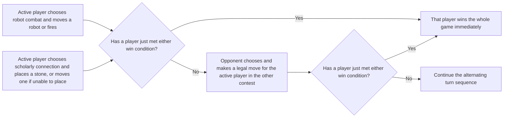
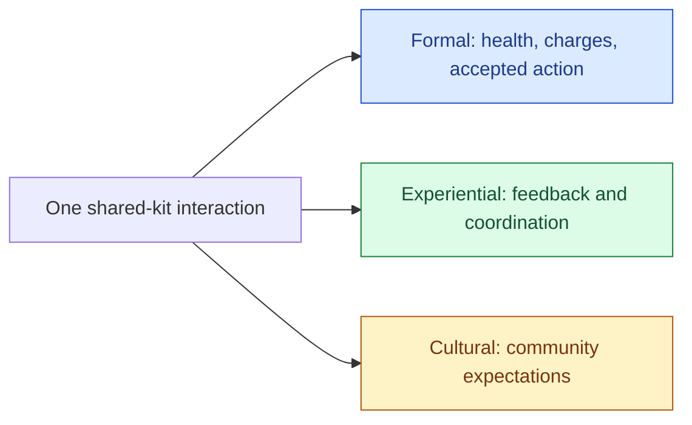

# 09 — Player choices, rules, and readable feedback

[[Chapter Edition/03 - Game Engine/00 - Reading Map|Reading map]] · [[Chapter Edition/03 - Game Engine/08 - Algorithms, application boundaries, and a first playable|Previous chapter]] · [[Chapter Edition/03 - Game Engine/10 - Engine changes across subsystem contracts|Next chapter]]

A working engine can still produce unclear play if its rules hide consequences. This chapter follows choices through interface, state change, feedback, and future possibilities so that implementation serves an understandable experience.

**By the end:** Analyze a feature as a loop of visible options, player action, authoritative state change, and legible consequence.

**Recall question:** What can the player infer before acting, what state changes, and what feedback proves that the rule took effect?

<!-- Derived from Continuous Notes/Game Engine - From First Frame to Living Worlds.md; source lines 10843–11689; source-span SHA256 3bfc75d230f5a50321913b1c557337c30b0ead6d7b232f4fbb7f9e92e5c5903d. -->

<!-- CHAPTER-SOURCE-BEGIN -->
## Design for play beyond a feature checklist

A renderer and game engine support an activity, but the rules and social setting determine what that activity means. A useful design lens asks what players are doing with and to one another, not only which controls or graphics the implementation exposes. Bartle’s well-known MUD roles—achievement, exploration, social connection, and player-versus-player domination—can prompt questions about rewards, discovery, communication, and conflict. The book grounds the lens in text-based MUDs and notes that players can mix these priorities; treat the four labels as a way to inspect one game’s possibilities, not as an exhaustive personality test or a fixed user segmentation. (Rules of Play, physical PDF p. 457–458; source `src-513f06a2888adb0105a8`.)

Small rule systems make the social consequences visible. In Little Max, a player who accepts a hidden dice claim immediately becomes the next person required to make a higher claim. The formal rule therefore passes the social role of listener/challenger into bluffer. The next decision is not just a comparison of odds: players infer whether the last person is truthful, how often others challenge, and whether a claim looks suspicious. Mafia uses a different hidden variable: player roles. Daytime discussion and voting create evidence about people’s behavior while the mafia secretly coordinate at night. Eliminated players still know the hidden roles but are expected to remain silent. In both cases, the rule system creates a social information problem, but the information structure is different. (Rules of Play, physical PDF pp. 458–461.)

A play community emerges through repeated interaction. It is shaped by the game’s rules, player personalities, actions among players, and the surrounding culture. Some communities exist only within one session; others continue across many games and time periods. This distinction helps an engine team see why persistence features, chat tools, moderation, and identity systems can alter the activity around a game without changing its core turn rules. It is a design question about the intended experience, not a requirement that every engine ship those systems. Stand Up illustrates the opposite case: a simple cooperative task can recruit spectators into joining, so the activity itself grows its group. (Rules of Play, physical PDF pp. 462–463.)

The social contract also has layers. Formal rules say what the game permits. Operational rules describe how a player carries out an action. Implicit rules are shared expectations: wait a reasonable time for a turn, do not cheat, pause if someone is hurt, or soften play when a child joins. These expectations connect the artificial game activity to values outside it. They can make play safe and trustworthy, but a program cannot guarantee the players’ trust merely by enforcing its rules. Designers can make a space more legible and provide tools for consent, moderation, or pausing; players and communities still supply social judgement. The book describes children’s understanding of rules shifting from improvisation, through treating rules as fixed, toward seeing them as changeable through mutual agreement. Use that as a historical framework for thinking about onboarding and community rule-setting, not as a diagnostic claim about any individual player. (Rules of Play, physical PDF pp. 464–467.)

Finally, ideal rules—the official written version—and real rules—the conventions a community actually uses—can diverge. A playground’s Foursquare players elaborated a compact base rule into named calls that adjusted difficulty, fairness, and tone. A multiplayer game may show the same gap when communities establish unwritten etiquette or house rules. If those conventions support a healthy experience, a designer can consider whether the game needs to make the practice explicit, offer configurable rules, or leave it community-owned. That choice can change social relationships even when the low-level mechanic stays the same. (Rules of Play, physical PDF p. 468.)

The workshop gives us a small result to pursue. Before choosing a framework, make that result precise enough that a player and a programmer can recognize the same success or failure.

### Let players read cause and consequence

Consider a sword attack that sometimes misses. The physics and collision code may know the exact reason: the target was out of range, blocked the strike, or dodged. If the player sees no difference between these cases, the world feels inconsistent even when the simulation is deterministic. A short impact sound, a visible block pose, a clear distance cue, or a readable dodge can connect the attempted action to its immediate outcome. The goal is not to expose internal engine state verbatim; it is to make the relevant cause legible at the moment it matters. (Game Design: Theory and Practice, PDF pp. 33-35; Rules of Play, PDF pp. 50-51.)

That immediate signal should also connect to something that matters later. If repeated hits lower an enemy’s guard and create an opening, players should be able to perceive both the present hit and the developing opportunity. The immediate result is discernable; the accumulated tactical consequence is integrated into the larger play. A hit spark alone may confirm contact but say little about whether the player is making progress. A changing stance, a stagger threshold, or a readable guard meter can show the longer relationship. The right presentation depends on the game: the selected theory pages explicitly leave room for different forms of meaningful feedback. (Rules of Play, PDF pp. 49-52.)

Player needs differ. One player may want mastery and a hard challenge; another may want exploration, a social activity, a solitary responsive world, fantasy, status, or an emotional arc. These are not a checklist that every game must satisfy. They are prompts for engine and interface choices. If a game promises exploration, streaming and world transitions should preserve player agency and show what new paths are available. If it promises competition, timing and outcomes should be consistent enough that practice teaches skill. If it promises a quiet solitary experience, interruptions and social prompts may undermine the desired mood. (Game Design: Theory and Practice, PDF pp. 27-33.)

Direction and progress can coexist with player freedom. A player may be free to choose a route through a level while still needing to know the current objective and whether actions move them closer. A useful engine-facing design question is: what state change can the game communicate after each meaningful action? A quest objective can update, a door can respond to a key, or an NPC can react to a choice. The player should not have to infer invisible progression from unrelated events. At the same time, a sandbox may intentionally let players define their own goals, provided its world gives understandable material to work with. (Game Design: Theory and Practice, PDF pp. 35-36.)

#### Design systems that produce readable outcomes

In the interview, Doug Church recalls design work around LookingGlass titles and discusses player choice, state, events, and emergent sequences. An event can describe a particular occurrence; a state describes what is currently true. For example, a guard hearing a sound is an event, while the guard being alerted is a state that can influence later decisions. Systems built from states and responses can create a sequence the designer did not script step by step. This distinction is presented as a useful way to think about game behavior, not a replacement for narrative or scripting in every game (*Game Design Theory and Practice*, interview with Doug Church, PDF pp. 537–542 / printed pp. 512–517).

Emergence still needs legibility. If the player cannot tell what the guard saw or heard, the resulting response may feel arbitrary rather than earned. The interview’s stealth and AI examples emphasize visible cues, plausible line of sight, and repeated behavior that the player can learn. **Illustrative design test:** show a guard turning toward a noise, then let the player see whether the guard is searching or has returned to patrol. The precise cue example is ours; the principle is grounded in the interview’s discussion of readable behavior and player inference (PDF pp. 542–544 / printed pp. 517–519).

Church’s account also connects prototyping with design judgment: try the interacting mechanics, observe what they let the player do, and revise the system when its results do not support the intended experience. Production and commercial constraints shape which ideas survive. The interview supports these statements as Church’s recollections and opinions, not as an independently verified history of every project or a universal process prescription (*Game Design Theory and Practice*, PDF pp. 545–548 / printed pp. 520–523).

##### Environmental effects can change both play and interpretation

The proposal gives destructible objects health and damage-type vulnerabilities: one object may respond to TNT, another to fire, while bullets do nothing. Objects can reveal plausible contents when broken; explosions can damage nearby things, ignite them, and start chain reactions. Even ammunition storage prompts an open design question in the appendix: should shooting a TNT box destroy the ammunition inside? Some windows take repeated shots that make holes before the whole pane breaks; walking over shards can leave bloody prints. [PDF pp. 636–637 / printed pp. 611–612]

Light is both atmosphere and a tactical resource. Switches can be placed logically near doors, but a room may deliberately have broken lights; timed circuits require the player to reset a breaker. Shots and explosions can destroy lights, so firing carelessly may remove useful illumination. Fire can come from weapons, explosions, enemies, or scripted events; it can spread between objects and characters, inflict damage over time, burn continuously in some cases, or spawn creatures in certain places. Burning enemies may move erratically but continue attacking; friendly people flee, and screams signal damage. Fluid pools can be flammable, leave fading footsteps, or spawn enemies; rain or blood may create them dynamically, while enough water can extinguish fire. Water bodies affect creature behavior differently, and weather ranges from clear skies to storms that fill ground depressions. [PDF pp. 637–639 / printed pp. 612–614]

The other effects also carry state and feedback. Blood from injured creatures can form pools; some enemies lose specified limbs, then either bleed out or keep functioning. Torque accumulates four stages of bloodiness, which fade with time and may frighten friendly characters. Bullet tracers show motion, while impact marks vary with both material and projectile. Controller vibration varies with damage type and amount, attacks, landings, nearby machinery, and Insanity Mode. Flashbacks are brief pre-rendered images triggered by reminders of Torque’s past; the final one branches between Torque having been framed if the player helps non-player characters and Torque having killed his family if the player kills every human character. In-world events can trigger from reaching or looking at a location or using a switch. Some events are protected from interference; others abort if the player kills a participant, who may then return to ordinary behavior. This proposal aims to tell story while leaving the player in control. [PDF pp. 639–641 / printed pp. 614–616]

The controls appendix lists two PlayStation 2 layouts with different mappings for movement, jump, attack, use, flashlight, target, throw, first-person view, inventory, map, and pause. The weapon examples show why mappings and mechanics belong together. The Shiv supports a light three-tap combo, a slower heavy lunge, and an airborne attack. Holding the Stun Stick keeps a creature immobilized for longer, creating time to switch weapons or reposition; it has no battery limit in this proposal. The Pistol fires once per press, is accurate at range, has weak stopping power, and carries the most ammunition; using two pistols doubles fire rate but reduces accuracy while still targeting one enemy. The Shotgun fires a spread, re-cocks between shots, reloads slowly, and stuns well nearby but wastes ammunition at distance. The TNT Stick visibly burns for five seconds, can pass through water, and can destroy doors. A Molotov creates a lasting main fire and smaller nearby fires, but its flame goes out in water. These proposed mechanics turn weapon labels into choices about timing, distance, and surroundings; they are not established facts about released *The Suffering*. [PDF pp. 641–644 / printed pp. 616–619]

### Keep the rules distinct from the machinery

A digital game contains much more code than its rules. In a falling-block game, the rules include how input moves and rotates a block, when it locks, how completed rows score, and what ends a round. The memory allocator and file reader help the program run, but they do not define the player's move choices. This distinction helps engine teams avoid confusing implementation complexity with game complexity. It also helps designers ask whether a proposed system change affects the game contract or only its implementation. (Rules of Play, PDF pp. 149-152.)

The source separates three rule layers. Constituative rules describe the abstract system: for example, selecting a cell in a grid and winning by completing a line. Operational rules describe how a player enacts those choices: click an empty square, see a mark, hear a cue, and learn whose turn comes next. Implicit rules are shared expectations that may not be written down. For an engine, this is a reminder that the same underlying game logic can be presented through different devices and feedback without changing the core logic, while a cue that reveals hidden information can change the actual strategic choices and therefore the game's formal structure. (Rules of Play, PDF pp. 146-147, 149-155.)

For example, changing the color palette of a game piece may be purely aesthetic if its identity remains clear. Making an enemy disappear in shadow may change what the player knows and when they can act, so the visual system becomes part of the rules as experienced. Similarly, a win sound or flashing line can communicate a formal outcome. A prototype can use placeholders for effects that do not affect choices, but it still needs enough feedback to test whether players understand the rules. The distinction is functional, not merely “graphics versus code.” (Rules of Play, PDF pp. 152-155.)

#### Production rules and player-facing meaning belong in the same conversation

Technical features are only part of what makes a game shippable. The *Game Engine Architecture* excerpt closes by distinguishing engine technology from gameplay systems: rules, objectives, entities, and the experience they create still have to be designed. A different production example makes the connection practical: a team’s game prototype drove prefabs, dynamic meshes, scene transitions, and packaging needs, while an engine release overview describes asset packs and runtime features tested through a game jam. A first playable can therefore test both whether a system works and whether its behavior communicates clearly to the player.

Mechanics also require examining how players interpret and exploit them. A chance mechanism can be biased by a small implementation error or strategically manipulated through the order in which a counting rhyme is spoken. A player’s subjective uncertainty may also differ from the formal probability table. This links implementation review to playtesting: verify the randomizer mathematically, then observe whether people understand the risk and make the choices the designer intended. The Rules of Play pages are conceptual design theory, not a replacement for probability testing; the creator reactions are opinions, not user studies.

Source boundaries: the dated Sparky and Hazel accounts are historical prototypes and release descriptions. They do not verify current SDK, API, platform, or runtime behavior. The trailer reactions are subjective commentary with no code or capture analysis. The chapter-specific Rules of Play and *Game Engine Architecture* points are integrated separately in `pdf-additions.md`; this section adds creator workflow examples and labels inferences as such.
#### The engine runs the rules; the game gives them a purpose

The assigned architecture pages end with an important boundary. A physics solver, renderer, animation system, and asset pipeline provide machinery; they do not decide what players are trying to accomplish. A game also needs entities that matter to its rules, goals that define progress or failure, and an experience that makes those rules meaningful. That is why a feature-complete engine and a complete game are different achievements: the first supplies capabilities; the second chooses and connects them for a particular player situation (*Game Engine Architecture*, PDF p. 711 / printed p. 13).

For example, a destruction system may turn a wall into moving fragments, but gameplay design determines whether that wall blocks progress, protects a player, reveals a route, or merely decorates the scene. The same physical result can serve different rules. Ask both questions during implementation: “Can the subsystem produce this state?” and “What can the player understand or do because it happened?” The example is an explanatory application of the chapter’s distinction, not a quoted scenario from the page.

### Design decisions as authored experiments

The interview excerpt in *Game Design: Theory and Practice* is most useful as a record of how its interviewee remembers a particular production, not as independently verified studio history. It describes a small group exploring a 3D dungeon idea, early working prototypes, and design changes shaped by the team’s available technology, experience, and publisher context. It repeatedly links design to iteration: try movement or combat in a small slice, observe what feels compelling, then expand the world around the strongest interactions. The inspected pages include period game images that anchor the discussion, but those images are illustrations, not evidence for every recollected production detail (PDF pp. 526 and 529 / printed pp. 501 and 504).

A small “minute of play” is a useful design instrument: specify a short sequence of player actions, feedback, and consequences, then build only enough content and technology to test it. A screenshot or rough room map can similarly make a spatial assumption visible. For example, before building a full stealth system, sketch one corridor, one light source, one hiding place, and one patrol. Ask whether the player can infer when they are seen and whether a choice changes the next moment. If not, expanding the world makes the uncertainty larger rather than resolving it. Treat the interview’s specific project history as a case study, while using the experiment format as a transferable method.

The excerpt also discusses how authored spaces, logs, dialogue, sound, and simulation can share the job of communicating a world. A player may reconstruct the story by exploring a room and comparing records rather than receiving one uninterrupted explanation. That freedom needs legible signals: a choice is meaningful when the player can understand the available actions and later perceive a consequence. The interview criticizes rules that hide their consequences behind opaque calculations; translate this into a design test: can a player form a useful expectation, act, and recognize what changed?

#### An interview separates a designer’s view from the editor’s conclusion

The assigned Doug Church pages continue an interview rather than introduce it. Church discusses market expectations, LookingGlass, Deus Ex, Frequency, game perspective, player agency, and independent experimentation. He describes a tradeoff between focused depth and broad scope: he sees Thief as focused and deep, while describing Deus Ex as broad but shallower in places. He does not declare one approach universally correct; his point is that ambitious scope can create a different set of production and coherence problems (*Game Design Theory and Practice*, interview with Doug Church, PDF pp. 549–552 / printed pp. 524–527).

Church also describes his role on Frequency as primarily engineering and low-level sound work, with design suggestions and meetings, rather than as one of the game’s main designers. When discussing first- and third-person viewpoints, he weighs fidelity, animation, aiming, stealth, and what the player can see. Perspective is a way to shape the player’s relationship with the character and world; the interview presents tradeoffs tied to a particular game and technology era, not a ranking of camera modes (*Game Design Theory and Practice*, PDF pp. 552–554 / printed pp. 527–529).

His comments on player agency frame the designer as authoring systems that create an experience with the player. He values what players remember doing and the choices they made, while recognizing commercial pressures and the difficulty of making less familiar interactions legible. His Indie Game Jam remarks treat short experiments as valuable for discovery and community, without claiming they will automatically transform a large studio’s production model (*Game Design Theory and Practice*, PDF pp. 554–556 / printed pp. 529–531). These are Church’s recollections and opinions in an edited interview.

The pages after that interview change authorship. PDF pp. 557–559 / printed pp. 532–534 are Richard Rouse’s conclusion, discussing games as an interactive medium and the designer’s motivation. PDF p. 560 / printed p. 535 begins a sample design document for *Atomic Sam*, which Rouse says was never developed into a finished game. Do not attribute those passages to Church or treat the sample document as a shipped game (*Game Design Theory and Practice*).

#### Fairness is both structure and player trust

A **level playing field** is the design ideal that no player receives an unjustified advantage. Rules can make the contest more impartial by holding the relevant conditions constant, but equal opportunity is difficult to guarantee. First move, lane position, lighting, wind, or order of information can affect a contest. Digital systems add their own perceived fairness risks, such as network lag, an AI that seems to cheat, or stutter that disrupts control. Whether or not a player’s suspicion is technically correct, loss of trust can break their willingness to accept the game’s rules. [PDF pp. 261–263 / Chapter 20, printed pp. 11–13]

The game *Pig* illustrates how a fair-sounding adjustment can shift strategy. Players take turns rolling toward a target score of 100; they can bank their turn total, but a roll of 1 loses that turn’s unbanked points. The first player to reach the target may win before others have had the same number of turns. The text explores options: randomizing order, rotating the first player over a series, or letting everyone finish a final round. Each addresses one inequality while introducing a tradeoff—random order does not remove the first-player advantage, a series feels more like a tournament, and a final-round rule can reward whoever rolls last. There may be no mathematically perfect adjustment for every table, so the perceived fairness of the rule matters too. [PDF pp. 263–264 / Chapter 20, printed pp. 13–14]

These examples connect formal rules to lived play: a game’s conflict is not only the opponent it names, but also the goals, resources, timing, information, and fairness players encounter. Designers can make these structures visible, then playtest whether the intended form of competition or cooperation is the one participants actually experience.

### Rules, emergence, and meaningful outcomes

*Rules of Play* separates the formal rules a design specifies from the implementation that executes them and from assumptions players bring implicitly. The distinction matters because a game can run exactly as coded while failing to communicate its actual rule. For example, a pressure plate may technically activate only above a mass threshold, but if the game gives no visual or audio cue when that threshold is crossed, players may interpret the result as random. A designer should test the written rule, the implemented rule, and the player’s inferred rule as three related but distinct things.

**Emergence** describes larger patterns that arise from repeated interactions among simpler parts. It is not a synonym for randomness. The excerpt’s messenger-city thought experiment asks the reader to imagine messages moving between locations under local rules: each messenger follows simple constraints, yet their combined paths and exchanges can form patterns. The inspected “Four Kinds of Systems” figure and text place fixed, periodic, chaotic, and complex behavior in a qualitative diagram (PDF pp. 163–164; chapter 14 local pp. 5–6). It is a conceptual aid, not a calibrated scale or a claim that every game belongs to one exclusive category. A perfectly static screen is fixed; a repeated two-state blinking signal is periodic; random-looking pixels illustrate the typology’s disordered category; an organized but changing crowd path can illustrate structured complexity.

To test a game rule, start with the smallest playable action/outcome loop. A coin toss with no stake or consequence is a random event, but it may not make meaningful play. Add a choice the player can understand—such as choosing a risk level before the toss—and a persistent consequence that changes later options. Now the outcome can carry meaning because the player’s action and the system’s response are connected. This does not mean randomness is inherently bad; randomness can create uncertainty while rules and feedback make its consequences interpretable. The excerpt’s Heads-or-Tails variants are exercises in that distinction (PDF pp. 165–167).

A practical design review can ask: what may the player do; what state changes; what feedback reveals the change; what repeated interactions produce a pattern; and can the player attribute the result to a rule they could learn? That review joins formal mechanics to implementation without collapsing one into the other. When the result feels arbitrary, inspect the rule, the feedback, and the player’s assumed rule before adding complexity.

Here the disordered category is a qualitative design label, not a demonstration of mathematical chaos. Deterministic rules can make nearby starting states diverge strongly without injecting independent random inputs; a random-looking image alone does not establish that behavior.

#### A choice is a loop through possibility, not a menu item

A useful way to connect interaction design to engine state is to stop treating a **choice** as the instant when a button is pressed. *Rules of Play* describes choice as a small cycle. The player is already in a context; the game communicates some possibilities; the player selects an action through an interface; the rule system changes state; the game communicates the consequence; and that consequence becomes part of the next context. Salen and Zimmerman call this anatomy a **choice molecule**. The term is useful because a failure at any link can make a mechanically valid action feel meaningless. If the option is invisible, the player cannot deliberately choose it. If input is accepted but the state change is hidden, the player cannot learn the rule. If the result is visible but has no later consequence, the action may be readable yet strategically empty.

This turns an apparently subjective complaint such as “the interaction feels arbitrary” into several testable questions. What information existed before the action? Which alternatives could the player reasonably perceive? What input or decision selected one? Which authoritative state changed? What feedback exposed that change? What new alternatives now exist? A door, dialogue response, combat dodge, crafting recipe, or strategy-game order can all be traced through the same cycle even though their software implementations are very different. The loop does not require five classes or five subsystems; it requires five meanings to remain connected.

The set of actions and outcomes reachable through those repeated cycles is the game’s **space of possibility**. It is not the same thing as a content count. A game with one hundred weapons can offer a narrow possibility space if they all solve encounters in essentially the same way; a game with a handful of strongly interacting verbs can create a wide space if position, timing, information, resources, other players, and world state continually change what those verbs mean. From an engine perspective, this is why adding a component type or scripting hook is not automatically adding meaningful possibility. The new capability matters only when rules expose it to decisions and consequences that can participate in later decisions.

This also clarifies **second-order design**. Designers directly author rules, parameters, objects, interfaces, and content, but they do not directly author every play sequence that will result. Play emerges when people repeatedly operate the formal system. The engineering consequence is important: an editor should make rule relationships inspectable and changeable, a runtime should make state transitions observable, and a playtest build should make it cheap to compare the predicted possibility with the one players actually discover. The purpose of observability here is not to eliminate emergence. It is to let the team distinguish desirable surprise from accidental unreadability, degenerate strategy, or an implementation bug.

Three layers of rules help during that diagnosis. **Constitutive rules** are the abstract relationships that define the formal system. **Operational rules** are how participants actually enact those relationships: which commands, turn procedures, prompts, or controls make an action possible. **Implicit rules** are the expectations that surround play but may not be encoded at all: etiquette, conventions, assumptions about fair conduct, or community practice. In a digital game, code can enforce many constitutive and operational rules, but it cannot make every implicit social expectation true merely by representing it as a boolean. Conversely, presentation can accidentally alter the experienced formal game: revealing hidden information, changing action timing, or making one choice unreadable changes what players can rationally do even if the underlying simulation function is unchanged.

A strong engine-facing design review therefore follows one possibility through all three layers. Write the abstract condition, show how the player performs it, identify what the interface reveals, and record any social convention the design relies on but does not enforce. Then replay the choice molecule and ask whether its outcome remains discernable and integrated into future play. This joins the earlier discussion of meaningful play to implementation without pretending that implementation alone determines experience.

Source basis: Salen and Zimmerman, *Rules of Play*, Chapter 6 (“Interactivity”), especially the choice-molecule/anatomy-of-a-choice and space-of-possibility discussion; Chapter 12 on constitutive, operational, and implicit rules; and Chapter 14 on emergence and second-order design. The engine mappings and diagnostic questions above are synthesis rather than quotations from the source.

#### Information is uncertainty about a signal, not its meaning

The next chapter of *Rules of Play* changes schemas from uncertainty to information theory. It uses “information” in a technical sense: a measure related to uncertainty in a signal, not the ordinary meaning or importance of a message. A nonsense string and a meaningful sentence can have the same information-theoretic structure if their possible symbols and probabilities match. This distinction helps keep the formal question separate from what a game’s story or clue means to its players (*Rules of Play*, PDF pp. 199–201 / printed pp. 1–3 of Chapter 16).

Imagine trying to guess whether a stranger ate breakfast: there are only two answers. Guessing the stranger’s favorite color has more possible answers, and guessing a favorite word has many more. A correct response to the larger-choice question resolves more uncertainty. The excerpt connects this to game decisions: a player selecting among many possible actions navigates a larger possibility space than a player whose next action is already determined. This is a conceptual bridge, not an equation for scoring game choices (*Rules of Play*, PDF pp. 200–202 / printed pp. 2–4 of Chapter 16).

In Mastermind, feedback from each guess narrows the remaining candidate codes. The solution remains fixed, so deductions can reduce uncertainty. If the opponent changed the hidden code after every guess, earlier feedback would not constrain the next guess in the same way. Twenty Questions applies a similar process to a culturally meaningful answer: each yes/no question partitions the possibilities, while the answer itself remains stable. These examples distinguish information flow from semantic content without denying that context matters to players (*Rules of Play*, PDF pp. 202–203 / printed pp. 4–5 of Chapter 16).

A signal also travels through a channel. The book’s examples follow a message from source through a signal and channel to a receiver; noise interferes with that transmission. A whispered message in Telephone changes as it passes among people, and that distortion is part of the activity’s fun. For an engine designer, this offers a useful way to ask where information is produced, transformed, displayed, and misunderstood. The excerpt does not provide a software networking protocol or a modern information-theory calculation; it provides a framework for thinking about signals and uncertainty in game systems (*Rules of Play*, PDF pp. 203–204 / printed pp. 5–6 of Chapter 16).

#### Information can be a formal signal or knowledge held by players

The two adjacent *Rules of Play* chapters use “information” differently. Chapter 16 uses the information-theory sense: a measure of uncertainty across possible messages, not the semantic importance of the message. A yes/no answer distinguishes two possibilities; a question with many plausible answers can distinguish more. The chapter then describes a signal moving from source through a channel to a receiver, with **noise** as distortion that can make the signal harder to recover. Charades makes that difficulty part of play, while ordinary communication treats it as a problem (PDF pp. 205–208 / printed pp. 7–10 of Chapter 16).

**Redundancy** means that some parts of a message help recover it when other parts are missing. In a crossword, crossing answers constrain one another: a clue that is hard to solve can become easier after neighboring answers supply letters. The design point is that noise and redundancy interact. Too much constraint leaves little meaningful choice; too little structure makes actions unrelated to outcomes. The chapter uses this as a conceptual lens on meaningful play, not as a networking protocol or a quantitative balancing formula (PDF pp. 205–208 / printed pp. 7–10 of Chapter 16).

Chapter 17 switches back to the ordinary game-design meaning of information: knowledge or content that can be hidden, revealed, transformed, remembered, or forgotten. **Perfect information** means all players know the complete current game position; **imperfect information** means some game information is hidden from one or more players. This distinction is independent of randomness: Backgammon has dice but can still be a perfect-information game because the board state and moves are public; Stratego has hidden piece identities without requiring random outcomes during play (PDF pp. 209–211 / printed pp. 1–3 of Chapter 17).

Celia Pearce’s four categories ask who knows a piece of information: everyone, one player, the game system alone, or no one until a random process generates it. These categories are a useful design checklist, though the chapter itself notes ambiguity between information hidden in a deck and a freshly randomized outcome. In *Enchanted Forest*, the board and current treasure are public; each player privately remembers what they saw beneath trees; the still-hidden treasure locations are initially unknown to players; dice create random movement values. As turns reveal clues, information shifts between categories. Players can navigate toward unvisited trees, infer from another player’s movement, or bluff about what they know (PDF pp. 211–214 / printed pp. 3–6 of Chapter 17; the illustrated board/game example visually inspected on PDF p. 212).

The value of information depends on its **information economy**: how one fact relates to other facts and available choices. A player who remembers a card or has seen a hidden location can use that knowledge only in relation to the current objective and the other players’ likely knowledge. Designers can make exploration meaningful by revealing locations, abilities, items, or rules over time, but hidden content alone does not guarantee interest. If information cannot be perceived, used, or connected to a decision, it adds volume without meaningful play. The chapter’s examples include fog of war, hidden locations and moves, item progression, and learning a simulation’s rules by experimenting (PDF pp. 214–216 / printed pp. 6–8 of Chapter 17).

#### Use feedback loops to shape how a game state moves

A feedback loop has a sensor that measures something, a comparator that decides whether the measured state needs correction, and an activator that changes the world. A thermostat senses room temperature, compares it with a chosen threshold, and turns cooling on or off. In a game, the sensor might read score difference, race position, or deaths at a level location; the comparator classifies the state; the activator grants an extra player, adjusts an opponent, drops a helpful item, or changes the enemy count. [Rules of Play, PDF pp.220–224 (printed chapter 18, pp.2–6)]

“Negative” feedback opposes a deviation and tends to stabilize a measured difference; “positive” feedback amplifies it and tends toward a runaway. These labels describe the direction of the loop, not whether it is good or bad. If a team is five points behind and receives an extra player, it may catch up; when it is fewer than five points behind, the bonus player is removed. This is a negative feedback rule because it pushes the score difference toward zero. If the team in the lead receives the extra player instead, the advantage can compound and produce a blowout. That positive loop may suit a short, chaotic game, but it can erase meaningful choices if it becomes irreversible too early.

A racing example uses position as the sensor: when the human player is first, the second-place opponent accelerates; when the player is last, nearby opponents slow down. The system adjusts the competitive backdrop instead of changing the player's own vehicle. This can keep rivals close, but if the adjustment is too visible or too strong, players may feel the game is manipulating the result. A different example gives trailing racers more useful power-ups. These rules create catch-up pressure through different mechanisms, so test how players perceive them as well as whether they narrow the rank gap. [Rules of Play, PDF pp.225–227 (printed chapter 18, pp.7–9)]

Positive feedback can also be deliberate: a successful attack in Powerstone stuns an opponent, making further hits easier. The loop is eventually interrupted by an effect that hurls the stunned character away. In a strategy game, gathering resources can create more units that gather still more resources; rival players' loops and combat tactics provide counterpressure. A useful design trace records the state variable, threshold, action, next-state effect, and release/limit condition. If there is no limit, ask whether an early lead can decide the match before players have meaningful counterplay.

Dynamic difficulty adjustment is a stronger intervention: the sample describes counting repeated deaths at a location, then adding helpful objects or reducing enemies. It can help a stuck player progress, but it raises a design question absent from a basic catch-up mechanic: does the game tell the player, hide the change, or let them opt out? A player may value support or may prefer a fixed challenge. Use a playtest to check understanding and trust; feedback logic cannot guarantee meaningful play by itself. [Rules of Play, PDF pp.227–228 (printed chapter 18, pp.9–10)]

#### Feedback rules and player agency

A **feedback loop** observes the current state, compares it with a target or condition, and changes the system in response. A thermostat is the simple example: sense room temperature, compare it to the set point, and switch cooling on or off. Negative feedback reduces deviation and tends to stabilize; positive feedback reinforces change and can amplify a lead. In a game, an early resource advantage that creates more resources can be positive feedback, while a catch-up rule can reduce the gap. Neither label says whether a mechanic is fun: too much correction can flatten meaningful differences or make players feel the game is taking control away. [Rules of Play, PDF pp. 230–233 / Chapter 18, printed pp. 12–15]

Chutes and Ladders’ exact-finish rule is a useful caution about naming. The authors say it can stretch the ending and let trailing players catch up, but it is not a strict cybernetic loop because no sensor, comparator, and activator are operating as separate parts of the system. The book offers a conditional “pseudo-feedback” reading of the rule. When evaluating a game, distinguish an effect that resembles negative feedback from a mechanic that explicitly detects a state and changes a rule or action because of it. Also inspect emergent loops players can discover even if designers did not intend them. Dynamic difficulty adjustment is one deliberate intervention; whether it feels helpful or unfair depends partly on perceived agency. [PDF pp. 229–232 / Chapter 18, printed pp. 11–14]
#### Map choices without pretending outcomes are certain

A **decision tree** maps possible decisions and resulting branches. Tic-Tac-Toe is small enough to enumerate: each open square creates a branch, and a win or full board ends that path. The tree becomes useful for analysis even when too large to draw completely. The text gives three conditions for a complete tree: play moves in discrete units, each decision has a finite set of clear choices with knowable outcomes, and the game itself is finite. A continuous-action sports play does not fit this cleanly because choosing a play does not determine its outcome. A mission-selection map may still help even if the combat within each mission cannot be fully enumerated. [PDF pp. 236–238 / Chapter 19, printed pp. 2–4]

In ordinary design talk, “strategy” can mean a general opening plan. In game theory, it means a complete contingent plan that prescribes what to do at every point, including every response to an opponent’s possible move. That distinction exposes assumptions: a rational player is modeled as knowing the game and choosing to maximize a defined utility. The book describes this as a deliberately narrow mathematical model, often involving two players and simultaneous strategy revelation. Use it to ask precise questions about choices and outcomes, not to claim that real players always behave as perfectly rational optimizers. [PDF pp. 239–240 / Chapter 19, printed pp. 5–6]

#### Use game theory as a narrow lens on choices and conflict

**Game theory** is an economic theory of rational decisions in situations where outcomes depend on more than one decision-maker. It is not a general theory of games or a step-by-step design recipe. The text models a rational player as an idealized person who knows the rules and chooses to maximize a measured outcome, without ordinary emotional, ethical, social, or memory limits. A **strategy** is a complete plan that covers every possible game state and anticipated opponent strategy. Most examples use two players because analysis grows more complicated with more players. These assumptions make small decision problems easier to inspect; they do not describe how all real players behave. (Rules of Play, Chapter 19, PDF pp. 241–243, 248–249 / printed pp. 7–9, 14–15.)

A **utility** is a number used to represent how much a player prefers an outcome. It can represent cake, money, time in prison, or a score; the number is a modeling choice, not a measurement of a person’s complete feelings. A **payoff matrix** places one player’s choices on one axis and the other player’s choices on the other; each cell records the outcome for one or both players. In the cake example, one child cuts and the other chooses. If the cutter divides unevenly, the chooser takes the larger piece. Anticipating this, the cutter’s safest choice is an even cut. The matrix makes the incentives visible without requiring a long sequence of turns. (PDF pp. 243–244 / printed pp. 9–10; cake payoff matrix visually inspected on both pages.)

A **zero-sum** game is one where one player’s gain is exactly another’s loss. In a dollar game, if the winner gains $1, the loser loses $1, so the total payoff is zero. Not every competitive situation is zero-sum: players can both gain or both lose. A **saddle point** is a cell that is best for one player’s worst-case choice and worst for the other’s best-case choice; in the cake example it gives the cutter and chooser a stable outcome. The chapter warns that an always-best move can become a **degenerate strategy** or exploit: if repeating one attack defeats every opponent, much of the game’s designed choice becomes irrelevant. Designers can inspect the rules, but playtesting is needed to find strategies people actually discover. (PDF pp. 244–245 / printed pp. 10–11.)

Not every matrix has a fixed best move. In **Matching Pennies**, each player simultaneously reveals heads or tails; one wins if they match and the other wins if they differ. A player who always chooses heads can be countered, so the book’s mixed strategy chooses heads or tails with equal 50/50 probability. Over many plays the expected average payoff is zero. This example shows how randomness in a strategy can prevent an opponent from exploiting a predictable choice. (PDF pp. 245–246 / printed pp. 11–12; matrix visually inspected on PDF p. 246.)

The **Prisoner’s Dilemma** is non-zero-sum: two prisoners independently choose whether to cooperate or testify, with sentence lengths as the payoff. Each has an incentive to testify regardless of the other’s choice, leading to two years each, even though mutual cooperation would give each only one year. The text presents two competing readings of the solution and calls the problem unresolved: minimax reasoning favors defection, while a symmetry argument chooses the better mutual outcome. Preserve that tension instead of teaching it as a single settled rule. The point for design is that even simple rules can create complex choices, and the payoff model must be stated before interpreting the outcome. (PDF pp. 246–248 / printed pp. 12–14; payoff grid visually inspected on PDF p. 247.)

The final two assigned pages begin Chapter 20, which shifts from formal game theory to **conflict** as the struggle to achieve a game goal against obstacles or other forces. The excerpt lists player structures such as one versus one, team versus team, one against many, free-for-all, player versus game system, and cooperative group versus game system. Conflict may be direct, as in arm wrestling, or indirect, as in separate figure-skating performances judged by score; a real-time strategy game can move from parallel development to direct encounters. These two pages are only the chapter’s introduction and examples, not a complete account of game conflict. (Rules of Play, Chapter 20, PDF pp. 251–252 / printed pp. 1–2.)

##### Conflict comes from the rules players can use

“Conflict” in a game can mean several things: beating another player’s score, attacking them directly, competing for scarce items, cooperating against computer-controlled enemies, or trying to survive a challenge set by the game itself. The examples of *Centipede*, *Joust*, and *Gauntlet* show how player count, simultaneous versus alternating turns, visible scores, attack rules, team structure, and shared resources change the kinds of competition that emerge. In *Joust*, two players may fight each other or coordinate against enemies; an accidental collision can shift a cooperative session into rivalry. In *Gauntlet*, attacks cannot harm teammates, but players still compete over food, keys, and score. [Rules of Play, PDF pp. 253–255 / Chapter 20, printed pp. 3–5]

A **zero-sum** contest is a narrow model where one player’s gain is exactly another player’s loss. The sample contrasts that model with score comparisons: a two-player *Centipede* match can turn the score into win/loss, while a personal best or high-score list compares a player with their past performance or with strangers’ records. The number is not inherently the goal; rules determine whether it means a victory, a rank, or a personal achievement. [PDF pp. 253–254 / Chapter 20, printed pp. 3–4]

The authors argue that competition and cooperation can coexist. They distinguish **player cooperation**, where people intentionally work together against a game system, from **systemic cooperation**, the shared agreement to follow the rules and sustain the game’s “magic circle.” Their example *Catch the Dragon’s Tail* forms a line of players who act as one dragon: the head tries to catch the tail, while the middle players have an ambiguous role. The group cooperates to stay connected and simultaneously participates in a chase. The design lesson is that goals and roles need not be symmetrical or perfectly clear for play to be engaging. This is the authors’ design framework, not a claim that every player experiences every game the same way. [PDF pp. 256–259 / Chapter 20, printed pp. 6–9]

#### Exploiting a rule is different from breaking it

Imagine a player who discovers that one tactic reliably beats the computer. They may be studying the game intensely, or taking an unsportsmanlike shortcut; the action itself does not settle the classification. *Rules of Play* separates five player types using three questions: how much the player cares about winning, whether they follow operational and implicit rules, and whether they accept the shared play frame (the authors’ “lusory attitude”). A dedicated player studies the rules to master them. An unsportsmanlike player may obey written rules while violating expectations such as taking a reasonable turn. A cheat secretly breaks an operational rule to win. A spoil-sport rejects the game frame and can make play impossible for everyone. The authors stress that these categories have fuzzy boundaries and depend on context. [Rules of Play, PDF pp. 267–272, 274–276 / Chapter 21, printed pp. 1–6, 8–10]

The term **degenerate strategy** describes a tactic that exploits a weakness in a game’s structure and makes success unusually easy or narrows play to one dominant path. In an RTS example, a fast “tank rush” defeats opponents before they can prepare; players then develop defensive counters. In the authors’ Basketball examples, rule changes such as the three-point line and three-second rule shift incentives and open space for different strategies. The design response may be a patch or rule change, but a player community can also create counter-strategies. Either way, examine the trade: does the exploit remove meaningful choices, or does it provoke a richer response? [PDF pp. 271–274 / Chapter 21, printed pp. 5–8]

Sports make a further distinction: some rule violations are expected parts of play because officials call fouls and apply penalties. A single violation may receive a limited penalty; repeated behavior can remove a player from the game. Designers can use that pattern as a question, not a recipe: if a game permits intentional transgressions, does it make the boundary legible, apply consequences consistently, and preserve play for others? The chapter describes sanctioned violations as part of its conceptual discussion; examples here do not substitute for checking any sport’s current rules. [PDF p. 276 / Chapter 21, printed p. 10]

#### Rule-bending can be part of the rules when its boundaries are clear

Sports create many close calls because real movement happens across millimeters and milliseconds. Athletes may push right up to a start signal or the edge of a foul to gain an advantage; officials interpret violations and apply penalties. A governing body can impose consequences beyond one match for much larger offenses. The chapter connects this enforcement to professional sports’ large outside stakes, where players, spectators, and organizations have strong reasons to trust the contest is fair. [Rules of Play, PDF pp. 276–277 / Chapter 21, printed pp. 10–11]

The optional *Illuminati* variant deliberately allows some deception: misread dice, steal from the bank, lie about group power, stack or peek at cards. It prohibits tipping the table, importing money from another set, and cheating during setup or income; if caught, the player undoes the cheat. The authors explain how these limits keep play from being destroyed or bogged down, and how the variant’s framing warns players that it can strain friendships. The case shows a design option: a game can authorize transgression while making limits and social context explicit. [PDF pp. 277–279 / Chapter 21, printed pp. 11–13]

Digital games add distinct boundary crossings. Easter eggs are creator-hidden secrets; cheat codes may be designed in; guides and walkthroughs supply outside knowledge. A workaround uses ordinary game rules or physics in an unintended way, such as climbing a wall with proximity mines. True cheating violates multiplayer rules, such as controlling two accounts at once; a hack changes code or records; a spoil-sport attack can disable play for others. The chapter relates these cases to code’s flexibility, online anonymity, and fan communities that inspect and remix games. Its design question is which kinds of discovery or modification support the experience and which undermine play for others. DeKoven’s further proposal is to let players change rules to find a game that works for their community; iterative designers already test changes by playing rule variations. [PDF pp. 279–282 / Chapter 21, printed pp. 13–16]

#### *Ironclad* puts two win conditions on one board

The commissioned game *Ironclad* is for two players and uses a 6-by-8 board (48 squares), with its narrow ends facing the players. Each player has twelve checkers in six robot stacks (two stacks of three, two of two, and two of one) and thirty-two stones; they share one six-sided die. As the setup diagram shows, four robot stacks occupy the player's home row; the two single-checker stacks are centered on the row in front. The opponent's setup mirrors it. Robot stacks move and fight on squares; colored stones move along intersections to form an unbroken connection between opposite sides. The active player chooses one contest and makes a move there; then the opponent chooses and makes a legal move for the active player in the other contest, controlling that second action. A player who meets either win condition wins the whole game immediately:

In robot combat, the objective is to move a robot onto any of the six squares in the opponent’s first row. A robot moves one square horizontally, vertically, or diagonally, but cannot enter an occupied square. Instead of moving, a player may fire at an enemy within two squares along a straight or diagonal line. A target takes one damage per attacking robot in range; shots pass through robots. Each damage removes one checker from the target’s stack, and damage greater than its stack removes it entirely. Stones at the corners of a robot’s square give it a defensive bonus; for each attacking robot, the attacking player rolls a die and damages the target only on a result greater than that bonus. The p288 example gives a target a bonus of 3, so each attacking robot damages it only on a roll of 4, 5, or 6.

In scholarly discourse, the objective is a connected line of a player’s stones from one side of the board to the opposite side. Each turn, place one stone; if no placement is possible, move a stone of either color. The diagrams show the setup, robot movement/range, damage, and terrain. The rules create a decision across systems: advance one win condition while the opponent controls a legal move for the active player in the other contest. This is a published rules proposal, not recorded evidence that its balance was tested. [Rules of Play, PDF pp. 285–288 / Commissioned Game 2: Ironclad, printed pp. 1–4]

#### Treat the player-facing contract as an engineering contract

Before inventing another subsystem, state what the player is entitled to infer from the world. Rouse’s opening design discussion is useful here because many of its “player expectations” can be restated as runtime contracts. A world should behave consistently enough that experience teaches rules. Its boundaries should be legible enough that a player can tell what can and cannot be attempted. Reasonable solutions should work when the game has taught the player to expect them. The player should have direction without needing every route prescribed, should be able to make progress in increments, and should have a fair chance to recover from setbacks rather than discover that an earlier invisible mistake made the current state hopeless.

These are not promises that every game must be easy, fully explained, or symmetric. A puzzle may intentionally conceal the solution; a horror game may intentionally create uncertainty; a roguelike may make loss severe. The contract is about **coherence between what the game teaches and what it later demands**. If a wall is climbable whenever it has a painted edge, an identical painted edge that is suddenly decorative needs a reason or a new cue. If a stealth game establishes that darkness hides the player, an enemy that ignores that rule because a trigger fired may be technically correct but experientially incoherent unless the exception is communicated. If a difficult encounter is meant to test mastery, the player needs enough information and control that failure can be attributed to a decision rather than to invisible state.

Rouse also emphasizes that players generally expect to **do rather than merely watch**. This does not outlaw cutscenes or authored sequences. It asks whether the game’s important promises are expressed through player activity. A story about being a clever infiltrator is weakened if every clever infiltration happens only in a noninteractive scene while actual play consists of unrelated shooting. A system about negotiation is weakened if dialogue choices have no consequences. The engine cannot solve that thematic mismatch, but it can make the relevant decisions available: reversible state transitions, readable objectives, scripting hooks, event history, conversation state, and tools for designers to connect consequences to later world state.

A practical acceptance test can therefore be written from the player’s perspective before it is written from the API’s perspective. “After I place the heavy crate on the plate, I can tell that the plate registered it, I can see which door changed, and removing the crate reverses the condition unless the design explicitly latches it.” The implementation can then derive tests for mass threshold, overlap, event dispatch, door state, save/load, sound, animation, and UI. This is stronger than a feature checklist because it defines the causal experience the systems collectively owe.

Source basis: Rouse, *Game Design: Theory & Practice*, Chapter 1 (“What Players Want”), especially the discussion of consistency, understandable world bounds, reasonable solutions, direction, incremental accomplishment, fair chance, avoiding pointless repetition or hopeless stuck states, and player action. The conversion into engine acceptance tests is an engineering synthesis.

### Begin with a player situation

Suppose a player swings a sword at an enemy beside a ledge. The attack misses. What should the player understand? Did the enemy step away? Was the player too far away? Was the attack blocked by a wall? Did the input arrive during recovery? Is the attack still in cooldown? A developer may be able to inspect the collision system and see the answer, but that does not help the player if the game communicates none of it.

This scene turns a vague requirement like “combat should feel responsive” into a testable question: when a reasonable attack fails, does the player receive enough information to understand the outcome and make a better next choice? Rouse discusses players’ expectations of consistent rules, understandable world bounds, reasonable actions working, direction, incremental accomplishment, fairness, and acting rather than merely watching (Rouse, *Game Design: Theory & Practice*, 2nd ed., Ch. 1, PDF pp. 33–40, printed pp. 8–15). That is design analysis, not an API contract. We turn it into one only after choosing the game’s intended behavior.

Salen and Zimmerman give an especially useful lens. In their definition, an action and the system’s outcome form a relationship; a designed experience becomes stronger when that outcome is perceivable and carries significance into the larger game (Salen & Zimmerman, *Rules of Play*, Ch. 3, PDF pp. 49–52, printed pp. 3–6). Apply that idea carefully. A combat cue is not automatically “meaningful” because it is loud or colorful. The cue should correspond to the actual outcome: blocked, out of range, invulnerable target, interrupted attack, or successful hit. If an animation shows a hit while the rules register a miss, feedback makes the mismatch more visible rather than repairing it.

Translate intent through five questions:

1. **Action:** What can the player do, and what input expresses it?
2. **Rule:** Under what conditions does the action succeed or fail?
3. **Outcome:** Which authoritative state changes, and at what time boundary?
4. **Communication:** What does the player see, hear, feel, or infer immediately?
5. **Continuation:** How does the outcome shape later options, resources, or goals?

This is a proposed working checklist. Its value is that it joins design and implementation at a seam where misunderstandings often occur. The designer can state the intended action/outcome relationship, while engineering can identify the state transition, collision query, event, and display path that must make it real.

#### Separate chance, risk, and uncertainty

A game outcome may be hard to predict for different reasons. The excerpt distinguishes macro-uncertainty about which broad result happens from micro-uncertainty among the individual outcomes that make it up. Risk describes a situation where players know the nature of the uncertainty in advance; in the roulette example, both the possible outcomes and their odds can be calculated. Uncertainty, in the book’s chess example, comes from not knowing enough about the opponent to estimate how the match will resolve. A single game may mix risk and uncertainty, and changing the time frame can change how it feels (*Rules of Play*, PDF pp. 181–185 / printed pp. 1–5).

Two fair six-sided dice make the probability distinction concrete. There are 36 equally likely ordered pairs because each of the first die’s six results can pair with each of the second die’s six results. Four pairs sum to five—$(1,4),(2,3),(3,2),(4,1)$—so $P(\text{sum}=5)=4/36=1/9$. Six pairs are doubles—$(1,1)$ through $(6,6)$—so $P(\text{doubles})=6/36=1/6$. A total of seven occurs in six pairs, while a total of two occurs only in $(1,1)$. Thus the eleven possible sums from two through twelve are not equally likely. The book’s table of outcome counts on PDF pp. 186–187 / printed pp. 6–7 was visually inspected; the example calculation here is explanatory arithmetic from those counts.

A random mechanism is only one source of uncertainty. A player may not know an opponent’s intention, may not yet understand a system, or may face a difficult choice whose outcomes are known but costly. Those cases can feel uncertain without dice. Separating the mechanism from the player’s knowledge helps a designer ask what they actually want: a probability distribution, hidden information, a skill test, or a choice with risk. This section follows the assigned excerpt and does not claim to summarize the full book’s probability theory (*Rules of Play*, PDF pp. 188–192 / printed pp. 8–12).

##### Chance has a mechanism, a strategy, and a player’s interpretation

Chance in a game is not only the random-number operation. *Rules of Play* distinguishes micro-level chance operations from macro-level uncertainty about how the whole game will end. A deterministic game can still feel unpredictable when players cannot know one another’s plans. The chapter also separates certainty, risk, and uncertainty. In its formulation, risk means players know the nature of the possible outcomes ahead of time; uncertainty means they cannot confidently predict the result. Roulette is its example of a known risk distribution, while a match against an unknown chess opponent illustrates outcome uncertainty. Most games combine these conditions, and the overall game can feel more uncertain than one isolated action (*Rules of Play*, PDF pp. 193–194 / printed pp. 13–14; chapter summary on PDF p. 197 / printed p. 17).

The reading gives two useful reminders for anyone implementing a random feature. First, a small coding bias can compound through a complex system. In the microbe example, one direction was accidentally counted twice in a random choice; a small probability imbalance gradually pulled the simulated population toward one corner. Second, players can turn an apparent chance procedure into a strategy. Children in the cited counting-out study changed rhyme length, count order, or their position to influence who became “It.” A game designer should test both the random mechanism and the ways players may manipulate it (*Rules of Play*, PDF pp. 193–194 / printed pp. 13–14).

Players also reason about chance imperfectly. The excerpt lists overvaluing rare high-payoff outcomes, adding successive probabilities as if they were independent chances in a simple sum, assuming a streak makes the opposite result “due,” and remembering unlikely positive outcomes differently from negative ones. These are described as fallacies that designers may need to account for, or may choose to build into a game’s decisions. Treat them as the book’s design discussion, not as a complete taxonomy of cognitive biases (*Rules of Play*, PDF pp. 194–195 / printed pp. 14–15).

The chapter’s summary includes the broad statement that computer programs cannot generate true randomness. That assertion is presented here only as a historical statement from the 2004 text, not as current technical guidance about random-number generators. The more durable design question in this excerpt is whether the probability procedure gives the player the intended experience and whether its outcomes support meaningful choices (*Rules of Play*, PDF p. 197 / printed p. 17).

### Turn adjectives into observations

“Responsive,” “fair,” “clear,” and “satisfying” are useful design words, but they are not yet measurable specifications. Ask what a tester would observe.

| Design word | Observable question | Possible instrument |
|---|---|---|
| Responsive | How long from accepted input to visible action? | Input timestamp, tick id, animation-start time, frame-present time |
| Fair | Can players predict why an attack failed? | Failure-reason telemetry plus observed playtest explanation |
| Clear | Can a player identify the attack’s effective range? | Hit/miss boundary trials and post-trial explanation |
| Satisfying | Does a confirmed hit read as a consequential event? | Animation, sound, haptic and target-reaction review with players |
| Consistent | Do equivalent conditions produce equivalent results? | Repeated scenario, fixed seed, rule assertions |
| Learnable | Does the player improve after receiving feedback? | Success rate across attempts, plus observed strategy changes |

These instruments can help answer a question but cannot replace judgment. Telemetry may say players hit more often after a brighter flash, while observation reveals that the flash hides an enemy’s attack. A survey may report enjoyment, while behavior shows that players leave the encounter. Pair counts with direct observation and keep the design hypothesis explicit.

A combat action can be represented as a state transition:

$$
(S_t, a_t) \xrightarrow{\text{rules}} (S_{t+1}, o_t),
$$

where (S_t) is the authoritative game state at time $t$, $a_t$ is a player action, and $o_t$ is the outcome exposed to the rest of the game. This is a compact model for requirements, not a formula quoted from either design book. It forces a distinction between the event and the interpretation of the event. A `DamageApplied` event says health changed. A “hit confirmed” cue may also need hit location, armor absorption, target state, and whether the target died. A miss can still be a valid outcome, but the system should be able to explain it in terms that match design.

#### Treat screenshots and trailers as observations, not implementation proofs

A reaction video may identify a frame that looks reflective, realistic, or unusually detailed, but it rarely reveals how the image was made. In one trailer review, the presenter first mistakes a reflection and later corrects the interpretation after seeing more footage. Another reviewer explicitly cannot tell whether rocks use Nanite, whether reflections are ray traced, or whether a scene is offline-rendered until the presentation clarifies it. A disciplined review writes down the visible cue—highlight movement, blur, fog, a reflection, or a camera change—and then marks the technique as confirmed, inferred, or unknown. ([GAME ENGINE DEVELOPER Reacts to Ratchet & Clank: Rift Apart](https://www.youtube.com/watch?v=qCSyy5BTDuc&t=0m0s), [THE MOST PHOTOREALISTIC Unreal Engine 5 Demo So Far!](https://www.youtube.com/watch?v=jbEfCcl7gOw&t=0m0s)).

The same restraint applies to official demonstrations. A GDC video can show a layered material or procedural assembly and state its hardware and experimental status, while a commentator speculates about how the feature works. Keep the speaker’s claims separate from the reaction’s hypotheses. A beautiful frame can inspire an engine experiment; it cannot establish current support, performance, or game-ready behavior without a build and measurements.
#### A visual review should describe the frame before naming its technique

A trailer can show the effect of rendering without revealing the method. A reaction reviewer may see depth of field, particles, blur, a bright reflection, or a distorted background and infer a particular technique. But compression, camera motion, and art direction can hide or imitate those details. One reviewer initially misread a reflection, then corrected the claim after viewing gameplay; another called possible photogrammetry, Nanite, and Lumen use speculation because the pipeline was unknown. Describe the visible evidence first, then label the technique as confirmed, inferred, or unknown ([Is this TOO REALISTIC? Unreal Engine 5 UNRECORD Gameplay Trailer // Game Engine Dev Reacts](https://www.youtube.com/watch?v=p4aAMPtNIsQ&t=0m0s), [GAME ENGINE DEVELOPER Reacts to Ratchet & Clank: Rift Apart](https://www.youtube.com/watch?v=qCSyy5BTDuc&t=0m0s), [GAME ENGINE DEV REVIEWS Ratchet & Clank: Rift Apart GAMEPLAY](https://www.youtube.com/watch?v=d5_9EEfN-Mw&t=0m0s), [GAME ENGINE DEV REACTS to Halo Infinite | Campaign Gameplay Trailer](https://www.youtube.com/watch?v=HWtEcbiuLBQ&t=0m0s)).

That distinction helps teams give useful review feedback. “The visor highlight moves with the scene” is an observation. “It is ray traced” is an implementation claim that needs stronger evidence. “I cannot read the far terrain through the fog” may be a usability observation even if the fog is artistically intended. A trailer review can generate questions for a capture or developer interview; it cannot replace those checks.

### Focus the prototype on the risky question

A prototype should answer a design uncertainty, not simply demonstrate that the team can assemble a small piece of the final technology. Salen and Zimmerman describe iterative design as a cycle of playable prototyping, playtesting, evaluation, and refinement; they emphasize that actual play reveals things that documents and advance reasoning cannot settle (Ch. 2, PDF pp. 31–32, printed pp. 1–2). They also recommend getting an early interactive prototype into play rather than waiting for polished presentation. Rouse likewise gives a detailed design-process account through early concepts, working gameplay, design tools, and playtesting (chapters inventoried at PDF pp. 9–15). The design move is to find the question whose answer could invalidate the current plan.

For the sword attack, possible uncertainties include:

- Can the player recognize the attack wind-up and recovery windows?
- Is the target’s movement readable enough to make timing feel fair?
- Does a short input buffer improve accessibility without making combat feel automatic?
- Does generous target selection help or undermine spatial mastery?
- Does combat remain legible when two enemies overlap?

A paper mock-up can test whether the rules are understandable. A primitive interactive version can test input timing and collision shape. A graybox arena can test spacing and camera framing. A physics stress scene can test contact stability separately. Do not use a polished character model to answer a timing question unless animation readability itself is the uncertainty. Reducing irrelevant detail makes the experiment cheaper and its result easier to interpret.

Write each prototype brief in one paragraph: the player situation, the uncertain design claim, the smallest playable test, the observation to collect, and a result that would change the design. Example: “We believe players can distinguish a blocked sword attack from a miss by reading a brief spark at the blocking surface. Test in a graybox room with varied distances and shield angles. After each attack, ask the player what happened before showing debug text. If players confuse blocked and out-of-range cases, revise the feedback or rule separation.”

The last sentence matters. A prototype without a decision attached becomes a demo. A team can spend weeks polishing a mechanic and still not know what it proved.

### Protect useful ambiguity; eliminate accidental ambiguity

Some games intentionally leave uncertainty. A mystery may not tell the player whether an ally is trustworthy. A tactical game may conceal enemy intent. A horror game may obscure the location of a threat. These are designed ambiguities. The player may not know what will happen, but should be able to understand what they did and what the system revealed. Salen and Zimmerman’s broader framing of games through formal rules, play experience, and cultural context (introduced in *Rules of Play*, PDF pp. 26–28, printed pp. 4–6) is helpful here: rule clarity does not mean every narrative or strategic question must be answered.

By contrast, accidental ambiguity arises when feedback contradicts the rule, the control fails without reason, or two similar actions produce different results with no perceivable distinction. The job of architecture is not to make the game predictable in every outcome. It is to make the designed uncertainty legible enough that player choices remain meaningful.

<!-- Supervised source-review addition b8b7b75be97cafeb -->

### Rules are shared agreements that make play possible

A game’s rules are a formal model of what players may do, what the system does in response, and how the state changes toward an outcome. They constrain action, but they do not describe every quality of the experience. A card’s color or illustration can carry meaning without changing the rules; by contrast, “draw two cards when you land here” changes the state and belongs to the formal system. Players can invent free play around a toy, while a game’s rules establish the particular structure that makes a round of that play recognizable as this game.

Useful rules are **explicit** enough to answer relevant cases, **shared** in the sense that participants can refer to a common procedure, **stable during a round**, **binding** within the play they have accepted, and **repeatable** as a procedure. These are design goals, not guarantees that people interpret every sentence identically. A rulebook may be public while players disagree about whether a move was legal; examples, demonstrations, referee decisions, interface feedback, and social convention all help settle interpretation. Repeatable means the same procedure can be applied again, not that a game with shuffled cards or dice must produce the same outcome. A game may also contain randomness as an explicit rule.

“Fixed” should be read at the right level. A group can agree on a variant before play, tournament rules can permit a referee to resolve an unusual case, and a designer can revise the rules between editions. During a round, however, participants need to know which agreed version governs a disputed action. If rules may change mid-round, the game needs a higher-level procedure that says who may change them, when the change takes effect, and how players learn it. Otherwise, an apparent exception can feel arbitrary.

A simple example is a cooperative card game in which players may discuss their hands but may not show them. The restriction is explicit; every player needs to know it; it binds behavior for that round; and it can be applied repeatedly. The group can still interpret “discuss” differently, so the design may need a concrete example or a referee convention. If the group wants an open-hand variant, it can agree before starting. The variant changes the play, but the players still share a clear rule for which version is active.

The “magic circle” is a useful way to analyze the temporary frame in which game rules organize activity; it is not a literal wall that prevents a game from affecting life outside play. A match can shape friendships, reputation, time, money, or community norms. DeKoven’s description of rules as creating a common goal with no external impact is a theoretical framing from the cited discussion, not a universal fact about games. Formal rules may be enforced by software, a referee, or a group’s social practice, and those forms of enforcement can carry consequences beyond the play session. [Rules of Play, physical PDF pp. 121–132]

### Specify both allowed actions and boundaries

Players learn a game by forming expectations. Rouse’s chapter on player expectations includes consistency, understandable boundaries, reasonable solutions working, direction, gradual achievement, fairness, and avoiding situations where the player becomes hopelessly stuck (Ch. 1, PDF pp. 33–40). Requirements should therefore describe both positive actions and limits. “The player can attack” is incomplete. Specify when attack is accepted, what interrupts it, whether holding the button repeats it, what happens when the target leaves range, and which cues signal those cases.

Boundaries need not all be spelled out to the player. A mystery game may keep a door locked until a clue is found. But the lock should behave consistently enough that players can reason about the world. If a key opens one visually identical door but not another without explanation, the system teaches arbitrary behavior. A game can be surprising; it should still make its own surprises coherent in retrospect.

A requirements table can separate player-facing promise from engine mechanism:

| Promise | Rule owner | Runtime support | Evidence |
|---|---|---|---|
| An attack can be interrupted by a dodge | Combat state machine | Tick-ordered commands and state transition | Scenario replay with simultaneous inputs |
| A shield blocks attacks from its front | Combat rules | Contact/query and shield orientation | Boundary cases around shield arc |
| The player can tell a block from a miss | Presentation design | Outcome event with impact point/reason | Blind playtest plus event trace |
| Repeated attacks have consistent timing | Combat rules | Fixed-step timing and stable input ordering | Replay and low-frame-rate scenario |
| The player can recover from a mistake | Level/gameflow design | Checkpoint and progression state | Full encounter playthrough |

This table deliberately does not equate implementation with proof. “Outcome event exists” is not evidence that players can tell a block from a miss. Each promise needs an appropriate observation.

#### A design document can specify a playable contract without pretending a game exists

The selected pages finish an author’s discussion of document detail, then begin *Atomic Sam*, a sample design document. The author says the sample deliberately omits detail because the author expects to guide development; a team without that continuing author involvement would need more explicit descriptions. A **focus statement** summarizes the intended experience and helps decide which mechanics belong. In the sample, the focus is a non-violent action game about defeating robots creatively with projectiles and environmental devices, in a whimsical retro-future setting. This frames the following controls and systems as a coherent proposal (PDF pp. 561, 564–566 / printed pp. 536, 539–541).

The document separates camera behavior, in-game information, saving, controls, and movement. That makes requirements inspectable: the camera should stay behind the character smoothly, avoid blocking the view, and move closer when space is tight; an on-screen flight meter should reveal a resource the player must manage; checkpoints should define where failure restarts. Those statements guide design and implementation but do not prove that a camera or checkpoint system was built. The source is an authored sample for a game that the book says was never developed (PDF pp. 565–568 / printed pp. 540–543; title page and contents visually checked on PDF p. 562).

The rocket-pack illustrates how a movement system becomes a set of player-readable rules. Holding the control accelerates until a limit; releasing it does not stop Sam instantly; burst movement spends charge faster; hovering also consumes charge; landing recharges it. The interface displays remaining charge so the player can plan a route. Flat surfaces permit landing, while slopes and dangerous floors change the consequences. This is more useful than specifying only “the character can fly”: it gives designers, animators, programmers, and testers observable conditions to implement and check (PDF pp. 569–572 / printed pp. 544–547).

The projectile inventory also distinguishes carrying capacity, ready state, throwing, and recovery after a miss. Sam can carry up to fifty of each type, and missed projectiles may be retrieved after combat. This shows how a control document can explain both state and feedback, although the selected range ends before all throwing details. Treat the numbers and mechanics as part of this fictional design, not as reusable engineering standards (PDF pp. 567–572 / printed pp. 542–547).

##### A design document connects mechanics to the world

The *Atomic Sam* sample design document shows a different kind of engine-facing work: specify what the player can do, what each tool works against, and how allies or enemies change the play situation. Goo-balls stick certain ground or wall-crawling enemies; water balloons short exposed wiring; a magnet-and-weight pulls metallic flyers down. Each item also has limits, so the player must read the target and choose a response. This is a prototype of a mechanic catalog, not implementation evidence. A useful entry records the intended effect, valid targets, exceptions, and what feedback tells the player it worked. [Game Design Theory and Practice, PDF pp. 586–588 / printed pp. 561–563]

The proposed friends are designed to follow without getting stuck, point out threats and secrets, and deliver story while Sam is in safe situations. These requirements connect AI behavior to the experience: an ally that trails behind or talks during danger would violate the design intent even if its movement routine technically ran. The boss examples also connect mechanics to level geometry. The Visionary can be defeated by activating and aiming fans so their airflow pushes it back into a ceiling crate; Zeffir can be weakened through projectiles or by disabling the posts supporting his platform. These alternatives make observation and interaction part of combat. They remain intended behaviors in a sample proposal, not evidence of a shipped game or a tested AI system. [PDF pp. 585–595 / printed pp. 560–570]

The story outline then ties those mechanics to progression: Sam searches three locations, gathers allies and pieces of a message, and discovers why his parents were taken. A design document is strongest when these pieces reinforce one another: the world gives the player reasons to move, tools create readable choices, characters reveal information during play, and level objects support the intended encounters. [PDF p. 596 / printed p. 571]

##### Turn a design document into an observable route through the game

A design document can define a progression that gives players goals and gives the team testable states. In the *Atomic Sam* sample, the player begins in an apartment where a rocket-pack tutorial can be followed or skipped. A hub then offers three middle regions—Benthos, Harmony, and New Boston—in any order. Each region supplies a clue fragment and introduces a companion or local story. The player must complete all three before returning to the hub and unlocking the final airship level. This is a useful distinction between player choice and progression gates: the order is flexible, while the requirement to visit each branch is not. (Game Design Theory and Practice, Appendix A, PDF pp. 598–603 / printed pp. 573–578.)

The document connects movement and story to locations. The city confines the rocket-pack below tall buildings; the undersea dome limits flight height; the Moon colony requires a spacesuit and a surface trip to a character excluded from the dome; the finale shifts combat to narrow corridors aboard a flying fortress. These details imply different navigation, combat, and environment constraints, but they remain written requirements and story content, not evidence that a game was built. The fictional setting also presents an unjust social hierarchy among Moonies and robots; that is part of this sample’s authored world, not an endorsed design rule. (PDF pp. 597–603 / printed pp. 572–578.)

The next appendix gives an unusually candid account of a shipped project’s document. The *Suffering* document is dated eight months before the game shipped, was edited down for publication, and retained outdated names, cut quest items, an abandoned targeting system, and a planned introduction never attempted. Other late changes—storytelling, morality/reputation, creature behavior—were handled in separate documents and never merged into the main one. The author notes that some requested sections were included for apparent completeness even though they were vague or did not match final implementation. The lesson is not that documentation is useless; it is that a document’s revision, scope, and authority must be visible. A design brief is evidence of intended behavior, not proof of shipped behavior. (Appendix B, PDF pp. 604–608 / printed pp. 579–583.)

##### A design document describes a game that is meant to exist

An implementation team cannot build reliably from a genre label such as “horror action game.” It needs a proposed player, a setting, a loop of actions, and rules for what happens when those actions meet obstacles. The sample appendix called *The Suffering* describes a proposed game named *Unspeakable*: a prisoner explores a frightening island, fights creatures, and tries to understand his past. Its opening explains the desired feeling—cautious exploration broken by intense combat—and specifies how the story should reach the player during continuous play. This is a design proposal, not evidence that the described features shipped in the released game called *The Suffering*. [Game Design Theory and Practice, PDF pp. 612–613 / printed pp. 587–588]

That distinction matters because the appendix shifts quickly from mood to contracts. “Save anywhere” means a player can create a save at any time and later restore position and status; a checkpoint is an automatic save at a chosen challenge boundary; “Continue” chooses the latest saved state; auto-loading offers the latest save after death. Each rule answers different questions: what state is preserved, when it is captured, and what the player must do to resume. A production spec should also name failure cases—such as a full memory card or an interrupted save—even though this sample does not define them. [PDF pp. 613–614 / printed pp. 588–589]

Difficulty is described as a bundle of changes rather than one global multiplier. The proposal varies enemy toughness, accuracy, and damage output; the number of enemies; ammunition and health placement; puzzle complexity; and the amount of help text. These choices affect different skills and resources. For example, adding puzzle hints can support a player who understands combat but is stuck on navigation; reducing enemy numbers changes pressure without changing weapon damage. The page also describes the labels and intended audience for four difficulty settings, but it does not report playtest results. Treat the settings as proposed tuning, not verified balance. [PDF p. 614 / printed p. 589]

#### Design a mechanic as a state transition, not just a button label

A design document becomes useful to programmers when it states what the player can do, what state the game checks, and what changes after an input. In the Atomic Sam sample, tapping “Next Projectile” switches to the next available item, while holding it opens a selectable list; releasing commits the centered choice. The character may visually put the projectile away after five seconds, yet the throw input still uses the selected projectile immediately. That is a valuable distinction between presentation state (“arm lowered”) and gameplay state (“projectile remains readied”). [Game Design: Theory & Practice, PDF pp.573–574 (printed pp.548–549)]

The generic Action button is context-sensitive: near a switch it toggles it, near a pushable object it moves it, and holding it near a carryable object begins a carry that ends on release. The same control saves input complexity, but the player needs contextual cues so the engine's choice is legible. A “Look” hold temporarily changes camera control while leaving Sam in place. These cases can be specified as small transition tables before implementation:

| Current situation | Input | State change | Feedback the player should see |
|---|---|---|---|
| Near a switch | Action press | Switch activates | Switch movement and world response |
| Near a carryable object | Action hold | Object attaches to hands; projectile throw disabled | Pose and carry animation |
| Carrying object | Action release | Object detaches with defined placement/physics | Drop animation and resulting motion |
| Projectile ready | Next press and release | Select next available projectile | Held-item change |
| Projectile ready | Next held, directions, release | Choose from inventory list | Carousel highlight and committed item |

This is not a claim that the sample shipped these mechanics; it is a way to turn its written intentions into testable state transitions. Each row raises engine questions—input edges versus held state, interaction query, animation event, collision response, and UI prompt—without confusing the engine service with the design rule.

The same document describes combat puzzles in which a player positions an enemy near a steam vent, waits for the right moment, then activates a switch; a fan can redirect an enemy into the hazard. A safe training room teaches rocket-pack movement before hostile play. These examples show how environment, timing, and feedback can teach a mechanic. The design should specify what clue lets the player predict the trap and what happens when timing is wrong, including whether the trap can hurt the player. [Game Design: Theory & Practice, PDF pp.575–580 (printed pp.550–555)]

AI behavior is also a player-facing rule. The sample varies enemy perception cones and memory, from a robot that forgets the player after line of sight breaks to one that remains locked on; pathfinding ranges from beelining to navigating around obstacles. This can create difficulty through readable limitations instead of only increasing health or speed. If a trap is meant to work, an enemy can be authored to patrol near its trajectory—but the level must communicate the opportunity rather than relying on invisible designer intent. [Game Design: Theory & Practice, PDF pp.580–584 (printed pp.555–559)]

##### Choose goals and endings as part of the mechanic

A **goal** states what counts as success, and a loss condition states when progress stops. Together they shape the duration and rhythm of play. A race to the bottom of a ski slope turns casual recreation into a contest; a repeated survival game may have no single winning endpoint and instead ask the player to last longer or beat a score. The chapter treats a clear, measurable goal as central to formal game structure, while acknowledging that people can play for social or other reasons beyond winning. [PDF pp. 259–260 / Chapter 20, printed pp. 9–10]

The *LOOP* case study makes the design choice concrete. The prototype’s core action—drawing loops around butterflies to score—came before its ending rules. The team considered a target quota, clearing all butterflies, or endless play, then considered whether loss came from a timer or an overcrowded screen. It chose discrete levels with a capture quota and a time limit. Captured butterflies were replenished, keeping the screen active and preserving alternate strategies. The printed screenshots on PDF pp. 261–262 show the interface and a level’s quota/score feedback; the text explains why the game allowed players to exceed the quota for bonus points. The image and prose support a proposed design process, not a claim of present availability or a shipped implementation. [PDF pp. 260–262 / Chapter 20, printed pp. 10–12]

The chapter also warns that “clear objective” does not mean there is only one way to win. Designers can experiment with multiple endpoints, nonstandard victory conditions, or goals that ask players to lose quickly. The important step is to test what the chosen endpoint does to pacing, strategy, and the player’s sense of progress, rather than inheriting a convention without asking why it fits. [PDF p. 262 / Chapter 20, printed p. 12]

##### A resource meter can reward style and create a deadline

In the proposed *Unspeakable*, successful kills fill a 100-point Insanity Meter. A melee kill doubles the points for that enemy; a jumping kill adds a 1.5 multiplier; quick double and triple kills add further multipliers. The proposal shows how these combine: two five-point kills made while jumping yield 7.5 and 15 points, for 22.5 total. Once full, the meter stops accumulating. Activating Insanity Mode spends it over time, changes which attacks are available, and ending the mode too late can leave the character collapsed and end the game. This makes the resource both a reward for expressive play and a limited-duration power state with a failure consequence. It is a proposed mechanic in a sample design document, not evidence that the released *The Suffering* behaved this way. [PDF pp. 625–628 / printed pp. 600–603]

Other state rules connect survival feedback to item handling. Health recovers slowly only up to 20 of the proposed 100 points; pills can restore more, but not above the cap. The HUD appears when aiming or after damage. Useful objects are noticed through the character looking toward nearby pickups; proximity can collect them, play a sound, and briefly show their name, while unneeded health or ammunition remains in the world for a later return. Read together, these details describe not just a health number or inventory list, but when the player learns about state changes and how the design avoids interrupting movement. [PDF pp. 629–632 / printed pp. 604–607]

#### A weapon spec is a set of decisions the player can feel

Suppose the player holds Attack while carrying a machine gun, then taps Attack with a pistol. The same button produces different timing: the machine gun can continue firing while held, while the pistol fires once per press. A melee weapon may instead choose its move from how firmly the analog button is pressed. In the sample proposal, weapon identity is therefore a bundle of player-visible contracts: damage, readiness, speed or rate, range and accuracy, stun, secondary effects, ammunition, and reload behavior. Those variables let a designer make two weapons feel different without relying on names or appearance alone. [Game Design Theory and Practice, PDF pp. 621–624 / printed pp. 596–599]

The proposal also connects an action to its mode. Pressing Attack can force aimed view and acquire a target; holding Target selects a hostile target within range, and quickly releasing then pressing it cycles to the next candidate. Throwing keeps the primary weapon available but temporarily prevents another attack, while movement continues. A mounted weapon enters a separate first-person view with direct aiming and a finite supply attached to that emplacement. These cases suggest a useful way to specify a control: name the starting mode, input, resulting action, temporary restrictions, feedback, and exit condition. That checklist is a derived teaching aid; the appendix does not describe its original implementation architecture. [PDF pp. 621, 623–625 / printed pp. 596, 598–600]

### Failure feedback and accessibility

A game should not require every player to infer a failed action from the absence of an effect. But not every failure needs a pop-up explanation. Use the smallest cue that makes the relevant distinction clear in the game’s sensory language. A tactical game may use a combat log. An action game may use sound, a brief hit-stop, silhouette, or controller vibration. A screen-reader user may need a textual cue or a configurable audio channel. A player with low vision may rely more on sound and haptics; a player who cannot hear may rely on animation and visual indicators.

The rule event should be presentation-neutral and complete enough for alternate renderings. `Blocked` plus an impact point can drive a spark, sound, haptic, subtitle, and accessibility description. If the only output is a particle spawned by the collision function, accessibility options and replay analysis may be difficult. The engine’s job is to preserve outcome meaning across channels; the game’s design determines how many channels to use and how strong each signal should be.

Feedback also has timing. A cue emitted three frames after the hit may be interpreted as a separate event, especially in a fast encounter. Record the time between command, rule outcome, and presentation. If the simulation runs ahead of presentation, attach the simulation tick to the event so the renderer can place a cue at the correct world position and time. In multiplayer, a speculative local cue may need later confirmation. The game should avoid training players to trust a visual hit marker that sometimes appears without a real outcome.

### Decide what the first game must be able to do

Imagine you want to make a top-down game with a character, a few rooms, collisions, a user interface, and a way to restart after losing. You might be tempted to start by designing an all-purpose engine: support every graphics API, every physics model, multiplayer, asset hot reload, and a visual scripting language. That list sounds ambitious, but it does not yet say what the first playable game needs. It also creates dependencies before you have seen how the systems need to work together.

Instead, write the first game’s path in plain verbs: open a window; show a scene; read input; move an object; draw it; save the scene; press Play; return to editing. Each verb identifies a responsibility. “Open a window” points to platform code. “Read input” points to a boundary between the operating system and gameplay. “Draw” points to a renderer. “Save” points to a stable description of scene data. “Press Play” points to a difference between authoring and runtime state. That list can grow, but it gives the first architecture a reason to exist.

The opening Hazel captions explicitly take time to define and plan. The author pauses to say that scope should be discussed before construction, and that planning an event system matters because the reason for an architectural decision is part of learning how to write an engine. That is more than presentation style. A learner who can explain why a system exists can later replace or narrow it. A learner who only memorizes class names tends to cargo-cult interfaces that do not fit the next project.

A practical first scope statement might read: “This engine will support a desktop 2D game with a window, keyboard and mouse input, layered application code, a sprite renderer, editable scenes, save/load, and a runtime Play mode. It will target one rendering backend first. 3D, networking, audio, multiple backends, and mobile deployment are future decisions.” The statement is neither a product promise nor a permanent limit. It is a way to make costs visible. If the game later needs 3D lighting, you can add it against a working 2D application rather than trying to validate every system at once.

<!-- Supervised source-review addition 2d78e4994fec4bff -->

### Design by connecting play, technology, and story

A game concept can begin with a mechanic, a technical opportunity, or a story. Whichever comes first, test the connections among all three: what the player repeatedly does, what technology is needed to make that action work, and what the story lets the player understand those actions to mean. The connections are constraints, not a formula that assigns each story to one genre. A gameplay loop may demand simulation, networking, authored animation, or only a few carefully timed state changes; the right choice depends on the experience the game needs to deliver.

Consider a rescue game set in a flooded city. The story promises that a small team reaches isolated families before water closes the routes. If the central play is to steer several rescuers in real time through changing streets, the design needs legible commands, pathfinding or direct control, route hazards, and feedback about the rising water. Those choices imply technical work: multiple agents, navigation around blocked streets, a changing environment, and performance on the target hardware. If the target device cannot support that many active agents and simulation steps, the team has several honest design options: let the player directly control one rescuer and issue simple orders to the rest; use a tactical pause so orders can be planned; make distant civilians and distant water changes scripted rather than fully simulated; or reduce district size while keeping the same rescue dilemma. Each option changes pacing and player agency, so the team should test whether it preserves the story’s promise rather than treating the engine limit as an invisible implementation detail.

The iteration can start at any corner. A technical prototype for water flow may suggest a new evacuation mechanic; a story about divided loyalties may motivate a shared-resource rule; a tested mechanic may reveal that the original plot needs a different point of view. Record the assumption, build the smallest prototype that could disprove it, and revise the other corners when evidence demands it. “Gameplay, technology, and story constrain one another” is the reusable model. The book’s examples that pair Greek mythology with a narrow set of genres, or reject mythology in a flight simulator, are the author’s period-specific design illustrations, not laws: a contemporary flight game could use mythology if its mechanics and presentation make that combination coherent. [Game Design Theory and Practice, physical PDF pp. 61–72]

#### Choose the game you want to make before choosing how much engine to build

A game engine and a game are related but different products. A team making a game needs rules, content, interaction, and a way to ship them; an engine team builds reusable technology and tools that let games do those things. If the goal is to ship a game with a small team, rebuilding graphics, asset management, animation, and platform layers can consume the time that should go to the game. If the goal is to study engine technology, the engine itself may be the intended result. This is the creator’s opinion in an older vlog, but it yields a practical question: what is the actual deliverable, and which layer is the user trying to learn? ([Do you want to make GAMES or game ENGINES?](https://www.youtube.com/watch?v=Y4J4ZdQGEgo&t=0m20s), [Why you NEED to use a GAME ENGINE!](https://www.youtube.com/watch?v=QQ9MTzrsldo&t=0m1s)).

When the engine is the goal, a small game is still a useful test. One developer proposed a simple Mario-like platformer and worked backward to ask which editor, scene, input, rendering, and gameplay features Hazel needed. Another small-team example began with a Space Invaders prototype, then used the translation to Hazel to expose missing prefabs, dynamic meshes, and scene transitions. The game is a set of requirements that exercises the engine; it is not merely a showcase placed on top after engine work is done. ([The Importance of LONG-TERM PLANNING (Hazel Roadmap)](https://www.youtube.com/watch?v=OsnwKYxPX1A&t=5m29s), [He MADE A GAME using my GAME ENGINE](https://www.youtube.com/watch?v=56ISmbJE9S4&t=2m10s)).

A useful planning sequence is to pick one representative game action, build the smallest prototype that tests it, and record the friction. If many identical enemies must spawn, a prefab may reduce repeated setup. If a menu must lead to a game scene, scene loading is a real requirement. If a project has to run outside the editor, packaging becomes part of the feature. The roadmap should express those dependencies and assign owners, rather than list every engine feature anyone might want. The historical roadmap video explicitly notes that a visible team board can prevent two volunteers from unknowingly building the same feature. ([The Importance of LONG-TERM PLANNING](https://www.youtube.com/watch?v=OsnwKYxPX1A&t=6m35s)).

Keep the schedule proportionate to the team. One creator says he works better with a broad target and manageable milestones than with an imitation of a studio sprint calendar. That is personal experience, not a universal productivity rule. A strong plan makes the next step legible while leaving room to adjust when a prototype uncovers a different need.

### Keep an audio front end separate from its playback backend

The narrated audio system exposes load, play, stop, pause, resume, and volume operations through a front end, while an optional OpenAL plugin handles device playback. A single listener has position and orientation; positional sources have emitters whose locations update with the world. The initial implementation targets stereo output, and the presenter describes mono effects as spatially positioned while stereo tracks are non-spatial in this OpenAL path. Keep that behavior attributed to this backend rather than assuming it applies to every API. [Kohi #142](https://www.youtube.com/watch?v=xb23Y9o7tP4)

Playback channels are not the same as output channels. The source describes 16 playback channels, each tied to one OpenAL source and one active sound; requesting a specific channel replaces its sound, while a negative ID requests a free channel and drops playback if none is available. Master, channel, and emitter volume combine. The channel minimum and stereo/mono assumptions are the presenter’s claims, not independently verified backend guarantees. [Kohi #142](https://www.youtube.com/watch?v=xb23Y9o7tP4)

Short effects can load as one decoded buffer. Long music or voice tracks can reuse two buffers: queue both, unqueue each after playback, refill it with the next samples, then queue it again. The source reports a worker per playback source guarded by a mutex and a brief sleep between work checks; its reason that audio playback blocks is specific narration, not a general OpenAL contract. The implementation uses stb_vorbis and minimp3, and MP3 cleanup remains flagged. Error recovery, format coverage, and stress behavior are not established by the stream. [Kohi #142](https://www.youtube.com/watch?v=xb23Y9o7tP4)

<!-- Bible-final-pass: real-time audio runtime -->
#### Turn the audio front end into a real-time voice and mixing system

The front-end/backend split above tells us who owns the public API. We still need the runtime path that turns many play requests into the sample block consumed by the device.

Separate four meanings:

~~~text
audio asset
  decoded or compressed sound data

voice
  one active playback instance of an asset

mixer
  combines active voices into output buses

device backend
  delivers final sample blocks to the platform audio API
~~~

One explosion asset can have twenty simultaneous voices. Asset identity and playback identity are different.

#### The audio callback is a deadline boundary

Many audio APIs periodically request the next block of samples. Missing the deadline creates an audible underrun, click, or gap.

Treat the callback more strictly than a normal update. Avoid filesystem/network I/O, unpredictable decoding, waiting on game-thread mutexes, unbounded heap allocation, blocking logging, or complex destruction in the callback path.

A common structure is:

~~~text
game thread:
  enqueue Play(sound, gain, position, priority)

audio thread:
  consume bounded commands
  update preallocated voice slots
  mix next block
  submit samples
~~~

The exact queue can vary. The important contract is that audio completion does not depend on a slow editor or gameplay operation.

#### A voice owns playback state, not the asset

A voice may contain an asset reference, sample cursor, gain, playback rate, loop state, priority, spatial parameters, bus routing, fade/envelope state, and start sequence.

The cursor is per voice. Two enemies playing the same footstep asset at different times must not share one cursor.

When a non-looping cursor reaches the end, the slot becomes reusable. A loop wraps according to its loop range. A streamed voice may point at decoded chunks rather than one fully resident PCM buffer.

#### Mixing is addition plus a level policy

For mono voices x_j[n] and gains g_j:

~~~text
y[n] = sum_j g_j x_j[n]
~~~

Several individually legal samples can sum outside the final range. Hard clipping is easy but distorts. A production engine may keep floating-point headroom, use bus gains, compression/limiting, or another mastering policy.

The witness hard-clips only to keep its small test output bounded. That is a test policy, not a recommendation for final mastering.

#### Voice capacity needs an overload rule

CPU and hardware budgets limit active voices. When all slots are occupied, an engine can reject the new sound, steal the oldest, steal the quietest, steal the lowest priority, or virtualize inaudible voices.

The policy is player-visible. Critical dialogue should not disappear because many low-priority debris sounds started first.

The witness uses a deterministic rule: steal the lowest-priority voice; for equal priority, steal the oldest. If the new request is lower priority than every active voice, reject it.

#### Streaming separates decoding from playback

A long track need not be fully decoded into memory. Keep a small queue of PCM blocks:

~~~text
compressed asset
  -> worker fills block A
  -> worker fills block B

audio consumes A
worker refills retired A
audio consumes B
...
~~~

The decoder must stay ahead of playback. If it falls behind, report an underrun. Seek, pause, loop, and device changes all belong to this state machine.

#### Resampling is part of correct playback

A 44.1 kHz source mixed into a 48 kHz device cannot advance one source sample per output sample without changing speed.

The source-position increment is approximately:

~~~text
source_rate / output_rate
~~~

That gives a fractional cursor. A reconstruction filter estimates values between stored samples. Linear interpolation is simple; higher-quality resamplers spend more work for better frequency behavior.

Changing playback rate also changes pitch and duration. Time stretching without changing pitch is a different algorithm.

#### Spatial audio consumes published world meaning

The game owns emitter and listener transforms. Publish a compact timestamped snapshot for audio rather than letting the callback query arbitrary ECS state. Occlusion queries can run at a safe cadence elsewhere and publish their results to the mixer.

It does not implement HRTF processing, resampling, streaming decode, effects buses, device hot-swap, or thread-safe command publication. Those now have explicit architectural homes instead of being hidden behind a single play-sound call.

The executable witness below owns a fixed voice pool and performs no allocation inside its mixing function. It verifies summation, natural voice retirement, looping, deterministic voice stealing, rejection of an unimportant sound when all slots are more important, and bounded output.

~~~cpp
/*
Teaching contract: Clip contains mono floating-point samples; cursor is a
per-playback frame index, gain is dimensionless, and a fixed pool bounds active
voices. For every frame, the mixer sums sample*gain across active voices, then
this witness clamps to [-1,1]. A finished non-looping voice retires; a looping
voice wraps; a full pool steals the oldest voice among the lowest priority, but
rejects a lower-priority request. The mixing call uses fixed arrays and existing
clip storage, so it allocates no memory. Device callbacks, command concurrency,
spatialization, resampling and perceptual loudness policy are outside this CPU
contract; hard clipping is used only to make output bounds testable.
*/
#include <algorithm>
#include <array>
#include <cmath>
#include <cstddef>
#include <cstdint>
#include <iostream>
#include <stdexcept>
#include <vector>

struct Clip {
    std::vector<float> mono;
};

struct Voice {
    const Clip* clip = nullptr;
    std::size_t cursor = 0;
    float gain = 1.0f;
    int priority = 0;
    std::uint64_t age = 0;
    bool loop = false;
    bool active = false;
};

void require(bool condition, const char* message) {
    if (!condition) throw std::runtime_error(message);
}

template <std::size_t N>
class Mixer {
public:
    // In a production audio callback, clip memory and voice storage must already
    // exist. This teaching mixer performs no allocation in mix_block().
    bool play(const Clip& clip, float gain, int priority, bool loop) {
        if (clip.mono.empty()) return false;

        Voice* slot = nullptr;
        for (auto& v : voices_) {
            if (!v.active) { slot = &v; break; }
        }

        if (!slot) {
            // Steal the least-important voice. For equal priority, steal the
            // oldest one so the rule is deterministic and inspectable.
            // Deterministic overload rule: lowest priority loses, then oldest.
            auto it = std::min_element(
                voices_.begin(), voices_.end(),
                 {
                    if (a.priority != b.priority) return a.priority < b.priority;
                    return a.age < b.age;
                });
            if (priority < it->priority) return false;
            slot = &*it;
        }

        *slot = Voice{&clip, 0, gain, priority, next_age_++, loop, true};
        return true;
    }

    template <std::size_t Frames>
    std::array<float, Frames> mix_block() {
        std::array<float, Frames> out{};
        for (std::size_t frame = 0; frame < Frames; ++frame) {
            float sample = 0.0f;
            for (auto& voice : voices_) {
                if (!voice.active) continue;

                // Each overlapping voice owns its own cursor into shared clip samples.
                sample += voice.clip->mono[voice.cursor] * voice.gain;
                ++voice.cursor;

                if (voice.cursor == voice.clip->mono.size()) {
                    if (voice.loop) {
                        voice.cursor = 0;
                    } else {
                        voice.active = false;
                    }
                }
            }
            // This witness uses hard clipping only so the output contract is
            // bounded. A real engine may use headroom, limiters and mastering.
            out[frame] = std::clamp(sample, -1.0f, 1.0f);
        }
        return out;
    }

    std::size_t active_voices() const {
        return std::count_if(voices_.begin(), voices_.end(),
                             { return v.active; });
    }

    bool has_priority(int p) const {
        return std::any_of(voices_.begin(), voices_.end(),
                           [=](const Voice& v){ return v.active && v.priority == p; });
    }

private:
    std::array<Voice, N> voices_{};
    std::uint64_t next_age_ = 0;
};

bool near(float a, float b, float eps=1e-6f) {
    return std::fabs(a-b) <= eps;
}

int main() {
    const Clip a{{0.25f, 0.25f, 0.25f}};
    const Clip b{{0.50f, -0.50f}};
    const Clip loop{{0.10f, 0.20f}};

    {
        Mixer<4> m;
        require(m.play(a, 1.0f, 1, false), "first voice should start");
        require(m.play(b, 0.5f, 2, false), "second voice should start");
        const auto out = m.mix_block<3>();
        require(near(out[0], 0.25f + 0.25f), "voices must sum into the same sample");
        require(near(out[1], 0.25f - 0.25f), "signed PCM samples must mix correctly");
        require(near(out[2], 0.25f), "finished short voice must stop contributing");
        require(m.active_voices() == 0, "non-looping voices should retire at end");
    }

    {
        Mixer<1> m;
        require(m.play(loop, 1.0f, 1, true), "looping voice should start");
        const auto out = m.mix_block<5>();
        require(near(out[0],0.10f) && near(out[1],0.20f) &&
                near(out[2],0.10f) && near(out[3],0.20f) && near(out[4],0.10f),
                "looping cursor must wrap exactly");
        require(m.active_voices() == 1, "loop remains active");
    }

    {
        Mixer<2> m;
        require(m.play(a, 1.0f, 1, true), "low-priority voice A");
        require(m.play(b, 1.0f, 5, true), "high-priority voice B");
        require(m.play(loop, 1.0f, 3, true), "new medium voice steals least priority");
        require(!m.has_priority(1) && m.has_priority(3) && m.has_priority(5),
                "voice stealing must preserve more important voices");
        require(!m.play(a, 1.0f, 0, true),
                "lower-priority request should be rejected when all slots are more important");
    }

    {
        Mixer<2> m;
        const Clip loud{{0.9f}};
        require(m.play(loud,1.0f,1,false) && m.play(loud,1.0f,1,false),
                "two loud voices should start");
        const auto out=m.mix_block<1>();
        require(near(out[0],1.0f), "output contract must remain bounded");
    }

    std::cout << "audio voice mixer: 4 suites PASS\n";
}
~~~

**Reconstruct without reading:** distinguish an asset from a voice, explain why the callback should not wait on the game thread, derive the basic mix equation, state a voice-stealing rule, and explain how streaming buffers stay ahead of playback.

#### Shared systems should pay for themselves

A reusable engine system exists to make repeated game work cheaper. If a helper saves one line once, it may not deserve a subsystem. If every feature needs a consistent way to receive resize events, draw textures, or identify entities, a shared API can prevent many features from inventing incompatible conventions. The cost of a subsystem includes more than its source code: it must be named, tested, documented, integrated into tools, and kept compatible with saved projects.

One useful test is to ask whether two independent game features would otherwise solve the same problem differently. If both need to draw a textured quad, a renderer API can provide common behavior. If only one game needs a custom dialogue graph, forcing it into a generic node framework may be overdesign. Engine design is the repeated choice between a local solution and an abstraction whose future value is uncertain. Hazel’s public series is valuable here because many episodes show the discussion and implementation as a progression, not just a polished list of completed components.

### Read a game feature at three nested scales

A game system is a set of interacting parts that forms a larger whole. To inspect one, name four things: its **objects** (the parts), their **attributes** (properties and state), their **internal relationships** (how the parts affect one another), and the **environment** (the context around the system). These labels depend on the question being asked; they are a lens for analysis, not a required software architecture. Salen and Zimmerman’s chess example shows why the lens matters: the same board game can be examined as a formal rule system, as an experience between players, or as a cultural object. The book describes these systems as nested: rules are experienced through play, and play sits in a wider cultural context. (Rules of Play, PDF pp. 63–68.)

Consider a co-op game in which one player marks a medical kit and another chooses to use it. At the **formal** level, objects include the two characters and the kit; attributes include each character’s health and the kit’s remaining charges; relationships include who can activate it and how much health it restores; the environment is the modeled game state. Here we can check a precise rule: if the player has 40 health, the kit restores 25, and maximum health is 100, the result is 65 and one charge is consumed. If two players activate the final charge simultaneously, the rule must define which operation wins or whether the actions serialize. These are questions for implementation and tests.

At the **experiential** level, the objects become the players interacting with the game. Their attributes include not only health and inventory but also what each person knows. Their relationships include coordination, trust, and competition over scarce resources; the environment includes the screen layout, controls, voice chat, and the physical setting in which they play. A formally correct 25-point heal may still be confusing if the charge counter updates late or the interaction prompt is hidden beneath another player’s marker. Conversely, a visible but inaccurate counter teaches a false rule. The relevant check now includes whether the players can predict the result and coordinate around it.

At the **cultural** level, the game itself is the object. Its designed elements and history are attributes; its relationships include how players connect it to genre conventions, community practices, and other media; the environment is the surrounding culture. A community may treat the last kit as a shared emergency resource, or develop a house rule that the player who finds it may claim it. Neither convention is automatically encoded by the health system. A designer can decide whether to support that practice with a ping, a shared-resource rule, or no special feature, but should not mistake a popular convention for a universal player expectation.

**Read the figure:** start with the same interaction. Each branch asks a different question and calls for different evidence: a state transition, participants’ understanding, or the surrounding practice.

The three levels answer different questions and remain connected. An engineer can fix the simultaneous-use race at the formal level, then test whether the interface communicates the result at the experiential level. If a community consistently adopts a house rule because the shipped mechanic feels unfair, that cultural evidence may motivate a design change. Treating one level as the whole game creates blind spots: a unit test cannot establish that the prompt is legible, and one playtest cannot prove the formal update is race-free. The source presents the levels as an analytical framework; the medical-kit example and its test plan are an applied teaching example.

The same separation helps make “interactive” precise. The book distinguishes **cognitive interactivity** (a player’s interpretive, emotional, or intellectual engagement), **functional interactivity** (the usability and material behavior of controls and display), **explicit interactivity** (choices and procedures designed into the system), and **beyond-the-object interactivity** (participation in the surrounding culture, such as fan interpretation). A game interaction can involve several at once. When the player uses the kit, interpreting its icon is cognitive, getting a prompt to respond is functional, choosing to spend a charge is explicit, and debating the team’s house rule afterward is beyond the current match. For defining the game’s input-and-outcome contract, explicit interactivity is the most direct focus; the other modes still affect whether that choice is understandable and meaningful. (Rules of Play, PDF pp. 69–72.)

A practical failure trace shows why this distinction matters. Suppose the server correctly accepts one player’s use of the last kit and reduces its charges from one to zero. The formal rule is satisfied. But if the other player’s UI continues to show one charge for half a second, the second player may press Use and see nothing happen. The controls technically registered, yet the functional feedback made the system look unresponsive; the explicit choice produced no expected outcome from that player’s perspective. If the team has learned a different house rule, the result may also feel socially unfair. Diagnose each layer separately: log the authoritative state transition and tick; measure the UI update delay; show a consumed/contested response to the rejected action; then observe whether teams understand the shared-resource rule. Choose the remedy after locating the fault: unclear rules may need better feedback, while delayed state may need a synchronization or notification change. A correct network trace alone does not establish a good player experience.

Open and closed systems provide a related boundary check. In the book’s terminology, a closed system does not exchange with its environment; an open system does. A formal rule model can be treated as closed when all relevant state and transitions are inside the rule set. A cultural analysis is open because it examines exchange with history and community. An experiential system may be framed either way depending on whether the question includes only in-game actions or also the players’ social and physical context. State the chosen boundary before using “open” or “closed”; otherwise the label hides which inputs and consequences the analysis includes. (Rules of Play, PDF pp. 67–68.)

**Use the framework as a review prompt, not a player taxonomy.** For a proposed engine feature, write one formal state transition, one experiential question about what participants can perceive or coordinate, and one cultural assumption that should be checked rather than baked in. Then choose a separate verification method for each. This keeps technical correctness, interaction quality, and community meaning in the same design conversation without claiming they can be reduced to one metric.

### Ask what the game makes valuable

A game is made and played inside a culture. Its meaning therefore depends on more than the state transitions inside its rules: the people who make and play it bring shared habits, histories, values, institutions, physical places, and media with them. The *Rules of Play* chapter calls these surrounding conditions the game’s **cultural context** and treats games as cultural objects that can be read in relation to that context. The context is analytically outside the game’s designed rules, but it is not irrelevant to play: it can shape what a rule or representation means to participants.

The book deliberately offers several ways to define culture rather than one universal definition. Pick the scope before making a design claim. These eight readings ask different questions about the same game:

| Reading | What it studies | A concrete question |
|---|---|---|
| Topical | Areas of life such as work, religion or economics | Which parts of everyday life does the game represent? |
| Historical | Traditions passed between generations | Which inherited story or convention is being reused? |
| Behavioral | Shared, learned ways of acting | What do experienced players teach newcomers to do? |
| Normative | Ideals and expectations about how people should act | What does the group call fair, generous or unacceptable? |
| Functional | Ways people solve shared problems | How does the game help people coordinate or compete? |
| Mental | Learned ideas and habits of thought | What does the game assume players already understand? |
| Structural | Patterns connecting roles, ideas and practices | Who has authority, and how do the roles depend on each other? |
| Symbolic | Shared meanings assigned to signs and objects | What does a uniform, badge or scarce item mean to this group? |

For example, a medical kit can be a resource in the rules, a sign of a support role, and an object governed by an unwritten sharing convention. Those descriptions answer different questions; naming the scope prevents an interpretation about one group from quietly becoming a claim about every player. The eight readings come from the book’s discussion on physical PDF p. 498; the questions are teaching applications.

The chapter’s **Games as Cultural Rhetoric** framework asks how a game expresses or carries values. Here, **rhetoric** means a way of expressing or promoting beliefs, sometimes through an unstated story. The book takes this use of the word from Brian Sutton-Smith. The book argues that games can do more than mirror their culture: their rules, goals, symbols, and representations may reproduce, reinforce, or sometimes transform cultural beliefs. This is an interpretive lens. It does not mean that every player reads the same message, that designer intent controls interpretation, or that a game causes a particular social outcome.

Consider the book’s American Dream example. Lotteries marketed with the promise that anyone might become a millionaire and the game show *Who Wants to Be a Millionaire?* frame wealth as an attainable prize. The chapter reads that framing as a cultural rhetoric of individual success, shortcuts, and chance. To use the example carefully, separate the observable design choice (a prize organized around becoming rich) from the book’s interpretation of the values that choice expresses. A design review can then ask: Which outcomes does the game reward? What effort, luck, cooperation, or ownership does it make visible? Which assumptions become part of the player’s route to success?

The book’s Chaturanga discussion makes a related point through changing formal structure. It describes the game’s pieces as modeled on an ancient Indian army and reads their hierarchy as reflecting the social order of that military context. As the game moved between cultures, pieces changed; the chapter interprets additions such as the queen and bishop as changes that affected both the rules and player experience, not merely the names or appearance of pieces. These are the chapter’s historical account and interpretation, relayed through its cited sources; this review did not independently verify that history. The useful design question is how a change in represented roles also changes movement, power, and strategic choice.

The pages also place this lens alongside other situated examples: Scrabble can carry different meanings for different groups; basketball is shaped by its institutions, arena, economics, and media; and games can draw on subcultures or stereotypes. These examples should remain attributed readings, not universal labels. A game may be read differently across communities and over time.

A practical cultural-rhetoric review can trace four things:

1. **Formal choices:** What does the game make players do, accumulate, protect, exchange, or compete over?
2. **Expressive choices:** Which identities, symbols, histories, places, and groups does it represent, and how?
3. **Context:** Which social, historical, economic, physical, or media conditions could shape how those choices are understood?
4. **Interpretation boundary:** Which conclusions are observed in the design, which are the book’s or reviewer’s interpretation, and which would require evidence from players or the relevant communities?

This complements analysis of rules and play. Rules describe the formal actions and outcomes; play concerns how participants act and experience them; cultural analysis asks how those actions and meanings connect to life beyond the designed system. A game can be technically consistent while communicating an unintended priority, and a critic can identify a possible reading without proving that every participant experiences it. Keep those claims separate when designing, documenting, or evaluating a game.

For an original design check, return to the shared medical kit. Suppose the rules award a personal score bonus to whoever consumes its last charge, even when a teammate needs it more. The bonus is an observable incentive in the formal rules. Reading that incentive as a preference for individual gain is an interpretation; saying it makes every player selfish would require evidence. Change the rule to reward keeping the whole team alive and inspect what choices now earn points. Then observe play before claiming that the intended cooperation actually occurs. This connects the cultural question to a rule you can implement and a behavior you can test.

Source: Salen and Zimmerman, *Rules of Play*, physical PDF pp. 496–504, especially the context definition on p. 498 and the rhetoric discussion on pp. 503–504. The medical-kit comparison is an original teaching example.

<!-- CHAPTER-SOURCE-END -->

---

[[Chapter Edition/03 - Game Engine/00 - Reading Map|Reading map]] · [[Chapter Edition/03 - Game Engine/08 - Algorithms, application boundaries, and a first playable|Previous chapter]] · [[Chapter Edition/03 - Game Engine/10 - Engine changes across subsystem contracts|Next chapter]]
