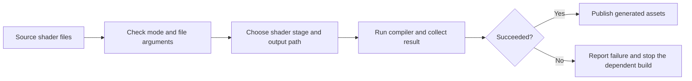

# 13 — Portable startup, windows, events, and input

[[Chapter Edition/03 - Game Engine/00 - Reading Map|Reading map]] · [[Chapter Edition/03 - Game Engine/12 - Transactions, recovery, and safe project boundaries|Previous chapter]] · [[Chapter Edition/03 - Game Engine/14 - Application clocks and stable input identity|Next chapter]]

A project becomes interactive only after platform resources and application services start in a valid order. This chapter builds a small visible window and routes events through boundaries that keep game rules independent of the operating system.

**By the end:** Describe startup/shutdown dependencies and separate native window events, application input state, and game actions.

**Recall question:** How does a close request travel from the platform into orderly shutdown, and how does a key press become a tick-stamped game action?

<!-- Derived from Continuous Notes/Game Engine - From First Frame to Living Worlds.md; source lines 24192–24924; source-span SHA256 e374ba097624e6a4280ef5a3cd65e4d7420687cb599b6f9a1db6750484f2ecff. -->

<!-- CHAPTER-SOURCE-BEGIN -->
## Turn the application into a portable working foundation

Now turn the promise into a program that starts, reports failure, and closes reliably. The C and C++ implementations offer different mechanisms for the same responsibilities.

#### Make subsystem memory needs visible before startup

A subsystem that owns a small, fixed state block can describe its memory need before it begins doing work. Give initialization two phases: with a null state pointer, it returns the required byte count; after the application reserves that many bytes, initialization receives the block and sets up the subsystem. The first call is a size query, not a partially initialized subsystem. Document that distinction in the function contract and make failure explicit in the second call.

This makes memory ownership visible at the application boundary. The application can reserve one startup arena, ask each subsystem for its state size, hand out non-overlapping blocks, and keep ownership outside a reloadable engine module. Opaque `void*` state at the boundary avoids requiring every caller to know the private state structure, while the subsystem itself casts and interprets its own block. The tradeoff is that a raw opaque pointer has no type or lifetime checking; the API must state who retains it and when it becomes invalid.

A fixed arena does not grow safely by itself. If it is full, return a failure and leave its offset unchanged. Reallocating and moving the arena could invalidate every pointer already handed to subsystems. Capacity should be a measured/configured budget, not a magic constant: the stream starts with 64 MiB as a temporary allowance, and does not establish that amount as a generally suitable target. Also distinguish the allocator's CPU-side bookkeeping from GPU resource storage: resizing the free metadata alone does not move or resize GPU payloads.

A robust requirements query should state alignment as well as byte count, use the same configuration as the later initialization call, and avoid acquiring live resources during the query. Keeping bytes outside a reloadable module does not guarantee state-layout compatibility with replacement code; version that contract if reload is supported.

Source reading: [caption source](https://www.youtube.com/watch?v=3ZFcvBjRFN0). Captions document the narrated development state; on-screen code and reported builds were not independently reproduced.


#### Keep engine lifecycle separate from game-specific frame work

The engine should provide lifecycle hooks and rendering services; a consuming game should choose its own test meshes, fonts, skybox, and render views. Kohi moves testbed setup into game boot/configuration/render/shutdown callbacks so an editor or another application can make different choices. Metrics calculation similarly belongs in a metrics system, while the game decides how to display FPS or frame time. [Kohi application/game boundary](https://www.youtube.com/watch?v=UWaUUhOFCec)

A later refactor groups delta time, elapsed time, and a frame allocator into a constant `FrameData` pointer passed to input, system updates, renderer hooks, and game callbacks. The engine owns/resets the allocator; an application may request an opaque per-frame block for its own transient data. A render-packet geometry array moves from persistent game state into that frame block. This reduces duplicated parameters but adds a cast/configuration contract: the block must be sized before use, initialized before callbacks that read it, and not retained past frame reset. The stream reports a rebuild/run; its generic scene lifecycle remains a sketch. [Kohi frame context](https://www.youtube.com/watch?v=xRag4sy8Kyk)

##### Freeze features, then move game behavior out of the core

Before attempting an Emscripten build, the Sparky series pauses feature work and removes portability hazards and project-specific code. The episode distinguishes desktop audio from browser audio, expects JavaScript audio in the web build, and plans to compile the other dependencies through Emscripten. It also corrects declarations that the author expects Clang to reject.

A texture batch has a finite number of texture slots. When the renderer fills those slots, it must flush and begin another batch; a deliberately tiny slot count increases draw calls and sharply reduces the observed frame rate in this test. The source uses this as a concrete reason to track batch limits and flush behavior, while its measured numbers remain specific to the sample scene and machine.

The episode moves a hard-coded tile layer and its projection out of the engine core into the example game, then removes obsolete simple-renderer and static-sprite examples. It sketches an application base class with initialization, a once-per-second tick, a separately paced update, rendering, and a window loop. A small game subclass creates its layer and shader, displays FPS text, handles keyboard movement, and draws a texture. This is an evolving architecture shown before the promised browser build; it is not evidence that the cross-platform port succeeded.

##### Keep frame phases visible so game work and engine work stay separate

A small engine example can teach more than where its methods are declared. It can show when each method is allowed to do work. In a historical Sparky devlog, the creator describes layer hooks for initialization, events, periodic ticks, updates, and rendering. Initialization happens after renderer and scene setup; a tick is intended for low-frequency diagnostics; update advances gameplay at a fixed interval; rendering follows the display. The narrator also doubts whether the shown render interval is really synchronized, so the schedule is a design sketch rather than verified behavior. See [Sparky devlog #5](https://www.youtube.com/watch?v=zqmgcQd6ayc&t=6m30s).

This separation helps answer practical questions. A key press belongs on an event path. Movement and simulation belong on a time-defined update path. Drawing belongs on a render path that can happen at a different rate. A diagnostic counter can run less often than either. If one callback silently performs all four jobs, frame pacing and side effects become hard to reason about. The source describes an update rate of 60 Hz, but projects should state and verify their own timestep rather than copy that value as a universal rule.

A code review of a small Hazel-inspired engine makes the complementary API point: application code should describe the scene and requested draw, while the engine owns unavoidable startup steps and graphics state transitions. The reviewer recommends hiding buffer binding/linkage details behind a vertex-array or geometry-construction API, so a caller supplies vertex data, indices, and layout without manually managing every OpenGL bind. This is a design recommendation from a historical OpenGL example, not a mandate to hide every backend operation. Abstractions earn their place when they remove repeated state choreography while preserving a clear way to inspect what work will be submitted. [The cube-focused review](https://www.youtube.com/watch?v=sIAXLH7ZqCw&t=10m26s)

### Keep example behavior in the example application

A reusable engine library should provide capabilities, while a particular demo or game decides how to use them. This Hazel episode moves camera, shader, vertex-array, and drawing behavior out of the engine's general `Application` class and into the Sandbox example layer. It also groups commonly used rendering headers in the public Hazel API header, while keeping names explicit in the example so readers can distinguish engine types from sample code.

The episode tests two input styles. Handling repeated key-press events moves the camera in discrete, uneven steps because key-repeat events are not a continuous per-frame signal. Polling held keys from the update method produces continuous movement, but the shown fixed per-update speed still depends on frame rate. The author identifies delta time as the next correction. Rotation is also wired into the camera state, with its sign adjusted to match the camera's rotation convention.

This is a teaching refactor and an input experiment in the Hazel codebase at this point in the series. It does not demonstrate frame-rate-independent movement or per-object transforms; those are identified as follow-up work. [Source:](https://www.youtube.com/watch?v=4zj-0FQ7Xbg)

#### Add a feature by following its data across the engine

A circle that appears on screen and a circle that participates in physics are two different facts. Rendering answers what the player sees; a collider answers what the solver sees. The Hazel example starts from that distinction: an entity can have a circle sprite, yet fail to collide until it also has a circle collider and a rigid body. Its offset test overlays a separately rendered circle so the author can compare the visible reference with the collider's intended location. This is a useful debugging method because it makes the hidden physics state observable without pretending that the debug drawing is the physics itself. [Hazel circle collider, 00:00:00–00:01:10; 00:11:46–00:14:36]

A new component is a vertical slice through an engine, not just a new struct. In the example, adding a circle collider touches runtime component retrieval, the inspector controls, entity duplication, scene serialization and deserialization, and the physics fixture. Missing any one of those paths creates a feature that works only in one context: it may collide during play but disappear after duplication, fail after saving and reopening, or remain invisible in the editor. Trace a test object through each path and keep the evidence for each separate. [Hazel circle collider, 00:08:31–00:11:46]

This pattern also applies to a render feature. The circle-rendering episode separates circle parameters and shader behavior from ordinary sprite rendering, while reusing quad geometry where the underlying geometry is shared. Its first draw failure came from a missing vertex-array bind; later, a missing component-copy path caused circles to disappear in a duplicated runtime scene. Those failures occurred at different boundaries, so a correct fragment shader alone could not prove the feature complete. [Circle rendering, 00:19:51–00:28:40; 00:49:13–00:51:57; 00:59:24–01:02:12]

### Choose a module boundary that matches how the game is developed

A renderer can work on screen while the engine remains awkward to consume. In this episode, the author begins from link errors: ImGui had been compiled into a static library, then linked into Hazel's DLL, but a sandbox executable that called an ImGui function not referenced by Hazel could not resolve it. The linker removes unused symbols from the DLL, so the apparent dependency chain did not export everything the client needed. The episode traces static-library input, the Hazel DLL, and the sandbox's unresolved call at 02:30–05:20, then demonstrates the export/import macro workaround at 06:30–09:15. [Rendering and Maintenance](https://www.youtube.com/watch?v=695SyEyFwWU&t=150s) [Rendering and Maintenance](https://www.youtube.com/watch?v=695SyEyFwWU&t=390s)

A module definition file (`.def`) can explicitly list DLL exports, but the speaker describes maintaining such a list by hand as error-prone. The video looks at that option around 09:20–11:00 before considering a different build boundary: make Hazel a static library so its required objects are linked into the final executable. The discussion compares deployment and rebuild needs, symbol visibility, template/shared-pointer boundaries, and link-time optimization at 11:00–16:30. These are the author's reasons for preferring a static-library workflow for this project at that moment; they are not a universal verdict that DLLs are bad. [Rendering and Maintenance](https://www.youtube.com/watch?v=695SyEyFwWU&t=550s) [Rendering and Maintenance](https://www.youtube.com/watch?v=695SyEyFwWU&t=660s) [Rendering and Maintenance](https://www.youtube.com/watch?v=695SyEyFwWU&t=780s) [Rendering and Maintenance](https://www.youtube.com/watch?v=695SyEyFwWU&t=930s)

The useful design question is: which part must change independently? If game code changes every minute while the engine stays stable, hot-reloading the game module may matter more than hot-reloading the engine. If you ship a single executable and do not promise binary plugin compatibility, static linking can simplify deployment and avoid cross-DLL C++ ABI problems. If users need plugins, separately updated engine binaries, or a C# editor loading a native core, a DLL/shared library may be the right boundary, but its exported ABI and ownership rules need design. The source explicitly contrasts hot-swapping game code with reloading the engine at about 16:00–18:00 and discusses its intended native, cross-platform tools around 18:00–20:00. It closes by sketching rendering-context/swap-chain work and asks readers to try a static-library conversion and warning cleanup as future tasks around 22:00–24:50; those later features and cleanup are plans, not completed work in this episode. [Rendering and Maintenance](https://www.youtube.com/watch?v=695SyEyFwWU&t=960s) [Rendering and Maintenance](https://www.youtube.com/watch?v=695SyEyFwWU&t=1080s) [Rendering and Maintenance](https://www.youtube.com/watch?v=695SyEyFwWU&t=1320s)

When diagnosing a link failure, first identify the target types and the edge where the symbol disappears: static library into shared library, then shared library into executable is not equivalent to static library directly into executable. Inspect the final link inputs and exports. A local workaround that forces a function to be referenced can confirm the diagnosis, but it does not create a complete export contract. The episode demonstrates such a temporary forced-use test around 07:00–09:00; do not mistake that demonstration for a maintainable public API.


### Design the next engine layer backward from a small finished game

A feature list can grow without bringing the engine closer to a usable game workflow. Start with a small game the engine should support, then write down the authoring steps a developer would need to complete it. Work backward from those steps to find missing engine capabilities. This keeps a renderer, scripting system, scene model, and editor tied to an end-to-end use rather than treating each as a goal on its own.

A 2020 Hazel roadmap episode uses a Flappy Bird-sized game as this target. It describes a public 2D learning branch and a faster development branch, while explicitly treating the roadmap as a plan. The presenter wants users eventually to place entities and appearance data into a scene, allowing the scene to drive rendering; lower-level direct drawing remains useful for controlled rendering work. The source does not show these later features being completed. [Hazel 2020](https://www.youtube.com/watch?v=6BHhNELSnDU)

This backward design also clarifies API shape. A user making a game should describe the intended result, such as drawing a textured quad or attaching a sprite to an entity. The renderer may need to batch geometry internally, but callers should not need to manage the batch's begin/end mechanics for ordinary scene drawing. A direct renderer API can remain available for specialized use, while the common route hides mechanical steps behind scene data and simple operations.

A vertical-slice checklist might be: create a project; load a sprite; place and move an entity; respond to input; detect a collision; show a score; restart after a loss; save and reopen the scene. For every step, ask what the author writes, what the editor stores, what engine service runs it, and how a learner can tell it worked. If a proposed engine feature does not unblock one of these steps or improve a measured bottleneck, defer it until the slice reveals a reason to build it.

#### Source-to-volume map

- Existing foundations: `### Focus the prototype on the risky question`, `### A step-by-step build order for a small Hazel-like engine`, and `### Put a render API under scene-level submission calls`.
- The roadmap adds a specific method for choosing feature order: derive it from a small completed game and keep public API simplicity separate from internal renderer mechanics.
- Limits: this is a dated planning episode as transcribed in English captions; no implementation, scripting runtime, scene workflow, or performance target is verified here.

### Prototype the game loop, then list what the engine lacks

The Flappy-style one-hour prototype is presented as a postmortem. It makes missing capabilities visible: collision, particles, and post-processing were absent or incomplete, so the author chose a triangle texture to include a glow, pooled a fixed set of pillar pairs, and used screen-space falloff for a vignette. The game state determines whether particles keep updating after game over. These choices show how constraints shape a prototype; they should not be elevated into general engine recommendations ([42aqVsdcxwU](https://www.youtube.com/watch?v=42aqVsdcxwU), 00:09–10:00; 21:34–30:17).

A separate Hazel rendering experiment adapts particles from an unrelated OpenGL demo and uses a bounded pool to stress rendering. It reports that a 100,000-particle allocation behaves differently in debug and release and calls its memory layout inefficient. The camera-bounds first-frame bug is attributed in the video to C++ member initialization order and resolved by reordering fields. This is a useful diagnostic example: when a value is read during construction, inspect declaration-order initialization rather than assuming the constructor’s textual order controls it. The result remains an observed video demonstration, not an independently reproduced test ([q39GnqVhLf8](https://www.youtube.com/watch?v=q39GnqVhLf8), 03:49–08:25; 19:21–22:52).


#### Let a short game expose the engine’s next concrete need

A feature request is easier to judge when it comes from a game someone is trying to finish. In a 72-hour Hazel jam, the team made *Forest* while streaming. The prototype forced practical decisions: place papers only in the village to simplify content placement, decide whether the player picks up or carries a gun, and remove a planned title screen so the game can fade directly into play. This is a useful engine-development loop: build a small playable, record the friction that blocks the intended experience, then choose the smallest change that removes that friction. The jam account also shows the limit of that evidence: the team discusses ideas and unfinished experiments in real time, so a suggestion in the stream is not proof of a shipped system ([How We Made a Game in 72 HOURS using OUR OWN GAME ENGINE](https://www.youtube.com/watch?v=tQ_pjZDfm-0&t=0m1s)).

A second jam, *Saving Captain Chino*, makes the connection between world rules and player choices especially clear. The player carries coffee through a randomly generated battlefield. Enemies spill the coffee, so the objective itself becomes a resource the player must protect. The player can put it down while fighting, scout the route, clear enemies from newly revealed areas, and retrieve the coffee for the final trip. Here “chunk” means a tile region generated as the player nears its edge; the presenter says new chunks may add enemies, while visited chunks do not respawn them. That rule creates a tactical choice between carrying the fragile objective forward and preparing the route first. The same demonstration reveals a bad dead end: ammunition is finite, and if the player runs out before clearing enemies, there may be no way to obtain more. A mechanic that generates tension can also make progress impossible, so test for both intended risk and accidental lockout ([We Made a Game About Delivering Coffee in a War Zone in Hazel in 72 Hours!](https://www.youtube.com/watch?v=ahrdtYwBLTk&t=6m42s)).

The coffee game also exposes how presentation settings can make a build more usable across machines. Its launcher offers a render scale rather than listing every display mode. Lowering the internal image width and height can reduce rendering cost while leaving the window’s presentation size alone. This is a useful quality knob, but the video does not provide a benchmark or claim a particular performance gain. A function-key overlay reports counters, and the developer describes the game as GPU-limited because of its effects; that is a diagnosis from the creator, not a measured comparison. Separate the player-facing control, the diagnostic signal, and the performance conclusion when documenting such a feature ([We Made a Game About Delivering Coffee in a War Zone in Hazel in 72 Hours!](https://www.youtube.com/watch?v=ahrdtYwBLTk&t=1m7s)).

### Build a minimal application before building game systems

An empty application is a valuable checkpoint. It proves that the compiler, build generator, dependencies, program entry, and operating-system window can cooperate. If this foundation is unstable, every later error will be harder to classify. A linker issue can look like a renderer issue. A bad working directory can look like missing assets. A broken event callback can look like a frozen game loop.

The first Hazel episodes establish the project’s terms: the engine is a library that the example application uses; the application has an entry point; the window and core services belong to the engine; and the game-specific code is supplied by a client. In the 2023 public repository, `Application.h` declares `CreateApplication` as a function to be defined by the client, while `EntryPoint.h` supplies the common program entry that calls that factory. This is a familiar engine pattern: the engine owns the long-lived platform loop, while the client supplies project behavior through a narrow hook.

A conceptual entry arrangement looks like this:

```cpp
// Engine-owned startup, shown as pseudocode.
int main() {
    auto game = CreateProjectApplication();
    game->Run();
}

// Project-owned customization.
Application* CreateProjectApplication() {
    return new MyGameApplication();
}
```

The point is not whether the factory returns a raw pointer or a smart pointer. The point is that the engine controls startup while the project chooses its concrete application. A useful public contract should make this ownership clear and should not hide global lifetime assumptions behind many unrelated helpers. The public Hazel snapshot uses a singleton pointer for `Application::Get()` and asserts that only one application exists. That is simple and practical for one desktop application, but it also creates a constraint: tests or tools that need multiple independent application instances will need a different design. This is a design tradeoff, not a universal recommendation to use singletons.

### Generate platform projects from one configuration, then verify each target

The Premake walkthrough replaces manually maintained IDE projects with one Lua project description for source files, include paths, libraries, defines, platform filters, and build configurations. It separates debug, optimized release, and distribution intent, and derives output/intermediate paths from configuration, system, architecture, and project name to avoid collisions. A post-build copy step places the engine DLL next to the sandbox executable. The stream fixes a project-generation include syntax error and a sandbox dependency path, then reports successful Visual Studio 2017 generation and F5 execution. Other platform project generation is prospective, not demonstrated. [Premake walkthrough](https://www.youtube.com/watch?v=sULV3aB2qeU)

The later cross-platform symbol work addresses a different boundary: the shared library can compile while a consuming application still cannot resolve a required API. Hiding GCC/Clang symbols by default and explicitly exporting public APIs makes that boundary resemble Windows’ explicit exports. A link-time undefined-symbol check catches a missing export earlier than a runtime loader failure. The stream reports the Linux check; Mac flags were researched but not tested, so do not generalize this as cross-platform verification. [Symbols and mipmaps](https://www.youtube.com/watch?v=xb23Y9o7tP4)


#### Make platform and lifecycle assumptions visible

Cross-platform support is a series of host-specific contracts, not a compiler switch alone. The Emscripten walkthrough changes the main-loop handoff, resource packaging and paths, shader dialect, buffer update path, and texture selection strategy for its browser target. It also builds native dependencies as bitcode and defers browser audio. These are evidence of the changes that particular historical project needed; they are not a current recipe or a claim that one build configuration makes a desktop engine portable. [Emscripten experience, 00:07:42–00:09:03; 00:23:38–00:28:28; 00:35:13–00:58:47; 01:12:52–01:38:03; 02:06:47]

Similarly, an audio system owns more than a sound filename. It must initialize a backend, create playback handles, update the backend, and release or stop resources under an explicit lifecycle. The example only begins playback after the manager's update function is called from the loop; its callback and pause/resume details are still implementation-specific. Keep the game-facing command separate from the desktop or browser playback backend, and verify each target independently. [Sounds and sound managers, 00:08:13–00:14:04; 00:20:24–00:25:00; 00:41:43–00:54:56; 01:18:12–01:29:33]

Vulkan makes selection and presentation another explicit chain. The surface belongs to a window-system path; physical-device suitability depends on the surface, required features/extensions, and queue families; presentation support is checked against that surface rather than inferred from a graphics queue flag. The Kohi source is a generated Whisper transcript, and its described work stops before logical-device creation. It is a useful design trace, not proof of a complete renderer or a current API recipe. [Kohi #015, generated ASR, 00:05:52–00:10:29; 00:13:30–00:20:50; 00:27:22–00:37:24; 00:43:32–00:47:24]

### Packaging changes the host, not the engine’s obligations

An older Java lesson gives a useful delivery test: can someone start the game without opening your IDE? Its runnable JAR needs the intended entry point, required libraries, and resources. An export failure caused by an out-of-sync project is repaired by refreshing the IDE’s view of the filesystem. That is a build-input problem rather than a rendering bug. Once the game runs outside the IDE, its console may no longer be visible; useful diagnostics need an intentional destination. The narrated cross-machine frame rates are observations, not a controlled portability or performance test. [Runnable JAR export](https://www.youtube.com/watch?v=velhSXA2CnQ)

A Windows executable wrapper changes how that JAR is launched; it does not, by itself, turn the Java program into a self-contained native engine. The source supplies the runnable JAR and runtime-version setting to a wrapper tool, saves its configuration, and reports a successful launch. A file icon and the application window’s icon are separate pieces of presentation. The tutorial’s old runtime versions, tool settings, and informal FPS comparison are historical evidence, not current compatibility recommendations or proof of a speedup. For any packaging system, test the actual runtime requirements on a machine without your development environment. [Executable wrapper](https://www.youtube.com/watch?v=ucW3mBoTyTw)

The applet lesson explores a different host: it embeds the existing display in a container, forwards start/stop lifecycle calls, and packages classes and resources in an archive referenced by an HTML page. Archive paths are resolved relative to that page. The example assumes a browser Java plugin; keep it as a historical host-adapter example rather than a present-day browser deployment recipe. Its use of synchronized methods alone does not establish a complete threading contract, and its visual glitch remains unresolved. The lasting question is which responsibilities belong to the reusable game loop and which belong to its host—window creation, cursor behavior, lifecycle, resource location, and shutdown. [Applet host](https://www.youtube.com/watch?v=WkBMoCbbgO0)


#### Project generation is part of the foundation

C++ projects often separate the build description from generated IDE files. A generator script can describe targets, source groups, include paths, and dependencies once, then emit projects for the chosen IDE. The opening series captions discuss using Premake as the project-generation tool and later implementing the application’s basic pieces. This is an example of treating build setup as a real engine concern: a contributor must be able to reproduce the project’s structure rather than rely on one person’s machine state.

Keep the dependency graph understandable. The engine core should not have to include every editor header. A sample game should not secretly compile a second copy of the renderer. A third-party library should have one documented route into the build. When setup fails, record the tool version, command, and first meaningful error. “It works in my IDE” does not tell the next developer how to reproduce the build.

#### Logging and diagnostics belong early

The opening sequence introduces logging before the engine grows. That is good sequencing. A first log facility can separate engine messages from application messages, assign severity, and provide a consistent output route. When a window does not resize or an asset fails to load, a clear diagnostic saves more time than a sophisticated feature that cannot explain its own failure.

A practical log record answers: which subsystem emitted this; what operation failed; what input or path was involved; and is the message informational, a warning, or an error? Do not hide recoverable failures behind assertions. An assertion is useful when the program has violated an internal condition that should never happen. A missing texture file selected by a user is an expected failure path and should usually produce an actionable error instead of terminating the editor.

The series also covers precompiled headers after the basic event design. A precompiled header is a build optimization: the compiler stores a prepared representation of frequently included headers to avoid repeating expensive parsing. It can speed up iteration in a large C++ project, but it should not be used to conceal missing includes or create unclear dependencies. A source file should still include what it logically depends on, and the project’s build configuration must apply the precompiled header consistently. This sequence makes sense: get the project compiling, then optimize a measured compile bottleneck.

#### Separate a diagnostic message from the operation it describes

A **log level** classifies a message, for example as a trace of ordinary work, a warning about a recoverable condition, or an error describing a failed operation. The level helps people and tools filter the record. It does not itself decide whether the caller should retry, return failure, or stop. An asset loader that logs an error and then returns an apparently valid resource has broken its contract despite producing a useful message.

An **assertion** checks a condition that the programmer expects to hold. A release configuration can disable some assertion mechanisms. Required work therefore belongs outside an assertion: performing a required operation only inside `assert(open_window())` can remove the operation when standard assertions are disabled. Open the window through the normal startup path, handle failure there, and assert appropriate invariants separately.

Give startup failures enough context to diagnose: the operation, relevant path or requested capability, and the platform/API result. A message saying only "initialization failed" leaves the user guessing which resource was missing. At the same time, a logging callback must not interpret an arbitrary message as a formatting program or retain a borrowed temporary string beyond its valid lifetime. Formatting, storage ownership, and routing to console/file are separate responsibilities.

The fully read Kohi logging lesson builds formatted messages, platform output, and assertions. These examples expand the surrounding contract rather than treating the presence of a logger as complete error handling or claiming that a particular debug macro is safe in every configuration. [Caption source: Logging and Assertions](https://www.youtube.com/watch?v=l9e8PJskYnI).


#### Put ownership and lifetime into the first application loop

A platform abstraction becomes useful when the rest of the engine has a clear owner for it. The initial window loop can prove that the OS can create a surface, deliver queued messages, and close cleanly, but putting that loop in user `main` leaves platform details in the game entry point. Move startup, message pumping, and shutdown behind an application lifecycle. Let the engine call a user-supplied `create_game` function to obtain a small game interface: configuration, opaque game state, and callbacks for initialize, update, render, and resize. The engine can validate that required callbacks exist before calling them. This boundary keeps OS handles and game implementation details on their respective sides.

The order of teardown matters as systems acquire dependencies. A renderer may hold platform surface data; input may register event callbacks; both must be shut down before the platform state disappears. Write the lifecycle in dependency order and reverse it for cleanup. A callback contract should also say when it runs: in this tutorial scaffold, update and render run only while the application is not suspended, resize updates stored dimensions before notifying the game, and the first delta-time value is temporarily a placeholder. A `void*` state pointer is useful for hiding user state from the engine, but allocation through platform functions is a temporary coupling; a later engine allocator should own this responsibility.

Source reading: [caption source](https://www.youtube.com/watch?v=jEbqCf-MsZs) · [caption source](https://www.youtube.com/watch?v=ojEPsZFPj2Q) · [caption source](https://www.youtube.com/watch?v=nGgvWzoCsyk). Captions document the narrated development state; on-screen code and reported builds were not independently reproduced.


### A service is not ready merely because its constructor returned — Gregory integration

The window and renderer story becomes a real engine architecture problem as soon as more than one subsystem can fail while starting. Consider an editor which needs a platform event pump, then a window, then a GPU device, then a resource loader, then a game world. Saying that these are "layers" does not determine **which of them is allowed to exist when another initialization step fails**. Nor does moving every subsystem into a C++ object automatically solve the problem. A service constructor might allocate a native handle before discovering that a required feature is unavailable; its caller must not treat the half-created service as ready, but the half-created service must still release anything it acquired.

Describe the dependencies as a directed graph. Write an edge `A -> B` when *B cannot be initialized or used unless A is ready*. If the graph contains a cycle, such as renderer -> asset manager -> renderer, there is no valid whole-service startup ordering; the design must split construction from activation, inject a narrower interface, or break the dependency. If it is acyclic, a topological ordering gives an initialization sequence. The topological ordering does not specify **one unique** schedule: independent providers can start in either order or, when concurrency is safe, in parallel. The important property is that each service starts after all its providers and stops before any provider it still needs. During normal shutdown, reverse **successful start order**, not the alphabetical order of service names.

The failure rule is deliberately stricter than "call shutdown on everything." Track the set `Ready` of services whose `start()` returned success. If startup fails at service `S`, `S` must roll back its own partial acquisition using local RAII or explicit cleanup, and the coordinator stops only members of `Ready` in reverse order. Destructors for successfully constructed C++ wrappers should be non-throwing; do not allow a platform callback or an already-destroyed logger to be invoked during late teardown. A final GPU frame's command submission is not its completion: the renderer must wait for the relevant device work or retain retired resources before destroying memory still referenced by that work.

Take a concrete trace. Platform startup succeeds; window startup succeeds; renderer acquires a provisional surface object but fails device-feature negotiation. The trace must be `platform ready -> window ready -> renderer partial -> renderer partial cleaned -> window stopped -> platform stopped`. It must **not** try to stop an unready renderer as if it were fully active; nor may it destroy the platform first, because the window destructor still calls into that platform. Missing dependencies and cycles should be rejected *before* any service starts. This is what the accompanying C++20 witness tests, including the exact rollback trace. The witness intentionally does not pretend that its `Service` class is a Vulkan/Metal lifetime wrapper: device-loss, callbacks from other threads and GPU fences add real obligations beyond this logical proof.

This improves the older engine-support-system motivation in Gregory's Chapter 5 (2009) without treating his original platform choices as present-day requirements. It also sharpens the existing engine lifecycle discussion: a scene's per-frame memory arena may be reset once all CPU jobs borrowing that arena have joined, but a GPU upload staging allocation must remain alive until the *GPU* has finished consuming it. "End of the frame" is not a universal free point. The practical ownership question is always **what is the last possible user, and what evidence proves that user is finished?**


### Precompiled headers as a measured project choice

When many translation units repeatedly parse the same stable headers, a precompiled header (PCH) lets the compiler reuse a prepared representation of that shared prefix. In this Hazel episode, the instructor creates `HazelPCH.h` and a corresponding `.cpp`, puts common standard-library headers there, and conditionally includes `Windows.h` when the project's Windows platform define is active. The useful design rule is to keep this shared set relatively stable: frequently changed headers can invalidate the prepared state and reduce the benefit.

The build description names the PCH header and, for Visual Studio's workflow shown here, the source file that creates it. The project regenerates its Visual Studio files, then includes the PCH first in each current `.cpp` translation unit. That ordering is part of the demonstrated setup: the compiler must encounter the precompiled prefix before ordinary includes. Because the project is small at this point, the author can update its few translation units before the codebase grows.

The episode reports clean and incremental build timings with PCH enabled and disabled and sees improvement in its own sample. Treat those numbers as a local observation, not a general ratio: compiler, machine, project size, header stability, and build configuration all affect results. This is a Hazel/Premake/Visual Studio workflow from the cited episode, not a universal prescription for every compiler or current toolchain. [Source:](https://www.youtube.com/watch?v=UQ718BrbQ5E)

### Build boundaries: library choice, runtime assumptions, and warning scope

A game project can compile cleanly and still have a fragile binary boundary. In this Hazel episode, the presenter makes the core engine a static library and links it into the application. The practical motivation is to remove a DLL boundary that had become unnecessary for the project’s current design. A static core does not prevent later modules from being loaded dynamically: it only changes how Hazel itself is packaged.

The most important compatibility issue here is the C/C++ runtime (CRT), which provides services such as allocation and deallocation. If one DLL allocates an object with one runtime configuration and another DLL frees it with a different one, the two sides may disagree about the allocator’s bookkeeping. The result can be a crash or memory corruption. In this episode the engine core becomes a static library linked into the application, which removes that particular engine/application DLL boundary. It does not establish a universal cross-DLL ownership fix. This is a constraint of the shown Windows toolchain setup, not a universal rule that every library must always use static linkage. A dynamic module boundary still needs an explicit, compatible ownership and ABI policy.

The build cleanup follows a useful sequence: edit Premake configuration for the intended library kind and runtime, regenerate IDE projects, reload them, clean old outputs, rebuild, and launch. The presenter also moves settings into clearer language, platform, and configuration scopes so that a setting such as the C++ dialect is not accidentally treated as Windows-only. This is configuration hygiene tied to a specific Premake/Visual Studio workflow; generated project files are outputs of that process and should reflect the checked-in build description.

Warning cleanup demonstrates why suppression scope matters. A third-party implementation emits deprecated-CRT warnings. A macro defined in the implementation file seemed appropriately narrow, but that file is compiled through a unity build and the relevant declarations had already entered through a precompiled header. Since the compiler saw the declarations before the macro, that attempt could not suppress the warnings. The episode first explores include-order adjustments, then concludes that the shared build configuration is the effective place for the macro in this setup. The tradeoff is broader suppression: a project-level setting can also hide warnings in code beyond the third-party source. The episode leaves warning-as-error enforcement off, so the reported zero-warning build is a demonstrated result rather than an enforced invariant.

Use this example when teaching students to reason about build boundaries: ask who creates and destroys an object, which runtime owns that memory, and whether the build configuration matches at both ends. Then ask where a warning originates, when the affected declaration is parsed, and how wide a suppression applies. The caption-reported zero-warning build and successful launch are evidence for the demonstrated configuration only; source code and other platforms need their own checks.

Source: [Static Libraries and ZERO Warnings | Game Engine series](https://www.youtube.com/watch?v=TlvmnoDlrI0)

Microsoft documents that separately linked CRT copies can retain separate state and heap managers: using `/MT` in both a DLL and its executable does not by itself make cross-boundary allocation/free safe. Keep destruction in the allocating module, pass an agreed allocator, or otherwise establish the required compatible ownership contract. [Microsoft CRT boundary guidance](https://learn.microsoft.com/en-us/cpp/c-runtime-library/potential-errors-passing-crt-objects-across-dll-boundaries?view=msvc-170)

### Make build and source organization part of maintenance

A project generator is a tool that turns a build description into IDE or build-system files. In the historical Hazel walkthrough, the repository's checked-in Premake executable does not recognize the newly selected Visual Studio 2019 action. The fix is to replace that tool binary with a release that supports the requested action; the recording reports that VS2017 generation still works afterward. This sequence is shown at 06:00–11:20. A generator upgrade is therefore part of the toolchain change, not an incidental download: pin and document the version so contributors generate the same project model. [Maintenance](https://www.youtube.com/watch?v=e9uTV44oOiw&t=360s) [Maintenance](https://www.youtube.com/watch?v=e9uTV44oOiw&t=600s)

The same episode makes a Windows batch script's scope visible by moving it into a `scripts` directory and naming it for Windows, while noting that Mac and Linux need their own scripts and build checks. It adjusts directory handling after the move and reruns project generation around 12:20–15:00. The general lesson is to label platform-specific tooling honestly and make the command reproducible; one `.bat` file does not demonstrate cross-platform support. The speaker discusses potential Mac/Linux support and CI but explicitly describes those as future work around 08:45–10:00. [Maintenance](https://www.youtube.com/watch?v=e9uTV44oOiw&t=740s) [Maintenance](https://www.youtube.com/watch?v=e9uTV44oOiw&t=525s)

Upgrading a compiler or IDE can expose old code assumptions even when the project file itself converts cleanly. The lesson builds the solution under VS2019, explains why compiler changes can affect templates and macros at 16:00–17:20, and then reorganizes Hazel headers and source folders. After moving files, it regenerates the project and uses compiler errors to find stale include paths; it says the Debug and Release configurations both built and launched in that snapshot around 17:30–23:35. This is evidence for those configurations on the author's machine at that time, not a compatibility guarantee for all machines or platforms. [Maintenance](https://www.youtube.com/watch?v=e9uTV44oOiw&t=960s) [Maintenance](https://www.youtube.com/watch?v=e9uTV44oOiw&t=1050s) [Maintenance](https://www.youtube.com/watch?v=e9uTV44oOiw&t=1320s) [Maintenance](https://www.youtube.com/watch?v=e9uTV44oOiw&t=1410s)

A good maintenance change has a short verification loop: record the old and new tool versions; regenerate from a clean checkout; compile every supported configuration; run the executable; and inspect warnings separately from errors. The video specifically cautions against checking Debug alone and requests a community warning cleanup near 22:00–24:20. Warnings were not all eliminated in the recording. Organizing files can improve navigation, but avoid moving code solely for visual neatness when ownership is unclear: a camera controller may span renderer and application concerns, so state the dependency rule before choosing its folder.


#### Keep declarations, ownership, and implementation visible

The Sparky C++ introduction presents the syntax needed to follow the engine series: functions and overloaded operators, integer and floating types, the preprocessor, pointers and references, classes and structs, arrays, headers, namespaces, and inheritance. Several contrasts with Java are useful when reading later engine code: a function can exist outside a class, a pointer is an address that must be dereferenced, and a reference lets a function work with the caller's value without making a copy.

The examples also show why C++ needs visible ownership choices. Stack objects are destroyed at scope exit; raw heap allocations created with `new` require matching cleanup. A virtual destructor matters when deleting a derived object through a base pointer. Const references express that an argument is read-only, and const member functions promise not to change the object through that method. Header declarations can be included in many translation units while `.cpp` definitions are compiled separately; include guards or `#pragma once` prevent repeated declarations. Namespaces help keep unrelated names from colliding.

This is a compressed orientation, not a safe ownership manual. It demonstrates raw arrays and `new`/`delete` but does not develop modern RAII or standard containers, and it acknowledges that later videos will cover more detail. Keep platform/compiler-specific statements about integer widths tied to the environment shown in the source.
#### Dependency setup is an engineering task, not a version guarantee

The adjacent GLEW episode shows a source-era Windows/Visual Studio integration: include paths, library paths, static-versus-DLL linking, a preprocessor definition, and initialization after an OpenGL context exists. An attempted modern OpenGL call is used as a smoke check. The steps are specific to that historical project and environment; they should not be copied as current dependency setup instructions without checking contemporary official documentation. Likewise, the Visual Studio walkthrough teaches navigation, build configurations, breakpoints, watches, and call stacks in the version shown, not every modern IDE layout (The Cherno, “Ep. 2: OpenGL Extensions,” 00:00–00:21:43; “Introduction to Visual Studio,” transcript timestamps across the episode).

#### Keep project organization useful and proportionate

A small team can lose work in the gaps between meetings, code, bugs, and plans. In one historical Hazel workflow account, the technical director uses a Notion page as a dashboard linking Jira issues, recent commits, documentation, and a calendar. Longer collaborative documents go into Google Docs; Jira issues carry ownership, estimates, and progress, while epics group related tasks into a larger objective. The key mechanism is the shared index: a person returning to work can find what is active and where the details live. Its limitation is also explicit—status views help only if people update their issues. These are one team’s period-specific tool choices, not requirements for engine teams or current product recommendations ([What tools I use to manage Game Engine Development](https://www.youtube.com/watch?v=XGYEk9rbGjU&t=3m11s)).

Process choices should serve the work being done. A separate announcement proposes week-long live streams to get through editor UI and other tedious work, with prepared edited episodes for the instructional channel. Later, the creator moves the long game-engine series to a separate channel because its niche audience and hour-long sessions do not fit the main channel’s short edited format. These examples show how teaching and production formats can affect what work is visible; they do not demonstrate that a planned sprint, upload schedule, or channel move was completed. Preserve that distinction between an announced plan and an observed result ([Game Engine Series Week!](https://www.youtube.com/watch?v=Q4wHOx5av0w&t=0m1s), [Goodbye Game Engine series. 👋](https://www.youtube.com/watch?v=4w9NYltdaew&t=0m3s)).

Visual reactions can suggest questions for a technical review, but they cannot identify a renderer implementation. A reaction to the Cyberpunk 2077 trailer praises dense environments and neon lighting, speculates about reflections, and explicitly admits the capture platform and reflection method are unknown. Treat “I see a bright reflection” as an observation; “it is ray traced” requires stronger evidence. Likewise, the horror prototype playthrough gives subjective feedback about lighting, sound, repeated enemy reveals, and the loading hitch before a scare. Such reactions can identify perceived effects or friction worth testing, but they are not code inspection, a systematic playtest, or a performance measurement ([GAME ENGINE DEV REACTS to Cyberpunk 2077 — Official Trailer —](https://www.youtube.com/watch?v=ZyfFCIFHYuk&t=1m11s), [Game Engine Dev Plays Horror Game - Deppart Prototype](https://www.youtube.com/watch?v=Y3-p6MlTjLA&t=0m0s)).

Source boundary: these creator accounts describe specific historical Hazel and Sparky branches, jam builds, and personal workflow. They do not establish current engine APIs, current product features, or reproducible performance results. The Cyberpunk trailer reaction and prototype playthrough are subjective visual/gameplay commentary. The roadmap and channel announcements are plans unless a source demonstrates completion.
#### Documentation is part of the build and release path

Documentation becomes easier to maintain when its source is plain text and the publishing steps are repeatable. A historical Hazel docs tutorial stores Markdown pages in Git, uses mdBook to produce HTML, and defines navigation in `SUMMARY.md`. A webhook asks a server to pull and rebuild after a push. The tutorial’s own debugging is instructive: assumptions about a webhook payload are wrong, a root-owned directory causes permission errors, and inspecting actual responses plus logs reveals the issues. The concrete lesson is to make the source list, build command, worker permissions, and failure logs explicit. This describes one old deployment, not a secure current production recipe; it does not cover webhook signature verification or deployment hardening. ([How I made a DOCUMENTATION WEBSITE for my Game Engine](https://www.youtube.com/watch?v=tJDof3nrfHU&t=3m18s)).

Documentation should also describe the maturity of a feature. A checklist that labels an OpenGL path “not yet done,” a noisy shadow prototype, or a missing import path is more useful than a release note that implies completion. A roadmap can explain intent; a test, release artifact, or clean package run provides stronger evidence. Keep these layers separate when communicating engine progress.

Evidence boundary: the examples above come from dated creator accounts, release walkthroughs, roadmap videos, and subjective trailer reactions. They do not establish present API contracts, platform support, compatibility, licensing, or current performance. No repository code or current SDK was inspected in this caption pass.

### Start a tool project from the build recipe

A new editor or test application should be generated from the project’s build description, not assembled by copying IDE settings that can drift. In the project setup lesson, Premake is treated as the source for compiler, include, link, and output-directory rules; a Sandbox target provides a pattern, while a separate editor target gets its own source files and layer. Keep the distinction clear: a game-facing sandbox exercises runtime behavior, while an editor creates and changes authored data. The video reports a build and link followed by a crash when the expected assets were absent; copying the Sandbox assets is the demonstrated workaround, not a general resource-lifetime solution ([Qbt-1rcSqZc](https://www.youtube.com/watch?v=Qbt-1rcSqZc), 01:53–10:08).

The same setup lesson catches a viewport image flipped vertically by inspecting texture coordinates. That is a useful diagnostic pattern: when geometry appears correct but the image is upside down, check UV orientation before changing camera or transform math (16:29). Its input routing and scrolling remain unresolved at the end of the lesson (17:51), so do not teach the viewport as a finished interaction system.


#### Keep build work incremental and validate dependency tracking

A build script becomes slow when every source file is compiled on every run. A make-based build can model each object file as the output of a source file plus its dependencies. The first build creates the directory structure, compiles translation units into intermediate object files, then links the engine library and testbed. Later builds can reuse unchanged object files and relink only what changed. Keep these generated object directories out of version control, and provide a clean target for a deliberate rebuild. Separate engine and testbed rules when their output type, include paths, or link dependencies differ; use platform-specific rule files where DLL and shared-object conventions differ. The tutorial reports faster rebuilds, but the transcript does not establish dependency tracking for included headers or modern compiler portability, so those need separate validation.

Source reading: [caption source](https://www.youtube.com/watch?v=WR0tAQj-og8). Captions document the narrated development state; on-screen code and reported builds were not independently reproduced.


#### Give asset tools a precise command-line contract

Suppose adding one fragment shader means editing three post-build scripts. Each script repeats the compiler command, its stage option, and an output filename. A small change now has three chances to drift. Move the shared decision into an **asset tool**: a developer-facing program that prepares files for the engine. The platform scripts can then launch that program and check its result. This is **offline processing** because it happens while preparing the game, rather than during its frame loop.

Kohi’s Toolchain episode starts from this repeated shader-build work and introduces a command-line utility. Shader conversion is the operation developed there; mesh and texture conversion are possible later extensions. A **mode** selects an operation within the utility. Keeping mode selection separate from the operation makes the boundary visible: the entry point checks the requested operation, and that operation checks its own inputs. [Episode source, local ASR around 00:00–00:10](https://www.youtube.com/watch?v=cCEmwjfHIkY&t=0).

A shader is a program used by the GPU pipeline. In this example, GLSL is the source language, a stage identifies where the program runs, and SPIR-V is the compiled intermediate representation. The vertex and fragment stages perform different jobs, so stage selection belongs in the conversion contract. Shaderc provides the `glslc` compiler used for this kind of source-to-SPIR-V work. [Shaderc’s own documentation](https://github.com/google/shaderc).



The important boundary is between a valid request, a successful conversion, and permission to continue the build. A tool that recognizes a filename has not yet proved that the compiler succeeded. A script that launches the tool has not yet proved that the generated file is usable.

##### Understand the argument strings before parsing a mode

A **command-line interface**, or CLI, is the text interface used to start a program. In an ordinary C entry point, `argc` counts argument strings and `argv` indexes them. Under the usual invocation convention, `argv[0]` names the program. The program chooses what later strings mean.

For a new tool, we can deliberately define this interface:

```text
asset-tool shaders basic.vert.glsl "scene space.frag.glsl"
```

After the launching shell has handled the quotes, our proposed program receives:

| Index | String | Meaning in this example |
|---|---|---|
| `argv[0]` | `asset-tool` | Program name |
| `argv[1]` | `shaders` | One-word mode |
| `argv[2]` | `basic.vert.glsl` | First input path |
| `argv[3]` | `scene space.frag.glsl` | Second input path, including its space |

Here `argc` is four. For this particular interface, with one mode string and no extra options,

$$
\texttt{argc}=1+1+n_{\text{files}}.
$$

Thus six input paths give eight argument strings. The number counts strings, not words inside a quoted filename. Check that an index exists before reading it: a mode requires `argc >= 2`, and this shader operation requires `argc >= 3`. Print usage when those requirements are not met. Return a documented success or failure result so the caller can respond.

The ASR renders Kohi’s mode names as “build shaders” and a short form. That spelling alone cannot establish whether the actual interface uses a joined identifier, a quoted string, or several parsed tokens. The later narrated count of eight arguments is consistent with one mode string and six paths. Treat the exact mode spelling as unresolved until checking the program’s help or code. The one-word `shaders` interface above is our constructed example, not a reconstruction of an unseen identifier.

##### Make file naming a checked rule

A **suffix** is the ending of a string. A convention such as `.vert.glsl` or `.frag.glsl` can carry both stage and source-language information. Write down exactly which endings are accepted and what happens to an unsupported filename. The example below accepts lowercase vertex and fragment suffixes; adding compute or geometry support would require both a naming rule and an implemented conversion path.

Count the literal characters when doing suffix arithmetic. `.frag.glsl` has ten characters; `frag.glsl` has nine. A caption’s reference to “nine” does not establish which literal the on-screen code compared. For an implementation we control, calculate the suffix length rather than copying a spoken count. Also check the whole input is at least that long before subtracting: unsigned length arithmetic can otherwise wrap for a short filename.

Output naming needs the same care. To turn `basic.frag.glsl` into `basic.frag.spv`, either replace the five-character `.glsl` ending with `.spv`, or remove the four letters `glsl` and append `spv` while keeping the existing dot. Mixing those two recipes creates an extra dot or removes part of the stage name. A C output buffer also needs room for its terminating zero byte.

This complete C17 example exercises argument and suffix classification. It prints the recognized stage and path; compiler invocation is a separate step.

```c
#include <stdbool.h>
#include <stdio.h>
#include <stdlib.h>
#include <string.h>

static bool ends_with(const char *text, const char *suffix) {
    size_t n = strlen(text), m = strlen(suffix);
    return n >= m && memcmp(text + n - m, suffix, m) == 0;
}

int main(int argc, char **argv) {
    if (argc == 2 && strcmp(argv[1], "--help") == 0) {
        puts("usage: asset-tool shaders FILE...");
        return EXIT_SUCCESS;
    }
    if (argc < 3 || strcmp(argv[1], "shaders") != 0) {
        fputs("usage: asset-tool shaders FILE...\n", stderr);
        return EXIT_FAILURE;
    }
    _Static_assert(sizeof(".frag.glsl") - 1 == 10, "suffix length");
    for (int i = 2; i < argc; ++i) {
        const char *stage = ends_with(argv[i], ".vert.glsl") ? "vertex" :
                            ends_with(argv[i], ".frag.glsl") ? "fragment" : NULL;
        if (stage == NULL) {
            fprintf(stderr, "unsupported shader suffix: %s\n", argv[i]);
            return EXIT_FAILURE;
        }
        printf("classify %s: %s\n", stage, argv[i]);
    }
    return EXIT_SUCCESS;
}
```

The example was compiled with `cc -std=c17 -Wall -Wextra -Werror -fsanitize=address,undefined`. Six runs covered help, missing arguments, an unknown mode, a filename shorter than the suffix, and two valid inputs including a path with a space. They produced the expected exit statuses with no sanitizer diagnostics. This verifies the constructed classifier, not Kohi’s executable or shader compiler output.

##### Treat the compiler as another process

An **SDK**, or software development kit, supplies development tools and libraries. An **environment variable** is a named value made available to a process; it can tell a tool where an SDK is installed without embedding one developer’s path in source code. A lookup helper takes the variable’s name as input. If an explanation calls that parameter `name`, it does not mean the environment variable is literally called `name`. A missing value needs an explicit error path. For example, the Vulkan SDK documents `VULKAN_SDK` as an installation-location variable. Keep that documented identifier distinct from an ASR rendering such as “Vulkan SDK.” [LunarG SDK setup](https://vulkan.lunarg.com/doc/view/latest/linux/getting_started.html).

The narrated design finds the SDK compiler, derives a stage and output name, assembles a command, and checks its result. Keep the compiler path, stage, input path, and output path as distinct values until the process-launch boundary. This makes spaces and unexpected characters in filenames easier to handle correctly.

C’s `system()` accepts a command string interpreted by a command processor. That adds another parsing step: characters in the string can become shell syntax. On POSIX-style systems, distinguish failure to start from a child that exits unsuccessfully or is terminated; a returned wait status must be decoded before describing it as the child’s numeric exit code. These details are different from merely checking whether the overall operation succeeded. [Linux man-pages project: `system()`](https://man7.org/linux/man-pages/man3/system.3.html).

A useful launcher abstraction reports the category and evidence: “could not launch compiler,” “compiler exited unsuccessfully,” or “compiler was terminated,” plus the input path and available diagnostics. Where the platform offers an argument-vector process API, pass executable and arguments separately. When a shell is deliberately needed, apply that shell’s quoting rules. An interactive terminal session can have different startup state, aliases, or shell configuration, so it is not a complete specification of `system()` behavior.

The episode reports negative error values for some failure paths. Preserve them as narrated implementation details; define the statuses of a new tool explicitly, and do not assume the launching shell displays the same signed C integer. In the constructed classifier, `EXIT_SUCCESS` and `EXIT_FAILURE` express the contract plainly.

##### Keep platform scripts and shared policy in agreement

The platform script still owns its working directory, executable path, file list, and response to failure. The shared tool owns mode parsing, input validation, and conversion policy. Use one executable name consistently in the build target, post-build command, and debugger configuration. A makefile variable’s spelling is a project convention, so the transcript’s discussion of an “assembly” name should not be turned into a claim about the implementation language.

Line-continuation syntax also belongs to the command processor. Windows batch uses the caret glyph `^` in the demonstrated setup; “carrot” in ASR should be read as a transcription uncertainty, not taught as the symbol’s name. The shell-script version uses backslash continuation. They are platform-specific syntax for writing a long command across lines. `cmd.exe` also uses `^` to escape special characters, and paths with spaces require appropriate quoting. [Microsoft’s `cmd` reference](https://learn.microsoft.com/en-us/windows-server/administration/windows-commands/cmd).

Finally, let failure propagate. If shader conversion fails, the dependent build step should stop with a useful report. Checking only that the tool itself compiled misses that boundary. A practical check is to remove generated outputs, run conversion, confirm successful statuses and expected outputs, and then exercise the runtime that consumes them. Keep those observations separate: the episode narrates successful build/debug/output-regeneration checks, but those results were not independently reproduced here. The narrator also says macOS was not available for testing. Future central configuration and additional asset modes remain extension work rather than demonstrated completed features. [Local-ASR source, platform integration and reported checks around 00:19–00:32](https://www.youtube.com/watch?v=cCEmwjfHIkY&t=1167).

**Recall:** explain the difference between an argument string and a shell word; show why the proposed interface needs at least three argument strings; count a suffix without a magic number; and trace a compiler failure back to the build script. If any step depends on an unstated filename convention, current directory, or shell rule, make that part of the contract visible.

**Source boundary:** this addition uses the saved Kohi #064 ASR and its local-pipeline extraction of all 33 timestamped spans, plus the separately cited technical references and original classifier. The original audio was not manually compared, on-screen code was not inspected, and the Kohi project was not built. Nontechnical greetings, camera remarks, and channel promotion remain in the source cache rather than the lesson. All 48 extracted points remain in the source ledger, including uncertainties and repeated narrated outcomes.

### Begin with a runnable program and a visible failure

A game engine tutorial can start with a grand architecture diagram, but a learner needs a small result that can be built and broken. Kohi’s opening episodes establish the project and its Windows and Linux build environments, then lay down platform, logging/assertion, application and renderer foundations. The captions for [Kohi #000](https://www.youtube.com/watch?v=teg23SJlyl8), [#001](https://www.youtube.com/watch?v=F6_WdnzQIQ4), [#002](https://www.youtube.com/watch?v=NIv1mygBOcg), [#003](https://www.youtube.com/watch?v=l9e8PJskYnI), [#004](https://www.youtube.com/watch?v=ojEPsZFPj2Q), [#005](https://www.youtube.com/watch?v=nGgvWzoCsyk), and [#006](https://www.youtube.com/watch?v=jEbqCf-MsZs) repeatedly frame the work as a cross-platform engine built from scratch in C with Vulkan. A full read of #000 sets an important learning boundary: the presenter says an existing engine is the faster route when the primary goal is shipping a game; building Kohi is for understanding the underlying technology. The announced first target is Windows and Linux with C, Clang and Vulkan, and the architecture is explicitly provisional. The planned layout separates a shared engine library, lightweight executable, reloadable game library, testbed and separate editor; these are plans in the opening episode, not proof they are all implemented at that point. The full #016 logical-device caption makes ownership distinctions visible: the physical device is obtained and its query arrays are freed, the logical device is created/destroyed, while graphics/present/transfer queues are obtained as handles rather than created or destroyed. Queue-family indices are deduplicated when roles share a family; enabled features and the swapchain extension are still hard-coded at this tutorial stage, with configuration deferred. The early code creates a foundation on which each later feature can be demonstrated, rather than pretending the engine exists before it can open a window or report an error.

The first practical problem is that a program needs a place to start and a way to stop. If application logic is scattered through `main`, platform setup, event processing, and renderer startup become entangled with game behavior. A small application layer gives those steps a lifecycle: initialize, run the loop, process input/events, update and render, then shut down. “Lifecycle” means the ordered stages in which a subsystem becomes valid and is later released. Initialization order matters because the renderer depends on a window, while rendering resources depend on a live graphics device. Shutdown order matters for the inverse reason: a resource must be destroyed before the device that owns it.

This is also why logging and assertions arrive early. A log records what the program observed; an assertion states an assumption that must hold at a particular point. Together, they turn a silent blank screen or null handle into a localized explanation. A useful failure report names the subsystem and failed operation. An assertion is not a substitute for handling ordinary runtime errors, but it can expose programmer mistakes at the boundary where the invalid state was created. The caption for [Kohi #003: Logging and Assertions](https://www.youtube.com/watch?v=l9e8PJskYnI) presents these as utilities needed “for the rest of our application development,” a sensible dependency ordering: diagnostics pay for themselves before the complicated systems arrive.

Build scaffolding is part of this design. A build is a repeatable translation from source files plus platform/compiler settings into a runnable program. It is not merely a one-time compiler command. When a project supports Windows and Linux, those configurations should be explicit and reproducible. Kohi’s early captions separate Windows and Linux setup ([#001](https://www.youtube.com/watch?v=F6_WdnzQIQ4), [#002](https://www.youtube.com/watch?v=NIv1mygBOcg)); the corresponding lesson is to keep platform-specific compiler, dependency, and linker decisions visible. Hidden machine-local setup makes a tutorial appear to work while making it impossible to reproduce elsewhere.

A learner should therefore maintain a tiny “known-good” milestone: build, start, log a startup line, run until a close event, then release resources. Each new subsystem should preserve that milestone. This habit narrows debugging. If the known-good program stops building after a change, the error is in the changed layer or its contract, not somewhere in an imagined future engine.

#### Keep a window milestone small enough to verify

This Hazel implementation puts a platform-independent `Window` interface in front of a GLFW window, passes per-window `WindowData` through GLFW’s user pointer, and initializes GLFW once for the demonstrated setup. The per-window records do not by themselves prove a complete multi-window lifecycle. The first visible milestone is deliberately small: create a window and clear it pink; VSync is configured through the implementation. The caption runs on Windows and defers close, resize, keyboard, and mouse event routing to the next episode, so it does not prove those platform paths. [Caption source](https://www.youtube.com/watch?v=88dmtleVywk).


##### A resize becomes pending work

**Episode source:** [Kohi#021: BIG Milestone! Clearing the Screen](https://www.youtube.com/watch?v=hRL71D1f3pU). This transcript was generated locally with Whisper base.en from public audio. It is a reviewed ASR transcript, not a YouTube caption track.

The speaker describes caching the latest framebuffer width and height and incrementing a size-generation counter when a resize event arrives. At frame start, unequal current and last-recreated generations indicate pending work. The renderer waits for the device, recreates swapchain-dependent objects, copies the new dimensions into the render state, then catches the handled generation up to the current one. A zero width or height means the window is minimized, so rendering pauses until a drawable size returns. This generation scheme can coalesce several rapid resize events into one rebuild using the latest size. [ASR 00:01–00:07, 00:30–00:34]

### Put operating-system differences behind a narrow platform boundary

A window, clock, file read, and key event are ordinary needs, but operating systems provide them through different APIs. If every subsystem calls Win32 on one machine and X11 or another Linux facility on another, portability becomes a search-and-replace problem that never ends. A platform layer owns those differences and exposes a small engine-shaped interface. “Abstraction” here simply means a stable operation name and contract that hide how a platform performs it.

The Kohi captions explicitly build Windows and Linux platform code in separate steps: [#004](https://www.youtube.com/watch?v=ojEPsZFPj2Q) takes on the platform layer, and [#005](https://www.youtube.com/watch?v=nGgvWzoCsyk) completes the Linux platform code. The two environment-setup episodes also acknowledge that setup is not identical. This is a concrete reason to avoid pretending cross-platform means identical implementation. The public source snapshot contains separate platform files, including `kohi.core/src/platform/platform_nix.c` and renderer-specific platform files under `kohi.plugin.renderer.vulkan/src/platform/` for macOS, Windows, and Linux. Those files are code evidence from the 2026 snapshot, not proof that every historical video used the current exact implementation.

The boundary should be small enough that it can be understood and tested. For example, an engine-facing window interface can ask for a window with a title and dimensions, query whether it is open, and receive normalized events. The platform backend translates those operations into native calls. The game should not have to know which native message means “close requested.” The translation is a one-way adaptation: native details enter the platform module, while engine concepts leave it.

The platform layer is not a license to abstract everything. A boundary earns its cost when multiple systems need the same behavior or when platform variance is real. If a helper only renames a native call without reducing coupling or clarifying ownership, it may add indirection without making the system easier to change. The Kohi retrospective itself values cross-platform support as a strength while identifying complexity elsewhere, a reminder that abstractions are tools with maintenance costs, not automatic improvements.

### Start with one visible event

Imagine a player presses jump while standing on a moving platform. A good game must do much more than draw a character a little higher. It samples the button, decides whether the character is allowed to jump, changes a simulation state, advances that state in time, resolves the platform contact, selects an animation, places the character in the world, renders a new image, and communicates whether the jump worked. If any layer disagrees, the result feels broken: the character visibly jumps but remains grounded in the physics; the animation lifts the feet while collision keeps the body pinned; or the jump succeeds but the camera and sound imply failure.

This small event gives us a useful way to understand an engine. An engine is a set of reusable runtime systems and authoring tools that coordinate data and computation so a particular game can run. Gregory describes a layered architecture in which foundational facilities support higher-level gameplay foundations, while the boundary between engine and game varies by project (Gregory, *Game Engine Architecture*, PDF pp. 25–28, printed pp. 1–4; the contents map runtime architecture in §1.6 and gameplay foundations in Chs. 13–14, PDF pp. 9–13). That is not a rigid universal taxonomy. It is a practical question: which services are general enough to reuse, and which express this game’s own rules?

For our jump, a likely dependency chain is:

```text
input event -> gameplay command -> simulation state -> contacts -> animation/camera
             -> render submission -> display + sound/haptics + diagnostic trace
```

The arrows are contracts, not necessarily calls on one thread. A jump command needs a stable definition: actor identity, intended action, and the simulation tick to which it belongs. Physics needs to know which entities have bodies, how they move, and what counts as a valid support contact. Rendering needs a pose and camera snapshot. The player needs the result to be visible and consistent. Keeping these responsibilities explicit makes it possible to change the renderer without rewriting jump rules, or tune jump response without changing memory allocation policy.


## Let one input produce one intended change

Once the program can receive events, decide exactly when they become world actions. Time and routing must agree before a larger scene can behave predictably.

### Let input enter without handing it the whole world

A window system reports events such as a key press, pointer movement, resize, or request to close. An **event** is a report that something happened, with data describing it. An **input state** answers a different question: which controls are currently held? A press transition and a held state should not be confused. “Jump” often uses a transition; continuous walking uses a state or a sampled action value.

Drain the pending event queue, translate device details into actions, then let the appropriate world update consume those actions. A **queue** stores items for later processing in an agreed order. If a key goes down and up before the next simulation step, a single final “held” boolean loses the press. Preserve transitions until the intended consumer receives them. If one display frame contains three fixed simulation steps, decide which step consumes a one-shot action so it does not fire three times.

SDL's official polling documentation shows processing pending events in a loop and documents its main-thread restriction. This is a concrete platform contract, not a guarantee that every window library has the same rule. [SDL3 event polling](https://wiki.libsdl.org/SDL3/SDL_PollEvent).

For the workshop, translate a physical key into `Interact`. The editor's text field may currently own keyboard focus, so decide whether the action should reach the game. **Focus** means which interface is receiving input now; **capture** means an interface temporarily claims a category of input. If entering a file name also picks up a crate behind the dialog, input routing is crossing the wrong boundary.

Do not make every service subscribe to every raw event. A **callback** is a function given to another part of the program so it can call back when a specified event occurs. A narrow callback can be enough for a small program. A typed event queue helps when producers and consumers operate at different points in the frame. A direct function call is often clearer when the caller needs an immediate result. Choose the mechanism from timing, ownership, and error requirements. Indirection is not a measure of sophistication.

### Separate elapsed time from the time the world advances

The operating system measures elapsed real time. Rendering may take a different duration each frame. A physics or gameplay update can instead advance in constant increments. One such update is a **tick**. If a tick is $h=1/60$ second, sixty ticks represent one simulated second, regardless of how many images are displayed between them.

An **accumulator** holds elapsed time not yet simulated. Add the latest real frame duration, perform as many whole ticks as the chosen budget permits, and keep the remainder. If the remainder is $a$ with $0\le a<h$, the fraction $\alpha=a/h$ tells presentation how far it lies between two saved simulation states. **Interpolation** estimates a value between known values; for position the simple model is

$$
\mathbf{x}_{\mathrm{draw}}=(1-\alpha)\mathbf{x}_{\mathrm{previous}}+\alpha\mathbf{x}_{\mathrm{current}}.
$$

Here drawing blends the two completed states, so it normally presents the simulation approximately one tick behind rather than predicting the future. Do not feed the blended position back into physics. That would let display timing alter the authoritative world state. **Authoritative** means the state from which decisions are made, as opposed to a temporary visual estimate.

An overloaded simulation needs a policy. Unlimited catch-up can make a slow frame demand still more work and keep the program behind. Clamping a long wall-time interval or limiting updates can keep the application responsive, but discards simulated elapsed time or lets simulation lag. Those choices are visible behavior. A networked lockstep game cannot casually drop ticks while claiming to preserve the same timeline. **Lockstep** means peers advance an agreed simulation using corresponding inputs for each tick. Fiedler's timestep article motivates fixed increments, an accumulator, presentation interpolation, and the catch-up failure commonly called a spiral of death. [Fix Your Timestep!](https://gafferongames.com/post/fix_your_timestep/).

Constant ticks alone do not establish **determinism**, the property that the same initial state and inputs produce the same later state. Floating-point operations, iteration order, random-number state, asynchronous completions, and unrecorded inputs can still differ. For a replay, record the tick's accepted actions and relevant state-changing decisions, then compare a defined state representation at checkpoints. A **replay** is reconstruction from recorded information, not necessarily a video.

**Trace:** after a $10$ ms frame with $h\approx16.667$ ms, there is no full tick. After another $20$ ms, accumulated time is $30$ ms: run one tick and keep about $13.333$ ms. The draw fraction is about $0.8$. One tick updated the world; two display opportunities did not mean two updates. Now repeat the trace with a one-second pause and specify what the overload policy does before you judge the result.


#### A game is soft real-time, and one frame can contain several timelines

Gregory’s useful systems-level description of a video game is a **soft real-time interactive simulation**. “Real-time” does not merely mean “fast.” It means work has deadlines: a frame should be ready before the next presentation interval, an audio buffer before the device needs more samples, a physics step before dependent gameplay consumes its result, and network work before old estimates become unacceptable. “Soft” means missing one of those deadlines normally degrades quality rather than producing the catastrophic failure expected of a hard real-time controller. A missed frame can stutter; an underrun can click; late input can feel sluggish. The player survives, but the experience changes.

That framing prevents an architectural mistake: assuming there is one universal engine clock because the program displays one image at a time. There can be several legitimate **abstract timelines**. Wall time measures elapsed time outside the simulation. Simulation time advances according to the game’s stepping policy and may pause, slow, accelerate, or deliberately discard wall time. Physics may use fixed substeps. Animation can have clip-local time and playback rate. Audio has a device sample clock. Networking maintains remote timestamps and interpolation/extrapolation windows. UI may continue animating while gameplay is paused. A replay may advance recorded ticks as fast as the host can process them while still representing the original simulation timeline.

The important rule is not that every subsystem must have a different clock. It is that every conversion between clocks must be explicit. If gameplay reads “current animation time,” ask whether that means current simulation tick or a render-interpolated pose. If a network snapshot says time 12.4 seconds, identify the clock domain and how it maps to the local estimate. If a pause menu freezes physics but not audio fading, the pause operation is a policy over timelines rather than a global variable called time. If the renderer interpolates between two fixed simulation snapshots, presentation time may lie between authoritative ticks without granting the renderer permission to mutate either one.

Different update frequencies can be legitimate too. Physics may require a smaller stable step than tactical AI. Expensive path planning might be distributed across frames while low-level steering reacts each tick. Rendering may run faster or slower than both. This does not authorize arbitrary stale reads: the system still needs a freshness contract. A slow AI update can write an intention that a fast locomotion controller consumes; a renderer can consume an immutable snapshot; an audio system can schedule from game events without rerunning gameplay. The architecture becomes clearer when each hand-off says **which timeline produced this state, at which point, and how long it remains valid**.

This view also sharpens performance analysis. Average frame time is not enough. A 16 ms average can hide 40 ms spikes that repeatedly miss a 60 Hz presentation deadline. A worker pool that improves throughput but sometimes delays the one job on the critical path can make the game feel worse. Measure deadlines and tails as well as totals: frame-time distributions, late audio work, physics catch-up count, input-to-presentation latency, and network snapshot age. Soft real-time engineering is the discipline of deciding which lateness is acceptable, how it degrades, and how the runtime recovers without silently changing simulation meaning.

Source basis: Gregory, *Game Engine Architecture*, §1.2.1 on games as soft real-time simulations and Chapter 7 on rendering/game loops, abstract timelines, time measurement, multiprocessor loops, and networked multiplayer loops. The clock-domain terminology above is a modern systems synthesis built on that framing.

### Give the application a clock and a loop

A real-time application repeatedly updates state and presents a new image. At first the loop can be described in one sentence: process platform events, update the world, draw, present, and repeat until close. The order and timing of those steps become the skeleton that future systems share.

Hazel’s public `Application::Run` takes a current time reading, computes a delta from the previous frame, executes queued main-thread work, calls each layer’s update method, asks layers to draw their ImGui content, and calls the window’s update operation. It skips updates and UI rendering when the application is minimized. This is a concrete loop, not merely a list of concepts. The code also reveals the boundary of the snapshot: it organizes updates and editor UI, while renderer-specific work is called through separate systems.

A delta time is the elapsed time between two updates. If a character moves at five world units per second, its displacement for one update should be proportional to elapsed seconds:

```cpp
position += velocity * elapsedSeconds;
```

If movement is instead “five units per frame,” the character moves faster on a machine that produces more frames. Passing a timestep helps gameplay logic express rates in real units. It does not automatically make simulation deterministic. Variable frame duration can still affect physics, collision ordering, and replay results. A fixed-step simulation is often useful when the game needs stable physics; rendering can then interpolate between simulation states. The simple Hazel loop in this repository uses the measured timestep directly in layer updates, so do not claim that this snapshot implements a fixed-step loop merely because it defines a `Timestep` wrapper.

#### Put a mutex around shared allocation bookkeeping

A mutex protects a critical section: shared state that must not be updated concurrently. In the Kohi Linux threading installment, the allocator free list and allocation statistics are protected by one mutex around allocation/free bookkeeping. Keeping the lock around only those updates reduces the time competing workers wait. The same installment adds pthread wrappers for create, detach, cancellation request, sleep, and current thread ID, but it is groundwork rather than a worker pool. Its “active thread” check merely tests whether a joinable handle is stored and does not describe detached-thread state. [Kohi Linux threading primitives](https://www.youtube.com/watch?v=NxtqrN6Jw-4)

A POSIX cancellation request is not confirmation of completion. With the default deferred cancellation mode, it takes effect at a cancellation point; state and type settings can change that behavior. For a joinable thread, join it to confirm completion before releasing resources it can still use. An engine-level stop flag is a separate cooperative protocol. [Linux pthread cancellation contract](https://man7.org/linux/man-pages/man3/pthread_cancel.3.html). Protecting one allocator path also does not make unrelated engine state thread-safe. The stream reports a clean integration build but says concurrent jobs are not yet available to exercise; treat the thread wrappers and processor-based worker cap as implementation stage, not proof of safe concurrency.

#### A wait result can change ownership even when recovery is needed

A mutex wrapper must preserve the operating system's ownership rules. For Windows `WaitForSingleObject`, a zero timeout polls rather than waiting; a successful mutex acquisition and an abandoned mutex also need distinct treatment.

| Result | Relevant meaning |
|---|---|
| `WAIT_OBJECT_0` | The wait is satisfied; for a mutex, ownership is acquired. |
| `WAIT_TIMEOUT` | The wait was not satisfied before its deadline. |
| `WAIT_FAILED` | The wait operation failed; obtain the error information. |
| `WAIT_ABANDONED` | The caller acquires the mutex, but its previous owner terminated without releasing it; protected state may need consistency checks. |

Collapsing the last case into a plain false result can conceal acquired ownership. Define recovery and release behavior explicitly. A result type can carry both ownership and recovery status instead of forcing callers to infer them from one boolean. [Microsoft wait contract](https://learn.microsoft.com/en-us/windows/win32/api/synchapi/nf-synchapi-waitforsingleobject).

The resumed full Kohi Windows-thread review records how the tutorial classifies wait outcomes. The table above checks the platform contract independently; it is not a claim that the narrated wrapper already implements every recovery path. [Caption source: Windows Multithreading](https://www.youtube.com/watch?v=jmt_BE6ny1g).


##### Query success, worker completion and handle lifetime are separate states

The earlier mutex table distinguishes acquiring ownership from recovering abandoned protected data. A thread-status wrapper needs another distinction: did the operating-system query succeed, and what did the worker itself report?

For Win32, a **handle** is an operating-system reference to an object. GetExitCodeThread returns a BOOL indicating whether its query succeeded, and writes a separate DWORD status through its output pointer. A nonzero return means that the query worked; it does not mean the worker completed its application task successfully. For example, the query can succeed while the returned application exit status is $7$, which our application might define as “asset decoding failed.” Conversely, a failed query supplies no successful application result. Confirm termination before treating the status as final; avoid using STILL_ACTIVE, whose value is $259$, as an application exit code because polling code can mistake it for a running worker. [Microsoft: GetExitCodeThread](https://learn.microsoft.com/en-us/windows/win32/api/processthreadsapi/nf-processthreadsapi-getexitcodethread).

One orderly shutdown path is to ask the worker to stop through its documented cancellation policy, allow it to finish its cleanup and return, wait for its thread handle to become signaled, query the final status, and close the owned handle. Closing a handle releases that reference; it does not itself request cancellation, terminate the worker, or establish that its borrowed memory is no longer in use. A deliberately detached design can close its handle earlier, but still needs another valid way to keep worker-accessed data alive. [Microsoft: CloseHandle](https://learn.microsoft.com/en-us/windows/win32/api/handleapi/nf-handleapi-closehandle).

For an asset-loading worker, imagine the UI requests shutdown while the worker is writing into a staging buffer. Closing the thread handle and immediately freeing the buffer can leave a live worker writing through a dangling pointer. The missing gate is confirmed completion, not a second handle close. Conversely, keeping every completed worker's handle forever leaks resources. Keep the lifetime of the task, its shared buffers and its operating-system handle explicit.

Waiting also requires that the handle stay valid: closing it while WaitForSingleObject is still pending has undefined behavior. The wrapper must serialize those lifetime operations. This is separate from the mutex's abandoned-owner recovery problem, already explained earlier. [Microsoft: WaitForSingleObject](https://learn.microsoft.com/en-us/windows/win32/api/synchapi/nf-synchapi-waitforsingleobject).

The retained Kohi Windows-threading episode motivated this review. The platform contracts above were checked against Microsoft's documentation; they are not an assertion that the historical narrated wrapper implemented them correctly. This review did not run a native Windows thread or mutex experiment.


#### Main-thread work and threads

The public application keeps a queue of functions to execute on the main thread. A worker can prepare a resource or perform file work and then schedule an operation that must touch a main-thread-owned system. This queue is protected by a mutex, which prevents concurrent modifications to the queue container. The implementation executes queued functions at a clear point in the loop before layer updates.

That design creates a useful boundary, but it is not a complete job system. A general job system needs worker lifecycle, cancellation or shutdown, dependency scheduling, error propagation, and safe ownership of data passed to tasks. The queue’s presence should therefore be taught as a narrow handoff mechanism, not as evidence that all engine work is thread safe. A basic rule for a small engine is: decide which thread owns each mutable system, then make crossings explicit. Rendering APIs and UI frameworks often have strict thread requirements, so “background” is not synonymous with “safe.”

#### Minimized, resized, and closing states

Window lifecycle events affect the loop. A zero-width or zero-height resize may mean the user minimized the application. Hazel marks the application minimized and skips layer updates and ImGui rendering until a nonzero size arrives. That prevents rendering work against a viewport with no area. When the window is restored, the renderer receives the new dimensions and the application can continue.

This illustrates why platform events should not leak unpredictably into every game feature. The application can handle global window close and resize behavior, then forward events to layers. A game layer may care about keyboard input; a scene hierarchy panel may care about selection; the renderer may care about viewport size. The event system provides a common message form, while clear ownership decides who responds.

#### Make event delivery behavior explicit

An event needs an identifier, a small payload, an optional sender, and a callback registration. A fixed-size union can carry a few integers, floats, coordinates, or a short inline character array without allocating a separate heap object for every event. Keep payloads small and define who may use each code range; the tutorial reserves low codes for engine events and asks application events to begin above that range. Multiple listeners can subscribe to one code, while duplicate registration should be rejected or diagnosed so a stale callback cannot remain after an object is destroyed.

The described dispatcher calls listeners immediately, on the calling thread. A callback returning “handled” stops dispatch to later listeners. That is a specific contract: it is neither a queued message bus nor a background job system. It can be appropriate for short input or lifecycle notifications, but a slow listener stalls its caller. Priorities, deferred queues, per-frame processing budgets, and multithreaded delivery are possible later designs; they should be added only when the engine has clear ordering and ownership rules.

Source reading: [caption source](https://www.youtube.com/watch?v=XQ6qljkh2KI). Captions document the narrated development state; on-screen code and reported builds were not independently reproduced.


#### Make event identity and input values explicit

A listener may register more than one callback, so event uniqueness can depend on both listener identity and callback identity. Mouse button state is boolean; wheel direction is a signed delta and should not be collapsed into the same representation. The Kohi maintenance stream reports fixes for both contracts. [Kohi renderer maintenance](https://www.youtube.com/watch?v=x8ao57nbMlY)

### Keep the event API explicit about payload, timing, and propagation

Before a window exists, list the events the application needs and decide how they reach the application without making Window depend on the Application class. The planning stream compares a direct callback with an event-listener collection and a queued buffer. A direct callback is simple and synchronous, but a slow handler blocks the caller; a queue adds storage, ordering, and a defined drain phase. The choice is an implementation tradeoff, not a property of events in general. [Planning the event system](https://www.youtube.com/watch?v=5mlziHwq90k)

The later implementation presents a base event with runtime type, name, categories, handled state, and debug formatting. Category bits let one event be filtered as both input and mouse or keyboard. Typed dispatch checks the requested event type before invoking its handler. Key presses carry repeat information; mouse events carry position, scroll, or button data. The demonstrated path is immediate and synchronous. The source reports event delivery and category logging, while window integration and a queryable current-input API remain future work. [Event system implementation](https://www.youtube.com/watch?v=xnopUoZbMEk)

Treat “handled” as a route-control signal with a documented meaning. In this implementation, a handler returning handled stops propagation to later listeners/layers; a UI overlay can consume a key before gameplay sees it. Categories are convenient filters, not a replacement for a typed payload. The planning and implementation episodes establish the event contract and delivery model, not a queued bus or complete UI/game arbitration policy. [Planning the event system](https://www.youtube.com/watch?v=5mlziHwq90k) · [Event system implementation](https://www.youtube.com/watch?v=xnopUoZbMEk)


#### Separate application events from game messages

The same review argues that the engine’s event mechanism handles application-level events such as window and input events, while gameplay messages belong at the game layer. This boundary can keep engine architecture independent of game-specific communication. The stream also discusses whether a bitmask-like event category should remain a plain enum, a choice tied to the code’s usage and compiler warnings. These are maintainership judgments about that Hazel version, not universal C++ rules (The Cherno, “Finishing the Pull Requests!,” 00:07:00–00:30:18).

### Treat events as messages with an explicit route

An event is a structured description of something that happened: a key was pressed, the window resized, the mouse moved, or a close request arrived. A system that only polls the current state can answer “is this key held now?” but can miss transitions such as the exact press or release moment. A system that reports events can capture those transitions and route them to whichever layer is active.

The reviewed planning episode specifically frames the problem around window close, window resize, and input such as mouse and keyboard events. The next episode implements the event system, followed by the precompiled-header episode referring back to that event work. This is direct evidence of a deliberate sequence: list the event kinds the application needs, choose a dispatch approach, then add it before more systems depend on it.

In the inspected public code, event types are named in an enum. Event categories are represented as bit flags, so a keyboard event can be categorized as input and keyboard. Each event exposes its type, name, category, and optional string representation. A dispatcher checks whether an event’s runtime type matches a requested concrete event and invokes a callback if it does. Events also carry a handled flag. The application first tries global close and resize handlers, then walks the layer stack from the top toward the bottom until a handler marks the event handled.

A simplified picture is:

```text
OS callback -> Window -> Application
                         ├─ global window handler
                         └─ top layer -> lower layers -> stop if handled
```

The implementation is synchronous. The event is delivered where it was raised and handled immediately, in the current call path. The public `Event.h` comments explicitly describe that behavior and contrast it with a possible future event bus that buffers messages for a later event phase. Those two approaches solve different problems.

#### Synchronous dispatch versus a queued bus

Synchronous dispatch is easy to follow. A resize callback arrives; the application updates renderer dimensions; layers can inspect the same event before control returns. It avoids an extra queue and avoids having to decide when buffered events are drained. The cost is reentrancy: a handler may modify a structure that the current dispatch loop is traversing, or trigger more application work before the original callback returns. The call stack can also become deep if handlers cause more events.

A queued event bus separates production from consumption. A window callback appends a resize event; the application processes it in a known phase. That can help when multiple threads produce events or when deterministic ordering matters. It adds latency, storage, overflow policy, and a defined rule for events generated during event processing. It is also easier to lose the causal connection between the native callback and the eventual handler.

Choose based on the problem. A small single-threaded desktop engine can start with immediate dispatch, as this public code does. If event mutation, cross-thread producers, replay, or deterministic simulation becomes a real concern, introduce buffering with explicit ordering rules. Do not adopt an event bus just because it sounds more scalable. Conversely, do not treat a synchronous callback chain as harmless if callbacks can outlive or mutate their recipients.

#### Removing a layer pointer does not define who destroys it

The Hazel layer stack updates layers from bottom to top, places overlays after ordinary layers, and dispatches events in reverse so the topmost overlay gets first chance to handle them. A handled event stops that reverse walk. The episode’s vector-backed implementation also distinguishes the insertion boundary for overlays; its pop operation removes a pointer without deleting the object, so ownership and destruction must follow the caller’s actual contract. Layer enable/disable and fuller removal behavior remain unfinished in this snapshot. [Caption source](https://www.youtube.com/watch?v=_Kj6BSfM6P4).


#### Propagation and “handled” semantics

The handled flag creates a propagation rule: a UI overlay near the top can consume an event before gameplay receives it. This is useful when the editor has text input, menus, or gizmos. A selected text field should be allowed to interpret a key without the active game also treating it as a movement command. But the meaning of “handled” must be consistent. It could mean “a listener has seen this,” “the event’s default action was suppressed,” or “stop forwarding.” Hazel’s application uses it as a stop-propagation signal. That convention should be documented and used by every layer.

Categories are filters, not security boundaries. They help a listener cheaply ask whether an event belongs to keyboard or mouse input. The concrete type still carries the payload, such as a key code or cursor position. Avoid building a system where clients must repeatedly cast opaque event pointers without a type guarantee. Hazel’s dispatcher couples a type check with a cast in one template helper; the pattern keeps call sites short, though such a design must maintain the invariant that each enum type matches the correct concrete class.

### Layers give features a place to live

As soon as the engine has input, an editor UI, debugging overlays, and game logic, placing everything in one application class becomes difficult. A layer is a feature-shaped unit that receives a set of lifecycle callbacks: attach, detach, update, event, and UI rendering. A layer stack provides an order for those units.

In the public snapshot, ordinary layers are inserted before overlays. Overlays are appended at the end. Event dispatch walks the stack backward, so the topmost layer can handle input first; update and ImGui rendering walk forward. A useful arrangement might put core game behavior beneath editor panels and a diagnostic overlay. The topmost UI can consume a mouse click; unhandled input can flow down to lower layers.

Layers are an organizational seam rather than a substitute for all modularity. A physics simulation may be a service used by a scene rather than a layer. A resource cache may have longer lifetime than any particular UI panel. Use a layer when something needs to participate in the application’s update, event, or UI lifecycle. Use a service or component for behavior whose lifetime and data ownership differ.

The public layer stack owns layer pointers in this implementation: its destructor calls detach and then deletes the layers. Push operations call attach from the application after insertion. That makes lifecycle and ownership visible, but it also means callers must not hand the stack a pointer whose lifetime they expect to control elsewhere. Modern designs often use owning smart pointers to encode the same fact in the type system. Either way, answer four questions for every plugin-like object: who creates it, who destroys it, when does it attach, and what callbacks can still arrive during shutdown?

#### Overlays and the editor

An overlay is useful for UI that should sit above the main feature order: immediate-mode UI, debug tools, or a modal tool. Hazel’s application constructs its ImGui layer and pushes it as an overlay. The application run loop brackets UI drawing with begin/end calls, then asks layers to contribute their panels. That keeps the GUI backend from becoming the owner of every editor feature. A scene hierarchy panel and a content browser can each render through the editor layer while the engine still owns the ImGui frame lifecycle.

The same ordering idea appears in event propagation. A panel should receive a click before the scene viewport or game scene if it visually sits above them. Rendering order and input priority should agree closely enough that users are not clicking one thing and activating something underneath. This requirement becomes especially important when panels overlap or when a viewport is docked and resized.

### Transform a pointer into the control’s local space before testing a hit

For a two-dimensional affine UI control, keep its simple bounds in local coordinates and transform the pointer into that space. A screen-space axis-aligned bounding box can be useful for a cheap preliminary rejection, but it includes areas outside a rotated control.

Take a local rectangle $0\leq u\leq2$, $0\leq v\leq1$. Rotate it by 45 degrees about its local origin, then translate it by $(3,4)$. The screen coordinates are

$$
x_s=3+\frac{u-v}{\sqrt2},\qquad
y_s=4+\frac{u+v}{\sqrt2}.
$$

To reverse that transformation, first remove the translation. With $a=x_s-3$ and $b=y_s-4$, add and subtract the two equations:

$$
u=\frac{a+b}{\sqrt2},\qquad
v=\frac{b-a}{\sqrt2}.
$$

Now test the recovered local coordinates against the original rectangle. For example, the screen-space bounding box includes its corner

$$
\left(3-\frac1{\sqrt2},\;4+\frac3{\sqrt2}\right).
$$

The inverse maps that point to $(u,v)=(1,2)$, outside the rectangle because $v>1$. Accepting every point in the screen-space bounding box would therefore accept a click outside the visible button. The local test makes the distinction explicit.

This method requires an invertible control transform. A zero scale can make inversion undefined; choose a disabled/unpickable policy or another documented behavior instead of passing invalid numbers into a hit test. After the geometric test, apply the control's visibility, enabled state, ancestor clipping, and interaction-order rules. Being inside the local rectangle is necessary for this rectangular control, but need not be sufficient to receive the click.

A three-dimensional interface needs another step: screen coordinates alone do not specify a unique world position. Build the appropriate camera ray and intersect it with the control's surface under that interface's contract. Do not reuse a two-dimensional inverse-point shortcut without the missing depth information.

The full Kohi button lesson motivates transforming input into the control's local space. The equations and explicit false-positive case above are original teaching extensions, not a claim that the tutorial uses these exact numbers or implements every clipping policy. [Caption source: Button Rotation and Mouse Input](https://www.youtube.com/watch?v=VuPFUCVGy9U).

After the geometric test, state and routing still matter. The button demo updates nine-slice geometry and bounds together when its size changes; its initial click routing treats release as a click only if it was not part of a drag. The later hover/pressed work keeps the pressed appearance through drag-out and restores it on re-entry, but release outside does not activate the button. These streams do not establish a complete nested-control propagation or cancellation policy. [Kohi #141](https://www.youtube.com/watch?v=VuPFUCVGy9U) · [Kohi #143](https://www.youtube.com/watch?v=jLSfss8YrXE)

### Treat input capture as a route, not a hit-test result

Platform input first reaches the UI so it can update hover, focus, dragging, and text fields. A separate decision determines whether the game below should act on that input. A control can be geometrically hit yet decline to handle an event; a drag or focused text field can continue receiving events after the pointer leaves its rectangle. Keep visibility, enabled state, ancestor clipping, z-order, press/release pairing, and propagation semantics explicit. The Kohi prototype’s UI handler initially consumes events needed for object selection; returning false for unhandled events restores scene selection. [Kohi #143](https://www.youtube.com/watch?v=jLSfss8YrXE)

### Keep the standard UI optional and stateful, but name its current limits

The standard UI is scoped as an optional editor-style library, distinct from a possible animated or world-space in-game UI. Its early control tree stores transform, children, active/visible flags, and optional callbacks. Active controls are kept in a contiguous list for update, with transitions moving pointers between active and inactive arrays; the initial system sets an explicit maximum control count. At that stopping point it is a registry/system scaffold: panels, images, buttons, input, layout, and visible drawing are not yet shown. Later, controls are walked into compact renderable records in tree order and drawn without depth, so traversal order determines overlap. Registering a control is distinct from attaching it beneath the root or activating it. [Kohi #136](https://www.youtube.com/watch?v=IGt08az4bLA) · [Kohi #137](https://www.youtube.com/watch?v=ptdE4nbVN0U) · [Kohi #138](https://www.youtube.com/watch?v=xqExSNvOc6A)

A nine-slice divides an atlas region into fixed corners, stretchable edges, and a stretchable center. Source pixels and screen units are different measurements: a three-pixel corner may be drawn as ten screen units. Generating all nine quads into one geometry shares a draw path, but each quad needs its own four-vertex and six-index base. The reported implementation has an unresolved bottom-center placement error and temporarily hard-codes atlas dimensions because the atlas is not loaded when the control requests its size. Input is still deferred in that session. [Kohi #140](https://www.youtube.com/watch?v=C_uF9W2niD0)

For an atlas-backed panel, derive UVs from atlas pixel bounds and texture dimensions, independently of the panel’s screen rectangle. The source uses nearest filtering and clamp-to-edge for pixel-styled UI, checks orientation with colored corner markers, and corrects a one-pixel max-bound error. Atlas coordinates remain hard-coded temporarily; default-texture fallback and fatal map-acquisition failure are separate initialization paths. [Kohi #139](https://www.youtube.com/watch?v=-V5z1bVjl_c)

### Track text length, allocation capacity, cursor, and selection separately

A label can use the renderer’s shared geometry buffers instead of private per-label buffers, but then each text record needs buffer offsets, element counts, element sizes, and a material identity. The allocator must reserve and release ranges when text capacity grows. Maximum capacity and current string length are different values: draw only the current glyph count. In this prototype’s simple text path, capacity is corrected to count UTF-8 code points rather than encoded bytes because it emits one glyph quad per code point. That is a prototype policy, not a general text-layout rule: shaping can combine, split, or reorder characters, so production geometry capacity should follow emitted glyphs/vertices, while cursor movement and user-visible selection may need grapheme boundaries. The label conversion remains an unfinished refactor in its source episode. [Kohi #145](https://www.youtube.com/watch?v=HXJbWldxfj0)

For editable text, keep focus ownership, logical cursor, selection range, and horizontal scroll offset synchronized. The textbox prototype composes a nine-slice frame and label, clips both, and routes keyboard input only to the focused control. The following pass uses font measurement to keep the cursor visible with proportional glyph widths; selection replacement and deletion expose stale-buffer and copy-count bugs. The sources leave select-all, some whole-string deletion cases, command-history navigation, and other behaviors unresolved. [Kohi #147](https://www.youtube.com/watch?v=faESVT5N9gg) · [Kohi #149](https://www.youtube.com/watch?v=aWv2-QSOuO8)

The debug-console refactor adds a related capacity lesson: resizing its background must update the quad as well as the stored rectangle, and changing a label to shorter text must reduce the draw count rather than reveal old glyphs. Its panel composition and text editing are useful concrete stages, not proof that the full console or textbox is finished. [Kohi #146](https://www.youtube.com/watch?v=g7ZqqsMHZNo)

### Use stencil when a rotated UI shape cannot be represented by a scissor rectangle

A scissor clips to an axis-aligned rectangle, so it cannot exactly contain a rotated text box. A stencil mask can follow arbitrary geometry: draw the mask with writes enabled and a chosen 8-bit reference value, then draw the content only where stencil equals that reference. Stencil state also includes compare/write masks, a comparison, and distinct operations for stencil failure, depth failure, and pass. The episode changes to a depth-plus-stencil attachment format and configures the two attachment roles separately. For a masked item, it disables depth testing during the mask draw, disables stencil writes for the content draw, then resets stencil state. A captured render pass and a stencil-test overlay show the accepted/rejected mask region; rotating the box confirms the mask follows the transformed shape. [Kohi #148](https://www.youtube.com/watch?v=_VDD8wzUMuY)

The demo’s mask uses a hard-coded reference ID of 1, so it does not establish a unique-ID policy for overlapping or nested masks. The same episode moves key-repeat control into the input layer and enables repeats while the console is visible, disabling them when focus ends. It reports a Vulkan 1.2 support floor after consolidating dynamic-state variants; some feature-detection fixes remain under review. The text box’s horizontal scroll, Home/End, selection, and replacement remain unfinished, so working clipping is not a completed editor control. [Kohi #148](https://www.youtube.com/watch?v=_VDD8wzUMuY)

### Display scale and persistent identity need explicit platform policies

The UI scaling work introduces device-pixel ratio for sizing and font generation, but platform reporting differs. Windows has a DPI-change event and macOS exposes content scale; the X11 setup described cannot reliably derive one per-monitor value, so a manual override is considered and Wayland is left for investigation. A fallback must be explicit rather than pretending a desktop-wide number is correct everywhere. The same maintenance stream introduces 64-bit generated IDs and restoration of serialized IDs: randomness reduces collision likelihood but does not guarantee uniqueness, so loading still needs duplicate detection and a policy. [Kohi #144](https://www.youtube.com/watch?v=YCYZtc2PrtY)


#### Let the UI observe input before the game acts on it

Typing a console command should not also move the player. The input still needs to reach the UI so it can update focus, dragging, and text fields. Routing therefore has two decisions: deliver the event to the UI integration, then decide whether the underlying game should act on it. Dear ImGui documents `WantCaptureMouse` and `WantCaptureKeyboard` for that second decision; hiding input from ImGui itself when capture is false would prevent some of its focus behavior. [Dear ImGui input guidance](https://github.com/ocornut/imgui/blob/master/docs/FAQ.md#q-how-can-i-tell-whether-to-dispatch-mousekeyboard-to-dear-imgui-or-my-application).

Pairing press and release matters. If a text field consumes a key-down and then loses focus, the later release may arrive when capture is false. Record which recipient owns the interaction when needed, so a game action is not inferred from an unmatched release. Mouse hover alone is also an incomplete substitute for a capture policy: dragging and modal interfaces can retain an interaction beyond the initial hovered rectangle. These are integration policies to test with the actual UI backend, not just button hit tests.

The generated transcript of the historical Hazel lesson narrates handlers returning false to let later layers see events; it explicitly leaves more selective handling unfinished. That is a development stage, not a complete UI/game arbitration contract. Use the input API and backend appropriate to the version you build rather than copying old ImGui field writes from a noisy transcript. [Generated-ASR source: ImGui Events](https://www.youtube.com/watch?v=yBP1gSbQPPM).

#### A physical key is not a typed character

A key callback tells the game about a physical key action. Text input instead follows keyboard layout, modifiers, and character composition. A key and a character need not correspond one-to-one. GLFW supplies typed text through a character callback carrying Unicode code points; keep that meaning distinct from an engine's physical-key enumeration. [GLFW text input](https://www.glfw.org/docs/latest/input_guide.html#input_char).

A code point such as `U+1F600` does not fit into one unsigned 16-bit value. Truncating it to `0xF600` changes the character. Nor is one 16-bit unit by itself a general representation of a complete UTF-16 character. Choose an explicit text representation and perform the proper encoding conversion at the boundary. The generated lesson transcript contains an apparently casual 16-bit-cast justification; uncertain historical wording is not grounds to narrow the engine's text model.

A callback also retains a relationship to its target. Binding an object's member function through `this` does not extend the object's lifetime. Unregister or invalidate the callback before the target disappears, and account for already queued work if delivery is deferred. The handler's ownership, input meaning, and propagation result are three separate parts of its contract.

This source was read through a locally generated Whisper `base.en` transcript, 4,286 words. Technical spellings and a repeated outro remain uncertain; no manual listening or source-frame/code inspection is claimed. The current input-contract details above were checked against the linked primary documentation.


### Turning platform callbacks into engine events

A native window library reports concrete callbacks, while engine code benefits from a stable event vocabulary. In this Hazel episode, the window layer converts GLFW callbacks into Hazel event objects and forwards them through a callback stored in `WindowData`. GLFW's user pointer provides a route from its opaque window handle back to that data. The application registers its handler without making the window implementation depend directly on the application class.

For resize, the callback first updates the stored width and height, then emits a resize event. That ordering matters if a handler reacts by querying the window dimensions. Key callbacks distinguish press, repeat, and release; mouse callbacks cover button press/release, scroll offsets, and cursor position. The source explicitly leaves platform key-code conversion for later, so GLFW codes remain a portability gap in this stage. An error callback logs GLFW's code and description.

The application uses an event dispatcher to call a matching handler for window-close events. That handler clears the run flag, allowing the existing application loop to terminate. The episode demonstrates this path in its sample and notes that event routing will later extend toward layers. These are the design and behavior shown in this Hazel/GLFW episode; the source does not establish a current API contract for later Hazel revisions. [Source:](https://www.youtube.com/watch?v=r74WxFMIEdU)

### Poll current input while routing input events

An event answers “what just happened?” Polling answers “what is true now?” If a camera rotates only while Alt and a mouse button are held, a current-state query is convenient. If a text field needs to react to the exact press or release transition, an event carries that moment and can be routed through the layer stack. A responsive engine often needs both models, with clear ownership of the native window and a defined policy for which focused window supplies the polled state.

In the narrated Hazel desktop prototype, the public input facade offered static calls, while a platform-specific implementation queried GLFW through the application's window. The native-window accessor returned an opaque `void*` at the shared interface and was cast to GLFW's window type inside the Windows implementation. That boundary keeps the backend type out of callers, but the episode still couples the implementation to GLFW and a single global application/window. For multiple windows, the API would need to identify which window's input is requested. A global singleton is a simplifying design choice, not a universal input architecture. [Caption source: Input Polling](https://www.youtube.com/watch?v=yuhNj8yGDJQ)

Mouse coordinates illustrate a smaller API choice. GLFW writes the horizontal and vertical values through two output pointers. The Hazel facade returns them together as a pair; with C++17 structured bindings, a caller can write `auto [x, y] = Input::GetMousePosition();`. This keeps one position query coherent and avoids confusing an X-only result with a full coordinate. The source reports a console trace of mouse position, then leaves key and mouse-button checks as follow-up work. Treat that as the evidence boundary: the described demo exercised cursor coordinates, while the captions do not establish testing of every polling method or multi-window behavior. [Caption source: Input Polling](https://www.youtube.com/watch?v=yuhNj8yGDJQ)

#### Input callbacks and state queries serve different questions

The early Sparky input episode builds keyboard and mouse support around GLFW callbacks and arrays indexed by key/button codes. A callback records transitions; an `is key pressed` query asks for the current held state. The demonstration also distinguishes press, repeat, and release, and uses GLFW’s window user pointer to recover the owning window object in a callback. It revises the API from static access toward per-window instance methods for cursor state. This is historically useful for understanding one callback-based design. It does not prove the code’s bounds safety, multi-window correctness, or suitability as a current GLFW recipe (The Cherno, “Ep. 3: Input,” 00:00–00:34:44).

A previous-frame key snapshot can be copied as a value, so every consumer sees the same transition rather than the first query consuming it. The maintenance episode copies state-array bytes ([00:37:40](https://www.youtube.com/watch?v=CKhGMoTNPOo&t=2260)). For plain fixed-size arrays of key flags, a byte copy can preserve the values when the element type is trivially copyable: its representation can be copied without running a custom copy operation. Use valid source and destination storage, the correct complete byte count, and nonoverlapping ranges for `std::memcpy`; a straightforward safe case copies between live arrays of the same flag type and size. This is not a recipe for copying `std::string`, `std::vector`, ownership-bearing objects or scene components wholesale. Copying also does not synchronize concurrent writers. Ordinary array assignment through a suitable container is often clearer; choose by correctness first and measure any claimed speed difference. The language qualification follows the [C++ working draft's trivially-copyable rules](https://eel.is/c++draft/basic.types#basic.types.trivial), rather than a general performance claim from the historical stream.

<!-- CHAPTER-SOURCE-END -->

---

[[Chapter Edition/03 - Game Engine/00 - Reading Map|Reading map]] · [[Chapter Edition/03 - Game Engine/12 - Transactions, recovery, and safe project boundaries|Previous chapter]] · [[Chapter Edition/03 - Game Engine/14 - Application clocks and stable input identity|Next chapter]]
