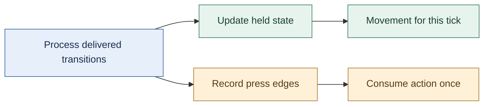
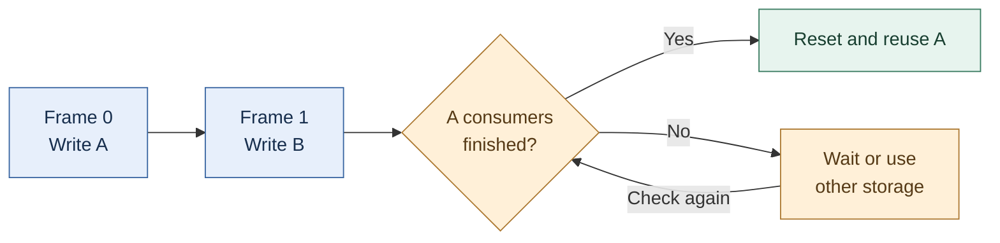

# 14 — Application clocks and stable input identity

[[Chapter Edition/03 - Game Engine/00 - Reading Map|Reading map]] · [[Chapter Edition/03 - Game Engine/13 - Portable startup, windows, events, and input|Previous chapter]] · [[Chapter Edition/03 - Game Engine/15 - Sparse-set components and generational entity handles|Next chapter]]

Input and timing must agree on which state transition belongs to which simulation step. This chapter clarifies frame measurement, tick pacing, and stable identity before introducing dense component storage.

**By the end:** Distinguish wall time, frame time, and simulation ticks, and ensure input identifiers remain meaningful across updates.

**Recall question:** How do you measure a frame without confusing it with a simulation tick, and what data lets an input be replayed at the correct tick?

<!-- Derived from Continuous Notes/Game Engine - From First Frame to Living Worlds.md; source lines 24925–26786; source-span SHA256 24b9b0f0f8f5149af61d211cb836157cd24fab0273a4c7d80590eb3a8c65182a. -->

<!-- CHAPTER-SOURCE-BEGIN -->
### Keep application key names independent of a windowing library

Suppose game code asks whether the Tab key is pressed. If it must name `GLFW_KEY_TAB`, every client that uses the engine now needs GLFW's headers, and a later backend change can alter the meaning of that integer. Define an engine-owned key-code vocabulary at the public boundary instead. The platform backend translates its native code to that vocabulary when producing events, and translates the engine value back when making a native polling query. The conversion point is the adapter boundary, where both code systems are known.

There are two broad policies. One can compile different numeric values for each platform, which avoids repeated conversion but makes serialized bindings platform-dependent. Or the engine can keep stable internal values and map to/from each backend. A stable serialized control map can use symbolic names such as `Tab` or a versioned engine code; it should not silently assume an operating system's integer assignments are portable. The Hazel episode copies a particular GLFW-era key table into engine headers and discusses conversion against Win32's different virtual-key assignments. That is a historical prototype decision; for a current project, choose and document a stable scheme and verify mappings for every supported backend. [Caption source: Key and Mouse Codes](https://www.youtube.com/watch?v=zaJGn8pur5I)

The demonstration notes that letter codes align with ASCII and can be cast to characters, but this convenience applies only to that part of the chosen table. A key code is not generally text: Shift, layout, dead keys, IME composition, and keyboard layout can make text input differ from physical-key identity. Use key events for controls and a separate text-input path for user-entered characters. Likewise, a modifier bitmask describes modifiers accompanying an event; it is not the same thing as a durable key identity. These distinctions prevent a shortcut system from accidentally becoming a text-entry implementation. [Caption source: Key and Mouse Codes](https://www.youtube.com/watch?v=zaJGn8pur5I)

### A held button and a completed tap carry different information

Imagine a player taps jump while a slow frame is being rendered. At $0\,\mathrm{ms}$ the button is up, at $5\,\mathrm{ms}$ it goes down, and at $9\,\mathrm{ms}$ it comes up again. The next update samples the stored state at $16\,\mathrm{ms}$. Both update-time samples say “up,” even though a complete tap occurred between them. A **state** answers “is the button down at this sampling point?” An **edge** records a change, such as “a press arrived.” A state sample cannot reconstruct every intervening change.

| Time | Input transition | Held state after processing it | Pending press count |
|---|---|---:|---:|
| Start | None | false | 0 |
| $5\,\mathrm{ms}$ | Press | true | 1 |
| $9\,\mathrm{ms}$ | Release | false | 1 |
| $16\,\mathrm{ms}$ | Simulation consumes the press | false | 0 |

Only genuine down transitions increment this example’s press counter; repeated-key actions need a separate policy. This table is an original trace for a deliberately simple policy: delivered press transitions increment a counter, release transitions change held state, and simulation consumes a pending press exactly once. It assumes the input layer has actually received and processed the transitions. A counter preserves how many presses arrived, but not their exact ordering relative to other inputs. A timestamped event queue is a better fit when that ordering matters. Neither structure means that a jump is permitted: grounded state, cooldowns and game rules still decide the action.

For movement, read the held state during the update and scale the motion by the chosen time step. For a one-shot action, consume an edge under an explicit rule. If several simulation steps occur during one rendered frame, decide which step receives a new press; do not make every catch-up step consume the same edge. If no step runs, retain the edge until its intended boundary. Focus loss, UI capture, pause and replay need policies for clearing, routing or retaining that pending input.



GLFW’s state query returns the last reported cached key state; it does not directly resample the physical keyboard. Its guide warns that a press and release can be missed between queries and describes callbacks and sticky-key mode as alternatives. Sticky mode retains a press until queried; it is not a complete ordered event history. OS key-repeat timing is also unsuitable for driving held-key movement. Those API facts support the distinction above; the counter, tick-consumption policy and numeric trace are original engine-design examples. [GLFW input guide](https://www.glfw.org/docs/latest/input_guide.html)


### Normalize input before gameplay consumes it

A keyboard key press is delivered differently by operating systems. Gameplay, however, wants to ask a simple question: “Is the jump action pressed?” If game code tests native key codes directly, a later platform port spreads through every gameplay feature. Input should therefore have two stages. The platform captures native events; the engine converts them to stable key/button or action states; gameplay consumes those states.

The series develops input in parts: [Kohi #009](https://www.youtube.com/watch?v=ZZhfCYNbVp8) introduces input, [#010](https://www.youtube.com/watch?v=6zjpgUX1TRY) connects the Windows-specific part, and [#011](https://www.youtube.com/watch?v=kIWFdKcGQPM) adds Linux. Those captions make an important architectural relationship explicit: the engine-level input system and platform implementation meet at a seam. The window receives events; a translation step updates the input state; gameplay queries an engine-level representation. In the full #011 caption, Linux key events pass through an X keycode-to-keysym conversion and then a switch mapping to engine key enums; upper/lowercase symbols are folded to one engine key. Mouse button indices are normalized and pointer motion forwards X/Y coordinates, while wheel handling is explicitly left for a later episode. The same build step exposes a missing portable string-duplication helper, prompting a first core string abstraction. This is useful evidence that portability work often discovers non-window dependencies in unrelated core code.

A key state has at least two useful notions. “Down” describes whether the key is held now. “Pressed this frame” describes a transition from up to down since the previous update. The latter avoids repeated actions every frame when a player intended one tap. Similarly, “released this frame” captures the opposite transition. A robust input update compares current state with prior state rather than trying to reconstruct a gameplay action from every raw event.

This design also prevents a common timing bug. If event pumping happens after gameplay reads input, the game sees the prior frame’s state and appears to respond one frame late. If input state is updated several times during a single frame with inconsistent reset rules, short presses may disappear or repeat. A clear loop order—collect events, update normalized input, run gameplay update, render—gives those states an understandable meaning. “Frame” means one iteration of this update/render cycle.

The captions later show input enabling a mock camera so the learner can move around the scene while the engine evolves ([stream](https://www.youtube.com/watch?v=s9xSwQvbG2w)). That is a useful test fixture: an engine can be visually complicated while still offering a simple camera control that confirms event delivery, frame updates and transforms are connected. The camera is not itself proof that all input semantics are finished; it is a visible end-to-end check for the specific path it exercises.

#### Preserve input edges as well as the final held state

A held-state snapshot answers "is this key down now?" It does not necessarily describe everything that happened since the previous simulation step. Suppose the player taps a key quickly while the program is processing platform messages:

| Observation | Held state |
|---|---|
| Previous simulation step | Up |
| Platform delivers key-down | Down |
| Platform delivers key-up | Up |
| Next simulation step | Up |

Comparing only the two simulation snapshots sees Up followed by Up and loses the tap. Preserve the press and release edges as events, or accumulate explicit transition flags until the intended consumer has processed them. A **transition** is a change of state; a **repeat** message for a key already held is not automatically another physical press.

Now consider several fixed simulation ticks occurring before one displayed frame. A one-shot action such as opening a door should consume the press according to the input policy, rather than firing once in every catch-up tick. A continuous action such as walking can use the held state across those ticks. That difference belongs in the gameplay command boundary, not in an accidental placement of the previous-state copy.

Focus loss needs a policy too. If the window loses focus after a key-down and receives no corresponding release, a purely event-updated held flag can remain stuck. Clear or reconcile relevant state on focus changes, and decide whether outstanding one-shot commands remain valid. Timestamp input when ordering matters, then specify how it maps to simulation ticks.

The fully read Kohi input lessons develop current/previous state tracking, key and button processing, and platform event routing. The quick-tap and catch-up examples extend that foundation to expose information a final-state snapshot cannot retain. They are original worked cases, not a claim that every edge policy is implemented in the early tutorial. [Input state](https://www.youtube.com/watch?v=ZZhfCYNbVp8), [Windows event processing](https://www.youtube.com/watch?v=6zjpgUX1TRY).


#### Input travels through two clocks, a focus owner, and a durable tick command

A controller stick report is a two-dimensional sample `(x,y)` in a device-specific coordinate convention; it is not yet a requested game velocity. The player may tilt diagonally, the physical stick may fail to return precisely to the electrical center, the input UI may have keyboard focus, and the display frame that receives an event may contain zero, one, or several physics ticks. These are distinct problems. Solve them in the order physical device -> calibration -> logical action -> ownership/capture -> timestamped tick command -> gameplay, not by allowing gameplay systems to query raw keys whenever they happen to run.

For a normalized stick `v = (x,y)`, use its **radial** magnitude `r = sqrt(x²+y²)` instead of dead-zoning `x` and `y` separately. With inner dead-zone `d` in `[0,1)`, define the output vector as zero for `r <= d`. Otherwise set `r' = (min(r,1)-d)/(1-d)` and `v' = (r'/r)v`. The scaling preserves the original direction because the same positive gain multiplies both axes. For example, `v=(0.3,0.4)` has `r=0.5`; with `d=0.2`, the new radius is `(0.5-0.2)/0.8=0.375`, hence `v'=(0.225,0.3)`. An axial dead zone can erase a gentle diagonal on one axis and distort aiming. If an outer dead zone or response curve is added, specify its order relative to calibration and remapping. A low-pass filter suppresses jitter but also adds latency; record its state and time base and do not assume a different sampling frequency preserves the same feel.

A quick press-release can occur entirely between simulation ticks. Polling the final held state yields `up` before and `up` after, and the tap disappears. Retain *transition records* in order (`pressed`, `released`) until the next simulation consumption boundary. A tick can receive both transitions while ending with held=false. Each transition is consumed exactly once; a second simulation tick in the same display frame must not repeat the first tick's press event. For deterministic replays, record the **logical action, tick number, value and order** after the device mapping and UI-capture decision, not an unspecified host key scan code alone. A real timestamp-to-tick policy must also define events arriving exactly at a tick boundary and the permitted clock-quantization tolerance.

Capture is an owner, not a property of a pixel hit test. If a text field or console takes focus while the MoveForward key is held, the gameplay action must be released or it can remain permanently stuck; it is not sufficient to ignore future key-up events. On device disconnect, clear device-specific state, send any necessary synthetic release, and decide whether another device can continue the same logical action. On a focus transition, UI and gameplay must not both consume the same activation. The reference lab's `TickInput` is a deliberately small single-button demonstration of the invariant and its focus-release rule. A shipping input router must additionally handle multiple active devices, capture ownership per source, bindings/chords/axes, accessibility remapping, platform timestamps, hot-plug, and vibration as an **output** command (not as gameplay input).

This expands the control-device material of Gregory's Chapter 8 into a modern fixed-step and editor-aware path. It connects to the previous engine loop material without pretending that sampling a button once per render frame solves time ownership.


#### Derive frame time from a monotonic clock, then treat pacing as a separate choice

A minimal clock stores a start reading and an elapsed duration. On each update, elapsed seconds are `now - start`; a frame delta is `current_elapsed - previous_elapsed`. Feed that delta into game update and input update instead of passing zero. Keep the absolute timer monotonic: wall-clock time can jump when the system clock is corrected, while frame measurement needs a steadily increasing source. Platform code should normalize each OS timer to seconds so the application does not depend on counter units.

Measuring a frame and limiting its rate are distinct operations. The loop can measure work time, accumulate elapsed time for an FPS counter, and calculate the remaining portion of a target interval such as 1/60 second. Sleeping for that remainder is an optional pacing policy; it should not be mistaken for a guarantee of a precise frame rate because sleep resolution and scheduling vary by OS. A debugger pause also produces a large delta, so test observations taken while stepping are not representative of normal frame timing. The tutorial leaves limiting disabled in its scaffold, which is a useful reminder to make the policy explicit.

Source reading: [caption source](https://www.youtube.com/watch?v=bbPdEkRaVNE). Captions document the narrated development state; on-screen code and reported builds were not independently reproduced.


#### Pace the quiet period after a resize

A frame-count debounce can expire almost immediately if the loop keeps iterating while rendering is skipped. In a Kohi fix, waiting 30 frames before rebuilding swapchain resources returned early without beginning or ending a normal frame; increasing the threshold to 120 still reached it rapidly. The presenter adds a 16 ms sleep to pace the path, then reports rebuilding about half a second after resizing stops. This is an expedient frame-count-plus-sleep fix, not a general time-based debounce or robust pacing policy. [Resize debounce fix](https://www.youtube.com/watch?v=x8ao57nbMlY)

**Chronology clarification:** after the temporary 120-frame diagnostic, the presenter restores the threshold to 30 frames. The sleep component alone is then about $30\times16\,\mathrm{ms}=0.48\,\mathrm{s}$; 120 such sleeps would instead total about $1.92\,\mathrm{s}$. The observed half-second behavior belongs to the restored threshold. Actual elapsed time also includes loop work and scheduling, so this calculation still does not turn frame counting into a time-based debounce guarantee.

### Scale movement by elapsed time, and state what the clock means

Suppose an arrow key moves a camera by a fixed 0.1 units each update. At 60 updates per second, that is 6 units per second; at 10 updates per second, it is 1 unit per second. Frame-based movement makes simulation speed depend on rendering speed. The lesson reproduces this mismatch and motivates delta time at 00:30–03:30, then works through the 60-versus-30 frame examples around 03:40–08:30. [TIMESTEPS and DELTA TIME](https://www.youtube.com/watch?v=pctGOMDW-HQ&t=30s) [TIMESTEPS and DELTA TIME](https://www.youtube.com/watch?v=pctGOMDW-HQ&t=220s) [TIMESTEPS and DELTA TIME](https://www.youtube.com/watch?v=pctGOMDW-HQ&t=500s)

Let $\Delta t$ be elapsed seconds since the previous update and $v$ be a velocity in world-units per second. Then the frame's displacement is

$$\Delta x=v\Delta t, \qquad x_{n+1}=x_n+v\Delta t.$$

At 60 Hz, $\Delta t\approx 1/60$ s; at 30 Hz, $\Delta t\approx 1/30$ s, so each slower update advances about twice as far. Over the same real-time interval, ideal constant-velocity motion covers the same distance, while the lower frame rate displays fewer, larger steps. The episode states this distinction at 08:30–10:00 and then introduces a small time-step value object that stores seconds and offers milliseconds at 11:00–13:00. [TIMESTEPS and DELTA TIME](https://www.youtube.com/watch?v=pctGOMDW-HQ&t=510s) [TIMESTEPS and DELTA TIME](https://www.youtube.com/watch?v=pctGOMDW-HQ&t=660s)

The demonstrated loop reads the current platform time, subtracts the previous frame time, stores the new value, and passes the resulting interval through application/layer updates. The caption notes that GLFW is used directly as a temporary clock source and suggests a platform abstraction later around 13:00–18:30. The first interval is unusual because there is no prior frame timestamp; initialize the baseline before the first measured update or explicitly accept a one-frame startup artifact. The video prints seconds and milliseconds and observes about 16.6 ms per frame with VSync at 18:00–19:00. [TIMESTEPS and DELTA TIME](https://www.youtube.com/watch?v=pctGOMDW-HQ&t=780s) [TIMESTEPS and DELTA TIME](https://www.youtube.com/watch?v=pctGOMDW-HQ&t=1080s)

The camera then multiplies movement and rotation speeds by elapsed time. With VSync disabled, the old fixed-per-frame motion becomes visibly too fast; after scaling movement by $\Delta t$, the episode reports roughly the same speed when VSync is restored. That before/after experiment is shown around 20:30–25:00. Treat it as evidence for the input-to-camera update path, not a proof of frame pacing, deterministic simulation, or physics stability. [TIMESTEPS and DELTA TIME](https://www.youtube.com/watch?v=pctGOMDW-HQ&t=1230s) [TIMESTEPS and DELTA TIME](https://www.youtube.com/watch?v=pctGOMDW-HQ&t=1350s)

A variable delta solves frame-rate-scaled movement, but it does not make every simulation robust to arbitrarily large stalls. Physics engines often use a fixed simulation step with an accumulator while rendering interpolates between simulation states; this episode does not implement that pattern. Decide whether each update is visual input, gameplay simulation, or physics, and define what happens after a long pause, debugger stop, or minimized window. Clamp or subdivide unusually large intervals only with an explicit policy. The speaker says a fixed-rate update can fall behind under load at about 08:20–10:10; the lesson's next topic is object transforms at 26:50–27:30, not a fixed-step physics implementation. [TIMESTEPS and DELTA TIME](https://www.youtube.com/watch?v=pctGOMDW-HQ&t=500s) [TIMESTEPS and DELTA TIME](https://www.youtube.com/watch?v=pctGOMDW-HQ&t=1610s)

### Make timestep and integration choices explicit

Suppose a particle begins at position $p$ with velocity $v$, acceleration $a$, and is advanced for a duration $\Delta t$ seconds. A simple game integrator may first advance position using the current velocity,

$$p_{n+1}=p_n+v_n\Delta t,$$

then compute acceleration from forces and advance velocity,

$$v_{n+1}=v_n+a_n\Delta t.$$

That ordering is meaningful: the position step uses the old velocity, while the newly computed velocity affects the next step. A different integrator can produce a different result even with the same force and timestep. So “integrate the particle” is not a neutral implementation detail; it defines when inputs influence visible motion. (Game Physics Engine Development, PDF pp. 73-76.)

The selected chapter also shows a deliberate approximation. The constant-acceleration position equation contains an extra term, $\frac{1}{2}a\Delta t^2$, but the sample engine drops it and uses current velocity only. For a small timestep and ordinary acceleration, the omitted displacement may be small. For a short, strong force, it can visibly matter. A designer who needs a punchy recoil kick or a fast launch should not assume that the approximation is harmless just because it works for falling particles. It is a measurable design and simulation choice. (Game Physics Engine Development, PDF pp. 74-76.)

Damping is another place where a formula silently becomes a player-facing rule. If a factor $d$ is applied once per rendered frame, then changing the frame rate changes how quickly motion dies away: more updates mean more multiplications. If instead $d$ represents the fraction retained over one second, the chapter applies $d^{\Delta t/(1\,\mathrm{s})}$ each update, where $\Delta t$ is the elapsed duration. This keeps the intended decay closer across different frame durations, though it costs a power operation. An engine may choose a cheaper per-step approximation for huge particle counts, but then should treat the visual difference as part of the behavior, not as an invisible optimization. (Game Physics Engine Development, PDF p. 75.)

The practical contract around an integrator should state at least: the units of duration, whether duration must be positive, which state fields the caller may set, whether forces are accumulated or persistent, and when accumulated forces are cleared. The example implementation asserts positive duration, advances position, derives acceleration from force times inverse mass, updates velocity, then applies damping. The pages do not show the complete force accumulator lifecycle, so that final clearing policy must be verified elsewhere before copying the interface. (Game Physics Engine Development, PDF p. 76.)

Inverse mass is particularly useful for static world geometry. A wall with inverse mass zero receives no acceleration contribution from accumulated force in this model, while a dynamic crate has positive inverse mass. Zero inverse mass alone does not erase an object's existing velocity or separately configured base acceleration, so the engine must also keep those values appropriate for an immovable body. Storing inverse mass avoids dividing by mass each time. But the name matters: accidentally storing mass in an inverse-mass field reverses the expected response. A small API that accepts ordinary mass and converts internally can keep content authors from making that mistake. (Game Physics Engine Development, PDF pp. 70-71, 76.)


### Time is part of the design

A frame is not simply “run every subsystem once.” The amount of real time between frames varies with hardware load, background work, and display cadence. The simulation therefore needs an explicit relationship between wall-clock time and game time. Gregory treats rendering loops, game loops, timelines, measuring time, and multiprocessing as separate but related architectural choices (Gregory, Ch. 7, contents PDF pp. 10–11; implementation passages in §7.1–7.5, PDF pp. 326–345, printed pp. 304–323). The important design decision is not to copy an old loop pattern. It is to decide which state must advance deterministically, which work can be asynchronous, and how the rendered frame observes the latest coherent simulation state.

A basic fixed-step simulation accumulates elapsed time and advances in slices of a chosen duration $h$:

$$
A \leftarrow A + \Delta t_{real}, \qquad
\text{while } A \ge h: \; S \leftarrow \operatorname{step}(S,h),\; A \leftarrow A-h.
$$

Here (S) is simulation state and (A) is accumulated time. The display can render at a different rate. If the renderer interpolates between the two latest simulation states, it can present smooth motion without making the physics step size depend on display speed. This pattern is a teaching example, not an attributed algorithm from a specific cited paragraph. Its tradeoffs are concrete: too large an $h$ increases numerical error and tunneling risk; too small an $h$ costs CPU; a long pause can create a “spiral of death” if the engine tries to catch up forever. A game may cap catch-up steps and deliberately drop excess simulation time, but that changes world-time semantics and must be an explicit product choice.

The jump system should consume input at a defined boundary. One clean arrangement is to timestamp raw input, turn it into a gameplay command, and apply that command on the next simulation tick. The renderer may show a prediction to reduce perceived lag, but prediction and authoritative state should remain distinguishable. For networked games, a tick identifier and stable input ordering become critical because two peers must agree which command affected which state. Gregory’s contents specifically call out networked and multiprocessor loops (§7.6–7.7, contents PDF p.11); those topics are only inventoried here, not deeply read. This section therefore recommends the concepts but does not claim a particular network protocol.


### Teach a control when the player needs it

A **heads-up display (HUD)** is information drawn over the game view. The proposal keeps most HUD elements hidden until they answer a current question: show flashlight charge while the flashlight is on, display recently equipped or collected items briefly, and reveal health and ammunition when aiming or after damage. This is contextual visibility. Instead of leaving every number on screen all the time, the design ties each indicator to a state where the player can use it. [PDF pp. 614–615 / printed pp. 589–590]

The spec also proposes help text at the moment a mechanic first matters, rather than a separate tutorial level. Picking up a weapon can prompt the attack control; encountering the inventory can teach how to switch weapons; reaching the insanity threshold can explain how to activate that mode. The prompt fades after enough reading time or after the player succeeds, and a setting can disable repeated assistance. The design lesson is to connect instruction to a visible opportunity and to provide a way to dismiss or suppress it. Those rules are proposed behavior, not proof of an implemented tutorial system. [PDF p. 614 / printed p. 589]

### Update gameplay state, then let subsystems batch their work

A character’s state at a moment might include position, velocity, health, and animation choice. The game loop advances that state from an earlier time using a time delta. This broad use of “state” means the object’s data at that moment; it is different from the named states inside a finite-state machine.

A tempting design is to call `Update(dt)` on every object and have each object update its own physics, animation, sound, collision, and rendering. The chapter explains why this scatters similar work: a renderer would receive one object’s request, then unrelated physics and audio work, then another render request. Instead, the object can change gameplay values and configure subsystem-owned records. Once objects have had their turn, rendering, animation, and other systems can process their respective data in batches. The exact ownership boundary depends on the engine, but the teaching point is to keep gameplay decisions distinct from subsystem-wide processing.

(*Game Engine Architecture*, PDF pp. 779–783 / printed pp. 757–761.)

### Let dependencies set the update order

Suppose a character carries a sword. The sword’s world position depends on the final pose of the character’s hand, so updating both objects in an arbitrary order can leave the sword using the prior frame’s pose for one frame. The relationship creates an ordering constraint: update the character first, then the attached object.

Batching also reduces unrelated costs. If a subsystem stores its per-object data together, it can process nearby data with better cache locality; it can compute global values once, allocate temporary resources once per batch, and overlap similar work in a pipeline. There is a correctness reason too: a group of colliding rigid bodies may need to resolve their interpenetrations together, so processing each body in isolation cannot generally produce a satisfactory result. These are the chapter’s reasons for batching, not measured performance guarantees. (*Game Engine Architecture*, PDF pp. 784–785 / printed pp. 762–763.)

A whole game frame has similar dependencies. Animation can produce a pose that ragdoll physics consumes; physics returns body positions that animation then uses to finalize the skeleton. A single `Update(dt)` call per object hides these stages. The chapter’s phased approach makes them explicit: objects can receive hooks before or after a subsystem pass, and lists can limit each hook to objects that need it. (Game Engine Architecture, PDF pp. 785–788 / printed pp. 763–766.)

When dependencies form several layers, group objects by tier: unattached roots first, their children next, then objects attached to those children. Run the necessary subsystem phases for each tier. This bucketed schedule preserves parent-before-child updates while retaining batches inside each tier. A vehicle, its passenger, and the passenger’s held item make a small constructed example. The author cites Naughty Dog’s *Uncharted* workflow as a historical example; that account is not evidence of current studio practice or a universal engine design. (PDF pp. 788–790 / printed pp. 766–768.)

### Make mixed-time reads visible

Objects are processed one by one, so during the loop some objects hold the new frame’s state while others still hold the old state. A query can therefore be internally valid C++ and still read the wrong time. If an attachment uses its parent’s newly updated position but the parent has not run yet, the attachment appears one frame behind. State that should be read consistently must have a clear time meaning: previous snapshot or current result.

The chapter proposes keeping each object’s previous state while computing its next one. That uses more memory, but it gives every object a consistent old snapshot and allows interpolation between old and new states for display. The excerpt cites Havok as maintaining previous and current rigid-body states for that purpose. The new states can still be inconsistent while they are being computed. Timestamps can help catch queries that read a state from the wrong update phase. A timestamp does not make partially updated data consistent by itself; it only makes the mismatch detectable. (Game Engine Architecture, PDF pp. 790–793 / printed pp. 768–771.)

The same dependencies explain why gameplay objects are hard to parallelize: objects may inspect one another unpredictably. The text describes message passing as one way a carefully designed object model could avoid direct cross-object reads, while its account of common practice keeps game-object logic serial and parallelizes data-heavy engine systems. For a costly subsystem job, an object can issue a non-blocking request and continue other work; it later consumes the result. Ask how early the request can start and how late the result can be used. Some systems may tolerate last frame’s result, but that introduces a deliberate latency. Batching requests, such as collecting many ray casts for one collision-system pass, can also reduce per-call overhead; converting synchronous one-at-a-time code may require reorganizing when requests are issued and collected. These are architectural ideas in a historical chapter, not guarantees about modern engines or hardware. (PDF pp. 793–795 / printed pp. 771–773.)

The last page begins the next topic: an event is an occurrence of interest during play, such as an explosion, an enemy spotting the player, or a health pack being collected. The event system must notify interested objects and provide a route for their responses. The assigned excerpt only introduces those two responsibilities; it does not cover a complete event queue or dispatch policy. (PDF p. 795 / printed p. 773.)

## Keep identity, storage, and ownership in agreement

The first object can live in a local variable. A world that creates, removes, saves, and reloads objects needs a more deliberate lifetime model.

### A live object needs an identity that survives storage changes

A crate's position in an array is not necessarily its permanent identity. Removing another item can move it, and reusing an old slot can accidentally make an old reference point at a new object. **Identity** answers “which logical object?”; **storage** answers “where do its current bytes live?”

An arena can reclaim a region of bytes together, but reclaiming bytes is not the same as running C++ destructors. If an arena stores objects that own other resources, arrange their cleanup before reset or deliberately restrict what may be stored there. Likewise, releasing CPU scratch memory does not prove that a GPU copy has finished reading it.

A **handle** is a small token that the owner resolves into the current object. A common teaching design stores a slot number and a **generation**, a counter that changes when a slot is reused. The owner accepts a handle only when both parts match an alive slot. Suppose crate A occupied slot 7 at generation 4. After A is destroyed, slot 7 is reused for crate B at generation 5. A's old handle is rejected instead of silently selecting B.

This does not make a handle automatically thread-safe, nor does it stop a caller keeping a raw pointer after validation. The validation and use must follow a lifetime rule. A bounded-width generation can eventually wrap; the laboratory retires a slot at the maximum generation instead of cycling into an old identifier. Other engines choose different tradeoffs and must state their assumptions.

An **entity** is a world object's identity. A **component** stores one kind of data associated with it. A **transform** records placement, orientation, and scale. A **collider** supplies the geometry and settings used to test physical interactions; it need not be identical to the visible mesh. A **system** performs work over suitable data. **ECS**, entity-component-system, names a family of ways to organize these relationships; it is not a command to put every behavior into one universal framework. A small object-oriented world, tables of components, or a hybrid can all be reasonable if access and ownership are clear.

During an iteration, defer changes that would invalidate the iterator or change the meaning of the current pass. **Deferred destruction** means recording a removal request and applying it at an agreed safe boundary. A raw pointer that happened to work before a container reallocated is not a lifetime guarantee. The C++ companion develops these ownership and borrowing issues in more detail: [[Concepts/Ownership and non-owning views]].


Notice that the GPU may extend the final lifetime. Removing a crate from the scene does not prove that a submitted graphics command has stopped reading its mesh. CPU and GPU completion are different facts.

### Keep submitted render resources alive until their users finish

Imagine a layer submits a draw using a shader and vertex array, then the layer is removed before the renderer processes that draw. The game thread may already have destroyed the layer and released its last references, while a queued render command still needs those resources. “The caller is done” and “the renderer is done” are different moments.

A useful lifetime trace is:

```text
Game thread                 Render queue / render thread
submit(shader, geometry) -> retain draw data and resource references
release layer's handles     process queued draw
                            release queued references
```

The `Refs, Scopes and Smart Pointers` episode introduces `Scope<T>` as an alias for unique ownership and `Ref<T>` as an alias for shared ownership. Its point is that public engine code can express intent without spelling `std::unique_ptr` or `std::shared_ptr` at every resource boundary, and could later change the implementation behind those aliases. A shared reference is appropriate when several parties must independently keep a CPU resource object alive; it is not a reason to make every pointer shared. A uniquely owned layer or short-lived local helper can remain uniquely owned. The choice answers who may keep the object alive, not merely who calls `delete`. [Caption source: Refs, Scopes and Smart Pointers](https://www.youtube.com/watch?v=HkGZ378nArE)

CPU object lifetime and GPU-use lifetime are separate contracts. A reference count can prevent the CPU-side wrapper from being destroyed while the render queue holds a reference. It does not, by itself, prove that previously submitted GPU commands have finished reading the underlying buffer or image. GPU storage still needs an API-appropriate completion rule—such as a fence or timeline value—before it is destroyed or recycled. Keep those two questions explicit: “Can CPU code still access this object?” and “Can in-flight device work still use this allocation?” The episode motivates retaining renderer assets across deferred work; the GPU completion rule is a general extension, not an implementation demonstrated there. [Caption source: Refs, Scopes and Smart Pointers](https://www.youtube.com/watch?v=HkGZ378nArE)

The speaker also notes shared ownership costs, including a separately managed control block and atomic reference-count operations in the standard shared-pointer implementation. Treat those as a measured tradeoff, not an automatic performance failure: first establish the required lifetime, then profile if reference counting appears in a hot path. The episode's `Ref` and `Scope` aliases improve vocabulary and preserve a possible implementation seam, but do not replace an asset manager. An asset manager may add identity, caching, load state, eviction policy, and explicit retention rules that a shared pointer alone does not provide. [Caption source: Refs, Scopes and Smart Pointers](https://www.youtube.com/watch?v=HkGZ378nArE)


#### Fence and semaphore jobs

A **fence** is the host-facing completion signal in this frame loop: after submission, the GPU signals it when that submission finishes, and a later CPU wait allows safe reuse of the associated frame resources. A **binary semaphore** carries ordering between device-side operations. Image acquisition signals an “image available” semaphore; queue submission waits on it before color-attachment output can write the image. The submission can signal a “render finished” semaphore for presentation to wait on. These primitives do different jobs: the fence paces CPU reuse, while semaphores link work in the queue/presentation path. [Khronos, [Synchronization](https://docs.vulkan.org/guide/latest/synchronization.html); [Rendering and presentation](https://docs.vulkan.org/tutorial/latest/03_Drawing_a_triangle/03_Drawing/02_Rendering_and_presentation.html)]

A compact illustrative pattern is:

```text
wait(frameFence[slot])
result, image = acquire(imageAvailable[slot])
if result is out-of-date: recreate swapchain; return
wait(imageFence[image]) if that image has a prior submission
imageFence[image] = frameFence[slot]
record(commandBuffer[slot or image], image)
reset(frameFence[slot])                 # only when submission will follow
submit(wait=imageAvailable[slot], signal=renderFinished[image], fence=frameFence[slot])
present(wait=renderFinished[image], image)
slot = (slot + 1) mod framesInFlight
```

This is a teaching trace, not reconstructed episode code. The index used for command buffers depends on the engine's resource organization. The important invariant is that the acquired image is the render target, and each reusable synchronization object is paired with the work or image whose completion it represents. The current Khronos tutorial sizes presentation-wait semaphores by swapchain image and indexes them by image index, because a frame-slot fence does not by itself prove that the presentation engine has finished waiting on a semaphore. [Khronos, [Frames in flight](https://docs.vulkan.org/tutorial/latest/03_Drawing_a_triangle/03_Drawing/03_Frames_in_flight.html); [Swapchain semaphore reuse](https://docs.vulkan.org/guide/latest/swapchain_semaphore_reuse.html)]

There is a specific early-return trap: if a frame fence is reset and image acquisition then returns `VK_ERROR_OUT_OF_DATE_KHR`, the function may return without submitting work to signal that now-unsignaled fence. A later wait on it can deadlock. The current Khronos tutorial addresses this by delaying the reset until acquisition succeeds and the frame is definitely going to be submitted. It also describes recreating the swapchain for an out-of-date result and waiting for a nonzero framebuffer size when minimized. [Khronos, [Swapchain recreation and fixing a deadlock](https://docs.vulkan.org/tutorial/latest/03_Drawing_a_triangle/04_Swap_chain_recreation.html)]

### State ownership and memory lifetime

Now consider what “the player is grounded” means. If animation, gameplay, and physics each keep their own unrelated grounded flag, drift is inevitable. The engine should identify one authoritative source and define how derived representations are refreshed. A common choice is: physics owns the contact facts for a tick; gameplay consumes a grounded/support result and decides whether jump is permitted; animation consumes gameplay movement intent and the resulting pose inputs. The result sent to rendering is a snapshot, not a second authority.

Memory choices affect these contracts. Gregory’s support-systems contents point to allocator design and memory management (Ch. 5, contents PDF p.10); his text explains that custom allocation can better match known usage patterns, but relocating allocations requires pointer discipline or indirection such as handles (PDF pp. 229–241, printed pp. 207–219). Translate that into a practical rule: use a short-lived arena for temporary per-frame contact candidates; use a pool or stable slot table for entities whose identity must persist; avoid retaining raw pointers into a buffer that may move or be reset. These are not interchangeable allocator recipes. Pick based on lifetime and access pattern, measure, and document invalidation.

For example, a `BodyHandle` can be a slot plus generation counter. A contact manifold stores handles, not raw addresses. If a body is deleted and its slot reused, the old generation no longer resolves. This protects delayed events and debug overlays from accidentally referring to a different object. The cost is an indirection and validation check. For tightly packed solver arrays, the engine can resolve handles once per step into local indexed data, preserving both safety and cache-friendly iteration.

Resource memory has another lifecycle. Gregory’s resource chapter distinguishes raw authoring data, processing/conditioning, packaging, loading, and runtime use; the asset build must understand dependencies so an edit causes dependent outputs to be rebuilt (Ch. 6 contents PDF pp. 10–11; selected text PDF pp. 301–307, printed pp. 279–285). His discussion also identifies streaming as loading data in the background while the main program continues (PDF p.291, printed p.269). A jump on a platform in the next streamed region raises a boundary question: does physics wait for collision data, use a conservative placeholder, or prevent entry until the region is ready? That is a gameplay contract as much as a file-I/O problem.

A resource manager gives the rest of the engine one place to request resource types and apply type-specific initialization (Gregory, PDF pp. 304–307, printed pp. 282–285). It can coalesce duplicate loads and track references, but it should not hide every cost. If a gameplay call that appears cheap can trigger disk I/O, decompression, GPU upload, and memory growth, frame-time spikes will be difficult to reason about. Offer explicit asynchronous request/completion states where cost is uncertain. Let the editor and build pipeline validate missing dependencies before the player sees a broken jump animation.

#### Read memory statistics as a ledger with a stated boundary

A memory report becomes useful when its numbers answer a precise question. **Live bytes** are the tracked allocations not yet released. **Cumulative allocated bytes** count allocations over time, including memory already released. **Peak live bytes** are the largest simultaneously live total observed. They can differ even in a program that releases everything correctly.

Consider a wrapper that records requested heap bytes:

| Operation | Live bytes | Cumulative allocated bytes | Peak live bytes |
|---|---:|---:|---:|
| Allocate a 1,024-byte texture staging block | 1,024 | 1,024 | 1,024 |
| Allocate a 256-byte temporary block | 1,280 | 1,280 | 1,280 |
| Free the staging block | 256 | 1,280 | 1,280 |
| Free the temporary block | 0 | 1,280 | 1,280 |

A cumulative total that keeps rising is not by itself evidence of a leak. Conversely, a zero total from one wrapper does not prove that the process has released every allocation. Third-party libraries, platform APIs, GPU allocations, and unwrapped calls can live outside its accounting boundary. Also distinguish bytes requested by callers from the allocator's actual reserved space, padding, and metadata.

A **memory tag** assigns a category such as texture loading, arrays, or application state. Tags help locate responsibility; they do not change ownership. For the counts to remain meaningful, deallocation must subtract the same size and category that allocation recorded. Depending entirely on a caller's guessed size or tag makes the report vulnerable to its own bookkeeping mistakes. Store or otherwise verify allocation metadata where the allocator contract permits it.

An arena adds a second boundary. Resetting its logical allocation position can make its objects unavailable while retaining the arena's backing storage for reuse. Report reserved backing bytes separately from currently occupied space. Calling a reset "freeing all memory" conceals this distinction and can mislead both optimization and lifetime reasoning.

The fully read Kohi memory-subsystem lesson motivates tagged allocation and accounting. The ledger and arena distinction above are original teaching extensions; they do not claim that the early wrapper measures every allocation in an operating-system process. [Caption source: Memory Subsystem](https://www.youtube.com/watch?v=_GBUCo2FbUk).


#### Align the address the caller receives

A pool beginning on a 32-byte boundary does not guarantee that every payload returned from it is 32-byte aligned. If a 12-byte header precedes the payload, a block starting at `0x1000` returns `0x100C`, which is twelve bytes past that boundary. Alignment belongs to the final address, after metadata and padding have been considered.

One layout can reserve space for a size breadcrumb, align the user pointer, and retain enough information to recover the allocator's original range on release. The contract needs more than a rounding expression: the alignment must be supported, all size additions must fit, the payload and metadata must remain inside the reserved block, and deallocation must recover exactly the range originally allocated.

Metadata has alignment rules too. A payload satisfying a byte-aligned request may not leave a preceding typed integer aligned; a header immediately after a 15-byte payload may also be misaligned. Add suitable padding or use a representation that permits safe byte copying into an aligned local object. Do not assume that hardware tolerating an unaligned load makes an arbitrary typed C access portable.

Test a range of payload sizes and alignments, not only a rounded size such as 64 bytes. Include alignment one, small odd payloads, exact-capacity requests, requests that cannot fit, and the representable-size limit of any compact size field. Failure must not advance the allocator or discard a still-valid old allocation.

The fully read Kohi correction rearranges metadata to repair the caller-visible alignment guarantee. The numerical address and additional metadata checks here expand that contract; they are not independent verification of the tutorial's allocator implementation. [Caption source: Memory Alignment Correction](https://www.youtube.com/watch?v=VQ6Q9B_WDlM).

Related foundations: [[Concepts/Alignment and padding|Alignment and padding]].

##### Recover the original allocation range

The corrected source layout stores a four-byte payload size immediately before the aligned pointer and a trailing header retaining the original block start. That compact breadcrumb imposes a 32-bit representability limit. [Alignment correction](https://www.youtube.com/watch?v=VQ6Q9B_WDlM).

The free-list layer may also return an alignment offset. Free must receive that offset and the original consumed range; adding a base offset twice shifts the allocation, while forgetting padding on release strands or overlaps free space. A later allocator walkthrough uses a header before the pointer to record size, alignment, and offset, and adds report-only memory tags. Report-only accounting must not be confused with freeing driver-owned memory. [Allocator offset and accounting walkthrough](https://www.youtube.com/watch?v=Fo9ri9DMu74)

These reported repairs do not establish exhaustive allocator correctness.


#### Bridge Vulkan allocation callbacks to an engine allocator

Vulkan allocation callbacks can route driver requests through an engine allocator, but the bridge must honor the requested alignment and preserve existing bytes when reallocation succeeds. A replacement should allocate first, copy the old contents, and release the old block only after the replacement is valid. The Kohi implementation checks that the requested alignment matches its original allocation, but its captioned discussion is uncertain about zero-size reallocation semantics; verify edge behavior against the Vulkan specification before treating the bridge as conformant. [Kohi Vulkan allocator callbacks](https://www.youtube.com/watch?v=F9hN1PrxnHE)

Separate allocations the application owns from driver-internal allocation notifications. The former provide a pointer that the engine can later free; the latter report size for accounting but do not transfer ownership. Counters for hooked buffer/image paths are useful diagnostics, not a census of all driver or resident GPU memory. The episode reports GPU-local and ordinary Vulkan totals and explicitly calls its allocator an early version; its measurements exclude unhooked resources.

### Give memory a lifetime that matches the work

Imagine loading a cave level. Its collision mesh, room graph, and encounter records are all created together. When the player leaves the cave, none of those objects need to outlive the level. A stack allocator fits this job: reserve a level region, remember a marker before loading, and return to that marker when unloading. The useful guarantee is not that every object can be freed whenever convenient. It is that the group has one clear storage-reclamation point. Allocations made after the marker are reclaimed with a constant-time pointer reset. That does not automatically run object destructors or release external resources such as file handles; the engine must arrange that work separately. The tradeoff is strict: a cave object cannot be individually freed while later allocations remain live, and a pointer into the region becomes invalid after rollback. (Game Engine Architecture, PDF pp. 229-231.)

Now consider per-frame visibility work: a list of lights visible to the camera, temporary sorting keys, and a scratch list of draw commands. If every entry is consumed before the frame ends, a single-frame allocator can reset the whole scratch region at the next frame. The question for the engine API is therefore not merely “how many bytes?” but “until when may a caller use this pointer?” A name such as `FrameScratch` can make the boundary obvious, and an API should avoid storing its result in persistent world state. A two-buffer version is useful when a worker job writes results that the next frame consumes: the buffer from frame (i) remains available during frame (i+1), then becomes reusable. This only works if the consumer finishes before the reuse boundary. (Game Engine Architecture, PDF pp. 235-237.)

For thousands of short-lived projectile records of exactly one size, a pool is a better shape. Every slot can be handed out or returned independently, so one projectile can die while others remain. Equal-sized slots avoid the “enough total free bytes, but no large enough hole” failure common to a general heap. The pool is not a universal allocator: if a caller needs a differently sized object or retains a slot after returning it, the pool contract no longer protects that caller. (Game Engine Architecture, PDF pp. 231-232, 238-239.)

This gives a useful engine review habit: draw a lifetime beside each allocation category. Level data lives from load to unload; frame scratch lives until frame completion; asynchronous output may live through the next frame; entity records may need independent lifetimes. Then choose storage whose reset/free rule matches that lifetime. The source’s double-ended stack example makes this concrete: level data grows from one end while temporary frame data grows from the other, sharing capacity while keeping separate rollback directions. But neither side may cross the other, so capacity planning and high-water instrumentation still matter. (Game Engine Architecture, PDF pp. 229, 231, 235-237.)

Alignment and relocation expose another boundary: a pointer is not just an address if the allocator needs hidden information to recover its original block, and moving blocks invalidates outstanding pointers unless every reference is relocated. For a compact engine, stable addresses may be a deliberate simplification. A movable heap can reclaim holes, but only if the engine owns references well enough to update them. Handles or indices can make relocation possible; unrestricted raw pointers make it difficult. The selected pages explain the relocation problem, but do not prescribe handles as its solution. (Game Engine Architecture, PDF pp. 233-235, 240.)

#### Two scratch buffers still need a completion rule

Suppose a visibility job reads a temporary list from scratch buffer A. The main thread moves on and writes the next frame's list into buffer B. Alternating buffers has bought the job extra time; it has not proved the job finished. If the main thread resets A while that job still holds a pointer into it, the pointer may still name allocated memory whose contents now belong to different work. This is a lifetime error even if no allocator reports a use-after-free.



The source's double-buffered allocator gives a useful way to separate adjacent frames' data. The completion gate above is an original extension for asynchronous consumers, not a claim that two buffers are a universal scheduling solution. For a CPU job, its completion token can release the borrow. For GPU-visible storage, use the completion condition for the actual submission that reads it. A frame counter or a CPU smart pointer alone does not establish that condition. Extra buffers reduce pressure under some workloads, but the reuse rule still needs proof that all relevant consumers are done. Storage capacity and safe reuse are separate questions. (Gregory, *Game Engine Architecture*, supplied 2009 edition, PDF pp. 235–237; asynchronous example and diagram are original teaching.)

The same distinction helps when reading [[Concepts/Storage duration and object lifetime|storage duration and object lifetime]] and [[Concepts/Ownership and non-owning views|ownership and non-owning views]]: keeping bytes allocated, keeping an object alive, and allowing a borrowed view to remain valid are related contracts that must agree.


### Give memory a purpose, then choose an allocator to fit it

General-purpose allocation is convenient but can become expensive or unpredictable in systems that create many short-lived objects. An allocator is a component that decides how a region of memory is handed out and reclaimed. The right allocator depends on the lifetime pattern, not on fashion. The series introduces a memory subsystem in [Kohi #007](https://www.youtube.com/watch?v=_GBUCo2FbUk), and later captions cover dynamic allocation, freelists and allocator work: [dynamic allocator](https://www.youtube.com/watch?v=BSBFBWwG8Ds), [freelists](https://www.youtube.com/watch?v=sP7xRUyP3e0), [wrapping up freelists and allocators](https://www.youtube.com/watch?v=SNDJ-rGJd5A), and a live stream that identifies a first simple allocator as its main task ([stream](https://www.youtube.com/watch?v=3ZFcvBjRFN0)).

A linear allocator is a good first example. It owns a fixed block and advances an offset as allocations are requested. Allocation is cheap: align the current offset, return that address, advance by size. Releasing individual objects is not supported; the whole block is reset at once. This is ideal for temporary data whose lifetime naturally ends together, such as per-frame scratch data. It is a poor fit for objects that must be freed independently or survive an unpredictable time.

A pool allocator handles a known set of same-sized objects. It divides a block into slots and tracks which slots are free. Allocation and release can be constant-time, but the object size and pool capacity constrain use. A freelist is a linked list of free slots; the link may be stored inside each free slot itself. The lesson is not “use a freelist everywhere.” It is that known, repeated allocation patterns can be served with predictable behavior by a specialized structure.

A dynamic allocator can serve varying sizes in a managed region, but then fragmentation, alignment, metadata and coalescing become concerns. Fragmentation means usable bytes are split into pieces too small for a particular request. Alignment means an address must satisfy a boundary requirement for the object or API that will access it. The current repository contains allocator modules under `kohi.core/src/memory/allocators/`, including linear, pool and dynamic allocators. Its roadmap explicitly says the freelist should be reworked to account for alignment and calls out carrying alignment into renderbuffer allocation. That is direct evidence that “size fits” is not enough: GPU-facing buffers can have stricter alignment requirements than a generic byte allocation.

A good allocator API needs observable failure. If a fixed arena is exhausted, silently returning overlapping memory corrupts unrelated objects. If a pool cannot supply a slot, the caller must know. A useful debug build tracks requested sizes, tags or allocation sites, but debug metadata should not obscure the basic contract. Start with the lifetime story: who allocates, who owns, who releases, and when is bulk reset safe? Only then select the allocator.

The later GitHub mirror has concrete allocator variants beyond the early videos. In the pinned [linear allocator source](https://github.com/travisvroman/kohi/blob/05a5193d5ed4890703cfcbbeb5c5e947feefecf6/kohi.core/src/memory/allocators/linear_allocator.c), allocation advances a byte offset and `free_all` optionally clears the full arena; the inspected allocator does not align each request. The [pool allocator source](https://github.com/travisvroman/kohi/blob/05a5193d5ed4890703cfcbbeb5c5e947feefecf6/kohi.core/src/memory/allocators/pool_allocator.c) uses fixed element slots plus a free-node array. Its `pool_allocator_destroy` body is empty in this mirror even though creation allocates its backing memory, an apparent cleanup gap that deserves verification before relying on that snapshot. The [dynamic allocator](https://github.com/travisvroman/kohi/blob/05a5193d5ed4890703cfcbbeb5c5e947feefecf6/kohi.core/src/memory/allocators/dynamic_allocator.c) combines a freelist with per-allocation size storage, alignment metadata, and optional debug guards/source-location fields. These code observations describe the later GitHub revision, not what the earlier videos had already implemented; no build or allocator test was run.
The source retrospective says the engine had 77.5 thousand lines, 472 commits and 265 full episodes by its writing point, and it praises the organization while acknowledging areas to improve. Those figures are from the repository retrospective and should not be mistaken for a live count at this revision. They illustrate a broader practical risk: custom allocation can be educational and useful, but every custom policy becomes code that must be tested, profiled and explained. Avoid building an allocator subsystem before a real allocation pattern needs it.

#### Total free space is not necessarily one usable range

A **free list** records ranges available for allocation. For a simple 64-byte example, let each requested range start at an eight-byte boundary and use half-open notation: `[0,16)` includes offsets zero through fifteen. This is a logical byte-offset example, not a claim about a graphics device's required alignment.

| Operation | Allocated ranges | Free ranges |
|---|---|---|
| Start | None | `[0,64)` |
| Allocate A: 16 bytes | A at `[0,16)` | `[16,64)` |
| Allocate B: 16 bytes | A at `[0,16)`, B at `[16,32)` | `[32,64)` |
| Release A | B at `[16,32)` | `[0,16)`, `[32,64)` |
| Release B and merge adjacent free ranges | None | `[0,64)` |

After releasing A, 48 bytes are free in total, but the largest contiguous free range is only 32 bytes. A request for one contiguous 48-byte block cannot fit. This is **external fragmentation**: available space is separated by live allocations. After B is released, **coalescing** merges neighboring free ranges, restoring one 64-byte span.

An allocator must also represent its own bookkeeping. Running out of free-list nodes can be different from running out of payload bytes. Resizing that metadata does not itself resize a GPU buffer or move uploaded mesh data. A GPU-buffer resize needs its own allocation, copy, synchronization, and publication path. Returning a byte range to the free list before earlier GPU work finishes can allow a new mesh to overwrite data still in use.

Reallocation needs a failure policy: if a larger replacement cannot be obtained, preserve the old valid allocation unless the contract explicitly states otherwise. Validate sizes and range arithmetic before copying. A byte-offset allocator, a CPU pointer allocator, and a GPU resource manager can share ideas without sharing all alignment or lifetime rules.

The fully read Kohi free-list and dynamic-allocator lessons motivate these structures. The 64-byte trace and separation of bookkeeping from GPU payload are original teaching extensions. [Free list](https://www.youtube.com/watch?v=sP7xRUyP3e0), [dynamic allocator](https://www.youtube.com/watch?v=BSBFBWwG8Ds).


#### Dynamic arrays in C: track capacity separately from length

A small generic C array can store a header containing capacity, logical length, and element stride, followed by contiguous element storage. Return a pointer to the element region so ordinary indexing still works; recover the header with a documented pointer offset in helper functions. Macros can provide `sizeof(element)` and make push calls accept a value, while implementation functions operate on byte pointers. This is a compact technique, but it depends on careful alignment, pointer arithmetic, overflow checks, and strict ownership. Those details deserve tests before treating the container as production-ready.

Capacity is reserved storage; length is the number of initialized elements. Growing capacity (for example, doubling it) preserves existing bytes, but popping need not shrink the allocation. Reserving room does not make elements logically present: after a bulk copy into reserved storage, explicitly set the length before iteration. A middle removal shifts the tail left, and insertion shifts it right; both should validate the index and compute byte counts from stride. Keep these invariants visible in the API so callers do not confuse allocated room with valid elements.

A growing allocation can invalidate pointers into its old storage. Reject overflowing `count * stride` and capacity-growth arithmetic before allocating or copying; a larger capacity is not evidence that arbitrary byte counts are safe.

Source reading: [caption source](https://www.youtube.com/watch?v=XQ6qljkh2KI). Captions document the narrated development state; on-screen code and reported builds were not independently reproduced.


### Separate state ownership from state use

Many engine bugs are ownership bugs with a graphics symptom. The code that creates a buffer must know when it can be destroyed. The code that submits work must not free a resource still referenced by an in-flight command buffer. A material should not own a shared texture accidentally if multiple materials use it. A scene unload should release its references without invalidating a global asset cache. Thinking in terms of ownership makes these relationships explicit.

A useful rule is to ask four questions whenever a subsystem API returns an object: Who owns it? How long is it valid? Who releases it? What happens if the operation fails? A raw pointer only answers “where is it now,” not any of these lifetime questions. An opaque handle may improve safety if the manager validates it, but then the manager owns the storage and must document whether handles survive reload or relocation.

GPU execution makes lifetime less intuitive because the CPU and GPU do not share one timeline. Suppose the CPU records a draw using a texture, submits it, and immediately destroys the texture. The CPU has finished issuing commands, but the GPU may not yet have executed them. A safe design tracks completion or defers destruction until the relevant fence signals. This is why synchronization and resource lifetime belong in the same mental model.

The repository’s retrospective highlights verbose asset requests and API differences between asset and resource systems, while its TODO proposes per-type request/release operations. Those observations are best converted into design questions, not copied as a universal API: Does this type need asynchronous creation? Is it safe to share? Should the API return a handle, callback result or ready pointer? Is release a decrement of a reference count or an explicit owner action? A consistent answer reduces accidental leaks and double frees.


### Preserve ownership, freshness, and intent in engine APIs

Several review comments connect seemingly small APIs to larger contracts. Physics queries may observe the previous completed simulation step unless the caller waits for fresh data. Working directories distinguish engine resources from project assets. UV offsets should be represented in a way that supports the renderer’s batching model and the editor’s eventual crop workflow. Unbinding graphics state may make debugging clearer even where a later draw would bind new state. Each example asks the same design question: which subsystem owns this data, when is it valid, and what user or caller intent does the API expose? The review is a historical discussion and its implementation comments are not evidence about current runtime behavior (The Cherno, “Finishing the Pull Requests!,” 01:09:00–01:30:52).

#### Treat ownership proposals as questions about lifetime and identity

Code reviews often recommend “use a shared pointer,” “put it in a pool,” or “make it a scene member.” These are not interchangeable fixes. First ask: who creates the object, who may keep using it, what event ends that use, and what identity survives replacement or relocation?

A borrowed reference is safe only while its owner guarantees the object remains alive and stable. An owning handle can extend lifetime, but shared ownership can obscure which subsystem must shut down first. An index survives vector reallocation because it does not store an element address, but it may refer to a different object after compaction unless the container preserves slot identity or checks a generation. A stable ID answers “which object?” while a pointer answers “where is it now?” A pool may improve locality for frequently traversed components, but it also needs a deletion/reuse policy and a way to validate handles. These are different contracts, not automatic performance upgrades.

The Hazel guest review raises these distinctions for queued callbacks, layer pointers, intrusive reference counting, buffer views, and scene teardown. A queued callback that captures shared ownership may be appropriate if the task must outlive its producer; a synchronous borrowed reference may be enough if the call cannot escape. A buffer described as pointer-plus-length can be a non-owning view, while a separate explicit release operation suggests ownership exists elsewhere. Read the actual type and call sites before concluding what owns the bytes. The episode's discussion of interpreting raw file bytes as objects is explicitly unsettled; casting does not itself settle object lifetime, alignment, padding, or serialization rules. [Hazel code review](https://www.youtube.com/watch?v=Glq1oDBy1cQ), 00:14–00:24 and 00:45–00:52

The same caution applies to suggested data-oriented redesigns. A component-per-heap-allocation design can scatter hot data, but replacing it with packed arrays is beneficial only if traversal is important and the storage/handle rules remain correct. Measure the workload and define mutation/deletion semantics before treating a reviewer's cache-locality argument as a measured win. Likewise, returning a reference to a current scene is only a defect if the caller can outlive or observe replacement of that scene without a valid contract. The 13-year-old engine review, Hazel 2D review, terminal engine review, and no-library engine review all contain useful design questions, but their source-level claims are not independent builds or reproductions.

### Give references a way to survive object deletion and relocation

Imagine a projectile keeps a reference to the target it hit. If the target is removed, a plain pointer still contains the old address. It may seem to work until another object reuses that memory, then the projectile can accidentally act on the newcomer. The chapter calls this a stale pointer. A handle table inserts a lookup step: a small handle stores a slot, and the table stores the current object address. Removing an object can clear its slot; moving it can update the slot. Reusing slots creates another hazard, so pair the slot with an object identity or generation value and check both when resolving the handle.

The book also describes smart pointers, which wrap pointers with ownership or reference-counting behavior. This can help manage lifetime, but ownership rules and runtime costs need deliberate design. The printed Boost and `auto_ptr` discussion is historical; it should not be read as current C++ library guidance. The chapter’s handle code is a teaching sketch and says it is incomplete.

(*Game Engine Architecture*, PDF pp. 772–777 / printed pp. 750–755.)

## Let identity survive changes in storage

### Reconstruction checkpoint — prove identity survives relocation

The long ECS chapter below already derives generations, sparse/dense storage, archetypes, migration, queries and scheduling. The missing layer was an independent executable proof that the central identity invariants actually survive storage movement. `tools/labs/ecs_reconstruction_lab.cpp` now supplies that layer: it destroys and reuses an entity index while proving the stale generation stays dead; removes a middle sparse-set element and verifies the swap-moved entity's reverse map; and migrates a Position-only entity into a Position+Velocity archetype while repairing the source-row location of another entity moved by compaction.

The witness deliberately stops before the hardest production claims. Its destination-first teaching migration is not a universal strong exception guarantee for arbitrary component types; structural changes are not performed concurrently; chunk packing and system-DAG conflict resolution are not yet benchmarked against current KairoECS. Those remain separate evidence levels rather than being inferred from the prose. Use [[Sparse-set storage]] and [[Archetype ECS]] as compact reconstruction maps, and use the full chapter below for the surrounding ownership and scheduling story.


Repository-specific passages below describe the supplied Kairo snapshot. They have not been revalidated against a current checkout; code fragments retain their stated surrounding context and are not all standalone tested programs. Numerical and contract explanations are taught independently of those implementation observations.

### Entity Identity, Generational Handles, Type Identity, Sparse-Set ECS, Dense Storage, Queries, Invalidation and Deferred Structural Changes

This pass begins **Phase 15: ECS, Generational Handles, Sparse Sets, Archetypes, Scene Data, and Data-Oriented Design**. M085 owns **Parts 1401–1411**, while M086 owns **Parts 1412–1434**, with every atom in both ranges required. Graphics_Engine_Mastery_Integra… Graphics_Engine_Mastery_Integra…

And for this pass, the central idea is not merely:

> “An ECS stores components separately.”

That is far too shallow.

The actual engineering problem is:

$$
\boxed{
\text{How do we represent millions of changing objects so that identity remains safe while data remains compact, cache-friendly, queryable and mutable?}
}
$$

Those goals conflict.

Stable objects suggest pointers.

Compact storage suggests moving memory.

Fast deletion suggests swap-removal.

Stable references suggest not moving memory.

Generic components suggest type erasure.

Fast queries suggest compile-time types or dense numeric IDs.

Immediate mutation is easy to understand.

Immediate mutation during iteration can corrupt the very arrays being iterated.

M085 and M086 are about resolving these tensions deliberately.

---

### ENTITY IDENTITY, GENERATIONS, FREE LISTS AND COMPONENT TYPE IDENTITY

---

**Entity identity as data rather than an object hierarchy**

Traditional object-oriented game code often starts like this:

```cpp
class GameObject
{
public:
    Transform transform;
    Mesh* mesh;
    PhysicsBody* body;
    Script* script;

    virtual void Update(float dt);
};
```

Then subclasses grow:

```text
GameObject
├── Player
├── Enemy
│   ├── FlyingEnemy
│   ├── ArmoredEnemy
│   └── BossEnemy
├── Vehicle
├── Projectile
└── Pickup
```

This looks clean until combinations explode.

What is:

```text
a destructible moving light-emitting physics object
```

supposed to inherit from?

ECS changes the model.

An entity is not an object containing its behavior.

An entity is simply an **identity**.

```cpp
Entity player;
```

The data exists elsewhere:

```text
Entity 42

Transform pool  -> Transform for 42
Velocity pool   -> Velocity for 42
Renderable pool -> Renderable for 42
Health pool     -> Health for 42
```

The entity itself can be nearly meaningless.

That is intentional.

---

**Identity and data ownership become separate concepts**

Imagine:

$$
E=42.
$$

The identifier 42 does not contain a transform.

Instead:

$$
TransformPool[42]
$$

may contain a transform.

Likewise:

$$
PhysicsPool[42]
$$

may or may not exist.

This separates:

$$
\boxed{\text{who}}
$$

from:

$$
\boxed{\text{what data they currently possess}}.
$$

That allows composition:

```text
Entity A:
Transform
Renderable

Entity B:
Transform
PhysicsBody

Entity C:
Transform
Renderable
PhysicsBody
Light
Health
```

No inheritance lattice is required.

---

**This does not mean “entities are just integer array indices”**

A raw integer such as:

```cpp
uint32_t entity = 17;
```

looks attractive.

Suppose entity 17 is destroyed.

Later the index is reused:

```text
old entity:
17

destroy

new entity:
17
```

Now some old system still has:

```cpp
Entity target = 17;
```

That stale reference silently refers to the new object.

This is an **ABA problem**.

From the holder's perspective:

```text
17 existed
17 disappeared
17 exists again
```

and raw identity provides no way to distinguish old 17 from new 17.

That is catastrophic.

---

**Your current Kairo entity handle**

`KairoECS/Entity.cppm` currently defines:

```cpp
struct Entity final
{
    static constexpr std::uint32_t InvalidIndex =
        std::numeric_limits<std::uint32_t>::max();

    std::uint32_t Index = InvalidIndex;
    std::uint32_t Generation = 0u;

    [[nodiscard]]
    constexpr bool IsValid() const noexcept
    {
        return Index != InvalidIndex;
    }

    friend constexpr bool operator==(
        const Entity&,
        const Entity&) noexcept = default;
};
```

That is already a generational handle.

An entity is:

$$
\boxed{
E=(index,generation)
}
$$

not merely:

$$
E=index.
$$

That distinction is foundational.

---

**Entity index representation**

The index identifies a slot in registry metadata.

For example:

```text
index

0 -> generation 4, alive
1 -> generation 9, dead
2 -> generation 1, alive
3 -> generation 3, alive
```

Kairo stores:

```cpp
std::vector<std::uint32_t> m_Generations;
std::vector<bool>          m_Alive;
```

So entity:

```cpp
Entity{3, 3}
```

means:

> inspect registry slot 3 and require generation 3.

The index provides efficient direct addressing.

Instead of:

```text
hash entity UUID -> registry record
```

we have:

```text
registryMetadata[entity.Index]
```

which is $O(1)$ and cache-friendly.

---

**Why index 0 is not inherently special**

Some systems reserve entity 0 as null.

Kairo does not need to.

Its invalid state is:

```cpp
Index = UINT32_MAX;
```

So index:

$$
0
$$

is a perfectly usable entity slot.

This is cleaner than sacrificing index 0 unless some API interoperability requires it.

---

**`Entity::IsValid()` is not the same as “entity is alive”**

This distinction matters.

Current:

```cpp
entity.IsValid()
```

only verifies:

$$
Index\neq InvalidIndex.
$$

It does **not** prove:

- index is within registry bounds,
- slot is alive,
- generation matches.

Actual liveness requires registry state.

Your `Registry::IsAlive()` correctly does:

```cpp
return
    entity.IsValid() &&
    entity.Index < m_Generations.size() &&
    m_Alive[entity.Index] &&
    m_Generations[entity.Index]
        == entity.Generation;
```

Thus there are two concepts:

$$
\boxed{
\text{syntactically non-null handle}
}
$$

and:

$$
\boxed{
\text{currently live entity}
}.
$$

Do not conflate them.

---

**Generation counters**

Suppose slot 5 begins:

```text
Index      = 5
Generation = 1
```

Entity:

$$
E_1=(5,1).
$$

Destroy it.

Increment generation:

$$
generation[5]\leftarrow2.
$$

When slot 5 is reused:

$$
E_2=(5,2).
$$

Now stale handle:

$$
(5,1)
$$

fails:

$$
generation[5]=2\neq1.
$$

So:

$$
IsAlive(5,1)=false.
$$

while:

$$
IsAlive(5,2)=true.
$$

That solves index reuse.

---

**Why generations solve the stale-handle problem**

Suppose physics holds:

```cpp
Entity target = enemy;
```

Enemy dies.

Another entity later receives the same index.

Without generations:

```text
target = new unrelated entity
```

silently.

With generations:

```text
target.Index      = 431
target.Generation = 8

registry slot 431 generation = 9
```

Therefore validation fails.

The old reference cannot accidentally mutate the replacement object.

This is one of the highest-value safety mechanisms in an engine.

---

**Generation counters do not provide infinite uniqueness automatically**

Suppose generation uses $g$ bits.

There are only:

$$
2^g
$$

possible values.

Eventually:

$$
generation
\rightarrow
generation+1
\rightarrow
\dots
\rightarrow
2^g-1
\rightarrow
0.
$$

If wrap occurs, an ancient stale handle may become valid again.

That recreates ABA.

For a 12-bit generation:

$$
2^{12}=4096.
$$

A pathological slot reused 60 times per second wraps in:

$$
4096/60
\approx68.3\text{ seconds}.
$$

That is surprisingly quick.

So generation width matters.

---

**Kairo's generation policy is stronger**

Your generation is full:

```cpp
uint32_t
```

and your destruction path explicitly checks:

```cpp
const bool recyclable =
    m_Generations[entity.Index] !=
    std::numeric_limits<std::uint32_t>::max();
```

If generation reaches:

$$
2^{32}-1,
$$

the slot is **retired instead of wrapping**.

That gives a strict process-lifetime invariant:

$$
\boxed{
\text{a destroyed Kairo handle will never become valid again through generation wrap}.
}
$$

It sacrifices one entity slot after more than four billion reuse cycles of that exact slot.

That is an excellent trade.

---

**Packing index and generation into one integer**

Your current Kairo handle stores:

```cpp
uint32_t Index;
uint32_t Generation;
```

This already contains the right information.

But the curriculum also requires understanding **packed handles**.

Use one 64-bit integer:

```text
63                             32 31                             0
+--------------------------------+--------------------------------+
|          generation            |             index              |
+--------------------------------+--------------------------------+
```

Then:

$$
raw=
(generation\ll32)
\;|\;
index.
$$

C++:

```cpp
struct PackedEntity
{
    using Value = std::uint64_t;

    static constexpr Value IndexMask =
        0x00000000FFFFFFFFull;

    static constexpr unsigned GenerationShift = 32;

    Value Raw = IndexMask; // invalid index, generation 0

    [[nodiscard]]
    constexpr std::uint32_t Index() const noexcept
    {
        return static_cast<std::uint32_t>(
            Raw & IndexMask);
    }

    [[nodiscard]]
    constexpr std::uint32_t Generation() const noexcept
    {
        return static_cast<std::uint32_t>(
            Raw >> GenerationShift);
    }

    [[nodiscard]]
    static constexpr PackedEntity Make(
        std::uint32_t index,
        std::uint32_t generation) noexcept
    {
        return
        {
            (static_cast<Value>(generation) << GenerationShift)
            |
            static_cast<Value>(index)
        };
    }
};
```

---

**What packing actually buys you**

Kairo's current pair of `uint32_t`s is normally already 8 bytes.

A packed `uint64_t` is also 8 bytes.

So packing does not necessarily save memory.

The advantages are instead:

- one scalar value for hashing/comparison,
- convenient atomic operations on platforms with native 64-bit atomics,
- easier serialization as one integer,
- explicit bit allocation,
- easier passing through C APIs.

The disadvantages are:

- bit manipulation,
- fixed allocation between index/generation bits,
- easier accidental misuse,
- generation width may be reduced if packed into 32 bits.

---

**32-bit packed handles**

Suppose total handle is only 32 bits.

A common split is:

$$
20\text{ index bits}
+
12\text{ generation bits}.
$$

Maximum slot index count:

$$
2^{20}
=
1,048,576.
$$

Generation states:

$$
2^{12}
=
4096.
$$

Current EnTT's default 32-bit entity traits use exactly a 20-bit entity field and 12-bit version field, while its 64-bit traits use 32 bits for each. This is a useful real production example of the capacity-versus-generation-width tradeoff. [skypjack.github.io](https://skypjack.github.io/entt/entity_8hpp_source.html?utm_source=chatgpt.com)

Other choices:

| Index bits | Generation bits | Max slots | Generation states |
|---:|---:|---:|---:|
| 24 | 8 | 16.7 M | 256 |
| 20 | 12 | 1.05 M | 4096 |
| 16 | 16 | 65,536 | 65,536 |
| 32 | 32 in a 64-bit handle | 4.29 B | 4.29 B |

There is no universal split.

---

**Free lists**

Once an entity dies, its index should usually become reusable.

Suppose registry has slots:

```text
0 alive
1 dead
2 alive
3 dead
4 alive
```

Without reuse, new entities always append:

```text
5
6
7
8
...
```

Metadata arrays grow forever.

Instead store dead reusable slots:

```text
free list:
3
1
```

Then next entity creation pops one.

Your Kairo implementation uses:

```cpp
std::vector<std::uint32_t> m_FreeIndices;
```

as a stack.

That gives:

$$
push=O(1)
$$

amortized,

$$
pop=O(1).
$$

---

**LIFO versus FIFO free lists**

A vector stack gives LIFO reuse.

Suppose:

```text
destroy 100
destroy 200
destroy 300
```

free list:

```text
100 200 300
```

next creation gets:

$$
300.
$$

This often helps locality because the most recently used metadata slot is reused quickly.

But rapid create/destroy loops can repeatedly hammer the same slot, advancing its generation quickly.

With 32-bit generations and slot retirement, that is essentially irrelevant in realistic process lifetimes.

With tiny generation fields, it matters.

---

**Intrusive free lists**

A separate vector is not the only design.

Dead slot metadata itself can store the next free index:

```text
slot 5 -> slot 9 -> slot 14 -> end
```

Then:

```cpp
uint32_t freeHead;
```

is enough.

A dead entity slot could reinterpret one metadata field as:

```cpp
NextFree
```

much like your `DynamicAABBTreeNode` intended in the previous pass.

This saves the separate free-index vector but makes slot state representation more complicated.

Kairo's separate vector is simpler and perfectly reasonable.

---

**Entity creation from a free-list slot**

Current Kairo creation has two paths.

**Reuse path**

```cpp
if (!m_FreeIndices.empty())
{
    index = m_FreeIndices.back();
    m_FreeIndices.pop_back();

    m_Alive[index] = true;
}
```

The generation was already incremented when the old entity died.

So returned entity is:

```cpp
Entity{
    index,
    m_Generations[index]
};
```

No new metadata slot is allocated.

---

**New-slot creation**

If free list is empty:

```cpp
index =
    static_cast<uint32_t>(
        m_Generations.size());

m_Generations.push_back(1u);
m_Alive.push_back(true);
```

New entities begin generation:

$$
1.
$$

Why not 0?

There is no deep requirement.

Starting at one makes generation zero available as a conspicuous default/uninitialized value.

It also means default:

```cpp
Entity{}
```

has:

```text
InvalidIndex
Generation 0
```

which looks distinct from normal created entities.

---

**Kairo creation exception safety**

Your current `Create()` does something many small ECS examples omit.

Before structural mutation:

```cpp
ReserveJournalSlot();
```

Then for a new slot:

```cpp
m_Generations.push_back(1u);

try
{
    m_Alive.push_back(true);
}
catch (...)
{
    m_Generations.pop_back();
    throw;
}
```

So if `m_Alive` allocation fails, the generation vector is rolled back.

That preserves:

$$
m_Generations.size()
=
m_Alive.size().
$$

This is not glamorous ECS theory.

It is exactly what production container design requires.

---

**Entity destruction and generation increments**

Destroying an entity must happen in a careful order.

Naïvely:

```text
mark dead
push free index
remove components
increment generation
```

is dangerous because failures or reentrant code could expose inconsistent states.

Your current ordering is much more deliberate:

```text
1. Verify entity is alive
2. Reserve journal capacity
3. Ensure free list can accept index
4. Remove every component
5. Mark entity dead
6. Decrement live count
7. Journal Destroyed using old handle
8. Increment generation
9. Push reusable index
```

This preserves several invariants.

---

**Why components must be removed before index recycling**

Imagine entity:

$$
E_1=(7,4)
$$

owns:

```text
Transform
Velocity
Health
```

If slot 7 is reused before those components disappear, new entity:

$$
E_2=(7,5)
$$

could encounter storage left by generation 4.

Sparse storage must never silently attach stale data to the new incarnation.

Your `Destroy()` therefore loops:

```cpp
for (const auto& storage : m_Storages)
{
    (void)storage->Remove(entity);
}
```

before recycling the index.

That establishes:

$$
\boxed{
\text{reusable entity slot}
\Rightarrow
\text{no components from previous generation remain}.
}
$$

---

**Generation must advance before reuse**

The critical ordering is:

```text
destroy old entity
     ↓
invalidate old generation
     ↓
place index on free list
     ↓
future Create may reuse
```

Never:

```text
free index
     ↓
reuse
     ↓
increment generation later
```

because there would be a window where old and new identity collide.

Kairo correctly increments before `m_FreeIndices.push_back()`.

---

**Validating an entity handle**

The complete validation predicate is:

$$
Valid(E)=
IndexValid
\land
InBounds
\land
Alive[Index]
\land
Generation[Index]=E.Generation.
$$

In C++:

```cpp
bool IsAlive(Entity e) const noexcept
{
    return
        e.Index != InvalidIndex &&
        e.Index < generations.size() &&
        alive[e.Index] &&
        generations[e.Index] == e.Generation;
}
```

Every externally supplied entity should eventually cross this boundary before mutating registry state.

---

**Why generation must also be checked in component storage**

One might say:

> Registry already validates entities. Why should `SparseSet` care about generations?

Because `SparseSet<T>` is also an independent public type in Kairo.

Someone could construct:

```cpp
Entity old{42,1};
Entity newer{42,2};
```

directly.

The component pool must remain internally coherent even when used separately.

Your `SparseSet::Contains()` checks:

```cpp
const uint32_t dense =
    m_Sparse[entity.Index];

return
    dense != Missing &&
    dense < m_Entities.size() &&
    m_Entities[dense] == entity;
```

That final equality checks both:

```text
Index
Generation
```

because `Entity::operator==` compares both fields.

Excellent.

---

**Component type identity**

Entities are one axis of identity.

Components need another.

When user writes:

```cpp
registry.Get<Transform>(entity);
```

the ECS must find:

$$
Pool<Transform>.
$$

When user writes:

```cpp
registry.Get<Velocity>(entity);
```

it must find:

$$
Pool<Velocity>.
$$

So every component type needs an identity.

Conceptually:

```text
Transform   -> type 0
Velocity    -> type 1
Health      -> type 2
Renderable  -> type 3
...
```

That numeric mapping enables:

- pool lookup,
- component masks,
- serialization metadata,
- reflection,
- query caching,
- command buffers.

---

**Static component type IDs**

A simple runtime-local scheme is:

```cpp
using ComponentTypeID = std::uint32_t;

inline ComponentTypeID NextComponentTypeID()
{
    static ComponentTypeID next = 0;
    return next++;
}

template<typename T>
ComponentTypeID ComponentType()
{
    static const ComponentTypeID id =
        NextComponentTypeID();

    return id;
}
```

Then:

```cpp
ComponentType<Transform>() == 0;
ComponentType<Velocity>()  == 1;
```

within one execution.

Lookup can become:

```cpp
std::vector<StorageBase*> pools;
```

instead of:

```cpp
unordered_map<type_index, ...>
```

which can be substantially cheaper.

---

**Why lazy static IDs are not persistent schema IDs**

Suppose registration order changes:

Run A:

```text
Transform -> 0
Velocity  -> 1
Health    -> 2
```

Run B:

```text
Health    -> 0
Transform -> 1
Velocity  -> 2
```

If file says:

```text
component type 1
```

its meaning changed.

So lazy static IDs are excellent for:

$$
\boxed{\text{process-local fast indexing}}
$$

but usually terrible for:

$$
\boxed{\text{serialization/network protocol identity}}.
$$

These are separate requirements.

---

**Thread safety of static type allocation**

Function-local static initialization is thread-safe in modern C++.

But the shared counter itself must also be safely incremented if different component types can be first-used concurrently.

A naïve:

```cpp
next++;
```

on a global integer is a data race.

Solutions include:

- register component types during single-threaded initialization,
- atomic counter,
- mutex-protected registry,
- compile-time type registration.

Engine startup registration is often the simplest.

---

**Runtime component type registries**

A real component registry often stores much more than a number.

For example:

```cpp
struct ComponentDescriptor
{
    ComponentTypeID ID;

    std::string Name;

    std::size_t Size;
    std::size_t Alignment;

    void (*DefaultConstruct)(void*);
    void (*Destroy)(void*);
    void (*MoveConstruct)(void*, void*);

    // Later:
    // Serialize
    // Deserialize
    // Reflect
    // EditorDraw
};
```

Then:

```text
type ID
   ↓
descriptor
   ↓
size/alignment/lifetime/serialization/etc.
```

This is the beginning of a reflection-aware ECS.

---

**What Kairo currently uses**

Kairo currently finds pools using:

```cpp
std::unordered_map<
    std::type_index,
    std::unique_ptr<StorageBase>
> m_Pools;
```

Lookup:

```cpp
m_Pools.find(
    std::type_index(typeid(Component))
);
```

This is a valid **runtime C++ type identity** solution.

It means component types do not require registration ahead of time.

The first:

```cpp
Emplace<Transform>
```

can create `Pool<Transform>` lazily.

But `std::type_index` is not the stable serialized identity you would want for scene schemas, editor metadata or networking.

So current Kairo has:

$$
\boxed{
\text{runtime storage type identity}
}
$$

but not yet:

$$
\boxed{
\text{explicit persistent component schema identity}.
}
$$

That later connects directly to reflection and serialization.

---

<!-- CHAPTER-SOURCE-END -->

---

[[Chapter Edition/03 - Game Engine/00 - Reading Map|Reading map]] · [[Chapter Edition/03 - Game Engine/13 - Portable startup, windows, events, and input|Previous chapter]] · [[Chapter Edition/03 - Game Engine/15 - Sparse-set components and generational entity handles|Next chapter]]
