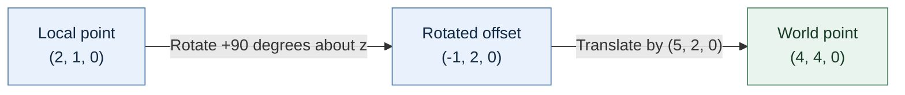

# 25 — Renderer evolution through resource ownership

[[Chapter Edition/03 - Game Engine/00 - Reading Map|Reading map]] · [[Chapter Edition/03 - Game Engine/24 - Profiling and languageplatform ownership|Previous chapter]] · [[Chapter Edition/03 - Game Engine/26 - Descriptor arrays and backend limits|Next chapter]]

New rendering paths should reuse proven ownership rules rather than introduce hidden lifetime assumptions. This chapter carries resources from scene-level intent through frame packets, views, and GPU consumers.

**By the end:** Evolve a renderer while keeping the owner, lifetime, and completion condition visible for every resource and frame packet.

**Recall question:** If a view is removed while its command is in flight, which owner retains its data until the last consumer completes?

<!-- Derived from Continuous Notes/Game Engine - From First Frame to Living Worlds.md; source lines 61668–62566; source-span SHA256 99505551c57e6760f7b7aec1b9330135b6ff45fa589f86f3c9c8cf49a0aa269a. -->

<!-- CHAPTER-SOURCE-BEGIN -->
## Let a renderer evolve without losing resource ownership

Our workshop scene can be drawn with rasterization, a CPU path tracer, or a GPU path tracer. The engine's job is to keep scene identity, resource lifetime and frame state coherent as those implementations change. Geometry-to-sample mathematics is developed in [[Chapter Edition/02 - Graphics Vision and XR/12 - Probability, Statistics and Uncertainty#Decide which samples a triangle owns|Decide which samples a triangle owns]]. GPU execution and synchronization are developed in [[Chapter Edition/01 - Computing Foundations/08 - Graphs, Search, and GPU Scheduling#Let many invocations cooperate without inventing a global clock|Let many invocations cooperate without inventing a global clock]]. Here we connect those calculations to an engine that can survive edits.

Suppose an artist changes the panel's material while frame $k$ is still using the old one. A material asset is the durable authored meaning; a runtime material instance is a version prepared for rendering; a GPU material record is its packed representation for a particular pipeline. Replacing the asset does not make the old GPU record unused. Build the new version, validate its dependencies, publish it for a defined frame, and retire the old buffers, descriptors and images only after their last use completes. If an editor keeps an index, pair it with the identity or generation rules needed to reject a recycled entry.

A render graph represents rendering operations and their resource accesses. A pass describes work such as writing depth, shading an opaque surface or resolving multisample color. Declaring a resource access creates information from which an implementation can derive dependencies, transitions and lifetimes. The graph must know whether a pass reads, writes or preserves previous contents. Marking a load as discard is correct only if no required previous content is read. An attractive graph drawing cannot compensate for an undeclared image read in a shader.

For GPU visibility compaction, the culling dispatch writes a list of visible object IDs and indirect draw arguments. The drawing stage consumes both. It therefore needs dependencies for the written payload and for indirect command reads, with scopes appropriate to the actual API. A shader barrier inside one culling workgroup cannot establish readiness for every group or for the later draw command. The engine owns that cross-dispatch contract.

For CPU path tracing, a tile scheduler can distribute independent pixel regions to workers. Give samples stable identities independent of which worker claims a tile. If two workers add to the same pixel, ownership or synchronization must be explicit; if each pixel has one writer, keep that invariant visible in the design. A cancellation request also needs an ownership policy: workers must stop accessing the old scene before the editor frees it. Publishing an immutable scene snapshot is one possible design, with a measurable copying and memory cost.

Progressive accumulation has a history validity problem. A sample belongs to a particular camera, geometry, material, lighting and estimator configuration. Change one of those and silently retaining the previous mean mixes different target images. Attach an accumulation epoch to the relevant state, reset or deliberately reproject history when the target changes, and distinguish exposure-only display changes from changes to scene-linear samples. History reuse can be a useful algorithm, but it requires its own validity conditions.

Validation should cross the subsystem boundary. Compare accelerated queries with brute force on the same rays; compare packing offsets with shader reflection; compare single-thread and multi-thread images with the same sample identities; and compare transport estimators in linear space before tone mapping. Each check establishes a different fact. A CPU mathematical witness does not establish GPU shader correctness, and identical screenshots do not establish that retired resources were freed at a safe time.

The world now owns meaningful state. Rendering needs a view of that state, not permission to become its accidental owner. The next explanations move from the engine boundary to the work behind a graphics submission.

### See a frame as a small, inspectable grid

Before asking a graphics API to draw a mesh, make a tiny image whose storage you can explain. A **pixel** is one sample in that image. It stores values interpreted as color, and sometimes opacity; it is not a little triangle or a game entity. A **pixel buffer** is memory holding those samples. Getting values into a buffer and getting that buffer displayed are separate jobs.

Imagine an image four pixels wide and three pixels high. Give its upper-left pixel the coordinates `(0, 0)`. In this example, horizontal coordinates increase to the right and vertical coordinates increase downward. Those are our image conventions; they do not establish how every graphics API or camera defines its axes.

A **row-major** layout puts one whole row in memory, then the next. For a tightly packed array containing one element per pixel, the element index is `y * width + x`:

| Row | First pixel | Next | Next | Last pixel |
|---|---|---|---|---|
| `y = 0` | `(0,0) → 0` | `(1,0) → 1` | `(2,0) → 2` | `(3,0) → 3` |
| `y = 1` | `(0,1) → 4` | `(1,1) → 5` | `(2,1) → 6` | `(3,1) → 7` |
| `y = 2` | `(0,2) → 8` | `(1,2) → 9` | `(2,2) → 10` | `(3,2) → 11` |

The calculation counts the `y` complete rows before our pixel, then moves `x` elements along its row. At `(2,1)`, one complete row contributes four elements and the horizontal move contributes two: the index is six. Twelve pixels occupy indices zero through eleven. A width of four allows horizontal coordinates zero through three; four is the count, not a valid horizontal coordinate.

Use an outer loop for rows and an inner loop for horizontal positions. Initially, write the index into each pixel element instead of trying to make an attractive image. Print the coordinates for this tiny buffer and check that each location is visited once. For a real display, replace those diagnostic integers with correctly encoded colors. Do not keep printing every pixel of every frame: the logging can dominate the work you intended to measure.

There is an important limit to the simple formula. An **element index** is not necessarily a byte address. If one pixel occupies four bytes, the tightly packed byte offset is four times its element index. Some image interfaces add padding between rows. Their **row pitch**, also called row stride, is the byte distance from one row's beginning to the next. With a 24-byte row pitch and four bytes per pixel, `(2,1)` begins at byte offset `1 * 24 + 2 * 4 = 32`, rather than the tightly packed offset 24. Use the interface's actual format and pitch when copying image data.

The short Cherno lesson demonstrates row-by-row traversal through printed coordinates. The four-by-three trace and pitch example here are original teaching extensions, not a claim that the video implements padded image transfer. [Caption source: How Rendering Works, episode 4.5](https://www.youtube.com/watch?v=6dOIju7--Jg).

### Put a rendering boundary between games and graphics APIs

A game needs to describe what it wants drawn; a graphics backend needs to translate that description into GPU commands. If every game feature directly calls OpenGL, then replacing the backend or testing the gameplay logic becomes difficult. An engine can introduce interfaces for renderer API, buffers, vertex arrays, shaders, textures, framebuffers, and commands. The interfaces give game and editor code a stable vocabulary while a backend supplies platform-specific implementations.

The Hazel public code exposes this separation. Core renderer classes delegate commands through a `RendererAPI`; platform-specific OpenGL classes implement buffers, vertex arrays, textures, shaders, and framebuffers. A `RenderCommand` acts as a high-level call site for operations such as clearing and drawing. The repo has a renderer API abstraction, an OpenGL implementation, shader and buffer classes, and a 2D renderer. That evidence is from the 2023 snapshot and should be described as its architecture at that revision, not as a claim about the latest Hazel development branch.

A useful learning progression is:

1. Create a graphics context and clear the window to a known color.
2. Upload a small vertex buffer and draw a triangle.
3. Define how vertex data is laid out and how a shader consumes it.
4. Add a texture and sample it in a shader.
5. Add transforms and a camera so objects can be moved in world space.
6. Batch compatible 2D draws to reduce repeated state changes.
7. Add off-screen framebuffers when the editor needs a scene viewport, picking, or post-processing.

This sequence is conceptual general guidance. It follows the public Hazel renderer abstractions and the Game Engine playlist’s renderer-focused episodes, but a video title alone is not enough to attribute every step to a specific explanation. The code is the checkable evidence for which abstractions existed in the inspected commit.

#### API abstraction has a price

An abstraction is worthwhile when it lets a meaningful part of the engine survive a backend change. It can also become the least common denominator that hides useful backend capabilities. For example, a simple “draw indexed” interface is portable across many APIs; a complex render graph with transient resources and synchronization needs a more deliberate model. Start with the operations the engine actually uses. Add capabilities when a real feature needs them, and expose backend-specific escape hatches only when you can define their lifecycle and portability cost.

Do not claim that an interface means multiple backends are implemented. In the public repository snapshot, an interface and an OpenGL implementation are visible; the README’s roadmap mentions native APIs as future goals. The existence of `RendererAPI` is proof of a seam, not proof that DirectX, Vulkan, and Metal are all supported. This distinction is a good example of evidence discipline: a design intention, an interface, and a working backend are three different facts.

#### From vertices to useful render operations

A vertex is structured data that describes a point or attribute for the GPU. A vertex buffer stores those records. A layout explains which fields the shader will read, such as position, texture coordinate, and color. An index buffer lets the renderer reuse vertices when forming triangles. A vertex array or equivalent binding object associates those resources with the expected layout. Shaders transform vertices and calculate pixel color. A texture provides image data that the shader can sample.

An engine renderer can expose either low-level primitives or more useful operations such as “draw sprite.” For 2D games, a sprite call can bundle a transform, texture, tint, and UV rectangle. Hazel’s 2D renderer is an example of raising the abstraction above raw vertices. The renderer can combine compatible requests into batches, preserving draw order where transparency requires it. Batching reduces per-draw overhead, but it introduces capacity limits, texture binding rules, and flush decisions. The engine should make those limits measurable and visible through renderer statistics rather than treating “batching” as an unlimited magic optimization.

##### Submit work, then flush it

The simple 2D renderer separates describing a shape from issuing graphics commands. A renderable quad stores position, size, color, a vertex array, and an index buffer. Its four vertices and six indices describe the quad; color values are uploaded alongside the geometry. A z coordinate is retained so a 2D scene can express drawing order.

A small renderer interface has two operations: submit a renderable and flush pending submissions. The example implementation queues renderable pointers. During flush it binds each renderable’s vertex array and index buffer, sets a model transform from its position, issues an indexed triangle draw, unbinds the resources, and removes the front queue item. The live coding exposed an important queue-loop bug: reading the front without popping it repeats the same item forever. Every successful iteration needs to advance the queue.

The demonstration gets two differently sized and colored sprites on screen, but it is deliberately simple. It issues one draw call per renderable and rebuilds a model matrix for each object on every flush. Queue ownership, shader lifetime, batching, and optimization are left for later design work. Treat these as limitations of this tutorial implementation, not guarantees about a modern engine renderer.

#### Give named cameras an owner and a release path

A camera can compute its own view matrix while a camera system owns named instances and their lifetime. In the Kohi system, setters mark a cached view dirty; a later getter recomputes rotation and translation, inverts the camera transform, and clears the dirty flag. This is correct only when callers use the setters or otherwise invalidate the cache. Named acquisition increments a reference count, release makes a slot reusable at zero, and a special default camera remains as a fallback. The renderer holds an active camera pointer and obtains its view during frame drawing, while game movement goes through the camera API. [Kohi camera system](https://www.youtube.com/watch?v=6UMJzh1RdOo)

This removes duplicated camera state across game and renderer code, but reference counts only work if acquisition and release are paired. If the renderer keeps only a borrowed active-camera pointer, that pointer must stop being used before the camera resource is released and its slot can be recycled; it must not outlive the owning reference. The source reports a clean build; it does not independently verify every lifetime path.

#### Camera and coordinate spaces

A camera defines how world positions become positions on screen. In 2D, an orthographic projection can map a chosen world rectangle to the viewport without perspective foreshortening. In 3D, a perspective projection makes distant objects appear smaller. A transform says where an object is positioned, rotated, and scaled in world space; the camera transform and projection determine how that world is viewed.

Keep coordinate spaces explicit. A position in screen pixels is not automatically a world position. Mouse picking must convert cursor coordinates through the viewport rectangle and camera transform before it can identify a scene object. If the editor scales or docks the viewport, stale pixel coordinates can select the wrong thing. This is why editor camera controls, framebuffers, picking, and transformation gizmos become connected features rather than isolated buttons.

##### Give vectors clear value semantics

The Sparky math episode begins with vectors as tuples of coordinates: a 2D vector stores x and y, a 3D vector adds z, and a 4D vector adds w. It implements component-wise arithmetic, equality, and stream output before adding direction-specific geometry operations. A shared header gathers the vector types under one include.

The live coding makes a useful C++ rule concrete. Mutating member methods can return a reference to the object they changed so calls can be chained. A free `+` operator has a different job: it should leave its operands unchanged and return a new value. Passing the left operand by reference initially changes the original unexpectedly; changing it to a value copy fixes that. Returning a reference to that local copy would then dangle, so the operator must return the result by value as well. These corrections matter more than the initial syntax sketch.

The lesson is limited to this introductory point-vector library. The episode defers dot products, cross products, normalization, and other direction-vector tools to later work, so it should not be used as a complete math API specification.
##### Compose parent and child transforms

A transformation stack lets a child be positioned relative to its parent. Push the parent's matrix, submit the child geometry, then pop back to the previous transform. Nested children inherit every matrix pushed above them. Each push composes the new matrix with the current top; the stack begins with the identity matrix so ordinary rendering remains unchanged. A guarded pop preserves that identity entry.

During submission, the renderer multiplies each vertex position by the current matrix. A 4 × 4 matrix can transform a 3D position by treating it as a homogeneous vector with w = 1 and using the first three output components. The base renderer can provide stack operations, but each concrete rendering path still has to apply the top matrix.

The tutorial then finds a design boundary: if a layer only submits a flat list of renderables, it has no clear scope for pushing a parent's transform around a group of children. That nested UI case is deferred to a later groups episode. The stack operation alone does not provide grouping semantics.
###### Move a rotation between coordinate bases by conjugation

Suppose $M_t$ performs a transformation in basis $B_1$, but the same physical action must be expressed in basis $B_2$. Let $M_b$ convert between the bases. The equivalent transform is

$$
M'_t=M_bM_tM_b^{-1}.
$$

With column vectors, the rightmost operation acts first: convert the point back to $B_1$, apply the known transform, then convert the result into $B_2$. For a concrete 2D trace, let the new origin be shifted to $a=(2,0)$ and let $M_t$ rotate by 90 degrees around the old origin. To express the same turn around the shifted origin, apply $T(a)RT(-a)$. Starting from $x=(3,0)$:

$$
x-a=(1,0),\qquad R_{90}(1,0)=(0,1),\qquad (0,1)+a=(2,1).
$$

The point rotates around $(2,0)$ and lands at $(2,1)$. This example assumes the conventional homogeneous column-vector layout described here; matrix storage and multiplication conventions must be made explicit in code. The text notes that this basis-change operation is especially useful when transforming an inertia tensor, with a dedicated implementation deferred to the next chapter. [Game Physics Engine Development, PDF pp.208–209 (printed pp.185–186)]

##### Transform a point with its rigid body

Suppose a headlamp is mounted off-center on a car. Its local coordinate describes where it sits relative to the car, while the car’s position is a world-space coordinate. If the car turns, rotate the local offset first; then translate by the car’s position. This order is the heart of a rigid-body transform: every attached point follows the same body orientation and translation, provided its offset from the body origin stays fixed (*Game Physics Engine Development*, PDF pp. 172–174 / printed pp. 149–151).

For a two-dimensional angle $\theta$, the assigned pages use the rotation matrix

$$
\Theta = \begin{bmatrix}
\cos\theta & -\sin\theta \\
\sin\theta & \cos\theta
\end{bmatrix}.
$$

If the headlamp’s body-relative coordinate is $q_b$, its rotated offset is $q' = \Theta q_b$. To get its world coordinate, add the body position $p$:

$$
q = \Theta q_b + p.
$$

**Worked example derived from the book’s values.** Let $q_b = (1.5,-0.75)$, $p=(4,3.85)$, and $\theta=3\pi/8$ (67.5 degrees). Using unrounded trigonometric values (the final coordinates are rounded below for readability),

$$
q' \approx \begin{bmatrix}0.382683&-0.923880\\0.923880&0.382683\end{bmatrix}
\begin{bmatrix}1.5\\-0.75\end{bmatrix}
= \begin{bmatrix}1.26699\\1.09880\end{bmatrix},
\qquad
q \approx \begin{bmatrix}1.26699\\1.09880\end{bmatrix}
+ \begin{bmatrix}4\\3.85\end{bmatrix}
= \begin{bmatrix}5.26699\\4.94880\end{bmatrix}.
$$

Rounding those results to two decimal places gives $q'\approx(1.27,1.10)$ and $q\approx(5.27,4.95)$. The transformed point is not the same as the body origin. This local-to-world conversion is what lets a renderer place a mesh vertex, or a physics system locate a point attached to a body. The numbers and matrix above follow the book’s printed example; the worked layout here is an explanatory reformatting, not a copied paragraph (PDF pp. 173–174 / printed pp. 150–151).

The book then explains why the body origin matters. A rigid body assumes its parts keep fixed offsets from that origin. Choosing the center of mass makes linear motion and angular motion easier to treat separately: the center moves like a particle, and rotation is computed around it. An artist may prefer a different pivot for an unsimulated object, but that convenient pivot is not automatically a convenient physics origin (*Game Physics Engine Development*, PDF pp. 174–175 / printed pp. 151–152).
##### Choose an orientation representation with its failure mode in mind

An orientation is the object’s current rotational pose. In 2D one angle is enough; in 3D an object can turn around three axes. Euler angles name those turns (often yaw, pitch, and roll), but a three-number representation does not by itself settle the order in which to apply them. Turning, then pitching can produce a different pose from pitching, then turning. This noncommutativity means rotations cannot be combined as if they were ordinary vectors. Near a gimbal-lock configuration, two rotational axes align and one independent direction of control is lost in that parameterization. That is a representation problem, not a physical inability of the object to turn (*Game Physics Engine Development*, PDF pp. 176–178 / printed pp. 153–155).

An axis-angle representation says “rotate by $\theta$ around this unit direction.” It directly describes an intuitive single turn, but combines a direction with an angle and needs conventions for angle range and composition. A 3-by-3 rotation matrix composes turns through matrix multiplication and avoids storing a bounded angle, but its nine values contain more degrees of freedom than the three needed for orientation. Floating-point updates can make its axes drift away from perpendicular unit vectors, so the matrix may need correction. The useful design question is not “which representation is always best?” but “what operations will this system perform, and how will it preserve a valid rotation?” (*Game Physics Engine Development*, PDF pp. 178–179 / printed pp. 155–156).

The excerpt presents a unit quaternion as a practical orientation representation. Given a unit axis $u=(u_x,u_y,u_z)$ and angle $\theta$, it stores four values:

$$
\hat q = (q_w,q_x,q_y,q_z) = \left(\cos\frac{\theta}{2},
 u_x\sin\frac{\theta}{2},
 u_y\sin\frac{\theta}{2},
 u_z\sin\frac{\theta}{2}\right).
$$

The four coordinates are constrained to unit length, $q_w^2+q_x^2+q_y^2+q_z^2=1$, so they still represent three rotational degrees of freedom. Multiplying two orientation quaternions composes rotations, and multiplication order still matters. Normalizing a nonzero quaternion rescales it to unit length, putting it back on the unit sphere required by this rotation representation. That does not undo accumulated orientation error, and a zero quaternion cannot be normalized (PDF pp. 180–182 / printed pp. 157–159). The rendered pages were checked because extraction obscures the formula layout.
###### Integrate angular velocity with a quaternion and renormalize

A quaternion $q=(r,i,j,k)$ represents a valid orientation when its magnitude is one. Floating-point rounding can slowly move it away from unit length, so normalize by

$$
q\leftarrow\frac{q}{\sqrt{r^2+i^2+j^2+k^2}}.
$$

The sample implementation handles a zero magnitude by returning to the identity/no-rotation value $(1,0,0,0)$. Its structure uses both named components and a four-element array in a union; that is a historical implementation excerpt, not a universal recommendation for a modern C++ representation. [Game Physics Engine Development, PDF pp.209–211 (printed pp.186–188)]

For angular velocity $\omega=(\omega_x,\omega_y,\omega_z)$, the book embeds the vector as a pure quaternion $\hat\omega=(0,\omega_x,\omega_y,\omega_z)$ and uses the first-order update

$$
q' = q+\frac{\Delta t}{2}\hat\omega q.
$$

The multiplication side is meaningful: the book's code constructs the angular increment and multiplies it by the current orientation in this order. Other libraries may choose another convention for handedness, active/passive rotations, or multiplication order; match the API's contract instead of copying symbols alone.

For a short worked step, start at the identity $q=(1,0,0,0)$, rotate about $z$ with $\omega=(0,0,2)$ radians/second for $\Delta t=0.1$ seconds, and use the book's first-order update. Then $\hat\omega=(0,0,0,2)$ and

$$
q'=q+0.05(\hat\omega q)=(1,0,0,0.1).
$$

Its magnitude is $\sqrt{1.01}\approx1.005$, so normalization gives approximately $(0.9950,0,0,0.0995)$. This is a small-step approximation; it is not exactly the same as constructing the exact finite rotation quaternion $({\cos(0.1)},0,0,{\sin(0.1)})$. A practical integration pass should update position and orientation, then refresh the cached transform matrix before rendering or querying it.

##### Advance orientation and find a moving point’s velocity

An object can rotate at an angular velocity $\boldsymbol{\omega}$, a vector whose direction is the spin axis and whose magnitude is the rate in radians per second. The text represents orientation with a quaternion but angular velocity with a three-component vector. That split is useful: orientation is a pose, while angular velocity is a rate and has no angle-wrap boundary. Two angular-velocity contributions can be added as vectors in the treatment given by the book when both are expressed in the same coordinate frame (PDF p. 182 / printed p. 159).

The excerpt gives a first-order quaternion update. With $\hat{\omega}=(0,\omega_x,\omega_y,\omega_z)$ and timestep $\Delta t$, it writes $\hat q' = \hat q + \frac{\Delta t}{2}\hat{\omega}\hat q$. Since this update is approximate, the resulting orientation should be normalized. **Illustrative calculation from that formula:** start at identity orientation $\hat q=(1,0,0,0)$; spin around $z$ at $\pi/2$ radians per second for $0.1$ seconds. The update gives approximately $(1,0,0,0.0785)$; normalizing yields about $(0.9969,0,0,0.0783)$, which corresponds to roughly a 9-degree turn. This is an example of the page’s equation, not a stability comparison or a recommendation for a production integrator. Timestep selection, higher-order integration, error bounds, and engine-specific stabilization are outside these pages (PDF p. 183 / printed p. 160).

A point away from the body center has velocity from both translation and rotation. If $r=q-p$ is the offset from body origin $p$ to world-space point $q$, then

$$
\dot q = \dot p + \boldsymbol{\omega} \times r.
$$

A point at the center has $r=0$, so its velocity is just the body’s linear velocity. A point to the side gains tangential velocity from the spin. The order in the cross product matters: the page uses angular velocity crossed with the point offset. **Illustrative example:** with linear velocity $v=(1,0,0)$ meters per second, angular velocity $\boldsymbol{\omega}=(0,0,2)$ radians per second, and point offset $r=(0.5,0,0)$ meters, the tangential part is $\boldsymbol{\omega}\times r=(0,1,0)$ meters per second, so the point moves at $(1,1,0)$ meters per second. This example is ours; the equation and operand order are from the page. It is a useful bridge from pose transforms to collision response and contact-point calculations (*Game Physics Engine Development*, PDF p. 183 / printed p. 160).

##### Make transform conventions visible in the data layout

A matrix is a rectangular array used here to transform vectors. The implementation excerpt stores a 3-by-3 matrix for a basis transformation and a compact 3-by-4 matrix for a 3D orientation plus a position. The 3-by-4 form stores twelve values because its implicit fourth row is always $[0,0,0,1]$. That row allows the transform to be written as a 4-by-4 homogeneous matrix while avoiding storage for the constant values (*Game Physics Engine Development*, PDF pp. 184–185 and 189–190 / printed pp. 161–162 and 166–167).

The text uses column vectors and post-multiplication: the matrix is on the left of the vector. In a 3-by-3 transform, the columns show where the three basis axes land. In a 3-by-4 transform, the first three columns describe those transformed axes, and the fourth column is the new position of the origin. “Row-major” in the excerpt describes how the `Matrix3` values are stored in a C++ array; it does not change the stated matrix-times-column-vector operation. When comparing this code with another math library, check both memory layout and multiplication convention—one does not determine the other (PDF pp. 184–188 / printed pp. 161–165).

**Worked example built from the chapter’s 3-by-4 form.** Let a transform rotate 90 degrees around $z$ and translate by $(5,2,0)$:

$$
M = \begin{bmatrix}
0 & -1 & 0 & 5 \\
1 & 0 & 0 & 2 \\
0 & 0 & 1 & 0
\end{bmatrix}.
$$

For point $x=(2,1,0)$, append the homogeneous coordinate $1$ and multiply:

$$
M\begin{bmatrix}2\\1\\0\\1\end{bmatrix}
= \begin{bmatrix}4\\4\\0\end{bmatrix}.
$$

The rotation first sends $(2,1,0)$ to $(-1,2,0)$; the translation then yields $(4,4,0)$. This example is ours; it illustrates the book’s matrix layout and multiplication convention (PDF pp. 189–190 / printed pp. 166–167).

**Read the figure from left to right.** The first arrow changes the offset's direction; the second places that offset relative to the world origin. These are the same operations as the worked matrix product, in the same order. This is our explanatory diagram, not a figure copied from the book.

Matrix multiplication composes transforms, but order must be read alongside the vector convention. In the book’s convention, multiplying $A B$ and then applying that result to a column vector applies $B$ first, then $A$. A transform hierarchy therefore cannot be implemented by swapping operands casually. Likewise, inverse transforms are useful when a point must travel from world space back into local coordinates—for example, to locate which part of a car was hit. The excerpt gives the inverse formula for a 3-by-3 matrix and shows that it exists only when the determinant is nonzero. A zero determinant means the mapping has collapsed at least one direction, so it cannot be uniquely reversed. The displayed multiplication and inverse formulas were visually checked on PDF pp. 193 and 195 / printed pp. 170 and 172 (PDF pp. 191–195 / printed pp. 168–172).

A compact 3-by-4 implementation can save memory, but the book cautions that target hardware may already provide optimized matrix support. The transferable lesson is to understand the representation and measure it on the target; the historical Cyclone code and its performance assumptions are not a current graphics-library prescription (PDF p. 194 / printed p. 171).

##### A transform matrix can move points and directions, but not in the same way

A **point** names a location; a **direction vector** names an orientation or offset without a location. Translation should move a point but must not move a direction. The chapter’s compact 3-by-4 transform stores a 3-by-3 rotation basis plus a translation column. It represents the homogeneous 4-by-4 matrix whose implicit final row is $[0,0,0,1]$. With column-vector convention, a point is extended with homogeneous coordinate $w=1$ so rotation and translation happen in one multiplication. The code stores the compact values row by row, but storage order and vector multiplication convention are separate choices; the implementation has to make both explicit (PDF pp. 202–205 / printed pp. 179–182; code and formula layout visually inspected on PDF pp. 202–203).

For a concrete example, rotate 90 degrees around $z$ and then translate by $(5,2,0)$:

$$
M = \begin{bmatrix}0&-1&0&5\\1&0&0&2\\0&0&1&0\end{bmatrix}.
$$

For point $(2,1,0)$, the homogeneous form yields

$$
M\begin{bmatrix}2\\1\\0\\1\end{bmatrix}=\begin{bmatrix}4\\4\\0\end{bmatrix}.
$$

The rotation changes the point to $(-1,2,0)$; the translation then adds $(5,2,0)$. This is an explanatory calculation built from the chapter’s compact transform convention, not a quoted sample result (PDF pp. 202–204 / printed pp. 179–181).

Going back from world coordinates to local coordinates requires the inverse transform. For a rigid transform made only of rotation $R$ and translation $t$, first subtract $t$, then apply $R^T$, because an orthonormal rotation matrix has inverse equal to transpose: $R^{-1}=R^T$. For a general invertible matrix, use its inverse; the determinant must be nonzero. A transpose is not an inverse for arbitrary matrices, and transposing a translated 3-by-4 homogeneous transform is not a meaningful shortcut (PDF pp. 196–201, 204–205 / printed pp. 173–178, 181–182; transpose material visually inspected on PDF pp. 202–203 for adjacent implementation context).

Directions omit translation. The book’s `transformDirection` uses only the 3-by-3 linear portion, and `transformInverseDirection` uses the rotational inverse. That is the right distinction for a rigid rotation/translation transform. If the transform includes scale or shear, those routines do not automatically preserve direction magnitude or transform surface normals correctly; normal vectors under general nonuniform scale need a separately derived rule, such as an inverse-transpose matrix when the linear transform is invertible. Do not read the chapter’s rigid-body convenience methods as a complete shader-normal specification (PDF pp. 205–207 / printed pp. 182–184; direction-transform code visually inspected on PDF p. 206).

The `Matrix4::setInverse` listing on PDF pp. 198–199 (printed pp. 175–176) declares an argument `m` but calls `getDeterminant()` without qualifying it with `m`; the following cofactor expressions use `m.data`. This is an apparent inconsistency in the printed listing, not proof about the original source implementation. For a zero determinant, the shown method returns before writing inverse elements, so the destination retains its prior state; the `inverse()` helper’s result depends on construction/initialization behavior not shown here. Do not treat the listing as a verified general inverse implementation. The design lesson is that singular transforms have no unique inverse, so a robust API should report that case and define the output state. This is a visual and extracted-text observation; no code was compiled.

#### Keep renderer contracts small while the backend grows

An engine-facing renderer can accept a frame packet rather than exposing an expanding list of graphics-API parameters. At first the packet may contain only delta time; later it can gather camera, environment, mesh, and material data. The frontend owns the common frame contract, while a backend interface owns API-specific initialization, shutdown, resize, begin-frame, and end-frame operations. A backend can decline a frame without treating every decline as fatal: a resize may temporarily invalidate swapchain resources. A failed end-frame operation, by contrast, may signal a more serious submission or presentation problem.

A render pass describes the attachments and subpass use for a rendering operation. Start with one color image and one depth image, make load/store and layout transitions explicit, then bind image views to a framebuffer sized for the actual render surface. With a swapchain, framebuffers commonly correspond one-to-one with swapchain images. This scaffold is still not visible rendering: successful Vulkan instance creation or a validation-clean render-pass setup demonstrates only those stages. Keep that evidence boundary clear until a clear operation or draw is actually presented.

Synchronization names describe different relationships. A fence gives the host a way to wait for submitted work to complete; a semaphore orders GPU work or coordinates rendering with presentation. Keep per-frame synchronization objects distinct from per-image ownership tracking. Before destroying resources still referenced by device work, wait for the device to become idle. Destroy dependent objects before their parent device and free command buffers before destroying their pool/device according to the ownership path used. These rules make cleanup a testable part of the rendering design, not an afterthought.

Source reading: [caption source](https://www.youtube.com/watch?v=70q9jtjWP4o) · [caption source](https://www.youtube.com/watch?v=4M1hKSFxhWw) · [caption source](https://www.youtube.com/watch?v=Is6CwlsaCFE). Captions document the narrated development state; on-screen code and reported builds were not independently reproduced.

##### Reading a matrix column without rebuilding it

A 4 × 4 matrix made from sixteen floats occupies 64 bytes when each float is four bytes. In the column-major example, each of its four columns contains four adjacent floats. A `getColumn` helper can return a vec4 value assembled from four array elements. That is a value result; it does not imply a heap allocation, and an optimizing compiler may remove or avoid a physical copy.

The historical MSVC demonstration overlays a sixteen-float array and four vec4 columns in a union, then observes matching storage addresses and mutually visible writes. Treat that observation as specific to the demonstrated compiler and representation, not portable C++ guidance: accessing an inactive union member and the active member object's lifetime require care. See the C++ draft rule for [union members and lifetime](https://eel.is/c++draft/class.union) and its narrow common-initial-sequence exception. The caption does not introduce an anonymous struct; if one is added to expose named components, identify it as a compiler extension rather than standard C++.

#### What the graphics pipeline stages do

A vertex buffer supplies per-vertex values and an optional index buffer lets primitives reuse those vertices. The input assembler interprets that data as points, lines, or triangles. The vertex shader runs per vertex and transforms positions while passing attributes onward. Optional tessellation can subdivide geometry; the geometry shader can discard or emit primitives. Rasterization turns primitives into fragments, interpolating per-vertex attributes across their coverage. Depth testing can reject fragments behind nearer opaque geometry. The fragment shader computes fragment outputs such as color and depth, and color blending combines outputs that map to the same pixel, including common transparency cases. The lesson presents this as a simplified overview and defers exceptions and detailed behavior.

It distinguishes fixed-function stages, whose behavior is configured through parameters, from programmable stages driven by shaders. Vulkan consumes compiled shader modules. The episode describes GLSL/HLSL being compiled to SPIR-V ahead of runtime, then sketches a post-build task that invokes the Vulkan SDK's `glslc`, writes vertex and fragment SPIR-V files, checks compiler failure, and copies assets beside the executable. A Windows batch file and Linux shell script are prepared. The task is exercised only far enough to report that shader compilation fails because the input shader file has not been created yet. Thus this source establishes the intended tool flow, not a successful shader compile or a working graphics pipeline.

Depth/stencil operations may occur early or late depending on the pipeline and shader behavior; the conceptual stage description is not a promise of one hardware execution order.

Source reading: [caption source](https://www.youtube.com/watch?v=KanKG-vd9GA). Captions document the narrated development state; on-screen code and reported builds were not independently reproduced.

#### Load a renderer through a small, platform-aware plugin contract

A dynamic plugin boundary needs a library name and an exported creation entry point. The platform layer turns a base name into an OS-specific filename, keeps the native handle opaque, resolves exported symbols, and calls them through a shared function type. Kohi first extracts Vulkan and game code into libraries; missing Windows export annotations become visible only after the hard link is removed. State-size and lifecycle entry points let the engine allocate application-owned state without knowing the concrete struct. Runtime hot reload remains planned until persistent state and callback ownership are designed. [Kohi dynamic renderer and game libraries](https://www.youtube.com/watch?v=oigQGZJ1Yc0)

A renderer plugin still needs a native window handle. One Windows approach copies application/window handles through a sized platform struct; redeclaring that struct in the plugin contains OS headers but risks layout drift. A typed adapter or stable opaque-handle contract can mature the boundary. The macOS port separately required Objective-C/AppKit/QuartzCore build work, Retina backing-pixel dimensions, POSIX thread/mutex code, explicit keycode translation, and Vulkan portability enumeration for MoltenVK. Its reported run covers one Apple Silicon/Monterey setup, not Intel or all OS versions. [Plugin platform bridge](https://www.youtube.com/watch?v=gLP3WWSvICs) · [Kohi macOS renderer port](https://www.youtube.com/watch?v=g9tvP4qf5sA)

A plugin test stream reports that a frame packet held a pointer to a local skybox value; copying it into frame-owned memory kept it alive through rendering until the frame allocator reset. Frame-scoped copies are appropriate only when every consumer finishes before that reset.

#### Rendering features emerge through visible experiments

The shader tutorial creates a shader class, compiles and links stages, handles errors, then draws a triangle and adds uniforms. The group tutorial adds a parent/child collection and recursively submits child renderables through a transform stack. The font episodes extend rendering toward glyph atlases, metrics, advances, kerning, and blending; their stream includes failed builds and experiments with texture formats. These episodes are best read as process records: build a visible test, inspect a failure, and add the smallest missing concept. Their legacy OpenGL and FreeType-GL implementation details belong to the period and project that produced them; the captions alone do not establish current compatibility or a complete text-rendering system (The Cherno, “Ep. 6: Shaders,” “Ep. 13: Groups,” “Ep. 18: FreeType and FreeType-GL,” and “Ep. 19: Font Rendering”).
#### Start with the surface the application must present to

Vulkan makes you answer a question before it can create the device your renderer will use: which physical GPU should this application target? A computer may expose one GPU or several, and each device reports its own features, memory, extensions, queue families, and ability to present images to the window's surface. A `VkPhysicalDevice` represents a Vulkan implementation exposed to the application; the implementation may be discrete, integrated, virtual, or CPU/software. The logical device is the application-facing object that later Vulkan work uses. The tutorial's episode ends before creating that logical device, so selection is the work demonstrated here.

The renderer cannot judge presentation support without a Vulkan surface connected to the window system. The example therefore moves surface creation ahead of physical-device selection. Its Win32 path calls the Win32 surface extension, while its Linux path calls the XCB surface extension. The implementation temporarily keeps the surface in both platform state and Vulkan context while the design is being worked out. That duplication is described as temporary, not as a settled ownership pattern. (00:05:52–00:09:00)

The platform layer needs enough Vulkan-specific information to create the surface. This is one of the tradeoffs surfaced by the tutorial: platform code owns the window-system details, but surface creation itself uses Vulkan types and extension functions. Keep the boundary explicit so each platform supplies its surface path while the Vulkan backend can query presentation support against the resulting surface.

Source: [Kohi #015](https://www.youtube.com/watch?v=6Kj3O2Ov1RU), 00:05:52–00:09:00; local Whisper base.en ASR, not a caption transcript.
#### Turn requirements into a suitability check

The example enumerates physical devices, then checks each candidate against a set of needs. Its starting requirements include a discrete GPU, sampler anisotropy, the swap-chain device extension, and queues for graphics, presentation, and transfer. Compute is tracked as an optional requirement that can be enabled if the renderer needs it. These are the tutorial's engine choices, not universal Vulkan requirements: another application may accept integrated GPUs, require different features, or need different queue capabilities. (00:10:29–00:16:22)

For each candidate, collect the properties, supported features, memory properties, extension names, and queue-family properties. Reject the device as soon as a required capability is missing. This is easier to reason about when the requirements are stated separately from the probing code: one structure describes what the application asks for; the query routine reports what a candidate offers; the suitability check compares the two. The tutorial uses this decomposition to keep its selection routine understandable as it grows. Reported support is not enabled use: required device features must still be explicitly enabled when a logical device is created. Robust count-then-fill loops must handle `VK_INCOMPLETE` and re-query if the available count changes. (00:13:30–00:20:50)

Source: [Kohi #015](https://www.youtube.com/watch?v=6Kj3O2Ov1RU), 00:10:29–00:20:50; local Whisper base.en ASR, not a caption transcript.
#### A queue family is a pool of queues with declared capabilities

A physical device reports queue families. Each family has capability flags, such as graphics, compute, or transfer, and a count that says how many queues can be created from that family. A family can support several capabilities at once; another may offer a narrower capability set, and a graphics-capable family is not guaranteed to support presentation. The tutorial inspects these properties with `vulkaninfo` and records family indices for the queue roles it needs. (00:20:50–00:25:39)

Presentation is queried separately because it is tied to a particular surface. A queue family's capability flags alone do not establish that it can present to the application's window. The example therefore checks presentation support for each family using the selected surface. For transfer work, it attempts to prefer a family with fewer overlapping capabilities, since a dedicated transfer family may allow transfer work to be scheduled separately. That preference is a heuristic shown in the tutorial, not a guarantee of faster transfers or better performance on every GPU. (00:25:39–00:29:03)

Source: [Kohi #015](https://www.youtube.com/watch?v=6Kj3O2Ov1RU), 00:20:50–00:29:03; local Whisper base.en ASR, not a caption transcript.
#### Check swap-chain support for the actual surface

The example asks each candidate device for surface capabilities, supported surface formats, and present modes. The format and mode lists use Vulkan's count-then-fill query pattern: first obtain the number of entries, then provide storage and retrieve them. The tutorial expects to query this support again later, so it sketches retaining allocated arrays and refreshing their contents. It then rejects a candidate with no formats, no present modes, or a missing required device extension or feature. (00:17:59–00:18:40; 00:30:36–00:37:24)

This query is surface-specific. The device alone is not enough: the combination of GPU and window surface determines whether the desired presentation path is supported. Later swap-chain creation must still choose settings from the reported capabilities; merely finding a non-empty list does not complete that work.

Source: [Kohi #015](https://www.youtube.com/watch?v=6Kj3O2Ov1RU), 00:17:59–00:37:24; local Whisper base.en ASR, not a caption transcript.
##### A window is part of the presentation contract

Companion-source provenance: public GitHub mirror `travisvroman/kohi`, pinned commit `05a5193d5ed4890703cfcbbeb5c5e947feefecf6` (commit message: mirror SVN revision r96). Its README identifies SVN trunk as the source of truth and says GitHub is periodically mirrored. This material is a read-only companion source review, separate from the PDF/caption/ASR source set; no video was reviewed from this code, and no code was built or run.

Imagine a renderer that can draw a triangle perfectly but has no agreement with the operating system about which window should show it. The missing piece is a presentation path: native window handles are used to create a Vulkan surface, and a swapchain is then created for presenting images to that surface.

Kohi’s pinned mirror revision makes the dependency visible in its call order. Per-window renderer state is allocated; the platform layer creates a surface from the native window; then the renderer creates a swapchain. The teardown reverses that relationship: swapchain first, surface second, per-window renderer state last. This ordering illustrates a general ownership question: which object depends on which other object, and which one must remain alive until its dependents are released?

The word **surface** here means Vulkan’s connection to a platform presentation target. It is distinct from the OS window and from the pixels eventually shown. The platform code supplies the OS-specific details: the Linux/XCB implementation obtains connection and window handles, while the broader platform interface leaves room for different implementations. This is why window-system integration belongs behind a platform boundary rather than being assumed to be one universal handle recipe.

Before making a swapchain, a device must be suitable for that surface. A **physical device** is the selected GPU; a **logical device** is the application-created interface used to issue most Vulkan work. A device may support graphics commands yet lack a queue family that can present to a particular surface. Kohi’s support query takes both the physical-device handle and the surface, and its cached result includes capabilities, supported formats, and presentation modes. Thus “this GPU works” is incomplete unless the presentation target is part of the question.

The **swapchain** is the presentation-owned collection of images exchanged with the display system. In this snapshot, Kohi stores its swapchain handle, image count/current image index, format, and a texture wrapper handle in a per-window record. It asks Vulkan for the swapchain images and creates image views for its renderer wrapper. At teardown, it frees the views/wrapper array and destroys the swapchain, while deliberately not destroying the images one by one: the code comments that the swapchain owns those images.

Trace one window through the lifetime:

1. Create the platform surface while the native window and platform connection are valid.
2. Query presentation support for the selected GPU against that surface.
3. Create the swapchain and renderer-side views/wrappers for its images.
4. The checked code places synchronization and frame resources with the per-window/swapchain state; the focused review did not inspect the frame-acquire/present loop.
5. On teardown, the checked swapchain path releases image views/wrappers before destroying the swapchain; the backend then destroys the surface before freeing per-window state. Keep any synchronization and frame-resource cleanup consistent with the owning window lifecycle.

This trace is a teaching model based on one code revision, not a universal Vulkan checklist. In particular, the snapshot’s helper destroys and recreates the swapchain, and the creation code shown sets `oldSwapchain` to null. Applications may choose other recreation strategies and synchronization policies; consult the Vulkan version and platform requirements being targeted. Kohi’s README itself describes the repository as an educational project and warns against treating it as production-ready or as the single correct design.

**Evidence boundary.**

The observations above come from the public GitHub mirror pinned to commit `05a5193d5ed4890703cfcbbeb5c5e947feefecf6` (mirror revision r96). The README identifies SVN trunk as the source of truth, so the mirror may lag. This companion reading does not inspect or verify any Kohi video, compile or run the engine, or establish current API behavior.

#### Save the selected device facts for later stages

When a candidate passes, the example stores its physical-device handle, chosen queue-family indices, properties, features, memory properties, and swap-chain support. It prints the device name, type, driver and Vulkan API versions, and memory heaps as diagnostics. In the recorded run, the machine reports an RTX 2080 Super and several queue families. Those values describe that one tutorial machine only; they do not establish behavior on other systems. (00:39:02–00:45:30)

The important boundary is visible at the end of the episode: the selection routine may find and report a suitable physical device, while logical-device creation remains unfinished. The current build-and-run demonstration reaches initialization diagnostics, but the source explicitly returns failure from the not-yet-implemented device-creation path. Treat this episode as a design and partial implementation walkthrough, not as proof of a complete Vulkan renderer. (00:43:32–00:47:24)

This decision path summarizes suitability selection. Selecting a device does not complete logical-device creation or prove renderer functionality.

Source: [Kohi #015](https://www.youtube.com/watch?v=6Kj3O2Ov1RU), 00:39:02–00:47:24; local Whisper base.en ASR, not a caption transcript.

### Choosing and integrating a graphics math library

Rendering quickly requires vectors and matrices: positions, directions, colors, transforms, and camera state all need structured math operations. A tiny library can be written quickly, but performance-oriented implementations also use SIMD (single instruction, multiple data), where one CPU instruction operates on several numeric components at once. Writing SIMD support directly brings compiler-specific intrinsics and platform concerns. This series instead adopts GLM, a header-only library whose familiar GLSL-style type names do not make it dependent on OpenGL.

The integration is deliberately modest: vendor GLM as a submodule, add its include directory to both the engine and sandbox projects, and optionally list its headers in generated IDE projects for browsing. These are separate concerns: an include path lets the compiler find headers, while a project file listing mostly affects IDE navigation. A small sandbox compile then checks the include setup; a debugger view confirms a sample matrix value. Neither proves every compiler's SIMD path nor every renderer convention.

The episode also identifies useful follow-up tooling rather than pretending it is already present: readable logging for vector and matrix types, and ImGui controls for inspecting or editing them during graphics debugging. Its stated next step is docking and multi-viewport support, with the aim of keeping close to upstream ImGui and reducing custom divergence.

Source: [Maths | Game Engine series](https://www.youtube.com/watch?v=Idr1G1KyPNg)

#### Reuse geometry while varying the object transform

In this early Hazel/OpenGL exercise, the same square geometry is submitted repeatedly while a model matrix supplies each square’s translation and scale; the shader combines that per-object transform with camera data. The episode uses a 20-by-20 arrangement to make repeated geometry visible and distinguishes the model transform from view-projection state. It explicitly treats this as a per-object 3D-style submission path, not the intended batched 2D renderer. [Caption source](https://www.youtube.com/watch?v=cbB2fh0UxZ0).

### Make each 2D draw describe its own transform

A quad can be present in a vertex buffer and still be useless as a game object if every draw places it at the same coordinates. The missing idea is a per-object transform: a map that takes a vertex from the quad's local coordinates into the renderer's next coordinate space. In the lesson's minimal 2D API, the caller supplies a position and size, while the renderer builds the matrix and sends it to the vertex shader. This keeps the easy-to-use call small while reserving matrix math for the rendering implementation. The source first frames the fixed-buffer problem and introduces translation, rotation, and scale at 00:00:24–01:26; it then narrows the public parameters to position and size and leaves rotation as an extension exercise at 01:35–02:08. [2D Renderer Transforms](https://www.youtube.com/watch?v=-Qt12lcAF0Y&t=24s) [2D Renderer Transforms](https://www.youtube.com/watch?v=-Qt12lcAF0Y&t=95s)

For a unit-size 2D quad centered on the origin, translation by $(x,y)$ and scaling by $(w,h)$ can be represented in homogeneous coordinates as

$$
T(x,y)=\begin{bmatrix}1&0&x\\0&1&y\\0&0&1\end{bmatrix},\qquad
S(w,h)=\begin{bmatrix}w&0&0\\0&h&0\\0&0&1\end{bmatrix}.
$$

If a vertex is a column vector, the lesson's intended composition is $M=TRS$: scale the local quad, rotate it if needed, then translate it. Matrix multiplication acts right-to-left on the vector. Thus $p'=TRSp$. Reordering changes the result: translation before scaling in the product can scale the offset too. The caption calls out the order and describes the shader's view-projection, object transform, and vertex position at 01:09–01:31 and 09:51–10:42; matrix construction and GLM helper setup follow at 10:53–12:16. [2D Renderer Transforms](https://www.youtube.com/watch?v=-Qt12lcAF0Y&t=69s) [2D Renderer Transforms](https://www.youtube.com/watch?v=-Qt12lcAF0Y&t=591s) [2D Renderer Transforms](https://www.youtube.com/watch?v=-Qt12lcAF0Y&t=653s)

Keep the API and the GPU representation distinct. A two-component position and size are convenient authoring values; the shader needs a matrix. The CPU can form that matrix per draw and set a transform uniform before issuing the draw. In the tutorial, the uniform-setting interface gains matrix and scalar/vector setters so the 2D renderer no longer has to downcast to an OpenGL shader. The distinction between a high-level `set` operation and a backend-specific upload is deliberate: a later material or buffer implementation could store values differently. The API change and rationale appear at 02:10–05:13; the lesson then discovers a missing GLM include during a build and adds it before continuing at 08:48–09:51. [2D Renderer Transforms](https://www.youtube.com/watch?v=-Qt12lcAF0Y&t=130s) [2D Renderer Transforms](https://www.youtube.com/watch?v=-Qt12lcAF0Y&t=528s)

A small visual witness is more useful than trusting the matrix expression by inspection. Draw one quad at the origin with unit size, another shifted left and reduced, and a third moved down/right with unequal width and height. The source performs this check at 12:29–13:36 and notes the next renderer limitation at 14:30–15:10: each quad still costs an individual draw call, so tilemaps and text will need batching to scale. It explicitly defers textures to a later episode at 15:10–15:30. These are the demonstrated result and stated roadmap of this historical episode, not evidence of a performance benchmark or of a completed batching system. [2D Renderer Transforms](https://www.youtube.com/watch?v=-Qt12lcAF0Y&t=749s) [2D Renderer Transforms](https://www.youtube.com/watch?v=-Qt12lcAF0Y&t=870s)

A robust implementation should additionally verify the matrix convention shared by CPU math and shader upload, including row/column interpretation and any transpose flag; the caption does not resolve those details. It also does not show rotation implemented, a hierarchy, or batching. Treat those as follow-up work rather than silently crediting the lesson with them.

### Load modern OpenGL entry points at the platform edge

A graphics context exposes functions through the platform driver, but modern OpenGL entry points are not all ordinary symbols that an application can assume are directly linked. A loader asks the active context/driver for function addresses and makes the supported entry points callable. The lesson introduces this requirement as preparation for using Dear ImGui, and chooses GLAD for that Hazel episode while comparing it with GLEW. It stresses that this is a project choice, not a claimed rendering-performance difference. That motivation and comparison are at 01:40–03:20. [Modern OpenGL (Glad)](https://www.youtube.com/watch?v=HFyHIc89z1g&t=100s)

The demonstrated setup generates a C/C++ loader for OpenGL 4.6 core, adds the generated source and headers under Hazel's vendor tree, gives the loader a premake static-library project, and links/includes it from Hazel. The source discusses core-profile selection and leaving extensions unselected for that snapshot at 04:30–06:05; the explicit source-file and include setup follows at 06:50–10:55. [Modern OpenGL (Glad)](https://www.youtube.com/watch?v=HFyHIc89z1g&t=270s) [Modern OpenGL (Glad)](https://www.youtube.com/watch?v=HFyHIc89z1g&t=410s) [Modern OpenGL (Glad)](https://www.youtube.com/watch?v=HFyHIc89z1g&t=650s)

Initialization has an ordering dependency: create the window and make its OpenGL context current before asking the loader to resolve procedures. The video calls `gladLoadGLLoader` with GLFW's procedure lookup after context creation, checks its return status, and temporarily verifies a modern function pointer. Those steps occur at 11:00–13:35. It also encounters header overlap: GLAD's header and GLFW's OpenGL include need coordinated configuration; the shown fix defines `GLFW_INCLUDE_NONE`, regenerates the project, rebuilds, and checks initialization at 14:20–16:20. [Modern OpenGL (Glad)](https://www.youtube.com/watch?v=HFyHIc89z1g&t=660s) [Modern OpenGL (Glad)](https://www.youtube.com/watch?v=HFyHIc89z1g&t=860s)

This episode's exact generator output and build recipe are version-specific. Regenerate for the chosen profile and required extensions, inspect the generated license and files, and verify the loader against the actual context profile and platform. Selecting a 4.6 core header does not prove that every target GPU supports 4.6. The lesson itself says it will later revisit a renderer-backed ImGui integration; at 16:30–18:55 it explains that the current engine renderer is not yet in place, so the near-term integration will use raw OpenGL calls, with the intended renderer-backed path deferred at 18:29–18:55. That is a temporary historical compromise, not a general recommendation to put UI backend calls into a game-facing API. [Modern OpenGL (Glad)](https://www.youtube.com/watch?v=HFyHIc89z1g&t=990s) [Modern OpenGL (Glad)](https://www.youtube.com/watch?v=HFyHIc89z1g&t=1109s)

### Keep the renderer frontend useful without pretending backends are identical

A rendering backend translates engine requests into a graphics API's commands. A renderer frontend decides what the engine wants drawn and organizes that work. This episode draws that boundary explicitly: backend primitives include a context, swap chain, buffers, textures, shaders, and state; frontend systems include materials, cameras, sorting, culling, LOD, effects, and the code that assembles a scene. It introduces the split and primitive examples at 03:30–06:00, then names frontend responsibilities at 11:00–16:40. The labels are the speaker's working vocabulary for Hazel, not a standard taxonomy every engine must adopt. [Rendering Architecture](https://www.youtube.com/watch?v=YPWNNmlIUIo&t=210s) [Rendering Architecture](https://www.youtube.com/watch?v=YPWNNmlIUIo&t=330s) [Rendering Architecture](https://www.youtube.com/watch?v=YPWNNmlIUIo&t=660s) [Rendering Architecture](https://www.youtube.com/watch?v=YPWNNmlIUIo&t=890s)

A useful boundary lets scene code issue a stable intent such as “draw this mesh with this material” while each backend handles its own buffers and submission details. But an abstraction cannot erase real differences for free. The episode warns that Vulkan command queues, synchronization, render passes, and descriptor sets do not line up one-for-one with OpenGL's state-oriented model; advanced techniques may need a backend-specific path. Its discussion of deferred rendering, Vulkan-only controls, and the cost of moving code into the backend occurs at 07:50–11:20 and 17:30–20:50. Keep a common API for work that is truly common; add an explicit extension when a backend capability materially improves a measured workload. Do not claim the episode implements any of these systems: it is a design discussion before the renderer is built. [Rendering Architecture](https://www.youtube.com/watch?v=YPWNNmlIUIo&t=470s) [Rendering Architecture](https://www.youtube.com/watch?v=YPWNNmlIUIo&t=630s) [Rendering Architecture](https://www.youtube.com/watch?v=YPWNNmlIUIo&t=1050s) [Rendering Architecture](https://www.youtube.com/watch?v=YPWNNmlIUIo&t=1220s)

The renderer command queue is presented as a way to record commands and execute them later, potentially on a render thread, while the main thread prepares more work. The episode contrasts an API with built-in command queues against constructing a similar model around OpenGL at 20:00–23:00. A queue introduces ordering, resource lifetime, synchronization, and failure-reporting responsibilities; it is not automatically faster because it exists. The recording's chosen progression is to start with OpenGL for quick visible results, get a complete renderer working, then consider another API or additional engine systems. That learning roadmap is stated around 23:00–25:00; it is not a claim that OpenGL is the best production backend for every target. [Rendering Architecture](https://www.youtube.com/watch?v=YPWNNmlIUIo&t=1200s) [Rendering Architecture](https://www.youtube.com/watch?v=YPWNNmlIUIo&t=1380s)

A practical design test follows from the split: list one feature such as a textured triangle; mark which steps require API-specific resources, which are renderer policy, and which are game intent. Then implement the simplest path and observe where the backend leaks into the frontend. If moving one operation behind an interface makes the common path clearer, the abstraction is earning its cost. If a generic interface hides essential synchronization or forces multiple backends into an inefficient least-common-denominator path, keep a deliberate extension seam. The source calls out that tradeoff at 10:00–11:00 and again at 17:30–18:20. [Rendering Architecture](https://www.youtube.com/watch?v=YPWNNmlIUIo&t=600s) [Rendering Architecture](https://www.youtube.com/watch?v=YPWNNmlIUIo&t=1050s)

### Give a 2D renderer a clean place to be exercised

A test harness should isolate the feature under development without deleting earlier examples that still test lower-level systems. In this episode, the existing sandbox layer mixes buffers, shaders, textures, camera control, and UI. The author keeps it for broad engine checks and creates a separate 2D sandbox layer with only the pieces needed to draw a colored quad and move an orthographic camera. The source frames this goal at 00:00–02:30 and starts the new layer around 13:00–15:50. That is a useful test-design move: preserve a general integration scene, then add a smaller fixture whose inputs and expected output are easy to recognize. [Preparing for 2D Rendering](https://www.youtube.com/watch?v=sEiZZ2APlDs&t=0s) [Preparing for 2D Rendering](https://www.youtube.com/watch?v=sEiZZ2APlDs&t=780s)

The new layer uses attach/detach callbacks to own its setup and teardown, and update/render/event hooks for its ongoing work. In the episode, the constructor is kept light while initialization is moved into `OnAttach`; the code is then narrowed from the old example to one flat-color shader, a square vertex array, a camera controller, and a color value. That sequence appears around 15:00–18:00, 20:00–25:00. A layer is a unit of application behavior in this Hazel design, not a GPU render pass. Keeping those meanings distinct prevents game/test organization from becoming entangled with backend submission. [Preparing for 2D Rendering](https://www.youtube.com/watch?v=sEiZZ2APlDs&t=900s) [Preparing for 2D Rendering](https://www.youtube.com/watch?v=sEiZZ2APlDs&t=1200s) [Preparing for 2D Rendering](https://www.youtube.com/watch?v=sEiZZ2APlDs&t=1380s)

The refactor exposes an include-boundary bug: Hazel's umbrella header includes an entry-point header that defines `main`. Including that umbrella from the new layer therefore defines another program entry point. The recording diagnoses the duplicate definition around 26:40–27:50 and moves the entry-point include to the source file that actually owns `main`. This illustrates a strong header rule: a convenience “include everything” header should not silently inject an executable entry point into every client translation unit. [Preparing for 2D Rendering](https://www.youtube.com/watch?v=sEiZZ2APlDs&t=1600s) [Preparing for 2D Rendering](https://www.youtube.com/watch?v=sEiZZ2APlDs&t=1670s)

The final demonstration shows the isolated layer drawing a colored square, accepting camera movement, and editing color and alpha in the UI at about 27:50–29:00. It is a focused smoke check of that layer's visible path, not a test suite for every renderer API. The episode also reports community contributions to platform macros, an OpenGL version assertion, and camera movement, then discusses how a teaching repository must balance contributions with explaining major systems at 02:30–12:30. Those statuses and decisions describe the recorded week only. [Preparing for 2D Rendering](https://www.youtube.com/watch?v=sEiZZ2APlDs&t=1670s) [Preparing for 2D Rendering](https://www.youtube.com/watch?v=sEiZZ2APlDs&t=150s) [Preparing for 2D Rendering](https://www.youtube.com/watch?v=sEiZZ2APlDs&t=600s)

### Start a 2D renderer with one visible, deliberately limited draw path

A useful first renderer should prove a complete path from caller intent to pixels. This episode proposes a static `Renderer2D` interface with begin-scene, draw-quad, and end-scene calls, while warning that it is a deliberately simple first step. Its motivation for isolating profiling and memory metrics comes early at 00:00–06:00, and it creates the public API and storage-less static class around 10:00–18:00. [Starting our 2D Renderer](https://www.youtube.com/watch?v=r_5fF1AxgpU&t=0s) [Starting our 2D Renderer](https://www.youtube.com/watch?v=r_5fF1AxgpU&t=360s) [Starting our 2D Renderer](https://www.youtube.com/watch?v=r_5fF1AxgpU&t=600s)

The visible operation begins with position, size, and color. The episode supports only an origin/constant transform first, then notes that a 3D position could reserve z for ordering before choosing a 2D position API for its immediate example at 17:00–21:00. In the current implementation, `drawQuad` sets a color and transform uniform and submits one vertex array through one indexed draw; the source explains this call path at 29:00–34:30. This is an immediate, one-draw-per-quad baseline, not a batching renderer. [Starting our 2D Renderer](https://www.youtube.com/watch?v=r_5fF1AxgpU&t=1020s) [Starting our 2D Renderer](https://www.youtube.com/watch?v=r_5fF1AxgpU&t=1260s) [Starting our 2D Renderer](https://www.youtube.com/watch?v=r_5fF1AxgpU&t=1740s) [Starting our 2D Renderer](https://www.youtube.com/watch?v=r_5fF1AxgpU&t=2040s)

The static class stores shared renderer resources because there is one active submission path in this small OpenGL prototype. “Static” is not inherently better: it makes the API convenient but also makes current-scene state global and harder to use for multiple viewports or concurrent scenes. The speaker's explanation around 10:00–16:30 emphasizes that the class is a wrapper over ordered graphics commands, not an object with independent instances. If the engine later needs several render targets or independent scene submissions, make that ownership explicit rather than assuming the static storage model still fits. [Starting our 2D Renderer](https://www.youtube.com/watch?v=r_5fF1AxgpU&t=600s) [Starting our 2D Renderer](https://www.youtube.com/watch?v=r_5fF1AxgpU&t=840s)

Explicit shutdown matters because GPU wrapper destructors call OpenGL while a context must still exist. The lesson moves storage into renderer-owned data and insists on releasing it before the context is destroyed at about 22:30–27:00. It momentarily uses shared ownership, then remarks that a scoped owner would better communicate exclusive lifetime but is not yet supported in the API. That leaves a real design question: resource ownership must be compatible with renderer shutdown order. A process-exit cleanup is not sufficient if GPU objects require a live context. [Starting our 2D Renderer](https://www.youtube.com/watch?v=r_5fF1AxgpU&t=1350s) [Starting our 2D Renderer](https://www.youtube.com/watch?v=r_5fF1AxgpU&t=1500s)

The first run displays a blank screen because the shader also expects a transform uniform; setting it to the identity matrix makes the square appear at about 32:30–34:00. This is a good debugging trace: a vertex array and valid draw call can still produce no visible result when shader inputs are incomplete. The episode ends with position and size explicitly deferred to the next lesson. Do not attribute a completed transform system, multi-quad batching, texture support, or measured performance improvement to this source. [Starting our 2D Renderer](https://www.youtube.com/watch?v=r_5fF1AxgpU&t=1950s) [Starting our 2D Renderer](https://www.youtube.com/watch?v=r_5fF1AxgpU&t=2040s)

### Put a render API under scene-level submission calls

A draw call is the command that tells the graphics API to consume previously configured geometry and shader state. The episode begins because a raw `glDrawElements` remains in application code, then works upward from the inputs needed for a scene: camera/environment state, object transform, geometry, and material. Its opening explanation covers draw calls and scene/object data at 00:00–09:00. The larger categories are conceptual scaffolding; at this point the Hazel sample has no full camera, lighting, material, or 3D mesh system. [Renderer Flow and Submission](https://www.youtube.com/watch?v=akxevYYWd9g&t=0s) [Renderer Flow and Submission](https://www.youtube.com/watch?v=akxevYYWd9g&t=270s)

The public flow becomes `BeginScene`, one or more `Submit` operations, and `EndScene`. `BeginScene` is where frame or scene-wide inputs such as a camera can later be established; each submit describes an object to draw. The episode introduces this submission pattern and contrasts it with a future command queue around 09:00–14:00. In the immediate prototype, however, `Submit` directly dispatches a draw. The command queue, sorting, batching, and separate render thread are explicitly deferred, not implemented by the presence of the high-level API. [Renderer Flow and Submission](https://www.youtube.com/watch?v=akxevYYWd9g&t=540s) [Renderer Flow and Submission](https://www.youtube.com/watch?v=akxevYYWd9g&t=720s)

A renderer API defines backend operations; a render command is a small static forwarding layer; the renderer owns higher-level scene/submission policy. The recording distinguishes clear color/clear commands from scene and mesh work around 14:00–18:00. It names the backend contract `RendererAPI`, implements an OpenGL version, and uses a `RenderCommand` façade around 18:00–28:00. The exact class layering is Hazel's historical choice. Its value is that application code can stop including GLAD and directly issuing OpenGL calls; its limit is that one OpenGL implementation is not proof of multiple working backends. [Renderer Flow and Submission](https://www.youtube.com/watch?v=akxevYYWd9g&t=840s) [Renderer Flow and Submission](https://www.youtube.com/watch?v=akxevYYWd9g&t=1080s) [Renderer Flow and Submission](https://www.youtube.com/watch?v=akxevYYWd9g&t=1380s) [Renderer Flow and Submission](https://www.youtube.com/watch?v=akxevYYWd9g&t=1560s)

The first OpenGL backend supports clearing, setting clear color, and indexed drawing of triangles using an index count obtained from the vertex array's index buffer. The concrete implementation is shown around 25:00–31:00. It assumes triangles and one index type because that is all the tutorial has built so far. A more complete API must make topology, index type, offsets, instances, and resource lifetime explicit when actual features need them. [Renderer Flow and Submission](https://www.youtube.com/watch?v=akxevYYWd9g&t=1500s)

The final integration removes the application-level GL calls, preserves the visible result, and removes the GLAD include from that client code at about 31:00–35:30. The episode's own closing identifies missing camera and object transforms, plus the future command queue and multithreading, at 34:00–38:00. Thus the demonstrated claim is narrow: a basic OpenGL triangle/quad draw path now goes through Hazel's renderer façade. It does not establish a complete scene renderer or that each class abstraction is independently necessary. [Renderer Flow and Submission](https://www.youtube.com/watch?v=akxevYYWd9g&t=1860s) [Renderer Flow and Submission](https://www.youtube.com/watch?v=akxevYYWd9g&t=2040s) [Renderer Flow and Submission](https://www.youtube.com/watch?v=akxevYYWd9g&t=2220s)

#### A graphics context still has a concrete backend

The Hazel prototype moves context creation and buffer swapping behind a small graphics-context interface: initialization receives the native window handle, while the GLFW/OpenGL implementation owns the GLAD loading and makes its context current. This gives the window/application a narrow lifecycle call without pretending that the context is API-neutral internally. Only the GLFW/OpenGL path is built and exercised in the episode; DirectX and Vulkan contexts remain hypothetical alternatives. [Caption source](https://www.youtube.com/watch?v=YZKEjaCnsjU).

#### Separate a renderer plan from an implemented command queue

This episode is a design discussion that walks from the visible goal of a triangle through context, buffers, shaders, draw work, and presentation, then separates renderer-level scene or batching decisions from graphics-API calls. It proposes a renderer abstraction and discusses command encoding as a possible way to queue work; the speaker qualifies multithreading and private-branch status rather than demonstrating a completed command queue. Use it as rationale and a milestone outline, not proof that the proposed architecture was implemented. [Caption source](https://www.youtube.com/watch?v=Hoi-Gzk-How).

### Build a renderer interface before investing in one graphics API

A renderer backend knows the details of a graphics API. A renderer frontend expresses engine-level requests such as creating geometry, materials, textures and render passes. If game code creates Vulkan command buffers and descriptors directly, the renderer is not replaceable and the rest of the engine inherits Vulkan’s vocabulary. A frontend/backend boundary contains that complexity.

Kohi’s caption sequence moves from renderer overview ([#012](https://www.youtube.com/watch?v=70q9jtjWP4o)) into Vulkan setup, devices, render passes, framebuffers, command pools and buffers. The later shader-system captions explicitly say the frontend and backend are being changed to provide a renderer-agnostic interface ([stream/video](https://www.youtube.com/watch?v=4E0v_5Wva-8)). This order is instructive: early learning uses a concrete backend to make results visible; as more engine systems begin to depend on it, a stable frontend becomes more valuable.

A frontend contract should describe what callers mean, not how Vulkan accomplishes it. For example, “begin a frame,” “create a texture,” or “draw this geometry with this material” should not expose Vulkan handles to gameplay. The backend translates those operations to Vulkan objects and commands. The distinction is similar to a restaurant order: a caller asks for a meal; it does not need to know which pan or burner is used. The analogy has limits because renderers expose capabilities and performance constraints, but it helps explain why callers should be insulated from implementation details.

An abstraction can become too generic. If the frontend exposes the lowest common denominator of all possible APIs, it may prevent useful backend capabilities. If it mirrors Vulkan exactly, it provides little insulation. A practical contract models engine needs and provides explicit extension points for capabilities that matter. The cost of supporting a second backend is the honest test of whether the interface is truly independent; merely naming a module “frontend” does not prove it.

The current public source separates `kohi.plugin.renderer.vulkan` from core and includes Vulkan platform-specific files. That confirms a plugin-shaped renderer backend in the later project state. The retrospective praises the renderer frontend/backend organization and says the Vulkan renderer was coming along well. The same retrospective warns that the rendergraph worked but created code complexity and overhead. That paired judgment matters: architecture that works can still cost too much to maintain.

#### Add a second graphics API only after shared assumptions are ready
A renderer port starts with the assumptions shared by the old and new backends. In a Hazel Vulkan sprint, the creator first repairs shader compatibility and a uniform-buffer binding-point bug in the OpenGL renderer. He says Vulkan is being added alongside OpenGL, not replacing it. The narrated progression then goes through Vulkan instance and device setup, queue families, a resizable swapchain, shaders, pipelines, vertex and index buffers, descriptor sets, and uniform buffers. The reported end result is a camera-controlled sphere after an initial goal of drawing a triangle. This is a progress account; it does not explain synchronization, resource lifetime, or portability details. [[caption source](https://www.youtube.com/watch?v=zUdaT19aSxA), full cleaned transcript]

#### Constructing a Vulkan graphics pipeline

The pipeline is the object that joins shader stages, vertex input description, render pass compatibility, viewport/rasterization/depth/blend state, and a pipeline layout. The tutorial wraps creation, destruction, and command-buffer binding in a helper. It starts with one vertex binding and a position-only vertex format, a triangle-list input assembly, one color attachment, and no descriptors yet. The vertex stride comes from the `Vertex3D` structure size; an attribute's format, offset, and shader location describe how bytes map to the shader input.

The selected rasterization settings include fill versus line mode for a separate wireframe pipeline, front-face winding, and back-face culling. Depth testing and depth writes are enabled; multisampling and stencil are left at simple defaults. Blending state is wired for later alpha work. Viewport, scissor, and line width are treated as dynamic state so those values can be changed without recreating the pipeline; other immutable choices require a different pipeline. These settings are starter choices and assumptions, not universal defaults.

Pipeline creation succeeds in the narrated run with `VK_SUCCESS` and no reported validation errors, but it still draws nothing. Shutdown first exposes a missing pipeline destroy call; adding that cleanup removes the validation errors. This provides a useful resource-lifetime lesson: every created pipeline and its layout must be destroyed before the device is destroyed.

#### Keep Vulkan inputs alive through the call that consumes them

A Vulkan descriptor write may retain a pointer to a `VkDescriptorBufferInfo` supplied by the caller, so that structure must remain alive through the descriptor update that consumes it. The Kohi maintenance stream reports fixing this temporary-lifetime mistake. The same stream moves device-extension array preparation outside a physical-device loop and frees the array after device selection, rather than allocating it repeatedly. These are specific fixes reported in the stream, not independent source verification. [Kohi renderer maintenance](https://www.youtube.com/watch?v=x8ao57nbMlY)

#### Share a renderer contract while keeping backend facts explicit

When a game may run on more than one graphics API, shared code needs a stable vocabulary for requesting work: create a texture, describe a vertex buffer, set material values, submit geometry. Each backend then translates those requests into its own resource types and operations. Sparky’s historical multi-API refactor sketches this arrangement with platform-independent interfaces and API-specific context, texture, vertex-buffer, index-buffer, and shader implementations. It also shows the cost: factories, duplicated implementations, shader differences, and a large increase in files. The Direct3D path is explicitly unfinished; Vulkan is only planned. Treat it as an architecture experiment, not evidence that arbitrary backends are interchangeable. [Sparky devlog #7](https://www.youtube.com/watch?v=yGggmfDGGv0&t=2m43s)

The same caution applies to shader inputs. One backend may expose uniform values in ways another backend does not. In that devlog, the author groups renderer-owned values such as camera data separately from material-owned values such as colors and textures, then maps resources to slots during shader setup. This is an attempt to make one renderer contract fit historical OpenGL and Direct3D 11. The author says OpenGL uniform-buffer support is not yet present and calls the work difficult. A shared API should therefore preserve differences that matter: resource binding rules, supported formats, synchronization, and failure modes cannot be assumed away merely because two implementations have matching method names.

A useful workflow is to begin with one backend and one narrow operation, record the concrete assumptions, and add another backend only when there is a real need to test the shared contract. Keep the backend choice visible in diagnostics. Avoid an interface that suggests a feature is available everywhere when one implementation is a stub or has not been tested. The live book’s renderer-boundary and backend sections develop this idea further.

### Understand Vulkan setup as a chain of explicit dependencies

Vulkan does not give an application a single “draw a triangle” call. The application chooses and connects explicit objects. A physical device is the GPU and its supported features. A logical device is the application’s opened connection to selected device functionality and queues. A queue is where work is submitted. A surface connects presentation to a native window. A swapchain is a set of images used to present rendered frames. Command buffers record work for later submission. Render passes or equivalent rendering scopes describe how attachments are used. A pipeline packages shaders and fixed-function state used to draw.

The playlist catalog titles lay out that dependency chain: extensions/validation (#014), physical device/surface (#015), logical device/queues (#016), swapchain/images/depth (#017), render pass (#018), command pools/buffers (#019), framebuffers/synchronization (#020), and a clear-screen milestone (#021). Captions for #014, #016, and #018–#020 were retrieved and sampled; captions for #015, #017, and #021 were unavailable in this pass, so their titles establish catalog order only. In #014, the presenter wires required Vulkan extensions and wraps result checking; #016 creates and stores the logical device; #018 configures color/depth attachment layouts; #019 pairs command-buffer allocation with freeing and submits a single-use buffer; #020 tracks fence status. These inspected details support the broader dependency model, while the missing episodes are not treated as transcript evidence.

A synchronization object coordinates when GPU work can proceed. The CPU and GPU run asynchronously: after the CPU submits a command buffer, the GPU may still be using images when the CPU begins the next frame. Semaphores and fences express those dependencies. A semaphore typically orders GPU submissions or presentation; a fence lets the CPU know a submission has finished. The exact synchronization design depends on the frame-in-flight strategy. A frame-in-flight is a frame whose GPU work has been submitted but may not yet be complete.

The playlist catalog labels #021 as a clear-screen milestone, but its caption was unavailable here. Independently of that title, clearing a window in an explicit graphics API requires a surface, a compatible device, swapchain images, a render target and a valid submission/presentation sequence. When the screen stays blank, debugging can walk those dependencies: Did device selection find graphics and presentation support? Was the swapchain recreated after resize? Is the acquired image attached to the framebuffer? Is the command buffer recording the expected pass? Is the submit wait stage correct? Is presentation waiting on the right semaphore? A clear is a useful first integration check because it avoids geometry and material complexity, but this description is technical analysis rather than a claim about the unavailable #021 transcript.

Validation layers and debug callbacks are not optional decoration during development. They report invalid API use near the source. The caption for #014 puts extensions, validation layers and debugger together early. A learner should treat those diagnostics as a second compiler: the C compiler catches language-level errors, while Vulkan validation catches many API contract errors. A validation warning may not explain the conceptual mistake, but it sharply reduces the search area.

A bug-fix appendix shows why a milestone is evidence only for a tested configuration. [Kohi #029.1](https://www.youtube.com/watch?v=U4QvUeUL37Y) follows viewer reports of a Vulkan crash/time-out around fence waits. In the full captioned diagnosis, the presenter compares `vkinfo` feature output from his GPU and a viewer’s GPU, identifies support for descriptor binding uniform-buffer update-after-bind as a difference, moves descriptor updates before binding, records whether each per-image descriptor was updated, and allocates three global uniform objects with an image-indexed offset. He reports that affected viewers tested the fix. A separate full-caption read of [#034.1](https://www.youtube.com/watch?v=aD6fZ7tQSAY) finds the object uniform buffer was incorrectly requiring host-visible plus device-local memory on all devices; that path is changed to host-visible/coherent, while the global uniform path feature-detects device-local+host-visible availability and uses it only when supported. The fixes address different contracts: descriptor update timing and uniform-buffer memory flags.

#### Buffer storage, reuse, and the first backend allocation

A command buffer and a data buffer solve different problems. The command buffer records operations for the GPU to execute. A vertex or index buffer holds the values those operations use. For a quad made from two triangles, naively listing three vertices for each triangle stores six positions, even though two corners are shared. Instead, store the four unique vertices once and let an index buffer refer to them in triangle order. This saves repeated vertex data and makes the triangle assembly explicit. The index order also carries winding information, so the sequence must match the renderer's front-face convention.

The episode builds a small Vulkan buffer wrapper around the raw handle and its allocation. Besides the handle and size, the wrapper tracks usage, memory flags, and whether its allocation is currently mapped. The planned interface makes common steps explicit: create and destroy; bind; map and unmap; copy data; copy between buffers; and resize. Mapping provides a CPU pointer to a mapped allocation, and that pointer is only valid during the mapping interval. A convenience load operation can map, copy bytes, and unmap in sequence.

Creating a Vulkan buffer does not by itself provide its backing memory. First create the buffer with its intended size and usage. Then ask Vulkan for the memory requirements, including compatible memory-type bits and allocation size. Select a memory type satisfying both those requirements and the requested properties. If none exists, creation must fail instead of pretending the requested allocation is available. Allocate the required memory and bind it to the buffer. The tutorial uses exclusive queue sharing based on its current single-queue assumption; that assumption must be revisited if a buffer is shared across queues.

Buffer size is not changed in place in the shown approach. Resize allocates a replacement, copies the old contents, waits until the device is idle, and then releases the old allocation. This preserves contents in the simple case, but a device-wide idle wait can stall unrelated work. The episode prioritizes a straightforward first implementation and does not show a narrower synchronization strategy.

The backend then allocates large, fixed-capacity device-local vertex and index buffers and tracks a running offset for each geometry stream. The offsets avoid overwriting earlier uploads, but this starter design does not yet address reclamation or capacity growth. Although the wrapper includes mapping and loading operations, the geometry buffers are requested as device-local for GPU access. The source explicitly leaves geometry upload to a later episode, so it does not yet explain or demonstrate how CPU-produced geometry reaches these allocations. The narrated successful application startup verifies only this initialization stage, not rendered indexed geometry.

Host-visible memory can be mapped, but visibility to the CPU does not alone settle cache coherency or GPU synchronization. In particular, unmapping non-coherent memory does not implicitly flush pending host writes. Use the required mapped-range flush and synchronization rules for the allocation. [Vulkan mapped-memory requirements](https://docs.vulkan.org/refpages/latest/refpages/source/vkFlushMappedMemoryRanges.html).

#### Dynamic allocation inside renderer buffers

A free list stores bookkeeping about which byte ranges in a separately managed region are available; it does not itself own or copy the payload bytes. A renderer buffer can use that metadata to allocate and release ranges as individual resources come and go. The buffer wrapper can retain its older whole-buffer upload path, while tracked subranges use allocate to obtain an offset, upload into that range, then free it when the resource is removed. Upload must report failure and return the chosen offset; geometry creation records that offset separately for vertex and index data. This is the groundwork for variable-size resources such as text controls. (Kohi #044, 00:01–00:11)

Resizing the free-list metadata allocates a replacement bookkeeping block and returns the old metadata block for release. That alone does not copy or relocate payload bytes in a Vulkan buffer; the buffer layer must preserve or upload its resource data separately when changing the GPU allocation. The implementation described here rejects shrinking, since allocated ranges might fall outside the smaller buffer. Creation and failure cleanup must keep the Vulkan allocation and free-list bookkeeping paired. (Kohi #044, 00:03–00:07)

Keep success separate from the selected byte offset: use an output parameter or a result carrying both validity and location. Zero is a perfectly valid first allocation offset and must not automatically mean failure.

Source reading: [caption source](https://www.youtube.com/watch?v=SNDJ-rGJd5A). Captions document the narrated development state; on-screen code and reported builds were not independently reproduced.

#### Give render buffers an API-neutral owner

An engine buffer wrapper can own purpose, total capacity, subrange allocation, and free-list bookkeeping while a backend owns graphics handles and memory properties. The Kohi wrapper describes vertex, index, uniform, staging, read, and storage uses, but its Vulkan implementation still rejects storage buffers. The contract should distinguish a tracked suballocation (offset and length recorded for later release) from a write to an explicit range owned elsewhere. [Kohi generic render buffer](https://www.youtube.com/watch?v=7mNgC7dGkZs)

Device-local storage may need a host-visible staging buffer: load bytes into staging, then copy to the target. Readback reverses that path when direct mapping is unavailable. In the narrated run, a successful build still showed a broken scene because a staging buffer was copied before pixel data had been loaded into it. The copy path also assumes a graphics queue. Treat API-neutral purpose as a boundary, not evidence that all usage types or queues are implemented.

#### Current Vulkan concepts that make the narration easier to follow

This section adds general teaching context from the current Khronos Vulkan tutorial and specification. It explains the terms in the narration; it does not establish what the episode's unseen code or rendered frames contain.
#### Two indexes answer two different questions

A **frame-in-flight slot** is the CPU's turn in a small ring of reusable frame resources. It commonly indexes a command buffer, an acquire semaphore, and a fence. The fence lets the CPU wait until the GPU has finished a prior submission before the CPU reuses those resources. A **swapchain image index** is returned by image acquisition and identifies which presentation image is currently available to render into. It is chosen by the presentation system and need not follow the frame-slot sequence. Keep the two indexes separate in code and in explanations. Depending on the design, command buffers can be organized by frame slot or by image, but each buffer must be safe to reuse before it is reset or recorded again. Khronos's current tutorial uses frame-slot command buffers and frame fences while selecting image-specific resources with the acquired image index. [Khronos, [Frames in flight](https://docs.vulkan.org/tutorial/latest/03_Drawing_a_triangle/03_Drawing/03_Frames_in_flight.html); [Rendering and presentation](https://docs.vulkan.org/tutorial/latest/03_Drawing_a_triangle/03_Drawing/02_Rendering_and_presentation.html)]
#### What the recorded commands describe

A **command buffer** is a recorded list of GPU operations. The CPU begins recording it, writes commands into it, ends it, and submits it to a queue; the GPU executes the submitted work later. A **viewport** maps rendered coordinates into a rectangle of the framebuffer and sets the depth range. A **scissor** is a pixel rectangle: pixels outside it are discarded. With dynamic viewport and scissor state, those values are commands recorded for the draw. [Khronos, [Command buffers](https://docs.vulkan.org/tutorial/latest/03_Drawing_a_triangle/03_Drawing/01_Command_buffers.html); [Fixed functions](https://docs.vulkan.org/tutorial/latest/03_Drawing_a_triangle/02_Graphics_pipeline_basics/02_Fixed_functions.html)]

A **render pass** (or, in newer paths, a dynamic-rendering scope) identifies the image attachments used for rendering and the start/end rules for that work. Beginning a legacy render pass can initialize its color attachment with `loadOp = CLEAR` and the clear color supplied at begin time. That clear is an attachment operation, so it can fill the render area before any mesh draw command exists. If the attachment is then stored and presented with correct image layout and synchronization, the first visible frame can be a solid clear color alone. This explains how “clear the screen” can be a milestone before geometry; it does not prove that this episode configured its attachment that way. [Khronos, [Render pass specification](https://docs.vulkan.org/spec/latest/chapters/renderpass.html); [Appropriate use of render pass attachments](https://docs.vulkan.org/samples/latest/samples/performance/render_passes/README.html)]
#### The episode's viewport choice

The speaker says this implementation uses `y = framebuffer height` and a negative viewport height to flip the vertical mapping for an OpenGL-style convention, with depth range `0` to `1`. Vulkan permits negative viewport height through `VK_KHR_maintenance1`, promoted to Vulkan 1.1; On a Vulkan 1.0 path, negative height requires `VK_KHR_maintenance1` or `VK_AMD_negative_viewport_height`; an application can instead perform its vertical flip elsewhere, such as in its projection transform. The viewport's `y` origin must pair with the negative height. A clear-only frame cannot verify projection orientation, triangle winding, or depth behavior, so those require geometry tests. The depth endpoints `0` and `1` are an ordinary allowed range; they do not by themselves choose a projection convention. [Khronos, [VkViewport reference](https://docs.vulkan.org/refpages/latest/refpages/source/VkViewport.html); [Vulkan tutorial Y-coordinate discussion](https://docs.vulkan.org/tutorial/latest/05_Uniform_buffers/00_Descriptor_set_layout_and_buffer.html)]

### Read a triangle's bytes as the GPU will read them

A first indexed triangle is a compact exercise in turning a CPU array into a draw the GPU can interpret. In clip space, a triangle can use three 3D positions such as $(-0.5,-0.5,0)$, $(0.5,-0.5,0)$, and $(0,0.5,0)$. An index list $(0,1,2)$ says to form a triangle from those three vertex records in that order. The vertex buffer stores the records; the index buffer stores references to records; a vertex array (in OpenGL) remembers the bound buffers and attribute interpretation needed by the draw.

The bytes need a layout contract. If each record is three 32-bit floats, the position attribute has three components and the distance from one vertex to the next (the stride) is $3\times4=12$ bytes. Its offset is zero when position is the only field. Once color or texture coordinates are added, the stride becomes the full record size and each attribute gets its own byte offset. The source walks through setting the attribute index, component count, stride and offset before issuing an indexed triangle draw. This is the bridge between “the array looks like three vectors to me” and the GPU's view of a sequence of bytes. [Caption source: Our First Triangle!](https://www.youtube.com/watch?v=bwFYXo0VgCc)

The tutorial reports that a triangle appeared on its tested Intel and NVIDIA drivers without an application shader, while also warning that driver behavior may differ. Treat that as a diagnostic shortcut in that historical environment, not as a portable modern rendering contract: a renderer should create and bind its own shader and explicitly define how vertex positions reach the rasterizer. A visible triangle proves that one path produced pixels; it does not prove the path is portable, that the buffer lifetime is correct, or that the resources are cleaned up. [Caption source: Our First Triangle!](https://www.youtube.com/watch?v=bwFYXo0VgCc)

### Read vertex records as bytes before asking the backend to draw them

Suppose each vertex stores a 3D position followed by a 2D texture coordinate. The GPU receives a flat byte range; it does not know where one field ends and the next begins. A **vertex layout** is the contract that maps those bytes to named shader inputs. With 32-bit floats, position occupies $3\cdot4=12$ bytes, UV occupies $2\cdot4=8$ bytes, and each interleaved vertex occupies $20$ bytes. The position begins at byte offset $0$; UV begins at byte offset $12$; the next vertex begins $20$ bytes later. In general, the stride is the total bytes per vertex, while each attribute offset is its starting byte within that record.

| Attribute | Components | Type | Offset | Bytes |
|---|---:|---|---:|---:|
| Position | 3 | 32-bit float | 0 | 12 |
| UV | 2 | 32-bit float | 12 | 8 |
| Next vertex | — | — | 20-byte stride | — |

Keep that description in data and let the backend turn it into its API's attribute declarations. A count of components alone is insufficient: the backend also needs the element type, whether integer values should be normalized into a floating range, and the byte stride and offset. For example, a four-byte color stored as unsigned bytes can be exposed as values from $0$ to $1$ when normalized; without normalization the shader receives integer-scale values instead. Making offsets and stride visible beside the format turns a mysterious corrupted attribute into a checkable byte calculation. The Hazel episode develops this layout abstraction for its OpenGL vertex attributes; the exact API calls are backend-specific. [Caption source: Vertex Buffer Layouts](https://www.youtube.com/watch?v=jIJFM_pi6gQ)

#### Treat vertex data as an agreement between CPU and GPU

A vertex buffer is a byte sequence interpreted according to an agreed record layout. If a record contains position, UV coordinates, color, and an entity identifier, the CPU's offsets and stride must match the shader's attribute locations and types. Attribute locations connect the two sides; a shader reading location 2 does not magically discover which C++ member was intended. The Sparky buffer and texture walkthroughs show the layout growing as new data is added, with member offsets used to keep interleaved records aligned with the declared shader inputs. [Buffers and vertex arrays, 00:14:11–00:17:05; 00:38:01–00:44:08; batch renderer textures, 00:04:14–00:09:37]

This is a contract to verify, not a claim that a particular C++ type is portable or that a GPU driver will accept every primitive. A signed index type caused an OpenGL error in the example, and native line rendering is subject to target implementation behavior. Check the actual API's required formats and the actual target's limits. Where one draw call batches sprites with different textures, the texture choice must travel with each sprite's submitted data or another batching strategy must split the work; changing a per-draw uniform between sprites cannot choose different textures inside one already-issued draw. [Buffers and vertex arrays, 00:27:45–00:38:01; 00:55:52; line rendering, 00:02:08–00:06:54; batch renderer textures, 00:14:40–00:18:57]

### Make geometry, buffers and memory visibility explicit

A triangle on screen seems simple because graphics APIs hide many steps. In an explicit API, geometry data must be represented in buffers, uploaded or made visible to the GPU, bound to a pipeline, and referenced by a draw command. Kohi’s progression includes Vulkan buffers ([#027](https://www.youtube.com/watch?v=jHSYJXs7VJQ)), a triangle and quad ([#028](https://www.youtube.com/watch?v=kgnc_hHVz_M)), matrices and quaternions ([#022](https://www.youtube.com/watch?v=nk3KNPrSRqc)), uniforms and descriptors ([#029](https://www.youtube.com/watch?v=yc40ixalLtU)), and model matrix/push constants ([#030](https://www.youtube.com/watch?v=xGonaV-OB7E)). The catalog titles establish episode order, while captions for #027–#030 were retrieved and inspected in part. In #027 the presenter describes a Vulkan buffer structure with a buffer handle, usage and device-memory allocation; #028 shows binding a vertex buffer before drawing; #029 distinguishes scene-wide uniforms such as projection/view from per-object values such as a model transform. #030 is titled push constants and model matrix. This evidence describes the tutorial implementation at those episodes, not every later renderer.

A vertex buffer stores per-vertex attributes such as position, normal, UV coordinate or color. An index buffer stores references that let a triangle reuse vertices. This reduces duplicated data, but it introduces a contract: index values must be within the vertex range and the pipeline’s vertex layout must match the bytes in memory. A mismatch can produce plausible garbage rather than an obvious crash.

A uniform is a small block of values supplied to a shader, often values that are constant for a draw or a group of draws: transform matrices, lighting parameters, camera data. A descriptor is Vulkan’s way of binding a resource such as a uniform buffer or sampled image for shader use. A push constant is a small amount of data sent directly with command recording; it is useful for compact per-draw values, but it is not a substitute for large arbitrary data.

Host-visible memory can be mapped by the CPU; device-local memory is optimized for GPU access. Some devices and memory heaps do not support the exact combination an application might wish to use for every buffer. That is why a common design stages data: CPU writes to a host-visible staging buffer, then a transfer command copies it into device-local memory. The captioned buffer fix (#034.1) concretely underlines that flags are constraints to query, not a wish list that the hardware guarantees.

The allocator and renderer systems meet here. GPU buffer allocations have alignment and lifetime rules; a render buffer suballocator must satisfy both the engine’s object-size needs and Vulkan’s device requirements. The project roadmap’s note to carry alignment into renderbuffer allocations is evidence of that practical coupling. The clean boundary is not “memory has nothing to do with rendering,” but “the allocator obeys an explicit alignment and lifetime contract supplied by the renderer.”

#### A shared position is not always a shared vertex

A cube has eight geometric corners, but a conventional flat-shaded mesh often stores twenty-four vertex entries: four for each of six faces. Why repeat a position? A **vertex entry** contains all the attributes the draw fetches together, not only a location. At one cube corner, three faces meet and need three different outward normals. If those faces share an entry with just one normal, they cannot all receive their intended flat-face normal. Texture coordinates can introduce further seams where positions match but attribute values differ.

In this representation, each face's four entries feed two triangles, giving six indices per face and thirty-six indices overall. This is one common indexed representation, not a law that every cube renderer must store twenty-four entries. Other representations can derive face information differently. The important rule is to decide whether the entire required attribute tuple can be shared.

The CPU layout and shader input layout must agree on each attribute. A **stride** is the byte distance from one vertex entry's beginning to the next. An attribute **offset** is its byte distance from the beginning of that entry. C++ can add padding to structures, so counting floats by eye is insufficient: use the actual structure size and valid member offsets, then declare matching formats in the graphics API. A normal mistakenly fetched from a color field can produce plausible-looking but incorrect lighting. Displaying normals as diagnostic colors is one way to see unexpected directions before debugging the lighting equation.

Normals also need a different transformation from positions. A normal represents a direction perpendicular to the surface. Consider a tangent and normal in the same local plane, with a nonuniform scale:

$$
\mathbf{t}=(1,-1,0),\qquad \mathbf{n}=(1,1,0),\qquad S=\operatorname{diag}(2,1,1).
$$

Their original dot product is zero. Scaling both vectors directly gives a tangent `(2,-1,0)` and a supposed normal `(2,1,0)` whose dot product is three: perpendicularity has been lost. For an invertible linear transform, transform the normal by the inverse transpose instead:

$$
\mathbf{t}'=S\mathbf{t}=(2,-1,0),\qquad
\mathbf{n}'=(S^{-1})^{\mathsf T}\mathbf{n}=(1/2,1,0),\qquad
\mathbf{t}'\cdot\mathbf{n}'=0.
$$

Normalize the result when the shading equation needs a unit normal. The inverse is undefined for a singular transform such as a zero scale; that case needs a policy rather than an attempted inverse. The translation part of an affine position transform does not move a normal direction.

The fully read Vulkan continuation discusses cube vertex duplication, normal diagnostics, structure layout, and normal transformation. The explicit tangent calculation above is an original numerical witness, not a claim that the transcript provides this exact derivation. [Caption source: Textures, Descriptors and Vertex Attributes](https://www.youtube.com/watch?v=QFf91u8bZlk).

##### Read a vertex as position plus the attributes the surface needs

A cube can be described by eight corner positions if the only goal is to connect those corners into triangles and shade the whole object uniformly. A vertex in a rendered mesh is usually a record containing several attributes, such as position, normal, texture coordinates, and color. A hard-edged cube needs a different normal for each face. At one geometric corner, the three touching faces therefore require three attribute records even though they share the same position. For six separately normaled faces, that commonly means 24 vertex records. Indices select complete records; they do not independently select a position from one array and a normal from another unless the renderer is explicitly designed that way.

This explains why a flat white cube can look acceptable before lighting and then fail when per-vertex normals are introduced. The review also catches a naming trap: an array of indices should be called indices rather than positions. A model loader or primitive factory can generate this repetitive data later, but manually constructing a cube is a useful way to understand the CPU-to-GPU data contract. [Cube topology discussion](https://www.youtube.com/watch?v=sIAXLH7ZqCw&t=13m50s)

Scale is part of that contract too. The reviewed cube spans from -1 to +1 on each axis, so it is two units wide. A consistent primitive convention makes camera framing, collision dimensions, imported assets, and physical quantities easier to compare. There is no universal unit choice; what matters is that the engine and its assets agree and that transforms are used to scale instances intentionally.

#### Load six sky directions into one cubemap resource

A cubemap asset is commonly authored as six directional images but sampled by a shader with a three-dimensional direction vector. The Kohi skybox loader builds filenames from a base name and face suffix, requires compatible dimensions/channel counts, copies each image into a contiguous face region, and releases the individual CPU images before creating the cube texture. Vulkan still represents the storage as a cube-compatible 2D image with six array layers, a cube view, and copy/transition operations across all layers. The source's face-name and orientation convention must match the asset. [Kohi cubemap loading](https://www.youtube.com/watch?v=-6yPOAwbjSI)

The first narrated run sized its staging buffer for one face, then copied six; multiplying the size by six fixed the reported result. This is a useful dimension check at every boundary: one face byte count, total six-face allocation, each copy offset, and view layer count. The book's HDR environment section already explains cubemap meaning and lighting use; retain this topic only for the resource-loading/layout trace, not as another general cubemap introduction.

#### Let the engine prepare HDR environments for image-based lighting
**Image-based lighting** uses an image of surrounding light as an input to surface shading. **HDR**, high dynamic range, preserves a wider range of brightness values than an ordinary display-ready image. An **equirectangular image** lays spherical directions out as longitude and latitude; a **cubemap** stores directional data on six faces. **Irradiance** describes incident light integrated over directions, while a **mip level** is a lower-resolution level in a texture hierarchy. Their preparation and filtering must match the shading model.

An HDR environment contains a wider range of light values than an 8-bit image can preserve. In one Hazel workflow, an artist loads a 32-bit equirectangular HDR image and the engine converts it to a cubemap, filters a mip chain for roughness-dependent reflections, and generates an irradiance texture. The developer contrasts this with an older process that required an 8-bit cubemap and a separately generated irradiance map. This makes the authoring change concrete: one source environment can feed several lighting resources prepared by the engine. [[caption source](https://www.youtube.com/watch?v=mzJ60W8I_bk), full cleaned transcript]

Exposure controls how much of the HDR range is visible in the rendered image. The demonstration shows bright areas initially looking blown out, then recovering detail when exposure is reduced. The creator also varies material roughness and metalness to show reflections becoming sharper or blurrier, and adds a normal map to change the reflected surface detail. This connects environment data, exposure, and material response in one visible workflow. The creator reports preprocessing in about half a second on his own computer, which should remain attributed to that setup rather than treated as a general timing guarantee. [[caption source](https://www.youtube.com/watch?v=mzJ60W8I_bk), full cleaned transcript]

#### Shader modules as pipeline inputs

The shader lesson separates writing a shader from giving Vulkan executable shader code. GLSL is compiled ahead of time to SPIR-V; Vulkan then creates a shader module from the binary bytes. A small wrapper owns that handle and centralizes creation and destruction. The example vertex shader writes a position to `gl_Position`, and its fragment shader produces white, giving the later pipeline work minimal inputs.

The episode also adds temporary file operations and reads shader binaries in binary mode, passing both the byte count and code pointer into module creation. A post-build script is drafted to call the Vulkan SDK compiler. Its first run is blocked by file permissions; after the presenter changes the script's executable bit, the build emits SPIR-V, and the debugger narration reports a module load and matching vertex-file byte size. Module creation is not yet a complete graphics pipeline and no rendered result is shown.

Source reading: [caption source](https://www.youtube.com/watch?v=01KQiQ4fdXs). Captions document the narrated development state; on-screen code and reported builds were not independently reproduced.

#### Keep sampling policy with the texture use

A texture stores pixels; a sampler defines how those pixels are filtered and addressed. The same image may be used with nearest filtering in one map and linear filtering in another, so the sampler belongs with the texture-map use rather than the shared image resource. Kohi's generic map records minification/magnification filters, U/V/W address modes, and opaque backend data translated to a Vulkan sampler. Unsupported generic values fall back to defaults; anisotropy remains fixed in the described version. [Kohi sampler configuration](https://www.youtube.com/watch?v=hGA2veSznn8)

Moving ownership changes the whole path: map configuration acquires a sampler, shader instances retain map pointers, descriptors pair image and sampler, and teardown releases them. The first run passed the map but stored only its image texture, so later sampler lookup used the wrong object. Tracing configuration, acquire, binding, and release together exposed the mistake. The stream presents configurable views/material editing as future use, not completed behavior.

#### Connecting per-object material data and texture sampling

A global uniform can carry camera state shared by every draw, but each object may need its own color and texture. This episode introduces a geometry render record containing the object's model matrix, an object ID, and texture pointers. The ID indexes fixed arrays and is also used to calculate the per-object uniform offset; the tutorial reserves the maximum 32-bit unsigned value as “no ID” so index zero remains available. That is a useful sentinel pattern, but its safety depends on validating IDs before indexing.

The first implementation uses a fixed pool of 1,024 objects and a monotonically increasing index. The presenter calls out the missing free list and dynamic capacity as future work. Each object gets descriptor state for each frame and a descriptor set. A shared object uniform buffer stores a padded diffuse-color record per object. A time accumulator feeds a sine wave, which is remapped from [-1, 1] into [0, 1] and written to RGB, yielding a reported black-to-white pulse. This tests the per-object descriptor path before image sampling is added.

For a texture that does not depend on external files, the renderer builds a 256×256 blue-and-white checkerboard in memory and keeps it as a default fallback. It adds a combined image sampler descriptor, texture coordinates to the vertex format, and a vertex-to-fragment interface carrying those coordinates. The fragment shader samples the image and multiplies the result by diffuse color. Descriptor generations are compared with texture generations so later texture replacement can refresh bindings. The narrator reports a successful build and a checkerboard mapped to the quad with smooth filtering; disk loading is left for the next episode.

Two implementation details need careful review in a real renderer: the offset calculation must obey the actual buffer-descriptor alignment rules, and `vkDeviceWaitIdle` before destruction is safe but can stall all queued GPU work. A scalable engine can retire resources after the specific submissions that reference them complete.

Source reading: [caption source](https://www.youtube.com/watch?v=n7qS96720yI). Captions document the narrated development state; on-screen code and reported builds were not independently reproduced.

### Treat a material file as a versioned contract between authoring data and shader inputs

A named material description can carry its version, material category, shader name, typed properties, and named texture maps with sampling choices. Version-aware loading can translate older records and supply defaults; an OBJ importer needs its own translation into the same normalized form. This creates a trace from source material to parser/importer, normalized runtime values, and shader binding. The early redesign is unfinished: later parser work reports version-state scope and dynamic-array push failures, plus pipeline-layout/push-constant validation errors. An explicit `Unknown` type is safer than treating the default numeric value as a valid material. [Kohi #112](https://www.youtube.com/watch?v=-Ps-749SEs4) · [Kohi #113](https://www.youtube.com/watch?v=-lHaaoIrdFM)

The UI material regression shows why material category must match the geometry and pipeline. Applying the ordinary default material to UI geometry points the UI shader at incompatible uniform/pipeline data. The proposed repair introduces an explicit material type, migrates version-one UI files, and gives UI a dedicated fallback material. Parser mode and closing-tag errors are corrected in stages, but another default/empty-array issue remains when the source ends. [Kohi #114](https://www.youtube.com/watch?v=K-EFytY5Pmg)

#### Treat materials as data contracts, and validate the lighting behind them

A material is not just a label for a shader. It binds surface parameters and texture references to the shader inputs that consume them. A historical Sparky experiment shows material instances overriding a base material’s gloss with a constant or a map, then demonstrates how a painted gradient changes reflections across a cube. It also describes albedo, specular, gloss/roughness, and normal maps. The author explicitly warns that the equations are not fully checked, that bright artifacts remain, and that the environment-map seams are visible. Use these examples to understand data flow and iteration, not as a validated physically based shading recipe. [Sparky PBR experiment](https://www.youtube.com/watch?v=zqmgcQd6ayc&t=17m30s)

In that specific older model, gloss is described as the inverse of roughness. Roughness influences how broadly reflected environment detail is distributed; the video says rougher surfaces sample a lower-detail mip level. A normal map perturbs the surface direction used by lighting, adding small-scale detail without changing the mesh silhouette. These descriptions are conceptual and source-specific. Modern material systems may choose different parameterization or defaults; name the convention in the asset/shader contract and test representative surfaces rather than relying on channel names alone.

Environment maps need preprocessing too. A lat-long panorama can be converted into six cube faces; mip levels made by simply averaging each face can leave seams or poor results when sampled for rough reflections. The devlog compares a basic generated mip chain with a filtered cubemap and shows a visibly smoother result, while admitting that some seams remain and the filter settings were barely tuned. This is a concrete example of why a texture’s import path can affect lighting even when the shader code is unchanged.

### Follow terrain material identity all the way to its draw

The first terrain material path composes several named Phong materials into one terrain runtime record. This reuses the ordinary material loader, but assumes three maps and a Phong property layout for each layer; custom shaders do not automatically fit. A parsed texture name can still disappear before runtime acquisition if the loader fails to copy it into the texture record. Trace the value from parsed config through resource identity, acquired texture, instance map array, descriptor, and rendered pixels. The #115 debugging session repairs one missing name but ends with invalid instance-map entries and no terrain result. The earlier terrain work also gets past startup but finds unsupported global image samplers; the intended terrain image never appears. [Kohi #115](https://www.youtube.com/watch?v=IaFdiRqQ-jw) · [Kohi #111](https://www.youtube.com/watch?v=J7qBRwaPxv8)

The later terrain material pass aligns CPU and shader layouts with explicit padding, reserves maximum map slots, fills absent maps with defaults, and creates altitude weights with smooth transitions. The terrain/material render is reported working; terrain picking is a separate shader path that still fails to return an ID at the end. Keep the visible material result separate from the unfinished picking result. [Kohi #116](https://www.youtube.com/watch?v=b_L8RSQlu48)

### Move from Phong maps to metallic and roughness with explicit defaults

The PBR migration replaces a standalone specular map with albedo, normal, metallic, roughness, and ambient-occlusion inputs. The sample curtain makes the per-pixel meaning concrete: cloth is rough and nonmetallic; its gold decoration is smoother and metallic. Missing maps receive explicit defaults, such as a neutral normal, black metallic, mid-gray roughness, and white AO. The material configs move to a new version, and the terrain shader blends each property across up to four layers. Sampling five maps per layer is intentionally simple for the first pass but expensive; packing metallic, roughness, and AO into channels is proposed, not implemented in that session. [Kohi #150](https://www.youtube.com/watch?v=SNdjjeRAFc4)

The lighting shader uses a Cook–Torrance microfacet BRDF. The normal-distribution term estimates facet alignment to the halfway direction; the geometry term accounts for self-shadowing among facets; Schlick Fresnel approximates angle-dependent reflectance. Direct directional and point lights accumulate reflected radiance (light reaching the viewer), weighted by material response and light geometry, followed by a small ambient term, tone mapping, and gamma correction. The testbed reports the new material response working, while scenes remain dark because environment lighting is missing. This is a direct-lighting PBR milestone, not a complete environment-lighting result. [Kohi #150](https://www.youtube.com/watch?v=SNdjjeRAFc4)

### Keep environment-light precedence and capability requirements visible

The PBR continuation defines a useful fallback order for a cubemap: material override first, scene environment second, engine default last. Clearing an override returns to the default; an invalid non-cubemap should leave the previous value unchanged. During the narrated work, the scene skybox stands in for an irradiance map, which is described as a blurred/convolved environment for diffuse illumination. A red/white checker cubemap confirms sampler connectivity, not physically plausible lighting. The scene loses terrain while ambient-color changes are being removed; the rollback makes it visible again, but the root cause is not isolated. [Kohi #151](https://www.youtube.com/watch?v=OME4d4Zwd7k)

That episode also enables partially bound descriptor behavior assuming Vulkan 1.2 without capability discovery or a fallback. Requesting a feature is not proof that every target supports it. Earlier, the #150 attempt to alias a 2D sampler array and cube sampler fails validation because the image-view dimension does not match the shader’s cube expectation; the source ends without working IBL. Keep the desired precedence contract distinct from the incomplete, capability-sensitive implementation. [Kohi #151](https://www.youtube.com/watch?v=OME4d4Zwd7k) · [Kohi #150](https://www.youtube.com/watch?v=SNdjjeRAFc4)

#### Materials combine surface values with texture references

A texture supplies sampled pixels, but a rendered surface also needs values such as diffuse color. The material resource groups those properties with a diffuse texture map and a generation number. A material system lets callers acquire by name from a file or create from a configuration in code. It tracks named entries, reference counts and optional auto-release, and uses a default white material with a default texture as a fallback. When a material is destroyed, it releases its texture references and renderer-side descriptor resources.

The episode introduces a small `.kmt` text format: each meaningful line is a key and value separated by `=`, `#` begins a comment, and ordering and blank lines are flexible. The parser trims whitespace, extracts the key/value substrings, parses a four-float diffuse color, and accepts a diffuse map name. Missing values use defaults; malformed colors warn and fall back to white. It also adds string parsing helpers and changes file reading to fill a caller-provided line buffer. This is a small configuration format, not a full serialization grammar: the line and key buffers are fixed, and partial numeric parses need stronger validation if the format grows.

Renderer material state uses a material's internal ID to select per-material uniform storage and tracks the generation so descriptor updates happen when material data changes. Sampler use identifies which material map belongs at each shader sampler slot. The initial run reports an out-of-bounds uniform buffer offset because the buffer was sized for one material rather than the configured capacity; multiplying by the maximum material count fixes the reported problem. A deliberately missing diffuse texture exercises the default fallback, and later changing the file to name `paving` is reported to load the texture. The fallback is resilient for rendering but should be paired with clear diagnostics so bad asset paths do not go unnoticed.

Allocate for the actual number of material slots using a checked, properly aligned slot stride. Shader member layout, descriptor range, and device offset alignment are separate constraints. Vulkan uniform-buffer descriptor offsets must satisfy the device-reported alignment; a stride that happens to work on one GPU is not a portable contract. [Vulkan device limits](https://docs.vulkan.org/refpages/latest/refpages/source/VkPhysicalDeviceLimits.html).

Source reading: [caption source](https://www.youtube.com/watch?v=K_jD7--h7F8). Captions document the narrated development state; on-screen code and reported builds were not independently reproduced.

#### A general shader layer and material binding

A shader configuration file can describe what a shader needs without embedding all of that setup in renderer code: render pass, stages and files, vertex attributes, and uniforms grouped by global, instance, or local scope. The shader system turns that description into backend resources, tracks shader IDs and uniform indices, and offers name lookup for setup plus cached numeric lookup for repeated draws. A renderer can then bind a shader, apply global camera data once, set per-material instance data, set per-object local data, and draw geometry. (Kohi #046–#048)

The boundary between frontend and backend matters here. Attribute layouts and uniform bookkeeping apply across render backends, while descriptor sets and shader modules are backend concerns. Materials can store shader IDs, making it possible to group geometry that shares a shader and reduce repeated switches. The example implementation still uses known built-in shader types and fixed render-pass assumptions, and its custom raw-pointer uniform setter cannot verify the caller's data size. Treat those as stated limitations, not guarantees of a finished general system. (Kohi #047–#048)

Source reading: [caption source](https://www.youtube.com/watch?v=T8-Tv4UsKCk) · [caption source](https://www.youtube.com/watch?v=4E0v_5Wva-8) · [caption source](https://www.youtube.com/watch?v=9nP3aBsrCXs). Captions document the narrated development state; on-screen code and reported builds were not independently reproduced.

#### Why tangent space is needed for normal maps

A flat triangle has one geometric normal, but a normal map describes smaller apparent bumps per texel. To align those texture directions with the triangle, the mesh needs a tangent direction along the texture's horizontal axis. The bitangent can be reconstructed from the normal and tangent with a cross product. Tangents can be derived per triangle from its edges and UV differences; a handedness sign stored in tangent.w corrects mirrored UV layouts. In the shader, subtracting the tangent component parallel to the normal and normalizing the remainder (Gram-Schmidt orthogonalization) improves the tangent basis, then a TBN matrix converts the sampled tangent-space normal into the space used by lighting. (Kohi #051)

A flat fallback normal map uses a neutral outward direction, so absent normal maps preserve the existing smooth appearance. This keeps the material pipeline uniform: every material can bind a normal sampler, while the default texture contributes no artificial bumps. The tutorial's generated maps and exaggerated settings are visual demonstrations, not production assets. (Kohi #051)

For a common RGB normal encoding, convert each sampled component from the zero-to-one range into the minus-one-to-one range. The ideal neutral sample is $(1/2,1/2,1)$, representing the tangent-space direction $(0,0,1)$; an eight-bit texture approximates the midpoint. Other encodings need their own decoding contract.

A normal map changes the direction used for lighting; it does not by itself move vertices or change the silhouette. Decode it as direction data, not as sRGB color. Degenerate texture coordinates can make tangent construction undefined, so an importer needs a rejection or fallback policy. The tangent, bitangent, and normal form the TBN basis; the stored sign resolves mirrored orientation.

Source reading: [caption source](https://www.youtube.com/watch?v=I0259XQnKng). Captions document the narrated development state; on-screen code and reported builds were not independently reproduced.

#### Transparency needs an explicit ordering strategy

Opaque depth testing can keep the nearest fragment. Blended transparency also needs color behind the surface, so writing depth too early can prevent farther translucent fragments from contributing. In the Kohi foliage example, artifacts lead to separating opaque and transparent draw records, drawing opaque first, then sorting transparent objects approximately back-to-front by transformed mesh center. A quicksort orders whole mesh records and appends them to the packet after opaque geometry. [Kohi transparency sorting](https://www.youtube.com/watch?v=duQSUgdrBk0)

Whole-object center sorting is only an approximation: a mesh can span the depth ordering, so surfaces may need interleaving. The episode shows popping/clipping as the camera moves. For the usual blended-transparent pass, keep depth testing enabled against opaque geometry and disable depth writes for transparent draws; back-to-front sorting alone does not prevent a nearer transparent fragment from hiding farther transparent fragments if it writes depth. This is the general policy, and the caption does not establish that every part of the narrated prototype used this exact state. Hard-edged foliage may use alpha cutout/discard and depth testing, while glass-like translucency still needs blending. The shader-global frame cache added alongside the pass must use an invalid marker distinct from the first real frame; copied render-view names also need a destruction path. The stream documents a working baseline with known limitations, not a universal transparency solution.

### Keep descriptor arrays and image-array layers separate

The next two episodes make a distinction that is easy to blur because both mechanisms contain the word “array.” A **descriptor array** is a list of separate resource descriptors under one shader binding. For example, a shader may declare `sampler2D materialTextures[5]`; each element can refer to its own 2D image, and the shader chooses an element such as `materialTextures[i]`. The Vulkan descriptor layout still has one binding, with a descriptor count of five. This is what the descriptor refactor makes explicit in shader configuration. [Kohi #157](https://www.youtube.com/watch?v=ZmZUmsqUN6Q) (00:10:12-00:10:45; 00:17:43-00:18:30)

A **2D array texture** is one image resource that contains multiple same-shaped layers. The shader uses one `sampler2DArray` descriptor, then supplies ordinary image coordinates plus a layer coordinate. For texture coordinates $(u,v)$ and layer index $\ell$, the lookup is conceptually

$$\operatorname{sample}(T,(u,v,\ell)),\qquad \ell\in\{0,1,\ldots,L-1\}.$$

The layers share the image's dimensions and format; they are not five unrelated image handles. This makes an array texture useful for shadow cascades because each cascade can occupy one layer of a same-sized depth image, while one shader binding addresses the whole set. The word **texture array** is sometimes used ambiguously; always ask whether it means many descriptor entries or many layers inside one image. [Kohi #159](https://www.youtube.com/watch?v=FrtHF-9K1HI) (00:04:48-00:05:20; 00:07:49-00:13:35)

That difference changes what the shader must declare and what the renderer must bind. A descriptor array of five `sampler2D` values is not interchangeable with one `sampler2DArray` value holding five layers. The former is five image descriptors selected by an index. The latter is one image descriptor and a discrete layer coordinate. A `samplerCube` is different again: it uses a direction and a cube image view. The earlier descriptor episode adds type-aware bindings precisely because the engine can no longer pretend every sampler is the same kind of thing. [Kohi #157](https://www.youtube.com/watch?v=ZmZUmsqUN6Q) (00:07:47-00:08:40; 00:17:43-00:18:30) · [Kohi #159](https://www.youtube.com/watch?v=FrtHF-9K1HI) (03:36:33-03:41:45)

The #157 stream ends with texture-map-to-uniform/array-element mapping still under investigation. Its typed-binding refactor is not proof that every sampler path was completed. [Kohi #157](https://www.youtube.com/watch?v=ZmZUmsqUN6Q)

#### A factory selects an implementation whose behavior still needs testing

Hazel’s prototype puts buffer and draw operations behind renderer-facing interfaces, then uses an API choice and factory to construct OpenGL-specific implementations. Callers request an engine operation while the backend owns the concrete OpenGL object and calls. The episode discusses runtime selection and virtual dispatch, but shows no completed second backend; the abstraction’s portability is therefore an architectural aim tested only by the OpenGL path. The useful boundary is the one matching current engine needs, not a guarantee that all APIs behave alike. [Caption source](https://www.youtube.com/watch?v=BwCqRqqbB1Y).

### Separate shader interface from backend implementation

A shader is a GPU program; a shader abstraction is the engine-facing contract used to create and set up that program without requiring every caller to know OpenGL details. At the start of this episode, Hazel's `Shader` class contains OpenGL code and sandbox code creates it directly. The change extracts an OpenGL-specific implementation and leaves a generic interface with virtual operations and a factory. The speaker motivates the split at 05:40–09:40 and explains that uniform upload should eventually be coordinated with materials and renderer data at different update frequencies around 09:40–12:00. [Shader Abstraction and Uniforms](https://www.youtube.com/watch?v=d5wL6eZnWMU&t=340s) [Shader Abstraction and Uniforms](https://www.youtube.com/watch?v=d5wL6eZnWMU&t=580s)

The temporary bridge is revealing: because OpenGL is the only backend in this lesson, call sites that need raw uniform operations cast the interface pointer to `OpenGLShader`. The recording uses a dynamic pointer cast and binds the shader before sending values at 14:00–17:30. This keeps the code working while the abstraction grows, but it is not backend-independent use; when a second renderer exists, either the interface must expose the needed operation or a material/renderer layer must own it. The source explicitly describes this cast as transitional, to be removed when the material system replaces individual uniform calls. [Shader Abstraction and Uniforms](https://www.youtube.com/watch?v=d5wL6eZnWMU&t=840s) [Shader Abstraction and Uniforms](https://www.youtube.com/watch?v=d5wL6eZnWMU&t=960s)

Uniforms are named inputs to a shader program. The episode adds scalar, vector, integer, and matrix upload methods as needed, including integer values for future samplers, then demonstrates a color vector changing through an ImGui color picker at runtime. That sequence appears around 18:00–24:00. A material is a higher-level bundle of shader choices, textures, and parameter values; the speaker says a mature system would gather values and upload coherent buffers rather than issue many individual OpenGL calls. That is future architecture in the recording, not implemented there. [Shader Abstraction and Uniforms](https://www.youtube.com/watch?v=d5wL6eZnWMU&t=1080s) [Shader Abstraction and Uniforms](https://www.youtube.com/watch?v=d5wL6eZnWMU&t=1350s) [Shader Abstraction and Uniforms](https://www.youtube.com/watch?v=d5wL6eZnWMU&t=1430s)

Uniform lookup has a cost. The lesson obtains a location by name whenever it uploads and notes that a renderer can cache the location because it remains stable for a linked program. A simple map from uniform name to location is one option; the source points this out around 19:30–21:00 and mentions a separate caching explanation. Cache lifetime must follow shader relinking or replacement: locations belong to a particular linked program, so stale entries must be invalidated when that program changes. [Shader Abstraction and Uniforms](https://www.youtube.com/watch?v=d5wL6eZnWMU&t=1170s)

The color-picker demonstration initially renders black because the shader expects a four-component color while the newly added path supplies three components; the recording notices this and restores an alpha component at about 23:00–24:00. This is a useful contract failure: API names such as `uploadFloat3` do not tell you whether the shader's uniform is `vec3` or `vec4`. Match the declared shader type, inspect program/link errors, and verify one known color before expanding the abstraction. The source's final color change is a visual check for that narrow path, not a test of all uniform types or a second graphics backend. [Shader Abstraction and Uniforms](https://www.youtube.com/watch?v=d5wL6eZnWMU&t=1380s)

### A material is shared shading code plus surface-specific data

A shader answers “how should this surface be drawn?” A material answers “which inputs make this use of that shader look like wood, paint, or metal?” The material episode starts with a fixed-color shader and motivates making it take data instead of hard-coding one color at 00:20–05:55. A uniform is a named shader input set for a draw or group of draws. In the demonstration, the same flat-color program receives red or blue values and produces an alternating grid at 13:00–17:00. This is a prototype showing why reusable shader code and per-surface data belong together; it is not yet a complete asset or material system. [Material Systems](https://www.youtube.com/watch?v=2k5FjtMNQsM&t=20s) [Material Systems](https://www.youtube.com/watch?v=2k5FjtMNQsM&t=210s) [Material Systems](https://www.youtube.com/watch?v=2k5FjtMNQsM&t=330s) [Material Systems](https://www.youtube.com/watch?v=2k5FjtMNQsM&t=780s) [Material Systems](https://www.youtube.com/watch?v=2k5FjtMNQsM&t=960s)

Separate data by who owns its meaning. The camera's view-projection matrix belongs to the scene or frame; an object's transform belongs to that object; surface color, roughness, and texture references belong to its material. A light direction affects shading, but it is not a property of the bunny's fur or a wooden table. The speaker makes this ownership distinction around 18:30–22:00 and explicitly asks whether light direction should be stored in a surface material. This becomes important when shader uniform storage grows: a material system must know which parameters it owns instead of blindly treating every uniform as material data. [Material Systems](https://www.youtube.com/watch?v=2k5FjtMNQsM&t=1080s) [Material Systems](https://www.youtube.com/watch?v=2k5FjtMNQsM&t=1230s)

A base material and a material instance solve different authoring needs. The base can describe the reusable shading model and common defaults; an instance can supply a particular color, texture, or roughness for one use. A mesh often refers to a material in authored data, while a renderer may accept an override for debugging or special passes. The caption sketches these relationships with a flat-color example and a silver PBR surface at 21:20–25:10. It does not implement serialization, shader reflection, validated parameter storage, or reference-counted material instances; those are discussed as later work. [Material Systems](https://www.youtube.com/watch?v=2k5FjtMNQsM&t=1280s) [Material Systems](https://www.youtube.com/watch?v=2k5FjtMNQsM&t=1440s)

Material organization also affects renderer work. If many opaque objects share one material, grouping compatible draws can avoid rebinding shader state and repeatedly uploading the same values. The lesson proposes rendering red instances together and then blue instances at about 25:00–27:10, but it does not measure the gain or resolve transparency ordering. Treat sorting as a renderer policy constrained by correctness: opaque draws may often be reordered, while blended transparent objects commonly depend on depth order. [Material Systems](https://www.youtube.com/watch?v=2k5FjtMNQsM&t=1500s)

Textures fit the same ownership model. A material may hold references to an albedo or normal texture and the shader interprets those inputs. The episode describes that extension around 27:00–29:00, then concludes that file-backed shaders and a better shader class are prerequisites. It asks viewers to choose a 2D or 3D development direction around 29:00–32:00; the poll and roadmap are time-specific, not current project decisions. [Material Systems](https://www.youtube.com/watch?v=2k5FjtMNQsM&t=1620s) [Material Systems](https://www.youtube.com/watch?v=2k5FjtMNQsM&t=1740s)

### Compile shader stages, link a program, and inspect both failure points

A shader stage is a small GPU program for one part of the graphics pipeline. A vertex shader runs for each vertex and computes its clip-space position; a fragment shader runs for covered fragments and chooses output values such as color. The lesson first explains those roles and how interpolated values pass between them at roughly 07:00–12:00. “Runs per pixel” is a useful beginner shorthand, but fragments are not always one-to-one with final displayed pixels because of multisampling, coverage, and later tests. [OpenGL Shaders](https://www.youtube.com/watch?v=QBCCHm_9HV8&t=420s) [OpenGL Shaders](https://www.youtube.com/watch?v=QBCCHm_9HV8&t=540s) [OpenGL Shaders](https://www.youtube.com/watch?v=QBCCHm_9HV8&t=660s)

#### Clip coordinates are not normalized device coordinates

A vertex shader's `gl_Position` is a four-component [[Concepts/Homogeneous coordinates and perspective division|homogeneous clip coordinate]]. If later vertex-processing stages are active, their final position output is what reaches clipping. Homogeneous coordinates use four numbers to represent a projected position. Multiplying all four by the same positive scale leaves the divided position unchanged; it also scales each clip-plane inequality by that positive factor. The fourth number is not a pixel coordinate. The word “clip” matters: OpenGL evaluates the primitive against clip-volume inequalities before it divides by the fourth component. In the default OpenGL depth convention, a clip point is inside the view volume when

$$
-w_c\le x_c\le w_c,\qquad
-w_c\le y_c\le w_c,\qquad
-w_c\le z_c\le w_c.
$$

For surviving positions with nonzero fourth component, perspective division produces normalized device coordinates (NDC):

$$
(x_{\mathrm{ndc}},y_{\mathrm{ndc}},z_{\mathrm{ndc}})=
\left(\frac{x_c}{w_c},\frac{y_c}{w_c},\frac{z_c}{w_c}\right).
$$

For example, $(2,0,0,2)$ sits on the right clip-plane boundary because $x_c=w_c$; it divides to NDC $(1,0,0)$. The value $(3,0,0,2)$ is outside the right plane because $3>2$. A triangle crossing that plane may be clipped to a new edge there; it is not correct to clamp its shader output to $[-1,1]$ before the divide. With $w_c=2$, the valid clip coordinate $x_c=1.5$ becomes $x_{\mathrm{ndc}}=0.75$, so pre-clamping it changes the projected position.

The fourth coordinate also carries information that division can hide. The point $(0,0,0,-1)$ would divide to $(0,0,0)$, apparently inside the NDC cube. Yet it cannot satisfy $-w_c\leq x_c\leq w_c$: that would require $1\leq0\leq-1$. Testing the divided coordinates alone has lost the sign restriction that made this point invalid for the clip volume. A zero fourth component likewise cannot be handled by ordinary perspective division. Detect invalid projection inputs rather than inserting an arbitrary tiny divisor and calling the resulting image correct.

Clipping an edge creates a new vertex, not a clamped old one. Let the clip endpoints be $A=(0,0,0,1)$ and $B=(6,0,0,2)$. Define the right-plane measurement $g(P)=w_c-x_c$, which is nonnegative on its inner side. We have $g(A)=1$ and $g(B)=-4$. Along the edge $P(t)=(1-t)A+tB$, the plane measurement is linear, so its zero occurs at

$$
t=\frac{g(A)}{g(A)-g(B)}=\frac15,
\qquad P(t)=(1.2,0,0,1.2).
$$

This vertex divides to NDC $(1,0,0)$. Dividing the original endpoints first gives NDC x coordinates 0 and 3; a linear interpolation of those numbers reaches 1 at a parameter of $1/3$. That parameter is different from the clip-edge parameter $1/5$. It cannot replace the parameter used to construct the homogeneous edge intersection or its ordinary perspective-correct attributes. Screen-linear attributes have separate interpolation rules. This is one reason a software rasterizer must keep the pipeline's spaces and interpolation policies explicit.

**Read the figure:** the shader produces a homogeneous position; clipping may create new vertices; division produces normalized coordinates; viewport state then maps those values to window coordinates and depth. Clipping is not a component clamp, and viewport depth mapping is not the same operation as choosing clip-space depth inequalities.

The inequalities above declare OpenGL's default negative-one-to-one depth convention with depth clamping disabled. OpenGL 4.5 and later also provide clip-control state selecting zero-to-one clip depth; then the near inequality is $0\leq z_c$, while the far inequality remains $z_c\leq w_c$. A renderer must state its actual API/state convention rather than attaching one z interval to every backend. The normative mechanisms are in the [OpenGL 4.6 Core specification, sections 13.7–13.8](https://registry.khronos.org/OpenGL/specs/gl/glspec46.core.pdf), printed pages 454–458.

The source recording's first-triangle example uses coordinates already between minus one and one. Its automatic captions at 00:08:40–00:09:26 mix that example with the general role of the model-view-projection transform. That does not establish that every clip coordinate lies in that interval. The new numeric traces and failure cases are original explanations checked separately; no source code or GPU execution from the recording was independently inspected. [OpenGL Shaders, relevant cue](https://www.youtube.com/watch?v=QBCCHm_9HV8&t=520s).

#### Return to shader compilation and linking

In OpenGL, source text is compiled into shader objects; compatible compiled stages are then attached and linked into a program object. Compilation and linking are distinct failure points, so check and report both status and info logs. The episode adapts the OpenGL wiki's example around 13:00–18:00, shows separate shader compile diagnostics around 20:00–24:00, and program link checks around 24:00–27:00. Its cleanup deletes stage objects after successful linking and deletes failed objects on error. This lifecycle describes the demonstrated OpenGL implementation, not a backend-neutral shader API. [OpenGL Shaders](https://www.youtube.com/watch?v=QBCCHm_9HV8&t=780s) [OpenGL Shaders](https://www.youtube.com/watch?v=QBCCHm_9HV8&t=1200s) [OpenGL Shaders](https://www.youtube.com/watch?v=QBCCHm_9HV8&t=1440s)

The sample vertex stage declares a position input at a fixed attribute location, writes `gl_Position`, and the fragment stage writes an RGBA output. It demonstrates a constant red color around 29:00–34:00, then passes a value from the vertex stage to the fragment stage to create a gradient at 35:00–40:00. The graphics pipeline interpolates the output across the primitive; changing vertex values changes the gradient. It also maps a signed position range into a nonnegative color range using $c'=0.5c+0.5$, since the example's positions range from $-1$ to $1$ while normalized color channels are in $[0,1]$. This visualization is an instructional experiment, not a color-space-correct material model. [OpenGL Shaders](https://www.youtube.com/watch?v=QBCCHm_9HV8&t=1740s) [OpenGL Shaders](https://www.youtube.com/watch?v=QBCCHm_9HV8&t=2040s) [OpenGL Shaders](https://www.youtube.com/watch?v=QBCCHm_9HV8&t=2220s) [OpenGL Shaders](https://www.youtube.com/watch?v=QBCCHm_9HV8&t=2340s)

For the tutorial, raw GLSL strings make it quick to experiment, and a raw string literal avoids escaping every newline. The recording uses this style around 28:00–30:00, but later explicitly says the shaders should move to files and the OpenGL-only code should move behind an API-specific class around 40:00. Treat the inline source as a teaching scaffold. A production asset pipeline still needs file loading, version/profile selection, diagnostics with the file name, and reload behavior. [OpenGL Shaders](https://www.youtube.com/watch?v=QBCCHm_9HV8&t=1680s) [OpenGL Shaders](https://www.youtube.com/watch?v=QBCCHm_9HV8&t=2400s)

The episode previews a physically based renderer from a separate development branch, but that preview does not mean the just-written flat-color shader implements PBR. Its public lesson ends with a red triangle and a roadmap toward API-specific shader classes. Keep those evidence layers separate. [OpenGL Shaders](https://www.youtube.com/watch?v=QBCCHm_9HV8&t=0s) [OpenGL Shaders](https://www.youtube.com/watch?v=QBCCHm_9HV8&t=2460s)

### Centralize shader lookup without hiding identity and capacity rules

A shader library is a named collection that lets the renderer or client retrieve a shared shader without manually carrying a separate pointer through every object. This is useful for common programs such as a flat-color or PBR shader; it is not a requirement that every shader live in one global map. The episode motivates library ownership at 00:00–06:00 and frames the intended renderer ownership near 18:00–20:00. [Shader Library](https://www.youtube.com/watch?v=Z9LE3ksHEQQ&t=0s) [Shader Library](https://www.youtube.com/watch?v=Z9LE3ksHEQQ&t=1080s)

The walkthrough begins by correcting a `std::vector` mistake: constructing a vector with a size creates elements, while `reserve(n)` changes capacity without changing size. Pushing shader IDs after constructing two zero elements made cleanup iterate over the unintended entries as well as the actual IDs. That bug and the distinction between size and capacity are demonstrated around 06:00–10:00. The speaker then replaces the vector with a fixed `std::array` because this OpenGL program has at most a vertex and fragment stage, guarded by an assertion that the number of stages stays within that capacity around 10:00–17:00. The fixed bound is specific to this implementation; a compute or geometry stage would require a deliberate update. [Shader Library](https://www.youtube.com/watch?v=Z9LE3ksHEQQ&t=360s) [Shader Library](https://www.youtube.com/watch?v=Z9LE3ksHEQQ&t=540s) [Shader Library](https://www.youtube.com/watch?v=Z9LE3ksHEQQ&t=660s) [Shader Library](https://www.youtube.com/watch?v=Z9LE3ksHEQQ&t=900s)

The proposed library maps a human-readable name to a shader reference and offers `Add`, `Load`, and `Get` operations. If the caller does not supply a name, the file basename can be used: strip directory components and the final extension. The source develops the map and API around 18:00–24:00 and string parsing around 24:00–29:00. The basename is convenient but not guaranteed unique: two directories can contain `flat_color.glsl`. A mature asset system should use a stable asset ID or detect duplicate names and report both paths. The episode asserts on duplicates and missing lookup in its sketch, but the broader identity/version policy is left open. [Shader Library](https://www.youtube.com/watch?v=Z9LE3ksHEQQ&t=1080s) [Shader Library](https://www.youtube.com/watch?v=Z9LE3ksHEQQ&t=1320s) [Shader Library](https://www.youtube.com/watch?v=Z9LE3ksHEQQ&t=1500s) [Shader Library](https://www.youtube.com/watch?v=Z9LE3ksHEQQ&t=1680s)

An unordered map makes lookup by string straightforward, while a `Get` operation should distinguish a missing name from a valid shader. The lesson adds an `Exists` helper and exercises the library in the sandbox around 29:00–39:00. The demonstration reports the same triangle output after retrieval; it does not benchmark lookup cost, prove thread safety, or show reload invalidation. The speaker also notes that a renderer-owned library would load common programs during renderer initialization, while isolated libraries remain possible for separate groups of shaders. Those are design choices from this prototype, not a finished asset manager. [Shader Library](https://www.youtube.com/watch?v=Z9LE3ksHEQQ&t=1740s) [Shader Library](https://www.youtube.com/watch?v=Z9LE3ksHEQQ&t=2040s) [Shader Library](https://www.youtube.com/watch?v=Z9LE3ksHEQQ&t=2220s)

Shader identity and lifetime need to stay connected: the library owns or shares references, while the graphics context owns backend program objects whose destruction must occur before context teardown. The episode implements reference lookup but does not demonstrate hot reload or device/context shutdown. Treat those as additional contracts before extending the map into a production asset system. [Shader Library](https://www.youtube.com/watch?v=Z9LE3ksHEQQ&t=2400s) [Shader Library](https://www.youtube.com/watch?v=Z9LE3ksHEQQ&t=2460s)

<!-- CHAPTER-SOURCE-END -->

---

[[Chapter Edition/03 - Game Engine/00 - Reading Map|Reading map]] · [[Chapter Edition/03 - Game Engine/24 - Profiling and languageplatform ownership|Previous chapter]] · [[Chapter Edition/03 - Game Engine/26 - Descriptor arrays and backend limits|Next chapter]]
