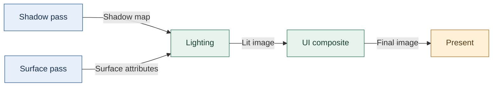
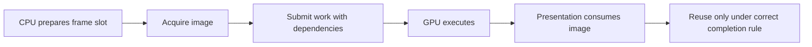

# 26 — Descriptor arrays and backend limits

[[Chapter Edition/03 - Game Engine/00 - Reading Map|Reading map]] · [[Chapter Edition/03 - Game Engine/25 - Renderer evolution through resource ownership|Previous chapter]] · [[Chapter Edition/03 - Game Engine/27 - Preparing and publishing runtime content|Next chapter]]

Logical resource indices must fit the shader’s representation and the selected backend’s capabilities. This chapter connects descriptor arrays and binding state to queried limits and explicit fallback behavior.

**By the end:** Design descriptor indexing and binding around device capabilities, reserved slots, and a validated shader-visible index range.

**Recall question:** How do you prove that every material slot fits both the backend limit and the shader’s index type?

<!-- Derived from Continuous Notes/Game Engine - From First Frame to Living Worlds.md; source lines 62567–63428; source-span SHA256 d783791a0d1b3e74635308c27f4dcd7360fb7a0f85c1f4495a208170088901ae. -->

<!-- CHAPTER-SOURCE-BEGIN -->
### Model descriptor arrays as indexed data, and keep backend limits at the backend boundary

When a shader uses several shadow maps or matrices, the interface needs to describe a sequence of resources and values, not only a single sampler or uniform. In this Kohi refactor, shader metadata gains typed sampler declarations and array lengths; uniform-setting calls gain an array index and compute the destination as the uniform offset plus element size times index. The same idea applies to a matrix array: with base byte offset $o$ and declared array stride $s$, element $i$ starts at $o+i\,s$, for $0\leq i<N$, where $N$ is the array element count. Array stride includes any required padding and must agree with the shader layout; it is not automatically the host language’s payload size. The captioned prototype uses its recorded element size in this calculation, so that representation needs its own alignment/stride check. The stream distinguishes array length from element index after an initial verbal slip: a non-array has one element and its first index is zero. These rules belong in a stable front-end contract, while OpenGL/Vulkan descriptor details stay in their backend implementations. [Descriptor refactor, 3:49](https://www.youtube.com/watch?v=HahgZzF2Dfo&t=229s) [Descriptor refactor, 5:21](https://www.youtube.com/watch?v=HahgZzF2Dfo&t=320s) [Descriptor refactor, 8:06](https://www.youtube.com/watch?v=HahgZzF2Dfo&t=484s) [Descriptor refactor, 10:54](https://www.youtube.com/watch?v=HahgZzF2Dfo&t=653s) [Descriptor refactor, 11:14](https://www.youtube.com/watch?v=HahgZzF2Dfo&t=673s)

The immediate workload is cascaded shadow maps. The old setup exposes one render-graph pass per cascade; the refactor tries to expose one shadow-map pass that internally executes the cascade work. Each cascade still needs its own view/projection data and depth resources. This changes who owns the loop: the application configures one conceptual pass, while the pass handles its several backend executions. It does not make the graph an automatic scheduler: the recording describes explicit sources and sinks, and leaves the relationship between a cascade's attachments and the single graph-level source unresolved. [Descriptor refactor, 13:42](https://www.youtube.com/watch?v=HahgZzF2Dfo&t=820s) [Descriptor refactor, 14:06](https://www.youtube.com/watch?v=HahgZzF2Dfo&t=844s) [Descriptor refactor, 16:40](https://www.youtube.com/watch?v=HahgZzF2Dfo&t=998s) [Descriptor refactor, 24:27](https://www.youtube.com/watch?v=HahgZzF2Dfo&t=1464s) [Descriptor refactor, 25:48](https://www.youtube.com/watch?v=HahgZzF2Dfo&t=1548s)

The refactor also discovers a backend-specific constraint around Vulkan push constants. The attempted design assigns separate ranges to local values, but validation rejects ranges with duplicate shader-stage flags and reports a pipeline-layout range that is too small. The developer changes direction: treat local values as a bounded block (128 bytes in this implementation), copy each value into that block at its offset, then issue one local apply/push operation. A local bind/apply pair is added to the renderer-facing API so another backend can implement the same contract differently. This is a design response to the Vulkan validation encountered here, not a universal requirement that every graphics API use a 128-byte push block. [Descriptor refactor, 39:19](https://www.youtube.com/watch?v=HahgZzF2Dfo&t=2358s) [Descriptor refactor, 10:54](https://www.youtube.com/watch?v=HahgZzF2Dfo&t=653s) [Descriptor refactor, 11:05](https://www.youtube.com/watch?v=HahgZzF2Dfo&t=662s) [Descriptor refactor, 30:01](https://www.youtube.com/watch?v=HahgZzF2Dfo&t=1801s) [Descriptor refactor, 33:13](https://www.youtube.com/watch?v=HahgZzF2Dfo&t=1991s) [Descriptor refactor, 36:54](https://www.youtube.com/watch?v=HahgZzF2Dfo&t=2212s)

Keep the completion boundary explicit. The source reports shader compilation errors, validation errors, later successful compilation steps, and then an attachment lookup/rebuild problem caused by the altered source-population contract. The speaker identifies that the graph-level pass cannot yet choose among per-cascade resources when regenerating targets, and ends by describing that mapping as unresolved; they commit the partial work for continuation. Thus the episode contributes a useful indexed-uniform and backend-boundary design, but it does not demonstrate a completed cascade attachment mapping or a fully correct final render. [Descriptor refactor, 39:19](https://www.youtube.com/watch?v=HahgZzF2Dfo&t=2358s) [Descriptor refactor, 42:12](https://www.youtube.com/watch?v=HahgZzF2Dfo&t=2532s) [Descriptor refactor, 45:23](https://www.youtube.com/watch?v=HahgZzF2Dfo&t=2722s) [Descriptor refactor, 53:05](https://www.youtube.com/watch?v=HahgZzF2Dfo&t=3183s) [Descriptor refactor, 57:28](https://www.youtube.com/watch?v=HahgZzF2Dfo&t=3447s)

### A vertex array records OpenGL binding state; it does not own the buffers

OpenGL's **vertex array object** (VAO) is often mistaken for the place where vertex data lives. The vertex buffer stores the bytes; the index buffer stores indices; the vertex layout explains how those bytes form attributes. The VAO records the association between buffer bindings and attribute descriptions for later draws. Binding an index buffer while the VAO is active associates that index-buffer binding with the VAO in the traditional OpenGL state model. The VAO therefore remembers draw setup; it does not copy buffer contents or automatically own the CPU objects that wrap those buffers.

This distinction matters when an engine adds a renderer-neutral interface. A Direct3D-style backend may not need an equivalent VAO object at all, so the interface must describe the engine's useful draw contract rather than promise identical native objects in every backend. In the Hazel prototype, adding a vertex buffer first binds the VAO and buffer, applies the buffer's layout, and retains a shared CPU reference in its own bookkeeping; setting the index buffer similarly binds it while the VAO is active. The author adds an assertion for a missing layout because binding a buffer before its attribute layout is ready would leave the draw setup incomplete. These details are specific to the older OpenGL binding model; newer direct-state-access calls provide a more explicit way to associate objects without relying on as much ambient binding state. [Caption source: Vertex Arrays](https://www.youtube.com/watch?v=rkxrw8dNrvI)

### Pack scalar material maps only under an explicit channel contract

Kohi's later material pass turns separate metallic, roughness, and ambient-occlusion images into one four-channel image. In that episode's convention, red stores metallic, green stores roughness, blue stores ambient occlusion, and alpha is reserved and filled with one. This is a project-specific swizzle. It is not the glTF metallic-roughness channel convention, where metalness and roughness use different specified channels; an importer must preserve the format's contract instead of assuming these orders are interchangeable. [Kohi, C/Vulkan Game Engine Dev Ep. 162](https://www.youtube.com/watch?v=C2zceJ88k7w)

The conversion utility reads each provided image, requires the same width and height, copies the selected scalar value per pixel into the output channels, and writes an RGBA PNG. Missing maps receive explicit episode defaults: black for metallic, mid-gray for roughness, and white for ambient occlusion; alpha is one. The stream checks one generated example by viewing its individual color channels and reports matching source maps. This is a useful asset-pipeline stage because it reduces three scalar-map samples to one packed-map sample, while preserving each value in its own component. The report is specific to that example; the episode ends with bulk conversion and material-config migration still to do, so it does not establish a complete converted asset set or tested runtime rollout. The source does not specify color-space metadata for the packed scalar channels, compression, or validation beyond matching dimensions; these must remain explicit pipeline decisions. [Kohi, C/Vulkan Game Engine Dev Ep. 162](https://www.youtube.com/watch?v=C2zceJ88k7w)

### Keep descriptor input arrays alive until the update call consumes them

A descriptor update often needs several `VkDescriptorImageInfo` records: one for each image view, sampler, and layout in a binding. In Kohi's stream, those records were assembled in a loop, while the corresponding `VkWriteDescriptorSet` records were submitted after the loop. The episode traces a wrong image view reaching unrelated material bindings, then identifies that each local image-info array had already gone out of scope before the batch update consumed its pointer. The repair passes frame data into the shader application path and allocates the temporary records from that frame's linear allocator. Its storage remains valid through the update call and is reclaimed when the frame arena resets. [Kohi, C/Vulkan Game Engine Dev Ep. 160](https://www.youtube.com/watch?v=Zcxl3BmmxJA)

This is a concrete instance of a general lifetime rule: the data named by an API pointer must outlive the operation that reads it. The frame allocator is a fitting scratch owner when the records are built and consumed within one frame; it does not make resources safe for GPU use after submission. Keep CPU-side descriptor-write inputs, descriptor-set contents, and GPU resource lifetime as separate questions. The presenter reports that the scene and cascade debug view render again after the fix, but the caption is not an independent code review or validation run. [Kohi, C/Vulkan Game Engine Dev Ep. 160](https://www.youtube.com/watch?v=Zcxl3BmmxJA)

The same stream replaces four separately held cascade depth textures with one layered array image and adjusts the shader sampler and descriptor setup to match. An array image stores multiple layers selected through one image resource and one array-sampler binding; an array of descriptors instead contains several independent image descriptors. Those shapes are not interchangeable, and a view used for whole-array sampling differs from a view of an individual layer used as a render attachment. The episode moves from an earlier broken state with image-view dimension mismatches and dozens of validation issues to a later reported result: after correcting descriptor setup and keeping image-info arrays alive through the update, the scene loads and the cascade-color view appears again. This result is explicitly separate from the earlier failed captures, and is still only the narrated prototype result. It does not remove the work of rendering scene geometry into the cascades. The source reports the shadow result visible again, with a remaining seam and jitter. It also explicitly leaves performance work open: the whole terrain is drawn without chunking, every object is submitted for every cascade, dynamic lights do not yet cast through this path, and shutdown still reports resource-cleanup errors. Treat the episode as a working prototype milestone with unfinished costs and cleanup, not as an optimized shadow system. [Kohi, C/Vulkan Game Engine Dev Ep. 160](https://www.youtube.com/watch?v=Zcxl3BmmxJA)

#### A file-backed shader is not yet hot reload

The Hazel prototype reads one text file in binary mode, splits it at `#type` markers into vertex and fragment sources, then compiles the parsed stages and links them. Keeping the stage marker and parser next to a file-backed shader makes the authoring path concrete, but the parser has limited syntax and error handling. Although reloadability is given as a reason to use files, this episode does not implement hot reload; cross-compilation and binary shader formats are only discussed as future options. [Caption source](https://www.youtube.com/watch?v=8wFEzIYRZXg).

### One shader source can target two APIs through SPIR-V

A shader written for Vulkan GLSL cannot always be handed directly to OpenGL. The Hazel shader episode uses a cross-compilation pipeline: ShaderC compiles Vulkan-style GLSL into SPIR-V; SPIRV-Cross inspects the SPIR-V resources and produces OpenGL-compatible GLSL; the OpenGL path compiles that GLSL into an OpenGL SPIR-V program. Keeping a Vulkan-targeted source lets the engine avoid building all shader interfaces around OpenGL-only assumptions. [SPIR-V and the New Shader System](https://www.youtube.com/watch?v=SXDlZRDjtXg)

This affects how shared data is described. The source moves the camera view-projection matrix from a per-shader uniform into a uniform buffer at a shared binding. Each shader that needs camera data declares that binding, and the renderer updates it once for the scene. Push constants are discussed as another Vulkan data path, more appropriate for small per-draw values; the episode's camera buffer is shared scene data. Explicit sampler bindings and input/output locations make resource connections visible across stages. Backend-specific calculations, such as depth-range conversion, can use preprocessor definitions before compilation.

SPIR-V reflection can report a shader's uniform buffers, binding numbers, sizes, members, and sampled images. That gives a material system information to validate or use when assembling resources. In the episode, reflection mainly prints diagnostics; a full material-binding layer is future work. The implementation also keeps both Vulkan-targeted SPIR-V and OpenGL-generated GLSL/SPIR-V, including text output for debugging. These artifacts take space, so a production cache needs source/options/backend hashes and a clear invalidation policy. The episode checks whether cache files exist but does not detect source changes automatically.

The reported first launch takes roughly 6.8 seconds to compile the shader artifacts; a subsequent cached launch takes about 19 milliseconds. These are observations from that development setup, not general performance claims. They show why compilation output is cached, while also making correctness of cache keys important: a stale shader binary can be as misleading as a slow first launch.

#### Source-to-volume map

- Existing foundations: `### Separate shader interface from backend implementation`, `### Compile shader stages, link a program, and inspect both failure points`, and `### Treat shaders and materials as a pipeline, not just files`.
- This source adds the source-to-SPIR-V-to-cross-compiled-GLSL flow, shared camera uniform-buffer binding, reflection outputs, and the missing cache invalidation boundary.
- Limits: English automatic captions describe a specific implementation snapshot. No build pipeline, generated shader binary, runtime, or cross-backend equivalence was independently verified; dependency packaging is deferred in the source.

### Treat shaders and materials as a pipeline, not just files

A shader is a program stage executed by the GPU. A graphics pipeline combines shader stages with vertex layout, rasterization, depth, blending and other state. A material packages the choices that make a surface look a certain way: shader/parameters and texture bindings, for example. These terms become easier when tied to a problem: a mesh can be uploaded correctly and still render as the wrong color because its shader does not receive the intended material values.

A full read of [Kohi #028](https://www.youtube.com/watch?v=kgnc_hHVz_M) records a useful first-render path. Temporary test geometry is copied through a host-accessible staging buffer into device-local vertex/index buffers, then the command buffer binds the pipeline and indexed geometry. The quad uses two triangles and six indices, reusing shared vertices. The presenter explicitly labels initialization and begin-frame drawing as temporary scaffolding and notes aspect ratio is not yet corrected. He then routes vertex position through the vertex shader and interpolates it as fragment color, making interpolation visible before texture coordinates are introduced. This episode demonstrates both a working path and the deliberate need to move demo code into proper resource/draw systems later.

The Kohi series covers shader modules ([#025](https://www.youtube.com/watch?v=01KQiQ4fdXs)), graphics pipeline setup ([#026](https://www.youtube.com/watch?v=OmPmftW7Kjg) and [#024](https://www.youtube.com/watch?v=KanKG-vd9GA)), uniforms ([#029](https://www.youtube.com/watch?v=yc40ixalLtU) and [#030](https://www.youtube.com/watch?v=xGonaV-OB7E) adjacent series), textures ([#032](https://www.youtube.com/watch?v=u-eyZCV_MRs), [#033](https://www.youtube.com/watch?v=n7qS96720yI), [#034](https://www.youtube.com/watch?v=2IxHj52-Kag)), a texture system ([video](https://www.youtube.com/watch?v=hDpzfAdW3vw)), and material/shader integration ([material](https://www.youtube.com/watch?v=K_jD7--h7F8), [final shader integration](https://www.youtube.com/watch?v=9nP3aBsrCXs)). The renderer-agency stream cited earlier then adjusts the frontend/backend interface around the shader system.

A texture on disk is not yet a GPU texture. It must be decoded into pixel data, represented by an image allocation with appropriate dimensions and format, populated (often through a staging copy), transitioned to a layout suitable for sampling, and bound through a descriptor. Image layout is a declared usage state that affects how Vulkan may access image memory. Forgetting a required transition can lead to validation errors or invalid sampling. A texture system hides repeated lifecycle steps from the game, but its contract should make ownership clear: who releases the image and sampler, and what happens if loading fails?

The later shader captions make this boundary concrete. In [Shader System Part 1](https://www.youtube.com/watch?v=wXLsGqck100), the presenter describes looking up uniforms by name but recommends storing the resulting location when the uniform is registered. [Part 3](https://www.youtube.com/watch?v=4E0v_5Wva-8) checks a shader’s maximum supported texture count before changing bindings. The finalization episode [#048](https://www.youtube.com/watch?v=9nP3aBsrCXs) sketches grouping geometry by shader identifier and remembering the current shader to avoid redundant state changes. These are implementation choices from the tutorial, and the caption does not provide a performance benchmark. Their teaching value is the lifecycle: discover a shader input, retain a stable lookup result, validate resource capacity, bind only supported inputs, and minimize repeated state changes when grouping draws.

A material API should save the caller from repeating low-level bindings while remaining honest about what can vary. A simple first material might identify a shader and values. A later material can add texture slots, render state and specialization. It is a mistake to make every material parameter dynamically typed before a real use demands that generality. Keep the first visible result legible: draw the same geometry with two material values and confirm the change comes from the material data path.

#### Find the missing triangle before rebuilding the renderer

A blank viewport leaves several possibilities open: no draw was submitted, the positions are outside the camera's view, the shader cannot read the data, or the renderer is discarding the triangle. Give the first test a deliberately small contract: draw one triangle with known positions and a constant visible color into a known target. Confirm that result before adding textures, lighting, and imported geometry.

**Face culling** discards triangles classified as front-facing or back-facing according to the configured rule. **Winding** is the order in which triangle vertices appear around the projected face. Temporarily disabling culling can help determine whether geometry exists but is classified unexpectedly; it is a diagnostic, not a permanent repair for inconsistent geometry. Compare the vertex order, front-face setting, projection, and viewport orientation together. Flipping an axis can reverse orientation, so correcting an upside-down image can expose a second culling problem.

A **viewport** maps the projected coordinates into a region of the render target. A **scissor rectangle** restricts which rectangular area can receive the draw's fragments. An accidentally empty or misplaced scissor can hide a correctly transformed triangle. A camera's forward direction is another explicit convention: which way it looks in world coordinates is chosen by the camera mathematics, not inferred merely from the name Vulkan or OpenGL. Give the test scene labeled axes and place one object in front of the camera according to that convention.

Next separate the transformations. The object's transform places its vertices into the world. The view transform expresses them relative to the camera. Projection maps the view into clip coordinates before later viewport mapping. Change one object transform while keeping the camera fixed, then move the camera while keeping the object fixed. If those operations affect unexpected objects or appear reversed, inspect the data path and multiplication conventions before compensating with arbitrary sign changes.

The fully read second Cubed stream progresses from a triangle to buffered geometry and cubes, using culling, viewport orientation, winding, and camera assumptions to diagnose unexpected results. Its initial draws reuse the UI render pass; separate off-screen targets and later effects are future steps in that session. The diagnostic sequence above develops the lesson rather than claiming that its unlit cube already implements lighting or a complete renderer. [Caption source: Vulkan — From 2D to 3D](https://www.youtube.com/watch?v=hSL9dCjwoCU).

#### A first input-driven camera

The camera lesson first repairs projection state: compute a perspective matrix at initialization and recreate it when the window size changes, using width divided by height as a floating-point aspect ratio. Near and far clip values become stored state. It then stores a view matrix and exposes a renderer setter, while explicitly warning that the test game reaches into renderer internals through a temporary hack that should later be replaced by a camera system.

The prototype camera state holds position, Euler angles, a view matrix, and a dirty flag. When changed, it constructs rotation and translation transforms and derives a view matrix using the inverse camera transform. Yaw and pitch helpers update angles and mark the view dirty; pitch is clamped to about ±89 degrees to avoid approaching the Euler singularity commonly called gimbal lock. Keyboard input applies yaw and pitch at a delta-time-scaled rate. Movement uses the camera's forward/right directions for forward, backward, and strafing, while vertical motion stays along world Y so looking downward does not turn an upward command into forward motion. It normalizes combined movement before applying speed and delta time, avoiding faster diagonal movement.

The debugging sequence matters: an initially incorrect camera sign put the view on the wrong side; correcting the transform/inversion made A/D movement visible. The presenter then tunes movement speed and reports the scene can be navigated. This remains explicitly temporary testbed code, not a complete camera abstraction; mouse look, robust input architecture, and production camera behavior are outside this episode.

A pitch clamp is a camera-control policy, not a general cure for every rotation singularity or a replacement for documenting axis and rotation-order conventions.

Source reading: [caption source](https://www.youtube.com/watch?v=s9xSwQvbG2w). Captions document the narrated development state; on-screen code and reported builds were not independently reproduced.

##### Treat camera and movement as related modes

The proposed game uses three views for three jobs: a third-person camera during exploration, an aimed-weapon camera while the target control is held, and a first-person examine view for careful looking and precision shots. In exploration, the camera follows behind the character and recenters after the player stops looking around. While aiming, it tries to keep a selected target visible. In examine mode, the character disappears from view, the player can look and sidestep slowly, and a reticle supports aiming at objects such as switches or lights. A **reticle** is the on-screen marker that indicates the aim point. [PDF p. 616 and p. 620 / printed pp. 591 and 595]

The same controller input can mean different things depending on the mode. The document describes the left stick as move/turn during ordinary navigation, while aimed mode moves relative to a camera orientation captured when aiming begins; in examine mode, the left stick looks around and the right stick strafes. Thinking of these as distinct states makes implementation questions visible: when does the mode begin, which controls are active, what camera updates, and what happens on release? That state-based reading is an explanatory design tool drawn from the spec; the appendix does not prescribe a particular state-machine implementation. [PDF pp. 616–618, 620 / printed pp. 591–593, 595]

Movement also has explicit context rules. Water depth slows movement and eventually blocks aiming or entry; the proposal distinguishes calf-deep, knee-deep, chest-high, and over-head water. Jump height depends on how strongly the analog jump control is pressed; the action changes for forward movement, backward movement, or strafing, and aiming changes whether a jump can include a shot. Clambering is a separate ledge action with stated minimum and maximum heights. A ladder is another constrained mode: move forward climbs, move backward descends, and jump or use dismounts. An immobilized character cannot move or jump but can still turn the camera and break free by repeatedly pressing attack or jump. [PDF pp. 617–620 / printed pp. 592–595]

A useful implementation exercise is to turn each proposed mode into a small transition checklist: entry condition, enabled inputs, state changes, player feedback, and exit condition. For example, “near ladder + press Use” enters ladder mode; “Move Forward” changes vertical position; “Jump” exits the ladder. This makes omissions easier to find than a control list alone, while remaining a derived way to organize the sample’s prose rather than a claim about its original code.

#### Per-surface response and specular light

Diffuse color answers what color a surface returns under light; a specular term adds the concentrated highlight that makes a surface appear shinier. A material's shininess controls how tightly concentrated the highlight is, while a specular map varies reflectivity across the surface. In the examples, brighter map regions reflect more and dark regions less. The shader derives a view direction from camera and fragment positions, combines it with the light direction into a halfway direction, compares that direction with the surface normal, clamps negative results, and raises the result to the shininess power. The specular result is added to ambient and diffuse contributions. (Kohi #050, 00:01–00:12)

Texture transparency needs to participate in that calculation. In the tutorial shader, the specular sample is multiplied by diffuse alpha so transparent texels in that example do not gain highlights. This is one illustrative material convention; transparency treatment depends on a renderer's blending and material model. A default black specular texture provides a neutral fallback, so materials without an authored map do not acquire unintended shine. The presenter notes the camera-position plumbing is still a temporary extension of an existing set-view hack, and that the example maps are auto-generated illustrations. (Kohi #050, 00:12–00:16; 00:21–00:30)

This ambient/diffuse/specular example is an illustrative lighting model. Its shininess exponent and specular map are not automatically interchangeable with the roughness and metallic parameters of a physically based material.

Source reading: [caption source](https://www.youtube.com/watch?v=9O--xSmf5NU). Captions document the narrated development state; on-screen code and reported builds were not independently reproduced.

#### Reject a bound only when the plane test proves it is outside

A camera frustum is the viewing volume bounded by its clipping planes. To test an axis-aligned bounding box, express a plane with a nonzero inward-facing normal and define the allowed side as

$$
\mathbf n\cdot\mathbf x+d\geq0.
$$

A codebase using $\mathbf n\cdot\mathbf x-q$ stores the opposite scalar convention: set $d=-q$ when translating it into this notation. Here the normal points toward the accepted half-space and the scalar $d$ places the boundary. Let the box have center $\mathbf c$ and nonnegative half-extents $\mathbf e$. The center's signed plane expression is $s$, and the box's largest displacement along the normal is $r$:

$$
s=\mathbf n\cdot\mathbf c+d,
\qquad
r=|n_x|e_x+|n_y|e_y+|n_z|e_z.
$$

The whole box is outside this plane when $s+r<0$. It is wholly on the accepted side when $s-r\geq0$. Otherwise it crosses or touches the plane. For this box formula, a unit-length normal is unnecessary: scaling both the normal and $d$ by the same positive factor scales $s$ and $r$ together.

For example, accept positions with nonnegative X. A box centered at X = −3 with X half-extent 1 reaches only X = −2, so it is outside. A box centered at −0.5 with the same extent crosses the boundary and must remain a candidate. Do not reject it merely because its center is outside.

A sphere uses a different projected extent. With a unit normal its radius is the required bound; with an unnormalized normal, multiply the radius by the normal's length. Mixing a raw plane expression with an unscaled sphere radius changes the test and can wrongly remove visible objects.

Reject against any frustum plane that proves exclusion. Passing the tests means keep the bound as a candidate; it does not prove that the detailed mesh is visible, unoccluded, or even tightly bounded. Expand bounds conservatively for motion or deformation when required, and use world-space bounds if the planes are world-space too. A culling optimization that removes a visible crate has changed correctness, not merely performance.

The fully read Kohi frustum lesson motivates sphere and box tests and their object/geometry granularity. The equations, sign convention, and numeric boundary cases above are original teaching extensions. [Caption source: Frustum Culling](https://www.youtube.com/watch?v=vJrfcI_bMTA).

Related foundations: [[Concepts/Dot products and orthogonality|Dot products and orthogonality]] · [[Concepts/Camera view and clip-space pipeline|Camera view and clip-space pipeline]].

##### Filter at geometry granularity

A mesh can contain hundreds of independently cullable geometries. The Kohi frustum implementation changes the render view from receiving whole mesh records to an explicit list of geometry render records, so the game-side selection can omit off-frustum pieces before the renderer builds its packet. The source episode first uses a sphere bound, then an AABB that reports fewer false positives; the result remains limited by approximate geometry bounds. Camera field of view and clip distances are temporarily hard-coded, and aspect ratio comes from window dimensions. A drawn-count display makes the filter observable during camera motion, but a zero count while looking away is only a basic witness, not an exhaustive correctness test. [Kohi frustum culling](https://www.youtube.com/watch?v=vJrfcI_bMTA)

The source build and visual observations were not independently reproduced.

### Resize the drawable area, then decide what the camera should show

Resizing a window changes more than its outer rectangle. The drawable pixel area may change, so the OpenGL viewport must be updated to map normalized device coordinates into the new drawable dimensions. A viewport is the pixel rectangle used for that mapping; it does not resize a camera's projection or every off-screen render target. The episode demonstrates a clipped region because the viewport remains at its startup size, introduces `glViewport`, and explains why framebuffers may also need resize notifications at 00:00–06:00. [Resizing](https://www.youtube.com/watch?v=7LswjvgRqbw&t=0s) [Resizing](https://www.youtube.com/watch?v=7LswjvgRqbw&t=120s) [Resizing](https://www.youtube.com/watch?v=7LswjvgRqbw&t=240s)

Send resize information through a window event so interested systems can respond. The Hazel walkthrough logs incoming width and height, then finds that minimizing the window reports zero dimensions at roughly 12:00–15:00. Zero-sized targets are not valid render areas; mark the application minimized and avoid updating expensive scene layers when there is no visible output. The first attempt to skip too much of the loop makes the window unresponsive, so the example narrows the change to skipping layer updates while still processing enough application work, as discussed at 14:00–17:00. This is a source-specific implementation experiment, not a universal prescription for every event loop. [Resizing](https://www.youtube.com/watch?v=7LswjvgRqbw&t=720s) [Resizing](https://www.youtube.com/watch?v=7LswjvgRqbw&t=840s) [Resizing](https://www.youtube.com/watch?v=7LswjvgRqbw&t=900s)

The concrete renderer path forwards the size through renderer and backend interfaces to call `glViewport`; after that, the lesson reports that content fills the resized window at about 18:30–21:30. Treat this viewport update as one part of resize handling. Once a renderer draws to off-screen targets, those targets need an explicit sizing policy too: match the drawable size, use a scale factor, or remain fixed-size. The episode discusses a framebuffer pool and buffers whose size is not necessarily the window at 04:00–07:30 and revisits future framebuffer notifications near 29:00–30:00. [Resizing](https://www.youtube.com/watch?v=7LswjvgRqbw&t=1110s) [Resizing](https://www.youtube.com/watch?v=7LswjvgRqbw&t=240s) [Resizing](https://www.youtube.com/watch?v=7LswjvgRqbw&t=1740s)

The camera asks a separate design question: when the drawable grows, should objects keep their apparent size while more of the world becomes visible, or should the same world region scale up to fill the new area? The source contrasts those choices around 09:30–11:00 and 21:30–29:00. In an orthographic camera, changing the projection bounds changes the visible world region. Aspect ratio and zoom policy determine what the player sees; updating only `glViewport` cannot choose that policy for you. The speaker experiments with adjusting zoom, finds the current controller's zoom state does not rebuild projection as expected, backs out the attempt, and concludes that the current width-based aspect behavior is a hybrid at 24:00–28:00. Preserve that unresolved camera policy instead of claiming a complete resize solution. [Resizing](https://www.youtube.com/watch?v=7LswjvgRqbw&t=570s) [Resizing](https://www.youtube.com/watch?v=7LswjvgRqbw&t=1290s) [Resizing](https://www.youtube.com/watch?v=7LswjvgRqbw&t=1440s)

Test resize behavior with a matrix of cases: maximize and restore, drag each axis, change aspect ratio, minimize and restore, and resize while a target is active. Check both viewport dimensions and projection bounds. For an editor, also resize an individual scene panel: its drawable rectangle and camera may differ from the main OS window. Those broader tests are engineering extensions; the episode's reported successful result is the main window viewport and the camera behavior in its existing orthographic setup.

### Keep camera data separate from camera behavior

An orthographic camera can be represented by projection and view matrices; a camera controller decides how user input changes those values. The lesson keeps keyboard and mouse behavior out of the camera's math/data class and creates a separate controller, explaining the separation at 04:00–08:00. The reason is practical: renderer code needs camera matrices, while input bindings and movement policy belong to the application or game layer. Adding controls directly to the matrix object would make this small data type depend on input, events, timing, and key codes. [Camera Controllers](https://www.youtube.com/watch?v=q7rwMoZQSmw&t=240s) [Camera Controllers](https://www.youtube.com/watch?v=q7rwMoZQSmw&t=420s)

The controller stores an aspect ratio and zoom level, constructs orthographic bounds from them, and exposes update and event methods. The example chooses a vertical range of roughly $[-z,z]$ and horizontal bounds $[-az,az]$, where $a$ is aspect ratio and $z$ is zoom. It initializes this state before the camera because member initialization follows declaration order; the source develops these choices at 08:00–14:30 and describes member order around 11:00–13:30. [Camera Controllers](https://www.youtube.com/watch?v=q7rwMoZQSmw&t=480s) [Camera Controllers](https://www.youtube.com/watch?v=q7rwMoZQSmw&t=660s) [Camera Controllers](https://www.youtube.com/watch?v=q7rwMoZQSmw&t=810s)

On each update, movement uses input state and elapsed time; event handling responds to window resize and mouse-wheel scroll. The sample maps WASD to translation, Q/E to optional rotation, and wheel offset to zoom, with the event dispatcher routing typed events to controller handlers at 14:00–19:30. The movement and rotation speeds are tunable policy, not a universal camera feel. For a real game, camera behavior may be game-specific or scripted; the controller is a useful editor/basic-navigation default, as the source notes at 00:50–03:30. [Camera Controllers](https://www.youtube.com/watch?v=q7rwMoZQSmw&t=50s) [Camera Controllers](https://www.youtube.com/watch?v=q7rwMoZQSmw&t=840s) [Camera Controllers](https://www.youtube.com/watch?v=q7rwMoZQSmw&t=960s)

Scrolling changes zoom and therefore rebuilds the projection. Clamp the inward zoom so the bounds do not cross or invert. The lesson experiments with a minimum zoom of 0.25, scales wheel sensitivity, and multiplies translation speed by zoom so movement feels faster when viewing a larger world region; these experiments occur around 20:00–22:30 and 30:00–34:00. Such coupling is a feel choice. A logarithmic zoom scale or a nonlinear speed curve may feel better across a wide range, but was only proposed as future exploration. [Camera Controllers](https://www.youtube.com/watch?v=q7rwMoZQSmw&t=1200s) [Camera Controllers](https://www.youtube.com/watch?v=q7rwMoZQSmw&t=1800s) [Camera Controllers](https://www.youtube.com/watch?v=q7rwMoZQSmw&t=1980s)

The sample's first run shows why a controller must actually be wired into the layer's update and event hooks; creating the class alone does nothing. It fixes an uninitialized aspect ratio and reports WASD/scroll/optional rotation working at roughly 27:00–33:30. It also reports that resizing still clips because viewport handling is not implemented yet, around 34:00–35:00. This is a useful incomplete-result boundary: the controller changes camera state, but the renderer's viewport and projection resize contract remains separate work. [Camera Controllers](https://www.youtube.com/watch?v=q7rwMoZQSmw&t=1620s) [Camera Controllers](https://www.youtube.com/watch?v=q7rwMoZQSmw&t=1740s) [Camera Controllers](https://www.youtube.com/watch?v=q7rwMoZQSmw&t=2040s)

### Derive a camera from the data the renderer actually consumes

A camera is not a graphics-API object. It is a collection of choices that eventually become matrices and frame inputs: where the viewpoint is, which way it faces, the projection type, field of view, aspect ratio, and depth range. This lesson deliberately spends most of its time on that design rather than writing a controller; it motivates the topic at 00:20–04:00, then separates camera transform, optics, and aspect ratio at 06:00–10:00. The numerical range for field of view is an illustrative preference from the speaker, not a universal rule for every lens or game. [CAMERAS and How They Work](https://www.youtube.com/watch?v=LfbqtmqxX04&t=20s) [CAMERAS and How They Work](https://www.youtube.com/watch?v=LfbqtmqxX04&t=360s)

For a column-vector convention, let the camera's world transform be $C$ and a point's model transform be $M$. The view matrix is the inverse camera transform, $V=C^{-1}$: when the camera moves right, the stationary world appears to move left. The projection matrix $P$ maps view-space positions into clip space. A point on a model is transformed as

$$p_{clip}=PVMp_{local}.$$

The source derives the inverse view relationship and the projection/model/view chain at about 10:00–22:00. Matrix convention matters: multiplication order and whether vectors are rows or columns must match the math library and shader. The transcript briefly generalizes row-major/column-major conventions too broadly; storage order alone does not dictate the mathematical convention. Verify the actual GLM and shader expressions used in your project. [CAMERAS and How They Work](https://www.youtube.com/watch?v=LfbqtmqxX04&t=600s) [CAMERAS and How They Work](https://www.youtube.com/watch?v=LfbqtmqxX04&t=960s) [CAMERAS and How They Work](https://www.youtube.com/watch?v=LfbqtmqxX04&t=1140s) [CAMERAS and How They Work](https://www.youtube.com/watch?v=LfbqtmqxX04&t=1320s)

A perspective projection encodes field of view, aspect ratio, and near/far clipping planes. The view and projection matrices are scene-wide; the model transform changes per object; mesh vertices are local to their mesh. That ownership split explains why a scene begins with a camera and each object submission supplies its own transform. The episode discusses framebuffers, projection bounds, perspective versus orthographic behavior, and the near/far planes at roughly 22:00–36:00. An orthographic projection keeps apparent size independent of depth, which suits many 2D and CAD views; perspective projection produces depth-dependent size. [CAMERAS and How They Work](https://www.youtube.com/watch?v=LfbqtmqxX04&t=1320s) [CAMERAS and How They Work](https://www.youtube.com/watch?v=LfbqtmqxX04&t=1560s) [CAMERAS and How They Work](https://www.youtube.com/watch?v=LfbqtmqxX04&t=1800s) [CAMERAS and How They Work](https://www.youtube.com/watch?v=LfbqtmqxX04&t=2100s)

The renderer can calculate $PV$ once per scene and combine it with each object's $M$. A shader may receive a view-projection uniform plus a model/transform uniform, then multiply by each vertex. The episode weighs CPU-side versus vertex-shader multiplication around 26:00–30:00 and explains why scene-level data belongs in `BeginScene` while object transforms are per submission around 29:00–34:00. Its proposed multi-threading warning is valuable: copying the camera matrices into frame-owned submission data avoids a later render thread reading a camera object that gameplay has already changed. That safety rationale is raised at about 32:00–34:00; a full command queue is not implemented here. [CAMERAS and How They Work](https://www.youtube.com/watch?v=LfbqtmqxX04&t=1560s) [CAMERAS and How They Work](https://www.youtube.com/watch?v=LfbqtmqxX04&t=1740s) [CAMERAS and How They Work](https://www.youtube.com/watch?v=LfbqtmqxX04&t=1920s)

The lesson closes by identifying the next implementation as an orthographic camera for the current 2D work, with a controllable perspective camera later. Those are roadmap statements from the recording, not features proven by this planning episode. [CAMERAS and How They Work](https://www.youtube.com/watch?v=LfbqtmqxX04&t=2220s)

### Keep an orthographic camera's view and projection jobs separate

A 2D camera still uses two different transformations. The **view matrix** moves world coordinates relative to the camera; the **orthographic projection** maps a chosen world rectangle into clip coordinates without making distant objects smaller. For horizontal bounds $L,R$ and vertical bounds $B,T$, the unclipped mapping is

$$
x_{clip}=2\frac{x-L}{R-L}-1,\qquad y_{clip}=2\frac{y-B}{T-B}-1.
$$

The renderer applies the camera projection and view to a world position, in the order required by its matrix convention: $p_{clip}=P V p_{world}$ for column vectors. Moving the camera right changes the view of the world in the opposite direction; changing the projection bounds changes how much of the world fits on screen. Keeping those effects separate makes “camera moved” and “zoom changed” different operations in both code and debugging.

If the design keeps a fixed world height $H$ while the viewport changes size, derive the horizontal span from the viewport aspect ratio $a=w/h$: choose $R-L=aH$, with centered bounds $[-aH/2,aH/2]$ and vertical bounds $[-H/2,H/2]$. Recompute those bounds after a resize, or explicitly choose a different policy such as letterboxing or stretching. The fully read Hazel example constructs an orthographic projection from left/right/bottom/top, stores camera position and a Z rotation, forms the camera transform, inverts it for the view, and uploads $PV$ to the shader. It also discovers that its GLM position field was not initialized to zero; explicitly initialize every camera field before matrix composition. This camera is a teaching prototype, not a complete resize-aware camera controller. [Caption source: Creating an Orthographic Camera](https://www.youtube.com/watch?v=NjKv-HWstxA)

### Use math to answer questions the renderer can test

The math library becomes valuable when it solves a visible uncertainty. A model matrix converts a vertex from the object’s local coordinates into the world; a view matrix expresses the camera’s position and orientation; a projection matrix maps the camera view into the clipped space the graphics pipeline expects. A quaternion is a compact way to represent rotation without the same gimbal-lock behavior that can affect chained Euler angles. The series treats vector and matrix foundations before the first geometry milestones, then returns to matrices and quaternions in [Kohi #022](https://www.youtube.com/watch?v=nk3KNPrSRqc) and model transforms in [#030](https://www.youtube.com/watch?v=xGonaV-OB7E).

This order gives each equation a job. A vector is a direction or point represented by components. Addition can move a position or combine directions; dot products measure alignment and are used for lighting and camera tests; cross products construct a perpendicular direction in 3D. A matrix represents a transformation that can be applied consistently to many points. Instead of teaching a matrix as a table of numbers, take a triangle whose vertices are in local coordinates and ask how all three should move when the object translates, rotates and scales. The model matrix provides one reusable answer.

Coordinate conventions must be explicit. Is the engine right-handed or left-handed? Which direction is up? Is the matrix multiplied on the left or right? Are matrices stored row-major or column-major? Does the projection depth range match Vulkan? A single inconsistent convention creates bugs that masquerade as renderer issues: mirrored winding, upside-down textures, inverted depth, or camera movement in a surprising direction. A good math module names these choices and tests them with simple witnesses: identity transform leaves a point unchanged; translating by `(1,0,0)` moves it one unit on X; a 90-degree rotation maps a known basis vector to the expected axis.

The mock camera stream is a practical convergence point: input changes camera movement, transforms change view, projection determines what is in frame, and geometry provides a visible witness. A tiny triangle and a controllable camera expose mistakes faster than a complex scene. Add one operation at a time and retain the witness after each change.

#### Per-object transforms with push constants

A global uniform describes values shared across a frame, such as the camera's view and projection. An individual object's model matrix changes per object, so the tutorial adds a renderer update-object path and sends that matrix as a Vulkan push constant to the vertex shader. The push-constant range is declared in the pipeline layout, restricted here to the vertex stage, and sized to hold two 4×4 matrices (128 bytes in the example). The presenter calls out 128 bytes as the guaranteed limit and chooses to stay within it. This is an example-sized use; applications still need to respect the device limit and layout/stage declarations.

The first test sends an identity-like model and expects no visual change. An initial validation error says a draw uses a push constant before one has been set. The presenter moves the object update ahead of the draw; a subsequent null command buffer issue is resolved by a clean rebuild. Then a quaternion-generated rotation is converted to a matrix, and a slowly incremented angle visibly rotates the test cube. Reintroducing camera motion demonstrates that the model and view transforms affect the scene together.

The shader applies model, view, and projection transforms to a vertex position, with order affecting the result. In the tutorial's convention, projection maps the 3D view into normalized device coordinates, view represents the inverse camera transform, and model places/orients the object. Read the product from right to left when reasoning about which transform acts first on the vertex. These are explanatory claims for this code's matrix convention; matrix storage, multiplication convention, and coordinate-system choices must be checked in an actual engine.

Source reading: [caption source](https://www.youtube.com/watch?v=xGonaV-OB7E). Captions document the narrated development state; on-screen code and reported builds were not independently reproduced.

### Render the state the simulation actually produced

The renderer turns a coherent world snapshot into pixels through visibility, transformation, material/shader work, rasterization and presentation. Gregory’s rendering chapter is broad; the contents identify depth-buffered triangle rasterization, pipeline, lighting, visual effects, and overlays (Ch. 10, contents PDF pp. 11–12; chapter begins printed p.399 at PDF p.421). The present reading inspected the beginning of that chapter, not every rendering section, so this section gives the architecture-level link rather than a detailed graphics tutorial.

Separate simulation ownership from render submission. The render thread can consume immutable transforms and resource references from a completed tick. This avoids the renderer reading half-updated transforms while physics is writing them. The cost is snapshot memory and possible latency. Double-buffered snapshots or carefully synchronized queues can provide a coherent view. A debug draw system should share the same frame and camera snapshot so its contact normals line up with the world geometry.

Resource formats matter here too. A mesh source authored by an artist is often processed into a runtime-friendly representation; texture and geometry upload costs should not unexpectedly occur in the middle of a jump or collision burst. The asset pipeline and runtime resource manager let the engine validate and prepare content before it is requested during play (Gregory, Ch. 1.7 listed contents PDF p.9; selected processing/manager discussion PDF pp. 301–307).

#### Inspect cascades and fade shadows before their quality runs out
Cascaded shadows trade detail for coverage: the camera’s view is split into regions so nearer areas can use more of the shadow map’s resolution. A useful editor diagnostic is to tint each cascade differently and inspect the shadow maps and split positions. In the Hazel log, the creator uses those controls to check cascade boundaries and adjusts the maximum shadow distance and fade region so shadows disappear gradually when the last cascade can no longer provide useful quality. The excerpt says seam quality improved but does not explain the implementation. [[caption source](https://www.youtube.com/watch?v=qbDrqARX07o), full cleaned transcript]

Soft shadows also have a visible cost in the example: roughly 3–4 ms per frame versus 0.8 ms for hard shadows, with VSync off. Setting light source size to zero still left the soft-shadow path active and slow, so the creator recommends disabling that path when hard shadows are acceptable. Treat these as measurements from one scene and setup, not general costs. [[caption source](https://www.youtube.com/watch?v=qbDrqARX07o), full cleaned transcript]

#### Use controlled simplification and hardware counters to find a GPU bottleneck
On a discrete-GPU system, **PCIe** is commonly the interconnect carrying data between host and GPU. A **staging buffer** is temporary transfer storage used to upload data into its intended GPU allocation. NVIDIA profiling terminology calls a scheduled group of shader threads a **warp**. These details are device-specific: a unified-memory system need not have the same transfer path.

A slow frame is not automatically caused by a complex pixel shader. In this Vulkan investigation, the developer starts with per-scope CPU timers and temporarily uses one frame in flight so a fence wait gives a clearer view of GPU completion time. He then reduces the rendered area and simplifies the fragment shader; the frame remains slow. Disabling shadow passes also leaves substantial cost. This narrows the problem before deeper profiling. [[caption source](https://www.youtube.com/watch?v=bUUZ1iD9_e4), full cleaned transcript]

Nsight GPU trace then shows high PCIe throughput and pixel-shader warp launch stalls. A colleague suggests that vertex and index data may be in system memory. Inspecting the buffer setup reveals that Vulkan buffers were marked CPU-only after a memory allocator refactor, so each draw needed geometry across PCIe. Switching to staging-buffer uploads produces a large reported improvement: the scene falls from roughly 22–30 ms to 9–10 ms with the fuller render path, and shadow passes from around 6 ms to under 1 ms each. The author says this is still not fully optimized and that remaining overdraw persists. Keep the measurements attributed to this setup; the transcript describes one project-specific investigation. [[caption source](https://www.youtube.com/watch?v=bUUZ1iD9_e4), full cleaned transcript]

#### Choose font storage around glyph coverage and layout needs

A bitmap font pre-renders a fixed glyph set into an atlas; metadata maps each code point to a rectangle, offsets, advance, and optional pair kerning. UTF-8 must be decoded into code points before glyph lookup: byte count is not character count, and recognizing one-to-four-byte leading patterns is not complete validation of malformed sequences. The Kohi bitmap loader parses BMFont text, writes a KBF cache, but stores one texture map and therefore assumes the asset fits on one atlas page. Its binary writer blits structs directly, coupling the cache to layout, padding, and byte order. [Kohi bitmap fonts and UTF-8](https://www.youtube.com/watch?v=zvGIp-S2mxA)

A system-font variant can rasterize needed glyphs from a TTF/TTC face into a per-size atlas instead of storing every possible glyph up front. The described version starts with ASCII and an unknown glyph, expands on missing code points, rebuilds a fixed 1024-square atlas, and tracks metrics and kerning. It demonstrates Japanese/Korean coverage but not right-to-left or connected-script shaping; only one atlas page is available and its binary KSF writer is unfinished. stb_truetype's warning about untrusted font files is noted by the presenter. [Kohi system-font atlas](https://www.youtube.com/watch?v=ek_37ALWCqU)

A fixed-size index representation must still fit every code point it claims to support. Tests should include supplementary-plane values, malformed sequences, missing-glyph fallback, atlas growth, and page overflow. These are contract extensions; the streams' build/demo claims are presenter-reported.

#### Choose glyph storage for the scale range you need
A **glyph** is a drawable shape used by a font. Its **advance** is the distance the text cursor moves after placing it; **kerning** adjusts spacing for particular glyph pairs. A glyph atlas packs many shapes into one texture so the renderer can draw them using texture coordinates.

A raster atlas stores glyph pixels and makes drawing straightforward, but enlarging those pixels reveals blur or blockiness. A signed distance field stores how close a sample is to the glyph edge, letting the shader reconstruct a smooth boundary at different display scales. That shifts work from pre-rasterizing every size to evaluating the edge during rendering. It is useful for world-space labels that may approach the camera, but it does not solve text layout: advances, kerning, line spacing, wrapping, glyph coverage, and batching still need explicit handling. If the text pass skips lighting or bloom, explain that as a compositing choice and state whether it still tests depth. (Full caption read: [caption source](https://www.youtube.com/watch?v=od_aKE_m38Y).)

The sign in a signed distance field distinguishes the sides of the contour as well as the distance to it. The shader interprets that encoding to estimate edge coverage; matching the generation scale and rendering filter still matters. Distance fields do not preserve unlimited detail at every magnification.

#### Debugging lighting and surface direction

A point light differs from a directional light because it has a position and its effect weakens with distance. The example uses constant, linear, and quadratic terms in an attenuation denominator, then combines ambient, diffuse, and specular contributions for each light. That makes the scene respond to nearby red and green lights, while a lighting-only render mode removes material color to reveal where light is landing. A normal visualization mode maps absolute normal components to RGB, making face orientation and normal-map detail easier to inspect. (Kohi #052)

The example hard-codes light values in the fragment shader because a general lighting system has not yet been built. Debug modes also require platform key handling: the presenter adds numeric-key mappings for Linux and documents a shift-mask workaround whose cause is not understood. (Kohi #052)

Taking absolute normal components hides the sign: opposite axis directions can receive the same color. For diagnosing flipped normals, use an encoding that preserves sign, and interpret the color in the documented coordinate space.

Source reading: [caption source](https://www.youtube.com/watch?v=uD_vLeHvM1M). Captions document the narrated development state; on-screen code and reported builds were not independently reproduced.

##### Debug the coordinate data that reaches the shader

A visual symptom can point to a transform omitted from one stage of the rendering path. In the Hazel animation walkthrough, an animated gun’s reflection rotates with the weapon incorrectly. Scrubbing the animation reveals the reflection does not follow translation or rotation. The speaker traces the path from skeletal animation to the vertex shader: bone matrices moved vertices, but world positions and normals used for image-based lighting did not include the bone transform. Adding the appropriate bone transform to those quantities restored the expected reflection behavior in the demonstrated scene ([Fixing Skeletal Animation Image-Based Lighting in Hazel](https://www.youtube.com/watch?v=fs9ChRr4VHM&t=4m18s)).

For a debugging session, write down the data each stage expects. A vertex’s animated position should be in the same world-space frame as the camera and environment lookup; its normal should follow the object’s orientation so the reflection direction is meaningful. Translation must not affect a direction vector. The speaker uses the linear part of the bone matrix for normals, but the video does not work through nonuniform scale or the general inverse-transpose normal matrix. So treat the fix as a diagnosis of that example, not a complete normal-transform rule. Check the exact transform convention and scale assumptions in the renderer you are using.

A related architecture change appears in a Hazel asset-viewer prototype. The renderer was initially shaped around producing one final frame for one scene. An asset viewer needed a second scene and view, while Vulkan’s command-buffer model offered a path to build rendering work across CPU threads. The developer then tried another viewport over the same scene, exposing a broader capability than the original asset viewer required. Separate viewports need their own camera and input behavior; rendering a static model may allow reuse of much of its command buffer, while a moving camera still changes uniform data. This is a useful architectural lesson: a concrete feature can reveal a reusable boundary, but extra flexibility should be measured rather than assumed to be free ([Another Week of Game Engine Development](https://www.youtube.com/watch?v=Dr6ly-PO9nM&t=2m12s)).

### Diagnose a frame as a pipeline

When the jump fails only on a moving platform, inspect the complete transaction in order. First verify the raw input edge. If the device reports held state but the gameplay system expects a press transition, the command may never be created. Next verify the command’s target tick. If input is sampled on the render thread and consumed by the simulation after a variable delay, repeated tests can produce different outcomes. Then verify the actor state machine permits jumping, the support contact is current, the platform velocity is accounted for, and the resulting trajectory is not immediately clamped by a ceiling or wall contact.

A timeline view can display a row per subsystem and a vertical marker per simulation tick. It should answer whether animation and physics refer to the same accepted jump. If animation starts from the command before gameplay acceptance, it may show a jump even when the rule rejected it. If animation waits for the confirmed outcome, response might feel delayed. That is a design choice: local prediction can start a provisional animation and then correct it if the simulation rejects the action, provided the correction is visually acceptable.

This illustrates why frame debugging and design validation need shared identifiers. A log line saying “jump started” is ambiguous unless it tells us whether that means the input was received, the command was accepted, the vertical velocity changed, or the animation began. Name events after the specific stage they describe. This small vocabulary prevents teams from arguing over one overloaded phrase.

The following case describes the OpenGL-era Hazel path. A vertex-array object is an OpenGL state object; Vulkan expresses its vertex-input and binding responsibilities through different API structures. The portable lesson is to make byte interpretation and draw state explicit.

#### Reuse geometry while keeping each object’s state
One geometry-batching approach combines small geometry into a larger buffer; instancing keeps a reusable mesh and supplies per-object data such as transforms separately. Use batching when merging small primitives is practical. Use instancing when many objects share a mesh but need different transforms or a small set of per-instance values. If the same object is drawn in several render passes, store its transform data in a buffer and reference it across those passes instead of resending it as a per-draw constant each time. Measure the full path: draw submission can fall sharply while entity traversal, asset lookup, physics, or pixel overdraw remains the limiting cost. (Full caption read: [caption source](https://www.youtube.com/watch?v=81uFrHwhQg4).)

Only group draws whose geometry and rendering requirements can be represented by the chosen path. Material bindings, render state, transparency ordering, buffer capacity, and visibility can constrain the grouping. Instancing reduces repeated geometry description; it does not eliminate the cost of processing the resulting instances or shading their pixels.

#### A capacity target needs a later measurement

This whiteboard episode sketches a separate `Renderer2D` surface with begin-scene and draw-quad calls, then proposes batching textured sprites and using atlases to reduce texture switches. It also inventories later possibilities such as sprite-sheet animation, responsive UI, glyph packing, post effects, and particles. The stated 100,000-sprite capacity is a target in the discussion, not a measured result, and none of these systems is implemented in the episode. The citation therefore documents the proposed roadmap and its context only. [Caption source](https://www.youtube.com/watch?v=ULO8JhM9FsQ).

#### Measure the actual path, then keep time and network work bounded

A multiplayer demonstration can pass a local test and still fail when latency appears. In one reviewer-run project, clients connect and move locally, but a remote client becomes extremely slow. The reviewer uses Tracy to identify a long client update region and finds a wait for a server acknowledgement on the main thread. Removing the wait makes the demonstration more responsive, but the reviewer then notices tight loops and unbounded message production. The experiment is incomplete; it does not establish a robust protocol or a measured server capacity. [Remote multiplayer review](https://www.youtube.com/watch?v=lAXOmE481j4&t=17m3s)

The transferable design question is what each message means. A rapidly changing position can often be superseded by a newer position, while a chat message or a confirmed gameplay event may need reliable delivery. These categories may need different transport, acknowledgement, ordering, and retry policies. Do not simply label all state “UDP” and all events “TCP”: the application contract must define what loss, delay, duplication, or reordering means. Keep network waits off the frame-critical path, and bound how frequently updates are produced. A nonblocking send alone does not provide a rate limit or congestion policy.

Profiling is useful here because it turns a vague “the game feels slow” report into a question about where time is spent. The reviewer uses a timing capture to locate a slow region and inspect active threads. Such a capture is only meaningful for the build, machine, and test scenario shown. It should guide a hypothesis, followed by a controlled change and a repeat measurement. In particular, local loopback is not a substitute for a remote-latency test.

A related rendering-performance devlog compares two render paths on one machine and one project. The creator reports substantially lower render-thread CPU time in a newer path but also notes that passes were removed when the game did not use them, GPU waiting complicated the timing, and broader stress tests remained future work. The result motivates profiling the work that the game actually submits; it does not justify a general speedup claim. [Renderer timing comparison](https://www.youtube.com/watch?v=ddfMzq0CNTw&t=11m16s)
#### Diagnose the first slow action before blaming the steady-state loop

A scene can run smoothly for several minutes and still hitch the first time the player triggers an effect. That pattern is useful evidence: it points toward work that is paid once, such as loading or decoding an asset, creating a script/runtime object, allocating a pool, initializing a logger, or populating a cache. It does not identify which one. A Hazel performance investigation starts with a first collision that pauses, followed by later collisions that appear smooth. The presenter tries changing the collider and inspects the prefab, but those edits do not remove the pause. The symptom is therefore not enough to name the cause. [Diagnosing Performance Issues in Hazel](https://www.youtube.com/watch?v=iY6QbL_3L2I), 00:00–05:30

Capture one representative slow frame and follow the call path. A frame profiler groups measured time by instrumented function; a sampling profiler estimates where execution spent time by periodically recording the active stack. They answer related but different questions. In the Hazel session, a capture points toward a C# projectile update, then added markers divide that update into prefab instantiation, logging, and force application. Individual marked calls look short, while a gap remains between them. The presenter experiments with moving the first random-number call and the hitch changes, but the available episode ends before a final timer measurement or confirmed explanation. The responsible cause is unresolved; this is a model for narrowing a hypothesis, not proof that a particular random API is generally slow.

Keep the investigation honest and repeatable:

1. Describe the trigger and compare its first occurrence with later ones.
2. Record build mode, scene, hardware, and what the measurement includes.
3. Capture the slow frame before adding instrumentation; markers can themselves alter timing.
4. Add a small number of markers around suspected boundaries, then remove markers that add noise or are not useful.
5. Change one candidate at a time and repeat the same trigger.
6. Stop at the strongest evidence actually obtained. “The cost moved when I moved this operation” is weaker than a final trace showing exactly which operation consumed the frame.

A logged frame duration is not a controlled benchmark. A profiler screenshot is not a root cause unless the relevant path is measured and interpreted. This distinction matters when a creator gives a specific millisecond value from one machine: retain it as a report from that session, never as an expected cost for the engine or language.
#### Find the stage that sets the frame time

Suppose a frame reports that the render thread spent time waiting for the GPU. That wait can be useful slack: if the main thread has independent work and still finishes before the render thread needs it, moving some work there may not change frame duration. But the conclusion is local to this game, machine, and capture. It does not mean “the CPU is free” on every system or that GPU work can be moved without dependencies. The Sparky performance log reads thread and GPU timers this way, then warns that PC hardware varies widely and a profiler can distort the result by instrumenting thousands of calls. If a counter says thousands of lookups take only a few microseconds, question the measurement before rewriting code. Narrow the experiment, compare with less instrumentation, and validate on representative hardware (Performance Bottlenecks in My Game Engine, 00:04:13–00:12:58, 00:15:12–00:21:42).

A useful profile is a map of where time goes, not a verdict about architecture. In the log, repeated world-transform composition and many separate static tile entities are suspects. Caching world transforms or batching static geometry are proposed next experiments, not completed optimizations. Keep that distinction in the record: measured timing, suspected cause, proposed fix, and post-change measurement are four different claims.

### Reuse geometry and choose a batch boundary from the data path

The debug renderer supports triangle list/strip/fan, line list/strip, and point-list topologies. Dynamic topology changes can stay within a topology class; crossing classes requires another pipeline path. Configuring only the topologies a shader needs bounds fallback pipeline variants. The color shader handles line and triangle geometry; vertex updates can animate a debug object without recreating it, but the demonstrated update path cannot grow the original capacity. [Kohi #117](https://www.youtube.com/watch?v=FYpNGvexM0g)

The renderer also separates CPU geometry description from GPU storage. Keeping the geometry records on the CPU supports queries such as face inspection, while the backend owns allocation and upload; re-upload should update an existing GPU allocation rather than reserve a second one. A related shader path updates shared global descriptors on first use and reuses them later, avoiding repeated same-frame descriptor updates. [Kohi #119](https://www.youtube.com/watch?v=pPWshwZB7eo)

The orthographic-view episode also describes a linear frame allocator contract: allocation, individual free as a no-op, and free-all/reset, with reset skipping a clear because the frame’s memory will be overwritten. The presenter attributes a frame-rate gain to this change, but captions contain no benchmark capture, so retain it as a reported profile result. [Kohi #127](https://www.youtube.com/watch?v=5i66-I3x9ug)

A reusable staging buffer removes repeated temporary-buffer creation, but every upload in the same frame needs its own byte range. Reserve an offset, write there, and carry that same offset through buffer and buffer-to-image copies; restarting at zero overwrites earlier uploads. The refactor uses a free list cleared during synchronized frame preparation and a fixed 256 MiB capacity. Profiling shifts visible work toward frame preparation/free-list clearing, but the source reports no comparable before/after frame rate and sends the branch for further testing. Readback staging remains separate. [Kohi #135](https://www.youtube.com/watch?v=zdZP0uQ4Pi8)

In the allocator profile, per-frame free-list clearing becomes a measured hotspot. A linear allocation track resets its offset rather than traversing and clearing nodes; staging buffers move to the linear track while geometry buffers keep free-list behavior. The stream also fixes sentinel initialization and adds update/prepare/render/present timing. It reports much higher rates after the changes, but no repeatable benchmark protocol is shown. A transfer-queue idle wait remains as a workaround after long runs segfaulted, with the cause unresolved. [Kohi #143](https://www.youtube.com/watch?v=jLSfss8YrXE)

### Keep the OpenGL ASR example separate from the Kohi Vulkan renderer

In a separate Sparky Game Engine source, a 2D batch writes four vertices and six indices per rectangle into a mapped dynamic OpenGL buffer, then issues an indexed draw at flush. Its vertex record stores position and color; the API’s stride and byte offsets must match the CPU struct and shader locations. The narrated begin/submit/end/flush path maps once per batch, but capacity overflow handling and automatic batch splitting are left for later. [Sparky Game Engine Ep. 9](https://www.youtube.com/watch?v=ImtWD_9OAeY)

The Whisper transcript reports a 57,600-sprite display after the speaker temporarily changes to 32-bit indices, but the identifiers and exact code are ASR-uncertain and no audio/frame/code inspection was performed. Do not treat that narration as proof the capacity and draw type were consistently implemented or as a measured frame-rate result. Independently, if each quad has four unique vertices and indices are unsigned 16-bit values from 0 through 65,535, one contiguous batch can address at most 16,384 quads; larger draws need wider index values or splitting. Keep CPU index storage, upload bytes, and draw index type consistent. This OpenGL example is not evidence for Kohi’s Vulkan implementation. [Sparky Game Engine Ep. 9](https://www.youtube.com/watch?v=ImtWD_9OAeY)

### A sprite texture is an authoring reference that reaches a batched draw

A visible textured sprite requires several layers to agree. The scene component must retain the texture choice and its tint or tiling settings. The scene renderer must pass those values into the 2D draw call. The batch renderer must preserve the texture identity for each submitted quad, and the shader must sample the matching resource. A successful drag-and-drop interaction proves only that the editor wrote a value; it does not by itself prove every later stage uses the correct texture.

In the Hazel episode, the sprite-renderer component gains a nullable texture and a tiling factor that defaults to one. The scene draw path forwards the texture, tiling, tint color, and entity ID. A content-browser drag payload supplies a path; the editor creates a 2D texture from that path and stores it on the component. This is a useful first vertical slice because it joins an editor action to rendered output. [Textures for Entities](https://www.youtube.com/watch?v=woSa-ZMJl-Q)

The initial renderer already uses a white texture for a sprite with no image. Sampling white and multiplying by a tint leaves the tint unchanged, so the same shader path can draw plain colored quads and textured ones. With an image present, the tint multiplies the sampled color, while the tiling factor controls repeated texture coordinates. That shared path is simple, but the texture identity must travel with each sprite through the batch. The episode shows visual artifacts with a channel-logo image and leaves a suspected texture-ID or vertex-data bug unresolved. Treat this as a debugging lead, not as proof of a particular root cause.

A component-level texture is a practical first step, while a reusable material asset becomes useful when multiple sprites should share a collection of rendering settings. Keep the distinction clear: the component says which asset this entity references; a material can package reusable shading choices and parameters; the renderer translates those choices into GPU bindings. The source leaves that larger 2D material design open, so the teaching extension here is the boundary between the three responsibilities, not a claim that the episode completed a material system.

A useful diagnostic trace follows one sprite. Drop `art/hero.png` onto the component; confirm the component stores a texture reference. Inspect the draw submission and verify it names that texture and the expected tint and tiling values. Then inspect the batch’s per-quad texture slot and shader sample. If the component shows the correct image but the GPU shows a neighbor’s image, the editor assignment worked and the fault lies downstream. If the artifact appears only after a batch fills or texture slots are reused, inspect slot allocation and vertex encoding before changing image alpha or sampler settings. This localizes the fault without treating the episode’s unresolved visual glitch as solved.

#### Source-to-volume map

- Existing foundations: `#### Connecting per-object material data and texture sampling`, `### Treat assets as references plus a pipeline`, and `### Reuse geometry and choose a batch boundary from the data path` in the game-engine volume.
- This source adds the editor-to-component-to-batch trace and preserves the recorded unresolved texture-ID/rendering artifact as unresolved; it does not duplicate general texture sampling or material foundations.
- Limits: English automatic captions only; the rendered demo, source code, and runtime behavior were not independently inspected.

### A tile map needs both a symbol table and a row convention

A tile map is a grid of cells where each cell names a tile. In a small prototype, a flat string can stand in for a two-dimensional array: `W` might mean water, `D` dirt, and each character occupies one cell. A separate symbol table maps each character to a subtexture from a sprite sheet. This keeps the level layout readable while the tile artwork remains in one atlas. The Hazel episode uses this approach for a hand-authored island, while identifying image-based authoring and procedural generation as alternatives. [Creating a Map of Tiles](https://www.youtube.com/watch?v=mj7qCwHTtK8)

A flat buffer needs an explicit width. For coordinates $(x,y)$ with $x$ increasing across a row, the row-major offset is

$$
 i = x + yW,
$$

where $W$ is the map width. The height can be inferred only if the data length is an exact multiple of $W$; production loaders should reject a zero width, incomplete last row, and symbols absent from the tile table. In the episode, the height is computed from string length divided by width, and unknown symbols are intended to use a fallback tile. The demo's fallback path itself crashes when its selected fallback texture is null, a useful reminder that error handling must also use valid assets.

Visit $y$ in the outer loop and $x$ in the inner loop so consecutive reads walk the contiguous row. The episode explains this as a cache-locality choice, but its small map does not report a timing comparison. Keep the memory convention separate from the screen convention: top-to-bottom authored rows may need a vertical flip when the renderer's texture or world origin is bottom-to-top. A map that looks upside down is often a coordinate mapping disagreement, not a wrong tile atlas.

For a concrete trace, let $W=4$ and let row 0 be `WDDD`. The cell at $(2,0)$ has offset $2+0\cdot4=2$ and selects the third symbol, `D`. The first cell of row 1 has offset $0+1\cdot4=4$. If drawing converts the row to $y'=H-1-y$, preserve the data lookup using the original $y$ and apply the flip only when computing the world position; otherwise the lookup and placement can accidentally reverse together and hide the bug.

#### Source-to-volume map

- Existing foundations: `#### Camera and coordinate spaces`, `### See a frame as a small, inspectable grid`, and `### Debug texture coordinates before changing sampling policy`.
- The source adds an explicit row-major map-layout example and distinguishes data indexing from vertical screen placement; it does not duplicate coordinate-space fundamentals.
- Limits: English automatic captions only; no editor or runtime map loader was inspected. The cache-locality explanation was not benchmarked.

### A batch limit must trigger a flush before the next quad is written

A batch buffer has finite capacity. If the renderer writes another quad after the last free vertex slot, it corrupts memory before any draw can happen. The capacity check belongs before writing the new quad: when the next submission will not fit, submit the current batch, reset its write pointers and per-batch counters, then append the quad to the fresh batch. Keep frame-level statistics separate from these per-batch values so a flush does not erase the totals the editor is displaying.

The Hazel episode makes this failure visible by setting the maximum to two quads. The initial path crashes after overflowing the vertex buffer; a flush-and-reset path then draws five quads in three calls. A 405-quad grid gives a second arithmetic check: a capacity of 100 produces five draw calls, while a capacity of one produces 405. These counts test the batching rule, not performance by themselves. [Renderer Stats and Batch Improvements](https://www.youtube.com/watch?v=KKv_pZvn2rM)

A compact renderer panel can report draw calls and submitted quads, deriving vertices as $4Q$ and indices as $6Q$ for quads, where $Q$ is the quad count. Reset the totals at a deliberate boundary, such as the start of a frame, so the display answers a stable question. If batch flushes also increment draw-call totals, the frame count remains meaningful across multiple batches. A test should verify both image output and counters at capacities of one, an exact divisor, and one less than the submission count; also test a single scene versus multiple scene boundaries so implicit flushes are visible.

#### Source-to-volume map

- Existing foundations: `### Reuse geometry and choose a batch boundary from the data path`, `### Measure the renderer, then choose a batch boundary`, and `### Make a performance claim identify its workload, measurement, and unfinished work`.
- This source adds the concrete pre-write overflow failure and arithmetic expectations for batch-capacity tests.
- Limits: captioned test scene and reported timings only; no executable or hardware benchmark was independently run.

### Rotating one rectangle inside a batch

A batch renderer prepares many rectangles together so it can submit them with fewer draw calls. That creates a constraint: a transform supplied once to the vertex shader applies to the whole submitted batch. It cannot rotate just one rectangle while leaving its neighbors fixed. The Hazel episode solves this by transforming the four corners of the requested rectangle on the CPU before appending them to the batch. [Drawing Rotated Quads](https://www.youtube.com/watch?v=-SQ8TlFZHbY)

Think first of the rectangle as a unit square centered at its own origin. Its four corners have coordinates $(\pm 0.5, \pm 0.5)$. To place, rotate, and size it, form a matrix from translation $T$, rotation $R_z(\theta)$, and scale $S$, then apply that matrix to each corner $p_i$:

$$p_i' = T R_z(\theta) S p_i, \qquad i \in \{0,1,2,3\}.$$

The order encodes the intended motion. Scale and rotation act around the rectangle's local center; translation places that center in the scene. The recording checks this by moving a quad away from the world origin and rotating it. If the matrix order is wrong, it can orbit the scene origin instead of spinning in place. A homogeneous four-component point lets the 4×4 matrix combine these operations in one multiplication.

The same transformed-corner path is reused for textured and solid-color drawing calls. That keeps their geometry generation consistent, but it also means even an unrotated rectangle pays for matrix operations in this version. The author explicitly leaves that tradeoff for later profiling. Angle units are also a small API decision with real consequences: the example accepts degrees and converts to radians for GLM, while the speaker considers radians as a cleaner caller-facing contract. Make the unit explicit at the function boundary.

The demo reports one draw call and more than 60 FPS for the shown scene; it does not provide a benchmark setup. The author identifies the more useful next checks: counters, a stress scene, adjustable batch size, and tests that cross batch and texture-slot capacity. Those remain proposed work in this episode, so the visible rotating quad should not be mistaken for proof that overflow handling is correct. Caption narration is evidence of what the speaker describes, not independent inspection of code or a runtime capture.

### Keep common quad options in the renderer API

A small game made with Hazel exposed several places where the caller had to edit engine internals. Texture repetition was hard-coded in the shader, so the episode adds a tiling factor to textured-quad drawing and sets it through a float uniform. It also notes that wrap mode is a separate texture property: repeating coordinates tile the image, while clamp-to-edge stretches the border pixel. Repeat remains the current default. [Improving our 2D Rendering API](https://www.youtube.com/watch?v=Q86V5DnSPPs)

Rotation gets explicit `DrawRotatedQuad` entry points instead of silently adding matrix work to every ordinary quad. The example accepts radians and supports both color and texture variants. That keeps a simpler path available for unrotated sprites, while acknowledging that the growing overload set is harder to maintain. A properties struct could consolidate tiling, tint, and other reusable defaults, but that idea is only discussed.

Textured quads also gain a tint color, defaulting to white so existing output is unchanged. The shader multiplies the sampled texel by the requested color, making a red shift possible without a custom shader edit. These APIs address practical game-authoring friction, but they remain in development: uniform buffers, a properties struct, triangle drawing, font rendering, and post-processing glow are future work in this episode. The narrated examples are not a build or performance audit.

### A sprite sheet is a texture plus a region

A sheet or atlas is one texture containing many images. The renderer can select one image by passing a rectangle in normalized texture coordinates. If a rectangular tile begins at pixel $(x,y)$ in an image of dimensions $(W,H)$ with cell width $c_w$ and height $c_h$, then its UV bounds are

$$u_0=\frac{x}{W},\quad v_0=\frac{y}{H},\quad u_1=\frac{x+c_w}{W},\quad v_1=\frac{y+c_h}{H}.$$

For a grid, use tile indices to derive $(x,y)$ from the sheet’s cell dimensions. Keep the cell size distinct from the drawn sprite size: one tree can occupy two vertical cells while still using one UV rectangle and a taller quad. Subtexture objects package the shared texture reference and four UV corners so callers can render a named region through the same quad path as a standalone texture ([FATUxECqhbg](https://www.youtube.com/watch?v=FATUxECqhbg), 08:24–12:00; [raj1Y5bF_wk](https://www.youtube.com/watch?v=raj1Y5bF_wk), 05:00–14:00; 22:57–24:34).

The practical benefit is reducing texture state changes and making many tiles convenient to address; fewer draw calls can follow from batching, but an atlas alone does not guarantee fewer calls. Nearest filtering tends to retain sharp pixel-art edges when magnified; linear filtering blends neighboring samples and can soften those edges. The video demonstrates these visual differences and tests multiple subregions, but the captions do not give a complete sampling/bleed solution for atlases with mipmaps or rotated packing. State those as separate engineering questions, not as solved by the lesson ([FATUxECqhbg](https://www.youtube.com/watch?v=FATUxECqhbg), 19:32–21:26).

### Batch the data that actually travels together

A batch is a group of compatible primitives submitted together. The first quad-batching lesson chooses a temporary maximum of 10,000 quads, writes vertices into CPU-side memory, then uploads the used byte range when flushing. A capacity boundary must account for vertices, indices, and bytes; drawing the full allocated index capacity would include unused entries, so the active index count must be tracked explicitly. If a batch fills, flush it and begin another. The episode reports two quads drawn in one batch after fixing index generation ([biGF6oLxgtQ](https://www.youtube.com/watch?v=biGF6oLxgtQ), 03:35–03:49; 15:00–31:42).

A capacity is a hypothesis, not a universal optimum. The tutorial says its limit needs target-hardware testing. Later, texture batching adds a second boundary: each unique texture used by a batch needs a sampler slot. The lesson temporarily uses 32 OpenGL sampler slots and says a robust limit should be queried from the active device. Slot zero is reserved for a white texture so untextured quads can use the same shader path. Repeated use of the same texture should reuse its existing slot rather than consume another. The sequence also shows debugging through sampler setup, vertex data, shader variable mismatch, and a missed slot increment ([Fz1VySWaad8](https://www.youtube.com/watch?v=Fz1VySWaad8), 01:31–06:48; 22:00–44:37).

A texture slot limit and a quad-capacity limit are independent constraints. Flush when either one is exhausted, and make the flush behavior observable in statistics. The source videos show prototype decisions and debugging, not a cross-backend guarantee: OpenGL sampler indexing, hardware capability queries, and resource binding rules differ by API.

#### Choose textures inside a batch

A batch renderer cannot bind a different texture between every sprite if it plans to draw all those sprites in one call. The Sparky example instead binds a set of textures to available texture units. Each renderable carries its texture, and the renderer maps that texture's GPU identifier to a compact sampler slot. The slot is written into the sprite's vertex data; the fragment shader uses it to choose the matching sampler. A sprite without a texture keeps its vertex color.

When a new texture arrives, the renderer can append it to the current set while capacity remains. Once the set is full, the renderer must flush the pending geometry, bind a fresh set, and continue in another batch. The demo shows multiple different textures in one batch and uses shader output to debug a wrong sampler index. It does not exercise overflow, so its fallback path remains unverified in the source. The 32-slot count belongs to this historical OpenGL example, not every device or graphics API.

### Definitions and a compact applied exercise

- **Atlas:** one texture storing multiple image regions.
- **Subtexture:** a texture reference plus UV bounds for one region.
- **Batch capacity:** a limit on compatible data submitted in one group; this may be constrained by vertex/index storage or resource slots.
- **Primary camera:** the selected runtime camera whose view/projection drives a scene render.
- **Serializer:** code that maps runtime or authored objects to a persistent representation and reconstructs them.
- **Typed drag payload:** a value tagged with a type so a drop target can interpret the data it receives.
- **Gizmo:** an on-screen manipulation control tied to a selected object and a view.

Try an explicit region calculation. Assume a $4\times4$ atlas with $64$-pixel cells, a $256\times256$ image, and a chosen convention in which row zero starts at the bottom. A cell at $(2,1)$ starts at pixel $(128,64)$, with UV bounds $(0.5,0.25)$ to $(0.75,0.5)$.

A tree region that starts at the same cell and spans two rows ends at pixel $(192,192)$. Its upper UV is therefore $(0.75,0.75)$, not $(0.75,0.5)$. Keeping the one-cell bounds while making the quad taller would stretch that one cell; it would not select the two-cell tree region. Match this row convention to the actual decode/upload and display policy.

World size is a separate choice. At a scale of $0.5$ world units per cell, the single-cell quad is $0.5\times0.5$ world units, while the one-column, two-row tree quad is $0.5\times1.0$ world units. Pixel dimensions do not automatically become world dimensions.

Now use two repeated textures, one color-only sprite, and the tree. Record which flushes are caused by quad/index capacity and which by unique texture slots, holding camera and object set fixed. This is an original exercise for the atlas and batching concepts, not a performance measurement supplied by the episodes.

### Measure the renderer, then choose a batch boundary

The renderer episodes give a practical progression from a single triangle to a 2D batch. First expose the data path: a vertex buffer contains packed attributes; a layout tells the graphics API how to interpret those bytes; a vertex array groups the attached buffers and index data; a render command submits the draw. This decomposition is valuable because each layer answers a different question. The byte layout is about data interpretation, the vertex array is about bound draw state, and the renderer owns submission order. (The Cherno, “Vertex Buffer Layouts,” [jIJFM_pi6gQ](https://www.youtube.com/watch?v=jIJFM_pi6gQ), ~00:00–05:00 and 16:09–21:00; “Vertex Arrays,” [rkxrw8dNrvI](https://www.youtube.com/watch?v=rkxrw8dNrvI), ~00:00–05:00; “Renderer Flow and Submission,” [akxevYYWd9g](https://www.youtube.com/watch?v=akxevYYWd9g), ~00:00–05:00.)

For 2D, accumulating quads before drawing can reduce repeated submission overhead. But the batch turns state into a capacity and ordering problem. The renderer must know how many vertices/indices fit, when to flush, and whether a texture/material change requires a new batch. A white texture can serve the untextured path while keeping a shared shader; real textures occupy other sampler slots, which must match the shader’s selection logic. Counters for quads and draw calls make these rules inspectable. The videos include a capacity/multiple-of-six correction and an observed matrix-multiplication hotspot, showing why measurement should follow the feature rather than rely on an assumed bottleneck. (“BATCH RENDERING,” [biGF6oLxgtQ](https://www.youtube.com/watch?v=biGF6oLxgtQ), ~00:00–05:00 and 11:43–16:43; “Batch Rendering Textures (+ Debugging!),” [Fz1VySWaad8](https://www.youtube.com/watch?v=Fz1VySWaad8), ~00:00–05:00 and 15:15–20:15; “Renderer Stats and Batch Improvements,” [KKv_pZvn2rM](https://www.youtube.com/watch?v=KKv_pZvn2rM), ~00:00–05:00 and 22:57–34:47; “Testing Hazel’s Performance!,” [Yw7RpvmqvSE](https://www.youtube.com/watch?v=Yw7RpvmqvSE), ~00:00–05:00 and 13:30–20:28.)

An effective exercise is to render the same fixed scene with batching enabled and disabled. Capture frame time, draw calls, quad count, texture binds, and a CPU profile. Change one variable at a time: batch capacity, texture count, or transform work. Repeat enough runs to avoid treating one noisy measurement as a conclusion. The video measurements are specific demonstrations; this protocol is a synthesis for making the result reproducible.

#### A frame can preserve one pass while preparing another

A frame does not have to be one uninterrupted drawing operation. In this episode, the world pass owns the 3D scene attachments: it clears color and depth/stencil, then draws world geometry. A following UI pass works on the same frame color result but does not need a depth buffer for flat interface elements. Its color attachment uses a load operation so the world image remains underneath the interface. This gives each phase a clear contract: the world pass establishes the image; the UI pass layers later work onto it.

That distinction makes attachment operations concrete. **Clear** starts an attachment from a chosen value. **Load** preserves the value already present, so the next pass can build on earlier output. An attachment is not just “a texture”; its role and operations at each pass matter. Pass ordering, attachment layouts, and synchronization must agree with the intended data flow. For a real renderer, validate that the prior contents are defined and that transitions are correct; a load cannot recover contents that were never produced or preserved.

The pass boundary also exposes renderer responsibilities. The backend chooses the Vulkan render pass and the framebuffer matching the acquired swapchain image. The frontend brackets work with begin/end operations and updates the state intended for that pass. A built-in pass identifier lets the frontend express “world” or “UI” without issuing Vulkan calls itself. A separate UI geometry list is prepared here, but the episode initializes its count to zero; the reported run therefore exercises the pass setup rather than actual interface drawing.

Different passes can need different pipeline assumptions. World vertices contain 3D position plus texture coordinates and use depth testing; the UI uses 2D position/UV data, a smaller vertex stride, and no depth test. Its orthographic projection maps a flat coordinate rectangle to the viewport. Because the graphics coordinate convention places the origin differently from common top-left UI coordinates, the presenter flips the UI projection vertically, then flips texture V in the vertex shader to keep images upright. These coordinate choices should be treated as one connected mapping, including viewport and asset origin, rather than isolated fixes.

A graphics capture tool such as RenderDoc can help answer whether the recorded command sequence matches the intended pass structure: inspect begin/end pass calls, pipeline and descriptor binds, buffer binds, and draw calls. In this narrated capture, the world pass contains a draw and the UI pass is described as a load pass with no draw. The presenter is uncertain why the second color pass is not displayed as expected, so the capture description is diagnostic evidence, not proof that every pass detail is correct.

Source reading: [caption source](https://www.youtube.com/watch?v=sXuf_wHIHgM). Captions document the narrated development state; on-screen code and reported builds were not independently reproduced.

#### Screen-space geometry as a separate rendering concern

A UI quad can share some material machinery with world geometry, but its needs are narrower. The Kohi implementation makes that difference explicit with world and UI material types, then routes resource acquisition, destruction, and drawing to the matching shader. That separation keeps the UI pass from inheriting world-only behavior, while making invalid types visible as errors. The presenter leaves switch statements as temporary scaffolding, so this is an intermediate design rather than a finished material-dispatch abstraction. (Kohi #040, 00:01–00:03; 00:15–00:17)

The same lesson applies to geometry data: a rendering API should carry the layout information it needs rather than assume one vertex struct. Passing element size, count, and an untyped data pointer allows 2D or 3D vertices to use one creation path. Upload code then computes byte length as `element_size * count`; that distinction matters because a buffer upload range needs total bytes, whereas the geometry description needs the size of one element. The UI's index winding also follows its projection convention, so its quad uses counterclockwise indices in this example. (Kohi #040, 00:10–00:14; 00:17–00:20; 00:26–00:28)

A separate UI render pass gives geometry stable screen-layer behavior while the camera moves through the world. The demo's test quad is deliberately simple: create a UI material, configure a 2D quad, submit it through the UI renderer, and observe that it remains over the world. This is a foundation for controls and editor overlays, not a complete interface system. (Kohi #040, 00:29–00:33)

Source reading: [caption source](https://www.youtube.com/watch?v=IolJ9Zt57uE). Captions document the narrated development state; on-screen code and reported builds were not independently reproduced.

### Turn a visible object into a dependable frame pipeline

One textured crate proves that vertices can become pixels. A useful scene adds many objects, lights, shadows, transparency, interface elements, and diagnostic views. Keep asking what information each operation needs and what it produces. A **render pass** is a grouping of drawing or related graphics work with defined inputs and outputs. An **attachment** is an image used as an output or depth/stencil target under that operation's rules.

The first conceptual pipeline can remain small. Collect visible objects, choose materials, draw opaque geometry, deal with transparent objects according to the selected technique, draw the interface, and present. **Opaque** surfaces hide what is behind them. Transparent composition combines contributions, so ordering and the chosen transparency model matter. A depth buffer alone does not solve every transparent-overlap case.

**Extraction** prepares drawing information from the world. For a crate, that can be a mesh handle, material handle, world transform, and flags. The renderer should not need to invoke arbitrary gameplay scripts while consuming the list. This makes a useful boundary for testing, parallel work, and preserving a coherent view of state.

#### Let render views assemble frame-specific work

A render view describes one operation such as world, UI, skybox, or a minimap: its pass configuration, matrices, callbacks, internal state, and packet-building/render functions. Each view packet carries the data for that operation; an outer frame packet holds ordered view packets. This separates scene ownership from renderer-facing work and allows an orthographic UI view to coexist with a perspective world view. The first Kohi version hard-codes world/UI views and performs name lookups and temporary geometry allocation each frame; it does not yet implement a general frame graph or dependency scheduler. [Kohi render-view system](https://www.youtube.com/watch?v=f8fx0HB6GgY)

A scene may own mesh and terrain populations while a view turns them into separate render records. Typed world data replaces an opaque array cast when the view needs multiple populations. The episode exposes two simple but important setup errors: passing an address instead of a value yielded garbage geometry, and an uninitialized terrain array failed at runtime. The scene decides what exists; the view decides how to express it to rendering; the packet is temporary frame data. [Scene/view render data](https://www.youtube.com/watch?v=JgMCoxs0nqo)

A render target combines texture attachments with backend framebuffer state. A pass and target should both be explicit at begin time so one pass can be reused against the current swapchain image or an off-screen target. The #059 refactor moves named pass registration, lookup, render-target wrappers, and resize refresh through a backend callback. It delays resize work until 30 frames after the last event, a debounce policy rather than a general scheduler. The episode reports finding and fixing an address-versus-value mistake while wrapping the depth image; this is presenter-reported build/run evidence. [Configurable passes and target lifetime](https://www.youtube.com/watch?v=tZjc_hSaUA4)

Later view configuration explores attachment kind/source, load/store behavior, and presentation as distinct choices. A `load` must preserve earlier contents; `dont-care` allows discard; final presentation is not implied for intermediate outputs. One refactor ends without compiling or running, so it establishes design direction rather than verified backend support. A prior view-system episode reports its final-color presentation flag and per-view resize regeneration; view creation alone does not prove GPU allocation succeeded. [Configurable attachment refactor](https://www.youtube.com/watch?v=wjiCBUXFVow) · [Render-view ownership and picking groundwork](https://www.youtube.com/watch?v=akxXEfbZcrk)

### A graph describes dependencies before choosing an order

A render graph describes rendering work and the resources that connect it. A pass is one unit of work with declared inputs and outputs. Imagine a renderer that prepares surface attributes for lighting, often called a G-buffer:

| Pass | Needs | Produces |
|---|---|---|
| Shadow | Scene geometry and light view | Shadow map |
| Surface | Scene geometry and camera | Surface attributes |
| Lighting | Shadow map and surface attributes | Lit image |
| UI composite | Lit image and UI data | Final image |
| Present | Final image and acquired presentation target | Displayed result |

The two first passes have no dependency on each other in this simplified graph. Either may run first, but both must precede lighting. A topological order is any ordering that satisfies every declared dependency: repeatedly select a pass with no remaining incoming edges, emit it, and remove its outgoing edges. If no pass is ready before all passes are emitted, inspect cycles or unresolved dependencies. A temporal effect may read an explicitly declared previous-frame image while writing a new current-frame image; folding those into one unnamed resource can create a false cycle or hide a real hazard.

The graph must also validate each resource’s format, dimensions, allowed uses, lifetime, and ownership. Expressing order does not by itself generate barriers, queue dependencies, or safe transient allocations. Two passes without a dependency are only candidates for parallel execution; shared resources, device queues, and backend policy still constrain them.

Kohi’s prototype uses named sources and sinks, checks links at setup, and handles global window targets. Its passes still run in insertion order; automatic topological scheduling is not shown. If a pass forgets to declare a read, the graph cannot infer that hidden dependency from a function name. These definitions and the scheduling example are general teaching structure, while the source-specific implementation remains an insertion-ordered dependency representation. [Kohi #129](https://www.youtube.com/watch?v=oPvx_v1RGvs) · [Kohi #130](https://www.youtube.com/watch?v=zxB7Ug95G08)

### Keep pass lifetime separate from frame data and scene ownership

A pass’s longer-lived state can hold shader and resource handles, while its extended data describes the inputs it needs for a particular execution. In the first conversion, creation allocates pass state, initialization loads resources and sets up the render pass, execution records drawing work, and destruction releases the state. The scene or application can own the objects and prepare the draw records; the pass consumes those records without deciding how the scene was traversed. [Kohi #131](https://www.youtube.com/watch?v=lFl_jtkfEDg)

Frame arrays belong to a frame allocator and must be prepared within that frame’s lifetime. Pass-owned data belongs to the pass and survives across frames. Confusing the allocators caused a freed-block failure during UI text array growth in the migration. Eligibility also needs an explicit per-frame flag: even with no scene loaded, the skybox pass may need to clear the output, and the final/UI pass may need to leave it presentable. The graph migration later gets past some setup failures, but bitmap text remains broken and old view cleanup remains unfinished at the reported endpoint. [Kohi #134](https://www.youtube.com/watch?v=AR6c1Bn57G4)

The preceding pass-conversion session is an earlier failure stage: it reports allocator and resize failures while replacing views and ends with output still broken. A later graph integration gets farther but still has invalid bitmap-text data. Keep those endpoints distinct; neither proves a completed graph-backed frame. [Kohi #132](https://www.youtube.com/watch?v=qxGXHap7GU0) · [Kohi #134](https://www.youtube.com/watch?v=AR6c1Bn57G4)

### Prepare each pass’s inputs according to its ordering rules

The data-gathering refactor moves renderer-facing collection to the application boundary that knows both the scene policy and the pass inputs. It gathers mesh, terrain, debug, UI, and text records into transient per-frame storage. Opaque geometry can be appended as it is found; transparent geometry needs camera-distance ordering; final UI overlap order belongs to the UI system. Terrain culling is deferred until terrain has useful chunks rather than one large object. For private debug lists, a count query followed by a caller-provided output array gives the application allocation control, at the cost of a second traversal and a failure path. The episode moves toward this design but still lacks attachment and view setup at the end, so it does not demonstrate an executable graph. [Kohi #133](https://www.youtube.com/watch?v=wIdIXUnaIL0)

### Rebuild image references only after the swap chain has changed

Resize invalidates more than dimensions: regenerating the swap chain replaces images and image views that graph targets may reference. The safe sequence is to prepare the backend resize, recreate the swap-chain resources, then notify the application-owned graph so it can rebuild targets and update its references. Repeated interactive resize events are debounced in the reported implementation after 30 stable frames; that is a selected heuristic, not a measured optimum. [Kohi #134](https://www.youtube.com/watch?v=AR6c1Bn57G4) · [Kohi #135](https://www.youtube.com/watch?v=zdZP0uQ4Pi8)

#### A frame can be drawn only after the presentation image is acquired

A renderer cannot assume it owns the image that is currently visible. In a Vulkan-style presentation path, the swap chain makes a set of presentation images available. The application acquires one image, records rendering that targets it, and queues that image for presentation when the rendering work is ready. The queue may contain more than one image, so the renderer needs to carry the acquired image index through the frame rather than guessing which attachment to draw into.

Treat the swap chain as an immutable configuration object in this example: when its size or compatible surface configuration changes, recreate it and rebuild the dependent views and attachments. That gives the application a clear recovery path for window resizing. Keep object ownership explicit: the swap chain supplies and destroys its presentation images; the engine creates and destroys the image views that describe how those images are used. The depth attachment is a separate engine-created image because the swap chain's color images do not provide it.

The historical Kohi episode also shows a useful construction order: inspect surface capabilities and formats, select a supported format and present mode, clamp the requested extent to supported limits, choose an image count within the reported bounds, then create the swap chain and retrieve its images. For each retrieved color image, create a view. Separately, select a depth format supported for depth/stencil attachment use, create the depth image, allocate compatible device memory, bind it, and create its view.

A small image helper can make that ownership visible by grouping an image handle, its allocated memory, an optional view, and dimensions. Its destroy path must release only resources it owns and must wait until submitted GPU work no longer uses them. Destroy the view before the image; then release the image's memory allocation. The historical episode narrates freeing memory before destroying the image, but a teaching implementation should use a clear resource-first teardown order and verify allocator-specific rules. For swap-chain images, destroy the engine-created views before destroying the swap chain, but do not separately destroy the swap-chain-owned images.

This episode's implementation is historical evidence, not a current Vulkan recipe. Its own code leaves mip levels, array layers, memory offsets and several image parameters fixed or marked for later work. Verify synchronization, result handling, format selection and lifetime rules against the Vulkan version and engine code actually in use. The successful build and lack of validation messages are reported by the speaker and were not independently reproduced here. Current Vulkan documentation requires pending device work that refers to an image to have completed before destroying it; see [vkDestroyImage](https://docs.vulkan.org/spec/latest/chapters/resources.html) and [vkFreeMemory](https://docs.vulkan.org/spec/latest/chapters/memory.html). The cleanup order above is a recommended ownership presentation, not a claim that freeing bound memory first is categorically forbidden in all Vulkan versions. The transcript also places render passes, framebuffers, command buffers, frame synchronization and the completed render loop in later episodes.

Source: Kohi #017, “Vulkan Swapchain, Images and Depth Buffer,” [video](https://www.youtube.com/watch?v=jWKVb_QdSNM). Reviewed from the complete local Whisper base.en transcript (11,007 canonical spoken words; 4 acknowledged reading chunks). Caption access had returned HTTP 429; this does not show that English captions are unavailable. No manual audio, frame, code or runtime verification was performed.

##### Follow one frame through recording and presentation

The narration waits for an in-flight frame fence, acquires a swapchain image, waits for any prior use recorded for that image, and records commands for it. The command buffer is described as associated with the acquired image. After recording, the speaker resets the frame fence, submits work with a wait semaphore and a signal semaphore, and asks the presentation queue to show that image. If acquisition or another begin-frame step fails, the episode's described control flow returns without ending or submitting a frame. [ASR 00:04–00:05, 00:07–00:25]

The episode reports fixing resize propagation across platform, application, renderer, and backend layers. The speaker then reports successful builds, a blue screen clear, resizing, and minimize/restore checks. Those are the narrator's results, not results independently reproduced in this review. [ASR 00:34–00:53]

### A small software renderer makes order dependence visible

A viewer’s near-wall clipping report leads an older Java renderer lesson to separate wall drawing from floor drawing. Moving the wall code exposes a hidden input: the camera’s forward value had been local to the old method. The source copies it into a field before invoking the new operation. The broader lesson is to name every input when extracting rendering work; an explicit parameter can make that dependency easier to inspect than mutable state whose update order is implicit. [Wall-rendering repair](https://www.youtube.com/watch?v=98K5Bm2sApY)

The render-distance limiter also has a place in the image-building sequence. In this source, applying it before the walls means the later wall operation overwrites that result; moving it after the walls changes the visible outcome. This is the same practical question a pass graph asks at a larger scale: which operation consumes the completed result of which other operation? It does not establish a universal floor/wall order for GPU rendering with depth tests and blending. The episode reports the wall result and shows method folding as a navigation aid; neither observation replaces a visibility or regression test of your own renderer. [Wall-rendering repair](https://www.youtube.com/watch?v=98K5Bm2sApY)

#### Describe what every pass reads and writes

An original three-stage frame might first produce a shadow-depth image from the light's view, then produce a lit scene image from the camera's view, then combine that image with interface graphics. The lighting stage cannot read a completed shadow image before the shadow work exists and has the right access state. The final stage cannot read the current scene image from an uninitialized allocation.

A **render graph** records passes and their resource dependencies. It can help determine an order, plan temporary image lifetimes, and generate synchronization under a particular backend. It is not automatically a correct scheduler. If a pass forgets to declare a read, the graph cannot infer that hidden dependency from a friendly function name.

For each image, specify format, dimensions, sample count, lifetime, and permitted uses. A resize can invalidate dimensions without changing logical identity. Rebuild the dependent resources at a safe boundary and handle a zero-sized window explicitly. Temporary allocations may share physical memory only when their lifetimes and API rules permit it. **Aliasing** is that reuse of storage for different logical resources; an overlap mistake can corrupt another pass even when every logical handle appears valid.

**Exercise:** give the three passes separate input/output records. Deliberately remove the shadow read from lighting's declaration. Can a validation layer or a graph check detect the missing dependency? If not, identify which correctness obligations still depend on the programmer. Then resize the scene target and verify that the interface does not sample the retired image.

#### Forward and deferred rendering move costs to different places

In **forward rendering**, geometry's shading computes its contribution to the scene image using the relevant lights and material. In **deferred rendering**, an earlier geometry stage stores surface information, then a later stage lights that stored information. That intermediate surface data is often called a **G-buffer**.

The choice changes bandwidth, memory, lighting work, material flexibility, antialiasing, and transparency handling. A small scene with few lights can favor a simple forward path. A scene with many lights may benefit from a different arrangement, but “many” needs a workload and hardware context. **Tiled** or **clustered** lighting partitions screen or view space and selects lights affecting each region; it is another way to reduce irrelevant work, not a synonym for deferred rendering.

The Khronos subpasses sample is a concrete deferred example with a geometry stage storing depth, albedo, and normals, followed by lighting. Its comparison shows why keeping intermediate data in tile memory can reduce external-memory traffic on relevant tile-based GPUs. That observation does not prove that one pass arrangement wins on every GPU. [Khronos subpasses sample](https://docs.vulkan.org/samples/latest/samples/performance/subpasses/README.html).

Define a fair comparison scene before choosing. Include the same image quality, lights, resolution, target formats, and transparency policy, then measure frame time and memory traffic where available. A renderer that omits expensive materials is doing different work, even if its frame counter is higher.

#### A material is data interpreted by an agreed shading model

A **material** describes how a surface should respond to light and which textures or parameters supply that description. A **shader** executes calculations at a stage of the graphics pipeline. The material is not identical to a shader file: many instances can share code but supply different values, and one material may need different passes or variants.

**Physically based rendering**, often shortened to **PBR**, uses models guided by physical light/material behavior. It still contains approximations and artistic decisions. A **BRDF**, bidirectional reflectance distribution function, describes how light arriving from one direction contributes toward another direction at a surface. Lighting, geometry, visibility, and output mapping must cooperate with the model; merely naming a texture `roughness` does not establish physical consistency.

As a concrete interchange contract, glTF defines a metallic-roughness material model. Its base-color RGB texture uses sRGB encoding and must be decoded for linear computations; its roughness and metalness texture values are linear data, sampled from the green and blue channels respectively. Such per-input interpretation belongs in the import and material contract, rather than being guessed from a PNG filename. [glTF material and texture specification](https://registry.khronos.org/glTF/specs/2.0/glTF-2.0.html#materials).

**Original debugging example:** the crate appears too glossy only after an artist's roughness texture is imported. First inspect the value sampled by the shader and the channel used. Then inspect whether an inappropriate colour transfer conversion was applied. Increasing a light's intensity may hide the symptom in one view while preserving the import error. Diagnostic views for normals, roughness, metalness, depth, and object identity let you test the representation before judging the final image.

### Choose shadow bias and filtering with the receiver geometry in view

The first directional-light shadow attempt wires a depth pass and verifies that geometry reaches the shadow map, but the scene comparison remains black or incorrect. The source ends without resolving light-space projection and depth comparison. Treat later shadow work as a recovery path, not as proof the first pass already worked. [Kohi #152](https://www.youtube.com/watch?v=2IxH8C9OUzg)

Depth comparisons can self-shadow when stored and receiving depths nearly match. A constant bias can reduce acne, but too much bias detaches shadows from casters (Peter Panning). Front-face culling in the shadow pass can move stored depth through thick objects without that offset, but single-sided planes have no back face to cast from. The right choice depends on the geometry in the scene, not a universal checkbox. [Kohi #153](https://www.youtube.com/watch?v=32RYiLA3OBs)

The same source softens jagged edges with nine equal-weight depth samples around the projected coordinate and averages them. This PCF kernel spends more samples for a softer boundary; it is not a Gaussian reconstruction. Clamp-to-border with a white border means positions outside shadow coverage are lit; a black border would darken them incorrectly. A console toggle initially works for meshes but breaks terrain until the terrain shader’s uniform locations are initialized, illustrating that shared visual controls still have per-shader binding contracts. [Kohi #153](https://www.youtube.com/watch?v=32RYiLA3OBs)

### Fit light coverage to the camera only after validating every coordinate transform

The frustum-fit attempt reconstructs eight camera-view corners, averages a center, transforms the corners into light space, and derives an orthographic shadow box. Expanding depth bounds can prevent clipping, but uses more map resolution; the reported margin of 20 is a temporary hard-coded value. The debug box stretches and flips, and the episode ends before the projection is corrected. This is a debugging case, not a finished camera-fitted shadow recipe. [Kohi #154](https://www.youtube.com/watch?v=GfpDnw66Ue8)

### Why a single map loses detail

Picture a camera looking across a large landscape toward a nearby car. A single directional-light shadow map must cover the whole camera view depth. If its image is $2048\times2048$ but spans roughly $400$ world units, then each texel covers a substantial patch of ground. Moving the camera can shift a shadow edge by a texel, which looks like a large jump near the player. The episode identifies a one-pixel shadow step and jitter as the visible failure; simply increasing texture size cannot keep fine detail across an arbitrarily long view. [Kohi #156](https://www.youtube.com/watch?v=coWS_saBPBk) (00:09:30-00:11:15)

The important distinction is between image resolution and world coverage. Keeping a $2048\times2048$ texture while projecting it onto a smaller near region makes each texel represent less world space. Another texture can cover the next region, and another can cover the distance. This is the cascade idea: divide the camera's visible depth into bands, then render a shadow map fitted to each band. Every map still uses finite resolution, but the nearest band spends that resolution where a small shadow movement is most visible. The episode diagrams four bands and assigns the same nominal 2K resolution to each. [Kohi #156](https://www.youtube.com/watch?v=coWS_saBPBk) (00:48:18-00:50:35)

### Choose split distances that spend precision near the camera

Let the camera's near and far distances be $n$ and $f$, with $0<n<f$, a positive integer $N$ cascades, indices $i=1,\ldots,N$, and $0\leq\lambda\leq1$. A purely uniform split puts boundaries at equal world-distance intervals:

$$u_i=n+(f-n)\frac{i}{N}.$$

That gives each band equal depth length, but perspective makes nearby regions occupy much more screen space than distant ones. A logarithmic split instead uses

$$\ell_i=n\left(\frac{f}{n}\right)^{i/N}.$$

The narrated implementation blends the two kinds of spacing with a reported multiplier of $0.95$:

$$s_i=\lambda\ell_i+(1-\lambda)u_i,\qquad \lambda=0.95.$$

This formula is a mathematical reading of the caption's described ratio/power plus uniform-distance calculation, not a transcription verified against source code. The episode presents $0.95$ as the value used in its prototype and says it should eventually be tunable. [Kohi #156](https://www.youtube.com/watch?v=coWS_saBPBk) (01:31:15-01:34:30)

For a worked illustration, assume $n=1$, $f=400$, and $N=4$. These are explanatory inputs; the stream mentions a view distance around $400$, but does not establish that the near plane is $1$. The first uniform boundary is $u_1=100.75$, while the first logarithmic one is $\ell_1=400^{1/4}\approx4.47$. With $\lambda=0.95$, the blended split is

$$s_1=0.95(4.47)+0.05(100.75)\approx9.29.$$

The next boundaries are approximately $29.03$, $99.98$, and $400$. So a fragment at view depth $40$ belongs to the third band, $[29.03,99.98]$. The near cascades are narrow, giving their maps more detail per world unit; the last cascade covers most of the remaining distance at lower detail. The exact numeric example is ours, while the use of logarithmic/uniform blending and four split values is source-supported. [Kohi #156](https://www.youtube.com/watch?v=coWS_saBPBk) (01:18:49-01:21:40; 01:31:15-01:34:30)

### Fit a light projection to each slice of the camera view

The current book's earlier Kohi #154 note records a camera-fitted shadow attempt whose debug box stretched and flipped. This episode revisits the camera frustum and then narrows it cascade by cascade. Begin with the camera-frustum corners. For the current band, keep the near-plane corners at the previous split and move the corresponding far-plane corners inward to the new split. The result is a truncated sub-frustum: exactly the camera-visible slice that this cascade must cover. The stream describes applying the previous and current split distances to those corner rays. [Kohi #156](https://www.youtube.com/watch?v=coWS_saBPBk) (01:35:02-01:36:20)

Next express that slice in the light's view. Find a center and an enclosing radius for the slice corners, then build a square orthographic light projection around it. Track the light-space minimum depth and depth range as well. In the earlier single-map version, the presenter says the shadow projection bounds came from the largest corner distance from the frustum center; cascade fitting repeats the process on each smaller corner set. A square bound is easy to update and avoids fitting independent width and height, though it may include unused space. [Kohi #156](https://www.youtube.com/watch?v=coWS_saBPBk) (00:07:26-00:07:38; 00:27:05-00:27:57; 01:35:02-01:36:20)

The per-cascade projection is not just a texture-size setting. Each slice has its own light-space matrix, shadow depth image, and split distance. In the fragment shader, transform the fragment into camera/view space, use its depth to choose a band, then use that band's light-space position and map for the visibility comparison. This is how the engine changes from “one map covers the camera” to “each visible point chooses the map sized for its distance.” The stream describes the depth and split inputs, four matrix/map slots, and indexed selection. [Kohi #156](https://www.youtube.com/watch?v=coWS_saBPBk) (01:16:16-01:21:40)

Use a consistent positive camera-forward depth when selecting a split. In a right-handed view convention looking along negative $z$, that depth can be $d=-z_{\mathrm{view}}$; it is not generally Euclidean distance from the camera. The exact shader sign convention must match the matrices and stored split values. Also distinguish the receivers fitted by a camera slice from their possible shadow casters: a tree behind the camera can still cast a shadow onto visible ground. That thought experiment explains why camera visibility alone is not a complete shadow-caster culling rule. These are original contract checks, not claims that the tutorial implements them.

### Read the debug view as evidence, not as a finished quality claim

The cascade-color mode makes band selection visible. In the caption-described demo, the closest band is red, followed by green and blue, with yellow farthest away. Walking toward an object shows the higher-detail shadow becoming active; zooming the inspection back out reveals transitions between bands. A visible seam and slight jitter remain. This is a useful debug result: it demonstrates range selection and improved nearby detail in that scene, while also exposing that camera-relative projection changes can still move texels. Cascades reduce the coverage burden on a map; they do not by themselves stabilize its texel grid or hide every boundary. [Kohi #156](https://www.youtube.com/watch?v=coWS_saBPBk) (00:58:58-01:03:00)

### Keep the prototype's costs and open work visible

The demonstrated implementation creates four independent shadow passes, four depth sources, and links each source into the scene pass. It also expands material/shader inputs to four light-space matrices, four shadow maps, and split values. The presenter says the repeated-pass version was chosen to get a working result and that later work could pack the maps into an atlas or texture array and use a specialized cascade pass. Rendering the scene for multiple light projections still has a cost even when the maps share an allocation. [Kohi #156](https://www.youtube.com/watch?v=coWS_saBPBk) (01:08:44-01:10:20; 01:16:16-01:18:49; 01:37:48-01:38:45)

Do not call this implementation tuned or production-ready from the episode alone. The presenter explicitly leaves a performance pass, configurable cascade count/splits, and cleanup for later. The visible color bands still show a seam and slight jitter, and the multiplier is hardcoded. There is no benchmark protocol, test result, or comparison against an alternative split policy in the caption. A useful next validation would hold scene, camera path, light, and output resolution fixed; capture per-cascade depth images; record which cascade each test point selects; then measure frame cost and inspect transitions while moving the camera. [Kohi #156](https://www.youtube.com/watch?v=coWS_saBPBk) (00:58:58-01:03:00; 01:31:15-01:34:30; 01:45:42-01:46:05)

The end of the stream moves into a separate Vulkan descriptor issue. Mixed 2D and cube samplers sharing an aliased binding are reported to fail through MoltenVK on macOS; explicit sampler types and separate bindings are proposed but not implemented before the caption ends. Treat that as an unresolved portability task, not as a cascade defect or a verified general statement about all MoltenVK versions. [Kohi #156](https://www.youtube.com/watch?v=coWS_saBPBk) (01:50:26-01:52:10; 01:58:22-01:59:45)

### Use different views of one image for rendering and sampling

An image and an image view answer different questions. The image is the resource backed by storage; allocation and ownership of that memory are separate lifetime decisions. A view tells a command or shader which part and interpretation of that storage to use. The cascade implementation needs two view shapes over the same four-layer image:

- A **single-layer 2D view** for rendering one cascade: use base layer $i$ and layer count $1$.
- A **whole-array view** for sampling cascades in the lighting shader: use base layer $0$ and layer count $L$.

The source first treats each layer view as though it could serve both jobs. Vulkan validation then reports a subresource range mismatch: a nonzero base layer combined with a count that reaches across all layers exceeds the image. The presenter works back to the two-view model. This is the core rule: an attachment view selects the layer to write; the shader's array view exposes the layers to read. [Kohi #159](https://www.youtube.com/watch?v=FrtHF-9K1HI) (00:30:58-00:39:30; 00:45:06-00:46:30; 02:22:18-02:28:00)

The engine-facing creation path therefore needs an image layer count and a selected layer index at the render-target boundary. For an ordinary one-layer 2D texture, defaults preserve the old path. For an array texture, the image is created with $L$ layers, one whole-array sampling view covers all of them, and each render-target attachment gets its own one-layer view. The stream also adds cleanup for the allocated layer-view handles; every extra view adds lifetime work as well as flexibility. [Kohi #159](https://www.youtube.com/watch?v=FrtHF-9K1HI) (00:07:49-00:13:35; 00:36:40-00:46:30)

### Consolidate shadow storage without claiming fewer scene renders

The shadow pass moves from separate cascade images and render-graph sources to one color array image and one depth array image. For four cascades, those images have four layers each. The pass still creates a render target for each cascade and frame: cascade $i$ writes to color layer $i$ and depth layer $i$, then the lighting pass samples from the full depth-array view. This simplifies shader/resource binding and render-graph wiring, but it does not show a reduction in the number of times the scene is rendered for shadows. The episode still describes a pass per cascade. [Kohi #159](https://www.youtube.com/watch?v=FrtHF-9K1HI) (01:06:57-01:08:00; 01:16:33-01:18:30; 03:04:08-03:05:00)

The render graph remains responsible for declaring that the scene pass reads the shadow depth source. Temporarily removing the source and attachment-population callbacks causes graph regeneration or source-link validation to fail. The renderer can manage cascade-specific framebuffer targets internally, but the graph still needs a declared shadow resource edge so the producer/consumer dependency is visible to validation and scheduling policy. A declared edge alone does not prove that this prototype derives execution order or emits every required transition. A resource can have internal subresources while the graph sees one array image. [Kohi #159](https://www.youtube.com/watch?v=FrtHF-9K1HI) (02:45:13-02:47:00; 02:58:28-03:05:00)

### Treat the final array-texture state as unfinished

This stream adds a writable 2D-array texture path with a layer count; it does not add a general array-image asset importer. Ordinary texture types retain a layer count of one, and the added path begins with no pixel data. It also needs separate views for layer attachments and whole-array sampling. The implementation's own validation failures expose how easy it is to pass the wrong view type, base layer, or layer count. [Kohi #159](https://www.youtube.com/watch?v=FrtHF-9K1HI) (00:07:49-00:13:35; 02:22:18-02:28:00)

Most importantly, the episode ends with sampler/image dimensionality mismatches still reported. The presenter then notices that some shader code still samples the consolidated image as independent 2D textures and changes it to use array coordinates, but the rerun continues to produce errors. The pass is described as work to continue later. The source supports the design distinction and debugging trail; it does not support a claim that the final cascaded shadow render works. [Kohi #159](https://www.youtube.com/watch?v=FrtHF-9K1HI) (03:36:33-03:47:03)

#### A shadow is a visibility question with a coordinate convention

For a shadow map, the light first records which surfaces are nearest from its view. During scene shading, transform the current surface point into that light's coordinates and compare the relevant depth against the stored depth. A **bias** offsets the comparison to reduce self-shadowing caused by precision and sampling errors. Excessive bias can detach the apparent shadow from the object.

This is a useful place to use the mathematics immediately. A point begins in the object's local coordinates, moves into world coordinates with its object transform, and then into the light's view/projection coordinates. The **homogeneous divide** converts a projected four-component point into normalized coordinates by dividing the appropriate components by its fourth component. The exact depth range and image-coordinate convention belong to the chosen graphics path. Do not paste a projection formula from another API and diagnose the resulting mismatch as a mysterious shadow bug.

An orthographic sun-shadow view and a perspective spotlight view answer related questions with different projections. **Cascades** divide a larger view range into separate shadow-map regions to distribute useful resolution. Their boundaries, stabilization, and blending are additional engineering choices, not automatic consequences of using several textures. A first implementation should prove one shadow comparison before adding those choices.

**Test:** render one plane and one cube under a fixed light. Display the shadow depth image directly, inspect the transformed coordinates for one selected point, and move the cube through the expected boundary. Then change only bias. You now have separate evidence for geometry, coordinates, sampling, and the tuning parameter.

#### Hierarchies make transform ownership visible

The crate can carry a label, and a character can hold the crate. A **local transform** describes a child's placement relative to its parent. A **world transform** describes placement in the world's frame. With the column-vector convention, if $W_p$ is the parent's world matrix and $L_c$ the child's local matrix, then

$$
W_c=W_pL_c.
$$

The order follows the question: first interpret the point in the child's local placement, then place that result through the parent. Changing the parent invalidates the cached world transforms of dependent descendants. A **dirty flag** records that a cached result needs recomputing. It must propagate or be checked in a way that does not leave a grandchild using an old parent transform.

Reparenting has two different promises. Keeping the local transform preserves the child's relationship to its new parent but can move it in world space. Keeping the world transform requires deriving a new local transform, which needs an appropriate inverse and may not preserve a simple translation/rotation/scale representation under every hierarchy. State which operation the editor is performing.

This same discipline matters for camera attachments, animated joints, audio emitters, and collision shapes. They are consumers of transforms with distinct timing needs. A physics object that owns its world pose should not simultaneously inherit an incompatible animated parent pose without an explicit policy.

#### Name GPU objects and inspect uniform bytes before changing equations

Validation can report a live sampler or in-use allocation without identifying its engine owner. Vulkan debug-utils object names and command-buffer labels make handles visible in RenderDoc and validation logs. Kohi dynamically loads naming/tagging callbacks, labels images, views, swapchain images, textures, and samplers, and uses debug-only wrappers. A labeled skybox sampler exposed shutdown ordering: unload had been deferred to the next frame, but application quit meant there would be no next frame. An immediate-unload option was added for shutdown while ordinary scene unload stayed deferred. [Kohi Vulkan object names and shutdown](https://www.youtube.com/watch?v=0ILGxLqvlsA)

A separate RenderDoc investigation finds a shader data-layout mismatch rather than a lighting equation error. In the cited C/shader declarations, a 12-byte `vec3` direction left the next `vec4` color at an unexpected offset; changing both declarations to aligned four-component values restored the expected layout. This describes that observed interface mismatch, not a universal rule to pad every shader `vec3`; offsets depend on the declared shader layout and matching host representation. Another upload metadata size field is one byte: a 480-byte light array wraps to 224, corrupting following fields. Widening that size field fixes the reported values. The version still caps lights at ten and allocates/copies during material application. [Kohi light uniform layout](https://www.youtube.com/watch?v=nhEHfkiarV8)

The streams report clean shutdown/rendering after their fixes; they do not prove general GPU-memory accounting or a generalized light-selection system.

#### Per-frame uniform data and descriptor binding

A uniform buffer carries values that shaders need, while a descriptor set connects that buffer to a shader binding. This episode builds the descriptor layout, pool and sets, then allocates a set for each swapchain image so each in-flight frame can use corresponding uniform data. The example includes view and projection matrices in a padded structure. Its 256-byte size is the presenter's example choice for an asserted hardware concern; alignment requirements should be obtained from the actual device limits and descriptor rules rather than copied as a universal constant.

During command recording, the renderer updates the current image's data and binds the matching descriptor set. Validation reports a draw without a bound set; the speaker adjusts command ordering and reports that the error clears. An identity setup is replaced with a perspective camera transform, and the presenter narrates that changing camera distance changes the square's apparent size. Correct per-frame updates still depend on synchronization that prevents rewriting memory while the GPU is using it.

Source reading: [caption source](https://www.youtube.com/watch?v=yc40ixalLtU). Captions document the narrated development state; on-screen code and reported builds were not independently reproduced.

### Treat submission and completion as separate events

The CPU builds commands. The GPU may execute them later. A **command buffer** records graphics work for submission; a **queue** accepts work in an API-defined order. A **fence** or a timeline value can let the host determine when specified work completes. A **semaphore** coordinates operations under its API's synchronization rules. These names describe different contracts; using one somewhere does not synchronize every resource everywhere.

The engine must answer two questions: does the next operation see the data it needs, and has the last user finished before storage is changed or freed? **Execution ordering** controls when operations occur. **Memory visibility** controls which writes a later operation may observe. A resource can be alive and still contain data that has not been made visible to the intended reader.

In Vulkan presentation, a frame slot and an acquired swapchain-image index need not be equal. A **swapchain** is the set of presentation images managed with the window/display system; the application acquires one for rendering and presents it later. Per-frame temporary resources and per-image resources have different indexing needs. Current Khronos guidance specifically warns that presentation may still be waiting on a semaphore even after a frame fence completes; its example associates presentation-ready semaphores with swapchain images. Follow the exact API guidance for the chosen presentation path rather than copying an older two-arrays-of-everything pattern. [Khronos frames in flight](https://docs.vulkan.org/tutorial/latest/03_Drawing_a_triangle/03_Drawing/03_Frames_in_flight.html).

Multiple **frames in flight** allow CPU preparation to overlap work that the GPU is already doing. More overlap can improve utilization but consumes more memory and can increase latency. It also multiplies lifetime obligations. Describe which data belongs to a frame slot, an image, a persistent asset, or a transient pass before choosing the array size.

Do not infer thread safety from the word “Vulkan.” Its official threading guide states that many externally synchronized objects require application coordination and discusses separate command pools for threads. That is an explicit API obligation. [Khronos threading guide](https://docs.vulkan.org/guide/latest/threading.html).

### Grow concurrency from a dependency you can draw

A **thread** is an independently scheduled path of execution. A job system breaks work into smaller tasks and schedules them onto workers. Sharing a pointer does not say when its data is ready or who can write it. Begin with the dependency graph: if world update writes transforms and render extraction reads them, either extraction waits, reads a published snapshot, or uses another explicitly safe arrangement.

A **snapshot** is a defined view of state at a boundary. It need not copy every byte of the world. It may hold compact drawing data or a versioned immutable structure, but its lifetime must be long enough for the consumer. A **data race** occurs under the language's rules when conflicting unsynchronized accesses occur; “it only writes occasionally” is not protection.

For the workshop, allow background workers to decode different texture files into separate buffers. Let a controlled graphics path schedule uploads and publish readiness. This makes the work's dependencies clearer than allowing every decoder to mutate the global renderer. If two jobs must append into the same output list, give them separate ranges, private lists followed by a merge, or proper synchronization. Choose from measured work and ownership, rather than adding a lock to every function.

**Failure exercise:** a texture appears correctly once in ten runs. Record request ID, asset version, producer completion, publication time, and consumer version. If the consumer sees an unpublished buffer, the problem is ordering. If it sees the right version with a wrong row pitch, the problem is representation. If the buffer was freed, the problem is lifetime. Each demands a different fix.

#### Make light overlap visible before promising a faster frame

A room containing a hundred lights does not imply that every visible surface needs to evaluate all hundred. **Light assignment** prepares a smaller candidate list for the region being shaded. In a tiled forward-plus renderer, divide the screen into small rectangles called tiles, use the camera and scene depth to constrain the volume represented by each tile, and decide which lights may affect it. The forward shading pass then consults the tile's list. The assignment step has its own cost and storage requirements; skipping irrelevant light evaluations is the intended benefit, not a guarantee that the whole frame becomes faster.

For an original counting example, imagine four tiles containing 256 shaded samples each, with six lights in the scene. Testing all six at every sample gives 6,144 possible light evaluations. Suppose the four candidate lists instead contain one, three, zero, and two lights. Evaluating those lists gives 1,536 possible evaluations. This calculation explains the opportunity; it leaves out list construction, depth processing, memory access, branching, visibility, and the cost of each light. It is not a measured speedup. If all six lights overlap every tile, the lists do not reduce that count at all.

A **light-complexity view** colors regions by their candidate count. A crowded color means "inspect this area's light overlap," rather than "the GPU spent exactly this many milliseconds here." Compare that view with measured pass times and the scene's actual appearance. A decorative glow may be better served by an emissive surface than an additional dynamic light if it need not illuminate surrounding objects, but those choices produce different images and must be evaluated against the scene's requirements.

Shadow testing needs a similarly deliberate scene. Place objects near and far, move the camera away from the origin, and move it through the world while inspecting both the final image and shadow coverage. A shadow frustum is the volume whose contents the shadow-map setup covers. Enlarging that volume without increasing the map resolution spreads the available samples over more space, which can reduce detail. A correct-looking shadow around one centered object does not establish adequate coverage for the level.

The fully read Hazel lighting log describes tiled light assignment and a light-complexity display; the shadow follow-up describes moving through a larger test scene to find coverage problems. Their reported frame times and light limits belong to those development snapshots. The counting exercise and interpretation above are teaching extensions, not measurements of Hazel or promises for another GPU. [Lighting log](https://www.youtube.com/watch?v=e0YTiO0Ur4o), [scene-shadow log](https://www.youtube.com/watch?v=16zctOwxGXM).

#### Separate a dead resource from an unfinished workload

Two GPU failures can look similar at the application boundary while needing different fixes. In one fully read Hazel debugging account, an environment texture could be released on the CPU while GPU work might still refer to it. A later graphics command could therefore use an invalid resource. The developer reports that deferring deletion through the render queue fixed the observed fault. [Caption source: I Fixed Vulkan](https://www.youtube.com/watch?v=EXgXMa5kapI).

Turn that story into a lifetime trace. The renderer records work using an environment image. Submission allows the GPU to execute it later. The scene replaces the environment image. The old image is no longer wanted by new scene work, but it is still needed by an earlier submission. Put it on a **retirement list**, a collection of objects awaiting safe destruction, with a completion condition for the GPU work that uses it. Destroy it only after that condition is satisfied. Moving deletion to a render thread or waiting an arbitrary number of CPU updates does not by itself prove GPU completion. Queues, fences, and the engine's resource-use records must agree on when the old image is safe to release.

The same account describes a different failure during irradiance computation: a heavy compute workload hung on slower hardware in the developer's tests. Reducing the generated resolution and sample count stopped that reported reproduction, and the parameters became configurable. This is not a universal safe resolution or proof that all device-loss failures mean excessive shader work. It shows why useful diagnostics must distinguish invalid resource access from a workload that takes too long or otherwise fails on a device.

For a reproduction, record the input image, processing resolution, sample count, GPU and driver, validation output, crash information, and whether a resource replacement was occurring. Change one suspected cause at a time. If you simultaneously lower quality, remove a resource swap, and change synchronization, a successful run does not identify which change mattered. The debugging narrative supplies evidence for these two reported incidents; the retirement-list contract and controlled reproduction checklist are general teaching extensions.

#### Separate a glowing image from illumination of the room

Make the workshop's warning sign bright red. Three different things might now be intended: the sign's surface looks self-lit, a soft glow spreads around it in the image, and nearby walls receive red light. These require different mechanisms.

An **emissive material** contributes a self-lit appearance to the surface being drawn. **Bloom** spreads a filtered bright contribution over neighboring image pixels. A **light source** contributes illumination when shading surrounding surfaces. In a renderer without a mechanism that transports emissive surface light into the scene, increasing emission and bloom will not by itself light the wall. A nearby point light can approximate that desired illumination, but it remains an additional light with its own position, range, and cost.

Bloom controls describe image processing rather than physical light transport. A threshold chooses which brightness values contribute; a knee can soften the transition around that threshold. Filtering at reduced resolutions and combining levels can produce a wider glow, while intensity controls the strength of the result. These descriptions do not specify a unique bloom algorithm. Inspect the effect with exposure held constant: changing exposure at the same time can make it unclear which control changed the appearance.

The fully read Hazel bloom log explicitly distinguishes emissive appearance from illumination supplied by a colocated point light. It demonstrates controls and describes a compute-based implementation, but does not establish a complete algorithm or that adaptive exposure is finished. The warning-sign example connects those distinctions to an authoring decision. [Caption source: HDR, Bloom and Emission](https://www.youtube.com/watch?v=ThA9pueKvus).

### From a named texture to a writable image

**Source:** Kohi #058, “Writeable textures (Vulkan Game Engine Series),” ID `86022SGWaHc`. The episode was covered from a locally generated Whisper transcript; this is not a YouTube caption track. The timestamp locators below point into that transcript. No code or video frames were checked, and the narrated build/run outcome was not independently reproduced.

At about **00:00–00:02**, the narrator calls a writable texture a texture that can be written to, and names swapchain images as a familiar case. “Writable” here is a broad engine feature: the new image is prepared for copying data into it, sampling it in a shader, and potentially using it as a color attachment. It does not by itself mean shader code can arbitrarily store pixels into the image. The distinction matters because Vulkan images need usage flags that match the operations the program will issue.

The first obstacle is ordinary refactoring work (**00:02–00:14**). The narrator changes texture API names, gets an undefined-reference linker error after a declaration and implementation stop matching, and corrects the mismatch. This is a useful diagnostic: when a function is declared but the linker cannot find its definition, check spelling and linkage across declaration, definition, and call sites before assuming the implementation itself is missing. The episode then adds create-writable, resize, and write-data entry points, with the renderer front end forwarding them to backend functions (**00:14–00:23; 00:55–00:59**).

The texture’s former transparency and writability booleans become flag bits. A flag is a small yes/no property stored as one bit; distinct powers of two can be combined with bitwise OR and tested independently (**00:14–00:20**). Later, a wrapped flag distinguishes an engine texture record that points at an image owned elsewhere. That distinction drives cleanup and resize responsibilities; it is not just a label.

### Creating and filling the image

For a writable image, the narrated backend chooses a Vulkan format from the channel count: one channel maps to an 8-bit normalized red format, two to red/green, and so on, with a four-channel fallback if the helper does not recognize the count (**00:43:47–00:45:12**). This conversion is a policy of this engine code, not a rule that every channel count has one universally correct GPU format. Actual format support and intended data meaning still matter.

The image-creation call combines several allowed uses (**00:45:17–00:47:59**): transfer source and destination, sampled image, and color attachment. A usage flag is a declaration of the kinds of Vulkan operations the image may participate in; it does not perform those operations. In the narrated design, transfer source/destination supports image copies, sampled permits shader reads, and color attachment supports rendering into it. The narrator also chooses device-local memory and a color aspect for the view, then increments a texture generation value. That generation is presented as a way for engine-side users to notice that texture state changed.

To put CPU-provided pixels into the image, the episode moves the upload path out of ordinary file texture creation and into `texture_write_data` (**00:49:30–00:52:04**). In plain terms, a staging buffer is a temporary buffer used to carry data to an image. The described sequence is: create staging storage, copy caller data into it, record a one-time command buffer, transition the image to a transfer-destination layout, copy buffer contents into the image, transition again, submit/end the one-time work, and destroy the staging buffer (**00:50:00–00:51:54**). The narrator says the final layout remains shader-read-only “for right now,” while acknowledging that a writable target may need a different choice later. That is an explicit unfinished decision: a render operation needs the image in a layout suitable for its use, so an upload-to-sample path and an upload-to-render path cannot be treated as interchangeable without tracking the next operation.

The episode’s reusable format helper and staging path match the broad Vulkan pattern described in the [Khronos texture-image tutorial](https://docs.vulkan.org/tutorial/latest/06_Texture_mapping/00_Images.html): copy from a host-visible staging buffer to an image in transfer-destination layout, then transition it for shader reads. Vulkan’s [image usage reference](https://docs.vulkan.org/refpages/latest/refpages/source/VkImageUsageFlagBits.html) separately defines transfer and color-attachment capability. These current docs explain the API concepts; they do not establish that this episode’s code compiled or that every selected format is supported on a particular device.

**Extra API context.** Host-visible memory can be mapped for CPU access; device-local memory is suitable for efficient device access, and a memory type can have both properties. Submitting a copy does not mean it has finished. Keep the staging buffer alive until all submitted commands using it have completed. Layout transitions also need synchronization that makes the transfer writes available to the next access. This explains the safety conditions of the pattern; the episode’s helper implementation has not been independently inspected. [Khronos, [Images](https://docs.vulkan.org/tutorial/latest/06_Texture_mapping/00_Images.html); [Buffer destruction requirements](https://docs.vulkan.org/refpages/latest/refpages/source/vkDestroyBuffer.html)]

Resize is destructive in this design (**00:48:08–00:49:23**). The narrator describes destroying and recreating the image at the new dimensions. Pixel contents are not preserved, because the implementation does not define a scale/copy policy for mapping old pixels into the new size. If callers need persistence through resize, they need to decide explicitly whether to resample, copy a region, or regenerate the content.

<!-- CHAPTER-SOURCE-END -->

---

[[Chapter Edition/03 - Game Engine/00 - Reading Map|Reading map]] · [[Chapter Edition/03 - Game Engine/25 - Renderer evolution through resource ownership|Previous chapter]] · [[Chapter Edition/03 - Game Engine/27 - Preparing and publishing runtime content|Next chapter]]
