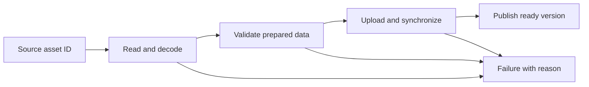

# 27 — Preparing and publishing runtime content

[[Chapter Edition/03 - Game Engine/00 - Reading Map|Reading map]] · [[Chapter Edition/03 - Game Engine/26 - Descriptor arrays and backend limits|Previous chapter]] · [[Chapter Edition/03 - Game Engine/28 - BVH traversal, refitting, and SIMD|Next chapter]]

Authoring data becomes useful only after import, conversion, cache validation, and publication agree on what “ready” means. This chapter makes that pipeline observable and connects prepared content to visibility queries.

**By the end:** Specify the inputs and version key for derived content, and publish it only after validation while rejecting stale asynchronous results.

**Recall question:** If a material or renderer setting changes during import, how does the cache know the output is stale and prevent an old completion from being published?

<!-- Derived from Continuous Notes/Game Engine - From First Frame to Living Worlds.md; source lines 63429–65865; source-span SHA256 fd409f3e205fdda302b2c4d96b39b53484c202b268607ef7756544624eb1eb69. -->

<!-- CHAPTER-SOURCE-BEGIN -->
## Prepare and publish content before promising it is ready

A mesh or texture becomes useful only when identity, preparation, lifetime, and visibility agree. The file-loading path is part of the engine rather than a temporary detail around the renderer.

### Allocate every mip level and keep the sampler synchronized with it

A mipmap chain contains progressively smaller versions of the same image. For a positive integer largest dimension $d$, the described number of levels is $L=\lfloor\log_2 d\rfloor+1$; a 256-pixel side therefore has levels 256, 128, 64, 32, 16, 8, 4, 2, and 1. A one-level image is not mipmapped. Lower-resolution samples can reduce minification noise and the amount of texture detail filtered for a distant surface, but this episode does not isolate which effect produces its reported improvement. [Kohi #142](https://www.youtube.com/watch?v=xb23Y9o7tP4)

The full resource contract includes image allocation for all levels, views and layout transitions covering those levels, and a sampler whose maximum LOD matches them. The narrated Vulkan path generates each level by blitting from the previous one with linear filtering, after checking that the format supports it. If filtering is unsupported, generation stops. Resize recomputes the level count; reload that changes the count may require a new sampler. Updating only an image’s level count would leave the view, layouts, and sampler inconsistent. [Kohi #142](https://www.youtube.com/watch?v=xb23Y9o7tP4)

The presenter reports a 4K terrain view moving from roughly 16–18 FPS to around 60 and looking smoother. VSync and test conditions vary, with no controlled benchmark or profiler comparison, so this is an observation from the session rather than a verified speedup. [Kohi #142](https://www.youtube.com/watch?v=xb23Y9o7tP4)


### Treat texture layout and transparency as two separate questions

When an image is loaded, first ask how many components each pixel has and in what order. RGB has three color components; RGBA adds alpha, a coverage/opacity value. If a loader reports four components but the upload describes three-component pixels, subsequent bytes are grouped at the wrong boundaries and colors appear corrupted. The lesson demonstrates that mismatch with a logo over a checkerboard at 00:30–03:20 and observes three versus four channels at 02:40–03:00. [BLENDING](https://www.youtube.com/watch?v=N94fHNZEHas&t=30s) [BLENDING](https://www.youtube.com/watch?v=N94fHNZEHas&t=160s)

The source distinguishes the GPU's internal storage format from the format of incoming pixel data. For its example, it chooses an RGB8 internal format with RGB input for three-channel data, and RGBA8 with RGBA input for four-channel data; it rejects other channel counts rather than pretending they work. The branch is built at 03:30–06:55. This is a useful minimum contract, but it does not prove support for grayscale, two-channel, floating-point, compressed, or platform-specific image formats. [BLENDING](https://www.youtube.com/watch?v=N94fHNZEHas&t=210s) [BLENDING](https://www.youtube.com/watch?v=N94fHNZEHas&t=390s)

Correctly uploading alpha does not itself combine a translucent texel with the color already in the framebuffer. Blending is a separate render state that combines a source fragment with a destination pixel. For the common straight-alpha rule shown, the output color is

$$C_{out}=\alpha_s C_s+(1-\alpha_s)C_d,$$

where $C_s$ is the source color, $C_d$ is the existing destination color, and $\alpha_s$ is source alpha. The source enables blending and selects source-alpha and one-minus-source-alpha factors; the explanation starts around 08:35, turns to renderer initialization and API layers around 10:30–16:10, and confirms the resulting checkerboard/logo composite around 16:10–17:35. [BLENDING](https://www.youtube.com/watch?v=N94fHNZEHas&t=515s) [BLENDING](https://www.youtube.com/watch?v=N94fHNZEHas&t=630s) [BLENDING](https://www.youtube.com/watch?v=N94fHNZEHas&t=970s)

The lesson's architecture adds an initialization route through application, renderer, render command, and backend API so OpenGL state is set at the backend boundary. This is a historical Hazel implementation choice described around 11:00–15:50, not a mandatory number of abstraction layers for every engine. The broader principle is to set persistent GPU state deliberately and make the state owner clear. The broken white/transparent areas before blending is corrected are described by the captions around 07:40–09:00, making clear that channel interpretation and compositing are separate fixes. The lesson corrects the output later at 16:10–17:35. A missing blend setup may leave transparent sprites opaque or otherwise incorrect; a state leak can also affect later draws. [BLENDING](https://www.youtube.com/watch?v=N94fHNZEHas&t=460s)

One subtlety is that the shown blend factors are the usual straight-alpha color factors. If textures instead store premultiplied RGB (RGB already multiplied by alpha), the source factor normally changes; mixing these conventions creates dark or bright fringes. Blending for color does not settle alpha-channel accumulation, sRGB/linear-light correctness, sorting of translucent objects, depth writes, or the behavior of cutout materials. Those are unresolved by this episode and need explicit pipeline policy and tests.

Here alpha is opacity for the demonstrated compositing rule. A fourth channel does not inherently mean opacity: the asset format and consuming shader assign its role, which could instead be a mask or another data value.

### Debug texture coordinates before changing sampling policy

A renderer receives geometry and tells the graphics API how to turn it into pixels. Add a texture to a quad and the renderer must carry more than an image handle: each vertex needs a texture coordinate, the shader needs a sampler, and the draw path must bind the matching texture. A **texture coordinate** (often called UV) says which part of an image is sampled at a point on the geometry. For a whole image, the four quad corners commonly use $(0,0)$, $(1,0)$, $(1,1)$, and $(0,1)$. If the vertex layout or buffer omits those values, the texture may bind successfully while every fragment samples the same coordinate. That is a useful debugging distinction: a visible flat patch can indicate valid draw and binding work but invalid UV data.

A disciplined diagnosis isolates each stage. First substitute the UV pair into visible color channels: red should vary with $u$, green with $v$. Then verify the sampler uniform points at the texture unit that the draw code actually binds. After the UVs vary correctly, restore sampling. The described Hazel prototype found that its quad vertex data and layout carried positions but no UVs; adding four corner coordinates and the matching layout element fixed the sample. The example's order matters: “texture is gray” is an observation; checking the coordinates identifies the broken link. [Caption source: 2D Renderer Textures](https://www.youtube.com/watch?v=mW8eW3pLtmk)

Sampling controls explain why the same image can look crisp, blurred, or tiled. A **filter** decides how texels (individual image samples) contribute when the rendered image size differs from the source. Nearest filtering chooses a nearby texel and can preserve sharp pixel edges; linear filtering blends neighboring texels. A **wrap mode** decides what happens when a UV leaves the interval $[0,1]$. Repeat maps the excess back into another copy of the image, so multiplying UVs by $k$ tiles the image about $k$ times across that axis. Clamp-to-edge keeps sampling the border texel instead. These are per-use choices: a repeating floor and a one-off portrait may need different address behavior. The tutorial demonstrates a prototype that hard-codes UV scaling in the shader, then suggests making it a uniform; that is an exercise, not an implemented material system. [Caption source: 2D Renderer Textures](https://www.youtube.com/watch?v=mW8eW3pLtmk)

A texture does not decide which quad appears in front. With a depth buffer, each fragment's depth is compared with the stored depth, and accepted fragments update color and depth according to the configured test and write rules. The prototype discovered that its expected layering did not work because depth testing had not been enabled, then corrected the sign of the depth offset after recalling its right-handed coordinate convention. This is a reminder to check the entire visibility contract: coordinate convention, depth test, depth clear, and draw state. Enabling a depth test alone does not establish a correct ordering policy. Nor does this small 2D example prescribe how every engine should layer sprites; many renderers deliberately use draw order or separate passes instead. [Caption source: 2D Renderer Textures](https://www.youtube.com/watch?v=mW8eW3pLtmk)

### Trace an image from file bytes to a correctly sampled texel

A texture upload crosses several formats and coordinate conventions. The decoder returns CPU bytes plus width, height, and channel count. The renderer must choose a compatible GPU storage format, describe the incoming byte format, upload the bytes, and bind the texture to a unit that the shader sampler reads. Those values answer different questions: an internal format describes GPU storage; the incoming format and element type describe the CPU buffer. A three-channel image, for instance, must not be uploaded as four-channel data simply because the shader declares a sampler.

A useful first test is a tiny asymmetric checkerboard with labeled or contrasting corners. It reveals vertical inversion immediately. The episode finds that the image decoder traverses rows top-to-bottom while the OpenGL path expects its image orientation in the opposite direction, then enables vertical flipping during decode. Only after orientation is correct does it change magnification filtering: nearest filtering preserves hard pixel edges, while linear filtering blends neighboring texels and blurs an enlarged checkerboard. Neither choice is universally right; photographs often benefit from smooth interpolation, while pixel art usually needs crisp sampling. The sample binds the texture to unit zero and sets the sampler uniform to that same unit, making the binding-to-shader link explicit. [Caption source: TEXTURES](https://www.youtube.com/watch?v=qEfohFgQ1-I)

Treat this episode's PNG decoder, OpenGL upload, one-level storage, and manually assigned sampler unit as a historical prototype path. A production asset pipeline may convert source images into engine formats and must make channel policy, color space, mip levels, filtering, wrapping, alpha blending, and resource lifetime explicit. The video itself calls several of those extensions future work; its successful checkerboard is evidence for that narrow path only.


#### From decoded pixels to a sampleable Vulkan texture

A decoded image is only the starting point. The renderer needs a Vulkan image for storage, an image view that describes the usable format and subresource range, and a sampler that says how texture coordinates become filtered pixel values. The lesson introduces these as separate pieces and wraps them in a texture resource carrying size, channel/transparency information, a backend handle, and a generation value. The renderer front end exposes create and destroy operations while the backend owns Vulkan-specific details.

The narrated upload path stages pixels through a CPU-visible, coherent buffer into a device-local image. It transitions the image from undefined to transfer-destination layout, copies the pixels, and then transitions it to shader-read layout. The image view and sampler are created with example settings: linear filtering, repeat addressing, and anisotropy. Those choices depend on the resource's intended use and the device features actually enabled. Layout transitions and upload synchronization also need queue-appropriate scopes; the caption does not provide enough exact code to certify those details.

A build initially fails because shared renderer types do not see the new resource declaration. The narrator moves the include to a common types header used by both front and back ends, reports a successful build and startup, then ends before loading test pixels or changing shaders. This is therefore texture-resource plumbing and upload preparation, not a demonstrated textured draw.

Source reading: [caption source](https://www.youtube.com/watch?v=u-eyZCV_MRs). Captions document the narrated development state; on-screen code and reported builds were not independently reproduced.


#### A completed load still needs permission to enter the world

The workshop can keep drawing while a worker decodes a door texture. The difficult boundary is not just starting the worker. The result must still belong to a live request when it reaches the world.

One workable policy keeps decoding on a worker and publishes through an owning thread:


"Owned input" means that the job can safely use its path, settings, and other parameters until it finishes. A pointer to a local request structure is not safe after that function returns. The result likewise needs an owner until the completion path consumes or releases it. A queue can move ownership without moving a raw allocation; its contract must say which side may free the data at each step.

Consider the request's identity:

| Moment | State |
|---|---|
| Tick 20 | Door slot 7, generation 3 requests a texture; its request identity is copied into the job. |
| Tick 21 | That door is removed. Slot 7 can later be reused with another generation. |
| Tick 23 | The worker completes the old request for slot 7, generation 3. |
| Completion | Resolve the full identity. If it is stale or canceled, release the result instead of applying it to a replacement door. |

A generation check protects logical identity; it does not retroactively make borrowed job memory safe. The worker must already have valid inputs while it runs. Cancellation must also define whether work stops cooperatively or finishes and is discarded. A flag cannot make an object safe to destroy while another thread is still reading it.

Before publication, validate the decoded data and perform any required upload and synchronization. A failed load keeps the documented old or fallback asset. A successful CPU decode is not proof that a GPU image is ready to sample. The simple policy drawn above uploads on the owning thread; engines can choose another arrangement only with explicit graphics-API threading, queue, and lifetime contracts.

This trace extends the fully read jobified-loading lesson by connecting it to the identity and publication rules already developed in this book. It is an original teaching scenario, not a claim that the tutorial implements cancellation and generation validation exactly this way. [Caption source: Jobifying Texture and Mesh Loading](https://www.youtube.com/watch?v=dRxw-C-eBGU).


##### Publish the result of a worker load

Worker-based loading changes the renderer contract: a material may refer to an asset whose GPU resource is not ready. The Kohi loader adds generation markers; packet construction filters meshes until their generation is valid, while texture maps select type-appropriate fallback textures and warn for unknown map uses. Workers read files and decode image data; a completion callback creates and swaps GPU textures on the renderer thread. Resource names are copied before dispatch so jobs do not borrow short-lived caller strings. [Kohi jobified texture and mesh loading](https://www.youtube.com/watch?v=dRxw-C-eBGU)

This keeps GPU upload on the render thread and does not demonstrate synchronization for resources still referenced by submitted GPU work. The stream also invalidates the live texture generation while building a temporary replacement, leaving fallback behavior possible during reload. A stronger policy keeps the old resource published until a validated candidate can be swapped at a safe boundary and retired after users finish; that policy is design guidance, not the demonstrated implementation. The video reports assets appearing during a live scene but provides no controlled performance measure.

#### Reloading code needs a quiet boundary, not just a new file

A library can export the same function names while old pointers still target code about to be unloaded. Event listeners, console commands, function tables, and worker entry points can all retain those pointers. Replacing only the main update callback leaves the rest of the program exposed.

A reload protocol therefore needs a **quiescent boundary**: a point at which the old module will receive no new calls and its relevant calls already in progress have finished. Stop dispatch into it, account for outstanding work, unregister or replace its callbacks, unload and load according to the platform rules, resolve required exports, validate the state contract, then resume. The exact order depends on which code owns teardown, so test both successful reload and failure to load the replacement.

Keep module lifetime distinct from state lifetime. Holding game state outside the library can preserve bytes across reload, but new code must still understand their layout and invariants. A changed structure or callback signature can invalidate that promise. Likewise, a file watcher observing a changed file does not prove that linking has finished or that the file is ready to copy.

The fully read hot-reload session encounters callback ownership and file-sharing problems. The protocol above generalizes the dependency problem rather than claiming that its development implementation is safe for arbitrary concurrent reload. [Caption source: Finalizing Hot-Reloading](https://www.youtube.com/watch?v=U1C9mMrpyF4).

Related foundations: [[Concepts/Ownership and non-owning views|Ownership and non-owning views]].


#### Loading image data means interpreting its layout

The FreeImage episode chooses a library so the engine does not need to write a decoder for every image format. Its example first asks the file signature what format the bytes contain, with the filename extension as a fallback, then loads a bitmap and reads its width, height, and pixel data. The integration also requires the application to find the library headers, linker files, and runtime DLL.

A pointer to pixel bytes is not yet a complete description of an image. The reader must know the bits per pixel, channel representation and order, row pitch, and which direction the rows are traversed. The live debugging mistakes in this episode show why guessing from width × height or treating one-byte channels as larger integers leads to misleading values. The author eventually uses library documentation and examples, then tests a deliberately simple image with distinct color blocks to expose the vertical row order. The transcript does not finish a general-purpose texture loader or specify all error and lifetime behavior.
#### From a pixel buffer to a visible sprite

A texture tutorial often looks like a short path: decode an image, create a GPU texture, bind it, draw a quad. The Sparky episode shows why every arrow in that path deserves a check. The author verifies a known pixel in a tiny image, then discovers that channel order (RGB versus BGR) changes the displayed result. He also questions whether FreeImage retains, copies, or releases the pixel buffer after upload. The episode ends with a texture finally visible after correcting the format, while noting that clean integration into the batch renderer is future work. That is a useful debugging sequence: validate decoded bytes independently, identify channel layout, then test GPU upload and sampling. It is not a finished texture-resource design, and the memory-lifetime question is left unresolved (The Cherno, “Ep. 15: Textures,” 00:00–00:50:24).

The later maintenance episode supplies the missing lifetime step: copy decoded pixels into engine-owned bytes before calling `FreeImage_Unload` on the bitmap. A borrowed pixel pointer refers to storage controlled by the bitmap; releasing the bitmap ends that borrow. Keep the image's dimensions, row pitch, channel layout and row direction with the owned bytes so a later upload interprets them correctly. A different design could retain the decoder object until its pixels are consumed, but it must still give that object an owner. The GPU backend also defines when upload staging data can be released; copying CPU pixels does not settle that separate lifetime. This completes the earlier texture experiment's unresolved question without treating its guessed ownership as a rule ([maintenance episode, 01:11:12](https://www.youtube.com/watch?v=CKhGMoTNPOo&t=4272)).

### Make loading a state transition rather than a hopeful pointer

A texture on disk is not yet a texture the renderer can sample. The file may need reading, decoding, format conversion, GPU allocation, upload, and synchronization. An **asset** is authored content identified and prepared for use; a **runtime resource** is its usable representation. One source asset can produce several runtime variants.

Represent the important states. `Unrequested` has no scheduled work. `LoadingCPU` means file and decoding work is underway. `WaitingForGPU` means prepared bytes await graphics work. `Ready` means the promised representation is usable under its synchronization contract. `Failed` retains a useful diagnostic. Use the state to decide whether to draw the real texture, a fallback, or nothing.



**Original example:** two crates use the same painted metal. They can share an immutable texture while keeping different transforms. If an editor brush changes the shared texture in place, both may change. If only one should change, create or identify a distinct resource instance. Godot's documentation provides a concrete example of separating behavior-bearing nodes from resource data and sharing loaded resources. Its particular loading and caching rules are Godot rules, not automatic properties of C++ pointers. [Godot resources](https://docs.godotengine.org/en/stable/tutorials/scripting/resources.html).

A **cache** retains a result for reuse. Its key must include what affects the result: asset identity, relevant import settings, target platform or format, and content version. If two requests use the same filename but different color-space assumptions, filename-only caching can return the wrong texture. **Invalidation** means recognizing that a retained result is no longer appropriate. It is part of correctness before it is a performance technique.

For **hot reload**, replace a resource while the application continues running. Read and validate the new version independently. Publish it at a safe boundary only after it is complete. Preserve the old working version if replacement fails, and retire its GPU storage only after outstanding users finish. A half-decoded replacement should never become the globally visible “current” texture.

#### Resource streaming is a publication protocol, not just a background read

The previous example correctly refuses to publish a stale result; the deeper contract has four different owners. The **request owner** holds a logical asset ID and monotonically changing generation; an **I/O worker** owns file bytes and decompression scratch; the **CPU asset representation** is parsed and validated; a **render/resource owner** schedules GPU upload and, only after its required synchronization, publishes a resident handle at a defined frame boundary. `read()` returning does not make a texture safe to sample. A compressed file passing its checksum does not establish the correctness of offsets, dimensions, decompressed allocation bounds or shader-compatible pixel layout. CPU-ready, upload-submitted, GPU-ready and publicly visible are different states even if a toy engine initially combines some of them.

A useful state machine is `Absent -> Requested -> CPUReady -> UploadQueued -> Resident -> Retiring -> Absent`, with separate Failed/Cancelled exits and a published generation. Each asynchronous result carries `(asset ID, request generation, content hash/version)`. A cancellation, world reset or replacement increments the generation. On arrival, publish only if the slot still expects that generation **and** the result passed parsing and budget checks. A worker is allowed to finish after cancellation; it is *not* allowed to overwrite a newer version. Avoid storing a pointer to a request-stack object or a borrowed file path inside an unjoined task. Hot reload follows the same rule: build a complete new generation beside the old, then atomically swap the owning handle at a safe boundary and retire the previous generation after its last GPU/CPU user.

Budgeting is a peak-lifetime problem, not just `sum(resident texture sizes)`. Let `R` be committed resident bytes, `Q` be reserved bytes for work in flight, `S` be temporary decode/staging bytes, `F` be resources retired but still referenced by GPU commands, and `B` be the relevant memory budget. A conservative admission policy maintains `R+Q+S+F <= B` for memory classes that share the same allocator or hardware budget; separate CPU and GPU heaps require separate inequalities. The C++ witness simplifies this to `R+Q <= B` because it deliberately does not model staging, driver overhead or deferred GPU retirement. When an estimate proves too small, the witness refuses publication; a real loader can request a larger reservation or fail cleanly, but must never silently overrun its budget.

A numerical trace clarifies the cancellation invariant. Budget `B=128` bytes (illustrative, not real texture sizes); issue generation 1 for a 64-byte asset and reserve 64. Cancel it, release its reservation and increment the generation. Request again at generation 3 for an estimated 40 bytes. A late completion for generation 1 must be discarded, without changing `Q` or `R`. Successful decoding for generation 3 permits publication of 36 actual bytes: release `Q=40`, acquire `R=36`, and leave the remaining capacity available. If a live render snapshot holds one pin, eviction must fail. Removing the pin does not itself prove *GPU* completion; the true renderer additionally checks its submission fence or completion event before recycling native resources.

Priority needs a defined policy. A visible doorway texture might have an imminent deadline; a far-away decoration may be prefetched; a speculative request must not starve the objects required for collision or gameplay. Priority can be adjusted as camera movement changes, but cancellation/reprioritization must be separate from identity. Measure queue wait, bytes/s, CPU decode, upload time, peak allocations, deadline misses and stale-completion count. A successful mean load latency can conceal a traversal hitch at a ninety-ninth-percentile transition. The original Chapter 6 resource-management discussion motivates these concerns; this contract states what present-day asynchronous publication and frame-in-flight ownership must actually enforce.


#### From a simulated asset job to real concurrent decoding — Gregory integration

The previous asset-publication reconstruction establishes the *logical* boundary: a worker's answer cannot mutate live engine resources merely because it has finished. That rule becomes harder when completion order is not known in advance. In a game that streams assets as the camera moves, the player can enter another world cell while a disk read or texture decode is running, and a higher-priority request can finish first on a different worker. A single map entry named `cell7/door/albedo` might therefore have several historical jobs with the same textual path but different *intent*. We need a way to recognize which result still owns permission to publish.

Consider one timeline. At tick 100 the renderer still draws version A, while worker 1 begins decoding proposed version B. The player then exits the cell and the engine cancels B. At tick 101 the player re-enters; worker 2 decodes newer version C and finishes before B. Publishing C is valid. Publishing B afterward would silently roll the asset back to the cancelled generation. The result's *generation token*, together with a slot that records its current pending generation, prevents this. Cancellation does not have to halt a CPU thread immediately; it must revoke the result's authority. It is often preferable to let a bounded task finish, discard its obsolete completion and avoid ad-hoc mid-decoder interruption protocols. Work cancellation and *publication cancellation* are deliberately distinct concepts.

For one asset slot, let `g` be the current request generation. A completion `c` is eligible only when the slot is pending and `c.generation == g`; the asset identifier must also resolve to that slot. A successful decode then enters a **CPU-ready, not-yet-published** state. That state means bytes passed a format check. It does not imply the renderer has uploaded them, transitioned their image layout or finished any GPU transfer. A production backend must supply an explicit upload-ready fact before the owner commits the new render-visible descriptor. In the small reference below, the `publish` call represents that permission and **does not perform a GPU upload**.

Ownership matters as much as generations. A caller's temporary `std::span` or a pointer to stack-owned image bytes is unsuitable for a job that may outlive the call. In this laboratory, each `Job` owns a `std::vector<std::uint8_t>`; moving a job into the queue transfers those bytes without lending a view into disappearing memory. The queue and completions are both protected by one mutex. Workers wait on a condition variable whose predicate says either work exists or shutdown was requested; every wait re-checks that predicate after wakeup. Only the owning resource thread invokes `Residency::request`, `cancel`, `accept`, `publish`, `drawn`, `gpu_completed` and `evict`. This single-writer rule is an important part of the example's race freedom: the map and budget counters are **not** concurrently mutable data structures.

The worker pool chooses the highest priority among **queued** jobs. Priority is a scheduling hint, not a deadline guarantee, because an already running decode is not preempted. With two workers and a third urgent request, the urgent request may still wait if both workers are occupied. A production pipeline should additionally bound the queue, propagate a resource-class priority, use back-pressure, consider deadline or camera-distance aging, and measure time from request to publication. A condition-variable wakeup only announces availability; it is not a fairness policy. The reference shutdown drains queued jobs and joins workers. A test gate that remains closed during destruction would block joining, so the harness explicitly releases gates before the pool exits. A production task API needs a shutdown/cancel policy strong enough to avoid that class of deadlock.

The tiny package parser illustrates another boundary. Its first four bytes encode an unsigned little-endian payload length. The code first demands a five-byte minimum containing header plus checksum, decodes length with shifts, then checks both an application-defined maximum and equality with `raw.size()-5` **before allocating the payload**. It finally validates an XOR checksum. XOR is chosen only to make the fixture inspectable. It is **not a cryptographic authenticity check** and does not protect against deliberate tampering or many transmission errors. A real asset package would validate schema/version, offset and count arithmetic, compression ratios, file provenance, cryptographic integrity as appropriate, and resource-specific semantic invariants. Never trust a file-provided size simply because it fits a host integer type.

Memory budgeting requires more care than measuring the current asset payload. Let `R` denote charged live resident bytes, `Q` denote reserved bytes for accepted pending requests and `F` denote old resident bytes held until previously submitted GPU uses complete. Our simplified accounting invariant is

$
B_{\mathrm{charged}} = R+Q+F \le B_{\mathrm{limit}}.
$

This model deliberately counts one reservation per pending request and keeps the *old* hot-reloaded texture charged until the last modeled frame fence has completed. For a 32-byte toy budget, a four-byte version C occupies four bytes. Requesting an eight-byte replacement temporarily raises the charge to 12, while the old four-byte version is still live. After decoding three bytes and publishing, the eight-byte reservation becomes three bytes of new residency, but the old four bytes remain in `F`: **seven bytes** are charged. A completion through fence 4 cannot release an old resource last read by fence 5; after fence 5 completes, the charge falls to three bytes. This is a conservation-style accounting test, not a claimed GPU observation.

Real peak memory may be much higher than this convenient equality. Encoded input and decoder output can coexist, decompression allocators can hold scratch buffers, staging and GPU copies may overlap, sparse residency can have page-granularity costs, and driver allocations are not fully represented by visible texture sizes. In production, either charge each distinct owner including input, decoded bytes, staging, live resources and retiring generations or state plainly which components your budget excludes. An admission estimate smaller than the eventual payload must not silently make a slot over-budget; the reference rejects any completion whose decoded size exceeds its reserved estimate. A stronger implementation can re-reserve with a checked growth path if a trustworthy format justifies it.

The two clocks in this example have different purposes. A **request generation** is a logical identity epoch and invalidates stale CPU results. A **GPU completion fence value** is an execution-order observation needed to determine when old GPU-visible storage is no longer in use. Incrementing a generation does not make submitted GPU commands stop reading their old descriptor. Conversely, a finished GPU command does not grant a cancelled CPU decode authority to publish. They solve different races and therefore must not be conflated. The example's fence values are controlled integers used to exercise retirement policy, **not** Vulkan timeline semaphore values or Metal command-buffer completion callbacks.

The full C++20 reconstruction below executes two actual worker threads. A `std::promise` gate deliberately blocks the first worker after it has taken the old request, then submits the newer higher-priority request for the other worker to complete. That makes the stale-result hazard reproducible without relying on sleeps or a fast computer. It next tests hot-reload retirement, malformed-byte rejection and failed budget admission. An invalid replacement leaves the last valid resident asset intact. All validation happens through runtime checks, so `-DNDEBUG` does not turn the correctness tests off.

Run the independent source with a compiler that supports C++20 and threads:

```sh
clang++ -std=c++20 -O2 -DNDEBUG -Wall -Wextra -Wpedantic -Werror -pthread \
  -fsanitize=address,undefined -fno-omit-frame-pointer \
  tools/labs/threaded_asset_publication_lab.cpp -o /tmp/threaded_asset_publication_lab
/tmp/threaded_asset_publication_lab
```

The tested local build also passed GCC C++20 optimized release compilation. These tests establish the reference model's observed behavior on the tested hosts and sanitizers; they do not prove that every possible interleaving has been explored. For that level of confidence, add repeated stress with randomized ordering, ThreadSanitizer where supported, scheduler fault injection, cancellation at every job phase, queue-capacity tests, device-loss simulation and integration tests against a backend's actual completion signaling. `std::thread` success is evidence of genuine concurrency, but a hypothetical GPU fence does not become a real one by being tested in a CPU program.

**Complete runnable source, identical to `tools/labs/threaded_asset_publication_lab.cpp`:**

```cpp
// C++20 reference: real worker threads plus generation-safe asset publication.
// GPU upload and render fences are deterministic models, not Vulkan/Metal calls.
#include <algorithm>
#include <chrono>
#include <condition_variable>
#include <cstddef>
#include <cstdint>
#include <deque>
#include <future>
#include <iostream>
#include <map>
#include <memory>
#include <mutex>
#include <optional>
#include <stdexcept>
#include <string>
#include <string_view>
#include <thread>
#include <utility>
#include <vector>

namespace asset_lab {
void demand(bool ok,std::string_view why) {
    if (!ok) throw std::runtime_error(std::string(why));
}
// A deliberately tiny trusted-size package format. The byte count in its
// header is NOT trusted until checked against the actual encoded buffer.
std::vector<std::uint8_t> pack(const std::vector<std::uint8_t>& bytes) {
    demand(bytes.size()<=32,"fixture payload too large");
    std::vector<std::uint8_t> out;
    const auto n=static_cast<std::uint32_t>(bytes.size());
    for (int i=0;i<4;i++) out.push_back(static_cast<std::uint8_t>(n>>(8*i)));
    std::uint8_t check=0;
    for (auto b:bytes) {out.push_back(b);check^=b;}
    out.push_back(check);
    return out;
}
struct Decode {
    bool valid=false;
    std::vector<std::uint8_t> bytes;
    std::string error;
};
Decode unpack(const std::vector<std::uint8_t>& raw) {
    if (raw.size()<5) return {false,{},"truncated package header"};
    std::uint32_t n=0;
    for (unsigned i=0;i<4;i++) n|=std::uint32_t(raw[i])<<(8*i);
    // Check BOTH a semantic maximum and the encoded extent before allocation.
    if (n>32 || std::size_t(n)!=raw.size()-5)
        return {false,{},"payload size mismatch"};
    std::uint8_t check=0;
    for (std::size_t i=4;i<raw.size()-1;i++) check^=raw[i];
    if (check!=raw.back()) return {false,{},"checksum mismatch"};
    return {true,std::vector<std::uint8_t>(raw.begin()+4,raw.end()-1),{}};
}

struct Job {
    std::string asset;
    std::uint64_t generation=0;
    int priority=0;
    std::vector<std::uint8_t> encoded; // Owned job input; no borrowed caller span.
    std::shared_future<void> may_finish; // Optional controlled test gate.
    std::shared_ptr<std::promise<void>> started;
};
struct Completion {
    std::string asset;
    std::uint64_t generation=0;
    Decode result;
};

class DecoderPool {
    std::mutex guard_;
    std::condition_variable work_ready_,completion_ready_;
    std::deque<Job> queued_;
    std::deque<Completion> completed_;
    bool closing_=false;
    std::vector<std::thread> workers_;
    void work() {
        for (;;) {
            Job job;
            {
                std::unique_lock lock(guard_);
                work_ready_.wait(lock,[&]{return closing_ || !queued_.empty();});
                if (closing_ && queued_.empty()) return;
                // Highest priority first among jobs not yet started. In-flight
                // work cannot be preempted by changing a later request priority.
                auto best=std::max_element(queued_.begin(),queued_.end(),
                    [](const Job& a,const Job& b){return a.priority<b.priority;});
                job=std::move(*best);
                queued_.erase(best);
            }
            if (job.started) job.started->set_value();
            if (job.may_finish.valid()) job.may_finish.wait();
            Completion done{std::move(job.asset),job.generation,unpack(job.encoded)};
            {
                std::lock_guard lock(guard_);
                completed_.push_back(std::move(done));
            }
            completion_ready_.notify_one();
        }
    }
public:
    explicit DecoderPool(unsigned concurrency) {
        demand(concurrency>0 && concurrency<=8,"invalid worker count");
        for (unsigned i=0;i<concurrency;i++)
            workers_.emplace_back([this]{work();});
    }
    DecoderPool(const DecoderPool&)=delete;
    DecoderPool& operator=(const DecoderPool&)=delete;
    ~DecoderPool() {
        // Caller must release any external test gates before destruction.
        {std::lock_guard lock(guard_);closing_=true;}
        work_ready_.notify_all();
        for (auto& worker:workers_)worker.join();
    }
    void submit(Job job) {
        {std::lock_guard lock(guard_);
            demand(!closing_,"queue closed");queued_.push_back(std::move(job));}
        work_ready_.notify_one();
    }
    Completion await_completion() {
        std::unique_lock lock(guard_);
        demand(completion_ready_.wait_for(lock,std::chrono::seconds(5),
               [&]{return !completed_.empty();}),"worker completion timed out");
        Completion out=std::move(completed_.front());
        completed_.pop_front();
        return out;
    }
};

struct Resident {
    std::vector<std::uint8_t> bytes;
    std::uint64_t last_draw_fence=0;
};
struct Retired {
    std::size_t bytes=0;
    std::uint64_t last_draw_fence=0;
};
struct Slot {
    std::uint64_t generation=0;
    std::size_t pending_estimate=0;
    bool pending=false;
    bool cpu_ready=false;
    std::vector<std::uint8_t> decoded;
    std::optional<Resident> current;
};
class Residency {
    std::map<std::string,Slot> slots_;
    std::vector<Retired> retired_;
    const std::size_t budget_;
    std::size_t used_=0;
    std::uint64_t completed_fence_=0;
    unsigned stale_completions_=0;
    unsigned failed_packages_=0;
    void retire_or_free(Resident&& old) {
        if (old.last_draw_fence<=completed_fence_) used_-=old.bytes.size();
        else retired_.push_back({old.bytes.size(),old.last_draw_fence});
    }
public:
    explicit Residency(std::size_t limit):budget_(limit) {}
    // request() is called by the owning gameplay/resource thread only.
    std::uint64_t request(const std::string& name,std::size_t estimated_bytes) {
        Slot& s=slots_[name];
        if (s.pending) cancel(name);
        demand(estimated_bytes<=budget_-used_,"budget rejected request");
        used_+=estimated_bytes;
        s.pending=true;s.cpu_ready=false;s.pending_estimate=estimated_bytes;
        s.decoded.clear();
        return ++s.generation;
    }
    void cancel(const std::string& name) {
        auto it=slots_.find(name);
        demand(it!=slots_.end() && it->second.pending,"cancel nonpending");
        Slot& s=it->second;
        used_-=s.pending_estimate;
        s.pending=false;s.cpu_ready=false;s.pending_estimate=0;
        s.decoded.clear();
        ++s.generation; // Any worker may still finish, but may not publish.
    }
    bool accept(Completion done) {
        auto it=slots_.find(done.asset);
        if (it==slots_.end() || !it->second.pending ||
            it->second.generation!=done.generation) {
            ++stale_completions_;return false;
        }
        Slot& s=it->second;
        if (!done.result.valid || done.result.bytes.size()>s.pending_estimate) {
            ++failed_packages_;cancel(done.asset);return false;
        }
        s.decoded=std::move(done.result.bytes);
        s.cpu_ready=true;
        return true;
    }
    // Called only after a real renderer would prove its new upload complete.
    bool publish(const std::string& name) {
        auto it=slots_.find(name);
        if (it==slots_.end()) return false;
        Slot& s=it->second;
        if (!s.pending || !s.cpu_ready) return false;
        const std::size_t actual=s.decoded.size();
        // The estimate was precharged. Transfer its charge to actual residency.
        used_-=s.pending_estimate-actual;
        s.pending=false;s.cpu_ready=false;s.pending_estimate=0;
        if (s.current) retire_or_free(std::move(*s.current));
        s.current=Resident{std::move(s.decoded),0};
        return true;
    }
    std::optional<std::vector<std::uint8_t>> read(const std::string& name) const {
        auto it=slots_.find(name);
        if (it==slots_.end() || !it->second.current) return std::nullopt;
        return it->second.current->bytes;
    }
    void drawn(const std::string& name,std::uint64_t fence) {
        auto it=slots_.find(name);
        demand(it!=slots_.end() && it->second.current,"draw unresolved asset");
        demand(fence>completed_fence_,"cannot submit to an already completed fence");
        it->second.current->last_draw_fence=
            std::max(fence,it->second.current->last_draw_fence);
    }
    void gpu_completed(std::uint64_t fence) {
        demand(fence>=completed_fence_,"GPU completion clock reversed");
        completed_fence_=fence;
        auto it=retired_.begin();
        while (it!=retired_.end()) {
            if (it->last_draw_fence<=fence) {
                used_-=it->bytes;
                it=retired_.erase(it);
            } else ++it;
        }
    }
    void evict(const std::string& name) {
        Slot& s=slots_.at(name);
        demand(!s.pending && s.current.has_value(),"cannot evict pending/missing");
        retire_or_free(std::move(*s.current));
        s.current.reset();
        ++s.generation;
    }
    std::size_t charged()const{return used_;}
    std::size_t retired_count()const{return retired_.size();}
    unsigned stale()const{return stale_completions_;}
    unsigned failed()const{return failed_packages_;}
};
} // namespace asset_lab

int main() {
    using namespace asset_lab;
    DecoderPool workers(2);
    Residency budget(32);
    const std::string name="cell7/door/albedo";
    std::promise<void> release_old;
    const auto old_gate=release_old.get_future().share();
    auto started=std::make_shared<std::promise<void>>();
    const auto begun=started->get_future();
    const auto gen1=budget.request(name,12);
    workers.submit({name,gen1,1,pack({1,2,3,4}),old_gate,started});
    demand(begun.wait_for(std::chrono::seconds(5))==std::future_status::ready,
           "old request did not start");
    budget.cancel(name); // Worker 1 is already decoding generation 1.
    const auto gen3=budget.request(name,8); // A newer request reuses the slot.
    workers.submit({name,gen3,10,pack({9,8,7,6}),{},nullptr});
    const auto next=workers.await_completion(); // Worker 2 can finish first.
    demand(next.generation==gen3 && budget.accept(next),"new decode not accepted");
    demand(budget.publish(name),"new asset publication failed");
    demand(budget.read(name).value()==std::vector<std::uint8_t>({9,8,7,6}),
           "wrong bytes published");
    release_old.set_value();
    const auto late=workers.await_completion();
    demand(late.generation==gen1 && !budget.accept(late) && budget.stale()==1,
           "old completion overwrote newer asset");
    demand(budget.charged()==4,"cancelled request leaked reserved bytes");

    budget.drawn(name,5); // Old generation is referenced by GPU work.
    const auto gen4=budget.request(name,8);
    workers.submit({name,gen4,5,pack({4,3,2}),{},nullptr});
    demand(budget.accept(workers.await_completion()),"replacement decode failed");
    demand(budget.publish(name),"replacement publish failed");
    demand(budget.retired_count()==1 && budget.charged()==7,
           "old GPU resource freed before completion");
    budget.gpu_completed(4);
    demand(budget.charged()==7,"premature GPU resource retirement");
    budget.gpu_completed(5);
    demand(budget.retired_count()==0 && budget.charged()==3,
           "completed GPU frame did not retire its resource");

    // Malformed bytes must not replace an existing valid published generation.
    const auto malformed=budget.request(name,8);
    auto invalid=pack({1,1,1});invalid.back()^=0xff;
    workers.submit({name,malformed,1,invalid,{},nullptr});
    demand(!budget.accept(workers.await_completion()) && budget.failed()==1,
           "bad checksum accepted");
    demand(budget.read(name).value()==std::vector<std::uint8_t>({4,3,2}),
           "malformed hot reload replaced good bytes");
    bool rejected=false;
    try { (void)budget.request("huge",32); }
    catch (const std::runtime_error&) {rejected=true;}
    demand(rejected && budget.charged()==3,
           "rejected over-budget request changed accounting");
    budget.evict(name);
    demand(budget.charged()==0,"asset not released after last user");
    std::cout << "PASS actual workers, stale completion, owned bytes, "
                 "checksum, hot reload, budget and mock GPU-fence retirement\n";
}
```

#### Runtime texture replacement and safe publication

The texture-loading example decodes PNG data through `stb_image`, requests four channels, and flips vertically to match the engine's coordinate convention. It creates a GPU texture and tracks a generation number used by the renderer's handle resolution. A key event asks the system to load alternate named textures while the application runs. The speaker describes the resulting swap, but no independent frame inspection was performed.

For a robust reload, keep the currently published texture usable while the replacement is decoded and fully created. Publish the candidate only after its image, view, sampler and any dependent descriptor state have passed validation. If any step fails, discard the candidate and preserve the old texture. After publication, retire the old GPU resources only when all submissions that could reference them have completed. The captioned sequence does not establish these transactional or GPU-lifetime guarantees; invalidating the active generation during load and destroying the previous image immediately can cause a fallback interruption or race with in-flight work.

Source reading: [caption source](https://www.youtube.com/watch?v=2IxHj52-Kag). Captions document the narrated development state; on-screen code and reported builds were not independently reproduced.


#### A named texture system with reference counting

As texture loading grows, keeping filenames, GPU uploads, fallback handling and lifetime rules inside the renderer makes unrelated parts depend on renderer internals. This episode moves those responsibilities into a texture system. Callers acquire a texture by name and receive a pointer; repeated acquisitions share the same loaded texture. A reference count tracks how many users hold it. The caller chooses auto-release on the first acquisition; when the count later reaches zero, an auto-release texture is destroyed, while a retained texture stays loaded. The in-memory default texture has a separate accessor and cannot be released through the ordinary name-based path.

The system preallocates one memory block for its state, texture array and name lookup table. A fixed maximum controls capacity. An invalid handle marks unused array entries, and a linear scan finds the next free slot. This avoids per-texture allocation but means acquisition cost can grow with the configured capacity, and a full array returns failure. The example later configures 65,536 entries. File loading still assumes a particular asset path; the presenter leaves a separate resource-loader layer as future work.

The new hash table can store copies or pointers and accepts caller-provided backing memory. It does not own pointer values. Its deliberately simple hash maps a name to one array slot and overwrites on collision. That is a teaching shortcut with a serious production implication: distinct names can map to the same slot, so this implementation does not reliably preserve every key. A real lookup structure needs collision resolution and must check the original key rather than treating a hash bucket as a unique identity. The episode reports 14 unit tests passing for the implemented table, including pointer/value paths and invalid API combinations. That narrated result is not independently reproduced.

When a material's texture changes, a descriptor cannot be considered current based on generation number alone: two different textures may each have generation one. The debug swapping path initially misses this distinction. Adding texture identity to per-frame descriptor state lets the update check compare both identity and generation, after which the presenter reports the swap behavior works.

Source reading: [caption source](https://www.youtube.com/watch?v=hDpzfAdW3vw). Captions document the narrated development state; on-screen code and reported builds were not independently reproduced.


### Put file access behind an engine contract

Imagine the same level package ships on a console disc, a developer machine, and a downloaded patch. If gameplay code opens a platform-specific path directly, every feature that loads an asset inherits that platform detail. A filesystem service can give the rest of the engine one stable set of operations: normalize or combine paths, open and close files, read data, enumerate directories where needed, and submit asynchronous reads for streaming. The platform layer then maps those operations to the available storage. The useful boundary is narrow: wrap the operations the engine actually uses, rather than copying every function from each operating system's API. (Game Engine Architecture, PDF pp. 284-290.)

Path strings also have meaning beyond their characters. `assets/levels/cave.pack` might be relative to a known content root; `/` could mean a mount point; a list of candidate roots could be a search path. If a shipped build already knows where every asset is, resolving a name by searching several directories on every request adds work and makes it harder to know which copy was loaded. A cooked asset manifest can instead map a stable asset identifier to one package location. This is an application of the source's distinction between a path and a search path, not a format mandated by the book. (Game Engine Architecture, PDF pp. 286-288.)

The thread and buffering examples connect storage to frame-time budgets. A synchronous read makes the caller wait for the transfer. That may be acceptable on a loading screen; it is risky in the middle of a frame if the asset is not already available. A streaming request should therefore have an explicit completion point and a destination whose lifetime outlasts the I/O. Logging has a similar pattern: collect bytes in memory, then let a worker write them, so formatting and disk stalls do not block the main loop. The engine still needs a policy for a full log buffer, shutdown flushing, and worker errors; those details are outside the assigned pages. (Game Engine Architecture, PDF pp. 288-290.)


#### Give game code a stable asset address

A model can live in `D:/Projects/MyGame/Assets/Characters/Hero/hero.fbx` on one workstation, in a packaged archive on a build server, and somewhere else on a player’s machine. If gameplay code stores each machine’s physical path, moving a project or packaging it changes the game code too. A virtual file system inserts a stable address between the game and storage: gameplay asks for `/models/hero.fbx`, while the project mounts that virtual directory onto one or more physical locations. The 2016-era Sparky development log describes mounts searched in order, so a later location can supply a file missing from the first. This keeps references stable while storage layout changes. The same interface could eventually read a packed binary archive, but that was presented as future work in this log, not as an implemented feature (Sparky Engine Dev Log #12, 00:03:56–00:06:25).

A stable address does not by itself guarantee a correct asset. The lookup still needs defined precedence, readable error messages, and tests for missing or duplicate names. A mount table is part of the project’s content contract: it determines what a path means at runtime. Treating it as explicit data makes a build easier to reproduce than relying on a developer’s accidental local directory structure.

### A content browser starts with a root and a navigation rule

A directory panel needs to know which files it is allowed to show and how the current location changes when a user opens a folder. The Hazel prototype starts with an `assets` root, enumerates entries with the C++17 filesystem directory iterator, and tracks a current path. Clicking a directory joins its filename to the current path; a back action moves to the parent until the root is reached. The panel uses `filename()` for labels, because `stem()` removes the final dotted suffix even when the entry is a directory. [Content Browser/Asset Panel](https://www.youtube.com/watch?v=aBuPmOGC7hU)

Keep filesystem paths as paths while navigating. Convert them to display text only at the UI boundary. The episode tries to create a directory with a Russian name and crashes in its string conversion path. That is evidence the shown implementation has a Unicode bug, not evidence that `std::filesystem::path` itself cannot represent the name. A project should define its path encoding and conversion policy, then test names that include accents, CJK characters, and emoji on each supported platform.

Scanning the directory every UI frame makes new files appear immediately in this prototype, but it also makes filesystem work part of the immediate-mode rendering path. For larger projects, maintain a cached listing and refresh it when the user requests it or when a file watcher reports a change. That requires the root to come from the active project rather than a hard-coded relative directory. The episode discusses these improvements but implements neither a project model nor a cache.

#### Keep filesystem work out of the editor’s frame loop

An asset browser should treat a directory listing as data to prepare, not as work to repeat while drawing the panel. The Hazel walkthrough enumerates a folder to build its item buttons, then points out that it could retain the entries and draw from the saved list each frame. It also offers a once-per-second scan as a way to notice files added outside the editor. The episode reports no timing measurement, so this is a design direction rather than a demonstrated performance result. [Content Browser/Asset Panel, 00:34:50–00:35:32; source `src-a82bb4f942703caa7b7f`, point p-000043, unit `u-7cacdd05265ba993707afb39`]

Separate three operations: **enumerate** the current directory, **present** its cached entries in the UI, and **refresh** the cached model when something may have changed. When the user opens a folder, enumerate that folder once and store entries with project-relative paths, stable UI IDs and file kinds. Each UI frame draws the prepared in-memory list. Filtering and sorting can be recomputed when the entries or the chosen filter/sort keys change, rather than automatically repeating all preparation every frame. Refresh on navigation, an explicit refresh action, a project change, or a file-watcher notification. A periodic refresh is a simple fallback when external tools may alter the folder, but the interval is a responsiveness-versus-I/O policy; it is not a universal one-second requirement.

A useful trace is easy to inspect: open `Assets/Materials`, count one directory scan, then render the panel for many frames and confirm the count stays unchanged. Create `wood.png` externally. Before refresh, the cached panel may not show it; after the invalidation or refresh event, it should appear once without duplicate IDs. Navigate into a child folder and back to confirm the new listing replaces the old one. If the browser scans every frame, a large or slow directory can make frame time depend on disk and metadata operations. If the cache never invalidates, it presents stale content. Logging scan count, duration and entry count makes those two failure modes visible.

The cache should not own the meaning of an asset. Keep the displayed label separate from its project-relative identity, and resolve that identity through the project’s asset boundary before opening or assigning it. The source’s path walk also hits a non-ASCII folder-name crash but leaves the cause unresolved; it is evidence to test encoding conversion at the filesystem/UI boundary, not a proven fix by switching to wide strings. The raw source says a cached entry vector and periodic scan are possible improvements; the invalidation contract and trace above are original teaching additions, not claims that the tutorial implemented them.


Asynchronous refresh needs an identity guard too. Suppose opening Materials starts request 41. Before it completes, the user opens Textures and starts request 42. Request 42 finishes first; the active panel now shows Textures. When request 41 completes, it must not replace that panel with Materials merely because its result arrived last. Match the result's project, directory and request generation to the active request before publication. A multi-folder cache may retain the Materials result under its own key, but it still must not publish it as the active Textures view. Canceling a worker is an optimization; rejecting stale publication is the correctness rule.

| Event | Active folder / request | Safe publication decision |
|---|---|---|
| Open Materials | Materials / 41 | Start its scan; show a declared loading or prior-list state. |
| Open Textures before 41 finishes | Textures / 42 | Start 42; 41 no longer owns this panel. |
| Result 42 arrives | Textures / 42 | Publish the complete Textures model. |
| Result 41 arrives late | Textures / 42 | Do not replace the active view; optionally cache it under Materials. |

Build a complete listing off to the side and publish it as one replacement. On a read failure, keep a stated policy: retain the prior listing with a visible stale/error indication, or replace it with an explicit failed state. Do not expose a half-refreshed mixture as if it were the current folder. A file-watcher event is an invalidation hint that prompts reconciliation; coalesced or missed events are a reason to rescan, not proof that the cached list is complete. A renamed path may change an entry's UI identity; persistent asset identity, if required, needs the project's separate asset-ID policy. These rules are original development of the cache proposal, not behavior verified in the recorded editor.


#### Source-to-volume map

- Existing foundations: `### Keep source assets, import choices, and runtime packages distinct`, `### Treat assets as references plus a pipeline`, and `### Publish a cache only after it is a valid asset`.
- This source adds the browser's root/navigation mechanism and the observed non-ASCII path failure; it does not repeat import or runtime asset-pipeline foundations.
- Limits: English automatic captions; the panel is a basic browser, with no thumbnail rendering, cached scan, project-relative root, or texture drag-and-drop in this episode.


### Resource and asset systems are about reliable identity and lifetime

The word “asset” often means a source or imported file that the project can identify and package. A “resource” often means a runtime object ready for use. A texture image on disk is an asset; a GPU image and sampler currently loaded for rendering are runtime resources. The exact naming varies by engine, but the distinction helps reason about import, load, cache, hot reload and release.

The series contains a resource-system episode ([video](https://www.youtube.com/watch?v=ubin1HH_kqw)) and later a texture system. The current retrospective says the asset/resource systems needed more work: requests were verbose, the asset system did not immediately return a pointer the way the resource system did, and the author planned to offload resource-handler logic to bespoke systems per resource type. The TODO reference API shows synchronous and callback-based binary asset requests, package-aware requests, release functions and explicit null/error handling. This is valuable design evidence: the author is weighing simpler API calls against central generic machinery.

A request API has several tradeoffs. A synchronous request is easy to use because the object is ready when the function returns, but it can block the main thread while reading, decoding or uploading. An asynchronous request returns before completion and needs a callback, future, event or state object. That is more flexible for large assets but complicates failure and lifetime. A request that returns a pointer immediately may return a placeholder or a handle whose readiness must be queried. The word “immediately” can hide this semantic question, so the API must say whether the caller receives loaded content, a stable handle, or a future result.

A handle is a small stable identifier used to refer to an object without exposing its raw address. Handles can help prevent stale pointers, support relocation, and centralize ownership. But they also require validation and generation or lifetime rules. If a resource is unloaded and its slot reused, an old handle must not accidentally refer to the new resource. The roadmap’s movement away from a generic resource system toward per-type asset operations should be taught as one project’s current design direction, not a universal rule.

Hot reloading means noticing that a source asset changed, rebuilding its runtime form, then notifying or updating systems that use it. The retrospective TODO proposes an event such as `KASSET_HOT_RELOADED`. That implies a key contract: consumers must either update their references or rely on stable handles. Otherwise one system can keep a pointer to the old object after the asset system replaces it.

#### Loading different asset types through resource loaders

A texture system should not need to know every detail of file I/O, and a material system should not each invent its own path rules. The resource system centralizes that boundary: a caller names a resource type and name, and a registered loader returns the corresponding data plus metadata. Built-in types include text, binary, image, material and static mesh; custom loaders can register a string type. Each loader declares its folder path and load/unload callbacks. The system keeps these loaders in a fixed-capacity array and dispatches requests by type.

The image loader wraps `stb_image` and returns pixels, dimensions and channel count. The texture system then uploads that image and releases the temporary CPU resource. The material loader reads a material configuration, while the binary loader reads shader SPIR-V from a supplied full path and the text loader reads character data. This lets the texture, material and shader consumers depend on resource data instead of implementing their own file reads. The file helpers are adjusted so callers first query size, allocate a buffer, then ask the file system to fill it.

The application initializes the resource system after the platform layer and before systems that consume resources; shutdown follows the reverse dependency order. The example points its configurable relative base path at the project's assets and writes compiled shader output there rather than copying assets into the executable directory. That simplifies this development setup, but still depends on a valid working directory and on shader compilation running before the application loads SPIR-V. The loaders also allocate paths and data directly; allocator integration and a more flexible resource-loading layer remain future work.

Source reading: [caption source](https://www.youtube.com/watch?v=ubin1HH_kqw). Captions document the narrated development state; on-screen code and reported builds were not independently reproduced.


#### Runtime loading and an engine-oriented mesh cache

An OBJ file is flexible but can require expensive parsing and vertex deduplication. A custom engine-oriented binary cache can save already processed arrays in the layout the renderer consumes. The KSM example writes a version, length-prefixed names, geometry count, vertex and index element sizes/counts/raw arrays, material names, and bounds data. Reading reverses that order, allocating arrays from the stored counts and loading bulk data directly. Tangents are generated after deduplication, avoiding work on vertices that will be thrown away. (Kohi #056, 00:01–00:12)

This cache still needs defensive boundaries. The demonstrated reader does not yet validate every returned byte count, and the debugging session shows why checking only whether a file exists is not enough: a failed write left a small invalid file that was later selected for loading. Versioned parsing and file integrity checks are natural follow-ups before treating this format as robust. The presenter reports a much faster repeat load, but provides no benchmark measurement. (Kohi #056, 00:08–00:19)

The stored schema, byte-order rules, count bounds, and safe cache replacement are separate from the speed benefit; use the cache-publication contract explained beside this importer.

Source reading: [caption source](https://www.youtube.com/watch?v=Uk2p3vKBMXE). Captions document the narrated development state; on-screen code and reported builds were not independently reproduced.


#### Invalidate derived assets when vertex layouts change

A tangent-layout change moved handedness out of a four-component tangent and into a three-component tangent value. Mesh generation, shader inputs, shader configuration, and vertex layout all needed coordinated updates. The first run crashed because cached KSM mesh files still used the old layout; deleting and rebuilding those derived files resolved the reported mismatch. A data-layout change therefore needs a cache invalidation or versioning path, and a check that loads freshly generated data. [Kohi renderer maintenance](https://www.youtube.com/watch?v=x8ao57nbMlY)

#### Importing a readable mesh format, then caching it

An OBJ loader has to turn a stream of text records into renderer-ready geometry. In the Kohi example, `v`, `vt`, and `vn` records provide positions, texture coordinates, and normals; face records refer to those arrays with one-based indices. The first loader intentionally accepts a narrow subset: triangulated faces and a Blender-style layout. Each object/material group becomes a geometry configuration, then tangents, bounds, and engine material references are prepared. Treat that as a staged importer, not a claim of complete OBJ compatibility. (Kohi #055, 00:17–02:26)

OBJ can repeat a vertex whenever its position, UV, or normal tuple repeats. Deduplicating identical complete vertex records and remapping face indices can substantially reduce GPU data, but the shown runtime pass is slow because it compares candidates directly. The presenter uses a large Sponza scene to show thousands of removed vertices, then explicitly identifies preprocessing and a binary cache as the way to avoid repeating that cost at runtime. (Kohi #055, 02:08–02:34)

The material-library step translates a limited set of MTL values into engine KMT files. It extracts map filenames, maps diffuse/specular/bump-or-normal fields, supplies defaults for missing textures, and writes the material's shader choice. The source also surfaces practical boundaries: duplicate material names overwrite, normal/specular inputs vary across exporters, and the chosen 4K test textures make load time visible. These are reasons to validate inputs and keep importer scope explicit. (Kohi #055, 00:17–00:36; 02:26–02:34)

During debugging, one partially written binary cache can be selected just because it exists, and the loader later reports missing vertex data. That motivates more than a file-exists check: a binary asset pipeline needs a version, valid lengths/counts, integrity checks, and safe replacement behavior before stale or truncated data can be trusted. The later KSM lesson adds an explicit version and bulk arrays, but its own caption still calls for stronger read-count validation. (Kohi #056, 00:08–00:19)

Source reading: [caption source](https://www.youtube.com/watch?v=kIbW4Kv6p4c) · [caption source](https://www.youtube.com/watch?v=Uk2p3vKBMXE). Captions document the narrated development state; on-screen code and reported builds were not independently reproduced.


### Treat assets as references plus a pipeline

A game scene should not embed every texture’s pixel data or every model’s vertex array directly into its serialized file. A scene generally stores a reference to an asset, while an asset system locates, imports, caches, and loads the actual resource. This separation lets multiple entities reuse the same texture and keeps scene files small.

An asset pipeline commonly has four stages. First, discover source files under project directories. Second, import or process them into a runtime-friendly form. Third, assign stable asset identity and metadata. Fourth, load and cache them when a scene or runtime asks for them. The content browser is the editor face of that pipeline; the runtime loader is its execution path. If an artist renames a file, a stable asset identity can preserve references even when the path changes.

The public Hazel repository at this pinned commit contains a content browser panel and project/scene serialization, but the later asset workflows advertised by titles in the channel should be checked against their captions and code before attributing specific details. The safe general lesson is to distinguish path from identity. Paths are useful for organizing and displaying assets; persistent IDs are better for references in saved content. An import cache should be reproducible: generated data should be rebuildable from source assets and recorded import settings.

#### Quiesce every callback before unloading a code module

A hot-reloaded game library can replace its update function while engine event listeners, console consumers, key bindings, and commands still point into the old library. Before unload, stop dispatching into the module and unregister every callback it owns; after load, register callbacks against the current module and state. A stable engine-owned consumer ID can let the new code replace an old callback without leaving the engine's console entry behind. Kohi's reload streams report these stale-pointer failures and explicitly warn that changed in-memory state layout or exported function signatures exceed the working reload contract. [Hot-reload callback cleanup](https://www.youtube.com/watch?v=U1C9mMrpyF4) · [Lifecycle stages and callback owners](https://www.youtube.com/watch?v=W-y6qSUOTw0)

A file watcher noticing a new DLL does not mean the compiler has released it. On Windows, the episode encounters a sharing violation and retries copying after a short delay; it reports unresolved console callback stability. A later Linux implementation adds a fixed 100 ms pause because the destination can remain busy, explicitly described as a workaround rather than synchronization. File readiness, callback quiescence, and state compatibility are separate conditions. The streams report selected reload demonstrations, not safe concurrent unloading in all cases.

A generic Windows file watcher is a separate bridge: registration validates and owns the path, stores a last-write timestamp, and assigns a reusable watch ID; polling emits written/deleted events when the timestamp or file existence changes. The narrated test first missed changes because an inverted null check skipped updates. The DLL workflow also finds that the debugger's PDB handle can block rebuilds, so the presenter gives symbol files unique names. This is a reported Windows prototype, not a portable, race-free file notification service. [Kohi file watcher and DLL reload](https://www.youtube.com/watch?v=SBG-qrT8wmg)

#### Failure handling and hot reload

Assets fail for ordinary reasons: the file is missing, corrupt, encoded in an unsupported variant, or changed while the engine is running. The editor should show a useful placeholder and report the cause. A project file that references an unavailable asset should remain inspectable rather than crashing on load. A hot-reload system can watch for changes and refresh resources, but it must avoid replacing a texture in the middle of a render command that still uses it.

Resource caching also raises lifetime questions. If ten sprites use one texture, they should generally share one loaded resource. If one scene closes, should the resource remain cached for the next scene? If import settings change, which cache entries become stale? These questions are part of an asset system, not incidental implementation details.


#### Let a material survive the model that introduced it

Suppose the artist imports a workshop containing three metal machines. The model's material slots describe which surface settings belong to which mesh pieces. That is enough to reproduce the imported appearance, but the project may also need one reusable "painted steel" material shared by later models. A **material asset** gives that reusable description an independent identity. A mesh slot can refer to it instead of owning a private, accidental copy.

This distinction changes editing behavior. Editing the shared material may intentionally update all three machines. Editing a per-instance override should affect only the selected machine. Make the scope visible before the user changes a value. Also define what clearing a slot means: use the imported default, use a fallback material, or leave the surface unassigned. An empty field is not a sufficient specification of runtime behavior.

Saving the scene should preserve the reference to the logical material, rather than a transient memory address. An asset manager resolves that persistent handle to currently loaded data. If resolution fails, show which reference failed and use the documented failure behavior. Stable identity makes replacement and reloading possible, but identity by itself does not implement safe hot reload or asynchronous loading. Those require the publication and lifetime rules discussed earlier.

When the material looks wrong, compare controlled inputs before changing the shader. A bright environment can create a strong edge highlight on a curved object. **Fresnel reflectance** describes how reflection changes with viewing angle; many ordinary dielectric surfaces reflect more strongly near grazing angles. A reference-renderer comparison can help diagnose a discrepancy only when material parameters, geometry, environment, exposure, and relevant color handling are sufficiently matched. Agreement is useful evidence; it is not proof that every stage of either renderer is correct.

The fully read material-workflow log describes independent materials, serialized handles, and asset-manager inspection. A second log describes comparing a suspect sphere highlight against another renderer. Their statements about possible later loading features remain plans in those sources. The workshop example expands the ownership and editing implications rather than claiming an exact Hazel API. [Material workflow](https://www.youtube.com/watch?v=YIpqGPepQAs), [reference-renderer comparison](https://www.youtube.com/watch?v=ZtJ5AYpBgUM).


### Wrapping images and deciding who owns them

The swapchain already creates its own images, so the texture system needs a way to expose those images without creating duplicates. The episode calls this **wrapping internal data** (**00:59:07–01:02:30**): build a texture record around an existing renderer-owned image, optionally register it for lookup, and update its internal pointer when the renderer replaces the image. A wrapped texture is therefore a view of a resource, not necessarily its owner. The narrator says wrapped swapchain textures should not auto-release their renderer-owned resource; if a wrapper is not registered, the caller is responsible for freeing the separately allocated wrapper record (**01:17:26–01:21:47**). These two lifetimes must not be confused: freeing a texture-system record is different from destroying the Vulkan image it references.

Texture resize follows the same ownership boundary (**01:15:00–01:16:57**). The described system checks that the texture is writable, updates width and height, and asks the renderer to recreate internal data only when the texture is not wrapped and regeneration is requested. If an image is wrapped from the swapchain, the renderer is already responsible for replacing it; asking the texture system to create another image would duplicate or conflict with that ownership.

The texture system also consolidates acquire and release bookkeeping (**01:02:41–01:11:31**). A shared `process_texture_reference` path takes a positive or negative reference difference, handles lookup and reference-count changes, and can skip file loading for writable textures. A reference count tracks how many engine users currently hold a named texture. The described auto-release path destroys an automatically managed texture when its count returns to zero; wrapped swapchain resources do not follow that same destruction rule. The episode also notes a possible follow-up: checking names of all default textures, rather than only the default name in the shown check, is left as a TODO (**01:22:07–01:22:38; 01:25:59–01:26:25**).

## Find the few objects that can affect the next decision

Repository-specific passages below describe the supplied Kairo snapshot. They have not been revalidated against a current checkout; code fragments retain their stated surrounding context and are not all standalone tested programs. Numerical and contract explanations are taught independently of those implementation observations.

### BVH Construction, SAH, Morton/LBVH, Traversal, Refit, Wide/Quantized BVHs and SIMD Packets

#### Reconstruction checkpoint — compare the hierarchy with an oracle

A spatial index is only useful if pruning never changes the query answer. `tools/labs/spatial_index_lab.cpp` therefore builds a median-split AABB BVH over a deterministic random workload and compares hundreds of overlap queries with brute-force enumeration. The same witness runs A* with explicit relaxation/reinsertion and uses a zero heuristic as a Dijkstra-equivalent correctness mode. This gives the later SAH/LBVH/refit discussion a concrete baseline: a more sophisticated builder is allowed to change build/traversal cost, but not the set of true query results.

The next proof layer is workload quality rather than basic correctness: binned SAH versus median versus LBVH build time, nodes visited, candidate tests, refit degradation and rebuild policy. [[BVH build traversal and workload selection]] and [[A star search and navigation contracts]] keep those decision boundaries explicit.


**CHUNK:** M079 + M080
**COVERAGE:** Original Parts **1301–1336**, with no intentional omissions. The atomic contract moves from “spatial acceleration as pruning work” through primitive bounds, BVH storage, median/SAH construction, Morton/LBVH, traversal, refit/rebuild, wide/quantized BVHs, node layout and SIMD packet traversal. Graphics_Engine_Mastery_Integra…
**PREREQUISITES:** M030 workload/algorithm reasoning and M078 collision-query semantics, AABBs, ray–AABB slab tests, frustum classification, cache/locality, recursion and basic probability.
**SYSTEM QUESTION:** Given millions of primitives, how do we arrange conservative bounds so a query proves that enormous portions of the scene are irrelevant **without ever throwing away a primitive that could really answer the query?**
**REPOSITORY TARGETS:** `KairoSpatial/BVH.cppm`, `BVHBuilder.cppm`, `BVHTraversal.cppm`, `SpatialTypes.cppm`, `SpatialDebug.cppm`, `tests/SpatialTests.cpp`, `tests/ScaleStressTests.cpp`. The curriculum explicitly maps M079 to BVH building and M080 to BVH traversal. Pasted text(1)
**MASTERY TARGET:** You should be able to derive SAH, construct a binary BVH by several strategies, explain exactly what Morton ordering does and does **not** do, manually traverse a tree, derive pruning conditions, implement refitting, explain when refitting fails, reason about memory layout and quantization, and distinguish scalar, packet, wide-node and hardware-oriented traversal.

---

**Spatial acceleration is fundamentally about avoiding work**

Suppose a scene contains one million triangles and a ray enters that scene.

The naïve query is

$$
\text{for every triangle }T_i:\quad
\operatorname{Intersect}(R,T_i).
$$

If the triangle intersection costs $C_I$, the work is approximately

$$
T_{\text{brute}}
\approx N C_I.
$$

For $N=10^6$, every ray tests one million triangles.

The insight behind spatial acceleration is **not** that a bounding-box test somehow solves triangle intersection faster. A bounding box gives much less information than the underlying triangle. Its value is that one cheap test can eliminate *many* expensive tests.

Imagine 100,000 triangles forming a building. If a ray misses one AABB enclosing the entire building, then from

$$
R\cap B=\varnothing
$$

and

$$
T_i\subseteq B\quad \forall i,
$$

we immediately infer

$$
R\cap T_i=\varnothing\quad \forall i.
$$

That one test proves that 100,000 triangle tests are unnecessary.

That is the core abstraction:

$$
\boxed{\text{Acceleration structure}=
\text{cheap conservative tests that prune expensive work}}
$$

The word **conservative** is crucial.

If a node says “miss,” everything underneath must genuinely be irrelevant.

A node may instead say “possibly intersects” when the actual geometry does not. That merely causes extra work.

Thus a BVH bound must satisfy

$$
G(n)\subseteq B(n),
$$

where $G(n)$ is all geometry below node $n$ and $B(n)$ is its bounding volume.

A false positive is tolerable.

A false negative destroys correctness.

This gives the BVH invariant that everything else follows from:

$$
\boxed{
B(n)\supseteq
\bigcup_{p\in\operatorname{subtree}(n)} B(p)
}
$$

for leaves interpreted as primitive bounds and internal nodes as unions of child bounds.

---

**What exactly is a BVH?**

A **Bounding Volume Hierarchy** is a tree in which each node stores a bounding volume covering all primitives below that node.

A simple binary BVH looks like:

```text
                         ROOT
                 Bounds: whole scene
                    /             \
                   /               \
          Internal A             Internal B
          /       \               /       \
       Leaf      Leaf          Leaf       Leaf
      [P0,P1]   [P2]          [P3,P4]    [P5]
```

The root bound contains every primitive.

Each internal node contains the union of its children's bounds:

$$
B_{\text{parent}}
=
B_{\text{left}}\cup B_{\text{right}}.
$$

A leaf stores references to one or more primitives.

A query begins at the root. If the query misses the root, it terminates immediately. Otherwise it recursively explores only intersected children.

This means BVHs **partition primitive references hierarchically**, but they do not necessarily partition space.

That distinction matters.

A kd-tree usually partitions space with planes.

A BVH groups objects into overlapping bounding regions.

Sibling BVH bounds are perfectly allowed to overlap.

That overlap strongly affects traversal quality, as we will see.

---

**Primitive bounds and centroids**

Before we can build a BVH, every primitive needs a conservative bound.

For triangle

$$
T=(A,B,C),
$$

its AABB coordinates are

$$
B_{\min}=
\left(
\min(A_x,B_x,C_x),
\min(A_y,B_y,C_y),
\min(A_z,B_z,C_z)
\right)
$$

and

$$
B_{\max}=
\left(
\max(A_x,B_x,C_x),
\max(A_y,B_y,C_y),
\max(A_z,B_z,C_z)
\right).
$$

For arbitrary primitive $P$, call its bounds

$$
B(P).
$$

We also usually calculate a representative spatial point called the **centroid**:

$$
C(P)=\frac{B_{\min}+B_{\max}}{2}.
$$

For triangles we could use geometric centroid

$$
C_T=\frac{A+B+C}{3},
$$

but many BVH builders instead use the center of the primitive's bounding box.

These are not always identical.

Why do we need centroids?

Because the bounding volume tells us how much space the primitive occupies, while the centroid gives us a convenient one-point coordinate used for ordering or partitioning primitives.

The distinction becomes essential in SAH:

```text
Primitive
    |
    +---- Bounds --------> Cost / node extent
    |
    +---- Centroid ------> Split ordering / bin assignment
```

Your current `BVHBuilder.cppm` performs exactly this transformation. `ToBVHPrimitive()` takes a `SpatialPrimitive` and caches:

```cpp
Bounds
Centroid = primitive.Bounds.Center()
UserID
UserIndex
LayerMask
```

That is a good build-time representation because repeated split calculations do not need to recompute the centroid.

---

**BVH node representation**

A conceptual binary node needs enough information to represent one of two states:

$$
\text{Node}
=
\begin{cases}
\text{Internal node}:& B,\ L,\ R\\[2mm]
\text{Leaf node}:& B,\ \text{primitive range}
\end{cases}
$$

A typical implementation is:

```cpp
struct BVHNode
{
    AABB bounds;

    uint32_t left;
    uint32_t right;

    uint32_t firstPrimitive;
    uint32_t primitiveCount;
};
```

The interpretation depends on whether the node is a leaf.

Your repository currently uses:

```cpp
struct BVHNode final
{
    SpatialAABB Bounds = SpatialAABB::Empty();

    SpatialIndex Left = SpatialInvalidIndex;
    SpatialIndex Right = SpatialInvalidIndex;

    SpatialIndex FirstPrimitive = 0;
    std::uint32_t PrimitiveCount = 0;

    SpatialIndex Parent = SpatialInvalidIndex;

    constexpr bool IsLeaf() const noexcept
    {
        return PrimitiveCount > 0;
    }
};
```

There is an important invariant here:

$$
\text{Leaf}\iff PrimitiveCount>0.
$$

Therefore internal nodes must have

$$
PrimitiveCount=0.
$$

Leaves must have invalid child indices.

The current `BVH::IsValid()` checks those relationships, including parent-child consistency and primitive-range bounds.

That is good because tree corruption then becomes detectable instead of silently turning into out-of-range traversal.

---

**Flat-array BVH storage**

Conceptually a tree invites pointer-based code:

```cpp
struct Node {
    AABB bounds;
    Node* left;
    Node* right;
};
```

But modern BVHs are commonly stored in flat arrays.

Your repository uses:

```cpp
std::vector<BVHNode> Nodes;
```

and child relationships are indices:

```cpp
node.Left
node.Right
```

So memory resembles:

```text
Nodes[]

index 0: Root
index 1: Root.Left
index 2: ...
index 3: ...
...
```

The exact physical order depends on construction.

Why are indices attractive?

An index is commonly smaller than a 64-bit pointer. More importantly, flat storage allows nodes to occupy one contiguous allocation, improving spatial locality and making serialization, GPU upload and index remapping easier.

Traversal becomes:

```cpp
const BVHNode& node = bvh.Nodes[index];

if (!node.IsLeaf()) {
    stack.push(node.Left);
    stack.push(node.Right);
}
```

No pointer dereference to independently allocated heap objects is required.

Notice, however, that "flat array" does **not automatically mean cache-optimal**.

If child indices jump wildly through the array, traversal still causes scattered accesses.

Construction order therefore matters.

Depth-first layout, breadth-first layout, sibling adjacency and wide-node packing can all affect cache behavior.

---

**Pointer-based BVHs**

A pointer tree is easier to construct conceptually:

```cpp
struct Node {
    AABB bounds;
    std::unique_ptr<Node> left;
    std::unique_ptr<Node> right;
};
```

It offers convenient local mutation. Nodes can be inserted or replaced without shifting a flat array.

But there are costs.

Each separately allocated node may require allocator metadata and pointer storage. Tree traversal becomes pointer chasing, so consecutive nodes may live on unrelated cache lines. Serialization requires converting pointers into stable references. GPU transfer cannot preserve arbitrary CPU virtual addresses.

A rough memory-flow comparison is:

```text
Pointer tree:

Node A
  |
  +---- pointer ----> arbitrary heap page
  |
  +---- pointer ------------------> another page


Flat tree:

Nodes[0] Nodes[1] Nodes[2] Nodes[3] ...
   |        ^         ^
   +--------+---------+
        integer indices
```

For static or mostly static acceleration structures, flat arrays are generally attractive.

For highly dynamic trees, mutable node pools can also use indices rather than raw pointers, preserving stable handles while still supporting insertion/deletion.

We will meet exactly that design in M081's dynamic AABB tree.

---

**Leaf-size choice**

Why not put exactly one primitive in every leaf?

Because reducing primitive count increases tree size and traversal depth.

Why not put 1,000 primitives in each leaf?

Because reaching a leaf would then require 1,000 expensive primitive tests.

Leaf size therefore trades:

$$
\text{Traversal cost}
\quad\leftrightarrow\quad
\text{Primitive intersection cost}.
$$

Suppose a leaf contains $N_L$ primitives.

Its approximate work after reaching it is

$$
C_{\text{leaf}}
=
N_L C_I.
$$

Splitting it introduces another node traversal:

$$
C_{\text{split}}
=
C_T
+
P_L N_L'C_I
+
P_R N_R'C_I.
$$

Splitting is worthwhile only when the expected primitive work saved exceeds the extra traversal cost.

This already hints at SAH.

Your default:

```cpp
MaxLeafSize = 4;
```

is a common small-leaf policy, but it should not be interpreted as mathematically universal.

Triangle intersection cost, node width, SIMD format, ray coherence and architecture all influence the optimal number.

Embree, for example, uses multiple node and primitive layouts specifically because the ideal representation depends on SIMD width, memory footprint and primitive intersection strategy. [embree.github.io](https://embree.github.io/papers/2014-Siggraph-Embree.pdf?utm_source=chatgpt.com)

---

**Recursive BVH construction**

The canonical top-down builder is remarkably compact:

```text
Build(primitives):
    compute bounds

    if stopping condition:
        create leaf
        return

    choose split
    partition primitives

    left  = Build(left subset)
    right = Build(right subset)

    create/complete internal node
```

More formally, suppose the builder owns primitive reference range

$$
R=[b,e).
$$

Its size is

$$
N=e-b.
$$

Calculate

$$
B_R=\bigcup_{i=b}^{e-1}B(P_i).
$$

If

$$
N\le N_{\max}
$$

or maximum recursion depth is reached, create a leaf.

Otherwise select split position $m$ such that

$$
b<m<e.
$$

Then recursively construct

$$
[b,m)
$$

and

$$
[m,e).
$$

Your `BuildRecursive()` follows exactly this structure.

An important implementation detail appears in the repository.

The code first does:

```cpp
const SpatialIndex nodeIndex =
    static_cast<SpatialIndex>(bvh.Nodes.size());

bvh.Nodes.push_back(BVHNode{});

BVHNode& node = bvh.Nodes.back();
```

Then recursion may push more nodes into the same vector.

A `std::vector` reallocation could invalidate `node`.

Your implementation avoids using that old reference after recursion. It reacquires:

```cpp
BVHNode& refreshed = bvh.Nodes[nodeIndex];
```

before writing the child indices.

That is the correct lifetime pattern for index-based recursive construction.

Had the code continued using the original `node` reference after recursive `push_back`s, it could have become dangling.

---

**Median split**

The easiest balanced BVH builder orders primitives by centroid coordinate and splits at the median.

Suppose the selected axis is $x$.

Sort centroids:

$$
c_0^x\le c_1^x\le\cdots\le c_{N-1}^x.
$$

Choose

$$
m=\left\lfloor\frac N2\right\rfloor.
$$

Left gets roughly half.

Right gets roughly half.

This gives balanced primitive counts.

That tends to produce tree depth near

$$
O(\log N).
$$

But balanced **count** does not imply good **spatial separation**.

Consider:

```text
               tightly packed cluster     distant primitive
                     **********
                     **********                         *

Median by count may divide:

              ***** | *****
              ***** | *****                         *

instead of:

              **********
              **********              |             *
```

The first produces highly overlapping child bounds.

The second may produce very uneven primitive counts but excellent spatial pruning.

Therefore median splitting optimizes balance, not expected query cost.

---

**Choosing the split axis**

A simple strategy selects the axis with the greatest centroid extent.

Let centroid bounds have size

$$
s=(s_x,s_y,s_z).
$$

Then

$$
a=\arg\max(s_x,s_y,s_z).
$$

Why centroid bounds and not primitive bounds?

Suppose one huge triangle overlaps most of the scene but its centroid lies near one side. Primitive bounds may make every axis appear enormous even though the primitive positions are meaningfully separable.

Centroid bounds answer:

> Where are primitive representatives distributed?

Primitive bounds answer:

> What space does the geometry occupy?

Your `MedianSplit()` calculates:

```cpp
const SpatialAABB centroidBounds =
    CentroidBounds(...);

const std::uint32_t axis =
    LargestAxis(centroidBounds.Size());
```

Then it stable-sorts the primitive-order range along that axis.

So the repository follows the standard centroid-extent heuristic.

---

**Centroid bounds and the degenerate-centroid case**

Centroid bounds are

$$
C_{\min,j}
=
\min_i C_{i,j}
$$

and

$$
C_{\max,j}
=
\max_i C_{i,j}.
$$

The extent is

$$
E_C=C_{\max}-C_{\min}.
$$

A tricky case occurs when

$$
E_C=(0,0,0).
$$

Every primitive has the same centroid.

No centroid split plane can meaningfully separate them spatially.

A median splitter can still divide the ordered array by index, but the resulting bounds may overlap almost completely.

This is not necessarily a correctness problem.

It is a **quality problem**.

Consider 100 concentric spheres. Every centroid is identical, but their radii differ.

Any centroid partition is arbitrary.

That distinction will matter when discussing quality degradation.

---

**Surface Area Heuristic**

Median splitting asks:

> How can I balance primitive counts?

SAH asks:

> Which split minimizes estimated future traversal work?

Suppose parent node $P$ has children $L$ and $R$.

A ray entering $P$ may visit L, R, or both.

The expected work is approximately

$$
C(P)=
C_T
+
P(L\mid P)C(L)
+
P(R\mid P)C(R),
$$

where $C_T$ is node traversal cost.

Now we need probabilities.

Under simplifying assumptions about rays, the chance that a random ray hitting the parent also intersects a child is approximated by the ratio of their surface areas:

$$
P(L\mid P)
\approx
\frac{A_L}{A_P},
$$

$$
P(R\mid P)
\approx
\frac{A_R}{A_P}.
$$

Therefore:

$$
\boxed{
C_{\text{SAH}}
=
C_T+
\frac{A_L}{A_P}C_L+
\frac{A_R}{A_P}C_R
}
$$

For leaves whose primitive tests cost approximately $C_I$,

$$
C_L=N_LC_I,
$$

$$
C_R=N_RC_I.
$$

Thus the split cost becomes

$$
\boxed{
C_{\text{split}}
=
C_T+
\frac{
A_LN_L+A_RN_R
}{
A_P
}
C_I
}
$$

while keeping the node as a leaf costs

$$
\boxed{
C_{\text{leaf}}=NC_I.
}
$$

This is the heart of SAH.

---

**Why surface area appears — deriving the intuition**

Why surface area rather than volume?

For ray traversal, what matters is how likely rays are to enter a bounding object.

A thin but wide slab may have very little volume but still present a large target to incoming rays.

Surface-area arguments arise from integral geometry: under isotropic line distributions, projected cross-sectional measures are tied to surface area.

We should therefore interpret

$$
\frac{A_C}{A_P}
$$

as a **heuristic probability approximation**, not a universal physical probability law for every workload.

Camera rays, shadow rays and coherent primary rays are far from uniformly isotropic.

Nevertheless, SAH works extraordinarily well as a general-purpose ray-tracing build heuristic.

The original high-performance BVH literature repeatedly uses SAH and faster approximations such as binning to trade build time against traversal quality. [ResearchGate](https://www.researchgate.net/publication/4278645_On_Fast_Construction_of_SAH_based_Bounding_Volume_Hierarchies?utm_source=chatgpt.com)

---

**A hand-worked SAH split**

Suppose parent bounds have area:

$$
A_P=100.
$$

We consider two possible splits.

**Candidate A**

Left:

$$
N_L=5,\quad A_L=40.
$$

Right:

$$
N_R=5,\quad A_R=40.
$$

Assume

$$
C_T=1,
\qquad
C_I=4.
$$

Then

$$
C_A
=
1+
\frac{40}{100}(5)(4)
+
\frac{40}{100}(5)(4).
$$

Therefore

$$
C_A=1+8+8=17.
$$

**Candidate B**

Left:

$$
N_L=2,\quad A_L=10
$$

and right:

$$
N_R=8,\quad A_R=75.
$$

Then

$$
C_B
=
1+
\frac{10}{100}(2)(4)
+
\frac{75}{100}(8)(4).
$$

So

$$
C_B=1+0.8+24=25.8.
$$

SAH therefore prefers candidate A despite candidate B potentially appearing spatially attractive on one side.

Now compare against not splitting.

With ten primitives:

$$
C_{\text{leaf}}
=
10\times4
=
40.
$$

Both splits are predicted to help.

This is the crucial difference from blindly splitting until `MaxLeafSize`.

A true SAH stopping decision can decide:

$$
C_{\text{leaf}}
\le C_{\text{split}}
$$

and keep the node as a leaf even when more than one primitive remains.

---

**AABB surface area**

For extents

$$
d_x=x_{\max}-x_{\min},
$$

$$
d_y=y_{\max}-y_{\min},
$$

$$
d_z=z_{\max}-z_{\min},
$$

surface area is

$$
\boxed{
A=2(d_xd_y+d_yd_z+d_zd_x).
}
$$

Notice what happens for a nearly planar box with $d_z\approx0$:

$$
A\approx2d_xd_y.
$$

The area does **not** collapse to zero merely because volume does.

Again, surface area is the appropriate heuristic quantity for traversal probability, not volume.

---

**Full sweep SAH**

Suppose primitives are sorted along one axis.

For each possible split between primitives $k-1$ and $k$, compute

$$
B_L(k)
=
\bigcup_{i=0}^{k-1}B_i,
$$

$$
B_R(k)
=
\bigcup_{i=k}^{N-1}B_i.
$$

Then evaluate

$$
C(k)
=
A(B_L(k))k+
A(B_R(k))(N-k)
$$

if using the common unnormalized split-ranking form.

Naïvely recomputing bounds for every split costs $O(N^2)$.

Instead construct prefix bounds:

$$
L_k=B_0\cup B_1\cup\cdots\cup B_k
$$

and suffix bounds:

$$
R_k=B_k\cup B_{k+1}\cup\cdots\cup B_{N-1}.
$$

These each require one linear pass.

Then every split cost becomes $O(1)$.

Your current `SAHSplit()` does exactly this.

It constructs:

```cpp
std::vector<SpatialAABB> left(count);
std::vector<SpatialAABB> right(count);
```

fills prefix bounds, fills suffix bounds, and evaluates every `leftCount`.

But it performs that process **after sorting the range separately for X, Y and Z**.

That is full sweep SAH, not binned SAH.

---

**Binned SAH**

Sorting at every recursive node can become expensive.

Binned SAH approximates candidate split positions using a fixed number $B$ of buckets, often values such as 8, 12, 16 or 32 depending on the builder.

Suppose centroid coordinate $c$ lies inside centroid range:

$$
[c_{\min},c_{\max}].
$$

Normalize:

$$
u=
\frac{c-c_{\min}}
{c_{\max}-c_{\min}}.
$$

Assign to bin

$$
b=
\min(
B-1,
\lfloor Bu\rfloor
).
$$

Each bin stores:

```cpp
struct Bin
{
    AABB bounds;
    uint32_t count;
};
```

Then build prefix information:

$$
N^L_k
=
\sum_{i=0}^{k}N_i,
$$

$$
B^L_k
=
\bigcup_{i=0}^{k}B_i
$$

and suffix equivalents.

Every boundary between bins becomes one candidate split.

Instead of $N-1$ candidate splits per axis, we test only

$$
B-1.
$$

---

**Canonical binned-SAH split implementation**

A useful reference implementation looks like this:

```cpp
struct SAHBin
{
    AABB bounds = AABB::Empty();
    std::uint32_t count = 0;
};

struct SplitCandidate
{
    int axis = -1;
    int splitBin = -1;
    float cost = std::numeric_limits<float>::infinity();

    bool valid() const noexcept
    {
        return axis >= 0;
    }
};

SplitCandidate findBinnedSAHSplit(
    std::span<const PrimitiveRef> refs,
    const AABB& parentBounds,
    const AABB& centroidBounds,
    float traversalCost,
    float intersectionCost)
{
    constexpr int BinCount = 16;

    SplitCandidate best;

    const float parentArea =
        parentBounds.surfaceArea();

    // A zero-area parent requires a fallback strategy.
    if (!(parentArea > 0.0f))
        return best;

    for (int axis = 0; axis < 3; ++axis)
    {
        const float cmin =
            centroidBounds.min[axis];

        const float cmax =
            centroidBounds.max[axis];

        const float extent = cmax - cmin;

        // All centroids coincide along this axis.
        if (!(extent > 0.0f))
            continue;

        SAHBin bins[BinCount];

        // 1. Accumulate primitive count and bounds per bin.
        for (const PrimitiveRef& ref : refs)
        {
            const float u =
                (ref.centroid[axis] - cmin) / extent;

            int bin =
                static_cast<int>(u * BinCount);

            bin = std::clamp(
                bin,
                0,
                BinCount - 1);

            ++bins[bin].count;
            bins[bin].bounds.expand(ref.bounds);
        }

        AABB leftBounds[BinCount - 1];
        AABB rightBounds[BinCount - 1];

        std::uint32_t leftCount[BinCount - 1]{};
        std::uint32_t rightCount[BinCount - 1]{};

        // 2. Prefix accumulation.
        {
            AABB bounds = AABB::Empty();
            std::uint32_t count = 0;

            for (int i = 0;
                 i < BinCount - 1;
                 ++i)
            {
                if (bins[i].count != 0)
                    bounds.expand(bins[i].bounds);

                count += bins[i].count;

                leftBounds[i] = bounds;
                leftCount[i] = count;
            }
        }

        // 3. Suffix accumulation.
        {
            AABB bounds = AABB::Empty();
            std::uint32_t count = 0;

            for (int i = BinCount - 1;
                 i > 0;
                 --i)
            {
                if (bins[i].count != 0)
                    bounds.expand(bins[i].bounds);

                count += bins[i].count;

                rightBounds[i - 1] = bounds;
                rightCount[i - 1] = count;
            }
        }

        // 4. Evaluate each bin boundary.
        for (int i = 0;
             i < BinCount - 1;
             ++i)
        {
            if (leftCount[i] == 0 ||
                rightCount[i] == 0)
                continue;

            const float leftArea =
                leftBounds[i].surfaceArea();

            const float rightArea =
                rightBounds[i].surfaceArea();

            const float expected =
                traversalCost +
                intersectionCost *
                (
                    leftArea *
                    static_cast<float>(leftCount[i]) +
                    rightArea *
                    static_cast<float>(rightCount[i])
                ) /
                parentArea;

            if (expected < best.cost)
            {
                best.axis = axis;
                best.splitBin = i;
                best.cost = expected;
            }
        }
    }

    return best;
}
```

The code mirrors the equation directly:

$$
C_T+
C_I
\frac{
A_LN_L+A_RN_R
}{A_P}.
$$

That is the mathematics → data → code bridge.

The next step is to partition the primitive references according to whether their centroid belongs to a bin at or below the selected boundary.

---

**Why binned SAH is an approximation**

Suppose 1,000 centroid positions lie along X.

Full SAH can test approximately 999 split boundaries.

A 16-bin builder tests only 15.

Therefore it may miss the exact optimal split.

But construction is dramatically cheaper.

This is an important production principle:

$$
\text{Better build quality}
\not\Rightarrow
\text{better total frame time}.
$$

If a scene is rebuilt every frame, spending 100 ms finding an exquisite tree that saves 2 ms of traversal is a losing design.

Wald's fast SAH work and subsequent dynamic-scene literature explored precisely this build-quality versus traversal-quality tradeoff, including binning-based construction. [ResearchGate](https://www.researchgate.net/publication/4278645_On_Fast_Construction_of_SAH_based_Bounding_Volume_Hierarchies?utm_source=chatgpt.com)

---

**Traversal cost versus intersection cost constants**

The full SAH equation contains constants for a reason:

$$
C_{\text{split}}
=
C_T+
\frac{A_L}{A_P}N_LC_I+
\frac{A_R}{A_P}N_RC_I.
$$

If

$$
C_I\gg C_T,
$$

the builder should work harder to avoid primitive intersections.

If bounding-box traversal is relatively expensive, very deep trees may be counterproductive.

Different primitive types also differ.

Ray–sphere intersection may be cheap.

Ray–procedural-curve intersection may be expensive.

Ray–subdivision-surface evaluation may be dramatically more expensive.

A single global SAH cost constant is therefore an approximation.

Production systems can even use primitive-type-specific costs.

---

**Your current SAH implementation: what it really optimizes**

Your current `SAHSplit()` computes:

$$
C=
A_LN_L+A_RN_R.
$$

It defines leaf cost as

$$
C_{\text{leaf}}
=
NA_P.
$$

This drops the parent-area denominator and explicit traversal/intersection constants.

For **ranking candidate splits within one node**, dividing all candidates by the same $A_P$ would not change the ordering.

So

$$
A_LN_L+A_RN_R
$$

is a perfectly reasonable simplified ranking score.

However, comparing split cost against

$$
NA_P
$$

implicitly corresponds to a model with no explicit traversal penalty.

A more faithful SAH stopping decision would compare

$$
C_T+
C_I\frac{A_LN_L+A_RN_R}{A_P}
$$

against

$$
NC_I.
$$

That difference becomes important for small nodes where traversal cost may outweigh further splitting.

There is another implementation cost.

Your builder does a `stable_sort` three times for every SAH node, while allocating left and right bounds vectors.

For a balanced hierarchy, repeated sorting can push construction toward approximately

$$
O(N\log^2 N)
$$

rather than the closer-to-$O(N\log N)$ behavior available to linear-partition or binned strategies.

So your code is useful as a correctness/reference SAH builder, but not yet a high-throughput SAH builder.

---

**Morton codes and Z-order curves**

SAH decides splits using estimated traversal cost.

Morton methods take a very different route.

They try to convert multidimensional spatial locality into one-dimensional key locality.

Suppose normalized point coordinates are

$$
x,y,z\in[0,1).
$$

Quantize them into integers, then interleave the binary bits.

For three 3-bit coordinates:

$$
x=x_2x_1x_0
$$

$$
y=y_2y_1y_0
$$

$$
z=z_2z_1z_0.
$$

A Morton code interleaves:

$$
x_2y_2z_2x_1y_1z_1x_0y_0z_0
$$

up to the chosen convention.

Nearby points often share long code prefixes.

Thus sorting by Morton code tends to put spatially nearby primitives close together.

The traversal through Morton order traces a **Z-order curve** through space.

---

**Quantizing positions for Morton encoding**

Suppose centroid bounds are

$$
[c_{\min},c_{\max}].
$$

For X:

$$
u_x=
\frac{x-c_{\min,x}}
{c_{\max,x}-c_{\min,x}}.
$$

Similarly Y and Z.

Clamp to

$$
[0,1).
$$

With ten bits per axis:

$$
q_x=
\left\lfloor1024u_x\right\rfloor
$$

with

$$
q_x\in[0,1023].
$$

Three 10-bit coordinates produce a 30-bit Morton code.

Your repository does exactly this:

```cpp
clamp(normalized.x, 0.0f, 0.999999f) * 1024.0f
```

and the equivalent for Y and Z.

The `0.999999f` prevents normalized coordinate 1.0 from producing 1024, which does not fit in ten bits.

For zero centroid extent, your code substitutes a safe divisor of `1.0f`, causing all centroids along that axis to map to the same normalized value.

That is sensible: if there is no spatial variation along an axis, that axis cannot contribute ordering information.

---

**Bit interleaving in 2D**

Take two four-bit coordinates:

$$
x=x_3x_2x_1x_0
$$

$$
y=y_3y_2y_1y_0.
$$

A 2D Morton key can be written

$$
M=
x_3y_3x_2y_2x_1y_1x_0y_0.
$$

One way to implement this is to "dilate" each integer by inserting zero bits:

```text
x3 x2 x1 x0

becomes

x3 0 x2 0 x1 0 x0 0
```

while Y becomes:

```text
0 y3 0 y2 0 y1 0 y0
```

OR the two bit patterns together.

---

**Bit interleaving in 3D**

For 3D, insert **two** zeros between source bits.

Example:

```text
x bits:
x9 x8 x7 ... x0

expanded:
x9 0 0 x8 0 0 x7 0 0 ... x0
```

Do the same for Y and Z, offsetting their bit positions.

Your `ExpandBits()` performs this using a sequence of multiplication-and-mask operations:

```cpp
value = (value * 0x00010001u) & 0xFF0000FFu;
value = (value * 0x00000101u) & 0x0F00F00Fu;
value = (value * 0x00000011u) & 0xC30C30C3u;
value = (value * 0x00000005u) & 0x49249249u;
```

The final mask

```text
01001001001001001001001001001001
```

contains one available bit every three positions.

Then:

```cpp
return x * 4u + y * 2u + z;
```

acts like

```cpp
(x << 2) | (y << 1) | z
```

because the expanded bit patterns cannot overlap.

This yields the 3D interleaving.

---

**Sorting primitives by Morton code**

Once each primitive centroid has code $M_i$, sort:

$$
M_0\le M_1\le\cdots\le M_{N-1}.
$$

The sorted sequence approximates spatial locality.

Consider:

```text
Spatial region                     Morton sequence

+-------------------+
| 0 | 1 | 4 | 5     |       0,1,2,3,4,5,6,7...
|---+---+---+---     |
| 2 | 3 | 6 | 7     |
+-------------------+
```

The precise visitation pattern depends on bit convention, but the essential property is locality through common prefixes.

This leads naturally to radix-tree construction.

---

**LBVH**

**LBVH** generally refers to Linear Bounding Volume Hierarchy construction driven by Morton-coded primitive ordering.

The high-level pipeline is:

```text
Primitive centroids
        |
        v
Normalize to scene bounds
        |
        v
Quantize coordinates
        |
        v
Morton encode
        |
        v
Sort by Morton code
        |
        v
Determine ranges sharing common prefixes
        |
        v
Construct radix-tree topology
        |
        v
Compute internal node bounds
```

Why does common prefix matter?

Morton prefixes represent progressively larger spatial regions.

If two sorted keys share many leading bits, they lie in nearby cells at several hierarchy levels.

A canonical radix-tree LBVH therefore derives topology from **longest common prefixes**.

Karras's 2012 construction makes this explicit: after sorting keys, internal nodes correspond to ranges of keys sharing prefixes, and the hierarchy can be constructed with high parallelism rather than level-by-level. [NVIDIA](https://research.nvidia.com/publication/2012-06_maximizing-parallelism-construction-bvhs-octrees-and-k-d-trees?utm_source=chatgpt.com)

---

**Duplicate Morton codes**

Quantization means distinct centroids can map to the same Morton key.

Suppose:

$$
M_i=M_j.
$$

Then the Morton bits alone cannot tell us where the two primitives diverge in radix-tree topology.

A common remedy is to augment comparison with primitive index, effectively treating the key as:

$$
(M_i,i).
$$

Conceptually:

$$
\delta(i,j)
=
\begin{cases}
\operatorname{CLZ}(M_i\oplus M_j), & M_i\ne M_j\\
B+\operatorname{CLZ}(i\oplus j), & M_i=M_j
\end{cases}
$$

where `CLZ` counts leading zeros and $B$ is the Morton key width.

The point is not the exact formula but the invariant: every primitive must remain uniquely orderable even when spatial quantization collides.

---

**Important repository distinction: your Morton builder is not a canonical LBVH**

Your current `SortByMorton()` correctly performs a 30-bit Morton ordering.

Then `BuildRecursive()` sees:

```cpp
UseMortonOrdering == true
```

and chooses:

```cpp
Split{
    begin + ((end - begin) / 2),
    ...
}
```

So after Morton sorting, every recursive range is split at its **midpoint by primitive count**.

That produces:

$$
\boxed{\text{Morton-sorted median hierarchy}}
$$

rather than:

$$
\boxed{\text{radix-prefix LBVH topology}}.
$$

It is still a legitimate spatial hierarchy.

It may be fast and can preserve useful locality.

But calling it canonical LBVH would be technically inaccurate.

The missing canonical mechanism is topology derivation from Morton-code common prefixes.

That is a concrete future implementation opportunity.

---

<!-- CHAPTER-SOURCE-END -->

---

[[Chapter Edition/03 - Game Engine/00 - Reading Map|Reading map]] · [[Chapter Edition/03 - Game Engine/26 - Descriptor arrays and backend limits|Previous chapter]] · [[Chapter Edition/03 - Game Engine/28 - BVH traversal, refitting, and SIMD|Next chapter]]
