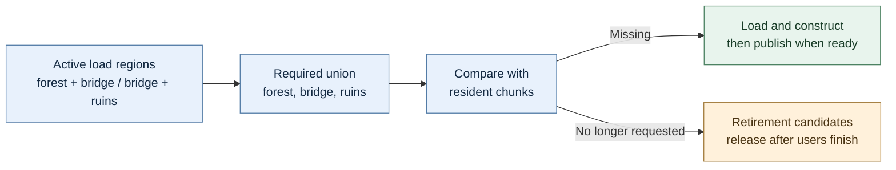

# 32 — Terrain materials and image composition

[[Chapter Edition/03 - Game Engine/00 - Reading Map|Reading map]] · [[Chapter Edition/03 - Game Engine/31 - Spatial-index serialization and query evidence|Previous chapter]] · [[Chapter Edition/03 - Game Engine/33 - Versioned scenes and transactional loading|Next chapter]]

A terrain tile must combine a compact set of materials while the renderer preserves filtering, layout, and color meaning. This chapter uses a small explicit blend before moving to saved scene contracts.

**By the end:** Implement and validate a bounded material blend, including texture inputs, weights, and visible edge cases.

**Recall question:** Do the blend weights sum to the intended value, and what image test reveals a missing texture or incorrect color-space conversion?

<!-- Derived from Continuous Notes/Game Engine - From First Frame to Living Worlds.md; source lines 78477–79213; source-span SHA256 2000f6bc683f156d903b93519bb5fc0f2fa169c761045d770090c25156ed9940. -->

<!-- CHAPTER-SOURCE-BEGIN -->
## Blend a small, explicit set of terrain materials

A terrain layer needs several maps, but sampler limits constrain how many can be bound in one draw. One proposed model uses four layers and four per-vertex weights; the fragment shader samples each layer and blends the material properties before passing them to lighting. Another earlier design explores eight layers but notes the device sampler limit. Array/packed textures can reduce sampler count at the cost of more complex loading and UV offsets. These are design discussions; the cited shader edits stop before sampler binding and terrain attribute wiring are complete. [Terrain material design](https://www.youtube.com/watch?v=vLzvpFaX50A) · [Earlier layer/sampler tradeoff](https://www.youtube.com/watch?v=unypFSvg7gI)

### Add scenes only after the lower path can display an object

A scene answers what exists in a world and how those objects are related. A camera answers from where and how that world is viewed. A transform describes position, rotation and scale. These may sound basic, but introducing a scene graph before the renderer can display one object creates several moving targets at once. The caption sequence first creates geometry and movement/camera experiments, then the later livestreams develop scenes and rendering hookups. A live episode describes scene loading/unloading mostly working ([Kohi Ep. 99](https://www.youtube.com/watch?v=N7sc-i-wryw)); related streams include simple scene file parsing ([Ep. 101](https://www.youtube.com/watch?v=q8AfndGO-Ms)) and terrain/render-view work. These later livestream links are inventory evidence; not every one was captioned in this pass.

A scene loader must distinguish serialized descriptions from live runtime objects. A file can say “create an entity named X with a mesh asset and transform.” The loader resolves that description into runtime structures, requests the assets, and handles missing or malformed fields. Loading and unloading are paired operations: if a scene creates resources, unloading must release references without destroying resources still shared elsewhere. This is an ownership problem as much as a parsing problem.

The current retrospective is candid about scene complexity. It calls the existing scene “okay” but says it could be better, specifically naming object management, hierarchy, and leaning too far toward the entity-component-system direction. An entity-component system (ECS) stores objects as identities plus separately organized component data; it can be powerful, but it is not automatically simpler than a scene graph or object-oriented scene model. The correct choice depends on scale, iteration patterns and tools. The retrospective also schedules a future scene refactor. That is evidence that an implemented architecture remained open to reconsideration.

Scene complexity should be earned. First render a static object. Then add a transform. Then add a camera. Then add multiple objects and hierarchy if the game actually needs parent-child transforms. A hierarchy is useful when moving a parent should move its children, such as a character with attached equipment. If all objects are flat and independent, a tree may add work without benefit.

### Let the editor change a document, then let the world run it

The workshop needs a crate, door, plate, camera, and light. A programmer can construct them in code, but a level designer needs to arrange them repeatedly. An **editor** is a tool for creating and inspecting game data. Its first useful feature may be selecting a crate, changing its position, saving, and getting the same arrangement back after restarting.

Separate the saved **document** from the running **world**. A document records intended content: object identities, properties, relationships, and asset references. A running world also holds temporary state: current contacts, timers, animation phases, unfinished jobs, and device objects. Saving raw memory is not a general serialization strategy. Pointers refer to this process; padding, byte order, layout, and versions can differ. **Serialization** means turning chosen information into a representation that can be stored or transmitted, with rules for reconstructing it.

For a door, save its stable identity, initial pose, required plate identity, and opening settings. On load, create entities, resolve references, validate required components, and only then activate dependent behavior. A missing plate should produce a diagnostic naming the door and unresolved reference. It should not become an arbitrary null-pointer crash during the first update.

**Schema** means the defined shape and meaning of saved data. A schema version allows the loader to recognize old representations. If `speed` once meant degrees per second and later means seconds per opening, retaining the same numeric field without a migration changes the game silently. A **migration** deliberately transforms an old version into the new meaning. Test a known old file, not only the latest file your own writer just emitted.

Treat an edit as a **command** with an intended effect and enough information to reverse it. Moving a crate from A to B records the entity's identity and old and new positions. Undo restores A if the command is still valid. A hundred mouse-motion samples can become one drag command, so one undo reverses one user action. If deleting a parent also deletes children or modifies references, define the whole transaction rather than pretending deletion has only one scalar effect.

An **immediate-mode UI** describes the current interface again on each update while the UI library handles interaction. It does not mean the game document has no persistent state or that undo happens automatically. Dear ImGui's official getting-started material distinguishes platform and renderer integration and the frame sequence needed to display the interface. Those backends connect the tool to a window and graphics API; the document model remains an engine/tool responsibility. [Dear ImGui integration](https://github.com/ocornut/imgui/wiki/Getting-Started).

When the user presses Play, choose the policy. One useful design copies or reconstructs a runtime world from the document. Running the game can then change the crate without rewriting the authored initial level. Another editor deliberately supports applying selected runtime changes back into the document. Both need explicit state ownership. A “Stop” button that leaves half the runtime timers active has not restored editing mode.

**Laboratory:** save a level with one plate and door, close the application, reopen it, and operate the plate. Move the plate, undo the move, save again, and reload. Delete the plate and confirm that the unresolved door dependency is visible and recoverable. This test crosses editing, identity, serialization, loading, and gameplay; a screenshot of a property panel cannot establish these behaviors.

#### Let the editor describe authored state without dictating runtime representation

A **game object** in this chapter is a broad name for a dynamic world element; engines may call such things entities, actors, or agents. It has attributes (current state) and behavior (how that state changes). A type defines the shared attribute schema and behavior for instances. For example, four ghost instances can share a ghost type while having different positions and health values. This terminology describes one object-oriented model; it is not an API requirement (PDF pp. 717–719 / printed pp. 695–697).

The object model shown to designers need not match the runtime data structures. A tool may present a rich object with components and editable properties, while runtime code stores a unique ID and keeps state in tables. Conversely, a tool-facing object can map to several runtime classes. The **tool-side object model** is what authoring tools expose; the **runtime object model** is what the program actually uses. Keeping this distinction visible lets a team design a useful editor without forcing the simulation to mirror every editor widget or inheritance relationship (PDF pp. 718–720 / printed pp. 696–698).

A **data-driven** engine lets content values or behavior be supplied by designers and artists as data rather than hard-coded solely by programmers. This can shorten iteration because a content creator can change a parameter or revise a level and see the result without waiting for a code change. That freedom carries real costs: the team must build authoring tools, validate broad inputs, preview results, diagnose content errors, and maintain the runtime paths. A useful test is whether the time saved through repeated project use exceeds the time spent building and supporting the tool. The excerpt warns that overbuilding a generalized tool can reduce productivity; it recommends choosing the specific parts of a game to expose rather than making every property configurable (PDF pp. 720–722 / printed pp. 698–700).

A world editor manages chunks and lets designers populate them with static and dynamic elements. Its role may include dedicated terrain/water tools or may rely on external content tools that tag assets for special runtime treatment. A chunk can be a mesh-backed level, or it may be an independent region that can contain multiple meshes—or none. The editor also needs to make world contents visible to its user; the cited Radiant and Hammer screenshots are historical examples of that role, not current interface recommendations (PDF pp. 721–723 / printed pp. 699–701; figures on PDF p. 722 are described in the extracted text, but were not separately rendered in this review).

##### Let object schemas bridge editor choices and runtime creation

Imagine a world editor that lets a designer place an enemy, adjust its health, and set a transform. The editor should show useful fields without needing to serialize the runtime C++ object byte-for-byte; that boundary is developed further in [[Chapter Edition/03 - Game Engine/33 - Versioned scenes and transactional loading#Serialization is an interface between tools and execution|the serialization interface discussion]]. A **type schema** is a description of those fields: each has a name and a data type, and the schema can add editor guidance such as a numeric range or a list of permitted choices. A vector can be edited as coordinates or with a 3D widget; an enum can become a dropdown; a minimum and maximum can constrain a number. Some engines let one schema inherit common fields from another, such as a shared unique ID or transform.

A **spawner** is the saved description of an instance, while the runtime maps its type to one or more classes and constructs the actual game object. The editor can work on the schema and simple key/value data without linking all runtime classes. This lets a designer define or use a type before its runtime implementation is ready, if the engine can safely retain unknown or currently unused data. The book presents this as a way to reduce coupling between tools and runtime representation; it is not a guarantee that every arbitrary editor field will work in a running game.

Defaults need an explicit rule. Suppose `Enemy.hitPoints` defaults to 20. If an Orc spawner stores only values the designer deliberately changed, it may omit `hitPoints` when the Orc should use the default. Later, the schema default changes to 30: old spawners that omitted the field now resolve to 30, while a deliberately overridden value such as 12 remains 12. This propagates a balance change without editing every world file. It also means changing a default can change old levels. A saved format therefore needs to distinguish “use the current default” from “the designer explicitly chose this number.” The text’s schema and spawner examples explain that policy; they do not prescribe a modern versioned serialization format.

#### When a game object is more than a class

A world editor lets a designer place an abstract “enemy,” “door,” or “pickup.” At runtime the engine must give that placement working identity, behavior, and links to rendering or simulation. Those two models need to agree on what the object means, but they do not need to use the same internal representation. One runtime may use a class instance; another may store a stable object ID and keep health, transform, and mesh data in separate tables. The design question is how the runtime can find an object, refer to it safely, update it, replicate its state, and reconstruct it from saved data. These are system requirements, not an argument for a specific language or architecture. [Game Engine Architecture, PDF pp. 736–737 / printed pp. 714–715]

The book contrasts two broad arrangements. In an **object-centric** model, one object instance or a small connected group owns most of an entity’s data and behavior. In a **property-centric** model, a unique ID is the join key for separate stores: one table might hold health, another a mesh, and another a transform. An object’s capabilities emerge from the properties it has. A useful test is to ask what a query such as “find enemies within 20 meters” must touch: object references in one collection, or a spatial/indexed view over distributed property data. The source names both patterns; it does not prescribe modern ECS implementation details. [PDF p. 737 / printed p. 715]

An older C example illustrates that object-like behavior does not require language-level classes. Hydro Thunder’s shared object structure held common data and a pointer to per-type user data, plus update and draw function pointers. The shared functions let the engine process many object types through one interface; the custom data and callbacks supplied type-specific state and behavior. This resembles inheritance and virtual dispatch, but is a hand-built convention: the programmer must keep the data and callbacks consistent. It is an historical example from the book, not a recommended universal pattern. [PDF pp. 738–740 / printed pp. 716–718]

### Separate editing from running

An editor scene and a running game scene have different jobs. The editor allows objects to be selected, moved, duplicated, and inspected. The runtime advances gameplay, physics, and scripts. If pressing Play mutates the only scene instance, stopping can leave the editor in a state the user never saved. A safer common pattern is to make a runtime copy, start the copy, run it, then discard it or apply explicitly chosen changes when stopping.

The Hazel public `Scene` has distinct editor, simulation, and runtime update paths. It exposes start/stop functions for runtime and simulation, pause state, and a `Step` method for advancing a chosen number of frames. This gives the editor a vocabulary for different modes: edit freely; simulate without necessarily running game scripts; run the game; pause; advance stepwise. These are not merely UI labels. They determine which systems update and which scene owns the changes.

A useful user-facing flow is:

1. Open a project and load an editable scene.
2. Select an entity in the hierarchy and inspect its components.
3. Change a value and see the viewport update.
4. Press Play; the runtime begins from a deliberate snapshot.
5. Pause and inspect runtime behavior without silently editing the source scene.
6. Stop; the editor returns to its authored state.
7. Save when the user intentionally commits authoring changes.

That flow requires a clear distinction between “save the source scene” and “capture a runtime state.” If the game supports a save game, that is a separate data format and lifecycle from the editor’s scene file. Avoid conflating project assets, authored scenes, and player save data.

#### Stopping play must account for shared assets too

Duplicating scene entities for play mode does not necessarily duplicate the assets they reference. Imagine that both the editor's crate and its runtime copy refer to the same red material. A script changes that material to blue. Destroying the runtime entity at Stop leaves the shared material blue, so the editor appears to have retained a gameplay change even though the scene objects were copied correctly.

Choose a policy for each mutable resource. Create a runtime material instance, store overrides on the runtime object, restore a recorded value, or explicitly allow an authored edit. The right choice depends on intended behavior, but it must be deliberate. Test it by changing both a transform and a shared material during play, stopping, and inspecting both. Restoring the transform alone does not establish a complete reset boundary. A fully read early Hazel physics log reports precisely this distinction: script-driven material changes persisted because they affected shared data. [Caption source](https://www.youtube.com/watch?v=RlQ4YVnQN40).

Physics introduces another state that may be invisible in a static inspector: a **sleeping body** is temporarily excluded from active simulation work when the engine judges it sufficiently at rest. Applying an impulse through an API that does not wake the body can then appear to have no effect. Define whether a gameplay force or impulse wakes it, expose that choice where needed, and test the same action on both an active and sleeping body. The early log identifies a wake option as necessary for its scripted movement; this is a behavior contract to check against the physics library actually used.

Finally, run repeated Play/Stop cycles while inspecting runtime ownership. An internal panel can list runtime scenes, entities, script instances, and exposed fields. If every stop leaves another empty runtime scene in the list, one successful launch has hidden a lifetime leak. The fully read script-inspector log uses such a panel to expose retained scenes. An organizational panel is useful here because it turns an invisible ownership mistake into a count that can be observed after every cycle. [Caption source](https://www.youtube.com/watch?v=g9HGp3icrIg).


#### Copy authored scene data; rebuild runtime state

Suppose an editor scene contains a character with a position, a rigidbody setting, and a script class name. Pressing Play should usually let the simulation move without quietly changing the scene the designer is still editing. One simple arrangement is to make a runtime copy, then build the simulation’s temporary objects from that copy.

In the inspected public Hazel snapshot, the editor does this explicitly: it calls `Scene::Copy` on the editor scene, switches the active scene to the result, and starts runtime on the result. The copy routine first creates new entities with matching UUIDs and tags, then copies each component listed in `AllComponents`. During runtime start, the scene creates a physics world and constructs bodies from each entity’s authored transform and rigidbody settings. This gives a concrete sequence: copy the design state, then create runtime state for the copy.

The word **authored** means values that describe what the designer saved or configured: for example, a body type, collider dimensions, a script class name, or a transform. **Runtime state** means objects that only exist while the simulation is running: for example, a Box2D world and body, a managed script instance, or a native script object. These have different lifetime owners. The scene owns the physics world in this implementation; body pointers refer to objects managed by that world; the script engine holds C# instances in a map keyed by entity UUID.

Now look closely at the component fields. A rigidbody component contains both authored settings and `RuntimeBody`, a `void*`. Collider components also declare `RuntimeFixture`, and the native-script component contains an `Instance` pointer. The generic scene copier copies whole component values, so it would also copy pointer values if they were non-null; it does not make a deep copy of a physics object or native script instance. The inspected physics-start path assigns a newly created body pointer to `RuntimeBody`, but does not assign its created fixtures to the `RuntimeFixture` fields. The editor’s usual Play flow copies before runtime starts, so runtime pointers in the source edit scene are ordinarily null. That safety comes from the flow, not from `Scene::Copy` clearing or rebuilding every pointer.

At stop, the scene deletes its physics world, and the script engine clears its scene context and entity-instance map. The inspected physics-stop routine does not walk components to clear `RuntimeBody`, which was assigned during physics start. A retained stopped runtime scene can therefore contain a body pointer value after its world has been destroyed. This is a conditional code-level stale-value risk, not an observed crash or failure in the standard Play flow, which returns to the separate authored scene. The inspected physics-start code does not populate `RuntimeFixture`, so this review does not establish a stale fixture pointer. Code that retains or restarts a stopped copy needs a deliberate invalidation/rebuild policy.

The practical design question is therefore not simply “can I copy this component?” Ask instead: **is this field durable authored data, or a borrowed/runtime handle whose owner has a shorter lifetime?** Copy durable data into a fresh scene. Recreate runtime objects from that data after the new scene’s world/context exists. When the runtime owner is destroyed, invalidate handles—or ensure the whole object holding them is discarded before any later access. A plain struct copy cannot create a new physics body, preserve a script object’s ownership, or make a stale pointer valid.

This snapshot is an educational example, not a claim of ideal or complete ownership handling. The README labels the public engine early-stage and distinguishes it from a more advanced private `Hazel-dev` codebase. The source review did not build or run the engine, inspect the private repository, or verify any episode.

### Keep camera identity separate from a render view

A render view describes a kind of work; a camera describes how one viewport sees the world. Passing a camera into packet preparation lets the same view use a world camera, an editor camera, or no camera when its pass is screen-space. The Kohi camera remains a named, reference-counted resource, so the application must hold a valid reference while a view borrows its pointer. The episode reports the camera/frame-data refactor, but only begins the separate wireframe view: shader compilation and scaffolding do not prove a visible wireframe frame. [Kohi #126](https://www.youtube.com/watch?v=xCA1MY94Hh0)

The application-owned view registration from #118 follows the same separation. Each application supplies its view callbacks and pass setup; the engine stores and registers the view pointer. The testbed’s refactor reports a working build, object picking, and hover after a callback copy/paste error is corrected. Its editor gizmo and editor-world view remain unrun scaffolding and are not connected to visible rendering. [Kohi #118](https://www.youtube.com/watch?v=CjJqa3iILAQ)

That session also adds concrete diagnostic geometry: mesh extents are calculated per subgeometry and folded into the outer mesh bounds, while a 3D line marks directional-light direction/color and the grid gains an optional third axis. The visible mesh box surrounds only the outer mesh, although submesh bounds are available. Picking and physics are proposed later uses, not features proven by the debug box itself. [Kohi #118](https://www.youtube.com/watch?v=CjJqa3iILAQ)

### Give each editor view its own projection and visibility policy

An orthographic editor view can center the world around the origin, while UI coordinates often start at the top-left. Those are different mappings. Reusing a UI projection for a scene viewport can shift the scene; a zero zoom value can collapse it. The wireframe prototype also borrows the world view’s geometry list and visibility filtering, then observes objects disappear as the editor camera moves. A diagnostic view needs a visibility rule appropriate to its purpose rather than inheriting camera-dependent culling accidentally. [Kohi #127](https://www.youtube.com/watch?v=5i66-I3x9ug)

The multiple-viewport work introduces a separate draw index as well as a frame number because descriptor/uniform updates can be limited per submission. Drawing the same scene for multiple viewports is a useful editor capability, but the testbed visibly renders it twice and the presenter notes the frame-rate cost. Per-viewport cameras, culling, and interleaving object draws remain follow-up work. [Kohi #125](https://www.youtube.com/watch?v=7ejRGnfNiU0)

A dedicated wireframe path can use a flat-color shader and a pipeline flag rather than paying for material sampling and lighting. Existing mesh or terrain records may have more attributes than that shader consumes, so the pipeline’s vertex-input description still needs to match the actual bound record layout. Terrain wireframe uses a separate six-input configuration; its first launch draws nothing until packet/array addressing is fixed. Terrain appears afterward, but terrain picking remains absent and validation still finds descriptor/fill-mode issues in the ongoing scaffold. [Kohi #126](https://www.youtube.com/watch?v=xCA1MY94Hh0) · [Kohi #128](https://www.youtube.com/watch?v=ZTC7Lryt6uQ)

### Separate drawing a Gizmo from manipulating the selected object

A Gizmo has both a visual pass and an interaction contract. The #119 editor-world view draws after the main world so scene depth does not hide its handles; distance and field of view scale the Gizmo to a useful screen size. That source demonstrates visual mode changes but not dragging a handle to change an object. [Kohi #119](https://www.youtube.com/watch?v=pPWshwZB7eo)

The preceding macOS/editor pass session treats missing dynamic topology as a backend capability issue and selects an internal pipeline variant by topology class. Its first drag test moves along X only; Y/Z, scale, rotation, selected-object synchronization, and distance-sensitive movement remain follow-up work, with occasional snapping observed. This is a narrow platform fallback and interaction milestone, not a complete cross-platform Gizmo. [Kohi #121](https://www.youtube.com/watch?v=dU6XqDBJJO4)

For interaction, build a ray from the camera and intersect a plane through the Gizmo. Consecutive hit points provide a delta; project that delta onto the chosen world axis for single-axis motion, or retain the plane delta for a two-axis move. The camera-facing plane needed by a Y handle is a specific correction after reusing the wrong plane logic; the center/all-axis handle remains erratic in that episode. Keep the Gizmo’s transform independent of the selected object’s scale, or a tiny imported model can make the handles unusably small. [Kohi #122](https://www.youtube.com/watch?v=MWraFUbYBN4)

The following Gizmo work reports usable move/rotate/scale and selection, but cancellation/undo and multi-axis rotation remain open. It keeps local rotation aligned with the object and global axes aligned with world orientation. These interaction results do not resolve rendering correctness: negative scale can reverse winding and make back-face culling hide a surface. [Kohi #123](https://www.youtube.com/watch?v=SdMihp51X_o)

For a mirrored object, the transform determinant can mark winding inversion in the draw record. Vulkan may switch front-face state dynamically when the capability exists, load an extension on older versions, or select an alternate prebuilt pipeline. The alternate-pipeline path multiplies variants and is not shown running; the stream reports the negative-scale test working but leaves Mac/MoltenVK validation open. [Kohi #124](https://www.youtube.com/watch?v=sCX_Sw0G4Ag)


### Let editor windows move without owning the application shell

Dear ImGui docking lets users arrange UI windows inside a dock space; platform viewports let a UI window become a separate native OS window. The lesson adopts the docking branch of ImGui and replaces Hazel's hand-copied GLFW/OpenGL backend work with the library's example backend files. It explains the motivation and feature set at 00:00–06:00, changes the submodule to the docking branch around 08:00–10:30, and compiles the backend translation units at 10:30–13:00. This is a historical dependency choice: the branch was active and not yet merged into ImGui master in the recording. Pin a commit and verify current upstream support before reusing that recipe. [ImGui Docking and Viewports](https://www.youtube.com/watch?v=lZuje-3iyVE&t=0s) [ImGui Docking and Viewports](https://www.youtube.com/watch?v=lZuje-3iyVE&t=480s) [ImGui Docking and Viewports](https://www.youtube.com/watch?v=lZuje-3iyVE&t=630s)

The architectural change is that Hazel owns the ImGui layer and calls each game/editor layer's `OnImGuiRender` between one backend `Begin` and `End` frame. A layer can then build its own window contents without initializing the backend or issuing the platform frame calls itself. The source removes custom event plumbing, adds begin/end helpers and a render callback at 13:00–20:00, then moves the ImGui layer under application ownership at 20:30–22:30. In the caption-described demo, detached windows and dockable panels appear around 23:00–27:30. This simplifies client use, but it does not mean every application configuration must ship editor UI; the engine should make that policy explicit. [ImGui Docking and Viewports](https://www.youtube.com/watch?v=lZuje-3iyVE&t=780s) [ImGui Docking and Viewports](https://www.youtube.com/watch?v=lZuje-3iyVE&t=1020s) [ImGui Docking and Viewports](https://www.youtube.com/watch?v=lZuje-3iyVE&t=1380s)

There are two instructive implementation hazards. First, Hazel's umbrella header accidentally imports the program entry point, which produces duplicate `main` definitions when a layer includes Hazel; the video ends by making that include local to the real entry-point translation unit at 28:00–30:00. Second, a vector iterator that marks the boundary between ordinary layers and overlays can become invalid when the vector reallocates. The presenter proposes replacing it with an insertion index around 24:30–26:30. These are concrete code review findings from the shown project, not inherent ImGui requirements. [ImGui Docking and Viewports](https://www.youtube.com/watch?v=lZuje-3iyVE&t=1680s) [ImGui Docking and Viewports](https://www.youtube.com/watch?v=lZuje-3iyVE&t=1470s)

Platform viewports are not just an extra UI flag: they create additional native windows and graphics contexts, so the backend must make the correct context current and render each platform window. The lesson uses the GLFW/OpenGL backend's viewport support at 15:00–18:30 and demonstrates floating windows around 23:00–25:00. In a multi-backend engine, keep backend-specific context work in the matching ImGui backend or a clearly owned platform layer. The recording explicitly accepts that this code is OpenGL/GLFW-specific rather than trying to write one generic implementation for every renderer. [ImGui Docking and Viewports](https://www.youtube.com/watch?v=lZuje-3iyVE&t=900s) [ImGui Docking and Viewports](https://www.youtube.com/watch?v=lZuje-3iyVE&t=1380s)

A useful verification checklist for this feature is lifecycle and input focused: create/destroy a detached viewport, move focus between windows, confirm events reach the right UI context, close and re-dock panels, and ensure shutdown releases all platform windows before destroying the graphics context. The episode shows the happy-path floating and docking visuals and identifies linking failures for user-authored ImGui calls around 27:30–30:00; it does not show shutdown stress, repeated window creation, multiple graphics APIs, or a production editor. [ImGui Docking and Viewports](https://www.youtube.com/watch?v=lZuje-3iyVE&t=1650s)

### Put a diagnostic interface behind a clear frame lifecycle

A debug UI helps inspect and adjust an engine while it runs, but rendering one inside an unfinished engine can expose layering and ownership problems. The Hazel episode explicitly calls its ImGui integration a temporary hack: it vendors a third-party UI library, uses its GLFW and OpenGL backends directly, and draws a demo panel over the scene. It attaches setup to layer lifecycle methods, creates the GUI context, sets display dimensions and frame delta, starts a GUI frame, builds widgets, renders draw data, and defers proper renderer abstraction and event forwarding. This is a useful prototype trace, not a recommended finished architecture. [Caption source: ImGui](https://www.youtube.com/watch?v=st4lgNI6_F4)

The ordering constraints are still instructive. The context and graphics backend must exist before GUI setup; the display size must be valid before frame creation; each frame begins once, gathers UI commands, and submits draw data while the graphics context is current. Input callbacks must be forwarded if widgets should respond to mouse and keyboard. The captions report an initial invalid-display-size failure, then show setting the size before beginning the frame; they also state that interaction was not yet wired and leave event callbacks as the next lesson. In a production design, hide backend calls behind a platform/renderer integration layer, forward events with an explicit capture policy, and tear down backend resources before destroying the graphics context. Those are design lessons inferred from the prototype's visible dependencies, not features completed in that episode. [Caption source: ImGui](https://www.youtube.com/watch?v=st4lgNI6_F4)

### Make tools support short edit-test loops

A level designer places a jump across a gap. A useful tool shows the level through the same renderer the game uses, so lighting, materials, and camera framing are not guesses. But a rendered view alone may hide the data needed to edit the level. Add an editing view or overlays for navigation paths, trigger volumes, collision bounds, and walkable slopes. Let each overlay be toggled, and show it in the player view when placement relative to the visible world matters. The source's slope-boundary example is useful because a debugging visualization became a better design tool: the same lines exposed where the player could stand or move. (Game Design: Theory and Practice, PDF pp. 419-422.)

Then make it fast to test what the level feels like. A designer may need to jump the gap, walk stairs, or follow a curved corridor as the actual character. A reversible test mode should start from the authored level state and restore it on exit, so runtime movement does not overwrite carefully placed entities. If entering test mode requires a long build or launch cycle, designers will try fewer variations. The source treats playtesting as repeated action: change, play, inspect, change again. Tool latency affects how many of those cycles fit into a project. (Game Design: Theory and Practice, PDF pp. 422-423.)

This suggests a modest editor architecture: persistent authored data is separate from transient simulation state; “Play Here” snapshots or reloads the authored scene; exit discards test mutations; and navigation, collision, and trigger overlays read the same runtime data used by the game. That keeps the visualization honest while making iteration cheap. This architecture is a synthesis from the source's tool concerns, not a verbatim system design in the pages.

Behavior tuning needs a similar boundary. If a designer must change an enemy's detection radius by editing C++ and waiting for a full compile, balance changes become expensive. Expose carefully chosen parameters in a data file or editor, while keeping core behavior code in the engine. A scripting language can support unique events and reusable behaviors, but adds interpreter, debugging, performance, and portability work. There is no free “designer editable” switch: choose the smallest content interface that serves the team's actual iteration needs. (Game Design: Theory and Practice, PDF pp. 425-427.)


### A click becomes scene selection only after the editor settles event ownership

A scene viewport can identify an entity beneath the pointer by reading an integer ID from an off-screen framebuffer attachment. That read answers “which entity projects to this pixel?” It does not yet answer whether the editor should change selection. A click may belong to a docked panel, the camera-navigation gesture, or a transform gizmo. Treat the picking result as a candidate, then let editor interaction policy decide whether to apply it.

In the Hazel episode, the first implementation handles a left mouse-button press, checks that the viewport is hovered, and assigns the hovered entity to the scene hierarchy’s selection context. This produces the expected path: click a rendered object, then show its selected state and properties. Clicking empty space can intentionally assign an empty entity and clear selection. These are two distinct outcomes, so a robust API should state whether “no entity” means clear selection or leave the current selection unchanged. [Clicking to Select Entities](https://www.youtube.com/watch?v=CU9v3uUgRaE)

The first working version also exposes why picking is a chain of contracts. A readback outside the framebuffer bounds can return an arbitrary integer rather than the sentinel used for “no entity.” If that integer is treated as a valid entity handle, a later component lookup may assert. The source describes a viewport-bound correction merged from a community contribution; the broader lesson is to validate coordinates before readback, validate the returned ID against the active scene, and make the empty-pixel representation explicit. This report is about the episode’s captions, not an inspection of the implementation.

The same click can overlap other editor operations. A gizmo handle may be visually in front of an entity, but the entity-ID buffer can still report the object beneath it. If the editor changes selection during a drag, the manipulation target can unexpectedly change. Camera navigation may use Alt plus the mouse, and a click intended to start or continue that gesture should not also clear selection. Route input according to an explicit priority: active drag/manipulation first, then navigation, then scene picking, with UI panels taking their own clicks. A helper such as `CanMousePick()` can collect the viewport-hover, gizmo-hover, navigation-key, and button checks so the policy has one named home.

A small event trace makes the rule concrete. Suppose a click arrives at window position $(x_w,y_w)$, the scene viewport occupies rectangle $R$, the cursor is inside $R$, the gizmo is not hovered, and Alt is not held. Convert to viewport-local coordinates, account for any vertical origin flip, and read the entity ID. If the ID maps to a live entity in the active scene, set selection. If it is the no-entity sentinel, apply the editor’s documented empty-space policy. If any preceding ownership test fails, leave selection alone and let the owning interaction consume the event.

#### Source-to-volume map

- Existing foundations: [[Chapter Edition/03 - Game Engine/32 - Terrain materials and image composition#Selection and picking|Selection and picking]] and [[Chapter Edition/03 - Game Engine/32 - Terrain materials and image composition#Use framebuffer attachments for editor interaction|Use framebuffer attachments for editor interaction]].
- This source adds a focused editor event-arbitration trace and the invalid-ID failure path; it does not replace the existing framebuffer or coordinate-space foundations.
- Limits: English automatic captions only; video, code repository, and running editor were not inspected.

### Replacing a scene must replace every panel's scene-bound selection

An editor operation often changes more than the document pointer. Opening or creating a scene changes which entities exist, while the hierarchy and properties panels may still hold a selection from the previous scene. If a panel dereferences that old entity after replacement, it can crash or show data from the wrong document. Treat scene replacement as one coordinated state transition: install the new scene, update each panel's scene context, and clear or restore a selection that is valid in that scene.

The Hazel episode exposes this through the New command. With an entity selected, creating a fresh scene leaves the properties panel holding the old selection context; its next access asserts because the selected entity belonged to the replaced scene. Clearing selection along with the context fixes the demonstrated case. If an editor later supports multiple open scene tabs, it needs an explicit policy: either store selection per scene and restore it when switching, or clear selection on every switch. [Open/Save File Dialogs](https://www.youtube.com/watch?v=zn7N7zHgCcs)

File dialogs should participate in this state transition carefully. A cancelled dialog returns an empty path; that must be a no-op, not a request to deserialize an empty filename. The episode wraps open/save dialogs in a platform utility and uses Windows common-dialog APIs, with the application window as the dialog owner. It also sets a flag to preserve the current working directory, because changing directories can make other relative paths resolve from the newly selected folder. The platform abstraction is demonstrated as a boundary, but this clip does not deliver the non-Windows implementations.

#### Source-to-volume map

- Existing foundations: `### Model a scene as data, then make it executable`, `### Make serialization a compatibility contract`, and `### Treat editor panels as clients of live engine state`.
- The source adds a concrete stale-selection failure during scene replacement and the empty-path cancellation rule; it does not duplicate general serialization design.
- Limits: English automatic captions cover a Windows implementation. No macOS/Linux dialog, multi-tab editor, file corruption path, or runtime was inspected.

### A docked viewport needs separate focus and hover decisions

An editor viewport may need keyboard and mouse input for different reasons. Camera movement should usually receive keyboard commands only while the viewport has focus. Mouse-wheel zoom or picking should require the pointer to hover inside its bounds. Focus means the viewport owns keyboard interaction; hover means the pointer is over it. A docked ImGui viewport is itself an ImGui window, so a blanket “ImGui wants the mouse/keyboard” capture rule can swallow input that the scene viewport needs, while bypassing capture altogether can leak input into another panel.

The Hazel episode debugs this by tracing event propagation: overlays receive events first, and the layer stack stops when an event is marked handled. The presenter distinguishes viewport focus from hover and adjusts the ImGui layer's event-blocking state using both. This is tied to the docked viewport arrangement in that development snapshot; it is not a universal replacement for widget-level capture or pointer-button ownership. [Code Review + ImGui Layer Events](https://www.youtube.com/watch?v=ETIhjdVBH-8)

A useful routing table is: focused + hovered permits camera keyboard and viewport mouse actions; focused + not hovered may keep keyboard focus but should not trigger pointer-based viewport actions; not focused + hovered can permit a click to activate the viewport but should not also run camera keys until focus is established; neither state routes the event to other panels or the game according to the editor's normal priority. If a press begins inside a widget or drag operation, retain its owner through release even if the pointer crosses a boundary. These rules are a design synthesis; the episode specifically demonstrates focus/hover gating and leaves broader capture behavior open.

The same code-review segment contrasts runtime renderer selection with platform input selection. A renderer backend may be selected at runtime from several compiled implementations, while a Windows input implementation is chosen by the platform build. The episode therefore replaces a virtual singleton-style input facade with static functions linked to the platform-specific implementation. This is an architectural choice contingent on compile-time platform selection, not a universal rule that every input abstraction should be static.

#### Source-to-volume map

- Existing foundations: `### Keep the event API explicit about payload, timing, and propagation`, `### Treat editor panels as clients of live engine state`, and the input-routing passage in the UI section.
- This source adds a concrete focus-versus-hover routing case for a docked scene viewport and the compile-time versus runtime platform-selection distinction.
- Limits: English automatic captions; the input refactor and UI behavior are described from a recorded code session and were not independently built or exercised.

### Repeated editor controls need one shared layout rule

An editor becomes easier to scan when repeated components share the same header, spacing, removal control, and width behavior. The Hazel episode factors common component framing into a templated `DrawComponent` helper, then passes a component-specific lambda for the fields that differ. This keeps the inspector behavior consistent while allowing a transform, camera, or sprite component to draw its own controls. [Making the Hazelnut Editor Look Good](https://www.youtube.com/watch?v=oESRecjuLNY)

The same principle applies to interaction and typography. Full-width tree rows make the entire entity line selectable, not only its text. Open Sans regular and bold fonts distinguish ordinary labels from compact axis controls. A width-aware add-component button uses the remaining content region, so a scrollbar does not cover it. The episode sets a minimum docked width around 370 pixels and a default editor window size around 1600 by 900; those are tuned for the shown layout, not universal constants.

A shared helper reduces visual drift, but it should not hide meaningful differences. A transform component may be required, while other components can be removed; an API should represent that policy instead of giving every header an identical destructive action. Font access by vector index is quick for two fonts, but a larger UI should address fonts by semantic names or roles so adding a new font does not change what index zero means. The source leaves font management, high-DPI scaling, light theme, and some default ImGui colors for later.

#### Source-to-volume map

- Existing foundations: `### Treat editor panels as clients of live engine state` and `### Build the editor around inspectable operations`.
- The source adds a reusable component-header pattern and concrete full-row selection/layout refinements.
- Limits: the style choices are one recorded Hazel/ImGui snapshot; no DPI behavior, native rendering, or full visual review was verified.

#### Size a thumbnail grid from the space each cell actually consumes

A content browser is a grid of repeated controls. Each tile has a thumbnail and a label, while the available panel width changes as the editor is resized. If tile width is fixed, the number of columns can be computed from the usable width and the full cell width. Let $W$ be the panel's available content width, $T$ the thumbnail width, and $P$ the gap between neighboring cells. $C$ columns fit when $CT+(C-1)P\leq W$, so the exact maximum is

$$
C = \max\left(1,\left\lfloor\frac{W+P}{T+P}\right\rfloor\right).
$$

For example, if $W=1072$ pixels, $T=256$, and $P=16$, then four columns exactly fit: $4(256)+3(16)=1072$. Using $\lfloor W/(T+P)\rfloor$ would incorrectly return three because it charges a gap after the final cell. The lower bound prevents a very narrow panel from producing zero columns, though a single tile wider than the panel may still need clipping or a smaller thumbnail. This formula is a simple layout rule, not a promise that the UI library's own padding, borders, text wrapping, or scrollbars have already been included. Measure the actual available region and account for style spacing once, without counting the same padding twice.

In the Hazel content-browser session, a fixed column grid provided a quick first layout, while a slider changed thumbnail size and a separate value changed the intended gap. The presenter used the UI library's available content width and distinguished this custom spacing from the library's style padding. This is a useful prototype method: first use buttons as visible rectangles to validate the grid; then replace them with image buttons and labels. However, the demonstrated implementation is tied to that historical ImGui API and session. Check the version in the project before copying column flags or double-click behavior. [ImGui Thumbnail Layout](https://www.youtube.com/watch?v=uQljBVVb-lU), 03:20–26:16

Navigation and drawing should also have separate conditions. A directory tile can open a directory; a file tile may open an editor or import flow, but should not pretend to be a directory. The content-browser review distinguishes editor resources such as folder icons from game assets owned by a project. That separation prevents an editor's own UI textures from being mistaken for assets the game must package. The session leaves texture transparency, final label sizing, and file-type previews unfinished, so it is evidence for a layout experiment—not a completed asset workflow.

### Let the editor panel size the scene render target

A scene view inside an editor is only useful if its image fits the panel that contains it. In this Hazel snapshot, the viewport panel reports its available content width and height; when those dimensions change, the editor resizes the framebuffer that holds the scene image. The framebuffer rebuild deletes its old color and depth textures before creating replacements, and binding it sets the graphics viewport to the target's dimensions. [Scene Viewport](https://www.youtube.com/watch?v=xiSW4UgjLKU)

The camera has to follow the same size change. For an orthographic camera, recomputing the projection bounds from the panel width and height preserves the intended image proportions as the panel is docked, detached, or resized. Setting the ImGui window padding to zero makes the rendered texture fill the panel, with the style restored after that window so unrelated UI keeps its spacing.

Two rough edges are part of the lesson. The demo flashes black for a frame during some resize operations; the speaker suspects the displayed texture ID may briefly be invalid, but does not resolve it. Input routing is also incomplete: removing an earlier event-blocking change restores interaction, but keyboard and mouse input can move the camera while the pointer is over other controls. A production editor needs explicit viewport hover/focus rules. Thus the episode demonstrates the resize path, while also recording transient rendering and event-capture defects that remain open.

### Resize only cameras tied to the viewport

A camera used to fill the game window should follow that viewport's aspect ratio. A security-screen camera or a shadow-map camera may need to keep a fixed ratio even when the editor window changes. Hazel's episode introduces a `FixedAspectRatio` flag to make this intent explicit, defaulting to false for cameras that should track the viewport. [Scene Camera](https://www.youtube.com/watch?v=UKVFRRufKzo)

The renderer's base `Camera` stores a projection matrix, while a scene-facing `SceneCamera` stores the parameters needed to rebuild it. For an orthographic camera, the example treats size as the vertical extent and derives horizontal extent from the current aspect ratio. A viewport resize updates every scene camera that is not fixed, rather than assuming only one main camera exists. Changing orthographic size also triggers projection recalculation, and the demo exposes that setting for a second camera.

The lifecycle edge case matters: a camera added after the resize notification may never receive a viewport size, leaving its projection unset or stale. Recomputing just on resize requires the scene to remember aspect ratio and recalculate whenever camera parameters change. The episode contrasts that with recalculating before every render, which Hazel dev uses. The demonstrated approach reports correct proportions while resizing, but it does not solve late-added camera initialization or establish perspective-camera behavior.

### Establish the editor shell before adding scene tools

The episode sets a goal for Hazel: a cross-platform 2D workflow where a standalone editor can arrange scenes, entities, sprites, and behaviors, then export or preview a game. That target is still a plan in this recording. It separates the Sandbox runtime project from a planned editor application, and starts by turning ImGui's docking support into the editor shell. Panels only dock once they are created inside the dockspace scope. [Next Steps + Dockspace](https://www.youtube.com/watch?v=UljMVrQ_zYY)

A small File/Exit menu exposes the need for an application-level close request, and a texture display experiment adds a renderer-ID accessor so `ImGui::Image` can show an existing texture. These steps demonstrate editor infrastructure, not a scene viewport. The intended viewport path is to render the scene into a framebuffer texture and show that texture in a dockable panel sized to the available space; both framebuffer and viewport behavior are deferred.

The episode also reports a portability problem in dynamic sampler-array indexing: community users say the shader works on Nvidia but fails on some AMD drivers. The author changes to a manual texture-index branch strategy but has no AMD graphics card to test it. Treat this as a reported compatibility workaround, not a locally verified cross-vendor fix. The broader lesson is to label engine goals separately from implemented editor infrastructure and from hardware-verified behavior.

### Give the editor its own camera

A scene editor needs to inspect and arrange a world before the game has a playable camera. Requiring a camera entity just to see the scene also leaves gizmos without a view when the scene contains no camera. Hazel separates editor and runtime paths: runtime updates use scene cameras and run scripts, while editor rendering uses a dedicated editor camera and does not run gameplay scripts by default. [Editor Camera](https://www.youtube.com/watch?v=8zVtRpBTwe0)

The example camera follows familiar 3D editor controls: Alt+middle drag pans, Alt+left drag orbits, and Alt+right drag or the scroll wheel zooms around a focal point. It uses viewport dimensions to build the perspective projection, so the editor must set its size after the panel layout is known. The renderer receives the editor camera's view-projection matrix through a separate `BeginScene` overload; the geometry path remains the same.

A zero yaw and pitch lock makes the perspective camera act like a fixed 2D view while keeping objects in 3D space for manipulation. That is a workaround, not an orthographic editor-camera mode. Input focus is visibly rough in the episode: controls do not respond until the viewport is focused, and middle-click does not establish focus as desired. The camera feel constants came from a hand-tuned older class, so they should be treated as interaction choices rather than universal values. The narrated demo shows the intended control path but is not independent code or build verification.

### Reject invalid viewport sizes before rebuilding targets

An editor can briefly receive a negative content size while a window is minimized or restored. If that signed value is cast to an unsigned framebuffer dimension, it becomes an enormous number and can trigger graphics errors or corrupt the camera aspect ratio. The episode adds a defensive framebuffer-size check and logs rejected requests. Its temporary maximum is hard-coded at 1920, while the author says the long-term limit should come from device capabilities. [Where to go next + Code Review](https://www.youtube.com/watch?v=ZVy81M-IST0)

The broader review distinguishes scene data from immediate drawing. A rendered quad is not yet a persistent game object, so editor selection and movement should follow an entity-component scene model rather than add tools directly to transient renderer commands. The proposed progression is ECS, scenes and components, authoring tools, then scripting. The episode also discusses platform macros, assertion ergonomics, shared versus intrusive references, key-code portability, and OpenGL vertex-array abstractions. These are review opinions and future questions; aside from the resize guard, the episode does not implement them or report cross-platform tests.

### Store transform parts separately and compose when needed

A transform matrix is convenient for rendering, but it is a poor place to preserve the editor's intended rotation value. Rotations wrap, while a user may want to retain a value such as 7,000 degrees in a scene file or workflow. Hazel changes its transform data to separate translation, rotation, and scale fields, then composes them into a matrix when drawing. Rotation stays in radians in the component, where trigonometric code can use it directly. [Transform Component UI](https://www.youtube.com/watch?v=8JqcXYbzPJc)

The properties panel converts rotation to degrees for people editing it and converts back to radians when storing the change. A reusable three-axis control places its label at the left and gives x, y, and z separate red, green, and blue buttons. Each axis button resets that component: translation and rotation return to zero, while scale returns to one. Unique ImGui IDs keep the translation, rotation, and scale controls independent.

The example uses two decimal places and a 0.1 drag speed. The narrator points out a real usability cost: a value such as 0.0001 can display as 0.00 even while the underlying value changes. Exact numeric entry or adaptive precision may be preferable when small values matter. The widget also borrows ImGui internal width helpers, which can need updates as that library changes. This is a demonstrated UI design, not a universal transform representation or verified cross-version widget contract.

### Let scene ownership shape editor components

An entity wrapper gives tools a stable place to add and inspect components without exposing the registry as the permanent public interface. The entity/component lesson proposes a scene-owned create operation, followed by tag, transform, and sprite-renderer components; scene update and draw submission should live with the scene, not be scattered through editor UI code ([Entities and Components](https://www.youtube.com/watch?v=-B1iu4QJTUc), 10:18–12:46). The presenter still exposes the registry temporarily in the demo, which is evidence of an intermediate API, not a recommended final boundary. When reporting an integration, distinguish the desired interface from temporary access used to get a prototype moving.

The component UI lesson supplies a small interface principle: shared UI structure can be a helper, while each component supplies its own controls. A sprite renderer’s color, texture, material, and shader are different responsibilities. The lesson shows color editing and proposes a white one-pixel texture to unify color-only and textured sprites; texture assignment and material workflows are explicitly deferred. Overlapping translucent squares reveal that blending order and depth behavior are visible design decisions. In the lesson, same-depth draws fail to produce the expected blend, and changing depth/order changes the result; for ordinary 2D content, explicit sort order and depth-test policy need to be part of the renderer contract ([u3yq8s3KuSE](https://www.youtube.com/watch?v=u3yq8s3KuSE), 02:53–15:33).

### Camera data belongs to a view contract

Keep an editor navigation camera distinct from cameras owned by runtime entities. The camera lesson separates projection behavior from entity transform: the component chooses projection, while position and orientation come from the transform. The scene searches for a primary camera and combines its projection with the inverse of its transform to form a view-projection; the video demonstrates switching between two cameras ([ubZn7BlrnTU](https://www.youtube.com/watch?v=ubZn7BlrnTU), 06:45–08:38; 23:22–36:02). The presentation also notes that zero can be a valid entity value, so a sentinel such as the library’s explicit null value is safer than assuming zero means “none” (01:55).

The camera UI lesson makes each projection mode’s settings explicit. Preserve orthographic size or perspective field of view and clipping planes when switching modes; recalculate the projection when a value changes. The UI displays degrees for field of view while the API stores radians, so convert at the boundary and label the units. A fixed-aspect option and primary-camera flag express separate decisions: whether the view owns a target aspect and whether the scene uses it. In the demonstration, no primary camera means no camera-driven scene render; selecting one restores the view ([RIMt_6agUiU](https://www.youtube.com/watch?v=RIMt_6agUiU), 04:43–10:00; 25:10–33:56). Another video contains a crash resolved by rebuilding but gives no established cause; do not infer one ([ubZn7BlrnTU](https://www.youtube.com/watch?v=ubZn7BlrnTU), 34:01).


### Build the editor around inspectable operations

A visual editor is not one giant panel. It is a group of tools that expose the engine’s data and workflows. In the public Hazelnut source, the editor layer coordinates a scene hierarchy panel and a content browser panel, and it uses the scene viewport for rendering. Each panel focuses on a job: list entities, inspect or modify components, navigate files, or view the scene through a camera.

An editor control is complete only when it acts on real state. A play button should start the runtime scene. A save command should serialize the intended scene. A content browser drag should create or assign an asset reference. A transform gizmo should convert pointer movement into a consistent world-space transform. A visual mock with inert buttons can demonstrate layout but not an editor workflow.

#### An object-ID image must preserve identity, not appearance

An ID-color picking pass uses color channels as data. The visible scene's processing can corrupt that data: blending, antialiasing, color-space conversion, or post-processing can produce a pixel value that encodes no intended object. Use an identity representation and render state that preserve the required bits, such as a suitable integer attachment where supported, or an explicitly controlled color encoding.

Define the background value and valid ID range, then keep the mapping from rendered IDs to live objects. If a delayed readback refers to an older frame, an object's slot may already have been reused. Resolve against the appropriate mapping and validate identity before selecting anything. A faster readback is not useful if it sometimes selects the wrong generation of an object.

Coordinates have a boundary too. UI pointer coordinates, viewport coordinates, framebuffer pixels, and the attachment's vertical origin can differ. Reject clicks outside the actual viewport rather than always clamping them onto a border pixel and selecting a border object. Resizing, display scaling, and docking should preserve this mapping.

Finally choose the interaction policy. Should transparent glyph gaps expose the object behind the label? Should an invisible helper remain selectable? Should a lower-resolution or periodically updated picking target permit delayed hover feedback? Rendering a frontmost ID answers the query you encoded, so the pass must encode the intended editor behavior.

The fully read Kohi picking session demonstrates RGB-encoded identity, periodic updates, and UI/text edge cases with known cleanup limits. These precision and policy rules extend the technique; they do not claim that the development version already resolves every case. [Caption source: Object Picking](https://www.youtube.com/watch?v=mx1TyxNFrdo).

##### Trace the RGB picking pass

A GPU picking pass can encode each candidate object's integer ID in RGB, draw world and UI candidates into an off-screen target with depth testing, and read the pixel under the cursor. The frontmost world ID wins; UI drawn afterward can cover it. A reserved clear color represents “no selection.” In the Kohi example, one packet combines world geometry, UI, and text, assigns sequential IDs, grows shader-instance capacity as needed, updates the target periodically (about every third frame), clamps coordinates, and emits a hover-ID-changed event. RenderDoc is used to inspect adjacent encoded values. [Kohi pixel-perfect object selection](https://www.youtube.com/watch?v=mx1TyxNFrdo)

The demonstration includes all current geometry rather than a pickable-only filter, text glyph gaps make hover IDs flicker, and shutdown still reports an undisposed buffer/device-memory allocation. A production editor must define ID range/background, preserve ID bits through blending/color-space state, map asynchronous readback to the correct live object generation, reject clicks outside the viewport, and decide whether transparent gaps or invisible helpers are selectable. These are extensions to the demonstrated method, not claims that its prototype already handles them.


#### A tool is part of the engine’s workflow

The Hazel 2D play-button episode links editor controls to scene state and a runtime camera view. The author explicitly points out unfinished gizmo, scene-renderer, and project-workflow pieces. That makes the example valuable as a boundary test: a play button needs a clear distinction between editing a scene and running it, with a way to return to the editable state. The later pull-request review stream reproduces a new-scene/play-mode state problem and discusses keeping an editor scene distinct from the active runtime scene. These are historical Hazel iterations, not claims about current Hazel behavior (The Cherno, “PLAY BUTTON!,” 00:00–approx. 00:55; “Finishing the Pull Requests!,” 02:11:00–02:15:25).

#### Give world editing tools that match the question being asked

A level designer may need to place a light, compare a camera view, or edit the same property on many selected objects. Those jobs do not all fit one generic list. A world editor usually combines a viewport, a navigation scheme, selection tools, a property grid, special object editors, and a save/load path. Each feature should make one kind of work observable and editable.

For example, an orthographic top view is useful when spacing objects along a floor; a perspective view answers whether those placements read correctly in the playable camera. A ray cast can select an object in perspective, but dense scenes make the nearest hit ambiguous. A good editor can cycle through intersected objects, let the designer hide obstructions, or provide a named hierarchy list. Layers also reduce clutter: lighting artists can hide unrelated geometry, while independently stored layers can let multiple contributors change one world chunk without overwriting each other's work. These are complementary interaction paths, not a single “selection algorithm.” [Game Engine Architecture, PDF pp.724–725 (printed pp.702–703)]

A property grid becomes more interesting when several objects are selected. If three lights share the same intensity, the grid can show that common value and apply an edit to all three. If their values differ, it can show a mixed/blank state; typing a value then intentionally brings them into agreement. With a heterogeneous selection, only common fields such as position may be editable. This avoids falsely presenting one object's specific property as universal. The same tool can offer per-instance free-form key/value properties for prototyping, while keeping transforms and asset links as special fields because changing a mesh or position must also update the viewport. [Game Engine Architecture, PDF pp.725–727 (printed pp.703–705)]

A practical selection trace:

1. Select a light and see position, color, and intensity.
2. Add a second light whose intensity differs; show the intensity as mixed rather than silently selecting one value.
3. Enter `4.0`; update both selected lights and mark the document dirty.
4. Hide the lighting layer to inspect geometry, then show it again without deleting objects.
5. Save just the lighting layer if the project's storage model supports independent layers, then reload it and verify the edits.

The final step matters: a property widget that changes an in-memory value is not yet a reliable editing workflow until save/load preserves that value. Layers can aid collaboration only if the file format and merge process preserve their separation.

### Picking needs an integer attachment and a viewport-local pixel

A color image usually stores normalized color channels. An entity identifier is an integer label, so storing it as ordinary color can clamp or reinterpret the value. The Hazel picking preparation uses a single-channel signed integer attachment: the shader can write an entity ID directly, and a reserved value such as $-1$ can mean “no entity.” The source uses an R32I-style attachment and reads one pixel with `glReadPixels`; it first tests the path with a hard-coded value of 50. [Preparing Framebuffers for Mouse Picking](https://www.youtube.com/watch?v=wYVaIOUhz6s)

Use the rectangle of the displayed scene image, excluding the panel's toolbar and padding. Express its minimum corner $(x_0,y_0)$ and the cursor $(x,y)$ in the same UI coordinate system. Let the image extent be $(W_u,H_u)$ in UI units and its attachment size be $(W_p,H_p)$ in pixels. Both extents must be positive. Define $u=x-x_0$ and $v=y-y_0$; reject the cursor unless

$$0\leq u<W_u,\qquad0\leq v<H_u.$$

Now choose the image-orientation contract. For an upright display whose top corresponds to the framebuffer's upper row, the integer readback pixel is

$$
i=\left\lfloor u\frac{W_p}{W_u}\right\rfloor,
\qquad
j=H_p-1-\left\lfloor v\frac{H_p}{H_u}\right\rfloor.
$$

The factors convert UI units to attachment pixels; the subtraction converts a top-origin image position to the lower-left framebuffer coordinates used by `glReadPixels`. This is a readback contract, not a universal statement that every texture is displayed with the same UV orientation. If the displayed image uses another UV mapping, derive the corresponding conversion instead of blindly flipping twice. [Khronos readback reference](https://github.com/KhronosGroup/OpenGL-Refpages/blob/main/gl4/glReadPixels.xml)

For example, an image begins at $(120,80)$, occupies $400\times300$ UI units, and renders into $800\times600$ pixels. Cursor $(135,90)$ becomes local $(15,10)$, then readback pixel $(30,579)$. At equal UI/pixel dimensions the scale factors are one, but the upper row still has index $H_p-1$. A cursor exactly on the excluded right or bottom boundary should not be clamped into a false pick. Check the final integer bounds before calling the API.

For this same orientation, the four attachment-corner pixel centers correspond to local UI positions $(0.25,0.25)$, $(399.75,0.25)$, $(0.25,299.75)$ and $(399.75,299.75)$. They map to $(0,599)$, $(799,599)$, $(0,0)$ and $(799,0)$. These are original numeric checks, not claims about test coverage in the episode. Docking, resizing and render scale can all invalidate previously cached dimensions.


- Existing foundations: `### A framebuffer specification separates a target's purpose from its OpenGL object

An editor viewport needs an off-screen image so it can display a scene inside a dockable panel. A framebuffer therefore needs an allocation description: dimensions, attachments, and eventually format/sample choices. Grouping those choices in a specification keeps a constructor from accumulating a long, order-sensitive list of arguments. The Hazel episode also introduces a swap-chain-target flag to represent the screen as a render destination, even though OpenGL expresses that destination by binding framebuffer zero. The flag is an engine-level description, not an OpenGL framebuffer object. [Framebuffers](https://www.youtube.com/watch?v=93bavRgVcwA)

The first OpenGL implementation creates a color texture, attaches it to the framebuffer, and also creates a depth-stencil attachment. It checks framebuffer completeness and uses the color attachment's renderer ID as an ImGui image. During the live implementation, the framebuffer is incomplete because the texture was not bound before its allocation/attachment calls; checking completeness at construction made the setup mistake visible. This is a concrete debugging lesson: validate the target immediately after all attachments and dimensions are established.

A fixed 1280 by 720 texture is enough to prove the off-screen path, but it is not a finished viewport. If the docked panel changes size, the framebuffer should be resized to its actual pixel dimensions, respecting the UI scale and any rendering resolution policy. The episode's first image size is wrong because an older render path uses a separate size; matching the panel is explicitly future work. Attachment formats, multisampling, and whether a 2D pass needs depth are also choices to make from the pass requirements, not universal defaults.

#### An editor manipulator can stay in world space while drawing above the scene

An editor gizmo is a viewport control attached to a selected object. Its handles must respond to the world camera and the object's transform, but a handle hidden behind a wall is difficult to use. Kohi's view-system stream proposes a dedicated gizmo view and render pass: keep the gizmo at the object's three-dimensional position, then draw that pass above the ordinary world image so the manipulator remains visible when geometry would otherwise occlude it. The presenter frames this as the goal of the view refactor at 00:38:16–00:39:02, not as a finished feature. [Kohi Ep. 118](https://www.youtube.com/watch?v=CjJqa3iILAQ&t=2296s)

That design separates two questions which are often conflated: where the gizmo is, and whether scene depth is allowed to hide it. A world-space transform and the editor camera still determine the gizmo's projected position and scale. A later overlay pass can then choose an explicit depth policy. Disabling depth testing prevents scene depth from hiding handles that otherwise survive projection, clipping and coverage; it can expose handles behind the selected object or another scene object. Testing depth preserves scene occlusion but can make the active control disappear. A hybrid can draw a faint occluded portion and a strong visible portion, or keep the center/active axis prominent while preserving depth for context. These are design options inferred from the stated goal; the episode does not implement or compare them.

A separate pass also creates a scheduling and input contract. The editor should render the scene view first and the manipulator after it, while selection and hit-testing should agree with the manipulator's visible handles. When the viewport changes size or camera, both scene and gizmo projections must use the same viewport rectangle and current camera data. A rendering pass that remains visible but receives stale coordinates can look plausible while manipulating the wrong world axis. The stream's application-owned view refactor is motivated by adding editor-specific views, while the gizmo and editor-world view remain scaffolding; a resize event also causes the testbed to fail during the session. Thus the safe takeaway is to define the overlay policy and its camera/viewport inputs, then verify rendering and interaction together. [Kohi Ep. 118, 00:35:45–00:42:44 and 03:01:29–03:12:30](https://www.youtube.com/watch?v=CjJqa3iILAQ&t=2145s)

This is a proposed editor interaction, not a demonstrated production gizmo. The episode describes mode handles for translation, rotation, and scale and moves view ownership toward the application, but reports the gizmo/editor view as unconnected or unfinished. No depth-state implementation or completed drag interaction is established by this source.


Use the same world point to explain what an overlay changes. With a conventional depth buffer where smaller values are nearer, let a wall store depth 0.2 and a gizmo fragment have depth 0.8. A LESS comparison hides that fragment. A later pass with scene-depth rejection disabled can draw it instead. The three-dimensional location has not changed; its occlusion policy has. A point behind the projection's valid clip volume still needs clipping. An overlay pass is not permission to divide an invalid homogeneous position or force it onto the screen.

Depth writes, depth comparisons and input precedence must be chosen separately. A read-only use of scene depth can distinguish visible and occluded portions without changing the world's depth buffer. A control drawn above a wall may also need priority over the wall during hit testing; otherwise the image offers a handle that the input path cannot select. Whether picking uses a GPU ID image or a CPU geometric test, make that priority consistent with the displayed policy. During a drag, retain the selected axis and the camera/viewport contract rather than silently changing the interpretation as another object becomes hovered. Constant apparent handle size, if desired, also requires an explicit screen-size policy; a world transform alone does not guarantee it across changing depth. These are design requirements and test cases for implementing the proposed control, not a completed implementation from the stream.


#### Source-to-volume map

- Existing foundation: `### Use framebuffer attachments for editor interaction`.
- This source adds the framebuffer-specification concept, screen-target abstraction, and the incomplete-framebuffer debugging trace.
- Limits: English automatic captions; no code/API or native render output was independently inspected. Dynamic panel resize is left for subsequent work.


### Use framebuffer attachments for editor interaction`, `#### Selection and picking`, and `#### Camera and coordinate spaces`.
- This source adds an end-to-end coordinate mapping and readback trace, with explicit integer/background and one-pixel boundary questions.
- Limits: English automatic captions only; no framebuffer implementation or readback latency was independently measured. The episode does not yet connect live entity IDs to the shader.


#### Selection and picking

Selection bridges the image and the scene data. A user clicks a visible object; the editor determines which entity was under the cursor. There are several approaches, from CPU ray intersection to a GPU picking buffer that writes an object ID per pixel. The appropriate method depends on geometry complexity and rendering requirements. A 2D editor can often use simpler geometric tests; a 3D editor may benefit from a dedicated picking pass.

Whatever method is used, selection must account for viewport bounds, camera projection, depth, transparency, and UI overlays. The editor should not pick behind an opaque object unless that is intentional. A gizmo handle should receive the click before the object itself. The selected entity should remain selected when the hierarchy panel is used, and deletion should clear or repair stale selection handles.

#### Inspector changes are data changes

An inspector presents component fields in a human-editable form. It must validate input, preserve units and ranges, and update derived state. Changing a transform may affect the world matrix, physics, and render bounds. Changing a camera field may update projection. Changing a texture path may require asset loading or a placeholder state. A panel that writes raw memory without keeping these relationships coherent will produce confusing bugs.

Undo and redo add another layer: an edit becomes a command with before and after values. This is often more reliable than trying to infer all changes after the fact. It can also make save prompts meaningful by tracking whether authored state has changed. An engine need not implement full undo at the start, but it should keep edit operations structured enough that undo can be added later.

#### Narrow a click to an actual surface

Suppose two crates overlap on screen and the user clicks the nearer visible face. CPU picking can turn the pointer into a **ray**: an origin and a direction extending through the scene. The ray is a query, not a physics object. Its purpose is to ask which selectable surface it encounters first.

Testing that ray against every triangle in every mesh may do unnecessary work. A **bounding box** is a simple enclosing volume. If the ray misses a box that genuinely contains the whole mesh, it also misses that mesh. If it hits the box, however, it has found only a candidate: the empty space inside the box is not necessarily part of the surface. A chair's box includes the gaps between its legs.

A useful search therefore has two levels. First reject entities whose bounds the ray misses. Then examine the remaining submesh bounds and their actual triangles, retaining the nearest acceptable surface hit. An entity bound encloses the object as a whole; submesh bounds enclose smaller pieces. This hierarchy avoids asking detailed questions about geometry that a cheap test has already ruled out. Keep bounds updated when an object moves, changes scale, or deforms; a stale or too-small bound can incorrectly reject visible geometry.

There is a subtle correctness trap: the box entered first does not necessarily contain the nearest surface. For a ray with unit-length direction, imagine one loose box beginning at distance one, with its mesh's first actual hit at distance nine. A second box begins at distance two, with a surface hit at distance three. Selecting only the first box would return the wrong object. You may visit candidate boxes in entry-distance order, but continue until the remaining candidates cannot beat the closest actual hit already found. In this example, retain distance three rather than nine. A ray parameter measures physical distance only when its direction has unit length; comparisons across transformed objects must use a consistent parameter or convert their hit positions back to a common space.

Selection also needs a policy. Should transparent decoration block selection? Should an invisible helper be selectable? Do we select back faces? These are editor decisions, so make them explicit rather than letting whichever intersection routine happens to run first decide the user experience.

The full caption read of the Hazel development log motivates bounds followed by triangle tests and discusses an additional entity-level filter. The counterexample, consistency conditions, and selection-policy questions here are original teaching extensions; they are not claims that the demonstrated implementation already handles every case. [Caption source: The Importance of Debug Code](https://www.youtube.com/watch?v=mdJtdKA6H4s).


#### Parse descriptions first, then instantiate the world

A scene parser can read a file successfully without creating any runtime objects. In Kohi's section-based formats, the current parser mode determines whether `color`, `attenuation`, or another `name=value` field belongs to a light, mesh, or scene record. A version field gives loaders a place to reject or adapt incompatible layouts. Store parent names during parsing and resolve them after all records exist so files need not list parents before children. [Kohi scene parser](https://www.youtube.com/watch?v=q8AfndGO-Ms) · [KSS format design](https://www.youtube.com/watch?v=tjQWdtn9FgY)

Keep parse records separate from scene construction and resource acquisition. A later stage validates records, creates objects, resolves hierarchy, acquires resources, and publishes renderable data. Compact transforms need an explicit contract: position and scale use three components, quaternion rotation four, and Euler conversion requires a specified axis/order. The streams report copy/paste field routing errors, shared repeated-name storage, pointer-level mistakes, incomplete fixtures, and uncertain Euler conversion; repeated point-light names and final hierarchy construction remain unresolved. These accounts establish a development state, not a validated scene format.

Scene load/unload also has dependencies. A default material may need a shader before the first empty frame; a Skybox may own a cubemap outside the material reference system; shared materials must not be destroyed while still referenced. Unload requested from an input callback can invalidate the current render packet, so one Kohi stream defers teardown to the next update and skips packet generation unless the scene remains loaded. Another defers unload until the next frame but misses that frame on application quit, leaving a sampler alive; shutdown therefore needs an immediate-unload path. A separate load/unload trace finds a material name used after destroying the object and a point-light array mutated while iterating upward. These reported fixes illustrate why repeated load/unload and shutdown paths need their own checks. [Scene startup dependency and repeated-load issue](https://www.youtube.com/watch?v=N7sc-i-wryw) · [Deferred unload and render packet lifetime](https://www.youtube.com/watch?v=FSW72FbVUJk) · [Material/light teardown bugs](https://www.youtube.com/watch?v=BYZLgM0bZpU) · [Immediate shutdown cleanup](https://www.youtube.com/watch?v=0ILGxLqvlsA)

A scene can also own hierarchy and visibility policy while the renderer receives a filtered packet. A proposed generic scene interface separates CPU structure initialization from later resource loading and release, allowing a connector scene to remain active while another scene loads. This remains architecture planning in its source. [Scene boundary and unload experiment](https://www.youtube.com/watch?v=BzBkhZ_FAqw)

Scene-object initialization order matters too: a generation marker reset after mesh setup made loaded geometry appear invalid, and creation after scene initialization skipped an object under an earlier-state-only check. Setting a transform before mesh creation also failed because creation zeroed the object. Construct, initialize/load, then set transforms and register renderability; the reported fixes are not an independent audit. [Scene object initialization](https://www.youtube.com/watch?v=FSW72FbVUJk)

Deferred teardown protects packet references, but a pass may still need to run to clear its attachments after scene data disappears. “No geometry to draw” is not always permission to skip the pass. Repeated scene switching and complete cleanup remain follow-up work in that stream. [Deferred scene teardown](https://www.youtube.com/watch?v=FSW72FbVUJk)

### Make serialization a compatibility contract

Serialization converts project or scene data into a durable representation and restores it later. The editor needs it for save/load; runtime games may need a different format for player progress. A useful scene file should be readable enough to debug, stable enough to compare, and versioned enough to migrate when component schemas change.

Hazel’s public repository contains project and scene serializer classes. The scene API exposes entity identity and component storage, while the editor needs to save and reopen authored work. Together these make serialization a first-class engine responsibility rather than an afterthought. Before storing a component, define its defaults and stable identity. When a field is added, older projects should either receive a safe default or a clear migration error.

Do not serialize raw C++ memory layouts. Padding, pointers, compiler versions, and container internals are not a durable file format. Serialize named fields or a versioned binary schema. Keep asset references as stable IDs or managed paths, not memory addresses. Validate input before allocating large resources. A corrupted project should produce a useful error and preserve the original file if a recovery path is possible.

The simplest useful test is round-trip behavior: create a scene with representative entities, save it, close it, load it into a fresh scene, then compare stable fields. Also test missing fields, unknown fields, missing assets, duplicate IDs, and older file versions. A serializer that only writes a file is not yet a complete save/load workflow.

#### Count the cost you actually changed

Imagine a floor built from a thousand repeated tiles. The scene might contain a thousand entities, each with a transform and mesh reference. The renderer might already combine those repeated meshes into a small number of **instanced draws**, commands that draw shared geometry with different per-instance data. Replacing those scene entities with one tile-map object can reduce editing and entity-management work without reducing draw calls further. A thousand fewer entities is useful evidence about one representation; it is not automatically a thousand fewer GPU commands.

Follow the whole path when measuring: authored object count, runtime object count, transforms updated, draw submissions, vertices processed, pixels shaded, and elapsed CPU/GPU time. These are different quantities. If the engine still submits the same instanced geometry, the frame may be limited elsewhere and show little improvement. A better workflow can still be valuable even when the frame time stays the same; say which benefit you observed.

Make a small sandbox scene that lets someone inspect those systems. A camera frustum overlay reveals a camera's intended view; a preview shows the image it actually produces. A collider overlay reveals the physics shape rather than asking the user to infer it from decorative geometry. A trigger can start a sound so the learner can follow one action through scene data and script behavior. Keep the scene small enough to inspect, with explicit expectations for each action.

Tool completeness needs similarly specific language. If Undo restores a moved transform but cannot undo changing a component, label those operations separately. A toolbar button named Undo is not evidence that all editor mutations are reversible. A useful operation test starts from known data, performs one change, undoes it, and verifies the intended previous state; repeated undo/redo should preserve the defined history behavior.

The fully read Hazel editor tour distinguishes tile/entity representation from already-instanced rendering and identifies limited undo coverage. The counting framework and workshop sandbox above generalize that lesson without claiming measured speedups or a complete undo implementation. [Caption source: October 2025 Hazel Dev Log](https://www.youtube.com/watch?v=-XT9R2P3I7M).


#### Keep console state, command execution, and input priority distinct

A developer console needs an observable command contract: create or find a named value, change it, print it back, and reject duplicate names or the wrong argument count. Kohi's KVar and console episodes show why input strings and history entries need owned copies; a history entry cannot borrow the current text widget's temporary buffer. Command recall belongs in the console UI, while command execution can stay independent of arrow keys and cursor behavior. The described parser splits on spaces, so it does not support quoted arguments with embedded spaces, and its shifted-symbol mapping assumes a US keyboard layout. [KVar/debug-console development](https://www.youtube.com/watch?v=vPaRWwSjki4) · [Console commands and key maps](https://www.youtube.com/watch?v=MM73i0sVXsc)

Input maps can be stacked by priority. The top map receives press, release, and per-frame hold callbacks first; modifier requirements refine a binding, and an override-all map prevents lower gameplay bindings from firing while a modal console owns keyboard input. A KVar-changed event can route a console command or key binding through one state-change path—for example, notify a listener that VSync changed—instead of having each input source call renderer internals. The source episodes describe early implementations; quoted parsing, platform-independent text entry, and fuller lifecycle behavior remain open.

A console consumer is separate from a command: consumers receive log messages and can display or persist them; commands parse user requests and call behavior. The roadmap stream proposes moving file logging onto a queued worker but does not implement that consumer. Treat its microsecond update/render figures as one diagnostic snapshot, not a benchmark. [KVar change notifications](https://www.youtube.com/watch?v=6cn8Ip0IJsw) · [Console roadmap and profiler display](https://www.youtube.com/watch?v=MM73i0sVXsc)

History has a second edge: recalled input must be copied before the editable field changes, and command splitting must initialize its scratch buffer and terminate every string. In the KVar stream, a malformed buffer later appears as invalid UTF-8 in console output; page navigation also initially fails because key recognition differs across platforms. Debugging confirms event arrival, binding type/modifiers, and key mapping before attributing failure to the command handler. The KVar session ends with command/registration work still in progress and a separate console text-buffer issue unresolved. [KVar history and parser debugging](https://www.youtube.com/watch?v=tXPhFa7GGMs) · [History navigation](https://www.youtube.com/watch?v=vPaRWwSjki4)

#### Serialize meaning instead of dumping addresses

Saving an object means writing enough information to reconstruct its value later. A pointer is only an address in the current process; writing its bytes does not save the array or object it points to. A manual serializer therefore writes fields in an explicit order and writes referenced content as content. On read, the matching reader consumes the same fields in the same order and allocates or fills the destination appropriately. The Hazel example makes this concrete: a string is stored as a length followed by its characters; a pointer-backed buffer is written as a buffer and size rather than as a raw pointer value (Serialization in Hazel, 00:14:13–00:16:27, 00:22:54–00:26:16).

One way to keep destinations interchangeable is to separate the operations from the storage. A stream writer exposes operations such as “write these bytes”; a file writer sends them to a file and a memory writer sends them to a buffer. Reader interfaces mirror the same arrangement. The data format can then use the same field-writing logic for disk or memory, while each backend owns its storage details (Serialization in Hazel, 00:08:29–00:12:59, 00:27:17).

For arrays and maps, write a count when the reader cannot otherwise know how many elements follow, then encode each key or element using a rule that matches its type. Simple fixed-layout values may be written directly only when their representation is safe for the intended format. More complex values need a defined serializer. A raw struct dump can bind a file to compiler layout, padding, byte order, and version assumptions; the historical implementation discussed in the video was deliberately simple and itself called out weak error handling and endianness as concerns. For durable saves or network formats, add explicit field/version rules, bounds checks, and failure behavior rather than treating the demo as a production specification.

When an index contains byte offsets that are not known until payloads are written, reserve space first, write payloads, then seek back and fill the index. The asset-pack example uses this two-pass shape. It also shows why a reader should validate a recognizable header and version before trusting offsets or counts (Serialization in Hazel, 00:19:34–00:20:41). A malformed length must not be allowed to trigger an enormous allocation or read beyond the file.

##### Separate a world chunk’s authored description from its live objects

A **world chunk** is a portion of the game world stored and managed as a unit. The chapter’s example includes static content such as meshes, collision shapes, trigger volumes, navigation data, and climbable edges, alongside dynamic game objects. A dynamic object’s initial state includes its attribute values and a type that determines which runtime behavior and components are created. The chunk file is therefore both spatial content and a recipe for starting the world. (Game Engine Architecture, §14.3, PDF pp. 756–759 / printed pp. 734–737.)

One tempting recipe is a **binary object image**: copy the in-memory representation of a C++ object directly into a file and restore it later. This can make loading appear simple, but a live object contains process-specific pointers and virtual-table references, and its data may need endianness conversion. Its byte layout is also coupled to the exact runtime class definitions. Changes to gameplay data can therefore break old files or require migration. The book says this representation is usually a poor fit for frequently changing game-object data, while it may suit more stable data such as mesh or collision data. (PDF p. 757 / printed p. 735.)

**Serialization** writes enough logical state to reconstruct an object, rather than preserving its exact memory image. A loader creates the appropriate class, then reads back its fields. A class can implement its own read/write functions, or a reflection system can describe class names, field types, and offsets so generic tools can process it. C++ does not provide a standard built-in serializer, so a class factory is commonly used to map saved type IDs to constructor functions. Text formats such as XML are readable and support hierarchy but may be slow to parse; a compact binary format can be faster and smaller. Neither choice makes schema evolution, malformed input, bounds, or compatibility disappear. (PDF pp. 757–759 / printed pp. 735–737.)

Serialization still risks coupling an editor to engine classes: the editor may need those classes linked in, or it may need their reflection metadata. A **spawner** offers a data-only boundary. It stores a tool-side type ID and simple key/value attributes—often including a model-to-world transform—then the runtime maps that description to one or more implementation classes and initializes them. A spawner may instantiate immediately or wait until runtime asks it to. The same kind of record can describe a locator or point of interest instead of an object to create. This lets the editor describe authored intent without copying the engine’s memory layout. (PDF p. 759 / printed p. 737.)

###### Stream world data while protecting both memory and visibility

A **world chunk** is a loadable portion of a game world. The book separates mostly static content—such as meshes, collision data, and navigation—from dynamic objects that begin with authored types and values. Loading must bring in files and allocate memory; spawning must construct the appropriate runtime objects. Those tasks are related, but object lifetime and asset lifetime need not be identical.

The simplest model loads one whole level at a time. The example uses a stack allocator: load data that stays resident first, record a marker, then place the level and its resources above it. When the level ends, reset the stack pointer to the marker and load the next level. That makes bulk reclamation simple, but the player waits through a loading screen and only experiences discrete levels. A **stack allocator** here means storage reclaimed by moving a boundary back to an earlier saved position; it works when allocations are released together in reverse order, not when arbitrary objects need independent lifetimes. This is one example of matching reclamation to a resource's [[Chapter Edition/03 - Game Engine/14 - Application clocks and stable input identity#Give memory a lifetime that matches the work|lifetime]].

An **air lock** is a small region between larger world chunks. The player can move or solve a puzzle there while asynchronous file I/O loads the next full region and the previous one is released. The book’s historical examples use confined corridors to hide transitions. This reduces interruptions after the initial load, but the small transition area is still a deliberate design constraint; the approach does not make the world unbounded or remove the initial loading screen.

For a more continuous world, several chunks may remain in memory while another loads into a recycled buffer. Coarse chunk streaming is simple to reason about, but it constrains chunk sizes to fit those buffers. The Uncharted example in this historical account instead breaks resources into equal-sized allocation blocks. A **pool allocator** reuses fixed-size blocks, which avoids external fragmentation when requests are served by compatible blocks. **Fragmentation** is wasted or unusable memory caused by free space being split or mismatched to request sizes; having enough total free bytes does not ensure that a suitably sized contiguous allocation exists.

A **load region** is a convex volume placed in the world with a list of chunks that should be resident while the player is inside it. Regions can overlap. If a player is inside regions whose lists are `{forest, bridge}` and `{bridge, ruins}`, the required set is their union: `{forest, bridge, ruins}`. The loader compares this required set with what is currently loaded, brings in missing chunks, and releases chunks no longer requested. Level layout must give assets enough lead time to load before they become visible and must avoid showing a chunk pop out. This is an authored visibility and timing contract, not something the allocator can solve by itself.



**Read this as a desired-residency calculation.** In our derived example, the current resident set is `{forest, bridge, cave}`. The required union keeps `forest` and `bridge`, requests `ruins`, and makes `cave` a retirement candidate. Leaving one region does not remove `bridge` if the other region still requests it. Region selection does not prove that loading has finished or that old users have released a chunk; publishing and retirement still obey their respective readiness and lifetime rules. The diagram and concrete resident set are explanatory constructions based on the chapter's region-union mechanism.


Spawning adds a second memory problem. A strict offline-allocation approach creates every object while a chunk loads and forbids creating or destroying objects during play. A designer can imitate spawning by activating a preallocated dormant object, but the total population must be predicted in advance. Dynamic spawning is more flexible and can use pools per object size or a **small memory allocator** with several fixed-size classes. For example, if the available classes are 8, 16, 32, 64, 128, and 256 bytes, a 70-byte request goes in the 128-byte pool, leaving 58 bytes unused inside that slot. Larger classes reduce the number of pools but increase this internal waste; choosing classes is a workload tradeoff, not a universal speed win.

The chapter also describes **memory relocation**: move live allocations into free holes to consolidate space. Moving bytes is not enough when code holds pointers into those objects; every such pointer needs a fixup or a stable handle layer. The caller’s access and lifetime rules still apply, as explained in [[Chapter Edition/01 - Computing Foundations/03 - Records as Resource Transactions#A pointer carries an access contract|the pointer access contract]]. That makes relocation a correctness problem as well as a memory-management technique. The pool, small-allocator, and relocation options are historical design patterns from the chapter, not claims about a current engine’s allocator.

### Tooling is part of engine architecture

An editor, debugger view, terrain tool or asset browser is not separate from the engine’s technical design. It reveals which data is easy to inspect and which operations are safe to expose. The roadmap includes material editor, texture browser, terrain editor, collision meshes, generic scene property editing and UI improvements. The retrospective also notes rendergraph complexity and scene management concerns. These are not merely future polish: tools can make engine concepts visible and can expose poor APIs early.

A rendergraph describes rendering as passes and dependencies over render targets/resources. It can schedule work and reason about dependencies, but it also introduces a representation that the engine must maintain. The retrospective says Kohi’s rendergraph worked but added substantial code complexity; planned alternatives included removal. That is an excellent architecture lesson: a system’s conceptual elegance is not enough. Ask what concrete scheduling, debugging or reuse benefit it provides, and measure whether that benefit outweighs the additional state and indirection.

Likewise, a UI system may begin with renderables, panels and buttons, then discover it needs input, layout, text, hover states, drag behavior, symbols and image atlases. The channel Videos list includes Kohi livestreams on UI renderables, panels, nine-slice, buttons and mouse input. The titles identify topics but do not prove implementation details; they mark a stream sequence worth reading if UI design is in scope. A good UI toolkit keeps input hit testing and visual rendering coordinated while allowing both to be debugged independently.

### A design tool is part of the design system

Engine tools can shape which ideas a team can explore cheaply. Rouse includes a chapter on designing design tools and gives a sample design document that communicates detailed behavior across player movement, inventory, health, interactions, and feedback (Ch. 21 listed in contents PDF pp. 9–10; sample design document appendix examples include pickup, inventory, HUD, and cue behavior in PDF pp. 632–634). The sample content is a historical example, not a template to copy literally. It demonstrates why a design document must answer questions at the level a team can implement and test.

For our attack, a tool might expose range, wind-up duration, recovery duration, hitbox shape, target filtering, cancel windows, audio cue, effect cue, and a table of rejection reasons. But an editor with many knobs can make the design worse if those values do not correspond to understandable concepts. Use a friendly label such as “early input buffer” only if the team agrees what it means and the runtime implements it consistently. Validate ranges and show the consequence of an edit in a real playable scene.

An effective tuning tool should help designers compare variants without destroying context. Save named snapshots, record the build and level, show before/after values, and permit returning to the previous known-good state. A histogram of hit distances might reveal that the nominal range and effective range differ due to animation pose. A timeline view that overlays input, wind-up, query, outcome, and cue can expose a delayed response. A visualized collision volume helps distinguish art silhouette from gameplay geometry. These are proposed tool features based on the design question, not features prescribed by Rouse.

Tools also need limits. If a designer can set a sword range to 100 meters, the editor should say whether that value is legal. If attack state data is authored in multiple places, the tool should identify the authoritative value. If a change is not hot-reloadable because it affects a compiled resource or network schema, make that boundary visible. The editor is an interface to game rules; it should make the actual rule easier to inspect rather than imply flexibility that the runtime cannot provide.

### Architecture should expose the decisions design needs

The engine should turn a player command into a rule decision, an outcome, and a presentation response. One possible event contract is:

```text
AttackCommand { actor, sequence, targetTick, direction }
AttackOutcome { actor, sequence, tick, result, target?, impactPoint?, reason }
```

`result` might be Hit, Blocked, Missed, Interrupted, or Rejected. `reason` should be an enumerated value useful in tools and tests, not a player-facing sentence hard-coded into the simulation. A presentation layer can map it to animation, particles, sound, haptics, camera motion, and text appropriate to context. This separation allows localization and accessibility work without changing collision logic. It also supports different game modes that communicate the same rule in different ways.

The event needs a stable identity so input and outcome can be correlated. Its tick provides deterministic ordering. The game simulation decides the hit or miss once; UI should not independently re-run collision tests to guess what happened. The renderer receives a result, not authority to alter health. This pattern follows the broad separation of runtime gameplay foundation systems and presentation layers in Gregory’s table of contents (Chs. 13–14, PDF pp. 12–13) and is an engineering recommendation synthesized for this example.

Keep the internal result richer than the player feedback. During development, “BlockedByShield at tick 7221” is precise. For players, a crisp metallic sound, visible spark at the shield, and no health reduction may communicate it without text. In another game, a compact label could be necessary. The rule outcome stays stable; the player-facing presentation adapts to the design and accessibility needs.

The trace should let a developer answer:

- Was the command received, and on which simulation tick?
- Was the actor in an allowed state?
- Which target and collision geometry were considered?
- What rule rejected or accepted the attack?
- Which state changed?
- Which presentation events were emitted and displayed?

Do not emit every internal variable continuously by default. Use filtered traces, circular buffers, and captured scenarios to avoid overhead. Gregory’s contents identify logging/tracing, debug drawing, console, pausing, and in-game profiling as engine development facilities (Ch. 9, contents PDF p. 11). In the selected engine reading, the profiling section also warns that hierarchical timing includes child work in its parent’s elapsed time (PDF pp. 411–413, printed pp. 389–391). That matters if you want to compare total attack cost to time spent in collision queries: do not add inclusive parent and child figures as if they were disjoint.

### Tooling as a shared language

Design tools and runtime tools should use the same names for rule concepts. If a designer sets “recovery” in an editor but the runtime calls it `cooldown`, and playtest logs show only `locked`, discussions become translation exercises. A shared schema can define attack phases and result codes; the authoring tool presents them in accessible language, while logs and tests preserve stable identifiers.

This shared language has three benefits. First, a designer can ask a specific question such as “does the early buffer window make interrupted attacks feel less responsive?” Second, engineers can correlate the authored setting with runtime behavior. Third, test cases can be generated from the same data, including just-before and just-after boundary values. This is a design-tool recommendation built from the problem framing in Rouse’s design-tools chapter and the systems/interaction concerns in Salen and Zimmerman; it is not asserted as a direct prescription in either source.

Do not let the tool hide complexity that matters. If an attack can hit multiple targets, display the targeting order or make it inspectable in debug mode. If collision shapes are independent of the visible sword model, draw both. If an animation marker controls when the query occurs, show that marker on the timeline. Tools can invite a false mental model just as player feedback can. A “damage radius” slider is misleading if the game uses an oriented sweep and a separate target filter.

#### Choose UI state lifetime and module boundaries deliberately

Immediate-mode UI rebuilds descriptions each frame; retained controls keep state between frames. The Kohi architecture discussion sees value in both: immediate mode can suit editor tooling, while runtime UI may prefer retained state to avoid repeating setup. It proposes a shared UI library for editor/testbed controls and a smaller game-specific UI library so a game need not link every editor feature. These are design directions, not a completed two-library UI architecture. [Kohi UI and plugin architecture](https://www.youtube.com/watch?v=6cn8Ip0IJsw)

The same modularity idea applies to renderer, audio, physics, and other systems: applications choose implementations behind agreed interfaces. The episode demonstrates flexible build-script linkage and a new Vulkan renderer library, but the renderer implementation is not fully removed from the engine and platform variants are not all validated. A module boundary is useful only when its state, callback, symbol, and dependency contracts are explicit.

### Treat editor panels as clients of live engine state

The editor episodes make an important architectural shift visible: the hierarchy, properties panel, viewport, and play controls are separate clients that inspect or mutate the active scene. Each panel needs an explicit scene context and a valid selection handle. Replacing a scene can invalidate that handle, so selection should be cleared or rebound; a panel should not keep a raw pointer into a scene whose lifetime it does not own. Likewise, deleting an entity while the current render/update iteration is traversing ECS storage can invalidate iteration. The demonstrated solution is to mark it for deletion and perform the mutation after the frame’s traversal. (The Cherno, “Scene Hierarchy Panel,” [wziDnE8guvI](https://www.youtube.com/watch?v=wziDnE8guvI), ~00:00–05:00 and 22:25–33:59; “Adding/Removing Entities and Components UI,” [PsyGmsIgp9M](https://www.youtube.com/watch?v=PsyGmsIgp9M), ~00:00–05:00 and 11:20–16:20.)

This leads to a useful panel contract: read from a named scene snapshot, issue edits through scene/entity APIs, and apply structural changes at a safe point. Inspector widgets should call setters that maintain derived state—for example, changing a camera’s projection should update its projection matrix—rather than writing internal fields independently. That keeps editor convenience from bypassing runtime invariants.

#### Discover script fields, then bind them to runtime state

An editor can expose a script field so designers can tune a value without editing code. The same field can also show live state during play, which is useful for debugging. The Hazel 2D episode uses Mono's class and field APIs to enumerate fields, read their names and type names, and check access flags. It initially exposes public fields; a custom editor attribute is only a future possibility.

Field metadata belongs to the loaded script class: it describes which fields exist and their types. The runtime values belong to each instantiated script object. The episode maps Mono type names into engine field categories and retains a field descriptor to read or write a particular field. That descriptor is metadata associated with the loaded class/image/domain; it does not own or pin a managed object. A `MonoObject*` or native cached reference has separate GC and app-domain lifetime rules. Cached metadata and objects must be invalidated or reacquired across unload/reload. The editor initially displays float fields with a drag control, then reads current float values and writes edits back into the live C# object.

The feature remains runtime-only here. Before Play, there is no managed object to edit. Persistent authoring requires a separate store for field values, then applying those values when the runtime instance is created. That edit-time serialization path is explicitly deferred. Other field types are mapped or discussed but do not yet have editor controls.

### Use framebuffer attachments for editor interaction

An editor viewport can render visible color and a second integer attachment containing entity identity. On click, read the integer at the pointer, resolve it to a live entity in the active scene, and update selection. This is a compact way to reuse the renderer for picking instead of testing every object on the CPU. It creates strict data requirements: the attachment must be cleared each frame, the shader must output the ID, the vertex attribute must use an integer path, and pointer coordinates must be converted from UI coordinates to framebuffer coordinates with the correct vertical origin. The reviewed Hazel clips show each of these issues appearing in turn, including a flipped Y coordinate and stale attachment values. (The Cherno, “Preparing Framebuffers for Mouse Picking,” [wYVaIOUhz6s](https://www.youtube.com/watch?v=wYVaIOUhz6s), ~00:00–05:00 and 19:09–29:09; “Clearing Framebuffer Texture Attachments + Git Branching,” [LPhBiIvDOs0](https://www.youtube.com/watch?v=LPhBiIvDOs0), ~00:00–05:00 and 08:53–13:53; “Mouse Picking,” [GKERbQ7Sqyg](https://www.youtube.com/watch?v=GKERbQ7Sqyg), ~00:00–05:00 and 09:58–14:58.)

Picking also needs interaction arbitration. If the cursor is over a properties panel or a transform gizmo is active, the same mouse click should not select an object behind it. Reuse the GUI/gizmo system’s authoritative capture state where possible; duplicated flags tend to drift. This is a good example of editor behavior emerging from several systems at once: framebuffer readback, entity identity, scene lifetime, and UI focus.

### Evidence boundary

This source study uses selected English auto-caption segments from later Hazel development videos by The Cherno. It describes specific development snapshots and demos, not a specification for every Hazel version or a claim that the presented systems are production-complete. The source captions are noisy in technical names and occasionally mistranscribe code terms. References below identify video ID, title, and the approximate caption timeline; claims about the demos are paraphrased. Design recommendations are labeled as synthesis. The per-video JSON records exactly which time ranges were inspected and which portions remain unread.

A useful way to follow the engine work is to track one object—say, a crate in a small game—from authoring, through scene storage, into runtime, and then through debugging. The most important engine boundary is not “editor versus game” as a pair of windows. It is the movement of data and ownership across stages: source asset, import description, authored scene, runtime instance, simulation state, and diagnostic view.

#### A cached world transform depends on its parent too

The crate has a local position relative to a moving platform. Its local transform can remain unchanged while its world position changes because the platform moves. A **dirty flag** says a cached result needs recomputation. Marking only the crate's local fields dirty cannot detect this parent change if the engine also caches the crate's world matrix.

Separate the dependencies. The local matrix depends on the object's position, rotation, and scale. The world matrix depends on that local matrix and the parent's current world matrix. One design recursively calculates the world result when needed; another caches it and tracks a parent revision or propagates invalidation to descendants. Either must preserve the same observable behavior. Keep the multiplication convention consistent with the math contract already established in this book.

Test the dependency with a short trace: place the crate one unit to the platform's right; move only the platform; observe that the crate follows; then move only the crate locally and observe the additional relative motion. Reparenting introduces another decision: preserve the current world pose or preserve the current local transform. These produce different results, so an editor operation must specify which one it performs.

The parent reference has a lifetime too. A pointer into a temporary mesh object is not repaired by copying that mesh elsewhere. Nor does putting meshes in a growing array guarantee that their addresses stay fixed. Use stable ownership or identity resolution for persistent relationships, reject hierarchy cycles, and define what happens when a parent is removed.

The fully read Kohi transform lesson motivates local/world composition, dirty local state, and parent-pointer lifetime. The parent-cache and reparenting traces above expand the dependency contract; they do not claim that the narrated implementation already provides a revision-based world cache or every editor policy. [Caption source: Transforms](https://www.youtube.com/watch?v=r2535XLneiI).


#### Scope and evidence

This addition covers only GEA PDF pp. 712–723 / printed pp. 690–701; *Game Physics Engine Development* PDF pp. 196–207 / printed pp. 173–184; Rouse PDF pp. 561–572 / printed pp. 536–547; and *Rules of Play* PDF pp. 205–216 / printed pp. 7–10 of Chapter 16 and pp. 1–8 of Chapter 17. The books were text-extracted with pypdf. Rendered pages visually inspected: GEA 713, 715, 717; Physics 202, 203, 206; Rouse 562; Rules 210, 212. The Atomic Sam design is a sample document, not a shipped game. No whole-book claim is made. The matrix worked example is original arithmetic over the cited convention; no source code was compiled. The apparent inverse-listing issue is a text-reading observation, not a runtime test.

### A scene is authored data with identity

Imagine an empty level. You create an entity, give it a transform, add a mesh or camera, and later attach behavior. The Entity Component System episode frames the scene as a collection of entity identities paired with component data. Hazel used an existing ECS library rather than presenting the project as an original ECS implementation; the choice reduces the amount of infrastructure the engine must invent, while leaving the engine free to wrap it with its own user-facing conventions (Z-CILn2w9K0, 00:00–16:00, partial review). The Entity class episode shows that wrapper purpose: code can call `AddComponent` or `GetComponent` on an entity even though the registry owns component storage (GfSzeAcsBb0, 00:00–09:40, partial review).

This separation is practical. The editor manipulates an understandable object handle; the underlying registry can store component collections in a layout suited to iteration. An entity handle is not the scene itself and should not be confused with ownership of the scene. When the scene goes away, handles that refer into it become invalid. A later hierarchy-panel discussion explicitly raises the scene-context and lifetime concern: a panel must be tied to the right scene and must not retain a stale scene reference after replacement (wziDnE8guvI, 04:03–07:46, partial review). That is a concrete reminder that UI selection is a reference into mutable engine state, not merely a label in a tree.

Stable identity becomes important as soon as data refers to other data. Names help humans, but two entities can both be named “Crate.” A persistent identifier lets serialized scene references and editor selections point at the intended object even after renaming. In the scene-system demo, entities include names and UUIDs alongside transforms and components; the serializer lets the editor save and reopen a scene, and lets runtime code load one (yot7ZHTrAS4, 00:00–07:10, reviewed). The takeaway is not that every internal object must be globally UUID-addressable. Rather, decide which references need to survive save/load, renaming, or asset movement, then give those references stable identity.

The add/remove UI episode shows the editor gradually becoming a scene authoring tool: users can create an empty entity from the hierarchy, attach components, and construct a scene from scratch rather than editing only a prebuilt example (PsyGmsIgp9M, 00:00–02:45, partial review). This shifts complexity into validation and UI rules. A component-add menu should only offer valid choices; removing a required component must either be rejected or have a defined cascade; entity deletion must clear selection and references. These are recommendations derived from the demonstrated workflow, not claims that the episode implements every guard.

### Keep source assets, import choices, and runtime packages distinct

A model file such as FBX or glTF is source material. It may contain meshes, materials, skeletons, and other data, while a game scene needs a predictable engine-facing asset. In the Editor-to-Runtime walkthrough, a source file is discovered as a mesh source and then receives an engine import description containing choices such as submeshes and materials. The editor keeps the original as a dependency, so changing or re-exporting source content can feed a refreshed import. The walkthrough describes metadata sidecars and UUID-based asset references, a content browser, and an asset manager as separate responsibilities (Z2U-S3fxAg8, 07:29–12:00, reviewed).

The useful mental model is a chain:

```text
artist source -> importer settings/metadata -> engine asset identity -> scene reference -> packaged runtime bytes
```

A source path answers “where did this come from?” An asset identity answers “which logical asset does this scene use?” Import metadata answers “how should the engine interpret it?” The package answers “what bytes and dependencies must ship?” Conflating these questions makes renames, reimports, and packaging fragile. The video notes that automatic file watching had been disabled after problems, leaving manual refresh/scan/reopen behavior in that development state. This is a useful correction to assumptions that a content browser necessarily means robust hot reimport.

The same walkthrough demonstrates that a scene file alone is not a runnable game. A runtime package also needs shader data, scripting assemblies and runtime libraries, fonts, and other dependencies. The first launch failed because the shader pack was missing; after adding it, the runtime reached a missing C# assembly; after adding scripting libraries, it then reported missing fonts. Copying those resources allowed the demo runtime to launch the scene (Z2U-S3fxAg8, 13:05–23:43, reviewed). These successive failures are valuable because each one exposes a missing edge in the dependency graph.

A packaging checklist should therefore be generated from references, not kept as a list of guesses. Start from the selected scene; walk references to materials, textures, meshes, shaders, fonts, scripts, and native runtime libraries; resolve each to a package entry; then run from a clean distribution directory that has no accidental access to editor source folders. The video shows a development distribution demonstration, not a release certification or proof of cross-machine portability.

#### A running game and a distributable game answer different questions

Launching the workshop scene in a separate executable is an important test: gameplay no longer depends on the editor's panels or its update loop. But the runtime may still read files from the development project. It can work on its author's machine because source models, scene text, shaders, and script assemblies happen to be available there. That is a successful playtest path, not yet evidence that the game can be distributed.

Make the distinction observable. First run the standalone program with the normal development assets. Then build a distribution directory and run it from a location where those original paths cannot accidentally satisfy a missing dependency. Record failures by dependency: missing shader, missing script runtime, missing texture, unsupported import. A package format only solves part of this problem. The more fundamental contract is that everything required to start and play the selected scene is discoverable and available through the runtime's intended loading path.

The early Hazel playtest described in the fully read captions explicitly still uses source assets and YAML scene text; custom formats, compression, and virtual filesystems are future possibilities in that update. This historical example helps explain why "standalone runtime" and "finished packaging pipeline" must remain separate milestones. [Caption source: First-Person Camera Controller and Physics](https://www.youtube.com/watch?v=nVZM2zSXaiY).

The same scene reveals another useful split: a render mesh supplies visible detail, while a collision representation supplies the geometry used for interaction. A decorative plant may need many visible triangles but only a simple collision shape, or no blocking collider at all. Conversely, a thin visible surface may need a deliberately more robust gameplay boundary. Choose the collision shape for the intended interaction and query precision. Simplification saves work but changes where contact happens, so show the collider in the editor and test walking, jumping, and object placement against it. The video identifies separating render and collision geometry as work still needed, rather than a completed feature.

<!-- Supervised source-review addition fed24c18e31fccdd -->

#### Mesh-local geometry and entity transforms must agree

An imported mesh contains vertex positions in a mesh-local coordinate system; a scene entity supplies the transform that places those vertices in the world. Using homogeneous column-vector points $\mathbf{x}_m=(x,y,z,1)^T$ and a $4\times4$ placement matrix $M_e$, write that relationship as $\mathbf{x}_w = M_e\mathbf{x}_m$, where $\mathbf{x}_m$ is a vertex in mesh space and $M_e$ is the entity transform. Moving the entity changes $M_e$. A translation can hide an offset in one instance, but it does not change the authored mesh-local vertices or pivot, so later rotation, instancing and collider alignment may still expose the mismatch.

A Hazel mesh-workflow session shows this failure with a fractured cube and an orange reference cube: the engine places the objects at the same nominal transform, but their geometry does not line up. The creator identifies the fractured geometry as misaligned, reworks it in Blender, and uses a reset/update-transform-from-mesh operation across the selected entities before updating the prefab. Grid snapping is attempted, but the session does not establish it as a reliable general repair. ([Making Games with Hazel + More Mesh Workflow](https://www.youtube.com/watch?v=GjqDjvNssOM))

For a simple trace, a vertex at mesh-local $x=2$ placed by an entity translation of $5$ appears at world $x=7$. If the intended pivot-relative vertex was $x=0$, translating this instance by $3$ puts that vertex at world $x=5$, but also moves the entity origin: it has compensated the visible position rather than repaired the asset convention. Choose deliberately between correcting the authored geometry and retaining a documented import/root transform; do not bake a correction into a skinned mesh without keeping its bind transforms consistent.

For a reusable import pipeline, make the local origin and transform convention explicit. Inspect the mesh-space bounds and pivot, apply the intended authoring transform before export, then verify the imported world-space result against a known reference before saving the prefab. Treat “reset transform from mesh” as a tool-specific workflow; this video does not specify its implementation, units, error tolerance, or behavior for every asset type.


#### Separate editable assets from runtime-ready data
During development, keep an asset in the format the artist or tool can still edit. At packaging time, convert it into a representation the runtime can load directly, and place those payloads in a container with an index. A compact header can identify the container and its format version; scene and asset handles can map to byte offsets and sizes. Load the index up front, then read only the payload needed by the active scene. This design trades packaging work and format maintenance for less runtime conversion. It also makes explicit the evidence needed for future changes: version compatibility, malformed-file handling, and actual load-time measurements are separate questions. (Full caption read: [caption source](https://www.youtube.com/watch?v=_k4TaZmSteY).)


Treat the index as input to validate, not as trusted pointers. Confirm the format version, entry count, and each payload range before reading. For unsigned offsets, first require the offset to be at most the file size, then require the payload length to be at most `file_size - offset`; this avoids trusting an overflowing `offset + length` calculation. An entry beginning at byte 96 with length 8 cannot fit in a 100-byte file. Define dependency and unsupported-version failures before promising that any recorded handle can be loaded.


##### Move repeated asset work out of the player’s launch path

An artist-friendly file is not necessarily the best runtime file. FBX and glTF are useful interchange formats because artists and tools can author and exchange models with them. A game that reads those files on every launch may repeatedly parse a hierarchy, decode image data, construct engine-side structures, and prepare GPU resources even though the same conversion is needed each time. Hazel’s historical *Dichotomy* release instead packed scene-referenced assets into a binary asset pack. The speaker says model data, node and bone hierarchy, vertex buffers, and index buffers were stored in Hazel’s own layout so runtime loading could read prepared data rather than ship the Assimp importer. The described build step starts from assets referenced by scenes, so unused project assets can be omitted ([TWO MAJOR NEW HAZEL ENGINE FEATURES shipped in our latest game](https://www.youtube.com/watch?v=VjlKwQoKluI&t=4m28s)).

This is an offline conversion pipeline: do work once in an editor or build step, store the result, then load the result in the game. It can reduce repeated conversion and keep authoring files out of the player-facing package, but it adds a format and a conversion boundary that must be maintained. The source does not show corruption handling, format migration, compression, security, a measured load-time comparison, or the binary schema in enough detail to reproduce it. It also shows a deliberate exception: levels remain loose PNG files so players can create or delete levels. A package need not force every asset into one container; keep content loose when user editing is part of the product. The pack and executable are separately versioned in this historical build, so diagnose compatibility as a relationship between two artifacts rather than assuming their version numbers are interchangeable ([TWO MAJOR NEW HAZEL ENGINE FEATURES shipped in our latest game](https://www.youtube.com/watch?v=VjlKwQoKluI&t=7m59s)).

A parallel historical Sparky experiment shows why backend and content boundaries often arrive together. A standalone Direct3D 11 demo reused the engine’s math and resembled its resource API, then a branch began separating API-independent interfaces from concrete OpenGL and Direct3D resources. The stated goal was runtime API selection on supported platforms, with compile-time constraints where Direct3D could not be built. This was an active prototype: the demo lacked cube maps and framebuffers, Vulkan and Metal were future ideas, and the promised full parity had not yet been shown. A second older Sparky log says adding Direct3D also exposed unclear uniform ownership and layer responsibilities in the OpenGL path. The transferable lesson is not “one backend is better”; it is that a second implementation tests whether shared contracts actually name the work both backends need ([Sparky Engine Dev Log #6 - The Start of Direct3D 11](https://www.youtube.com/watch?v=AsNE-eGmGxs&t=2m47s)).

###### Place asset conversion cost where iteration can tolerate it

A source model or animation is not necessarily in the format a target platform wants to load. An asset-conditioning pipeline can first convert source files into a platform-independent intermediate representation, then build target-specific optimized assets. For a project targeting two platforms, one intermediate mesh may feed two optimized outputs.

The timing of that second conversion changes the artist's feedback loop. Converting as soon as an asset is imported can make level iteration fast because the engine already has the target-ready data. But when the source asset changes, the cost is paid during the editing cycle. Converting while baking the level moves that cost later, before a run or package; this can make iteration slower at bake time but keep the source-editing step lighter. Converting on first load and caching the result defers the cost to runtime's first use, then avoids repeating it if the cache remains valid. These are placement choices for the same work, each with different latency and invalidation requirements. [Game Engine Architecture, PDF pp.729–731 (printed pp.707–709)]

Suppose a mesh takes 8 seconds to optimize for each target, and a level uses it on two platforms. If the pipeline converts at import, the artist waits for both target variants after changing the source. If it converts during a cook, the artist can continue editing before the 16-second combined build cost. If it converts on first load, the first run pays the wait, and the cache must be keyed by source content plus the target settings so stale optimized data is not reused. The 8-second values are an illustrative trace, not measurements from the book. Decide from how often artists change the source, when the game must be ready to run, and whether derived assets can be invalidated reliably.

#### Publish a cache only after it is a valid asset

A text importer and a runtime loader solve different problems. The importer interprets an authoring format and makes choices: triangulation, complete vertex identity, material mapping, tangent generation, bounds, and engine conventions. A runtime cache stores the prepared result so the game does not repeat that work every time it starts.


The arrows are acceptance boundaries. A file that merely exists has not passed them. Write a replacement cache to a temporary location, validate its structure and expected content, then publish it using a replacement procedure appropriate to the filesystem. Keep the previous valid asset available when conversion fails. An interrupted writer must not leave a partial file that a later loader mistakes for a complete cache.

Define the stored representation explicitly. Serializing a native C structure's bytes can also serialize padding, native widths, and byte order. A durable format needs agreed field widths, byte order, version handling, count/length limits, and a way to identify when source data or importer settings have changed. GPU-facing runtime data may still need conversion for a different target or layout; "binary" does not automatically mean portable or ready for every device.

Validate offsets and lengths before allocating or copying. A count multiplied by an element size can overflow before the allocator sees it. Validate the multiplication, checked offset/length addition, the remaining file size, and the requested destination capacity. Reject unreasonable counts before allocating. For a truncated cache, report which field or payload failed and return a defined failure or rebuild path rather than exposing partially initialized geometry.

The fully read Kohi OBJ and binary-mesh sessions encounter a tiny partial cache that passes a file-existence check and a loader whose read-length checks remain incomplete and motivate prepared arrays and versioning. The pipeline and publication rules above expand those observations into a loader contract; they do not claim that the demonstrated cache already satisfies every validation rule. [OBJ importer](https://www.youtube.com/watch?v=kIbW4Kv6p4c), [binary mesh cache](https://www.youtube.com/watch?v=Uk2p3vKBMXE).


#### Keep source assets, engine choices, and runtime packages distinct

An artist’s model and an engine’s use of that model answer different questions. The source file contains geometry, materials, and possibly skeletons or animation. An engine metadata asset can record which submeshes to use, whether the object is static or dynamic, what colliders to generate, and which animation data to keep. In the narrated Hazel workflow, a `.glb` or FBX file is discovered under the project’s Assets folder; creating an `.hsmesh` metadata file makes a selected interpretation usable in a scene while keeping the source as the data reference. ([From Editor to Runtime - The Hazel Engine Workflow](https://www.youtube.com/watch?v=Z2U-S3fxAg8&t=8m48s)).

This approach can make iteration convenient: re-exporting the source changes the input while metadata preserves intended use. But identity and file watching need care. In a separate Hazel postmortem, version control replaced a mesh by deleting and recreating it. A watcher treated those as separate events, removed the registry handle, then assigned a new one; scenes still referred to the old identity and only appeared broken after restart because in-memory objects survived. The report describes disabling automatic watching as a workaround and criticizes silent destructive changes. For a robust system, preserve asset identity across replacement or make the change explicit and recoverable; these are design deductions from the story, not verified fixes in the historical project. ([The WORST BUG in my Game Engine](https://www.youtube.com/watch?v=x5dy8T9dRPk&t=0m3s)).

A separate historical design discussion describes asset reload as a development-time promise: what the editor shows should follow the files currently on disk. Editing a material refreshes both its thumbnail and scene object because thumbnail generation loads the same asset. The creator views a brief reload pause during editing as acceptable. That does not mean a shipping game should read files from disk during every draw; changed files are reloaded into memory, and rendering still consumes memory-resident resources. ([I ACCIDENTALLY Created Hazel's Greatest Feature](https://www.youtube.com/watch?v=yMRp9DVZYnI&t=13m14s)).

The path from authoring to shipping is another boundary. In one development walkthrough, a scene is built, its used assets and shader data are packed, and a runtime is configured with a project path and scene UUID. First runs fail because the shader pack, C# runtime, and fonts are absent; copying those resources makes the sample launch. A later Hazel release overview presents a simpler “Build All” flow that produces asset and shader packs, sound banks, and project data. These are different points in a changing toolchain. A successful run inside the editor does not prove a clean standalone distribution; test the packaged output and record which files it actually needs. ([From Editor to Runtime](https://www.youtube.com/watch?v=Z2U-S3fxAg8&t=18m4s), [Hazel 2024.1 - Our New Biggest Release Ever](https://www.youtube.com/watch?v=10OVd1VHEZ4&t=9m45s)).

The same separation applies to model conversion. Sparky’s historical SPM build tool turns FBX interchange files into a packed engine-oriented binary layout. The author says direct buffer upload avoids parsing text per line and reports one old debug-mode timing, but the format was immature and lacked multiple-mesh support then. The pattern—validate source attributes, convert offline, load runtime-friendly data—is useful. The example is not evidence that a custom format is always faster or that this 2016 tool remains usable. ([Sparky Engine Dev Log #4 - Sparky Model Format](https://www.youtube.com/watch?v=EUy8G3uMitI&t=3m47s)).

<!-- CHAPTER-SOURCE-END -->

---

[[Chapter Edition/03 - Game Engine/00 - Reading Map|Reading map]] · [[Chapter Edition/03 - Game Engine/31 - Spatial-index serialization and query evidence|Previous chapter]] · [[Chapter Edition/03 - Game Engine/33 - Versioned scenes and transactional loading|Next chapter]]
