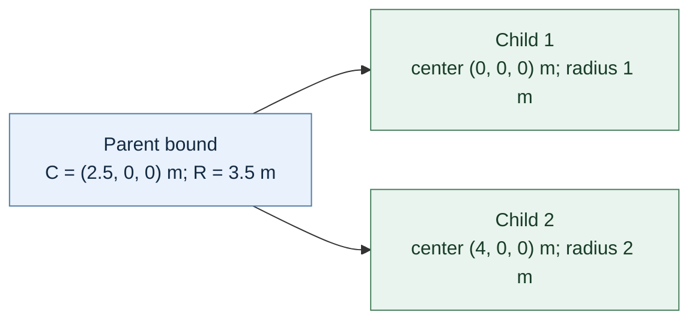

# 33 — Versioned scenes and transactional loading

[[Chapter Edition/03 - Game Engine/00 - Reading Map|Reading map]] · [[Chapter Edition/03 - Game Engine/32 - Terrain materials and image composition|Previous chapter]] · [[Chapter Edition/03 - Game Engine/34 - Rigid-body motion from forces to contact|Next chapter]]

A scene file is an interface between authoring and runtime, so unknown versions and broken references need defined outcomes. This chapter establishes a versioned document contract and a safe path from parsed data to world state.

**By the end:** Design schema validation, stable IDs, migration, and transactional replacement for a saved scene.

**Recall question:** If parsing or reference resolution fails halfway through loading, how do you guarantee that the previous live scene remains intact?

<!-- Derived from Continuous Notes/Game Engine - From First Frame to Living Worlds.md; source lines 79214–80372; source-span SHA256 ba50fb5d7039c4ca168b1517ef30e9be59a4211ec235e4281eef05ffcc076225. -->

<!-- CHAPTER-SOURCE-BEGIN -->
### Save scenes as a versioned authoring contract

A text scene file can make authored data inspectable and easier to merge, but the format is only one part of the contract. The scene saving lesson separates serializer code from scene runtime behavior, uses a root scene map and an entity list, stores identifiers and component data, and handles math types through explicit encoders/decoders ([IEiOP7Y-Mbc](https://www.youtube.com/watch?v=IEiOP7Y-Mbc), 01:45–11:00; 24:00–31:06). Missing component nodes are skipped; transform is treated as a required default. The source favors YAML over JSON based on the author’s merge experience—this is a preference grounded in that workflow, not proof that one format always merges better.

Deserialization must also account for context. A camera projection can depend on viewport size, yet a file may load before the editor supplies that size (34:03). Loading into an existing scene can append duplicate entities; the demo leaves reset/replacement to external code (36:00). A robust design should specify whether load replaces, merges, or appends, define how IDs are preserved or regenerated, and provide a validation path for unsupported versions. The video demonstrates a prototype serializer; it does not establish compatibility behavior for future file revisions.


### Serialization is an interface between tools and execution

Saving is not just writing memory to disk. It chooses what representation is durable, what names and identities survive, how version changes are handled, and whether humans can review edits. The scene-system demonstration uses readable text for the editable scene, emphasizing that text can be inspected and merged in source control, and contrasts it with a compact binary runtime representation (yot7ZHTrAS4, 03:26–07:10). Another scene-saving episode discusses YAML as a human-readable choice (IEiOP7Y-Mbc, 00:14–06:20, partial review). These examples support a design option, not a universal rule: readable source data helps review; binary can be useful for efficient packaged loading; either format still needs validation and versioning.

A separate serialization video discusses a lower-level binary serializer and memory stream, specialized serialization for particular object types, and an asset pack whose index/offset information precedes payload data. It also mentions checking a magic value and format version before trusting the data (EK4QSO_qO9Q, approximate reviewed windows 00:20–06:00 and 13:50–23:45; partial coverage). Those are distinct layers from scene YAML. A robust pipeline can use readable authoring files and binary packed data, but must document conversion and failure behavior. On load, reject the wrong file type, unsupported version, invalid lengths, impossible indices, and unresolved dependencies with actionable errors. Do not treat raw in-memory object layout as a stable file format merely because a quick prototype can write and read it.

### Play mode needs an explicit state boundary

Early in the scene-system work, Play directly changes the same scene that the editor is displaying. Stopping does not restore the original transform. The developer identifies this as a defect. In the later play/stop discussion, the proposed architecture is clearer: preserve an editor-authored scene, create a runtime copy for Play, and discard that copy on Stop. Scripts and physics may create or destroy entities, add components, change state, or alter referenced resources; restoring only transforms would miss those mutations. Opening a different scene while play is active had caused a crash, so the observed fix is to stop before replacing the scene (EAC6_h07izo, 00:08–05:26, partial review; yot7ZHTrAS4, scene system).

This is a separation of ownership and lifetime. The authoring scene is a document. The runtime scene is a temporary execution state. The renderer may display either; panels must know which one they edit or inspect. A state machine with `Edit`, `Simulate`, and `Play` is clearer than a collection of loosely related booleans. The physics-simulation episode specifically distinguishes simulating physics while keeping the editor camera from full gameplay (WPmR4F_-nc4, 09:45–11:15, partial review). That distinction enables a designer to inspect a falling object without surrendering editor controls.

A testable contract is: entering Play clones or instantiates runtime state; runtime scripts and physics mutate only that state; Stop destroys it; the authoring scene hash remains unchanged unless the user explicitly applies runtime changes. Opening another document first exits simulation. This contract follows from the development issues shown in the videos and is a recommended invariant, not a claim about every later implementation.

#### Run a copy so Play cannot damage the edited scene

A physics simulation changes transforms, and a real game can also spawn entities, run scripts, and create other state. Trying to remember and restore only selected values will not undo arbitrary runtime work. Hazel's editor therefore keeps the edited scene and creates a separate runtime copy for Play. Stop switches back to the original and releases the runtime scene.

Copying an ECS scene requires more than making new entities. The copy must preserve each entity's UUID so references can still point to the corresponding entity, while accepting that the ECS registry may assign different internal handles. The tutorial builds a UUID-to-new-entity map, then copies component data to the mapped destination. Components already present on new entities are replaced; others are inserted. The list of component types is manually enumerated in this version, with a registry-driven approach left for future work. Do not blindly byte-copy runtime-only resources: Box2D body/fixture handles, Mono instances or GC handles, cached GPU objects, and backend pointers must be excluded from authored scene data and cleared or rebuilt for the runtime scene.

The live debugging identifies two practical hazards: forgetting to populate the UUID map crashes component copying, and keeping a reference to a tag string while entity creation grows the registry can leave that reference invalid. It also switches editor panels to follow the active editor/runtime scene. The episode adds entity duplication and Ctrl+S path tracking, but those steps are still tutorial code that would need separate completeness checks.

### Physics tools should reveal what the solver sees

The physics episodes repeatedly expose the difference between rendered appearance and collision geometry. A sprite or detailed mesh does not have to define the collision shape. Static bodies participate in collision but are not moved by the solver; dynamic bodies respond to simulation. The 2D episode describes world stepping in Play and collider geometry/offsets; the 3D walkthrough warns that a detailed mesh collider can be costly and suggests a simpler collision mesh when appropriate (B1nO5wbPbwg, selected ranges around 18:01–20:11 and 33:58; oqTAHwwSA9I, 05:56–14:25, partial review). A first-person setup uses a capsule for the player and separately handles the camera because parent-child hierarchy support was not yet present in that snapshot (KuenrFVlm2E, 00:20–02:04 and 03:58–10:00, partial review).

An invisible collider is hard to tune. In the collider visualization episode, the developer adds rectangle/circle debug drawing and deliberately keeps it in an editor/debug layer instead of mixing it into the runtime scene renderer (rr1GPVzyG00, 00:07–04:12, partial review). This separation gives a clean switch: the game view renders game content, while diagnostics overlay solver inputs. It also helps catch scale coupling: the circle-collider episode discusses decoupling radius from visual transform scale so a decorative size change does not silently change gameplay collision (08rcY_YDWNc, 00:31–08:08, partial review).

The earlier 2D physics debug video notes a practical bug: script input could fail to affect a sleeping body until it was explicitly awakened. It also shows a shared material being changed persistently when the intention was an instance-level visual change (RlQ4YVnQN40, selected ranges 13:50–20:50). Both are ownership problems visible through behavior: simulation has a sleep state that affects input response, while a shared asset mutation leaks one object's temporary effect into future uses. Debug controls should expose sleep/wake state and distinguish asset defaults from per-instance overrides.

#### Draw physics colliders as editor overlays

Collider values are easier to tune when the editor can show the shape the physics system uses. The Hazel 2D episode keeps these debug drawings in the editor layer: render the scene first, then draw collider outlines as overlays. A scene query for entities with collider and transform components supplies the data without making ordinary scene rendering responsible for editor controls.

The overlay transform must represent the collider itself. The historical branch draws a circle from entity translation, collider offset, radius, and entity scale; it draws a box from offset, half extents, entity scale, and z rotation, with a factor of two to obtain full drawing dimensions. This is editor-visualization behavior, not a general Box2D shape-scaling rule. A Box2D circle has one scalar radius; nonuniform scaling cannot represent a true ellipse without changing the shape. The overlay must follow the same unit conversion, effective scale policy, offsets, and dimensions as the fixture, without applying radius or scale twice. Edit mode uses the editor camera; play mode uses the scene camera.

The episode's debugging is instructive: a wrong begin-scene call initially draws nothing, and later play-mode tests expose transform-scale issues. It ends with a real unresolved case: the circle overlay is not reliably visible from the opposite camera side. The proposed community issue or pull request means this source demonstrates an incomplete feature, not a finished depth solution.

### Scripts need a host, a lifecycle, and inspectable state

Native scripting begins with a concrete need: moving a runtime camera with input or making it follow a player. Hard-coding every behavior into the editor layer is the wrong place because gameplay behavior belongs with runtime entities (iIUhg88MK5M, 00:00–02:25, partial review). In the later C# workflow, script classes expose public fields in the editor, and hot reload makes it possible to change code and see the behavior during iteration (g9HGp3icrIg, around 08:00 onward; yot7ZHTrAS4, script component example). The development path can evolve from native scripts to managed scripts, but each adds a host/runtime boundary: class discovery, assembly loading, entity binding, field reflection, and reload policy.

That boundary must answer lifecycle questions. When does a script instance get constructed? Is its field value authored data or a live runtime value? What happens on scene reload? Does reloading code preserve state, recreate instances, or reset the runtime? Can a script safely create/destroy entities during iteration? These questions are exposed by the debug-code episode, where runtime scene cleanup is complicated by scripts that spawn or remove entities/components and by the need to keep a script engine available for editor field reflection (g9HGp3icrIg, 02:18–04:10, partial review).

The episode’s strongest practical lesson is observability. A debug panel that exposes maps of scenes, entities, and scripts revealed duplicate runtime scenes accumulating after repeated Play/Stop cycles. The visible state made a resource-lifetime leak apparent instead of leaving the developer to infer it from symptoms (around 05:58–07:43). Design debug views for the objects whose ownership is subtle: active scene contexts, script instances, asset handles, physics bodies, and pending reloads. A graph view or counts are often enough to reveal that “Stop” did not release something.

#### Keep behavior independent from the asset it acts on
A projectile script can depend on a prefab reference rather than hard-coding the projectile's appearance and components. The script asks the engine to instantiate that asset, receives an entity identity, then applies runtime behavior such as position and force. This creates a useful collaboration seam: gameplay logic can be tested with a placeholder while the asset changes from a sphere to a finished rocket. The seam depends on the instantiation bridge validating the asset and returning a usable entity identity; missing assets need a defined failure path. (Full caption read: [caption source](https://www.youtube.com/watch?v=ogQTYSokqAI).)


### Prefabs and iteration shift design cost to identity management

A prefab is presented as a reusable, preconfigured entity or entity hierarchy with components. Rather than creating a rocket from code each time—with render mesh, script, particles, light, physics and child objects—the user can author one in the editor, inspect it, and place copies (3QJsmsN0Pcg, 00:26–08:00, reviewed). The demonstration’s important caveat is that dragging the prefab into a scene copies its entities; instances are no longer linked, so later changes to the prefab do not update those copies. The video identifies a special linked prefab-instance identity/reference as future work (08:10–10:00).

That caveat is a design fork. Copy-on-place is simple and predictable, but duplicates maintenance. Linked instances reduce repeated edits, but require stable asset identity, instance overrides, nested-prefab behavior, and conflict rules when the source changes. A useful exercise is to define an instance as `(prefab asset id, local override set, stable instance id)` and specify what happens when a source component is deleted or a property changes. Do this before claiming “prefab support”; the word can mean anything from copy templates to a complete override system.

### Practice: trace one object end to end

Build a tiny test scene with one crate and one player. Give the crate a mesh source plus import metadata, a stable scene identity, transform, and simple collider. Save the editor document in a readable format; produce a runtime package with a dependency manifest. Enter simulation and verify the collider overlay without moving the editor camera. Enter Play and let a script change the crate; Stop and confirm the authoring document remains byte-for-byte or semantically unchanged. Package the scene in a clean directory and report every missing dependency as a path plus expected asset identity. Finally, create a prefab from the crate and document whether placement is a copy or linked instance.

The point of the exercise is not breadth. It is following the same object through each ownership boundary and asking what survives each transition. For every stage, record the owner, stable identifier, mutable state, and diagnostic view. Most of the later-engine problems in these demos become understandable in those terms: scene selection is a lifetime reference, runtime reset is state isolation, asset packaging is dependency closure, debug panels expose hidden ownership, and linked prefabs need identity and override semantics.


### Build contacts that can support stable physical response

Suppose a box rests on a slightly uneven floor. A broad collision test might say “these two bounds overlap.” That answers whether to investigate, but it does not say how the physical solver should keep the box supported. Fine collision checks determine the actual shape interaction; contact generation returns usable point data. This separation matters because a rendering mesh may contain thousands of triangles while the physical approximation can use a few boxes, spheres, or capsules. The simpler shape may be less visually exact but faster to test and easier to make stable. (Game Physics Engine Development, PDF pp. 286-288.)

Now place a wide crate on a flat floor. Reporting only one corner as the contact can make the crate tip or jitter even though most of its bottom face is supported. A contact patch represented by a small set of points gives the solver a better account of the support. Each contact needs a location, a direction, and a penetration measure: the point says where, the normal says which way the separating impulse acts, and the depth says how far the surfaces overlap along that direction. The normal convention must be consistent across the pair; this supplied book states a first-object-to-second-object convention. Other solvers may choose the opposite sign; their impulse and separation equations must match their declared convention. If one part of the engine flips body order without also flipping the normal, the solver can push objects together instead of apart. (Game Physics Engine Development, PDF pp. 289-292.)

The geometry of the touching features guides the contact recipe. A point pressing into a face uses the face normal and distance to the projected surface point. Two edges can use a normal perpendicular to both edge directions. Curved features need cases such as edge-face or face-face. These recipes do not have equal priority: the described engine focuses first on common point-face and edge-edge cases and omits rare point-point or point-edge cases. That is an explicit coverage tradeoff. For an engine, the contact test suite should include the support cases the game actually uses, such as a box on a plane, a sphere on a plane, and a crate edge against a wall, plus the intentionally unsupported edge cases so their limitations are visible. (Game Physics Engine Development, PDF pp. 292-295.)

The same page selection connects accuracy to authoring. Designers can build collision shapes manually, but this costs time; imported geometry can be simplified automatically, but the assigned pages do not supply such an algorithm. A practical engine can support both: use imported coarse shapes as a starting point, then let designers inspect and adjust them in an editor. Contact generation should use the authored physical representation, not silently depend on every visual triangle. (Game Physics Engine Development, PDF pp. 287-288.)


### From a conservative box check to a sphere–box contact

A collision test should answer a particular question. A broad-phase test asks whether two bounds could overlap, so it may keep extra pairs as long as it never drops a real collision. A narrow-phase primitive test asks whether the actual shapes touch and, when a response is needed, supplies a contact point, a normal with a declared direction, and penetration depth. These outputs are related but not interchangeable: “overlap” alone does not tell a solver which way to push or how far.

For a sphere against an oriented box, first express the sphere center in the box’s local coordinates. Here the box transform contains a translation and an orthonormal rotation; its half extents and sphere radius use the same length unit. Removing a nonuniform scale would turn the sphere into an ellipsoid, so it would not preserve this scalar-radius test. This change of coordinates removes the box’s rotation from the closest-point calculation. If the local center is $c=(c_x,c_y,c_z)$ and the box half extents are $h=(h_x,h_y,h_z)$, clamp each coordinate to its interval:

$$
q_i=\min(h_i,\max(-h_i,c_i)).
$$

The point $q$ is the closest point on the box to the sphere center in box coordinates. The squared distance $d^2=\|c-q\|^2$ determines overlap without a square root: the sphere touches or overlaps when $d^2\le r^2$. If it does not, reject the pair. If it does, transform $q$ back to world coordinates and use the vector from the box contact point to the sphere center as the normal, assuming the contact convention points from body 0 (box) toward body 1 (sphere). Its normalized direction is $(c_w-q_w)/\|c_w-q_w\|$, and the penetration is $r-\|c_w-q_w\|$. This is the point used by the supplied box–sphere example (Millington, *Game Physics Engine Development*, PDF pp. 305–309 / printed pp. 282–286; source `src-657cb0089860334fec51`, units `u-66dce93ea6c7148cf4ab515b`, `u-6f4e2c05fe00d4cd342d9e32`, `u-ad7f56799849cbcb02c6b714`, `u-c800d0a78969af102504d0b8`).

A cheap early-out tests the box’s three local axes. If $|c_x|-r>h_x$, the sphere is farther than its radius beyond the box’s x slab, so the shapes cannot touch; the same test applies to y and z. But passing all three tests is only a necessary condition near a corner, not proof of contact. With a unit box $h=(1,1,1)$ and a sphere of radius $0.30$ centered at $c=(1.25,1.25,0)$, both x and y gaps are $0.25$, so each axis test passes: $1.25-0.30=0.95\le1$. The exact closest point is $q=(1,1,0)$, however, and the gap is

$$
\|c-q\|=\sqrt{0.25^2+0.25^2}=0.3536>0.30.
$$

The final squared-distance check correctly rejects this corner near miss. If the center instead is $(1.20,1.20,0)$, the same early checks pass and the gap is $\sqrt{0.2^2+0.2^2}=0.2828$, giving about $0.0172$ units of penetration. This is why component-wise slab checks cannot replace the Euclidean closest-point test.

There is also a degenerate case in the textbook-style clamp algorithm: if the sphere center is inside the box, then $q=c$, so $c-q=0$ and normalizing it is undefined. The cited pages’ code forms its normal from this vector without showing an interior-center fallback in the inspected excerpt. A robust implementation must state what it means to resolve a sphere contained by a solid box. One possible policy chooses the nearest face and uses its outward normal, with penetration based on the distance needed to move the sphere completely out; another policy rejects containment as an invalid configuration for that body pair. For a solid box with half extents $(1,1,1)$, center $c=(0.2,0,0)$ and sphere radius $0.3$, the nearest face is $x=1$, at distance $0.8$ from the center. Moving the center outward by $0.8+0.3=1.1$ brings it to $x=1.3$, where the sphere just touches the face from outside. The ordinary exterior formula would instead divide by zero. Equal-distance faces need a deterministic tie rule or a deliberate multi-contact policy. The correct policy depends on whether the box is a solid collider and on the solver’s contact orientation. Do not quietly normalize a zero vector or treat this case as ordinary surface contact.

The same “early reject, then construct contact” idea scales to the separating axis theorem (SAT). A **separating axis** is a direction on which two shapes’ projected intervals do not overlap. One such axis proves the shapes are separated; overlapping projections on a tested axis do not prove intersection. A sphere versus an oriented box has a simple set of box-face axes for inexpensive rejection, followed by the closest-point distance test to settle corner cases. Two oriented boxes need a richer candidate set: the three face normals from each box and the nine cross products between an edge direction from each box. Near-parallel edge directions produce a tiny cross product. An exactly zero cross product supplies no axis. A small nonzero cross product can still encode a relevant separating direction, so calling every small axis redundant would be wrong. Projection comparisons can use an unnormalized nonzero axis because both sides scale together; numerical tolerances must then scale too. A conservative implementation may omit uncertain tiny-axis tests and retain an extra candidate, but that trades exact rejection for possible false-positive overlap. A robust predicate or a higher-precision fallback is needed when exact narrow-phase classification matters. The assigned pages introduce box–box SAT (PDF pp. 311–312 / printed pp. 288–289), but the full fifteen-axis derivation is an explanatory extension here, not a derivation claimed from those two pages.

For each candidate axis $a$, project each box center and radius. If box A has center $c_A$, half extents $h_A$, and orthonormal axes $u_i$, its projection radius is $R_A=\sum_i h_{A,i}|u_i\cdot a|$; the center projection is $s_A=c_A\cdot a$. Compute $R_B,s_B$ likewise. The intervals overlap only if

$$
|s_B-s_A|\le R_A+R_B.
$$

A strict gap on any candidate axis is a valid separating witness. Touching policy determines whether equality counts as contact. Floating-point implementations need conservative tolerances chosen in world or normalized units; an arbitrary large epsilon can hide real gaps, while inconsistent tolerances between broad phase and narrow phase can create false negatives. If no axis separates, SAT establishes overlap but does not by itself produce a stable manifold. The minimum-overlap axis can suggest a penetration normal, but feature clipping or other contact generation is still needed to get useful contact points, especially for face–face patches.

Keep the layers visible in code and diagnostics: local-space transform, three-axis early-out, closest-point distance, world-space contact point, oriented unit normal, signed penetration, and special handling for containment and near-parallel axes. Tests should include face, edge and corner contact, a corner near miss that passes the slab checks, exact tangency under the chosen policy, a rotated box, a center inside the box, zero-sized or degenerate extents if allowed, and very large/small coordinate scales. The book’s contact routines intentionally omit some rare feature combinations and describe a particular solver’s conventions; such omissions must be recorded as supported-shape limits, not generalized into a theorem that those contacts never matter.


### Keep contact features coherent across frames

A collision query is a snapshot. A resting contact is a relationship that persists while two bodies continue to support or constrain one another. The distinction matters because a detector that returns only the single deepest contact at each frame can keep rediscovering one corner while the rest of a crate’s support patch disappears from the solver’s view. *Game Physics Engine Development* describes a compact way to accumulate a useful contact set over successive frames: identify a contact by its type and by the specific feature on each object, refresh the changing measurements for contacts that recur, add newly observed features, and remove cached features after they have separated far enough. In the book’s box example, a feature is a particular vertex or face for point–face contact, or a particular edge on each box for edge–edge contact (physical PDF pp. 314–315; extracted units `u-1cca6d9fb043a576e1a0a091`, `u-a35966eb6c9d8121000049f5`; claim points `p-000002`–`p-000009`).

This is temporal coherence: nearby frames usually contain related geometry, so the previous frame’s feature identities are useful hints for building the next frame’s contact set. A practical cache key therefore needs the ordered body pair plus contact kind and feature identifiers, with body ordering normalized so the same physical pair does not appear twice in opposite orders. The key identifies *which geometric interpretation* is being revisited; it does not certify that the contact remains valid. Each simulation step must recompute the current world-space contact point, normal, and signed separation or penetration from the current transforms. If a body rotates enough that the old vertex–face pair no longer describes touching features, the old record must fail validation and the newly detected feature pair must be inserted. Do not carry a stale normal or depth forward as if it were current geometry.

The detector and cache have different jobs. A separating-axis test (SAT) can establish that two oriented boxes overlap by testing the three local axes of each box and the nine pairwise cross-product axes; it can stop at the first separating axis. That gives an overlap decision and a candidate axis, not a complete set of contact points. A deepest-feature query can produce one point–face or edge–edge candidate. The cache compares that candidate with the pair’s existing feature records, refreshes a match, or appends a new feature record. It supplies the current candidate records to a contact builder or resolver, which must separately decide which records belong in the active constraint set. For complex polyhedra, feature identification and full manifold generation require more work; the text presents this cache as a practical way to gather contacts over time, not a universal replacement for a robust collision library.

#### A four-sample support trace

Take two boxes, A (a crate) and B (the floor), and let positive $d$ mean overlap depth while negative $d$ means a gap along the contact normal. This sign convention is stated here for the example; implementations must document and consistently apply their own convention. Suppose the detector reports the same lower vertex of A against the same top face of B. Define the normal here as the unit direction of the normal force on the crate A from the floor B: upward, $\mathbf n=(0,1,0)$. This physical force direction is explicit for the example; contact records elsewhere may store a body-order-oriented normal, so their conversion to the solver impulse convention must be documented. The cache identity is `(A, B, point-face, A.vertex_3, B.face_top)`.

| Step | Recomputed contact data | Cache membership | Solver status in this example |
|---|---|---|---|
| $k$ | $d=+0.018\,\mathrm m$, point $=(0.42,0,0.10)\,\mathrm m$, $\mathbf n=(0,1,0)$ | Insert the feature. | Active: current penetration needs resolution. |
| $k+1$ | $d=+0.004\,\mathrm m$, point shifts to $(0.421,0,0.10)\,\mathrm m$, normal remains nearly upward | Match the key and refresh point, normal, and depth. | Active: current penetration needs resolution. |
| $k+2$ | $d=-0.006\,\mathrm m$ after slight separation | Retain because $d\geq\tau=-0.010\,\mathrm m$. | Inactive under the example activation slop $s=0.001\,\mathrm m$; do not apply support, friction, restitution, or cached impulses. |
| $k+3$ | $d=-0.014\,\mathrm m$ after the crate moves away | Evict because $d<\tau$. | Inactive; no constraint is emitted. |

The values and thresholds in this trace are illustrative, not values prescribed by the book. The cache retention margin $\tau=-0.010\,\mathrm m$ answers a geometric bookkeeping question: keep a refreshed feature candidate until it is farther away than this distance. The separate activation slop $s=0.001\,\mathrm m$ answers a solver question: only contacts with $d\geq-s$ enter the active constraint set. Thus the candidate at $k+2$ remains cached but is inactive. An engine may choose a different active-set rule, but it must not treat cache membership as proof that a contact currently supports either body. A new frame can also add other vertex–face or edge–edge identities, so retained candidates may accumulate beyond the detector’s one current deepest result.

Why permit a small negative depth in the *cache*? A solver may resolve an overlap so the next measurement is exactly zero or slightly separated. If the cache evicts at zero, resolution itself erases the feature identity. The next step then starts over with only the currently deepest candidate, defeating gradual accumulation of a useful contact set. Retention keeps the identity available for geometric revalidation; it does not require the solver to enforce it. If a retained separated candidate is activated, the solver’s unilateral normal constraint must prevent attraction: with an impulse convention in which positive normal impulse pushes bodies apart, accumulated normal impulse must satisfy $\lambda_n\geq0$. Friction must be bounded by the current normal support (for example, $|\lambda_t|\leq\mu\lambda_n$), and restitution should be generated only for a newly impacting, sufficiently closing contact—not merely because an old key remains cached. An excessively large retention margin is not inherently attractive, but if the active-set policy activates distant candidates it can cause premature repulsion or visible hovering. Keep the geometric retention distance and solver activation slop separate, and test both.

This cache is not a substitute for a sound contact manifold. Validate the feature geometry as well as its ID: for point–face contact, transform the vertex into face-local coordinates, confirm its projection remains within the face polygon (with a stated tolerance), and check that the recomputed normal remains aligned with the current face normal. A crate sliding off the face should invalidate that feature even if its vertex and face IDs still exist. For edge–edge contacts, recheck that the closest points lie on both finite edge segments and that the cross-product normal is well-conditioned; nearly parallel edges need a fallback or rejection rule.

A warm-start impulse is also separate from contact retention. If the solver reuses an earlier accumulated impulse to speed convergence, first validate the current feature, active status, normal alignment, and material/solver state. Keep or reproject the old tangential impulse only when the tangent basis remains compatible; otherwise clear it. Never apply an old impulse merely because the feature key is present. Test a flat box resting on a plane, a slightly tilted box that changes its supporting vertices, a box sliding off the plane, near-parallel edges, and reset or teleport invalidation. For each step, log body pair, feature key, current world point, normal, signed depth, active/inactive decision, warm-start decision, cache action, and eviction reason.

**Evidence boundary.** The source’s direct example is contact-feature caching across frames and a small negative threshold; it says selecting the correct value requires tuning (physical PDF pp. 314–315). The numeric trace, key normalization rule, units check, feature validation, active-set separation, unilateral-impulse rule, warm-start policy, and suggested test cases above are original engineering explanations derived from the mechanism. The source terminology is internally inconsistent: p.314 uses “point–face” for alternate interpretations, then calls a vertex-against-face pair “point–edge”; p.315 again lists “point–edge and edge–edge”; the p.317–318 algorithm tests each vertex against the other box’s faces. This insertion uses “point–face” to name the geometry and records the source discrepancy rather than silently correcting it. The cache shown by the book is an educational implementation, not evidence of a current Kairo or Maveb implementation.


### Sleeping physics bodies without losing a collision chain

A quiet pile need not be fully integrated every step. A sleeping body is one the simulation temporarily excludes from routine motion updates because its motion has remained small. A practical sleep policy needs both a quietness measure and an eligibility policy. The *Game Physics Engine Development* excerpt combines a scalar motion estimate from linear and angular velocity with a recency-weighted average. Its illustrative sum, $|v|^2 + |\omega|^2$, is a motion heuristic, not physical kinetic energy: it does not include mass, inertia, or consistent unit scaling. It is useful as a threshold signal only after tuning to the engine’s units and object scale.

A recency-weighted average can be written as

$$m_t = \beta m_{t-1} + (1-\beta)q_t,$$

where $q_t$ is the latest motion sample and $0\leq\beta\leq1$ controls how much history remains. For a retention $0<\beta_0<1$ over reference interval $h_0>0$, choose $\beta(h)=\beta_0^{h/h_0}$ for step $h>0$; the exponent is dimensionless. A high $\beta$ smooths brief spikes but can delay sleep; a low value reacts quickly but may flicker around the threshold. If the simulation step changes, preserve a comparable time response by adjusting the per-step weight. The source gives a duration-adjustment strategy equivalent to raising a base retention to elapsed-step duration. A cap is also needed: stale high history should not keep a body awake indefinitely after it has settled. The book’s constants are examples for its implementation, not universal defaults.

Sleeping is correct only while nothing relevant can disturb the body. If an awake object collides with a sleeping object, wake the latter before resolving that contact. The same can propagate through a chain: an incoming ball wakes a block; the block’s changed contact wakes the next block; further contacts wake the next object. Figure 16.3 shows this propagation and was visually inspected (PDF p. 413 / printed p. 390). The rule is about preserving causal response: ignore contacts wholly inside an inactive, settled group, but do not let an active object pass through the group because its members were asleep. Non-gravity forces or torques can also require a wake-up. The excerpt’s exact policy is specific to its solver design and should be compared with the target engine’s force, joint, and contact lifecycle.

The book also distinguishes numerical correction from visible motion. Iterative contact solvers may leave a tiny penetration or velocity after a pass. If a later pass makes only a visually imperceptible correction, repeatedly processing it can waste time or introduce jitter. A tolerance defines when the remaining error is small enough to stop revisiting. This trades precision for work, so scale matters: a tolerance suitable for a small tabletop object may be conspicuous for a giant world unit. Figure 16.4 shows a penetration being reduced over iterations, eventually to a fractional amount; inspected PDF p. 414 / printed p. 391. It supports the visual explanation of the example, not a general claim that any particular epsilon is safe.

Contacts can sometimes be grouped into independent sets. Treat bodies and their contacts as a graph: two contact constraints belong in the same connected group when they are linked through shared bodies; disconnected groups can be solved independently. In the inspected figure, contacts A–C form one connected cluster, D–E another, and F stands alone (PDF p. 416 / printed p. 393; figure 16.5). The potential benefit comes from parallel or localized solving, but the data structure must expose adjacency cheaply. If finding each connected set requires repeatedly scanning every contact, the bookkeeping can erase the saved solve time. Profile the whole collision step and measure the actual graph density before adopting the grouping.

When extending this contact example to full engine islands, include other active constraints, such as joints, when deciding whether bodies are mechanically independent. A disconnected mathematical graph does not by itself provide thread-safe storage, scratch allocation or job scheduling. These are engine-level contract checks beyond the contact-only illustration.


## The rotating crate forces mechanics to meet engine state

The crate now has location and identity, but applying a force away from its centre produces rotation as well as translation. This complete previously separate rigid-body narrative now becomes the entrance to our physics and contact subsystem. Its equations and reconstruction tests are retained.

# Rigid bodies — from extended motion to contact constraints

> **Reading position.** This is an additive, continuous treatment of the physical-model chain covered by the Game Engine book's Parts 1601–1700. It does not mark any missing original source reviewed or supersede its source ledger. Its examples, equations, assumptions, failures and executable witness form one self-contained reading route rather than one hundred atomic headings. For an engine, the central question is: **what state must we own and update so a crate can translate, rotate, collide and come to rest predictably?**

## The crate exposes the weakness of point-mass motion

Imagine the workshop game: a player pushes a crate toward a pressure plate that opens a door. Representing the crate by one position and one velocity suffices only while we ignore rotation and shape. An off-centre shove visibly spins it. Two crates with identical centre-of-mass velocities can strike the plate differently when their orientations differ. We therefore need a *rigid body*: an idealized extended object whose points keep fixed distances from one another. Rigidity is a modelling assumption, not a claim that real wood or steel never deforms.

Choose the world frame, SI units, and a local body frame. Let the centre of mass position be `x` (metres), its orientation `R` a proper 3×3 rotation matrix, linear velocity `v` (m/s), and angular velocity `ω` (rad/s). A local point `r_local` on the crate maps into the world as

$$
p(t)=x(t)+R(t)r_{\mathrm{local}}.
$$

It moves with point velocity

$$
u(p)=v+\omega\times(Rr_{\mathrm{local}}).
$$

This is not an extra empirical rule. Differentiate the position, and use the fact that the derivative of a rotating fixed-length vector is its instantaneous angular velocity crossed with the vector. The cross product is perpendicular to both operands: it gives a tangential velocity and preserves the body's internal distances. If the crate rotates about its centre while `v=0`, a point at the centre stays still; a point at radius 0.5 m with `|ω|=2 rad/s` travels tangentially at 1 m/s.

**First-use distinction.** Orientation describes *where* the body's axes point; angular velocity describes *how fast and about which axis* the orientation changes. A single Euler-angle triple can become singular at some orientations and is not a vector that can safely be integrated by ordinary component addition. A unit quaternion or a rotation matrix is suitable for orientation storage; normalize a quaternion to manage floating-point drift. The angular velocity is represented in a declared frame; the equations below use world-space quantities. A renderer may interpolate visual poses but must not silently become the owner of authoritative physics state.

## Why the centre of mass, inertia and torque appear

A body may consist of particles with masses `m_i` at local positions `r_i`. Its total mass is `m=Σm_i`; choose the origin at the centre of mass so `Σm_i r_i=0`. For a continuous body use integrals rather than sums. The mass tells us resistance to linear acceleration: Newton's law gives `m dv/dt = F` when `F` is net external force.

Rotation introduces another question: **how is that mass distributed around an axis?** The world-space moment-of-inertia tensor `I` maps angular velocity to angular momentum `L=Iω`. In the body frame,

$$
I_{\mathrm{body}}=\int_{\mathrm{body}}(\|r\|^2\mathbf{1}-rr^T)\,dm,
\qquad I_{\mathrm{world}}=R I_{\mathrm{body}}R^T.
$$

The tensor is symmetric; it is positive definite for a three-dimensional body with a nondegenerate mass distribution. This definition follows by summing each particle's angular momentum `r × (ω × r) dm` and applying the vector triple-product identity. For a rectangular box of side lengths `a,b,c`, mass `m`, and axes through its centre, the diagonal body-frame entries are `m(b²+c²)/12`, `m(a²+c²)/12`, and `m(a²+b²)/12`. Units are kg·m². A thin or deliberately locked object can make an inverse inertia axis singular or constrained; do not invert such a tensor blindly.

A force `F` applied at world point `p` exerts torque `τ=(p-x)×F`. The lever arm explains why a force through the centre translates without spinning, while the same force at an offset creates angular acceleration. General rotational dynamics satisfy

$$
\frac{dL}{dt}=\tau,\quad L=I_{\mathrm{world}}\omega,\quad
I_{\mathrm{world}}\dot\omega+\omega\times(I_{\mathrm{world}}\omega)=\tau .
$$

The cross term matters because the inertia tensor rotates with the body. The simplified equation `α=I⁻¹τ` is not generally exact for freely rotating asymmetric bodies; it becomes a useful special case about a fixed principal axis, with negligible gyroscopic coupling, or for an instantaneous impulse update in which orientation is held fixed.


## Generalized coordinates describe the configuration the mechanism can actually have

The Newtonian state above is written in ambient Cartesian coordinates because a free rigid body naturally lives in three-dimensional space. A constrained mechanism often has fewer independent degrees of freedom. A pendulum bob occupies \(\mathbb R^3\), but once its rod length is fixed its allowed positions lie on a sphere; a planar pendulum needs only one angle. A door has thousands of mesh vertices but one hinge angle. **Generalized coordinates** \(q=(q_1,\ldots,q_n)\) parameterize the configuration manifold rather than storing every constrained Cartesian coordinate as independent state.

This is not merely a memory optimization. It changes the mathematical form of the dynamics. Let the Cartesian configuration be a smooth map

\[
x=x(q).
\]

Then velocity is obtained by the chain rule,

\[
\dot x
=
J(q)\dot q,
\qquad
J(q)=\frac{\partial x}{\partial q}.
\]

The kinetic energy becomes a quadratic form in generalized velocity,

\[
T(q,\dot q)
=
\frac12
\dot q^T M(q)\dot q,
\]

where \(M(q)\) is the generalized mass matrix induced by the embedding and physical masses/inertias. Potential energy is \(U(q)\). Define the Lagrangian

\[
L(q,\dot q,t)=T-U.
\]

Hamilton's principle states that the physical motion between fixed endpoint configurations is a stationary curve of the action

\[
\mathcal S[q]
=
\int_{t_0}^{t_1}
L(q,\dot q,t)\,dt.
\]

Vary the path by \(q(t)+\varepsilon\eta(t)\) with \(\eta(t_0)=\eta(t_1)=0\). Differentiating the action with respect to \(\varepsilon\), integrating the \(\partial L/\partial\dot q\) term by parts, and requiring the first variation to vanish for arbitrary \(\eta\) yields

\[
\boxed{
\frac{d}{dt}
\frac{\partial L}{\partial\dot q_i}
-
\frac{\partial L}{\partial q_i}
=
0
}
\]

for every generalized coordinate.

Arnold emphasizes a structural advantage that is easy to miss in component derivations: the extremal condition does not depend on whether the same curve is described in Cartesian, polar, or another smooth coordinate system. The formula for \(L\) changes with coordinates, but the physical extremal does not. That is the right reason to use generalized coordinates—not because angles are somehow more “physical,” but because coordinates should follow the configuration manifold.

For a simple planar pendulum with length \(\ell\), mass \(m\), and angle \(\theta\),

\[
T=\frac12m\ell^2\dot\theta^2,
\qquad
U=mg\ell(1-\cos\theta).
\]

The Euler–Lagrange equation gives

\[
m\ell^2\ddot\theta
+
mg\ell\sin\theta
=
0,
\]

or

\[
\ddot\theta+\frac{g}{\ell}\sin\theta=0.
\]

The rod-length constraint never appears as a multiplier because the coordinate already lives on the allowed one-dimensional configuration space. This is a **reduced-coordinate** model. The contact solver later in this chapter instead uses full body coordinates and imposes transient constraints through impulses. Both are legitimate; they solve different structural problems.

For an engine, the choice is architectural. A ragdoll assembled from unconstrained rigid bodies plus joints is flexible under topology changes and contact. A robotic arm represented directly by joint coordinates can eliminate joint drift and reduce the number of unknowns. Converting between the two requires explicit kinematics, Jacobians, inertia mapping, and a policy for contacts that act in Cartesian space.

Source basis: V. I. Arnold, *Mathematical Methods of Classical Mechanics*, Part II, Chapters 3–4, especially the calculus of variations, Lagrange's equations, coordinate-independence of extremals, holonomic constraints, and Lagrangian systems.

## D'Alembert's principle says ideal constraint reactions do no virtual work

A holonomic constraint restricts configuration to a submanifold \(M\). In Cartesian coordinates, the body may feel reaction forces that enforce the restriction. D'Alembert's principle characterizes an **ideal** constraint by saying the reaction has no component along any allowed virtual displacement.

Let \(x(t)\in M\), and let \(\xi\in T_xM\) be any tangent vector to the constraint manifold at the current configuration. For a unit-mass natural mechanical system with potential \(U(x)\), Arnold writes the constrained equation in the form

\[
\left(
\ddot x+\nabla U(x),
\xi
\right)
=
0
\qquad
\forall \xi\in T_xM.
\]

Equivalently, the residual

\[
\ddot x+\nabla U(x)
\]

is normal to the allowed tangent space. That normal component is supplied by the constraint reaction.

This is the geometric reason Lagrange multipliers appear. Suppose constraints are

\[
g_a(x)=0.
\]

Their gradients \(\nabla g_a\) span normal directions under regularity assumptions, so the Cartesian equation can be written

\[
M\ddot x
=
F_{\mathrm{applied}}
+
J_g(x)^T\lambda,
\]

where \(J_g\) is the constraint Jacobian and \(\lambda\) contains reaction magnitudes. Multiplying by an allowed virtual displacement \(\delta x\) satisfying \(J_g\delta x=0\) makes the constraint term vanish:

\[
\delta x^T J_g^T\lambda
=
(J_g\delta x)^T\lambda
=
0.
\]

The reaction enforces geometry without doing first-order work along permitted motion.

Do not overextend this idealization. Dry friction, motors, damping, joint limits with impacts, and compliant contacts can perform or dissipate work. A rolling-without-slip condition may be nonholonomic and cannot always be represented as a position-level manifold \(g(q)=0\). Game-engine joints often add stabilization terms because discrete integration drifts away from the ideal manifold. Those numerical terms should be identified separately from the physical constraint.

The contact constraint later in this chapter is unilateral rather than an equality manifold: bodies may separate but may not interpenetrate. Its multiplier/impulse must satisfy a nonnegativity/complementarity condition. D'Alembert's tangent/normal picture still helps: the normal reaction acts in the forbidden direction, while tangential motion is free until friction introduces another constraint law.

Source basis: Arnold, Part II, §21 on D'Alembert's principle and constrained extrema on manifolds. The Jacobian/multiplier engine form above is the standard finite-dimensional translation of the tangent-space statement.

## Small oscillations turn nonlinear mechanics into a generalized eigenproblem near equilibrium

A nonlinear mechanical system can be difficult globally and simple locally. Arnold begins the theory of oscillations by linearizing near an equilibrium because the linearized system often explains frequencies, stability, resonance, and the first visible response to small disturbances.

Let \(q_0\) be a stable equilibrium and write

\[
q=q_0+\eta.
\]

For a natural Lagrangian, expand the potential:

\[
U(q_0+\eta)
=
U(q_0)
+
\frac12\eta^T K\eta
+
O(\|\eta\|^3),
\]

because the first derivative vanishes at equilibrium. Here \(K\) is the Hessian of the potential at \(q_0\). Freeze the mass matrix to first order,

\[
T
\approx
\frac12\dot\eta^T M\dot\eta.
\]

The linearized Euler–Lagrange equations are

\[
M\ddot\eta+K\eta=0.
\]

Seek a harmonic mode

\[
\eta(t)=\phi e^{i\omega t}.
\]

Then

\[
(K-\omega^2M)\phi=0,
\]

or

\[
\boxed{
K\phi=\omega^2M\phi.
}
\]

This is a generalized eigenvalue problem. Eigenvectors \(\phi_j\) are mode shapes; \(\omega_j\) are natural angular frequencies. Under the usual symmetric positive-definite mass matrix and stable stiffness assumptions, modes can be chosen \(M\)-orthogonal:

\[
\phi_i^T M\phi_j=0
\qquad i\neq j.
\]

Expand displacement as

\[
\eta(t)=\sum_j a_j(t)\phi_j.
\]

The coupled system then decouples into scalar oscillators,

\[
\ddot a_j+\omega_j^2a_j=0,
\]

until damping, forcing, nonlinearities, or mode truncation are added.

This is the mechanics counterpart of PCA/SVD and Laplacian eigenmodes elsewhere in the curriculum: a basis is chosen that diagonalizes the important quadratic forms. Modal animation and reduced deformable simulation exploit exactly this structure. Keeping the lowest modes can reproduce large-scale compliant motion at much lower cost, but mode truncation cannot represent arbitrary local deformation or topology change.

Stability also depends on the Hessian. If \(K\) has a negative generalized eigenvalue relative to \(M\), then \(\omega^2<0\) for that direction and the linearized solution grows exponentially rather than oscillating. A zero mode can correspond to a symmetry or unconstrained rigid motion. Thus an eigenanalysis is also a local stability diagnostic.

Numerical stepping must respect the highest retained frequency. Explicit methods can become unstable when \(h\omega_{\max}\) is too large. A reduced model with fewer high-frequency modes can therefore be cheaper not only because it has fewer coordinates but because it may permit a larger stable timestep—though that changes the represented physics.

Source basis: Arnold, Chapter 5 on linearization and oscillations; the generalized mass/stiffness eigenproblem is also the normal-mode framework developed in Riley, Hobson, and Bence, *Mathematical Methods for Physics and Engineering*, Chapter 9.

## The Legendre transform turns configuration-space dynamics into phase-space dynamics

The Lagrangian formulation evolves \(q\) through a second-order differential equation. Hamiltonian mechanics introduces canonical momentum

\[
p_i
=
\frac{\partial L}{\partial\dot q_i}
\]

and, when the velocity-to-momentum map is invertible, uses \((q,p)\) as independent phase-space coordinates.

Define the Hamiltonian by the Legendre transform in the velocity variables,

\[
H(q,p,t)
=
p^T\dot q-L(q,\dot q,t),
\]

where \(\dot q\) is expressed as a function of \((q,p,t)\). Differentiating,

\[
dH
=
\dot q^Tdp
-
\frac{\partial L}{\partial q}^Tdq
-
\frac{\partial L}{\partial t}dt,
\]

after the \(p^Td\dot q\) terms cancel using \(p=\partial L/\partial\dot q\). The Euler–Lagrange equation gives \(\dot p=\partial L/\partial q\), so

\[
\boxed{
\dot q=
\frac{\partial H}{\partial p},
\qquad
\dot p=
-\frac{\partial H}{\partial q}.
}
\]

A second-order system in \(q\) has become a first-order system in twice as many variables.

For a standard particle with

\[
L(q,\dot q)
=
\frac12\dot q^TM\dot q-U(q)
\]

and constant positive-definite \(M\),

\[
p=M\dot q,
\]

and

\[
H(q,p)
=
\frac12p^TM^{-1}p+U(q).
\]

Here \(H\) equals total mechanical energy. That equality is common but not the definition of a Hamiltonian; generalized velocity-dependent potentials, time-dependent coordinates, or other Lagrangians require more care.

If \(H\) has no explicit time dependence, then along a Hamiltonian trajectory

\[
\frac{dH}{dt}
=
\nabla_qH^T\dot q
+
\nabla_pH^T\dot p
=
\nabla_qH^T\nabla_pH
-
\nabla_pH^T\nabla_qH
=
0.
\]

Energy conservation follows directly from the canonical equations. In a numerical engine this exact continuous invariant need not be exactly preserved by a discrete integrator. That distinction is why energy drift is a property of the time-stepping method, not proof that Hamiltonian mechanics itself is dissipative or explosive.

Source basis: Arnold, Chapter 3 §§14–15 on Legendre transforms and Hamilton's equations, especially the equivalence between Lagrange's equations and the canonical first-order Hamiltonian system.

## Symplectic structure explains why long-time phase behavior is a stronger target than one-step position error

Write canonical phase state as

\[
z=
\begin{bmatrix}
q\\p
\end{bmatrix},
\qquad
J=
\begin{bmatrix}
0&I\\
-I&0
\end{bmatrix}.
\]

Hamilton's equations are

\[
\dot z
=
J\nabla H(z).
\]

The canonical symplectic two-form is represented locally by \(J\). A smooth map \(\Phi\) is symplectic when its Jacobian satisfies

\[
D\Phi(z)^T J D\Phi(z)=J.
\]

This condition is stronger than ordinary volume preservation. Taking determinants implies

\[
|\det D\Phi|=1,
\]

so a symplectic map preserves phase volume, but many volume-preserving maps are not symplectic. Arnold develops both ideas: Liouville's theorem states that Hamiltonian phase flow preserves phase volume, while the symplectic formulation identifies the closed nondegenerate two-form preserved by Hamiltonian flow.

The distinction matters numerically. A generic high-order integrator can have excellent short-time state accuracy yet slowly distort the qualitative geometry of conservative motion. A **symplectic integrator** exactly preserves a nearby discrete symplectic map. It usually does not conserve the original Hamiltonian exactly at each step, but backward-error analysis often explains its bounded, oscillatory long-time energy error as exact motion under a nearby modified Hamiltonian for long intervals.

For the separable Hamiltonian

\[
H(q,p)=T(p)+U(q),
\]

symplectic Euler can be written in one variant as

\[
p_{n+1}
=
p_n-h\nabla U(q_n),
\]

\[
q_{n+1}
=
q_n+h\nabla T(p_{n+1}).
\]

For \(T=p^2/(2m)\), this is the familiar velocity-first/semi-implicit Euler update already used earlier in the engine curriculum. Its value is not that it is magically exact. Its update order gives a symplectic map for this Hamiltonian form, which often produces much better long-time qualitative behavior than explicit Euler.

Hamiltonian mechanics also introduces the **Poisson bracket**

\[
\{f,g\}
=
\nabla f^T J\nabla g.
\]

Along an autonomous Hamiltonian trajectory,

\[
\frac{df}{dt}
=
\{f,H\}.
\]

A quantity \(f\) is conserved when its Poisson bracket with \(H\) vanishes. This gives a compact algebraic language for invariants and canonical transformations. In a game engine one does not need to implement a Poisson-bracket type to benefit from the concept: it explains why position and momentum are paired, why canonical transforms preserve dynamics, and why integrator structure can matter beyond local truncation order.

Do not confuse this with contact/constraint projection. A collision impulse makes the trajectory nonsmooth and can intentionally dissipate energy through restitution/friction. A projected constraint solver can also destroy exact symplecticity. Structure-preserving free-flight integration is still useful, but the full engine is a hybrid dynamical system containing smooth Hamiltonian segments, external forces, constraints, impacts, sleeps, and authored corrections. Each layer should state which invariants it preserves or intentionally breaks.

Source basis: Arnold, Chapters 7–9, especially Hamiltonian phase flow, Liouville's theorem, symplectic manifolds, Hamiltonian vector fields, Poisson brackets, and canonical formalism. The explicit symplectic-Euler bridge is a numerical-analysis application of that structure.

## Turning continuous motion into an engine timestep

The differential equations describe ideal continuous time, but a game engine executes discrete updates. At a fixed timestep `h` seconds, a simple *semi-implicit Euler* translational step is

$$
v_{n+1}=v_n+h F_n/m,\qquad x_{n+1}=x_n+h v_{n+1}.
$$

Notice that position uses the **new** velocity. Explicit Euler would use `v_n`; the difference affects energy behaviour. Neither is exact. Forces can be state-dependent, and an unstable or too-large timestep can cause tunnelling, visible energy injection or constraint jitter. The timestep is part of the numerical model; simply multiplying an arbitrary penetration correction by `h` does not create a physically principled solver.

Rotation can be updated with a unit-quaternion increment derived from `ω h`, but the implementation must declare whether its angular velocity and quaternion multiplication use the world or local frame. Re-normalization treats storage drift, not integration error. For a production solver, decide the order of force integration, collision generation, velocity constraints, position correction, sleep decisions and render interpolation. Their data dependencies must be explicit.

## Why contact changes *both* linear and angular velocity

Now the crate reaches the floor. A collision detector supplies a contact point `p`, normal `n` (unit length, pointing from body A toward B), penetration depth `d` (metres), and optionally stable feature identifiers. This contact record is not itself a solver: it says *where and how* the bodies interfere, but not which changes in velocity satisfy the constraint.

Let `r_A=p-x_A` and `r_B=p-x_B`; point velocities are `u_A=v_A+ω_A×r_A` and `u_B=v_B+ω_B×r_B`. The relative normal speed is

$$
v_n=n\cdot(u_B-u_A).
$$

Negative `v_n` means the bodies approach along the chosen normal. A scalar normal impulse `j≥0` acts as `-jn` on A and `+jn` on B. The resulting linear velocity changes are `Δv_A=-jn/m_A` and `Δv_B=+jn/m_B`. Since the impulses act at offsets, they also change angular velocities:

$$
\Delta\omega_A=-I_A^{-1}(r_A\times jn),\qquad
\Delta\omega_B=+I_B^{-1}(r_B\times jn).
$$

The *effective inverse mass* along this normal is the amount by which a unit normal impulse changes relative normal speed:

$$
k_n=m_A^{-1}+m_B^{-1}
+n\cdot\Big[
(I_A^{-1}(r_A\times n))\times r_A
+(I_B^{-1}(r_B\times n))\times r_B
\Big].
$$

It is not just inverse mass: off-centre impulses also spend effort creating rotation. Treat static/kinematic bodies as zero inverse mass and zero inverse inertia in the impulse solve. Check that `k_n` is finite and positive before division.

For an isolated collision with restitution coefficient `e` in `[0,1]`, and approach speed `v_n<0`, the unconstrained impulse is

$$
j=-(1+e)v_n/k_n.
$$

Restitution models a bounce; `e=0` requests no normal rebound, and `e=1` idealizes perfectly elastic relative normal motion. Applying this formula independently to a stack of many simultaneous contacts is not a complete stack solver. A contact at rest should not receive a new bounce on every solver iteration: restitution is normally gated by a meaningful approaching-speed threshold.

**Numerical witness.** Two equal 2-kg bodies strike head-on at their centres with `v_A=+3 m/s`, `v_B=-1 m/s`, `n=+1`, and `e=0.5`. The relative speed is `v_n=-4 m/s`; because both lever arms vanish, `k_n=1/2+1/2=1 kg⁻¹`. Thus `j=6 N·s`. The final velocities are `v'_A=3-6/2=0 m/s` and `v'_B=-1+6/2=2 m/s`; the final separation speed is `2 m/s`, half the incoming closing speed. Total momentum is `2·3+2·(-1)=4 kg·m/s` before and `2·0+2·2=4 kg·m/s` after. With an off-centre contact, this scalar calculation is insufficient unless the rotational terms are included in `k_n`.

## How a resting contact avoids the endless-bounce problem

Stacks, resting crates and multi-point manifolds require a *persistent constraint solve*. Store each normal impulse's accumulated magnitude `λ≥0`. During a projected Gauss–Seidel iteration compute an incremental request `Δλ`, clamp the **total** accumulated impulse,

$$
\lambda_{\mathrm{new}}=\max(0,\lambda_{\mathrm{old}}+\Delta\lambda),\qquad
\Delta\lambda_{\mathrm{applied}}=\lambda_{\mathrm{new}}-\lambda_{\mathrm{old}}.
$$

Only apply the second quantity. Clamping the incremental impulse alone forbids an iteration from *removing* an excessive earlier impulse, so it can create artificial forces. Cached impulses from the previous frame can warm-start the solver when contact identifiers, normals and body ownership genuinely match. Do not carry impulses across unrelated contacts or silently reuse stale contact features after a topology change.

For penetration correction distinguish three mechanisms: a velocity-level bias that asks the next step to separate, a position-level correction that directly repairs overlap, and substepping/continuous collision detection that prevents some deep penetrations in the first place. Bias has velocity units: a typical bounded Baumgarte-style term has scale `β max(d-s,0)/h`, where `β` is dimensionless and `s` is a slop allowance in metres. This is *not* a proof of physical energy correctness; too much bias can create bounce, especially with a changing timestep. Position-only repairs can move objects without imparting consistent velocity. Fixed timesteps, capped correction, split impulses, and enough solver iterations each address different failure modes.

Friction applies impulses in the plane tangent to `n`. Choose tangential directions from the relative contact velocity (or a robust orthonormal basis when nearly stationary). The Coulomb bound is `|λ_t|≤μ λ_n` for a single tangential direction; a two-dimensional tangent plane has a disk or cone bound, not independently unconstrained scalar impulses. `μ` is dimensionless. Static and dynamic friction require an explicit model/approximation rather than treating `μ` as a magic damping constant.

## The live engine contract

The minimum coherent system owns: stable body IDs; poses and current/previous transforms; linear and angular velocities; mass/inverse mass; body-space inertia and orientation-dependent world inverse inertia; collision shapes; force/torque accumulators; and contact manifolds with feature IDs and accumulated impulses. The update loop is: accumulate inputs/forces → advance free velocities → update collision proxies → broad-phase potential pairs → narrow-phase contacts → warm start validated contacts → iterative velocity/friction solve → integrate poses and repair position as required → update sleep state → publish an immutable render snapshot. Broad phase must never be mistaken for proof of collision; it produces candidates that narrow phase tests. The renderer must not race writes into the physics owner's mutable pose array.

The pressure-plate gameplay rule should query a **physical contact or overlap event** with stable identifiers, rather than infer activation from a rendered sprite. Deterministic replay requires declared timestep, stable processing order, controlled floating-point environment where possible, and recorded inputs. It is not guaranteed merely because a fixed timestep was selected. A useful diagnostic stream records frame number, contact pair IDs, normal, penetration, relative normal speed, accumulated impulse and number of iterations.

## Reconstruction and failure tests

With an empty body list, there should be no contact events. Two approaching, centrally aligned bodies should conserve total linear momentum under internal impulses. An off-centre impulse should change angular momentum with sign matching `r×J`. Two separating bodies should not receive an attractive normal impulse. A resting stack should approach stable relative velocity without a fresh restitution bounce each frame. Static bodies should not be moved by inverse-mass division; a contact with zero total effective inverse mass should be reported as unsolvable rather than divided by zero. Rotating a rectangular crate should rotate its **world** inverse inertia, while its body-space inertia remains fixed. Finally, reducing `h` while holding the physical scenario constant should expose numerical convergence or non-convergence—not an unexplained change of physical laws.

The accompanying [standalone C++20 impulse witness](../../tools/labs/rigid_body_contact_lab.cpp) checks a fully specified central 1D collision and the projected accumulated-impulse rule. It is deliberately *not* a complete 3D rigid-body engine. In particular, it does not certify contact generation, inertia tensor rotation, friction cones or GPU execution. The chapter's equations make those missing production responsibilities explicit.

## How the next engineering problem follows

We have now obtained a physically meaningful state, derived the effects of an off-centre contact, and specified an iterative constraint update. The remaining engine-design challenge is not another isolated vocabulary item: it is how to preserve these invariants as contacts are created, persist or disappear across frames while rendering, networking, editing and gameplay all observe a coherent world. Those ownership and synchronization questions arise because the physical model now requires a stateful, reproducible execution pipeline.


## Let motion and contact answer the same world rules

A crate can now exist and be edited. It must also move, collide, rest, and trigger the plate under an explicitly chosen approximation. Begin with an isolated numerical witness, then add interacting contacts.

### The physics step: predict, detect, resolve, commit

Physics should be understood as a pipeline rather than a mysterious “apply gravity” function. At minimum, a simple rigid-body update needs state (position, orientation, linear and angular velocity, mass/inertia, and flags), forces/torques, integration, collision candidate generation, contact construction, constraint resolution, and a committed result. Millington’s contents lay out that progression from particle laws and an integrator through constraints, rigid bodies, collision detection, contacts, friction, and stability (Millington, *Game Physics Engine Development*, contents PDF pp. 8–16). The paragraphs read in detail here are concentrated in Chs. 7, 12, and 13 rather than the whole book.

#### 4.1 Integration is a numerical approximation

Newton’s law says that force changes momentum; for a constant mass, acceleration is force divided by mass. In continuous time, acceleration is the rate at which velocity changes, and velocity is the rate at which position changes. A computer does not solve the continuous path exactly for every game object. It samples state at discrete times and approximates the change across a finite interval.

A simple explicit Euler update is:

$$
\mathbf{v}_{n+1}=\mathbf{v}_n+h\mathbf{a}_n,
\qquad
\mathbf{x}_{n+1}=\mathbf{x}_n+h\mathbf{v}_n.
$$

A semi-implicit variant uses the newly updated velocity for position:

$$
\mathbf{v}_{n+1}=\mathbf{v}_n+h\mathbf{a}_n,
\qquad
\mathbf{x}_{n+1}=\mathbf{x}_n+h\mathbf{v}_{n+1}.
$$

The second formula often behaves better for game motion, but neither makes arbitrary time steps safe. Millington devotes Ch. 3 to laws of motion and “the integrator” (contents PDF p.9, printed pp. 43–54), and Ch. 16 includes integration stability (contents PDF p.15, printed pp. 375–397). The formulas above are standard teaching forms; inspect the chosen implementation and its assumptions before substituting one. A stiff spring, for example, can demand a much smaller step than free fall. A platformer may use authored character motion and only use rigid-body physics for selected objects; fidelity to laboratory mechanics is not always the game’s goal.

For the jump, gravity is one acceleration term. A jump impulse or velocity change is another rule, and the game may intentionally set vertical speed to a tuned value when the command is accepted. If the code only adds a force for one variable frame, jump height changes with frame duration. If the game wants responsive, repeatable jump height, put the rule at a fixed simulation boundary and test it at the largest allowed step and under low frame rates.

#### 4.2 Find candidate pairs before detailed contact

Checking every polygon of every object against every other polygon is too expensive. Millington describes two distinct phases: coarse detection filters likely pairs; fine detection determines actual contact geometry, including contact location and normal (Ch. 12 §12.1, PDF p.255, printed p.232; Ch. 13 begins at contents PDF p.13, printed p.263). The broad phase must be conservative: false positives merely spend extra work, while false negatives allow objects to pass through each other. Bounding volumes such as spheres and boxes provide cheap tests, and hierarchies or spatial structures reduce the number of object pairs examined (PDF pp. 256–259, printed pp. 233–236).

This is a useful place to make one clear performance tradeoff. A bounding sphere is cheap but can be loose for a long, thin object. The loose bound creates extra candidate checks. A tighter oriented box may save fine checks but cost more to maintain and test. “More accurate” is not automatically faster overall; profile the whole stage. For a moving platform game, a spatial grid might work well in a mostly flat level, while a hierarchy might suit a highly varied world. Those are hypotheses to benchmark, not universal rules.

Fine detection should output contacts in a shared, inspectable representation. At minimum: body handles, world-space point, unit normal with a documented orientation convention, penetration depth or separation, and material/feature identifiers if needed. Millington emphasizes the contact normal as an explicit direction, especially when contact geometry does not align with the vector between object centers (Ch. 7 §7.1.3, PDF pp. 129–130, printed pp. 106–107). Debugging code should draw this normal, not just a red dot. A wrong normal often looks like a solver bug even when the solver faithfully follows bad input.

#### 4.3 Resolve velocity and overlap

A contact has two visible problems. Bodies may be moving into one another, and they may already overlap due to discrete stepping or imperfect geometry. An impulse changes velocity immediately; it is conceptually different from a force that accelerates over time. Millington introduces this distinction and a contact resolver that receives a set of contact records (Ch. 7 §7.1.4–7.2, PDF pp. 130–131, printed pp. 107–108). In a simple collision along normal $\mathbf{n}$, compute relative velocity along the normal. If it is closing, choose an impulse that stops or reverses the closing motion according to the material’s restitution. Restitution is a parameter controlling rebound; it is not a free source of energy.

The contact normal convention must be consistent, because reversing it flips the sign of “closing.” Unit tests should include two bodies approaching each other, separating already, one moving body against static scenery, and equal/opposite momentum expectations. Use tolerances and state the simplifications: a particle-only solver does not capture rotational effects of a contact away from the center of mass.

Penetration correction is separate. One can shift positions apart by a bounded amount, distribute correction by inverse mass, or use a more sophisticated projection. If correction is too aggressive, stacks jitter and fast objects appear to teleport. If too weak, objects sink into floors. Millington’s contents identify interpenetration handling and the resolution pipeline as substantial parts of Ch. 14 (PDF p.14, printed pp. 301–349); this guide read the contact/impulse and broad-phase passages but does not claim a complete survey of all projection methods.

Contact order matters when many contacts interact. A stack of crates can be unstable if each pair is resolved once in a poor order. Sequential iterative solving revisits constraints, but consumes time and remains approximate. Resting contacts need special care because gravity continually pushes objects into support surfaces. Friction adds a tangential constraint: static friction resists sliding up to a limit; dynamic friction opposes motion while sliding. Millington’s contents locate resting forces, micro-collisions and friction in Ch. 15, and stability/optimizations in Ch. 16 (PDF p.15). Those topics deserve focused follow-up reading before implementing production stacking, joints, or high-speed contact.

<!-- Supervised source-review addition ee1d00bff2b64930 -->

#### Particle cables and rods are distance constraints represented as contacts

The particle engine’s cable and rod examples turn a distance relationship into a contact record that the existing contact resolver can process. They are hard constraints with different admissible states rather than collision shapes. The contact record describes both a velocity response and a separate positional-error correction; those solve different problems.

Let particles A and B have positions $\mathbf{x}_A$ and $\mathbf{x}_B$, inverse masses $w_A=1/m_A$ and $w_B=1/m_B$, separation vector $\mathbf{r}=\mathbf{x}_B-\mathbf{x}_A$, and distance $d=\lVert\mathbf{r}\rVert$. When $d>0$, define $\mathbf{n}=\mathbf{r}/d$, a unit vector from A to B. Let $L$ be the permitted distance and let $C=d-L$ be the signed length error. If $w_A+w_B>0$, the positional-error portion of contact resolution can use a single inverse-mass-weighted correction: this equation describes the geometry of that correction, not a complete velocity or energy solver. It is

$$
\mathbf{x}_A' = \mathbf{x}_A + \frac{w_A C}{w_A+w_B}\mathbf{n}, \qquad
\mathbf{x}_B' = \mathbf{x}_B - \frac{w_B C}{w_A+w_B}\mathbf{n}.
$$

For a cable, apply this positional correction only when $C>0$: the line is slack while $d<L$, so there is no length error to correct. At $d=L$, however, outward relative velocity would stretch the cable in the next instant, so an active contact can still be needed for its velocity response. The supplied cable code emits a contact at $d\geq L$, including zero penetration at the taut boundary; an outward relative velocity $(\mathbf v_B-\mathbf v_A)\cdot\mathbf n>0$ is the direction that tension must oppose. For example, if $\mathbf{x}_A=(0,0)$, $\mathbf{x}_B=(3,0)$, $L=2$, $w_A=0.25$, and $w_B=0.75$, then $d=3$, $\mathbf{n}=(1,0)$ and $C=1$. The correction moves A right by $0.25$ and B left by $0.75$, leaving their distance at $2$. A cable’s velocity response can use restitution to decide whether tightening produces rebound; a taut-rope design usually chooses little or no bounce.

A rod requires $d=L$ in both directions. Generate a contact for either $C>0$ (too long) or $C<0$ (too short); the sign of $C$ makes the correction pull together or push apart. For a rod of target length $2$ with the same particles compressed to distance $1.5$, $C=-0.5$: A moves left by $0.125$ and B right by $0.375$, restoring distance $2$. Use zero restitution to avoid intentionally turning a rod correction into a bounce. That choice does not guarantee zero vibration: timestep size, contact ordering, repeated corrections, tolerances, and iteration budget still affect stability. The source has a discrepancy here: its prose recommends two opposing contacts every frame, but the displayed `ParticleRod::fillContact` returns zero at exact target length and otherwise emits only one contact, choosing the normal from the sign of the length error. Do not describe that displayed implementation as generating two contacts. A solver that maintains a bilateral rod constraint can instead enforce the permitted relative velocity at the boundary directly; whichever representation is chosen must agree with the actual resolver and iteration policy.

Guard the degenerate cases: if $d=0$, the direction $\mathbf{n}$ is undefined and needs a stable fallback direction or a reported invalid constraint; if $w_A+w_B=0$, both particles are immovable and no mass-weighted correction is possible. A production implementation also needs consistent normal conventions and a defined policy for impossible constraints.

This contact-based solver differs from time-division collision handling. A time-of-impact loop predicts candidate collision times over the remaining frame interval, advances to the earliest event, resolves that collision, then recomputes motion and candidate times because the changed velocity can change later events. It repeats until the interval is consumed or a bounded event budget is reached. In ideal arithmetic, resolving exactly at the first contact avoids stepping through each impact; in a real engine, numerical error, simultaneous contacts, and resting contact can repeatedly report an event at nearly the same time. The loop therefore needs progress limits and a persistent/resting-contact or discrete-step fallback. Recomputing after each impact can represent a sequence of separated impacts such as idealized pool balls, but does not by itself solve simultaneous or sustained contacts and can be costly as a general game-world method. [Game Physics Engine Development, PDF pp. 145–156 / printed pp. 122–133]

<!-- Supervised source-review addition ee9d62417b59bce5 -->

#### What changes when the solver works directly on predicted positions

**Position-based dynamics (PBD)** predicts positions, projects constraint violations toward admissible positions, and then reconstructs velocities from the corrected displacement over the step. A distance projection can therefore resemble the positional correction above, while the full update method differs from a solver organized around velocity impulses and separate penetration repair. The original [PBD paper](https://doi.org/10.2312/PE/vriphys/vriphys06/071-080) develops this position-centered formulation.

**Extended PBD (XPBD)** introduces compliance, the inverse of stiffness, into that projection. For the distance constraint $C=d-L$, let $h>0$ be the step, $k>0$ the stiffness in newtons per metre, $\alpha=1/k$ the compliance in metres per newton, and $\widetilde\alpha=\alpha/h^2$. Accumulate a multiplier $\lambda$ across solver iterations within the step:

$$
\Delta\lambda=\frac{-C-\widetilde\alpha\lambda}{w_A+w_B+\widetilde\alpha},\qquad
\lambda\leftarrow\lambda+\Delta\lambda.
$$

With the earlier normal from A to B, apply $\Delta\mathbf x_A=-w_A\mathbf n\Delta\lambda$ and $\Delta\mathbf x_B=w_B\mathbf n\Delta\lambda$. Setting $\alpha=0$ recovers the hard distance correction when the denominator is nonzero. Positive compliance permits extension; it is a different physical model, not merely a slower hard rod. A cable additionally needs an inequality and an admissible tension multiplier. [XPBD](https://mmacklin.com/xpbd.pdf) addresses the stiffness dependence of ordinary PBD on timestep and iteration count; finite convergence error still depends on the solver budget. Multiplier initialization, inter-step warm starting, contact handling and velocity reconstruction remain explicit implementation choices.


#### 4.4 Discrete time can miss collisions

A body can move from one side of a thin wall to the other between two samples. Neither sampled position overlaps the wall. This is tunneling, and no amount of better contact resolution fixes it if detection never reports a contact. The remedies include smaller fixed steps, swept tests/continuous collision detection for selected fast bodies, thicker collision geometry, or game-specific speed limits. Each costs something. A racing game may need continuous checks for a few fast vehicles; a slow puzzle game may not. Collision tests should include maximum speeds and thinnest obstacles, not only ordinary scenes.

### A discrete update is a choice

A physics engine knows position and velocity at one instant, but needs to estimate them at the next. Let $x_n$ be position, $v_n$ velocity, $a_n$ acceleration, and $h$ the elapsed simulation time. With constant acceleration over the step, the familiar continuous-motion solution is

$$
x_{n+1}=x_n+v_n h+\tfrac12 a_n h^2, \qquad v_{n+1}=v_n+a_n h.
$$

Millington’s particle integrator uses a first-order Newton–Euler update: it advances position with the current velocity, then updates velocity from acceleration and applies time-adjusted damping (Millington, *Game Physics Engine Development*, PDF pp. 73–76, printed pp. 50–53). The text also compares this first-order approach to a position equation with the acceleration term, and later discusses integration stability and a second-order alternative (PDF pp. 402–403, printed pp. 379–380).

There are two common update orders worth distinguishing:

**Explicit Euler** uses old velocity to advance position:

$$
x_{n+1}=x_n+h v_n, \qquad v_{n+1}=v_n+h a_n.
$$

**Semi-implicit (symplectic) Euler** updates velocity first and uses the new velocity for position:

$$
v_{n+1}=v_n+h a_n, \qquad x_{n+1}=x_n+h v_{n+1}.
$$

The formulas differ only in which velocity is used for the position step, yet that difference accumulates. Worked example: start at $x_0=0\,\mathrm{m}$, moving right at $v_0=4\,\mathrm{m/s}$, with constant acceleration $a=-10\,\mathrm{m/s^2}$ and $h=0.2\,\mathrm{s}$. The new velocity is $v_1=4-10(0.2)=2\,\mathrm{m/s}$.

- Explicit Euler gives $x_1=0+4(0.2)=0.8\,\mathrm{m}$.
- Semi-implicit Euler gives $x_1=0+2(0.2)=0.4\,\mathrm{m}$.
- The constant-acceleration equation gives $x_1=0+4(0.2)+\frac12(-10)(0.2)^2=0.6\,\mathrm{m}$.

The two first-order schemes land on opposite sides of the exact result in this example. Neither is universally “the right one”; the result depends on the system and step size. Semi-implicit Euler is often favored for game dynamics because its energy behavior is frequently more manageable for oscillatory systems, though stiff constraints and large steps can still destabilize it. That comparison is an additional standard numerical-analysis explanation; Millington’s specific integrator is the position-first Newton–Euler form above, not the semi-implicit formula.

A useful code-reading habit follows: locate the order of operations. If code updates position before velocity, it is using old velocity for that position step. Do not infer the integrator from a method name like `integrate`. Confirm how forces become acceleration, when damping is applied, and whether the state is advanced with fixed or variable $h$. Millington’s implementation computes acceleration from base acceleration plus force times inverse mass, advances position, advances velocity, then damps it (PDF p.76, printed p.53).

### Mass and inverse mass

Newton’s second law is $\mathbf{F}=m\mathbf{a}$, so acceleration is $\mathbf{a}=\mathbf{F}/m$. Engines often store **inverse mass**, $w=1/m$, because it is the multiplier used in acceleration and impulse calculations. A dynamic object with mass $m=2\,\mathrm{kg}$ has inverse mass $w=0.5\,\mathrm{kg^{-1}}$. Double the mass, and the same force or impulse produces half the acceleration or velocity change.

Millington points out that an immovable wall is naturally represented as infinite mass, which has inverse mass zero; it cannot gain acceleration from a finite force. Zero physical mass, by contrast, would imply unbounded acceleration and is unsuitable for an ordinary simulated particle (PDF pp. 70–71, printed pp. 47–48). In code, a **static body** therefore has $w=0$, not $m=0$. The static object participates in collision detection and provides a contact normal, but solver corrections do not move it.

Inverse mass also gives a simple way to share a contact response. A light object (large inverse mass) changes velocity more; a heavy object (small inverse mass) changes velocity less. If both bodies are static, their inverse-mass sum is zero, so there is no movable degree of freedom for an impulse to affect. A robust solver should detect that case rather than divide by zero.

### One-dimensional collision impulse, with signs made explicit

We will define the contact unit normal $n$ to point from body A toward body B. Let their velocities along that axis be $v_A$ and $v_B$. Define relative speed

$$
u=(v_B-v_A)\cdot n.
$$

Under this convention, (u<0) means the bodies are closing; $u\ge 0$ means they are already separating or stationary along the normal. Let $w_A=1/m_A$, $w_B=1/m_B$, and coefficient of restitution $e\in[0,1]$. For a closing contact, the desired post-impact relative speed is $u'=-e u$. Apply an impulse of magnitude $j$ along $n$: body A receives (-j n), while B receives (+j n). Thus

$$
v_A'=v_A-w_A j n,\qquad v_B'=v_B+w_B j n,
$$

and along the normal $u'=u+(w_A+w_B)j$. Solving for $j$ gives

$$
j=\frac{-(1+e)u}{w_A+w_B}\quad\text{when }u<0\text{ and }w_A+w_B>0.
$$

Do nothing if $u\ge0$, since an impulse there would add energy to an already separating pair. Do nothing if the inverse-mass sum is zero, since both bodies are immovable. Millington’s particle contact code uses a contact-normal convention from the first body’s perspective and applies opposite impulses scaled by each inverse mass; its contact resolver tests for separating velocity before applying a restitution response (PDF pp. 129–134, printed pp. 106–111). The signs above deliberately define the normal from A to B and use (v_B-v_A), so they should not be mixed with a solver using the opposite convention.

Numeric check: A has $m_A=2\,\mathrm{kg}$, $v_A=3\,\mathrm{m/s}$; B has $m_B=1\,\mathrm{kg}$, $v_B=-1\,\mathrm{m/s}$; $n$ points right and $e=0.5$. Then $u=-1-3=-4\,\mathrm{m/s}$, and inverse-mass sum is $0.5+1=1.5\,\mathrm{kg^{-1}}$. The impulse is

$$
j=\frac{-(1+0.5)(-4)}{1.5}=4\,\mathrm{N\,s}.
$$

A changes by $-0.5(4)=-2\,\mathrm{m/s}$, so $v_A'=1\,\mathrm{m/s}$. B changes by $+1(4)=4\,\mathrm{m/s}$, so $v_B'=3\,\mathrm{m/s}$. The new separating speed is $3-1=2\,\mathrm{m/s}$, which is $e|u|=0.5(4)=2\,\mathrm{m/s}$. Momentum checks: before, $2(3)+1(-1)=5\,\mathrm{kg\,m/s}$; after, $2(1)+1(3)=5\,\mathrm{kg\,m/s}$.

If B is a static wall, set $w_B=0$; the same formula still works, and only A changes. In 3D, this simple equation ignores rotation. A contact away from the center of mass creates angular velocity too, so the effective mass along the contact direction includes rotational inertia. The 1D example teaches sign and inverse-mass distribution, not the complete rigid-body solver.

### Broad phase, narrow phase, and contact data

Collision detection should reduce expensive geometry checks without missing real contact. Millington separates **coarse** collision detection from **fine** collision detection. The coarse pass quickly proposes candidate pairs; the fine pass verifies contact and determines details such as point and normal (Ch. 12 §12.1, PDF pp. 255–256, printed pp. 232–233). This distinction is commonly called broad phase and narrow phase.

A broad phase uses inexpensive bounds or spatial organization. A sphere bound is simple to test but may be loose around a long, thin object; an AABB may be tighter in some orientations but can cost more to update/test. Hierarchies can prune many pairs by rejecting parent bounds before visiting their children (Millington, §12.3, PDF pp. 256–259, printed pp. 233–236). A false positive creates extra work for the narrow phase. A false negative is worse: a real collision is omitted entirely, so the solver cannot repair it.

The narrow phase uses the actual simplified collision shapes to determine whether a pair intersects and, if so, produces contact data. Keep this geometry work separate from the dynamics solver. The detector knows shape-specific details; the solver consumes a stable contact representation. Millington explicitly describes this separation in Ch. 7’s collision-processing discussion (PDF pp. 134–135, printed pp. 111–112). A contact record typically needs the bodies, contact point, normal, penetration/separation measure, and material response data. The normal’s orientation must be documented because the sign test for closing velocity depends on it.

#### Separate likely collision pairs from exact contact data

The excerpt ends the rigid-body chapter by naming a major limit: flight and sailing examples omit collision resolution. The next chapter introduces collision detection as a pipeline. A naive approach would test every object pair; with $N$ objects, that is $N(N-1)/2$ pairs. For $N=500$, this is $124{,}750$ potential checks before considering the cost of detailed geometry tests.

A **coarse collision detector** quickly finds pairs that might touch, using simple rules or data structures. A **fine collision detector** checks those candidates against more detailed collision geometry and generates contact points and a collision normal for the physics step. These stages address different costs: coarse detection reduces the number of expensive checks; simplified collision shapes reduce the work per check. The excerpt introduces the split and says the book will develop it in the next chapter. It does not yet describe a complete collision system, any particular spatial data structure, or production performance guarantees.

### Friction lives in the contact plane

The normal direction prevents bodies from moving into each other. Motion tangent to that normal lies in the **contact plane**. Friction resists sliding in this plane. Millington distinguishes static friction, which can cancel an applied tangential force up to a limit, from dynamic/kinetic friction, which opposes existing tangential motion; the limit scales with normal reaction force and a material coefficient (Ch. 15 §15.3, PDF pp. 381–384, printed pp. 358–361). He then explains how an impulse-based engine adapts this idea to tangential velocity impulses (PDF pp. 385–388, printed pp. 362–365).

For a simplified impulse solver, first compute the tangential relative velocity $\mathbf{v}_t$ by removing its normal component:

$$
\mathbf{v}_t=\mathbf{v}_{rel}-(\mathbf{v}_{rel}\cdot n)n.
$$

If its magnitude is near zero, there is no sliding direction to oppose. Otherwise, the solver can calculate the tangent impulse needed to stop the slide. But it must bound that impulse. In a Coulomb-style approximation, the tangent impulse magnitude cannot exceed $\mu j_n$, where $j_n$ is the normal impulse magnitude and $\mu$ is the friction coefficient. Below that limit, the contact can behave like static friction and cancel the tangential motion; above it, clamp the tangent impulse to the bound, leaving some residual slide. This is a conceptual bounded-tangent model; a full rigid-body solver also accounts for effective mass, multiple tangent axes, accumulated impulses, and friction cones.

A numeric sketch: suppose the normal impulse magnitude is $j_n=4\,\mathrm{N\,s}$, and $\mu=0.5$. The maximum tangent impulse magnitude is 2 N·s. If stopping the slide would require 1.2 N·s, the solver can cancel it. If it would require 3 N·s, the solver applies at most 2 N·s and the object continues sliding. This prevents friction from reversing tangent velocity and adding energy. The coefficients are design parameters; Millington notes that in game development they are often tuned empirically rather than calculated from exact material microstructure (PDF p.382, printed p.359).

### Resting contacts, iteration, and stability

A body resting on a floor is still affected by gravity. Each step gravity creates a small downward velocity; the contact solver must cancel it. Millington describes treating resting contacts as repeated small impulses (“micro-collisions”) rather than explicitly solving every reaction force, while noting the risk of visible vibration if restitution bounces the body at each step (Ch. 15 §15.2, PDF pp. 377–381, printed pp. 354–358). A common response is to remove the velocity contribution caused by the previous step’s acceleration and reduce restitution for low-speed contacts. These choices are approximations; they should be tested with the actual game’s contact scenes.

Several contacts can interact. Resolve one corner of a box against the floor, and another corner may become more deeply embedded. A sequential solver therefore often revisits contacts for a bounded number of iterations. Millington’s particle resolver repeatedly selects the most severe closing contact, re-evaluates after each change, and stops when contacts separate or the iteration budget is reached (Ch. 7 §7.3.1, PDF pp. 144–145, printed pp. 121–122). In his rigid-body collision pipeline, position correction similarly repeats on the deepest penetration up to a limit; tightly packed contacts may consume the entire budget and still leave small overlap (Ch. 14 §14.4, PDF pp. 361–363, printed pp. 338–340).

An engineering implementation may introduce **contact slop**: ignore or tolerate a small penetration band so floating-point noise and tiny corrections do not cause jitter. Slop is a practical solver parameter, not a guarantee of physical accuracy and not a term from the specific passages cited above. Pair it with bounded positional correction (often called a correction fraction) so a deep overlap does not teleport bodies apart in one step. Too much slop lets objects visibly sink; too little can create endless correction jitter. Measure the distribution of penetration depths and watch representative scenes.

A bounded iteration count is a performance budget and an approximation. Too few iterations can leave stacks loose, corners penetrating, or constraints visibly stretching. More iterations cost time and may improve convergence, but do not repair incorrect contact normals, missing broad-phase pairs, bad mass ratios, or a poor time step. Track both the maximum/average iteration count used and the residual penetration or closing speed. A stack that consumes every iteration each frame is a signal that the solver is under pressure, not simply an invitation to raise the cap indefinitely.

Millington catalogs stability failures such as unexpected motion, missed fast collisions, slow drift down slopes, and errors when numerical values span very different scales (Ch. 16 §16.1, PDF pp. 399–405, printed pp. 376–382). He also explains why first-order Newton–Euler can be insufficient when acceleration changes sharply, and discusses second-order updates and RK4 with costs and limitations (PDF pp. 402–403, printed pp. 379–380). For a resting body on a slope, he shows how acceleration-induced tangential velocity can be separated from contact-normal motion and removed only when friction is sufficient (PDF pp. 401–402, printed pp. 378–379). This is a good example of a “physics bug” emerging from the interaction between integration, contact correction, and friction rather than from any one formula alone.

### A practical validation ladder

Use simple scenes that isolate assumptions before building complex gameplay:

1. **Free fall:** compare position/velocity against an analytic constant-acceleration witness over a fixed duration. State whether the integrator is explicit, semi-implicit, or another scheme.
2. **Impulse pair:** use the 2 kg and 1 kg example above; verify momentum conservation and the requested restitution along the normal.
3. **Static floor:** verify a static body with inverse mass zero stays fixed while a dynamic sphere rebounds or settles.
4. **Resting contact:** drop a low-restitution body onto a plane and inspect vertical jitter, penetration, and energy drift.
5. **Friction threshold:** compare a tangent impulse below and above $\mu j_n$; the first should stop slide, the second should leave residual motion.
6. **Broad-phase oracle:** for generated pairs, compare the candidate list with a brute-force narrow-phase pass; no true overlap may be missing.
7. **Slope and stack:** test one body on a slope, then two, then a small stack; record iteration usage and residual overlap.
8. **Fast body:** sweep a projectile past a thin obstacle at maximum intended speed to determine whether discrete detection tunnels.

These are original suggested tests, informed by the failure modes and algorithms in Millington’s inspected chapters. A successful numeric witness establishes only the tested equation and setup. It does not establish production solver stability, player feel, or correctness for every geometry. Record the time step, units, mass range, collision margin, restitution/friction settings, and iteration caps with the result so the evidence remains reproducible.

### Integrate physics without surrendering the scene model

Physics adds continuous motion, collision detection, constraints, and contact events. It is tempting to represent the physics library’s body as the entity itself, but that ties the game’s identity and serialized authoring model to a runtime simulation object. A cleaner arrangement keeps a physics component on the entity and creates a runtime body from that component when simulation starts.

The public Hazel scene code declares a Box2D world and separates runtime, simulation, and editor update paths. That is code evidence for a 2D physics integration in the 2023 snapshot. It does not imply 3D rigid body support in that version. A later video title mentions 3D physics, but a title is not enough evidence for implementation details. The current public repository and later teaching series need distinct citations in the source ledger.

The key design decision is transform authority. While editing, the scene transform is the authored value. During simulation, the physics world may be authoritative for dynamic bodies. The engine must synchronize results back to render transforms at a defined point. If both the editor gizmo and physics system write the same transform concurrently, the object jitters or snaps. Kinematic, static, and dynamic bodies have different authority rules and should be represented explicitly.

Physics time should be advanced in fixed steps or in a controlled accumulator to reduce variation. A render frame may contain zero, one, or several physics steps. Collision callbacks should not destroy bodies in the middle of a physics library’s locked simulation phase; instead, queue structural changes until a safe point. These are common integration rules, not claims about unreviewed Hazel video implementation.

#### Connect simulation bodies to logical objects and rendered meshes

A physics body, a game object, and a renderable mesh answer different questions: what moves under the solver, what the game logic identifies, and what appears on screen. *Game Engine Architecture* draws these as linked but distinct entities (PDF p. 688 / printed p. 666, Figure 12.35). A logical object may have no physics body, one body, or several. The chosen relationship determines how position and orientation pass between systems (PDF pp. 689–691 / printed pp. 667–669).

Consider a heavy door that the game animates open, then releases into physics after the player lets go. While animation owns the motion, the game updates the body’s transform. After release, the physics system owns it; the game object and mesh follow the simulated body. This is an illustrative example based on the text’s distinction among game-driven, physics-driven, and fixed bodies. A fixed object does not move; a game-driven body receives transforms from game logic; a physics-driven body publishes simulation results back to the logical object. The system needs an explicit owner at each phase to avoid competing writes.

A frame loop gives this ownership a time order. In the book’s sequence, update game-driven bodies and query-helper shapes first, apply forces/impulses and adjust constraints, step the physics world, then copy physics-driven transforms back to game objects. Rendering follows so it sees a consistent completed state. A query issued before the next simulation step may return the previous completed state. Waiting for a fresh simulation result improves freshness but can delay dependent work. That is a latency/freshness tradeoff, not merely an API detail (*Game Engine Architecture*, PDF pp. 692–695 / printed pp. 670–673).

The chapter also compares synchronous and asynchronous simulation and job-based work. Parallel execution can divide tasks, but consumers must know when a result is ready; reading a body while a worker is still updating it can expose races or stale data. Begin with an explicit dependency chain, then parallelize independent work and synchronize before consumers need the result. These pages discuss historical Havok/PhysX-era patterns; they are architectural context and do not document current SDK contracts (*Game Engine Architecture*, PDF pp. 696–699 / printed pp. 674–677).

#### Turning a push into a spin

Push a rigid body through its center of mass and it accelerates linearly. Push at a point away from the center and the same force also twists the body. The turning effect is **torque**, written in the source as $\tau = p_f \times f$, where $p_f$ is the application point relative to the center and $f$ is force. The perpendicular distance from the center is the lever arm: a force directed along the line through the center has zero cross product and produces no torque. For example, pushing a door near its hinge turns it less than applying the same push at the handle. As an illustrative unit check, a perpendicular $10\,\mathrm{N}$ push applied $0.5\,\mathrm{m}$ from the hinge gives torque magnitude $5\,\mathrm{N\cdot m}$; a push directed along the hinge-to-point line gives zero torque. This numerical example is a derivation from $|\tau|=|r||f|\sin\phi$, not a number stated by the book. The book’s equation and accompanying text were checked against the rendered page. [Game Physics Engine Development, PDF pp. 220–221 / printed pp. 197–198]

A body’s **moment of inertia** is the rotational counterpart to mass, but it depends on the axis. A long stick is easier to spin about an axis through its length, because most of its mass lies close to that axis; it is harder to spin about an axis across the stick, because more mass lies farther from that axis. For point masses, the scalar moment is $I=\sum_i m_i d_i^2$, with each $d_i$ measured perpendicular to the chosen axis. In three dimensions, a $3\times3$ inertia tensor collects the axis moments and the cross-axis **products of inertia**. Those off-diagonal terms encode coupling: torque around one axis can produce angular acceleration with components along another. The book’s displayed convention places negative products off the diagonal. [PDF pp. 221–224 / printed pp. 198–201]

For a rectangular block of mass $m$ and side lengths $d_x,d_y,d_z$ aligned with the axes, the diagonal moments shown are $I_x=\frac{m}{12}(d_y^2+d_z^2)$, $I_y=\frac{m}{12}(d_x^2+d_z^2)$, and $I_z=\frac{m}{12}(d_x^2+d_y^2)$. For example, a $12\,\mathrm{kg}$ block with dimensions $(2,1,1)\,\mathrm{m}$ has $I_x=2$ and $I_y=I_z=5\,\mathrm{kg\,m^2}$ under these formulas. It is harder to rotate about $y$ or $z$ because the 2 m dimension puts more mass farther from those axes. This numerical example is calculated from the displayed equations, not given by the book. The rendered formula matches the extracted listing. [PDF p. 224 / printed p. 201]

The book writes the rotational response as $\ddot{\theta}=I^{-1}\tau$ and stores an inverse inertia tensor to avoid inverting the matrix during each update. In this compact chapter notation, $\theta$ and its derivatives describe angular motion: the angular velocity and angular acceleration are vectors, while the body’s orientation is stored separately as a quaternion $q$. Do not read $\ddot{\theta}$ as a generic list of second derivatives of three Euler angles. Its code notes that the body-space tensor must be nondegenerate. The text then explains a coordinate mismatch: torque and angular acceleration are in world coordinates, while the body’s inertia tensor is defined in its local body coordinates. A box may have easy-to-use principal moments in its own axes; after the box rotates, a world-space torque no longer lines up with those body axes. Rotate the tensor into world space as the body turns, and use that derived tensor for the current step. A vector or matrix must be interpreted in a named coordinate frame before its components can be combined; adding a body-space torque to a world-space torque is meaningless until one is transformed. The source gives an optimized matrix expression; the high-level lesson is to make coordinate spaces explicit at API boundaries. The chapter’s compact equation is its stated model; the excerpt alone does not validate every general rigid-body rotational formulation or integration method. [PDF pp. 224–228 / printed pp. 201–205]
#### Keep force and torque bookkeeping separate

Several forces can be accumulated before calculating acceleration, but force and torque need separate accumulators. An off-center force contributes to both; two forces can cancel in net translation while still combining into a turning effect. A force applied at the center of mass contributes no torque, which is why the API can offer a center-force path. For a spring attached to a body, the attachment point can be authored in body space and transformed to a world-space point each frame. The historical API expects the force direction in world space and the attachment point in body space for that helper. Mixing those conventions silently creates incorrect torque, so names and comments should state the expected frame. [PDF pp. 228–231 / printed pp. 205–208]

#### Advance rotation with torque, then check the exact integration listing

A force applied away from a rigid body’s center can change both its linear motion and its rotation. The spring example stores connection points in each body’s local coordinates, transforms them to world positions, computes a direction between the anchors, and applies the resulting force at the first world-space point. Applying a force at a point is what lets the engine derive a torque. The author notes that torque generators can use the same force-generator pattern, such as driving a fan or car wheel. (Game Physics Engine Development, §10.3, PDF pp. 232–233 / printed pp. 209–210.)

The rotational analogue of mass is the **moment of inertia**; in 3D it is represented by an inertia tensor. Torque changes angular velocity through angular acceleration, just as force and mass govern linear acceleration. The rigid-body integration example computes linear acceleration from accumulated force and inverse mass, and angular acceleration by applying the world-space inverse inertia tensor to accumulated torque. It then updates velocity and angular velocity, applies time-scaled damping, advances position and orientation, recomputes derived transform data, and clears the accumulators. A world prepares a frame by clearing forces/torques and recalculating derived quantities; after force generators run, `runPhysics(duration)` integrates each registered body. The world updates object transforms before rendering. (PDF pp. 234–239 / printed pp. 211–216.)

A damped velocity can be scaled by a factor raised to elapsed time, as in $v' = v\,d^{\Delta t}$, so damping is tied to elapsed time instead of a fixed per-frame multiplier. In the printed `RigidBody::integrate` listing, however, the “Impose drag” block appears once before position/orientation advancement and again after orientation advancement. The rendered pages and extracted text both show this repetition. Treat it as an apparent listing issue; no source code was compiled, and the passage does not establish what the original implementation did. If copied literally, it applies the damping operations twice per integration call. (PDF pp. 234–235 / printed pp. 211–212; both pages visually inspected.)

The chapter is explicit about a major boundary: this 3D rigid-body engine has not yet restored collision detection and hard constraints. It demonstrates uses for forces without contact resolution, rather than a complete general-purpose physics engine. Its flight and boat examples should be understood within that stage of the book’s progression. (PDF pp. 235–239 / printed pp. 212–216.)

### Physics exists to serve the game’s rules

Gregory’s engine architecture places collision and rigid-body systems beside gameplay foundations and game-specific logic, rather than treating physics as the game itself (Gregory, contents PDF pp. 12–13; physics integration is Ch. 12.5, printed p.666, contents PDF p.12). Millington also asks whether a game needs a physics engine and describes advantages and weaknesses in the introduction (contents PDF p.8, printed pp. 2–4). This leads to an engineering test: before buying or building a general solver, list which interactions the game needs, what visual/feel qualities matter, and what failure modes players will notice.

For the jump example, a physically accurate character controller may be less useful than a controlled capsule and authored jump arc. But physics is still valuable for the moving platform, debris, and environmental props. The engine can offer several motion models under a common query interface: kinematic actors with authored trajectories, dynamic rigid bodies, and static collision geometry. The common contract is contact and query behavior, not identical simulation.

#### A physics system supplies motion; gameplay decides what that motion should mean

A physics engine can calculate contacts and impulses, but it does not decide that every character should move like a freely simulated object. The assigned architecture pages distinguish mechanisms by who controls motion. A physics-driven body follows forces and collisions; a game-driven body follows animation, scripted movement, or player input; a fixed body participates in collision without being dynamically moved. This division lets a game use simulation where it improves the experience and retain direct control where it does not (*Game Engine Architecture*, PDF pp. 700–706 / printed pp. 678–684).

For a humanoid, the book describes game-driven capsule bodies as useful for hit detection and secondary contacts, while movement itself is often controlled by casts and game logic. Picture a character moving diagonally into a wall. A controller can cast the capsule along the intended path, detect the wall, remove the component of motion that points into it, and let the character slide along the surface. Similar probes and custom rules let the character step over a curb or refuse a slope that is too steep. The solver does not hand the game all of these movement decisions for free; the controller defines them. The page’s Havok figure shows a capsule phantom with a contact-plane manifold, a set of cleaned-up surface constraints that can inform those decisions (PDF p. 702 / printed p. 680, Figure 12.37; visually inspected).

A camera that follows a character is another collision client. A sphere cast can reveal that a camera’s desired position would pass through a wall, but the recovery choice is a design choice. Zooming inward preserves aim direction; swinging sideways may keep the character visible but disrupt camera-relative controls or aiming; changing pitch can make the horizon and character hard to read. If a pillar blocks the view of the character, the game might move the camera, fade the pillar, or tolerate temporary obstruction. The chapter stresses that camera collision needs testing in the actual game situations because a mathematically valid adjustment can still feel wrong (*Game Engine Architecture*, PDF pp. 703–704 / printed pp. 681–682).

Ragdolls make the ownership shift especially visible. While a character is conscious, animation drives its pose and game-driven collision shapes may intentionally overlap to close gaps in hit detection. When the character becomes unconscious, physics-driven bodies and constraints take over. Those bodies may need a different collision setup: shapes that overlap harmlessly during animation can generate large impulses if treated as colliding rigid bodies. A simple blend between the animated pose and a physics pose may look poor because the physics body quickly moves away from the animation. A robust transition may need powered constraints, careful death animation, and detection of nearby geometry before enabling dynamic response. This is an integration problem across animation, collision, and physics, not just a toggle on one body (PDF pp. 704–706 / printed pp. 682–684).

The same boundary appears in destructible objects. Several rigid bodies can represent breakable pieces, but the game may need structural roles, health, secondary explosions, cover rules, or collapse that propagates over time. A physics simulation can move the pieces after release; it does not automatically determine which pieces break, in what order, or how the collapse should read to the player (*Game Engine Architecture*, PDF pp. 700–701 / printed pp. 678–679). The following pages point to deformable bodies, cloth, hair, water and buoyancy, and fluid simulation as extensions beyond a rigid-body solver. They are distinct systems with separate stability, collision, and rendering questions, not a routine consequence of adding rigid bodies (PDF pp. 706–707 / printed pp. 684–685).

### Make simulation behavior inspectable with focused tests

A physics system benefits from tests at several scales. A formula test checks a small invariant such as momentum before and after a one-dimensional collision. A contact test checks that a sphere above a plane does not collide, one crossing the plane does, and the normal points in the documented direction. A replay test checks that an input sequence leads to the same state under the same build and settings. A gameplay scenario test checks that a character can jump from a platform and that the support velocity is handled as intended. A full game run checks whether the result still feels right with camera, animation, sound, and streaming active.

These tests answer different questions. A contact unit test cannot prove the broad phase includes all valid pairs in a complex level. A replay can reproduce a bug but cannot establish player comprehension. A playtest can show that jumping feels inconsistent without identifying whether the root cause is input sampling, collision geometry, or moving-platform velocity. Keep evidence at the layer where the claim lives and connect those layers with traces.

For a fixed-step contact solver, useful properties include:

- A body with zero inverse mass does not acquire velocity from solver impulses.
- A contact with positive separation and no predicted crossing does not create an impact.
- A closing velocity along the normal is reduced or reversed according to the chosen restitution model.
- Applying a pairwise impulse changes two dynamic bodies in opposite directions.
- A separating contact does not receive a bounce impulse simply because it is geometrically close.
- The reported contact normal has length near one and points according to the documented A/B convention.
- A broad-phase candidate list may include extras, but must include every pair that the narrow phase reports as intersecting.

The final bullet expresses a particularly powerful differential test: generate random shapes and positions, compare a conservative broad phase against an expensive all-pairs narrow-phase oracle, and fail if the broad phase omitted a true collision. This test does not validate the narrow-phase algorithm itself, but it isolates broad-phase false negatives. The property comes from the broad/fine distinction described by Millington (Ch. 12 §12.1–12.2, PDF pp. 255–256, printed pp. 232–233); the testing strategy here is original engineering advice.

### Physics scope and safe approximation

A general-purpose solver offers reusable behavior, but every feature expands the space of failure. Restitution, friction, sleeping, joints, continuous collision, soft bodies, and constraints interact. A stack resting on a slope combines detection accuracy, stable normals, gravity, friction, positional correction, and iteration order. If the game only needs a character to stand on a nearly flat authored surface, a specialized controller may be easier to tune and test than a universal rigid-body stack.

Conversely, if the core play depends on emergent object interactions, rigid bodies may be central. The right question is not whether the engine can simulate “real physics” in general. Ask what the player may do, what the world must respond to, and which approximations remain believable. A pinball game needs precise, repeatable collision timing. A comic platformer might intentionally bend gravity, tune air control, and snap characters to platforms. The numerical model must serve the rules, but the rules may deliberately depart from physical realism.

Document each approximation near its design purpose. “Character jump uses a designed launch speed and air-control acceleration; it is not a force-driven body” makes the behavior testable. “Crates use dynamic rigid bodies with discrete collision at fixed step; extremely fast projectiles use swept tests” tells the team where tunneling risk remains. “Static level pieces are merged into broad-phase chunks” communicates a performance assumption that tools can validate.


#### Approximate aerodynamic forces with a body-space tensor

A real aircraft depends on fluid dynamics; the book deliberately avoids claiming to simulate that full discipline. Instead, it describes an **aerodynamic tensor**, a 3-by-3 matrix that maps the air’s velocity into a force for a surface: $\mathbf{f}_a = A\mathbf{v}_w$. Here $A$ is stored in body coordinates, while the velocity and resulting force are expressed in world coordinates. The tensor must therefore be transformed into the appropriate basis as the body rotates. (Game Physics Engine Development, §11.2.1, PDF p. 240 / printed p. 217.)

The sample `Aero` force generator stores the tensor, the surface’s attachment position in body space, and a pointer to the environment’s wind velocity. The body’s motion and the prevailing wind determine the air velocity relative to the surface; the generator computes the corresponding force and applies it at the surface point. A flight game may omit wind to avoid adding a player-facing variable, while a sailing model benefits from it. Figure 11.1 is referenced as the aircraft demonstration, but that image falls outside the assigned page range and was not inspected here. (PDF pp. 240–242 / printed pp. 217–219; the class listing on PDF p. 241 visually inspected.)

A control-surface setting interpolates among minimum, base/neutral, and maximum aerodynamic tensors. The base tensor is inherited; the control-surface structure stores the minimum and maximum variants. The input ranges from $-1$ through $0$ to $+1$. The implementation blends the appropriate neighboring tensors to approximate the current surface orientation, then transforms the result and applies the force. The excerpt warns that values outside this input range produce undefined results in this historical API. This is a low-cost approximation, not a substitute for a full aerodynamic solver. (PDF pp. 242–243 / printed pp. 219–220; listings visually inspected on PDF pp. 242–243.)

##### Turn aerodynamic controls and buoyancy into forces at useful points

The flight example continues the aerodynamic tensor model from the preceding pages. A **control surface** changes how the aerodynamic tensor maps air-relative velocity to force. The book calls same-direction changes to both wing controls “banking” and opposing changes “rolling.” Keep that naming attributed to this example: in standard aircraft motion, a roll is rotation about the aircraft’s longitudinal (nose-to-tail) axis and produces a bank attitude; ailerons usually create that roll by changing the two wings in opposite directions. The useful implementation distinction here is whether the two wing generators receive same-signed or opposite-signed tensor-control inputs, which changes the lift and moment on each side. [NASA Glenn, Aircraft Motion: Turns](https://www1.grc.nasa.gov/beginners-guide-to-aeronautics/aircraft-motion-turns/) The rudder’s tensors vary yaw response. In this book’s sample, control input spans $-1$ to $+1$, and the base, minimum, and maximum tensors are blended; the exact representation and sign convention belong to this historical implementation.

For example, the wing’s base tensor and positive extreme shown on printed page 221 are

$$
A_0=\begin{bmatrix}-0.1&0&0\\1&-0.5&0\\0&0&-0.1\end{bmatrix},\qquad
A_1=\begin{bmatrix}-0.2&0&0\\1.4&-0.5&0\\0&0&-0.1\end{bmatrix}.
$$

If the control interpolation at input $u=+0.5$ is halfway from base to positive extreme, a simple illustrative blend is $A(u)=0.5A_0+0.5A_1$, giving

$$
A(+0.5)=\begin{bmatrix}-0.15&0&0\\1.2&-0.5&0\\0&0&-0.1\end{bmatrix}.
$$

This arithmetic illustrates interpolation; it is not a measured flight model or proof that every implementation maps input linearly. The worked blend uses $u\in[-1,1]$; handling values outside the documented range is an implementation contract that must be checked. Its sail and rudder also change orientation relative to the rigid body; the `AngledAero` listing combines surface orientation with body orientation while keeping one tensor. The printed declaration names the constructor `Aero` inside `AngledAero`, which looks inconsistent with ordinary C++ constructor syntax. Treat it as an apparent excerpt defect, not a tested compiler result.

A boat adds **buoyancy**, the upward force associated with displaced water. This excerpt approximates it as increasing with submersion until a maximum, then staying capped rather than increasing without limit at greater depth. The point where the force acts matters. The **center of buoyancy** is the center of mass of the displaced water; for one force applied at an offset from the boat’s center of mass, the moment is $\boldsymbol{\tau}=\mathbf{r}\times\mathbf{F}$, using the [[Chapter Edition/01 - Computing Foundations/17 - Python and Numerical Tools for Graphics Systems#The cross product and its definition|cross product]]. The book’s fixed-center approximation says the relative placement of center of mass and center of buoyancy can produce a righting or toppling torque; that is a property of this toy attachment model, not a general floating-stability test. In an actual hull, the center of buoyancy moves as the hull tilts and the displaced volume changes. A single force’s instantaneous torque depends on the full offset vector and force direction, not height alone.

A small derived example makes the scale concrete. Under the idealized Archimedes relation, displacing $0.01\,\mathrm{m^3}$ of fresh water at $1000\,\mathrm{kg/m^3}$ corresponds to $10\,\mathrm{kg}$ of water, or about $98\,\mathrm{N}$ of upward force using $g=9.8\,\mathrm{m/s^2}$. For this force-moment example, take the lever arm $\mathbf r$ in world coordinates ([[Chapter Edition/01 - Computing Foundations/28 - Reliable Optimization and Root Finding#10.5 Higher precision and local coordinate frames|a named coordinate frame]]) from the center of mass to the force point, and take $\mathbf F=(0,98,0)\,\mathrm{N}$. Then the out-of-plane $z$ moment component is $\tau_z=r_xF_y-r_yF_x$:

| World-space offset $\mathbf r$ (m) | Upward force $\mathbf F$ (N) | Moment about center of mass |
| --- | --- | --- |
| $(+0.5,-0.2,0)$ | $(0,98,0)$ | $\tau_z=+49\,\mathrm{N\,m}$ |
| $(-0.5,-0.2,0)$ | $(0,98,0)$ | $\tau_z=-49\,\mathrm{N\,m}$ |

These are derived teaching values, not numbers printed by the book. They show that the same vertical separation can yield opposite instantaneous moments when the horizontal offset changes sign; they do not determine the whole boat’s stability. The book’s actual generator uses a deliberately simpler submerged-depth model and fixed body-space attachment points.

To approximate a changing buoyancy center without calculating the moving water volume, the author attaches several generators at different body points. The catamaran uses four, one fore and one aft on each hull. As the boat pitches, the forward and rear attachments submerge by different amounts, so their forces differ and create a restoring or destabilizing torque. This is a controllable approximation; the excerpt notes that fixing the attachment locations can look less believable in large waves.

The sailing example uses a sail to turn wind flow into lift and forward movement, and a rudder to steer. A real boat may separate rudder and daggerboard functions, but the example combines them for simplicity. Optional **hydrofoils** act like submerged wings to lift the hull; their force must stop when they leave the water, and can diminish as the hull rises. The demo uses a calm ocean, four buoyancy points, a sail and rudder that the player can rotate, and wind that changes slowly through a recency-weighted random function. This describes the book’s demonstration and its controls, not a validated sailing simulator.

### Treat orientation as state, then refresh its convenient transform

A rigid body needs position and orientation as simulation state. A 4×4 transform matrix is useful for rendering and coordinate conversion, but it is derived from those state variables. The book keeps a matrix on the body as a cache and says to rebuild it after direct state changes or during integration. If code changes position or orientation and reads the matrix before refreshing it, the matrix is stale. There are now two representations of the same pose, so make one authoritative and name the refresh point. [Game Physics Engine Development, PDF pp.217–219 (printed pp.194–196)]

A compact update trace is:

```text
body.position/orientation change
        ↓
calculateDerivedData()
        ↓
transformMatrix refreshed
        ↓
renderer or physics query consumes it
```

If no consumer needs the matrix between the edit and the next integration step, recomputing it immediately may be unnecessary; if a renderer reads it now, skipping the refresh is incorrect. This makes “derived data” a cache-invalidation contract, not a second source of truth.

For linear motion, the text represents acceleration as $\ddot{p}=m^{-1}f$. It then gives a deliberately compact rotational analogue: $\ddot{\theta}=I^{-1}\tau$, where $I$ is the inertia tensor and $\tau$ the torque. Read this as the book’s simplified update model, not as the general 3D rigid-body law. In body-fixed coordinates, let $\omega$ be angular velocity, $\dot{\omega}$ its component derivative in those rotating axes, $I$ the body-frame inertia tensor, and $\tau$ the torque expressed in the same body frame. The general Euler equation is

$$
\tau=I\dot{\omega}+\omega\times(I\omega).
$$

The cross-product term accounts for the fact that the body frame rotates while angular momentum $I\omega$ is being differentiated. It vanishes for a spherical body with $I=\lambda\mathbf{1}$, because then $\omega\times(I\omega)=\lambda(\omega\times\omega)=0$; it also vanishes whenever angular momentum is parallel to angular velocity. Here $\dot{\omega}$ is not generally the list of second derivatives of three Euler angles. The book’s assigned excerpt does not derive this fuller equation; this paragraph is physics enrichment, checked against [MIT OpenCourseWare, *3D Rigid Body Dynamics: Euler’s Equations*, pp. 1–2](https://ocw.mit.edu/courses/16-07-dynamics-fall-2009/5e1d8699338146e5127080b880b906d6_MIT16_07F09_Lec28.pdf). Real-time integration still approximates continuous motion over finite time steps.

### Use a hierarchy to avoid testing every collision pair

If two objects’ enclosing bounds do not overlap, the objects inside cannot touch. A bounding volume hierarchy (BVH) applies that fact repeatedly: leaves represent object bounds, and each parent encloses its descendants. A failed overlap test near the top skips an entire group. If bounds overlap, descend and test smaller groups until candidate object pairs remain. A later fine phase still decides whether those objects actually contact.

A bounding sphere is easy to compare: centers separated by more than the sum of radii cannot overlap. But a sphere around a long crate may leave much empty space, so it can report many candidates that a tighter box would reject. Faster individual tests do not guarantee a faster whole pipeline; count both broad checks and the fine checks they trigger. A hierarchy can also cost more than a flat list when almost every bound overlaps.

There is a construction tradeoff too. A balanced tree with tight parent bounds tends to prune well, but takes effort to build or maintain. The chapter sketches bottom-up grouping, top-down splitting, and insertion into an existing tree. Which approach fits depends on how often objects move and how much query speed matters. These are broad phase design principles from a historical teaching text, not a benchmark or a production recommendation for a particular engine.

The sample sphere-overlap predicate uses strict squared distance `<` squared radius sum, so exact tangency is rejected. If the fine phase treats touching as contact, the broad-phase predicate must be chosen so it does not drop tangent candidates. The hierarchy traversal also accepts a caller-supplied output limit; when the limit is reached, the returned candidates may be incomplete. Treat a capacity-capped result as non-exhaustive unless the caller can prove it had enough room. The `getSize()` comparison shown in the traversal is a branch-descent heuristic. The assigned pages declare a two-sphere constructor but do not include its implementation or establish a specific growth metric for it.

(*Game Physics Engine Development*, PDF pp. 256–267 / printed pp. 233–244.)

**Evidence boundary:** This preparation covers only *Game Engine Architecture* PDF pages 772–783 and *Game Physics Engine Development* PDF pages 256–267. No code was compiled and no performance claim was measured. Examples introduced above are constructed for explanation.

**A derived parent bound.** The excerpt declares a constructor for a sphere enclosing two children; its implementation is outside these assigned pages. We can derive the geometry directly. Let the child centers be $c_1,c_2$, their non-negative radii be $r_1,r_2$, and $d=\lVert c_2-c_1\rVert$. Use consistent length units throughout.

If $d+r_2\leq r_1$, the first sphere already contains the second, so keep it. If $d+r_1\leq r_2$, keep the second. These cases also handle coincident centers. Otherwise the two outer extremes give

$$
R=\frac{d+r_1+r_2}{2},\qquad
C=c_1+\frac{R-r_1}{d}(c_2-c_1).
$$

Here $C$ is the parent center and $R$ its radius. The first child is enclosed because $\lVert C-c_1\rVert+r_1=R$; the second satisfies $\lVert C-c_2\rVert+r_2=R$. For any point in either child, the triangle inequality puts its distance from $C$ at most $R$. This is an exact-arithmetic construction; an implementation must retain that enclosure under its numerical precision.

For $c_1=(0,0,0)\,\mathrm m$, $r_1=1\,\mathrm m$, $c_2=(4,0,0)\,\mathrm m$, and $r_2=2\,\mathrm m$, we obtain $d=4\,\mathrm m$, $C=(2.5,0,0)\,\mathrm m$, and $R=3.5\,\mathrm m$:



Edges indicate geometric enclosure. The first child's farthest reach is $2.5+1=3.5\,\mathrm m$ from the parent center; the second's is $1.5+2=3.5\,\mathrm m$. A small candidate sphere centered at $(1.5,0,0)\,\mathrm m$ with radius $0.1\,\mathrm m$ overlaps the parent but neither child. Traversal therefore continues and rejects it at the children. This illustrates why a bounding-volume test can admit extra work while still providing useful rejection. The formula, example and diagram here are our mathematical bridge, not a transcription or execution of the omitted constructor.

### Grow a spatial hierarchy around the world’s shape

A bounding volume hierarchy changes with the objects grouped into it: move the objects and its useful grouping may change. A spatial partition maps positions into a world-fixed structure, which can be easier to build and combine with a hierarchy at a leaf. The distinction is not absolute, and a game may combine both. The chapter names grids among common spatial structures but does not explain grid operations in this assigned range. In a binary space partition (BSP), each node’s plane divides space into two sides. With normalized plane direction $\mathbf{n}$, plane point $\mathbf{p}$, and object-bound center $\mathbf{x}$, the signed distance is

$$
s=(\mathbf{x}-\mathbf{p})\cdot\mathbf{n}.
$$

Positive and negative signs select opposite sides; $s=0$ lies on the plane. If the object has spherical radius $r$, then $|s|\geq r$ puts its whole bound on one side, while $|s|<r$ means its bound crosses the plane. (Game Physics Engine Development, PDF pp. 274–277 / printed pp. 251–254.)

One simple BSP policy places a crossing object in both child branches. If every crossing object is duplicated, candidate pairs can be gathered from each leaf and sent to a narrow-phase detector; a BVH can also sit at a BSP leaf, adding a second coarse filter. But a large object that crosses many planes can be duplicated into many leaves and grow memory and traversal work. The source also describes keeping crossing objects at parent nodes or assigning them to one child, with different query bookkeeping. For static level geometry, a leaf can instead mark whether it represents collision space; an object crossing a plane checks both children, while one wholly to a side follows only that branch. BSPs can suit static level geometry, but building their planes from geometry is an expensive preprocessing step. (PDF pp. 277–278 / printed pp. 254–255.)

Quad-trees split a ground plane into four axis-aligned regions; oct-trees split 3D space into eight. A node stores its split point and child nodes. In the example at $(1,4,5)$ against a node at $(2,0,0)$, the object lies in the region with lower $x$ and higher $z$. A node chooses the child by comparing the relevant object coordinates against its split point. For a ground-based game, a quad-tree may be enough even when objects have height, and can save memory compared with a full oct-tree. The printed `getChildIndex` excerpt starts from an uninitialized integer; as shown in this page range it should not be copied without first initializing the index. (PDF pp. 278–279 / printed pp. 255–256.)

### Update the hierarchy without rebuilding all of it

For moving objects, the chapter’s BVH insertion sketch handles a leaf by turning the existing leaf and new object into two children, then recalculating the parent bound. At an internal node it descends to the child whose bound has the smaller `getGrowth` cost. Ancestor bounds are refreshed on the return path. The source describes the resulting parent sphere as enclosing, but not necessarily tightly enclosing, both children; the `getGrowth` definition is outside these assigned pages. Removal replaces the deleted node’s parent with its sibling’s data, detaches the sibling’s adopted children before deleting it, then recalculates bounds farther up the tree. The destructor listing on PDF page 272 appears to delete `children[0]` in both child branches; this likely source typo needs correction before any code reuse. The source’s parent-sphere figure was visually checked, but no implementation was compiled. (Game Physics Engine Development, PDF pp. 268–272 / printed pp. 245–249.)

A single object bound may fit an awkward long shape poorly. A hierarchy of sub-object bounds can tighten the approximation, and a level itself can be subdivided to exclude distant regions early. More bounds mean more bookkeeping, so the useful structure depends on whether tighter pruning offsets construction and traversal costs. (PDF pp. 273–274 / printed pp. 250–251.)

**Evidence boundary:** This pass covers only *Game Engine Architecture* PDF pp. 784–795 and *Game Physics Engine Development* PDF pp. 268–279. The figures reviewed were GEA pages 788 and 791, and Physics pages 270, 273, 278, and 279. No code was compiled, and no performance test was run. The studio/platform references and implementation examples are historical; the suspected excerpt typos are reported as cautions, not corrected source claims.

### See the empty space inside a parent bound

The earlier two-sphere calculation becomes easier to check when drawn to scale. This figure shows the cross-section through the centers of three-dimensional spheres. Each circle has its stated radius, and the horizontal and vertical axes use the same scale.


The blue parent has center $(2.5,0,0)\,\mathrm{m}$ and radius $3.5\,\mathrm{m}$. Its two green children have centers $(0,0,0)\,\mathrm{m}$ and $(4,0,0)\,\mathrm{m}$, with radii $1\,\mathrm{m}$ and $2\,\mathrm{m}$. The orange candidate has center $(1.5,0,0)\,\mathrm{m}$ and radius $0.1\,\mathrm{m}$. Its distance from the parent center is $1\,\mathrm{m}$, so their bounds overlap. Against the children, the center distances are $1.5\,\mathrm{m}$ and $2.5\,\mathrm{m}$; these exceed the corresponding radius sums $1.1\,\mathrm{m}$ and $2.1\,\mathrm{m}$. Both child tests reject it. The [[Concepts/Bounding volume hierarchies|hierarchy traversal]] therefore does useful work after the parent test: it removes this false candidate before a fine collision test.

**Recall:** Does overlap with a parent prove overlap with a child? No. The parent includes empty space between its descendants. Does rejection by a conservative parent let us skip its children? Yes, provided the parent really encloses them and the rejection test respects the contact policy. This original analytical figure illustrates the already derived example; it is not a reproduced book image or a measured engine result.

<!-- CHAPTER-SOURCE-END -->

---

[[Chapter Edition/03 - Game Engine/00 - Reading Map|Reading map]] · [[Chapter Edition/03 - Game Engine/32 - Terrain materials and image composition|Previous chapter]] · [[Chapter Edition/03 - Game Engine/34 - Rigid-body motion from forces to contact|Next chapter]]
