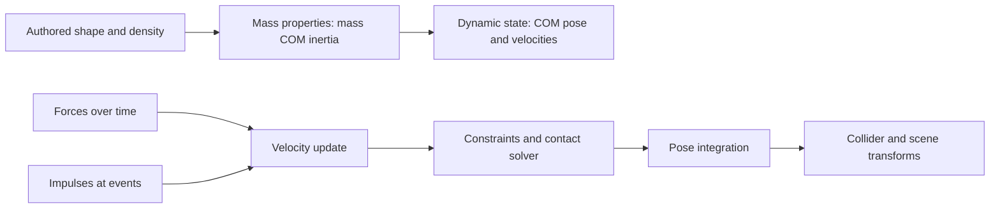
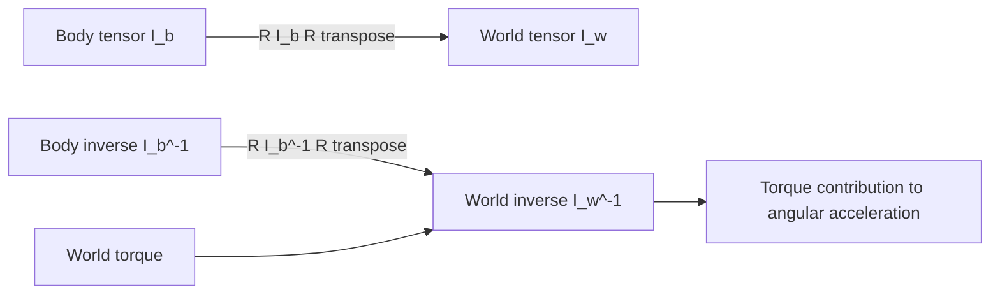
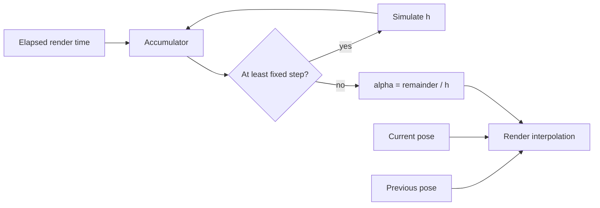

# 34 — Rigid-body motion from forces to contact

[[Chapter Edition/03 - Game Engine/00 - Reading Map|Reading map]] · [[Chapter Edition/03 - Game Engine/33 - Versioned scenes and transactional loading|Previous chapter]] · [[Chapter Edition/03 - Game Engine/35 - A complete rigid-body state before the formula audit|Next chapter]]

The crate that moved through the engine now needs a physical state whose translation and rotation agree. This chapter derives center of mass, inertia, force, torque, and contact from the state a simulator must own.

**By the end:** Relate forces and impulses to linear/angular motion, compute simple inertia, and explain the assumptions behind a rigid-body contact step.

**Recall question:** Where is the center of mass, what torque follows from this force point, and which state variables must be integrated?

<!-- Derived from Continuous Notes/Game Engine - From First Frame to Living Worlds.md; source lines 80373–82585; source-span SHA256 a5e41f45f514265d9107e9acef609a06b90f749807cf827035d6c5abf99a916a. -->

<!-- CHAPTER-SOURCE-BEGIN -->
## From the push on a panel to a repeatable rigid-body simulator

A rigid-body simulator becomes easier to reason about when we begin with a familiar event. Imagine a hinged-looking, but actually free, rectangular panel resting in space. We push its right edge upward. The panel does not simply move upward: its center accelerates and it starts to turn. Depending on the panel dimensions and force location, a point on the opposite edge can initially accelerate downward even while the COM accelerates upward. A useful engine must represent all of those outcomes without tracking every atom in the panel.

We will build that model from one physical assumption: distances between points fixed in the body do not change. A material point with body-coordinate position $\mathbf r$ therefore has world position

$$
\mathbf x(\mathbf r,t)=\mathbf c(t)+R(t)\mathbf r,
$$

where $\mathbf c$ is the center-of-mass (COM) position and $R$ maps body coordinates to world coordinates. The pose has six independent degrees of freedom: three for translation and three for orientation. A unit quaternion stores orientation with four values and one unit-length constraint. Shape points are reconstructed from pose; they are not independent dynamic state.

That compact representation also clarifies the boundary between a rigid body and its collision geometry. A body owns mass, COM, inertia, velocity, and pose. Inertia describes how the mass distribution resists rotational acceleration; pose means position together with orientation. One or more colliders describe the shape used to find contacts. A body can have several colliders, but still has one COM and one mass distribution. A visual origin, collider origin, and COM need not coincide. Keeping these concepts separate is what makes an off-center push, a compound object, or a mesh with an awkward authoring pivot manageable.



### Why the center of mass is the useful origin

For point masses $m_i$ at locations $\mathbf x_i$, total mass is $M=\sum_i m_i$ and the [[Concepts/Center of mass and inertia|center of mass]] is

$$
\mathbf c=\frac{1}{M}\sum_i m_i\mathbf x_i.
$$

For a continuous density field $\rho(\mathbf x)$, replace the sums by integrals: $M=\int_V\rho\,dV$ and $\mathbf c=M^{-1}\int_V\mathbf x\rho\,dV$. In COM-relative coordinates $\mathbf r_i=\mathbf x_i-\mathbf c$, the defining identity is $\sum_i m_i\mathbf r_i=0$ (or $\int\mathbf r\,dm=0$). This cancellation removes translation–rotation cross terms from the body's kinetic energy and is the reason the COM is the natural point for Newton–Euler equations.

Here is a worked asymmetric panel. Treat it as two uniform rectangular pieces whose centers are located in an authored frame: a $2\,\mathrm{kg}$ strip centered at $(0,0,0)\,\mathrm m$ and a $4\,\mathrm{kg}$ strip centered at $(1.5,0,0)\,\mathrm m$. Their total mass is $6\,\mathrm{kg}$ and

$$
\mathbf c=\frac{2(0,0,0)+4(1.5,0,0)}{6}=(1,0,0)\,\mathrm m.
$$

The dynamic origin must be shifted one metre from the authored origin. If the panel is stored by its visual pivot, then a torque arm computed as “world contact point minus body position” is wrong unless that body position is first converted to the COM. Choose and document one convention: the clearest is to store dynamic position as world COM, while deriving the scene transform from COM, orientation, and the fixed local COM offset.

Mass can be stored as $m$ or as inverse mass $w=1/m$. Solvers repeatedly multiply by $w$, and static bodies can be represented by $w=0$, meaning “no velocity response to finite [[Concepts/Impulse and force timing|impulse]].” It does not mean that physical material has zero mass. Avoid storing infinity and multiplying it by zero: that can create NaNs. Likewise inverse inertia zero on a principal axis expresses a locked rotation about that axis, not a zero-inertia material. Dynamic bodies should have positive mass and a physically valid positive inertia; static and kinematic bodies have different behavioral contracts and should not masquerade as invalid dynamic bodies.

Density connects authored geometry to mass: $m=\rho V$. For a solid box with half-extents $(a,b,c)$, volume is $8abc$; for a sphere, $4\pi r^3/3$. Scaling a similar solid by factor $s$ multiplies volume and mass by $s^3$, while inertia scales by $s^5$ at constant density. This steep scaling is one reason to pick sensible world units and to inspect mass ratios instead of relying on appearance alone.

### Inertia says how the same mass resists different turns

A translational mass is a scalar, but rotational resistance depends on the axis. For point masses measured from the COM, the inertia tensor is

$$
I=\sum_i m_i\big((\mathbf r_i\cdot\mathbf r_i)\,\mathbf 1-\mathbf r_i\mathbf r_i^T\big),
$$

or $I=\int((\mathbf r\cdot\mathbf r)\mathbf 1-\mathbf r\mathbf r^T)\,dm$ for a continuous body. It is symmetric. For a unit axis $\mathbf n$, the scalar moment about that axis is $\mathbf n^T I\mathbf n$. In general, $I\boldsymbol\omega$ is not parallel to $\boldsymbol\omega$; only in principal-axis coordinates is $I$ diagonal.

For a uniform rectangular solid with full side lengths $L_x,L_y,L_z$, the COM tensor in its aligned axes is

$$
I_b=\frac{m}{12}\begin{bmatrix}L_y^2+L_z^2&0&0\\0&L_x^2+L_z^2&0\\0&0&L_x^2+L_y^2\end{bmatrix}.
$$

Use a $2\,\mathrm{kg}$ block with dimensions $(2,1,0.2)\,\mathrm m$. Then $I_{xx}=2(1+0.04)/12=0.1733\,\mathrm{kg\,m^2}$, $I_{yy}=2(4+0.04)/12=0.6733\,\mathrm{kg\,m^2}$, and $I_{zz}=2(4+1)/12=0.8333\,\mathrm{kg\,m^2}$. The thin panel turns most easily around its long in-plane axis (small $I_{xx}$) and least easily around its normal (largest $I_{zz}$). Units check: mass times length squared is $\mathrm{kg\,m^2}$.

If compound child $i$ has mass $m_i$, COM $\mathbf c_i$, and COM inertia $I_i$ in child axes, first rotate its tensor into aggregate body axes using $R_iI_iR_i^T$. With aggregate COM $\mathbf c$, shift by $\mathbf d_i=\mathbf c_i-\mathbf c$ and sum:

$$
I_{total}=\sum_i\left[R_iI_iR_i^T+m_i\big((\mathbf d_i\cdot\mathbf d_i)\mathbf 1-\mathbf d_i\mathbf d_i^T\big)\right].
$$

The shift is the parallel-axis theorem. The outer-product, or dyadic, matrix $\mathbf d\mathbf d^T$ has entries $d_i d_j$; its off-diagonal entries encode coupling between coordinate directions. This term can introduce off-diagonal entries even when every child inertia was diagonal. Therefore “reciprocate each diagonal” is only an inverse for a diagonal tensor. A general symmetric tensor needs a full inverse or a principal-axis decomposition with eigenvalues checked for positivity. This is a useful place for unit tests: COM of a two-piece object, symmetry $I=I^T$, positive principal moments, inverse consistency $II^{-1}\approx\mathbf1$, and agreement between a directly constructed compound and the parallel-axis sum.

#### Body coordinates and world coordinates

Store the fixed mass distribution as $I_b$ in body coordinates. If $R$ maps body vectors to world vectors, then $\boldsymbol\omega_b=R^T\boldsymbol\omega_w$. Angular momentum transforms as a vector, so

$$
\mathbf L_w=R\mathbf L_b=RI_b\boldsymbol\omega_b=RI_bR^T\boldsymbol\omega_w.
$$

Thus $I_w=RI_bR^T$. Taking the inverse yields $I_w^{-1}=RI_b^{-1}R^T$. No scale matrix belongs in this rotational change of basis: physical scaling changes the mass properties themselves; it is not part of a pure orientation rotation. This derivation is also a reliable way to catch a mistaken transpose or a body-to-world convention error.

When the panel rotates, its world inertia changes even though its local inertia does not. With the thin panel above, a quarter-turn about world $y$ swaps which world direction sees the large and small moments. A torque about world $z$ should be multiplied by the current $I_w^{-1}$, not the fixed body-space inverse. A practical sign and frame check is to rotate a body by a known quarter turn, apply a world-axis torque, transform the answer back to body coordinates, and compare with the expected principal response.



### The edge push: force, torque, and angular momentum

A force applied at world point $\mathbf p$ has lever arm $\mathbf r=\mathbf p-\mathbf c$. Its torque about the COM is

$$
\boldsymbol\tau=\mathbf r\times\mathbf F.
$$

The order of that cross product matters. With the usual right-handed axes, $\mathbf r=(1,0,0)\,\mathrm m$ and $\mathbf F=(0,10,0)\,\mathrm N$ give $\boldsymbol\tau=(0,0,10)\,\mathrm{N\,m}$, a positive rotation around $z$. If the force points along the lever arm, the cross product is zero: the line of action goes through the COM and produces no spin. Torque units reduce to $\mathrm{kg\,m^2/s^2}$, the same dimensions as energy, but torque is a vector and energy is a scalar.

For the block above, apply that $10\,\mathrm N$ force at the right edge, one metre from COM, over $0.1\,\mathrm s$. For one numerical step, freeze the lever arm and inertia at their initial aligned values. Translation gets acceleration $F/m=5\,\mathrm{m/s^2}$ and, from rest, velocity increment $0.5\,\mathrm{m/s}$ in $+y$. The $z$-axis torque is $10\,\mathrm{N\,m}$; the angular acceleration in the aligned pose is $\tau_z/I_{zz}=12\,\mathrm{rad/s^2}$, so this frozen-coefficient velocity update gives an angular increment of $1.2\,\mathrm{rad/s}$. A sustained world-space force applied to a rotating material point generally changes its lever arm and world torque; the calculation is a step witness, not an exact finite-time solution of that moving-force problem. A force through COM produces the same translation and no angular increment. This pair of outcomes is an excellent geometry-and-sign regression.

The rotational counterpart of linear momentum is angular momentum. About the COM, $\mathbf L=I\boldsymbol\omega$, and the inertial-frame law is $\boldsymbol\tau=d\mathbf L/dt$. For a sphere with $I=\alpha\mathbf1$, torque-free spin keeps world angular velocity fixed. For an asymmetric body it does not: $I_w$ changes with orientation. Differentiating in a rotating body frame gives Euler's equation

$$
\boldsymbol\tau_b=I_b\dot{\boldsymbol\omega}_b+\boldsymbol\omega_b\times(I_b\boldsymbol\omega_b),
$$

so $\dot{\boldsymbol\omega}_b=I_b^{-1}[\boldsymbol\tau_b-\boldsymbol\omega_b\times(I_b\boldsymbol\omega_b)]$. The second term is gyroscopic coupling. A simple game integrator that uses only $I_w^{-1}\boldsymbol\tau_w$ intentionally omits this effect. That approximation is often acceptable for ordinary gameplay, but it is not the full torque-free asymmetric-body dynamics. It should not be described as conserving the exact angular momentum of a freely tumbling asymmetric body. A sphere test cannot reveal the omission; a torque-free non-principal-axis asymmetric top can.


#### Force generators are policies over bodies, not permanent force state

Millington’s particle and rigid-body development uses **force generators** to separate a force law from the object receiving it. Gravity, drag, springs, anchored springs, bungees, buoyancy, thrusters, aerodynamic forces, or a game-specific field can all answer the same conceptual question: given the body and the current environment, what force and possibly torque should be accumulated for this interval? The body owns mass and dynamic state; the generator owns or references the parameters of the law. A registry or system decides which generators affect which bodies.

<!-- Supervised source-review addition 98a31c389dc685e0 -->

#### A particle aggregate is a useful model for connected, flexible geometry

A particle physics world can represent a rope, cable, bridge, or soft body as point masses joined by constraints and spring forces. A typical step clears each particle’s force accumulator, applies registered force generators, integrates particle state, asks contact generators to fill a bounded contact array, then resolves the contacts; `startFrame()` must occur before the forces for that interval are accumulated. In the cited `ParticleWorld`, particle and contact-generator registrations are linked lists, the force registry separately uses a vector, and a full contact array can omit later generated contacts. Those are concrete choices from Millington’s implementation, not required container designs ( *Game Physics Engine Development*, physical PDF pp. 157–168 / printed pp. 134–145).

The examples show what this representation buys and what its collision tests mean. A bridge uses particles connected by rods and cables; a character is approximated by a sphere tested against each plank segment, with a contact sent to the nearest plank particle. Fixed pivot particles make a platform stay anchored. Spring-connected particles can form a soft blob, with a rendering method such as metaballs needed to turn the point set into a surface. These are application sketches, not complete general collision or surface-rendering algorithms.

The representation has a useful boundary: the cited contact model omits friction, so objects slide, and large sets of stiff constraints can flex, bend, or vibrate as competing corrections are resolved. Use particle aggregates when their deformable or cable-like behavior is the intended model; for general solid objects that need stable rotation and contact response, a rigid-body representation is the more appropriate next step. The numerical limits and tradeoffs belong beside the particle-world architecture, rather than being hidden by the visual plausibility of a demo.


This separation is more than an object-oriented pattern. It prevents a common temporal error: treating a force as though it were a durable velocity change. A force accumulator should normally represent contributions for the current integration interval, then be cleared after integration. Persistent influences are represented by persistent **relationships or generators** that reapply the correct force on the next step. Gravity remains active because the gravity rule runs again, not because last frame’s force vector was accidentally left in memory. An impulse is different: it changes momentum at an event and should not be re-applied every tick.

The distinction also makes testing easier. A gravity generator can be checked against mass policy; a drag law can be checked for direction, magnitude, units, and zero-velocity behavior; a spring can be checked at compressed, rest, and stretched lengths; buoyancy can be checked above, partially within, and below a fluid plane. Then the integrator can be tested independently with known accumulated forces. If a body explodes numerically, this separation helps ask whether the law produced an unreasonable force or whether integration mishandled a valid one.

Millington invokes d’Alembert’s principle while developing these mechanics. For engine work, the practical lesson is not to turn that name into mystique: forces, constraints, and inertial response can be reorganized mathematically, but the discrete engine still needs explicit state, units, sign conventions, and a stepping method. Later contact solvers may treat constraints through impulses or Lagrange-multiplier-like quantities instead of ordinary force generators. Keeping external force accumulation separate from contact resolution makes that architectural difference visible.

Source basis: Millington, *Game Physics Engine Development*, Chapters 5–7 and 10, including general force generators, gravity/drag, springs and buoyancy, hard constraints, and rigid-body force/torque accumulation.

<!-- Supervised source-review addition e09aaa7375d2e035 -->

### A staged explosion is a timed game force field, not a blast simulation

A force generator can produce a designed explosion response without claiming to simulate explosive chemistry, compressible air, fire, or structural damage. Millington’s game-physics example layers three effects: a short inward implosion, an outward-moving concussion front, and a weak convection chimney. They are artistic force fields for rigid bodies and particles. The parameters shape a visual/gameplay result; they are not calibrated blast physics, a prediction of real pressure. (Millington, *Game Physics Engine Development*, §17.2.3, printed pp. 411–418; retained physical-PDF block 433–444.)

Let the detonation point be $\mathbf{x}_0$, the body’s selected force-application point be $\mathbf{x}$, and its distance from the center be $r=\lVert\mathbf{x}-\mathbf{x}_0\rVert$. For $r>0$, define the outward radial direction as

$$
\mathbf{n}=(\mathbf{x}-\mathbf{x}_0)/r.
$$

At the exact detonation point, $r=0$ and this direction is undefined. A safe implementation applies no radial component there (or uses an explicitly designed, deterministic fallback); it never normalizes the zero vector. This sign convention makes an implosion use $-\mathbf n$ and the concussion use $+\mathbf n$. Choose radii in metres, durations in seconds, front speed in metres per second, and force magnitudes in newtons. Clamp the spatial and temporal envelopes so the generator cannot apply an unbounded force.

During an implosion interval $0\leq  t<T_i$, apply a modest inward force only in a selected annulus, such as $r_{min}<r<r_{max}$:

$$
\mathbf F_i=-\mathbf n\,F_i^{\max}S_i(r)G_i(t).
$$

Here $S_i(r)$ is a bounded radial falloff that reaches zero at the configured inner and outer limits, and $G_i(t)$ fades the effect to zero over its finite duration. The inner radius leaves the immediate center unaffected, while the force cap and fade reduce the chance that the simplified inward pull drags a body through the origin. A step-boundary test should check both radii and times immediately before, at, and after $T_i$.

For a moving concussion front, let $s(t)=c_wt$ be its radius, where $c_w$ is a chosen game parameter. A simple bounded band is

$$
W(r,t)=\max\left(0,1-\frac{|r-s(t)|}{w}\right),\qquad
\mathbf F_c=+\mathbf n F_c^{\max}W(r,t)G_c(t),
$$

where $w$ is the band half-width and $G_c(t)$ limits the active lifetime. This triangular envelope is a clear teaching model for a force peak near the front with falloff on either side; it is not a unique or physically validated shock profile. A discrete step can otherwise skip a thin band when the front travels farther than its width between evaluations. For a stationary sample radius, a conservative choice is $w\geq c_w h$, where $h$ is the physics step. Moving bodies require testing the relative separation $r(t)-s(t)$ across the interval, or sufficient substeps; front speed alone does not bound that relative motion. A swept test can detect that the band crossed the body even when neither endpoint lies in it, but the response must also declare how it integrates the time spent inside the band. If desired, the peak may depend on relative radial velocity, as the source discusses, but that response needs its own bounded, tested policy rather than an invented aerodynamic guarantee.

After the outward front, a low-magnitude convection effect can lift light bodies and particles within a bounded vertical cylinder. For horizontal radius $r_{xz}$ and height $y-y_0$, use a nonnegative envelope $S_u(r_{xz},y)$ that vanishes outside the chosen chimney radius and height, then apply

$$
\mathbf F_u=+\hat{\mathbf y}F_u^{\max}S_u(r_{xz},y)G_u(t).
$$

The source describes this as a weak, long-lived upward force; an artist may angle it outward to suggest a mushroom-shaped plume, but the result is still a visual convention. Keep it small, time-bounded, and separately testable. It can affect particles even when the rigid-body response is negligible. Fire, smoke, lighting flashes, and post-processing remain presentation effects with their own state; they do not follow from this force model.

**Numeric trace.** Put a $5\,\mathrm{kg}$ body at $(6,0)\,\mathrm m$, with detonation at $(0,0)\,\mathrm m$. Then $r=6\,\mathrm m$ and $\mathbf n=(1,0)$. Let $c_w=10\,\mathrm{m/s}$, $t=0.50\,\mathrm s$, and $w=2\,\mathrm m$. The front is at $s=5\,\mathrm m$, so $W=1-|6-5|/2=0.5$. With illustrative $F_c^{\max}=100\,\mathrm N$ and a fully active time envelope, the applied force is $(50,0)\,\mathrm N$. Holding this sampled force constant for a $0.01\,\mathrm s$ explicit integration step contributes impulse $(0.5,0)\,\mathrm{N\,s}$ and, before any other forces or solver effects, changes the body’s velocity by $(0.1,0)\,\mathrm{m/s}$. These are chosen game parameters, not a real-world blast estimate.

Apply the force at a deterministic body-local point, transformed to world space each step, for each body if the demo needs rotation: $\boldsymbol\tau=(\mathbf{x}-\mathbf{x}_{COM})\times\mathbf F$. Re-selecting a random point every frame makes torque jitter and can spin a body without a stable cause. The generator contributes force for the current integration interval; do not accidentally retain it as a permanent velocity change. Test the radial sign, zero-distance case, radius and duration boundaries, a wavefront crossing between steps, a static body, off-center torque, repeated runs with the same seed, and force/impulse units. Keep this example separate from the fracture sample’s mass-properties code: that excerpt’s box-volume and inertia expressions require correction before reuse.


### Force acts over an interval; impulse acts at an event

Newton's second law can be written $\mathbf F=d\mathbf p/dt$. Integrating over a time interval gives impulse $\mathbf J=\int\mathbf F\,dt=\Delta\mathbf p$. Therefore force has units newtons, $\mathrm{kg\,m/s^2}$; impulse has units newton-seconds, $\mathrm{kg\,m/s}$. For constant force over one step, $\mathbf J=\mathbf Fh$.

For a body of constant mass, a linear impulse changes velocity by $\Delta\mathbf v=w\mathbf J$, where $w=1/m$. There is no extra timestep factor: time integration is already inside the impulse. At a point away from COM it also gives angular impulse $\mathbf r\times\mathbf J$ and $\Delta\boldsymbol\omega=I_w^{-1}(\mathbf r\times\mathbf J)$. For the $2\,\mathrm{kg}$ block, let $\mathbf J=(0,4,0)\,\mathrm{N\,s}$ at $\mathbf r=(1,0,0)\,\mathrm m$. Translation changes by $(0,2,0)\,\mathrm{m/s}$. The angular impulse is $(0,0,4)\,\mathrm{kg\,m^2/s}$. Since $I_{zz}=0.8333\,\mathrm{kg\,m^2}$, the angular-speed change is $4/0.8333\approx4.8\,\mathrm{rad/s}$ about $+z$. At COM, the same impulse changes translation but not angular velocity. A static body has inverse mass and inverse inertia zero, so the dynamic response is zero.

Forces are accumulated over a step and then cleared after that step has consumed them. If an input force survives accidentally into the next step, it is applied twice. If it is cleared before integration, it is lost. Impulses are event-like: a jump action or a contact solver applies them at a defined point in the step; applying them once after a step is not the same as applying them once every rendered frame. Contacts commonly solve for impulses inside the physics step because they need to change closing velocity before pose advancement.

This distinction exposes a common timing bug. If a “jump” is represented as a force of $500\,\mathrm N$ for one frame, at $60\,\mathrm{Hz}$ it delivers about $8.33\,\mathrm{N\,s}$, while at $120\,\mathrm{Hz}$ it delivers about $4.17\,\mathrm{N\,s}$. An impulse of $8.33\,\mathrm{N\,s}$ gives the same momentum change independent of the step duration. A continuously held thruster is a force; a hammer strike is an impulse. Do not tune one to impersonate the other.

### A step is an ordered computation, not a bag of formulas

A simple fixed-step update can be described as a sequence:

1. Gather forces and torques that act during the interval.
2. Add gravity as force or as acceleration, using one consistent convention.
3. Convert force to acceleration: $\mathbf a=\mathbf F/m$; update linear velocity by $\mathbf a h$.
4. Update angular velocity using the chosen rotational model and current world inertia. If full asymmetric rigid-body motion is required, include gyroscopic coupling in a consistent frame.
5. Apply contact and gameplay impulses at their specified event point; update velocity immediately.
6. Integrate COM position using the resulting velocity and integrate orientation from angular velocity.
7. Clear interval force and torque accumulators, update sleep/activity state, and publish the new pose.

This is semi-implicit Euler in the common game-engine arrangement: update velocity first, then move using the updated velocity. It is first-order accurate, like explicit Euler, but often behaves better for mechanical systems at reasonable step sizes. “Often better” is not a proof of unconditional stability, nor does semi-implicit Euler conserve the exact energy. The harmonic oscillator makes the difference visible. Explicit Euler uses the old velocity to move and then kicks velocity; for $\ddot x=-\omega^2x$ its update matrix has determinant $1+\omega^2h^2>1$, so the amplitude grows. The velocity-first semi-implicit update has determinant one and is symplectic for this separable oscillator, meaning that it preserves the canonical position–momentum area even though the energy need not be exact; in its stable range, energy error tends to remain bounded and oscillatory rather than growing monotonically. It still has error, and too large a step still fails.

A timestep witness is useful. Start at $x_0=0,v_0=0$ under constant acceleration $a=-10\,\mathrm{m/s^2}$ with $h=0.1\,\mathrm s$. Explicit Euler gives $v_1=-1\,\mathrm{m/s}$ but $x_1=0$, because it used the old velocity. Semi-implicit Euler gives $x_1=-0.1\,\mathrm m$. The analytic position is $-0.05\,\mathrm m$. Neither one-step position is exact; the difference is update order, not a contradiction. Under constant acceleration, velocity updates exactly for a step; position approximates the integral. Reduce $h$ to check convergence instead of judging one step in isolation.

Quaternion orientation can be advanced from world angular velocity by its differential equation. A normalized first-order update is cheap but accumulates error and needs renormalization. If angular velocity is constant over step $h$, a finite rotation update uses the axis-angle increment $\Delta\theta=\boldsymbol\omega h$ and quaternion $\delta q=(\hat{\boldsymbol\omega}\sin(|\omega|h/2),\cos(|\omega|h/2))$, composed on the side dictated by the engine's world/body multiplication convention. Small-angle handling avoids dividing by near-zero magnitude. Exponential-map integration preserves unit length analytically for a constant-rate step, but changing angular velocity during the step still makes the update an approximation. Always state multiplication convention and verify with a known positive quarter-turn; quaternion formulas are convention-sensitive.

Damping is a deliberate nonconservative policy. For continuous linear decay $\dot v=-\lambda v$, exact velocity attenuation over $h$ is $v_{new}=v_{old}e^{-\lambda h}$. The half-life is $t_{1/2}=\ln2/\lambda$. Unlike multiplying by a fixed per-frame factor, this formulation composes across different step sizes: $e^{-\lambda h_1}e^{-\lambda h_2}=e^{-\lambda(h_1+h_2)}$. It intentionally removes momentum and kinetic energy. Record damping separately from numerical energy error.

Velocity clamps are also policy, not physical law. Clamping speed truncates momentum and removes kinetic energy; angular-speed clipping can also interfere with contact response. Keep a clamp only for a named safety or gameplay reason, expose when it activates, and test with and without it. A clamp that silently prevents explosions can hide a bad impulse, bad mass, or unstable step. A feature-speed measure such as $|\omega|r_{max}$ is often more meaningful than one universal angular-speed number, because it estimates how far the fastest point sweeps per second.

### Fixed time, substeps, snapshots, and repeatability

Rendering arrives at irregular intervals. Physics should generally consume fixed quanta $h$, often around $1/60\,\mathrm s$, through an accumulator. Each rendered frame adds elapsed time $\Delta t$; while the accumulator is at least $h$, simulate one fixed step and subtract $h$. A leftover fraction $\alpha=A/h$ can interpolate between previous and current physics poses for rendering. Interpolation smooths display; it must not feed back into authoritative physics state.

A $40\,\mathrm{ms}$ frame with $h=16.67\,\mathrm{ms}$ runs two steps (about $33.33\,\mathrm{ms}$ of simulation) and leaves $6.67\,\mathrm{ms}$ in the accumulator. One $33.33\,\mathrm{ms}$ step is not numerically equivalent to two $16.67\,\mathrm{ms}$ steps: the solver, collisions, springs, and damping are nonlinear or step-dependent. Fixed stepping makes input timing and numerical conditions more repeatable; it is necessary for many replay designs but not sufficient for cross-machine bitwise determinism. Floating-point operation order, parallel scheduling, contact ordering, fused operations, and transcendental implementations can still change low bits and eventually trajectories.

A maximum substep budget protects a real-time loop from the spiral of death. If simulating one second takes more than one second of CPU time, an ever-growing backlog cannot be caught up by an accumulator. Cap the work and define the overload policy: drop old whole steps, let simulation lag, reduce quality, or resynchronize. Preserve a fractional remainder if dropping whole steps so rendering interpolation remains meaningful. Report dropped time; otherwise the world can silently slow down while looking like ordinary fixed stepping.

State ownership must remain clear. The simulation owns COM pose and velocities. Scene transforms are derived output; kinematic scene motion is an input sampled before simulation. Keep previous and current physics snapshots for render interpolation, and do not mistake a render-smoothed pose for a physically integrated state. Static bodies ignore dynamic response. Kinematic bodies are moved by prescribed motion and can influence dynamic bodies through contacts, but the solver does not integrate them as force-driven masses. Sleeping bodies need an explicit wake policy when force or impulse arrives.



### Conservation checks distinguish physics from policy

For translation, $\mathbf p=m\mathbf v$. For spin about COM, $\mathbf L=I_w\boldsymbol\omega$. Kinetic energy is

$$
T=\frac12m\mathbf v\cdot\mathbf v+\frac12\boldsymbol\omega^T I_w\boldsymbol\omega.
$$

For gravity with vertical coordinate $y$ and acceleration $-g\hat y$, potential energy is $U=mgy$ and total mechanical energy is $E=T+U$. These diagnostics need their assumptions: no damping, no external work, no inelastic contact, and an integrator whose error is being measured. A restitution coefficient below one, friction, a velocity clamp, or damping is expected to remove energy. Equal and opposite internal impulses conserve total linear momentum for an isolated pair, while world angular momentum also requires consistent contact points and no external torque. Conservation is a diagnostic, not a blanket promise about a game solver.

Useful small experiments include free translation (constant velocity), constant force (linear velocity and quadratic position), a COM impulse (no spin), an edge impulse (spin with sign predicted by $r\times J$), a static impulse (no response), a torque-free sphere (constant world angular velocity), and a torque-free asymmetric top (tests the gyroscopic term). For a one-dimensional elastic collision, compare total momentum and kinetic energy before and after. For an inelastic collision, check momentum while expecting kinetic-energy loss. Sweep timestep values and record maximum relative energy error; a plot is better evidence than “it looked stable.”

Mass-property checks should cover sphere and box formulas, composite COM, tensor symmetry, positive eigenvalues, inverse consistency, world/body round trips, parallel-axis shifts, and the principal-moment triangle inequalities $I_1\le I_2+I_3$, $I_2\le I_1+I_3$, and $I_3\le I_1+I_2$ for a nonnegative mass distribution. These follow, for example, from $I_2+I_3-I_1=2\int x_1^2\,dm\ge0$ in principal coordinates. Impulse tests should check center and off-center response, parallel impulse/no torque, static response, and equal-and-opposite pairs. A debug view can draw the COM, principal axes, force arrows, torque axis, and colliders simultaneously. It often reveals that a wrong pivot or frame transform—not an integrator—is the source of a strange rotation.

A numerical witness for the panel edge impulse above should show $\Delta v_y=2\,\mathrm{m/s}$ and $\Delta\omega_z\approx4.8\,\mathrm{rad/s}$ from rest. Reversing the impulse changes both signs. Moving the application point to COM leaves the same $\Delta v$ but makes $\Delta\omega=0$. Doubling mass while preserving geometry halves linear response; rotational response follows the inertia scaling, not just the mass alone. These are crisp assertions with units and expected direction.

### A compact implementation contract

A useful dynamic body contract is: position means world COM; orientation maps body axes to world axes; linear and angular velocities are world-space; local inertia is COM-based and expressed in body axes; force and torque accumulators are world-space quantities valid for one step; impulse APIs change velocity immediately and do not take $dt$; pose advancement happens after the velocity and constraint updates; force clearing happens once the interval is consumed. Static, kinematic, and dynamic modes state who writes pose and how contacts respond. This contract prevents ambiguity from leaking into dozens of helpers.

A clear fixed-step interface can be written as

$$
\begin{aligned}
\mathbf F_{net}&=\mathbf F_{acc}+m\mathbf g,\\
\mathbf v^*&=\mathbf v+h\mathbf F_{net}/m,\\
\boldsymbol\omega^*&=\text{rotationalUpdate}(\boldsymbol\omega,\tau,I,R,h),\\
(\mathbf v^+,\boldsymbol\omega^+)&=\text{solveContactsAndConstraints}(\mathbf v^*,\boldsymbol\omega^*),\\
\mathbf c_{new}&=\mathbf c+h\mathbf v^+,\\
q_{new}&=\text{integrateOrientation}(q,\boldsymbol\omega^+,h).
\end{aligned}
$$

Here the star marks pre-solver velocity and plus marks post-solver velocity. If an engine instead advances pose before contact solving, it has chosen a different scheme and should test its behavior accordingly. Gravity may be applied as acceleration directly, which is equivalent for a body when it is mass-independent; multiplying it into force and dividing by mass should produce the same acceleration. A per-body “gravity scale” changes acceleration by policy; it is not a change to physical mass.

Unit discipline catches many mistakes before code runs. Position is metres, time seconds, mass kilograms, velocity metres per second, acceleration metres per second squared, force newtons, torque newton-metres, impulse newton-seconds, angular velocity radians per second, and inertia kilogram-metres squared. Radians are dimensionless in SI, but retaining the word “radians” in an API description helps avoid confusing angular and linear speed. Check dimensional consistency on each update: force times time divided by mass gives velocity; torque times time times inverse inertia gives angular velocity; velocity times time gives position.

A simulator is repeatable when the state transition, inputs, timing, ordering, and reset policy are explicit. Fixed time is one piece. A useful deterministic test captures an initial state, applies a timestamped sequence of forces and impulses, simulates a fixed number of steps, serializes state, resets, and repeats. Compare either exact bits on a fixed platform/build or documented tolerances across platforms. If contacts are present, also control body iteration and contact ordering. Do not infer determinism from one stable run or from an accumulator alone.

The original edge push now has a complete explanation: mass distribution chooses COM and inertia; the contact point defines a lever arm; the cross product gives torque or angular impulse; frame transforms place the inertia in the correct coordinates; forces accumulate across time while impulses alter momentum at an event; the solver adjusts velocities; a fixed-step integrator advances pose; and explicit constraints, damping, caps, snapshots, and overload policies state where the game departs from ideal mechanics. That is the core of a rigid-body simulator that can be reasoned about, tested, and reproduced.

### How the model fails when one contract is vague

A physics bug often presents as “the object rotates strangely,” but that symptom does not identify the faulty layer. Trace one event through named intermediate values. First print the world COM and world contact point. Then compute $\mathbf r=\mathbf p-\mathbf c$, the force or impulse vector, and their cross product. Then inspect local inertia, orientation matrix, world inverse inertia, and the resulting angular change. Finally verify which state is used to advance orientation. This ordered trace distinguishes a wrong application point from a wrong cross-product sign, an out-of-date tensor, a transpose error, or a bad integration order.

Several common mistakes have characteristic signatures:

- Using the visual pivot instead of COM makes identical forces produce different torques after an authoring-pivot change.
- Using a body-space inverse inertia on a world-space torque gives orientation-dependent errors that are correct only in special alignments.
- Treating a compound tensor as diagonal loses products of inertia; it may pass tests for aligned symmetric shapes and fail as soon as a child rotates or shifts diagonally.
- Applying $h$ to an impulse makes impact strength vary with timestep. Omitting $h$ from a force update makes continuous acceleration depend on frame count.
- Updating position with old velocity while intending a velocity-first scheme creates a different method than the one documented.
- Clearing accumulators at the wrong boundary silently drops a force or doubles it.
- Applying gravity as both force and direct acceleration doubles gravitational acceleration.

These can be converted into small “failure traces,” each with a deliberately wrong version and its signature. For example, use the same $4\,\mathrm{N\,s}$ edge impulse at $60$ and $120\,\mathrm{Hz}$. The correct immediate $\Delta v$ and $\Delta\omega$ match. If the result halves at the higher rate, the code treated impulse as force and multiplied it by $h$. If a $10\,\mathrm N$ force for $0.1\,\mathrm s$ yields $5\,\mathrm{m/s}$ for a $2\,\mathrm{kg}$ body, a likely missing-$h$ update has turned acceleration into a velocity increment each call. If it yields $0.25\,\mathrm{m/s}$, the covered duration may have been halved. A double-$h$ multiplication with $h=0.1\,\mathrm s$ instead produces $0.05\,\mathrm{m/s}$.

#### Time-step invariance has a limited meaning

The analytic constant-acceleration solution is $v(t)=v_0+at$ and $x(t)=x_0+v_0t+\tfrac12at^2$. A numerical scheme divides the same duration into increments and approximates the integral. With constant force, the velocity sequence can match the analytic endpoint (up to roundoff) when force is constant and each interval is covered exactly. Position depends on the quadrature/update scheme. In a collision system, changing the step count also changes when contact is detected and how many times a constraint is iterated. Therefore the right goal is not “every simulation is identical at every timestep”; it is a stated convergence trend and acceptable error over a declared operating range.

A clean timestep experiment holds initial state, total simulated duration, force law, collision policy, and solver iteration budget definition fixed. Compare $h=1/30,1/60,1/120,1/240\,\mathrm s$. Record endpoint COM error against an analytic free-flight or constant-force solution, angular momentum and energy residuals for a torque-free top, and maximum penetration for a contact case. Plot error versus $h$. A first-order method should show approximately first-order convergence in a smooth problem, but collision discontinuities and solver tolerances can change observed rates. Make this caveat visible rather than fitting a convergence order to a nonsmooth scene.

#### Coordinate conventions are part of the API

The right-hand rule, handedness of the world, quaternion component order, multiplication side, and whether angular velocity is world- or body-expressed are not incidental details. They define the meaning of every vector in the simulation interface. A coordinate-space type or suffix such as `WorldTorque`, `BodyAngularVelocity`, or `LocalCOM` can prevent accidental mixing. If the math library is row-major or column-major, that storage choice alone does not determine whether vectors multiply on the left or right. State the map explicitly: here $R\mathbf v_b=\mathbf v_w$ and $\mathbf v_b=R^T\mathbf v_w$.

Torque is an axial vector: under a proper rotation it transforms like any vector, but under a reflection its transformation includes orientation behavior from the cross product. This matters when converting between left-handed and right-handed pipelines. Do not “fix” a torque sign by changing one cross product without also understanding the coordinate-system conversion. A minimal lab applies $+x$ lever arm with $+y$ force and checks $+z$ torque under the chosen right-handed convention, then repeats after a known proper rotation. It should also confirm that a reflected basis is not treated as an ordinary proper rotation.

The orientation update has a similarly useful diagnostic. Start with identity orientation and $\boldsymbol\omega=(0,0,\pi/2)\,\mathrm{rad/s}$ for one second. A constant-rate exponential update should rotate body $+x$ to world $+y$ in the declared convention. Then apply the inverse angular velocity for a second and recover the starting orientation within tolerance. The test catches quaternion ordering, sign, and composition-side mistakes that can otherwise be hidden by rendering a symmetric cube.

#### World scale and robust operating ranges

SI is a coherent baseline: metres, kilograms, seconds, and derived newtons. A game's display scale can differ from the physics scale, but render conversion should occur at the boundary and should not quietly change collider dimensions while leaving mass properties untouched. If one game unit equals a centimetre, document that conversion and apply it consistently to positions, lengths, forces, inertia, and gravity. Distinguish changing units from physically resizing the object. Re-expressing the same body from metres to centimetres leaves its mass in kilograms unchanged; its numerical inertia in kilogram-centimetres squared is $100^2$ times its numerical inertia in kilogram-metres squared. A $2\,\mathrm{kg}$ body remains $2\,\mathrm{kg}$, and $0.8333\,\mathrm{kg\,m^2}$ becomes approximately $8333\,\mathrm{kg\,cm^2}$. By contrast, physically scaling every length by $s$ while holding density fixed multiplies volume and mass by $s^3$ and inertia by $s^5$. The density value itself must also be converted when changing length units.

Floating-point resolution and solver conditioning deteriorate when a scene mixes microscopic gaps with enormous distances, or when body masses vary by many orders of magnitude. A large dynamic-to-dynamic mass ratio can make iterative contact solving converge poorly even if every body is mathematically valid. Scale checks should include minimum/maximum collider extent, mass, inertia eigenvalue, velocity, and ratio between interacting masses. These are application bounds, not universal physical laws. Reject or warn at API boundaries when an input lies outside the intended range, and make the selected units visible to debugging tools.

A COM/inertia debug view should include a small COM marker even when the mesh origin is elsewhere, principal axes scaled with a comprehensible rule, and force/impulse arrows with labelled units. The ellipsoid associated with inertia is a visualization of anisotropy, not the collision shape. Make its legend clear so that a user does not mistake the principal-axis frame for the box's visual axes. For a compound, draw child COM markers as well as the aggregate COM; the offsets reveal the parallel-axis contribution.

#### Reset and replay semantics

A reset is not just assigning position to zero. It must define pose, linear and angular velocity, force and torque accumulators, sleep state, contact cache, previous/current snapshots, fixed-step accumulator, and queued commands. If an old force survives reset, the first replayed step is not the same experiment. If interpolation snapshots retain the pre-reset pose, the renderer can visibly sweep the body across the scene even while simulation state is correct. Treat reset as an atomic state transition and test the first step after reset explicitly.

A replay should record the initial snapshot, fixed timestep, ordered commands, and any configuration that changes behavior: gravity, damping, clamps, solver iterations, body modes, and deterministic ordering options. A state hash can identify the first divergent frame for the same build. A tolerant comparison of pose, velocities, momentum, energy, and contact error serves a different purpose when comparing builds or platforms. Neither a hash nor a visually similar replay proves the physical model is correct; they show repeatability under the declared conditions.

The complete teaching loop is therefore also a debugging loop. State a convention, derive one expected result by hand, instrument intermediate quantities, and compare code to that witness. Expand from one free body to one compound, then one impulse, then one constraint pair, then a replay. This increases complexity one layer at a time and keeps each discrepancy localizable. It also makes clear which claims are demonstrated: a successful mass-property unit test validates those formulas; a stable visual demo does not establish momentum conservation; a replay hash establishes same-configuration repeatability but not physical accuracy; and a timestep sweep establishes behavior only for the tested model, scale, and range.


![[Visual Recall/Integrated Geometry and Engine/panel-initial-acceleration.png]]

For this initially stationary panel, $a_y(x)=5+12x$ in metres per second squared. The left edge initially accelerates downward at $7\,\mathrm{m/s^2}$ while the COM accelerates upward at $5\,\mathrm{m/s^2}$. This witness uses the stated uniform $2\,\mathrm{kg}$, $2\,\mathrm m\times1\,\mathrm m$ panel and is not a claim about every shape.

Repository-specific passages below describe the supplied Kairo snapshot. They have not been revalidated against a current checkout; code fragments retain their stated surrounding context and are not all standalone tested programs. Numerical and contract explanations are taught independently of those implementation observations.

### Rigid-Body State, Center of Mass, Mass and Inverse Mass, Newtonian Force Accumulation, Gravity, Drag, Springs, Damping, Torque, Angular Momentum, Inertia Tensors, Principal Axes, Shape Inertia, Parallel-Axis Theorem, Composite Bodies, and World-Space Inverse Inertia

The pressure-plate crate from our workshop game is now the engineering test case. Until this point, a transform and a velocity could make the crate *look* as though it moves. But an off-centre push must create spin; landing on an edge must affect rotation as well as translation; and a resting crate must stop penetrating the floor without accumulating imaginary energy. The following mechanics are the smallest physical model that can answer all three demands. They are not independent formula topics: each quantity earns its place because the next computation needs it.

### Follow one crate through the complete physical argument

Suppose our crate is a homogeneous rectangular box with mass $m=2\\,\\mathrm{kg}$, width $a=2\\,\\mathrm m$, height $b=1\\,\\mathrm m$, and depth $c=1\\,\\mathrm m$. We choose the world frame to have $y$ upward and represent local body axes by the columns of a rotation $R$. The body's centre of mass $x$ has units metres; linear velocity $v$ has units m/s; angular velocity $\\omega$ has units rad/s. Those declarations let us distinguish positions from displacements, degrees from radians, and a world vector from body-local coordinates *before* an implementation mixes them.

For a homogeneous axis-aligned box the centre-of-mass inertia tensor in its local principal frame is diagonal:

$
I_{\\mathrm{body}}=\\frac{m}{12}\\operatorname{diag}(b^2+c^2,\\;a^2+c^2,\\;a^2+b^2)=\\operatorname{diag}(1/3,5/6,5/6)\\;\\mathrm{kg\\,m^2}.
$

Why is this mass-dependent matrix necessary? Consider a world-space horizontal force $F=(10,0,0)\\,\\mathrm N$ acting $0.5\\,\\mathrm m$ above the centre, at lever arm $r=(0,0.5,0)\\,\\mathrm m$. Its linear acceleration contribution is $F/m=(5,0,0)\\,\\mathrm{m/s^2}$, regardless of the contact point. But the same force exerts torque $\\tau=r\\times F=(0,0,-5)\\,\\mathrm{N\\,m}$. With the body axes initially aligned to world axes, the instantaneous angular acceleration about the principal $z$ axis is $\\alpha_z=\\tau_z/I_{zz}=-6\\,\\mathrm{rad/s^2}$ because $I_{zz}=5/6\\,\\mathrm{kg\\,m^2}$. This last scalar division is valid *here*, at the specified aligned orientation and initial zero angular velocity: in general the rotational equation also includes the gyroscopic term $\\omega\\times(I\\omega)$, and the world inertia is $I_{world}=R I_{body}R^T$.

At a fixed timestep $h=0.01\\,\\mathrm s$, an isolated semi-implicit first step from zero velocity would change the linear velocity by $(0.05,0,0)\\,\\mathrm{m/s}$ and, under the stated initial-axis assumptions, the angular velocity about $z$ by $-0.06\\,\\mathrm{rad/s}$. These are *one-step numerical approximations*, not exact long-duration predictions: as the orientation and velocities evolve, inertia, collision and solver forces change. Integrating orientation therefore requires a declared quaternion or rotation-matrix convention and an update consistent with the world/local angular-velocity frame.

When the crate touches the plate or floor, the contact impulse must change both $v$ and $\\omega$ through the lever arm. This motivates the effective inverse mass of the contact and ultimately the accumulated, clamped normal impulse of the persistent solver. A complete, continuous derivation from point velocity to contact constraints and warm starting is available in [[Chapter Edition/01 - Computing Foundations/39 - Research Navigation and Source Boundaries#Physical Foundations — Rigid Bodies, Extended Motion, and Contact Constraints|Rigid Bodies - From Extended Motion to Contact Constraints]]; the steps immediately below retain the supplied full derivations and engine code evidence. The standalone [C++20 contact laboratory](../../tools/labs/rigid_body_contact_lab.cpp) checks the simpler, central-contact limit; it does not establish correctness of the 3D angular solver.

The sequence below keeps the source's Part 1601–1700 labels for provenance, but those numbers do not divide the reasoning into separate lessons. Keep asking what the crate needs *next* to remain a physically and numerically coherent part of the game.

Everything comes from one physical picture:

$$
\boxed{
\text{A rigid body is a continuous distribution of mass whose internal distances do not change.}
}
$$

Once that assumption is accepted, almost every formula in M097/M098 follows from reducing millions of particles into a compact state.

---

### FROM PARTICLES TO A RIGID BODY

### Part 1601 — Particles versus rigid bodies

A particle is the simplest mechanical object.

Its spatial state can be represented by:

$$
\mathbf{x}(t)\in\mathbb{R}^3
$$

and velocity:

$$
\mathbf{v}(t)=\dot{\mathbf{x}}(t).
$$

It has mass:

$$
m.
$$

The particle has **no orientation**.

There is no concept of:

```text
front
up
rotation
spin
torque
angular momentum
```

because a mathematical particle has no spatial extent.

If you rotate a point around its own position, nothing observable changes.

A rigid body, however, occupies space.

A box can be rotated.

A sword can spin.

A force on one corner can rotate the entire object.

Therefore a rigid body requires both translational and rotational state.

Its configuration is approximately:

$$
(\mathbf{x},R)
$$

where:

$$
\mathbf{x}\in\mathbb{R}^{3}
$$

is a reference position, ideally the center of mass, and:

$$
R\in SO(3)
$$

is its orientation.

In an engine we usually store R through a quaternion:

$$
q=(x,y,z,w)
$$

with:

$$
\|q\|=1.
$$

So Kairo's current `MotionState`:

```cpp
struct MotionState
{
    Vec3f Position;
    Quaternionf Rotation;

    Vec3f LinearVelocity;
    Vec3f AngularVelocity;
};
```

is exactly the natural rigid-body dynamic state.

---

### Part 1602 — The fixed internal-distance assumption

Imagine a rigid body as N particles with local rest positions:

$$
\mathbf{r}_1,\mathbf{r}_2,\dots,\mathbf{r}_N.
$$

The defining rigid-body constraint is:

$$
\boxed{
\|\mathbf{x}_i(t)-\mathbf{x}_j(t)\|
=
\text{constant}
}
$$

for every pair $i,j$.

That is what "rigid" really means.

No stretching.

No bending.

No shearing.

No compression.

A real steel object deforms microscopically, but a rigid-body engine ignores that deformation.

This is why rigid-body simulation is vastly cheaper than deformable-body simulation.

Rather than independently simulate thousands of material points, every point can be reconstructed from one translation and one rotation:

$$
\boxed{
\mathbf{x}_i(t)
=
\mathbf{x}_{COM}(t)
+
R(t)\mathbf{r}_i
}
$$

where $\mathbf{r}_i$ is fixed in body-local coordinates.

This equation is enormously important.

It says the body's entire geometry is a rigid transform of one immutable reference configuration.

---

**Why rigid bodies have six degrees of freedom**

In 3D:

$$
3
$$

translational degrees:

$$
x,y,z
$$

and:

$$
3
$$

rotational degrees.

Therefore:

$$
\boxed{6\text{ DOF}}
$$

for a free rigid body.

A quaternion stores four numbers, but it has the constraint:

$$
x^2+y^2+z^2+w^2=1.
$$

So there are effectively three rotational degrees of freedom.

---

**Velocity of any point on a rigid body**

Start from:

$$
\mathbf{x}_p
=
\mathbf{x}_{COM}
+
R\mathbf{r}.
$$

Differentiate.

The translational part gives:

$$
\mathbf{v}_{COM}.
$$

The rotational derivative produces:

$$
\boldsymbol{\omega}\times\mathbf{r}_{world}.
$$

Therefore:

$$
\boxed{
\mathbf{v}_p
=
\mathbf{v}_{COM}
+
\boldsymbol{\omega}
\times
(\mathbf{x}_p-\mathbf{x}_{COM})
}
$$

Kairo already implements precisely this idea:

```cpp
return state.LinearVelocity +
    Cross(
        state.AngularVelocity,
        worldPoint - state.Position);
```

in `VelocityAtPoint()`.

That equation becomes central in collision response later.

A contact point can have significant velocity even when the COM has zero velocity.

Imagine a spinning wheel whose center is stationary.

---

### Part 1603 — Translational state

The translational dynamics of a body revolve around four quantities:

$$
\mathbf{x}
$$

position,

$$
\mathbf{v}
$$

linear velocity,

$$
m
$$

mass,

and:

$$
\mathbf{F}
$$

net force.

Momentum is:

$$
\mathbf{p}=m\mathbf{v}.
$$

For constant mass:

$$
\mathbf{F}=m\mathbf{a}.
$$

So:

$$
\mathbf{a}
=
\frac{\mathbf{F}}{m}.
$$

An engine generally stores reciprocal mass:

$$
m^{-1}
=
\frac{1}{m}.
$$

Then:

$$
\mathbf{a}
=
m^{-1}\mathbf{F}.
$$

That removes a division from hot code.

---

### Part 1604 — Rotational state

The rotational analogues are:

| Translation | Rotation |
|---|---|
| position $\mathbf{x}$ | orientation $R/q$ |
| velocity $\mathbf{v}$ | angular velocity $\boldsymbol{\omega}$ |
| acceleration $\mathbf{a}$ | angular acceleration $\boldsymbol{\alpha}$ |
| force $\mathbf{F}$ | torque $\boldsymbol{\tau}$ |
| mass $m$ | inertia tensor $I$ |
| momentum $\mathbf{p}$ | angular momentum $\mathbf{L}$ |

But there is one major complication.

Mass is scalar:

$$
m.
$$

Rotational inertia generally is **not**.

It is a matrix:

$$
I\in\mathbb{R}^{3\times3}.
$$

Most of M098 exists because of that fact.

---

### Part 1605 — Center of mass

Suppose masses $m_i$ lie at positions $\mathbf{x}_i$.

The center of mass is:

$$
\boxed{
\mathbf{c}
=
\frac{\sum_i m_i\mathbf{x}_i}
{\sum_i m_i}
}
$$

Define:

$$
M=\sum_i m_i.
$$

Then:

$$
\mathbf{c}
=
\frac{1}{M}
\sum_i
m_i\mathbf{x}_i.
$$

It is the mass-weighted average position.

---

**Why COM is special**

Choose coordinates relative to COM:

$$
\mathbf{r}_i
=
\mathbf{x}_i-\mathbf{c}.
$$

Then:

$$
\sum_i m_i\mathbf{r}_i
=
0.
$$

Proof:

$$
\sum_i m_i(\mathbf{x}_i-\mathbf{c})
=
\sum_i m_i\mathbf{x}_i
-
\mathbf{c}\sum_i m_i.
$$

But:

$$
\sum_i m_i\mathbf{x}_i
=
M\mathbf{c}.
$$

Therefore:

$$
M\mathbf{c}-M\mathbf{c}=0.
$$

This cancellation is why the center of mass dramatically simplifies rigid-body dynamics.

---

### Part 1606 — COM from point masses

Suppose:

$$
m_1=2kg,\qquad
\mathbf{x}_1=(0,0,0)
$$

and:

$$
m_2=6kg,\qquad
\mathbf{x}_2=(4,0,0).
$$

Then:

$$
M=8kg.
$$

COM:

$$
\mathbf{c}
=
\frac{
2(0,0,0)+6(4,0,0)
}{8}.
$$

Therefore:

$$
\boxed{
\mathbf{c}=(3,0,0).
}
$$

Notice it lies closer to the heavier mass.

That intuition should remain with you.

---

### Part 1607 — COM of continuous uniform shapes

For a continuous body with density:

$$
\rho(\mathbf{x}),
$$

mass is:

$$
M
=
\int_V
\rho(\mathbf{x})\,dV.
$$

Center of mass:

$$
\boxed{
\mathbf{c}
=
\frac{1}{M}
\int_V
\mathbf{x}\rho(\mathbf{x})\,dV.
}
$$

For uniform density:

$$
\rho(\mathbf{x})=\rho_0.
$$

Then:

$$
\mathbf{c}
=
\frac{
\rho_0\int_V\mathbf{x}\,dV
}{
\rho_0\int_VdV
}.
$$

Density cancels:

$$
\mathbf{c}
=
\frac{
\int_V\mathbf{x}\,dV
}{
V
}.
$$

For a symmetric sphere centered at origin:

$$
\mathbf{c}=0.
$$

For a uniform axis-aligned box centered at origin:

$$
\mathbf{c}=0.
$$

For a capsule symmetric around its local origin:

$$
\mathbf{c}=0.
$$

This is why Kairo's primitive mass-property functions use:

```cpp
Vec3f::Zero()
```

for local COM.

---

**Composite COM**

For child bodies with mass:

$$
m_i
$$

and local COM:

$$
\mathbf{c}_i,
$$

the combined COM is:

$$
\boxed{
\mathbf{c}
=
\frac{
\sum_i m_i\mathbf{c}_i
}{
\sum_i m_i
}.
}
$$

Kairo's `CombineMassProperties()` does exactly this:

```cpp
weightedCenter +=
    part.LocalCenterOfMass *
    part.Mass;

center =
    weightedCenter /
    totalMass;
```

That part is mathematically correct.

---

### Part 1608 — Mass versus inverse mass

Mass:

$$
m.
$$

Inverse mass:

$$
w=
\frac{1}{m}.
$$

Many solver equations use inverse mass more often than mass.

For example:

$$
\Delta\mathbf{v}
=
\frac{\mathbf{J}}{m}
$$

becomes:

$$
\boxed{
\Delta\mathbf{v}
=
w\mathbf{J}.
}
$$

This is faster and lets infinite mass be represented elegantly.

---

### Part 1609 — Infinite-mass bodies through inverse mass zero

A static body should not move under finite force.

Mathematically:

$$
m\rightarrow\infty.
$$

Then:

$$
\frac{1}{m}
\rightarrow0.
$$

So engines encode:

$$
\boxed{
m^{-1}=0
}
$$

for immovable bodies.

That does **not** mean physical mass is literally zero.

It means:

$$
\text{response to force/impulse}=0.
$$

Kairo's:

```cpp
StaticMassProperties()
```

returns zero mass and zero inverse mass as an engine representation.

The important solver quantity is inverse mass.

---

**Why not actually store infinity?**

You could store:

```cpp
mass =
    std::numeric_limits<float>::infinity();
```

but now you risk operations like:

$$
0\cdot\infty
$$

producing NaN.

Inverse-mass zero is simpler.

Example:

```cpp
velocity += impulse * inverseMass;
```

For static:

```text
inverseMass = 0
```

therefore:

$$
\Delta v=0.
$$

No branch required in the math itself.

---

**Kairo makes body semantics even stricter**

Current `MakeRigidBody()` rejects:

```text
Dynamic body
+
non-positive inverse mass.
```

Instead it says:

> Use `BodyType::Static` for immovable bodies.

That is good API semantics.

You do not want an object simultaneously claiming:

```text
Dynamic
```

and:

```text
infinite mass.
```

---

### Part 1610 — Density and mass from volume

Density:

$$
\rho
=
\frac{m}{V}.
$$

Therefore:

$$
\boxed{
m=\rho V.
}
$$

Units:

$$
[\rho]
=
kg/m^3.
$$

Sphere:

$$
V=
\frac{4}{3}\pi r^3.
$$

Therefore:

$$
m=
\rho
\frac{4}{3}\pi r^3.
$$

Kairo:

```cpp
const float volume =
    (4.0f / 3.0f) *
    Pi *
    radius *
    radius *
    radius;

const float mass =
    density * volume;
```

Correct.

---

**Box volume**

Using half-extents:

$$
(h_x,h_y,h_z),
$$

full dimensions are:

$$
2h_x,\quad2h_y,\quad2h_z.
$$

Therefore:

$$
V=
(2h_x)(2h_y)(2h_z)
=
8h_xh_yh_z.
$$

Kairo correctly uses:

```cpp
8.0f *
halfExtents.x *
halfExtents.y *
halfExtents.z;
```

---

**Capsule volume**

A capsule consists geometrically of:

$$
\text{cylinder}
+
\text{two hemispheres}.
$$

The hemispheres together form a sphere.

Therefore:

$$
V
=
\pi r^2h
+
\frac{4}{3}\pi r^3.
$$

Kairo uses exactly this volume.

---

**Scale sensitivity**

Mass scales with volume.

If a sphere's radius doubles:

$$
r\rightarrow2r,
$$

volume becomes:

$$
(2r)^3=8r^3.
$$

So:

$$
m\rightarrow8m
$$

at constant density.

This matters greatly in engines.

A visually "twice as large" object can be eight times heavier.

And rotational inertia scales even faster because it contains another $r^2$.

For similar shapes:

$$
I\sim mr^2.
$$

Since:

$$
m\sim r^3,
$$

then:

$$
\boxed{
I\sim r^5.
}
$$

This is why large objects resist rotation dramatically more than simple intuition sometimes suggests.

---

### Part 1611 — Linear momentum

Linear momentum:

$$
\boxed{
\mathbf{p}=m\mathbf{v}.
}
$$

Units:

$$
kg\cdot m/s.
$$

Momentum is a vector.

Kairo exposes:

```cpp
return linearVelocity * mass;
```

in `LinearMomentum()`.

---

**Why momentum matters more fundamentally than velocity**

Consider:

```text
1 kg body at 10 m/s
```

momentum:

$$
10\ kg\,m/s.
$$

Now:

```text
10 kg body at 1 m/s
```

momentum is also:

$$
10\ kg\,m/s.
$$

Same velocity change does not mean same dynamical significance.

Collisions conserve momentum in isolated systems, not velocity.

---

### Part 1612 — Newton's first law

An object maintains its state of uniform motion unless acted upon by a net external force.

In translational form:

$$
\mathbf{F}_{net}=0
$$

implies:

$$
\frac{d\mathbf{v}}{dt}=0
$$

for constant mass.

Therefore:

$$
\mathbf{v}=\text{constant}.
$$

So without gravity, damping, collision or force, a rigid body's COM should travel:

$$
\mathbf{x}(t)
=
\mathbf{x}_0
+
\mathbf{v}_0t.
$$

This is an excellent physics-engine sanity test.

---

### Part 1613 — Newton's second law in force form

The familiar equation:

$$
\boxed{
\mathbf{F}=m\mathbf{a}.
}
$$

Therefore:

$$
\mathbf{a}
=
m^{-1}\mathbf{F}.
$$

For a time step $dt$:

$$
\Delta\mathbf{v}
\approx
\mathbf{a}dt.
$$

Thus:

$$
\boxed{
\mathbf{v}_{new}
=
\mathbf{v}_{old}
+
m^{-1}\mathbf{F}dt.
}
$$

Kairo's helper:

```cpp
linearVelocity +=
    force *
    (inverseMass * dt);
```

implements this directly.

---

### Part 1614 — Newton's second law in momentum form

The more fundamental statement is:

$$
\boxed{
\mathbf{F}
=
\frac{d\mathbf{p}}{dt}.
}
$$

If:

$$
\mathbf{p}=m\mathbf{v}
$$

and mass is constant:

$$
\frac{d\mathbf{p}}{dt}
=
m\frac{d\mathbf{v}}{dt}.
$$

Therefore:

$$
\mathbf{F}
=
m\mathbf{a}.
$$

But if mass changes:

$$
\frac{d(m\mathbf{v})}{dt}
=
m\dot{\mathbf{v}}
+
\dot m\mathbf{v}.
$$

So:

$$
F=ma
$$

is actually the constant-mass special case.

Rigid-body game engines generally assume fixed mass during a step.

---

### Part 1615 — Newton's third law

If body A exerts a force on B:

$$
\mathbf{F}_{A\rightarrow B},
$$

then B exerts on A:

$$
\boxed{
\mathbf{F}_{B\rightarrow A}
=
-\mathbf{F}_{A\rightarrow B}.
}
$$

For an isolated pair:

$$
\mathbf{F}_A+
\mathbf{F}_B=0.
$$

Thus total linear momentum remains constant.

Collision solvers later apply equal and opposite impulses for the same reason:

$$
\mathbf{J}_A=-\mathbf{J}_B.
$$

---

**Third law does not mean equal acceleration**

If:

$$
m_A\neq m_B,
$$

then equal and opposite forces give:

$$
a_A=\frac{F}{m_A}
$$

and:

$$
a_B=-\frac{F}{m_B}.
$$

A lighter body changes velocity more.

That is exactly why solver equations are built from inverse masses.

---

### Part 1616 — Force accumulation

A body may experience:

$$
\mathbf{F}_1,
\mathbf{F}_2,\dots,\mathbf{F}_n.
$$

Net force:

$$
\boxed{
\mathbf{F}_{net}
=
\sum_i
\mathbf{F}_i.
}
$$

Similarly torque:

$$
\boldsymbol{\tau}_{net}
=
\sum_i
\boldsymbol{\tau}_i.
$$

Kairo's:

```cpp
struct ForceAccumulation
{
    Vec3f Force;
    Vec3f Torque;
};
```

is exactly this model.

`AddForce()` simply does:

```cpp
accumulation.Force += force;
```

---

**Why accumulate instead of immediately integrating**

Suppose systems execute:

```text
gravity
thruster
spring
aerodynamic drag
gameplay force
```

all before the physics step.

If each directly changes velocity independently, results can become order-sensitive and inconsistent.

Instead:

```text
systems
  ↓
force accumulator
  ↓
one integration phase.
```

Then:

$$
F_{net}
=
F_g+
F_{thruster}+
F_{spring}+
F_{drag}.
$$

Much cleaner.

---

**Force accumulator lifetime**

Continuous force generally represents:

$$
N=kg\cdot m/s^2.
$$

You apply it over one integration interval:

$$
\Delta v=
F\,m^{-1}dt.
$$

Then accumulator is cleared.

Kairo's `PhysicsWorld::Step()` does:

```text
IntegrateForces
...
Integrate dynamic motion
...
ClearForceAccumulators
```

exactly once per physics step.

We will revisit the timing implications in M101.

---

### Part 1617 — Gravity as force or acceleration

Near Earth's surface:

$$
\mathbf{g}
\approx
(0,-9.80665,0)
\ m/s^2.
$$

A body experiences gravitational force:

$$
\boxed{
\mathbf{F}_g
=
m\mathbf{g}.
}
$$

Then:

$$
\mathbf{a}
=
m^{-1}\mathbf{F}_g
=
m^{-1}m\mathbf{g}
=
\mathbf{g}.
$$

Therefore all masses accelerate equally in ideal gravity.

---

**Two equivalent implementation styles**

**Gravity as force**

```cpp
AddForce(
    body.Forces,
    body.Mass.Mass * gravity);
```

Then general force integration applies inverse mass.

**Gravity directly as acceleration**

```cpp
acceleration =
    gravity +
    force * inverseMass;
```

Kairo's `PhysicsWorld` uses the second:

```cpp
const Vec3f acceleration =
    (body.EnableGravity
        ? Gravity *
          (Settings.GravityScale *
           body.GravityScale)
        : Vec3f::Zero())
    +
    body.Forces.Force *
        body.Mass.InverseMass;
```

Both are physically equivalent for finite dynamic bodies.

---

**Why acceleration form is convenient**

It automatically avoids:

```text
mass * gravity
then multiply by inverse mass.
```

It also makes global/body-specific gravity scaling easy.

But conceptually remember:

$$
g
$$

has units:

$$
m/s^2,
$$

not Newtons.

Do not accidentally put acceleration into a force accumulator.

Dimensional analysis catches this immediately.

---

### Part 1618 — Drag-force concepts

A simple linear drag model:

$$
\boxed{
\mathbf{F}_{drag}
=
-c\mathbf{v}.
}
$$

It points opposite velocity.

Kairo's:

```cpp
return velocity *
    -linearDrag;
```

implements this.

Units require:

$$
[c]
=
kg/s
$$

because:

$$
\left(\frac{kg}{s}\right)
\left(\frac{m}{s}\right)
=
\frac{kg\,m}{s^2}.
$$

---

**Quadratic aerodynamic drag**

At higher Reynolds numbers a more common aerodynamic approximation is:

$$
\boxed{
\mathbf{F}_d
=
-\frac12
\rho C_d A
\|\mathbf{v}_{rel}\|
\mathbf{v}_{rel}.
}
$$

Here:

$$
\rho
$$

fluid density,

$$
C_d
$$

drag coefficient,

$$
A
$$

cross-sectional area,

and:

$$
\mathbf{v}_{rel}
$$

velocity relative to fluid.

Magnitude becomes:

$$
F_d
=
\frac12\rho C_d A v^2.
$$

Linear drag is useful for engine damping and simple simulations.

Quadratic drag is more physically representative for many aerodynamic regimes.

---

### Part 1619 — Springs and Hooke's law

For one-dimensional spring displacement:

$$
x
$$

from rest:

$$
\boxed{
F=-kx.
}
$$

where:

$$
k
$$

is spring stiffness in:

$$
N/m.
$$

For two points A and B:

$$
\mathbf{d}
=
\mathbf{x}_B-\mathbf{x}_A.
$$

Length:

$$
L=\|\mathbf{d}\|.
$$

Direction:

$$
\mathbf{n}
=
\frac{\mathbf{d}}{L}.
$$

Rest length:

$$
L_0.
$$

Extension:

$$
x=L-L_0.
$$

Force on A:

$$
\boxed{
\mathbf{F}_A
=
k(L-L_0)\mathbf{n}.
}
$$

Kairo's `SpringForce()` returns exactly this direction for A.

---

**Compressed spring**

If:

$$
L<L_0,
$$

then:

$$
L-L_0<0.
$$

Therefore force reverses:

$$
\mathbf{F}_A
$$

pushes A away from B.

Hooke's equation handles both stretching and compression naturally.

---

**Spring stiffness and numerical stability**

Very large:

$$
k
$$

means extremely high natural frequency.

For mass $m$:

$$
\omega_n
=
\sqrt{\frac{k}{m}}.
$$

If your time step is too large compared with this oscillation frequency, explicit numerical integration can explode.

That is why:

```text
"make the spring stiffer"
```

is not free.

Simulation timestep and stiffness interact.

---

### Part 1620 — Damping forces

A spring with no damping oscillates forever in an ideal conservative system.

Add damping:

$$
\boxed{
F_d=-cv.
}
$$

For a spring between two bodies, only velocity along the spring axis normally contributes to axial damping.

Relative velocity:

$$
\mathbf{v}_{rel}
=
\mathbf{v}_B-\mathbf{v}_A.
$$

Projection:

$$
v_n
=
\mathbf{v}_{rel}\cdot\mathbf{n}.
$$

Damping:

$$
\mathbf{F}_{damp,A}
=
c v_n\mathbf{n}.
$$

Combined spring-damper force:

$$
\boxed{
\mathbf{F}_A
=
\left[
k(L-L_0)
+
cv_n
\right]\mathbf{n}.
}
$$

Depending on the direction convention for $\mathbf{v}_{rel}$, the signs may be written differently; the physical requirement is that the damping term oppose relative motion along the spring.

---

**Critical damping**

For simple mass-spring system:

$$
m\ddot x+
c\dot x+
kx=0.
$$

Critical damping occurs at:

$$
\boxed{
c_{crit}
=
2\sqrt{km}.
}
$$

Damping ratio:

$$
\zeta
=
\frac{c}
{2\sqrt{km}}.
$$

Then:

$$
\zeta<1
$$

under-damped,

$$
\zeta=1
$$

critical,

$$
\zeta>1
$$

over-damped.

This is far more useful than choosing damping values blindly.

---

**Engine damping versus physical drag**

Kairo's rigid-body damping uses:

```cpp
velocity *=
    std::exp(
        -damping * dt);
```

That solves:

$$
\frac{dv}{dt}
=
-\lambda v
$$

exactly over one step:

$$
\boxed{
v(t+\Delta t)
=
v(t)e^{-\lambda\Delta t}.
}
$$

This has an excellent property:

damping is much less timestep-sensitive than:

$$
v\leftarrow v(1-\lambda dt).
$$

But notice the semantic difference.

A physical linear drag:

$$
F=-cv
$$

gives:

$$
\dot v
=
-\frac{c}{m}v.
$$

Thus:

$$
\lambda
=
\frac{c}{m}.
$$

Kairo's `LinearDamping` is directly an exponential velocity-decay rate.

It is therefore **mass-independent engine damping**, not necessarily a literal physical drag coefficient.

That distinction matters.

---

<!-- CHAPTER-SOURCE-END -->

---

[[Chapter Edition/03 - Game Engine/00 - Reading Map|Reading map]] · [[Chapter Edition/03 - Game Engine/33 - Versioned scenes and transactional loading|Previous chapter]] · [[Chapter Edition/03 - Game Engine/35 - A complete rigid-body state before the formula audit|Next chapter]]
