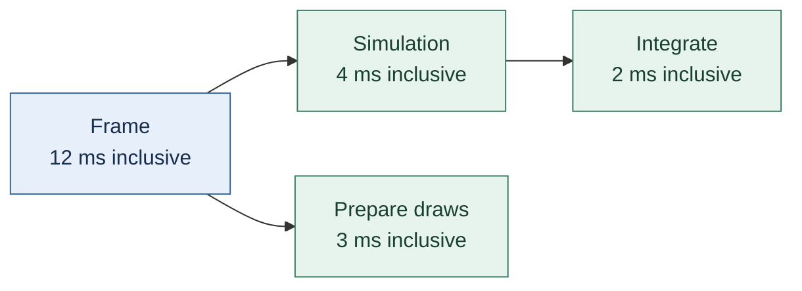
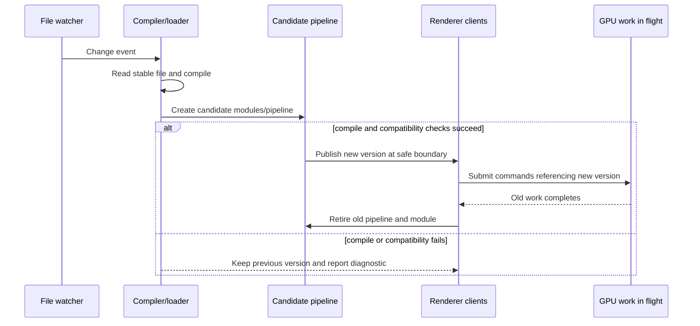
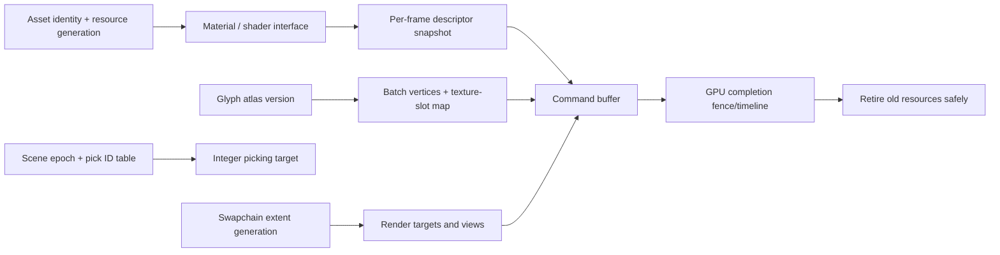

# 41 — Evidence, tools, and revisable design

[[Chapter Edition/03 - Game Engine/00 - Reading Map|Reading map]] · [[Chapter Edition/03 - Game Engine/40 - Coupled contacts and iterative response|Previous chapter]] · [[Chapter Edition/03 - Game Engine/42 - From cartridge bytes to a reproducible machine|Next chapter]]

After the physics and runtime examples, the volume returns to how teams learn whether a design works. This chapter uses prototypes, diagnostics, and source evidence to keep architecture and game decisions revisable.

**By the end:** Use the right artifact and evidence level to test a design question, distinguishing observed behavior, inference, and future intent.

**Recall question:** What observation would change your design decision, and what test can produce it without confusing a prototype with a shipped feature?

<!-- Derived from Continuous Notes/Game Engine - From First Frame to Living Worlds.md; source lines 100533–101302; source-span SHA256 bc94a3e6961f57b793be4d6e916d3cefb189a298e4d7fa0c693928ff91ed21a9. -->

<!-- CHAPTER-SOURCE-BEGIN -->
## Use tools and evidence to keep the design revisable

### Publication reconstruction — make DCC output pass through one engine contract

Editor and DCC tools should not each invent a private interpretation of “publish this asset.” Blender, Maya, Houdini and Nuke expose different host graphs and scripting APIs, but the engine-facing boundary can remain stable: host adapter → owned normalized asset description → validation → deterministic dry-run plan → staging → publication → engine-side verification.

`tools/labs/production_pipeline_contract_lab.cpp` now exercises the host-neutral middle of that chain. It normalizes a deliberately portable relative-path grammar, rejects parent traversal and absolute paths, validates schema/hash fields, rejects duplicate logical IDs and output collisions, sorts a deterministic publication plan, models idempotent re-publication, rejects an implicit destructive replacement, and validates contiguous frame sequences. This makes the publication chapter executable without pretending that CI launched Blender, Maya, Houdini or Nuke.

The host-specific responsibilities are developed in [[DCC adapters and engine publication]], while [[Production manifests and transactional publication]] separates lexical path checks from real symlink/root checks and separates atomic visibility from crash durability. Current production readiness still requires real host adapters, real SHA-256 calculation in the pipeline, platform filesystem tests and engine import verification.


A feature that worked once is a starting point. The next task is to find what happens under failure, content changes, heavy scenes, and actual play, and to preserve enough evidence to improve it.

#### Measure allocation churn with a per-frame delta

A cumulative allocation counter answers “how many allocations have happened since this state was initialized?” To find allocations on a particular frame, retain the prior frame's counter and subtract it from the current value. This creates a simple diagnostic signal that can be logged on demand without printing every frame. It measures allocation calls only; it does not show requested bytes, freed allocations, retained memory, or whether a rare later frame will allocate. Expand the instrumentation only when those questions matter.

**Evidence boundary:** these additions synthesize the full caption read of Kohi #24.5. The presenter reports local builds and allocator tests passing after fixes, and reports zero allocations on the demonstrated frame; those are not independent build or runtime verification. The shown subsystem conversion is partial, and later migration/CI work is described as future or off-stream work.

Source reading: [caption source](https://www.youtube.com/watch?v=3ZFcvBjRFN0) · [caption source](https://www.youtube.com/watch?v=KanKG-vd9GA). Captions document the narrated development state; on-screen code and reported builds were not independently reproduced.


### Measure the whole action before optimizing one function

A **profiler** records where time or other resources are spent. A **trace** records events across time so relationships become visible. CPU time, wall time, GPU time, memory use, allocations, and frame-to-frame variation answer different questions. An averaged frames-per-second number can hide a repeated hitch every two seconds.

First ask what the player experiences. If picking up the crate freezes the game, trace the interaction through asset work, script callbacks, physics, render preparation, and device waits. A slow-looking function may be waiting for another system, not doing expensive local computation. Optimize the measured cause and preserve the intended result.

Name workloads. “Faster renderer” is incomplete without a scene, resolution, device, synchronization policy, and comparison. Record the before/after work, counts, and timing distribution. If batching reduces draw submissions but increases CPU sorting and memory traffic, the result depends on the workload. A **batch** groups compatible work to amortize overhead; it does not guarantee a speedup.

Useful invariants include valid handles, finite transforms, bounded queues, legal resource transitions, and coherent component requirements. An **invariant** is a condition that should remain true at the relevant boundaries. Assert it where the violation first becomes visible, and include enough context to identify the entity, asset, frame/tick, and operation. An assertion that merely says “something went wrong” turns a precise failure into another search.

### Put diagnostic costs beside the feature

The profiling sequence starts with labeled scoped timers, moves to a visual trace, and instruments object lifecycle operations. That progression is instructive: a single duration says how long one chosen region took; a trace shows where nested work and scheduling overlap; lifecycle instrumentation can reveal repeated creation/destruction costs. A trace’s names need to identify useful operations without generating so much noise that the timeline becomes unreadable. Use the captured profile to form a new question, then measure again after the change. (“Intro to Profiling,” [YbYV8rRo9_A](https://www.youtube.com/watch?v=YbYV8rRo9_A), ~00:00–05:00 and 16:12–24:34; “Visual Profiling,” [qiD39bB7DvA](https://www.youtube.com/watch?v=qiD39bB7DvA), ~00:00–05:00 and 09:26–14:26; “Instrumentation,” [FtsehM4xoDw](https://www.youtube.com/watch?v=FtsehM4xoDw), ~00:00–05:00 and 24:37–37:19.)

### Debugging and profiling are design features

When the player reports “jump does not work on moving platforms,” reproduce the state and expose the hidden decisions. A useful in-game debug view can show: raw jump input and tick; grounded result and support body; actor velocity; contact point and normal; broad-phase candidate count; solver iteration count; and frame/tick duration. Gregory has dedicated sections for logging/tracing, debug drawing, in-game menus/console, pausing, debug cameras, and in-game profiling (Ch. 9, contents PDF p.11; selected profiling discussion PDF pp. 411–413, printed pp. 389–391). The specific tool design below is original synthesis from that architecture.

Add a deterministic reproduction record: seed, level/build identifier, simulation tick, relevant actor transforms/velocities, input commands, and physics settings. A single captured failure can be replayed after a code change. Be cautious: logging every object every frame can perturb performance and generate huge files. Prefer bounded circular buffers and targeted trace categories. For a one-second defect window, retain the last few hundred ticks and dump only when a diagnostic trigger fires.

Measure before optimizing. A profiler should answer both “which systems dominate?” and “why did this frame spike?” Inclusive timing of a parent function includes its children, so nested timings can be double-counted if summed blindly. Gregory discusses profiling tools and in-game profiling in the contents and inspected passages (Ch. 2.3 and Ch. 9.8; PDF pp. 411–413). Track frame-time distributions and spikes, not just average FPS. A physics broad phase that is cheap on average but explodes in a crowded level may be the real defect. Pair time with counts: active bodies, candidate pairs, contacts, iterations, bytes allocated, resources streamed.

### A compact architecture contract

For the jump-platform system, a small contract could be:

```text
InputCommand { actor, action=Jump, inputSequence, targetTick }
PhysicsSnapshot { tick, bodyTransforms, linearVelocities, contacts, supportByActor }
GameplayResult { tick, actor, jumpAccepted, rejectionReason }
RenderSnapshot { tick, actorPose, cameraPose, visibleEffects }
```

Every field is an example of a contract, not a prescribed public API. The core design questions are: who writes each value, who may read it, what time boundary it belongs to, how long it remains valid, and how a developer can inspect it. `jumpAccepted` should be decided once. Physics can expose a support body and contact details; gameplay decides whether a command is legal. The renderer and audio can then respond to the same accepted result. If the command is rejected, a subtle cue might explain why, if that supports the design.

A reliable implementation sequence is:

1. Build one actor, one static floor, and a reproducible fixed-step update.
2. Add a visible debug marker for support state and the contact normal.
3. Add a moving platform and decide whether it is kinematic or dynamic.
4. Specify how support velocity contributes to the actor’s motion.
5. Add jump input at a tick boundary and log acceptance/rejection.
6. Test low frame rates, maximum platform speed, and collision edge cases.
7. Profile a crowded stress scene and inspect frame-time tails.
8. Add streaming only after the loading and collision availability contract is defined.

This order narrows the search space. If the actor falls through the platform, the contact pipeline is suspect. If contact exists but jump is rejected, inspect gameplay policy. If it works at 60 Hz but fails when the frame stalls, inspect time accumulation and input-to-tick mapping. If it works but feels unresponsive, measure input latency and revise the experience deliberately instead of making arbitrary physics changes.

### Instrument costs in terms of gameplay content

A physics profiler becomes more useful when it records workload as well as duration. “Collision detection took 2.1 ms” is a starting point. Add numbers of active bodies, broad-phase node visits, candidate pairs, narrow-phase calls, contacts generated, solver iterations, sleeping bodies, and allocations. Then a designer can run a crowded encounter and see whether the spike is caused by actual complexity or an accidental pathological layout.

Keep the measurement overhead bounded. Sampling every entity’s complete state each frame may change cache behavior and distort the result. Use counters, selected traces, and representative captures; compare instrumented and minimally instrumented runs if timing is close to a budget limit. Inclusive time should be reported as such. If `Physics::Step` includes `BroadPhase`, `NarrowPhase`, and `Resolve`, summing all four figures double-counts child work. Gregory’s profiling discussion explicitly raises the nested measurement problem (PDF pp. 411–413, printed pp. 389–391).

The same principle applies to asset loading. Track request-to-ready latency, bytes read, decompression time, upload time, and peak memory by resource type. An average load time can hide a one-time shader or texture upload spike. A seamless level transition is a user-facing promise and needs evidence across worst-case travel routes, not just a fast desktop development machine.

#### Correlate one player action through every subsystem hand-off

Timing each subsystem separately still leaves the hardest stall unexplained: a platform event is delivered at one time, the next fixed tick consumes it later, a door's cell is requested, decompression completes, the GPU upload waits in a queue, the world publishes, and a frame eventually becomes visible. Give that journey a causal identifier rather than assuming that adjacent log lines belong to the same action. A useful diagnostic tuple is `(trace ID, logical action ID, fixed tick, display frame, asset/cell generation, service phase, thread/queue, monotonic timestamp)`. The trace ID connects a user-visible effect; the generation distinguishes cancelled/obsolete work; tick and frame numbers keep gameplay and presentation clocks apart. Do not conflate CPU time, GPU timestamp domains or network-synchronized clocks without recorded calibration.

For the earlier toy trace, capture `tap acquired`, `press+release dispatched tick 1`, `door gen 1 cancelled`, `door gen 3 CPU-ready`, `door gen 3 published`, `cell 7 resolved`, `character root request 0.5`, `physics resolution 0.3`, `frame interpolated`. If the player says "the door sometimes fails to open," you can distinguish a lost input edge, a stale completion, an unloaded target, a blocked collision move, and a late presentation. In a production implementation, record actual service/OS error codes, device-loss states, IO queue depth, frame-in-flight fences, allocator pressure, frame-time distributions and p99 stalls under stress. Logs must have bounded allocation and avoid flooding real-time threads; sampling/aggregation policies should never silently omit failure records.


### Use measurement to decide what to optimize

The public channel inventory includes a number of profiling and performance-oriented Hazel episodes, but this chapter’s direct caption reading is strongest in the opening Game Engine sequence; do not attribute detailed profiling advice to a particular episode without consulting its transcript. The general engineering principle is still clear: measure where time is spent before optimizing. An engine can expose frame time, update time, draw-call counts, memory use, and asset load time. The measures should answer a decision, not exist as decoration.

If the renderer is CPU-bound, reducing draw submissions or asset state changes may help. If GPU-bound, reducing overdraw, shader cost, or resolution may matter more. If stutters occur during asset loading, background import and controlled main-thread handoff may help. If editor responsiveness suffers while serializing, incremental saving or a worker may help. Each fix has costs and should be tested against the observed bottleneck.

A profiler overlay is useful, but profiling itself can distort timing. Record build mode, hardware, scene, and capture method. Compare like with like. Do not infer that a feature is “fast” because it has batching or a multithreaded queue; these are techniques, not results.

### Architectural tradeoffs worth making explicit

#### Small interface now or generalized framework later?

Choose the smallest interface that allows two real clients to share behavior. If a renderer abstraction only supports OpenGL today, label it as an abstraction with one implementation. If a generic asset interface has no second asset type, avoid predicting all future needs. Generalization is cheaper when based on a real second use case because the constraints become visible.

#### Global access or explicit dependencies?

Global singletons shorten call sites and can be practical in a small educational engine. They make dependencies less visible and complicate tests or multiple application instances. An explicit service reference adds plumbing but makes ownership and substitution easier to understand. The public Hazel snapshot uses a static `Application::Get()` accessor; treat it as a deliberate simplicity tradeoff rather than a rule that all engine systems should be global.

#### Immediate event handling or queued events?

Immediate dispatch keeps cause and effect near each other. Queued processing gives a defined phase and can support multiple producers or replay. The former needs careful reentrancy rules; the latter needs ordering, memory, and overflow rules. Start with the simpler model that meets current requirements and revisit when observed constraints change.

#### Native code or scriptable behavior?

Native C++ gives performance and direct API use, with slower iteration and crash risk. A managed runtime may improve reload and safety, but brings a runtime, bindings, and deployment burden. A narrow interface lets either approach coexist with engine-owned data. The right choice depends on who authors gameplay and how frequently it changes.

#### One renderer backend or several?

One backend reduces implementation and validation cost. Several backends improve reach and can expose architectural assumptions, but every feature must be tested across them. A renderer abstraction is not equivalent to a second backend. State exactly what has been built and on which hardware or operating systems it has been verified.

#### Entity-component composition or direct objects?

ECS supports flexible combinations and batch queries. It can make control flow indirect and identity management more involved. Direct classes are easy to follow for a small stable set of objects but can create inheritance tangles as combinations grow. Use the model whose costs are visible in the game’s actual object variety.

##### Why deep inheritance gets brittle

A class tree is appealing when objects form one clear family. A `RenderableObject` can be a kind of `MovableObject`, which can be a kind of `GameObject`. The trouble begins when the game asks for traits that cut across that single family tree. A flying crate, amphibious vehicle, animated trigger, and physical-but-invisible volume are not easily classified by one axis. Multiple inheritance can create diamond-shaped ancestry and duplicated base state; moving shared features upward can burden every descendant with capabilities it does not use. The “floating crate” example shows how a feature requested for unrelated types can bubble into a common ancestor, turning a lean root class into a catch-all. [PDF pp. 741–745 / printed pp. 719–723]

Composition offers another way to build an object: give it the services it needs. For example, a door entity can own a transform, mesh instance, and rigid body; destroying the door also destroys those owned parts. “Has a transform” expresses the relationship more accurately than making every window or renderable object a specialized rectangle or movable object. The distinction between **composition** and **aggregation** is about lifetime: in composition, the containing object owns and creates/destroys the component; aggregation links objects without controlling the other object’s lifetime. For example, a game object can refer to a shared mesh asset without owning the asset itself. That choice affects who is responsible for cleanup and whether a component can be shared. [PDF pp. 745–747 / printed pp. 723–725]

The chapter’s component diagram places optional services around a central `GameObject`. Its example lets derived object types create the components they need while a default destructor cleans up owned parts. Treat this as a teaching sketch, since the book explicitly says implementation details vary. A real design still has to answer how components are registered, how references survive deletion, how save/load restores them, and what update order connects physics, animation, and rendering. [PDF p. 747 / printed p. 725]

##### Choose an object architecture by deciding who owns the connections

Suppose a vehicle needs a transform, a mesh instance, an animation controller, a rigid body, a chassis, and an engine. One direct design gives a `GameObject` a fixed pointer for each standard component and lets `Vehicle` add its own fixed fields. This is easy to understand and lets constructors create a known object shape. It also means adding a new universally supported component changes the root class, and each instance has the slots whether or not it uses them. The example explicitly deletes derived components in the vehicle destructor and standard components in the base destructor, so the ownership path is part of the design rather than a detail to leave implicit. (Game Engine Architecture, §14.2.1.4, PDF pp. 748–749 / printed pp. 726–727.)

A **component** is a separate unit that owns a piece of an object’s data or behavior. A generic component model places components behind a common interface, often in a linked list. The root object can ask each component for its type, send it an event, or update it without knowing the concrete component classes. This permits arbitrary numbers of components and lets new component types be added without changing the root class. The tradeoff is that both the root and each component must make fewer assumptions: implementation becomes more generic, and cross-component coordination needs an explicit route. Figure 14.9 shows a `GameObject` hub pointing to a linked list of components that inherit the shared interface. The book presents fixed fields and a generic list as alternatives with different costs, not a universally superior choice. (PDF pp. 749–750 / printed pp. 727–728; Figure 14.9 inspected on PDF p. 749.)

A **pure component model** removes the hub object too. Components carry the same unique object ID, and a lookup system groups them logically. The ID substitutes for direct object ownership, but code still needs a way to construct the right component set for each kind of object. The chapter suggests factories or data-defined types for construction. Communication becomes another design problem: components might look up peers by ID, be pre-wired, or receive messages through another system. Figure 14.10 depicts the shared-ID relationship. It is a conceptual architecture sketch, not evidence that removing an object wrapper automatically improves performance or simplifies every engine. (PDF pp. 750–751 / printed pp. 728–729; Figure 14.10 inspected on PDF p. 750.)

The text then changes perspective to a **property-centric** design. Instead of storing each object as a bundle of fields, the engine stores values of the same property together and keys them by object ID. For example, one table may map IDs to positions, another to orientations, and another to health. This can store only properties an object actually has and can make uniform property iteration more cache-friendly. The familiar **array of structures** layout stores complete records one after another; **structure of arrays** stores each field in its own contiguous array. The book illustrates both with fixed-size sample storage. That example explains a memory-layout distinction; it does not prove that a property-centric engine is faster for every workload. A property bag can also make relationships and behavior harder to inspect or enforce. (PDF pp. 751–755 / printed pp. 729–733.)

The chapter distinguishes its use of *component* from *property object*: components in the object-centric discussion often link to engine subsystems such as rendering, animation, or collision; a property object represents an attribute such as health or inventory and may carry the behavior for that attribute. The boundary can be subtle, and the book says the practical result may be similar. The important design question is what data and behavior a unit owns and how other units find or notify it. Both property classes and scripts can implement behavior; the Dungeon Siege example is given as a historical case of designers adding property types through scripts. (PDF pp. 752–754 / printed pp. 730–732.)

### A complete worked example: place, play, and inspect a door

Consider a room with a door that opens when the player presses a key nearby. This tiny feature crosses nearly every important engine boundary.

First, the editor creates an entity with a stable scene ID and a transform. A sprite component refers to a door texture asset. A collider component describes the area that blocks movement. A script or behavior component stores the action to perform. The content browser locates the texture, and the scene serializer saves entity identity, transform, component values, and asset references. The file does not save a pointer to an OpenGL texture or the memory address of a Box2D body.

Second, on scene load, the asset system resolves the texture ID and either loads it or reports a missing asset. The scene creates component data in its registry. When simulation starts, the physics integration creates a body from the collider component. The render system reads transform and sprite data. The script system receives an entity handle that can query nearby state through a documented interface.

Third, the player presses the interaction key. The window backend translates the platform key event into an engine key event. The application offers it to the topmost editor overlay first. If the editor has text focus, the overlay consumes it; the game does not open the door. In runtime mode, the UI does not consume the key, so the game layer or script sees it. The behavior checks that the player is close enough and sends a door-open state change.

Fourth, the simulation updates the door’s state. If opening changes its collider, the physics system applies that change at a safe point. If it only changes sprite animation or rotation, the render transform updates. The renderer submits the sprite draw through the active backend. The editor’s viewport displays the rendered frame in a framebuffer; the hierarchy panel can still select the door and show its components.

Finally, the user stops Play. The runtime copy is discarded, leaving the authored door closed in the editor scene. If the user had moved or reconfigured the door while editing, those changes belong to the authored scene and can be saved. If the game offered a player save, the door’s in-game open state would be serialized through the game save system, not silently written into the editor’s project scene.

This example demonstrates why a game engine is a connected system rather than a pile of independent features. Identity links scene data. Asset references link files to rendering. Input events cross the platform boundary. Layers decide who handles events. The scene connects components to systems. Physics and scripts participate in runtime update. The renderer turns state into an image. The editor wraps all of it in an authoring workflow. Each responsibility can be small, but the contracts between them determine whether the engine is usable.

### Playtesting is a measurement practice

Rouse’s chapter on playtesting describes planning what to monitor, recording game flow, analyzing results, changing the design, and testing again. The chapter also warns against relying on a single group or allowing design-by-committee to turn every suggestion into a requirement (Rouse, Ch. 25, PDF pp. 509–524, printed pp. 483–498). The examples and recommendations here are based on those passages. The operational protocol below is my synthesis.

Before a test, state the question and the behaviors that would support or weaken the current hypothesis. For the attack feedback test:

- Recruit players with varied experience rather than only developers who know the implementation.
- Give the same instructions and scenario to each participant.
- Record button press, state transition, hit query result, damage outcome, cue playback, and frame presentation on one timeline.
- Ask open-ended questions before explaining the internal rules.
- Separate “what did you think happened?” from “did you like it?”
- After the session, compare observation to the intended rule and decide what to change.

A precise event trace might look like:

```text
12:04.100 input attack received (sequence 481)
12:04.117 command assigned to sim tick 7221
12:04.133 attack state entered: windup
12:04.267 hit query: blocked by shield, target=Enemy_04
12:04.267 outcome event: AttackBlocked
12:04.300 impact cue presented
12:05.900 tester says: "I think I was too far away"
```

The timestamps are illustrative. This log says the game’s internal event was blocked, while the player inferred out-of-range. The next design question is whether the cue is indistinct, the shield is visually hidden, the presentation is delayed, or the rules themselves are too subtle. Do not immediately tune damage or widen the hitbox; neither change necessarily fixes the misunderstanding.

Keep production QA, playtesting, and broad preference research distinct. QA seeks defects relative to specification. Playtesting investigates how a game’s rules and presentation are experienced. Preference research asks what people like or want in a broader market context. They may inform each other, but they answer different questions. Rouse explicitly distinguishes playtesting from general focus-group activity in his discussion (PDF pp. 522–524, printed pp. 496–498). A focus group might discuss whether combat sounds appealing; it cannot establish whether the player correctly understood a particular attack outcome during live play.

Good playtest notes capture context rather than merely verdicts. “Player was confused” is weak evidence. “Player attacked twice while the enemy’s shield remained raised; after the second spark, player said the attack had hit but health did not decrease” suggests a concrete mismatch between visual signal and health outcome. Preserve both the tester’s words and the observer’s factual timeline. Mark inference as inference.

### A compact requirement-to-evidence chain

A useful requirement includes intent, rule, observable outcome, and verification evidence.

**Intent:** The player should understand why an attack did not damage an enemy.

**Rule:** A raised shield blocks attacks arriving from within a defined front-facing arc. Attacks from outside that arc may hit. Attacks outside weapon range miss. Interrupted attacks produce no hit query.

**Outcome contract:** Each attack command produces exactly one terminal result, with an optional target and impact location. The result is recorded at a specific simulation tick.

**Player communication:** A block produces a spark and shield impact sound at the contact point. A miss produces no hit effect. A rejected command may produce a short response appropriate to the game’s pacing.

**Test scenarios:** Front shield hit; rear shield hit; attack just inside/outside range; attack interrupted during wind-up; simultaneous player and enemy attack; low frame rate; presentation dropped or delayed.

**Evidence:** Automated rule tests verify the state transitions. A deterministic replay verifies the timeline. Playtest sessions verify whether players infer the outcome. Profiling verifies the instrumentation does not create unacceptable spikes. These checks support separate claims; passing a rule test does not prove player comprehension.

This chain makes acceptance criteria possible without reducing design to metrics. It also identifies which evidence belongs to which discipline. A combat designer can own the intended outcome. An engineer can own event ordering and contact query behavior. An animator and sound designer can own presentation. A researcher or design team can observe player interpretation. The outcome is shared, but the proof is layered.


#### Keep one playable area alive while the design is still uncertain

Rouse’s development advice is deliberately practical: when the central gameplay is uncertain, build a **small playable piece that exercises the gameplay**, not merely a technology demonstration. A renderer demo proves that triangles can be drawn. A physics sandbox proves that bodies can collide. Neither proves that the intended game loop is enjoyable, understandable, or worth expanding. The prototype must combine enough of the actual player actions, responses, goals, and opposition that a teammate can play it and judge the experience.

The build should remain playable as features are added. Start with the smallest movement or interaction that can already be tested, make it feel coherent, then add the next mechanic without silently breaking the previous one. Placeholder assets are acceptable; broken peripheral features can be acceptable; a long period in which nobody can actually exercise the core loop is dangerous because design decisions accumulate without experiential evidence. Continuous playability is therefore not the same as “production quality at all times.” It is preservation of a runnable hypothesis.

Once the individual mechanics exist, build **one fully functional area** before multiplying content. A complete area forces systems to meet: spawn/loading, navigation, camera, collision, AI, objectives, checkpoints, audio, UI, save state, failure, and transitions. It exposes assumptions that isolated mechanics hide. If one representative level cannot be made coherent, producing twenty levels creates twenty versions of the same unresolved problem. In modern production this is often called a vertical slice, though the exact scope and polish expected by a studio can vary.

This also changes engine prioritization. The next engine feature should be the smallest capability blocking the playable area, not the most impressive item on a generic engine roadmap. If designers cannot iterate on enemy placement, editor undo and fast reload may be more valuable than another renderer effect. If the area cannot preserve state after streaming, stable identity and serialization are urgent. If combat feels unreadable, debug visualization and feedback hooks may matter more than a sophisticated AI planner. The playable slice becomes an integration test for architecture and design at the same time.

Keep a record of the hypothesis behind each addition: “adding a dash should make crossing exposed space a timed decision,” not merely “implement dash component.” Observe whether the new mechanic improves the intended play, whether it makes an older mechanic less useful, and which engine cost it introduces. If it fails, changing the design early is success; the prototype prevented the team from building content around a false assumption.

Source basis: Rouse, *Game Design: Theory & Practice*, Chapter 15 (“Getting the Gameplay Working”), especially the organic process, “too much too soon,” incremental construction, keeping the game playable, and building a fully functional area before broad content production.

### A working loop for design and engineering

For every risky mechanic:

1. Describe one player situation in ordinary language.
2. State the player action and the intended system response.
3. Name the uncertainty in the design.
4. Build the smallest playable prototype that isolates it.
5. Record the input, rule decision, state change, and visible outcome.
6. Watch varied players and capture their interpretation before explaining.
7. Compare intended and perceived outcomes.
8. Change either the rule, feedback, or both—but identify which hypothesis the change addresses.
9. Replay the same scenario and test adjacent edge cases.
10. Preserve a working snapshot so future changes can be compared.

This is a cycle, not a gate sequence. A new animation may alter perceived attack timing, which changes the playtest question. A new collision volume can change both fairness and engineering cost. New observations should update the specification rather than be forced into old assumptions.

#### Scope a 2D engine around the game it should make

The Hazel series draws a clear boundary: Hazel 2D may keep three-dimensional coordinates, perspective math, and an editor camera, but the series will focus on 2D rendering and physics rather than adding mesh rendering or a 3D physics engine. The motivating target is a layered game like Hollow Knight, where parallax, particles, lighting, and shader effects add depth to 2D art.

The roadmap groups the work around the full path from authoring to a shipped game. Rendering needs textured quads, batches, atlases, sprite animation, custom effects, and post-processing. C# scripting should reach entity/component behavior and expose selected properties through reflection so designers can edit and serialize them. Box2D should support collision callbacks and authored body/constraint settings. Particles, text, responsive UI layouts, audio playback/effects/mixing, asset streaming/hot reload, controller and platform support, profiling, runtime saves, packaging, localization, and stripped distribution builds all belong to the broader plan.

This is a scope map, not an implementation report. The speaker calls some ideas stretch goals or leaves them uncertain, including visual scripting, cinematic authoring, GPU particle simulation, and exact UI layout choices. The breadth explains why the series focuses on 2D and why systems outside rendering matter as much as the renderer itself.
#### A roadmap should produce something observable

The Sparky introduction frames the engine as preparation for a 48-hour game jam, with a 2D-first path inside a longer-term 3D ambition, Windows as the initial target, and web portability as a possibility. The return episode later talks about delivering a small game and debates graphics API work. In the later pull-request stream, the proposed sequence changes: add C# scripting and build a small game first, then move the renderer to Vulkan, initially single-threaded, and consider concurrency afterward. These are plans and personal tradeoffs expressed at different points in time, not evidence that the targets were achieved or remain current (The Cherno, “Intro: Sparky Engine,” 00:00–00:16:14; “Return of the Game Engine Series!,” throughout; “Finishing the Pull Requests!,” 02:47:12–02:53:40).

##### Keep roadmap statements separate from working features

A roadmap can reveal intended boundaries: which tasks need engine source access, which can be scripted by game authors, who expects to own a subsystem, and what kind of QA is planned before release. It cannot demonstrate that those features work or that the dates remain current. One Hazel announcement describes preliminary multiplayer as persistent connections plus raw byte buffers and game-authored serialization, rather than automatic entity replication; it also names prefab update behavior and a standalone GPU-particle prototype as future work. Record those as dated product intentions, not current capability. Similarly, a code-review video can demonstrate a failure in one setup without proving the whole project is broken. Keep three columns in your own notes: observed in the session, inferred by the reviewer, and planned for later.

This is especially important for technical commentary that quotes platform presentations. The PS5 reaction episode relays historical claims about SSD throughput, decompression, cache coherency, geometry processing and ray tracing, but it is neither the original technical talk nor a current hardware reference. Use it to identify questions—where data is copied, which stage decompresses it, how priority is represented—not as an authoritative API or benchmark. The episode itself cuts off before its promised power discussion.

###### Scope and evidence

This addition covers only Game Engine Architecture PDF pp. 748–759 / printed pp. 726–737; Game Physics Engine Development PDF pp. 232–243 / printed pp. 209–220; Game Design Theory and Practice PDF pp. 597–608 / printed pp. 572–583; and Rules of Play PDF pp. 241–252, covering Chapter 19 printed pp. 7–16 and only the opening of Chapter 20 printed pp. 1–2. All assigned extracted text was read. Rendered pages visually inspected: GEA 749–750; Physics 234–235 and 241–243; Rules of Play 243–247. Figures on these pages were visually checked where present. The Physics damping repetition is reported only as an apparent issue in the printed listing; no code was compiled or executed. Rouse’s Atomic Sam is a sample design document and The Suffering excerpt is a dated, edited design document, not a complete or authoritative statement of final shipped behavior. No whole-book reading claim is made.

#### Let the game’s next question justify the engine’s next feature

An engine does not become useful by accumulating a list of impressive subsystems. A feature earns its place when a real project exposes a repeated need and the team can explain how solving it improves the game-making path. A useful example is a content browser full of placeholder art: when a team must compare hundreds of models, textures, and environment maps during preproduction, thumbnails reduce the cost of browsing. That need is much more concrete than “editors should have thumbnails.” It also explains why thumbnails may be a priority for a prototyping workflow without being required to run every game. The creator describes thumbnails emerging from a Hazel prototype goal and asset-pack browsing, while noting the work grew well beyond the original spare-hours estimate ([How New Game Engine Features are Implemented](https://www.youtube.com/watch?v=z1O6AZWuWm4&t=8m54s)).

A small game can serve as an engine test even when the game itself is simple. In the Space Invaders example, the developer first prototyped in Unity, then rebuilt the game in Hazel to learn the workflow and discover missing engine pieces. That process surfaced prefabs for repeated invaders, dynamic meshes for destructible pieces, and scene loading for menu-to-gameplay transitions. A prefab is a reusable saved entity setup: create a bullet’s transform, renderer, script, and collider once, then instantiate that prepared object when the player fires. This can reduce duplicated setup in game code and make authoring more consistent. It is not automatically a runtime performance optimization; the source corrects that claim in the conversation ([He MADE A GAME using my GAME ENGINE](https://www.youtube.com/watch?v=56ISmbJE9S4&t=2m10s)).

This makes a useful planning loop: select a game-sized experiment, record the friction it exposes, estimate whether the need is local or reusable, then build the smallest engine feature that changes the workflow. The same approach has limits. The creator describes Hazel as a project with volunteers and a learning audience, so decisions were sometimes made for faster implementation or clearer teaching rather than for the staffing and extensibility expected of a decades-old commercial engine ([Another Week of Game Engine Development](https://www.youtube.com/watch?v=Dr6ly-PO9nM&t=1m45s)). The transferable practice is to state which constraint a design serves, not to copy an old engine’s roadmap.

### Use player observation to refine one hypothesis at a time

Playtests are most useful when the team can connect a player’s interpretation to a concrete event trace. Before testing, define a few observable behaviors rather than a vague goal like “combat should feel good.” For instance:

- Players notice when an attack is blocked.
- Players do not repeatedly press attack while the character is visibly in an uninterruptible recovery.
- Players can learn to attack around a shield after seeing a block outcome.
- Players do not attribute a miss to input failure when the actual cause is range.

After a session, classify findings: rule misunderstood, feedback absent, feedback mistimed, control mapping unexpected, animation inconsistent, or technical defect. A single event can belong to more than one category. If testers report the attack “feels random,” verify determinism and state logs before making a design diagnosis. The same symptom could come from a truly random rule, an untelegraphed but deterministic enemy pattern, inconsistent frame timing, or nondeterministic collision ordering.

Change one coherent part of the experience when possible. If the first test changes both hitbox size and sound cue, improvement does not reveal which change mattered. In exploratory design, combined changes may be acceptable, but record the uncertainty that remains. The goal is not laboratory purity; it is making decisions with enough evidence to avoid confident guesses.

### The bridge from design loop to architecture loop

Design iteration and engine development operate at different but connected speeds. A designer may revise attack timing several times in one afternoon. A change to the underlying simulation tick, event schema, or resource format may require a broader migration. Build the architecture so common design experiments are cheap while keeping expensive structural changes deliberate.

A useful separation is:

- **Content parameters** change often: timing windows, ranges, damage, cue references.
- **Rules structure** changes sometimes: new attack phases, new block categories, target-selection policy.
- **Engine capability** changes less often: event ordering, collision query type, animation synchronization, rollback/replay support.

The boundary is project-specific. A highly systemic game may change rules structure frequently and should make those rules data-driven. A tightly authored cinematic game may benefit from fewer generic knobs and more specific tools. Gregory’s contents identify data-driven gameplay and game-world tooling in the gameplay foundation chapters (PDF pp. 12–13); the architecture choice should follow how designers actually need to explore the system.

When design change is expensive, prototypes can decouple the question from the final technology. A paper test may determine whether attack recovery creates a useful decision. A small interactive prototype may compare input buffer lengths. Only after the rule is understood does it make sense to invest in a robust authoring interface, network prediction, or production animation pipeline. Conversely, if the question is specifically whether a complex collision interaction can be read in 3D space, a paper prototype is not enough. Pick the cheapest prototype that preserves the uncertainty under study.

### A case study checklist: make the shield readable

**Design question:** Can a player learn that a shield protects its forward arc and choose a flank attack?

**Rule sketch:** Shield orientation defines a front arc. Contact from the front produces `Blocked`; contact from outside the arc proceeds to damage evaluation. State exact angle boundaries and whether vertical angle matters. These numeric rules are design choices; set them in a prototype rather than assuming a universal value.

**Presentation sketch:** A blocked attack produces a contact-position spark, a short shield sound, and a small recoil in the defender. A successful flank hit uses the normal hit cue. Keep the effects distinct enough to identify without covering the player or enemy silhouette.

**Prototype:** A flat graybox with one player and one shield enemy. Use a visible debug arc and show outcome reason in a developer overlay. Remove the overlay for players.

**Playtest:** Ask players to defeat the enemy and narrate their interpretation after a few attempts. Record whether they change position after a block, whether they misread a blocked attack as a missed input, and whether their successful flank feels earned.

**Engine support:** Stable facing direction; collision contact point and normal; shield arc check; outcome event with reason; replayable input log; debug drawing; adjustable parameters; event-to-cue presentation mapping.

**Follow-up:** If players understand the rule but do not enjoy repositioning, the issue is likely strategic pacing or enemy behavior, not cue clarity. If they enjoy the tactic but cannot identify the arc, tune the visual silhouette or feedback. If results differ across runs with the same inputs, inspect timing, collision ordering, and random seeds before revising the design.

This small study shows why a design requirement must name both experience and mechanism. “Shield is readable” is not enough. The team needs to know which behavior should be learned, which state transition creates it, how it is communicated, and what observation counts as evidence.

### Debug by finding the earliest broken contract

A black window is a symptom, not a diagnosis. Debugging is faster when every subsystem has a small contract and an observable checkpoint. Platform initialization should say whether a window exists. Input should show normalized event state. The renderer should report selected device and swapchain dimensions. A resource request should say whether it found, decoded, uploaded and bound an asset. Each stage narrows the possible cause.

The practical chain is: source/build configuration; application startup; platform/window; event delivery; renderer instance and device; surface and swapchain; command recording; submission and presentation; geometry and pipeline; shader inputs; resources and descriptors. Test the earliest stage first. If there is no window, looking at a texture sampler is wasted effort. If validation reports an invalid image layout, inspect transitions before editing the model matrix.

Useful diagnostics preserve context. A generic “failed” line is weak. A better message includes the operation, resource identifier, requested dimensions/format or platform, and error code. Assertions should guard invariants that would otherwise cause confusing downstream faults, while recoverable errors should return control to a caller that can choose another path. For example, a missing optional texture may use a fallback; an unsupported required graphics feature may prevent renderer initialization with a clear explanation.

The buffer correction appendix is especially pedagogical because a problem was surfaced by viewers and isolated into a short follow-up rather than hidden in the main tutorial. It reinforces regression thinking: once the failure is understood, preserve a small test or reproducible startup path that would catch it again. The caption describes a reported memory-property assumption; the lesson is that API constraints should be verified against the actual selected device.

A debugging display is a tool that renders information about the engine itself: axes, bounds, wireframes, camera frustum, selected entity or texture atlas. The later Kohi livestream inventory includes debug displays and editor gizmos. These tools shorten feedback loops but should be optional and easy to turn off. A debug path should consume the same core renderer contracts as normal geometry wherever practical; otherwise the diagnostic view can hide a broken production path.

#### Trace a visual bug through the data path

When an animated model’s reflections move incorrectly, inspect the values the fragment shader receives, not only the final pixels. In a Hazel devlog, a gun’s cubemap reflection rotates and translates with the wrong parts of the animation. Scrubbing reveals that skeletal bone transforms affect vertex positions but were missing from the world-space position and normal values used for image-based lighting. Updating those values changes the reflection behavior in the demonstrated animation. ([Fixing Skeletal Animation Image-Based Lighting in Hazel](https://www.youtube.com/watch?v=fs9ChRr4VHM&t=4m18s)).

The practical diagnostic chain is: identify what appears wrong, vary one pose to isolate translation or rotation, inspect the vertex-stage transforms, then compare the vectors used by the fragment shader. Translation should affect a point position but not a direction. The video does not fully explain normal transforms under nonuniform scale, so its matrix edit should not be copied as a general formula without checking the renderer’s scale assumptions. Another animation update shows the next missing layer: imported clips all play in sequence, while mouse picking, choosing a clip, and triggering it through the editor or script remain open work. A working deformation path is not yet a complete animation-authoring system. ([Skeletal Animation! // Hazel Engine Dev Log](https://www.youtube.com/watch?v=8-wAi--vW1o&t=4m18s)).

Renderer features have the same prototype-to-system gap. A standalone Vulkan GPU-particle prototype emits, simulates, sorts, and indirectly draws particles on the GPU, reducing per-particle CPU/entity work; the creator says it is not yet Hazel’s renderer. A path-tracing experiment builds acceleration structures from a Hazel scene and accumulates samples as the camera stops. These demonstrations show feasibility, not production readiness: editor controls, memory lifetime, denoising, performance targets, and automated tests still need design. The roadmap itself acknowledges that runtime automation does not test editor tools such as undo/redo. ([The Future of the Sparky Game Engine](https://www.youtube.com/watch?v=hUFHzuIyK0g&t=6m27s)).

A concise measurement rule also comes from Sparky’s profiling log: do not compare a Debug frame time with a Release frame time and call the difference an engine optimization. The presenter showed one scene at roughly 6–8 milliseconds in Debug and 3–4 in Release, then asked contributors to profile optimized builds and state the scene and hardware. That is a useful warning, not a universal performance ratio. ([Sparky Engine Dev Log #11 - Profiling and Planning](https://www.youtube.com/watch?v=cimYa67cR-U&t=6m30s)).

### Keep architecture revisable with evidence, not taste

As a codebase grows, each subsystem creates pressure to generalize. A scene system might grow from a list of objects to hierarchy and components. A resource system might evolve toward asynchronous loading and hot reload. A rendergraph might encode dependencies and transient lifetimes. Every additional capability should answer a concrete use case and should be evaluated against its maintenance cost.

The Kohi retrospective is unusually useful because it does not present the current design as final. It calls the engine organized, cross-platform support stable and the Vulkan renderer promising, while also criticizing the rendergraph’s code complexity, describing the scene as overly complex in object/hierarchy management, saying the asset/resource API needed work, and questioning whether a lighting system served much purpose. Those are project author assessments preserved in the repository at the cited revision. They demonstrate how to review an engine: list what the architecture made easier, what it made harder, and what evidence motivates a refactor.

The #041 roadmap episode also states a preference for authoring scenes procedurally in code while retaining the ability to load scenes containing entities and components ([Kohi #041](https://www.youtube.com/watch?v=SS8Zn13cZus)). The author explicitly says an entity-component system does not solve every problem and not everyone prefers it. That supports a modest design takeaway: preserve more than one authoring route when the engine must serve both programmers and content creators, but do not promise that multiple routes are free. They need to converge on the same validated runtime scene contract.

A refactor should name the observable pain. “The API feels bad” is vague. “Every texture request requires five parameters repeated across call sites, and no call site can tell loading from ready” is concrete. “The rendergraph is too complicated” improves when measured in the number of concepts a renderer caller must learn, the debugging path for a pass dependency, or the code required to add a simple shadow pass. “Scene management is too ECS-like” is a preference until it is attached to actual operations that became awkward, such as finding an object by name or updating parent transforms.

The safest refactor keeps behavior witnesses. Before changing the renderer interface, preserve a triangle, a textured quad, a material variation and resize behavior. Before changing resource ownership, exercise request, shared use, unload and reload. Before changing a scene model, load a small scene with a parent-child transform and a missing asset. These witnesses turn a design discussion into a change with observable before-and-after behavior.

“Legacy” should also be evidence-based. Old code may be redundant, but it may also encode behavior the new path has not reproduced. Remove a system only after identifying its callers, migration path and replacement behavior. The retrospective’s plan to remove legacy lighting/camera systems shows an intended direction, not proof those systems were already removed. The current roadmap still contains future work and unfinished stability tasks, so readers should separate stated plans from completed features.

#### Grow the quality process with the project
A few features can be checked by running the editor and trying them. As the engine grows, that same manual pass becomes too expensive and still misses combinations. Keep unit tests for deterministic pieces such as math, then add repeatable workflow checks for opening sample scenes, entering runtime, detecting errors, and comparing captured images where stable output is expected. Treat these as different kinds of evidence. A proposed CI job is not proof until the build, launch, and scene checks are actually running. A release branch can then collect changes less often after a defined QA pass, giving users a clearer expectation about what has been tested. (Full caption read: [caption source](https://www.youtube.com/watch?v=tHjJHmDxhug).)


#### Let a focused test reveal the bug

A compact allocator test set can exercise the boundary conditions that ordinary startup may never hit: create then destroy; consume exactly the full capacity; fill it through repeated smaller requests; request one more byte block and verify failure does not advance the offset; then reset and verify reuse. Each test should control its inputs and assert specific state, so failures point to one behavior. In the stream, these checks caught a stale memory pointer after destroy and an incorrect remaining-capacity calculation. Those were implementation defects, not allocator theory.

An assertion macro can attach the source file and line to a failure, while a small runner keeps pass, fail, and bypass counts. Keep bypass visible in the report so an unfinished test is not mistaken for a pass. Deterministic inputs matter: for example, a time-related test should use a fixed timestamp rather than the current clock. Unit tests are useful for deterministic memory logic; GPU behavior may need integration coverage because it depends on device/runtime state. A manually run test program is still only manually run: adding it to a build does not imply CI executes it.

Source reading: [caption source](https://www.youtube.com/watch?v=3ZFcvBjRFN0). Captions document the narrated development state; on-screen code and reported builds were not independently reproduced.


### Turn engine features into headless tests

A physics test scene can be a small, self-contained program that creates bodies with different properties, steps the world, and reports expected outcomes. This is a better automation target than driving the full editor through mouse clicks when the question is whether a subsystem behaves correctly. Keep the test inputs deterministic, state the expected values or tolerances, and run the same scene in CI on each supported platform. A successful compile or launch is a different proof from a physics assertion passing. The reviewed Hazel testing discussion specifically imagines feature test scenes and emphasizes running them on another computer. (The Cherno, “Automatically Testing Hazel,” [0RDI41oBcmQ](https://www.youtube.com/watch?v=0RDI41oBcmQ), ~00:00–00:30, 07:57–08:27, 15:55–19:54; “Hazel Engine ON LINUX!,” [I4TQI7st0pc](https://www.youtube.com/watch?v=I4TQI7st0pc), ~00:00–00:30, 07:34–08:04, 15:08–18:56.)

### Asset reload should follow file identity and dependency edges

An asset changing on disk and appearing in a running game is a useful iteration loop, but a refresh button is not yet a reload system. The observed Hazel behavior first places an asset in the asset directory, then refreshes the browser before the runtime reflects the changed file. A robust design must know which imported asset came from that path, which runtime resources depend on it, and whether existing instances should be recreated or updated in place. That requires separating source identity, import settings, runtime object lifetime, and active references. (“I ACCIDENTALLY Created Hazel’s Greatest Feature,” [yMRp9DVZYnI](https://www.youtube.com/watch?v=yMRp9DVZYnI), ~00:00–00:30, 07:19–07:49, 14:39–18:19.)

#### Make assets keep their identity across edits, imports, and reloads

An asset file and the engine’s reference to that asset are different things. A project may store a mesh file on disk and also keep a registry handle that scenes use to find it. If an external version-control operation replaces that file by deleting it and creating a new one, an automatic file watcher may process those events separately. In the narrated Hazel bug, the watcher removed the registry entry on deletion and assigned a fresh handle on creation; existing scenes still referred to the old handle. The breakage appeared after restart because already-loaded assets remained alive until then ([The WORST BUG in my Game Engine](https://www.youtube.com/watch?v=x5dy8T9dRPk&t=0m3s)).

That failure suggests concrete safeguards: preserve identity when a file is replaced, coalesce filesystem events into a transaction, make destructive registry changes visible, and provide a recovery or refresh path. These are design options inferred from the reported sequence, not claims about a present Hazel fix. The same report warns against relying on disconnected notes: suspected bugs should become an owned, searchable issue or a short reproducible investigation so that another feature does not bury them ([The WORST BUG in my Game Engine](https://www.youtube.com/watch?v=x5dy8T9dRPk&t=4m55s)).

The asset pipeline also has two distinct representations. Artists need an interchange format that supports their tools and rich source data; a runtime may prefer a compact, engine-specific representation arranged for direct upload or predictable loading. A historical Sparky demonstration converts FBX files to SPM, a binary layout whose vertex and index data can be read into buffers with little runtime parsing. The presenter describes SPM as a rushed prototype and reports that it lacked multiple-mesh support at that stage. Treat the example as a pipeline pattern, not a recommendation to invent a format casually or a benchmark proving binary files are always faster ([Sparky Engine Dev Log #4 - Sparky Model Format](https://www.youtube.com/watch?v=EUy8G3uMitI&t=3m47s)).

Imported data has to match the renderer’s assumptions. The same demonstration requires tangents and binormals for its normal-mapping path, and shows how the converted model is loaded, paired with a material, and attached to an entity. This makes a good review question for any asset importer: which attributes are mandatory, who validates them, and does the tool report the missing data before runtime? The video shows one historical FBX/engine path; it does not establish today’s FBX, glTF, or Hazel contracts. In a later animation-system account, the team says it selected glTF as its supported model format while continuing to revise its animation design ([The Story of Animation in Hazel](https://www.youtube.com/watch?v=HPZo1oFESYQ&t=2m45s)).

### Release claims need distinct evidence layers

Several clips discuss releases, CI, and games made with Hazel. These are different evidence types. A trailer or game-jam showcase demonstrates that one project ran in one environment; a release video summarizes features; a CI workflow demonstrates a configured build/test path; and a test scene provides repeatable evidence for a specific subsystem. Hazel’s Linux discussion explicitly notes incomplete automated test coverage, while release planning debates whether a renderer branch is suitable to ship. Report the supported platform, tested configurations, feature state, and known gaps separately. Do not collapse “it ran once,” “it builds on CI,” and “it is release-ready” into one claim. (The Cherno, “What it Takes to Release a Game Engine,” [wv6KQWrV4KA](https://www.youtube.com/watch?v=wv6KQWrV4KA), ~00:00–00:30, 05:40–06:10, 11:20–14:11; “Hazel 2024.1,” [10OVd1VHEZ4](https://www.youtube.com/watch?v=10OVd1VHEZ4), ~00:00–00:30, 07:37–08:07, 15:14–19:03.)

#### Separate a working prototype from a shippable feature

A renderer experiment may show a roughness-controlled reflection, shadow, or deferred buffer before it is reliable enough for a project. Sparky’s development logs repeatedly label features as unfinished: shadow maps are noisy, image-based lighting is partial, deferred rendering may be present but broken, and some debug or reload paths may not work. A release walkthrough later distinguishes those experiments from features included after testing and stabilization. It describes a release branch, a main/render thread split, asset packaging, sound graphs, depth of field, spotlights, sprite rendering, and debug drawing; it also explicitly says thumbnails were still planned rather than included. These are dated statements about particular releases, not current engine guarantees ([Sparky Engine March 2016 Release!](https://www.youtube.com/watch?v=o4_tPhgslcU&t=4m34s), [Sparky Dev Log #3 - The Start of Physically Based Rendering](https://www.youtube.com/watch?v=YRd2F1JDGlg&t=0m8s), [Our biggest release ever... Hazel 2023.1](https://www.youtube.com/watch?v=L_XLGmG2Ct8&t=0m1s)).

A safe progression is to name the evidence level: idea, prototype, integrated path, tested workflow, and packaged release. For example, a deferred renderer writing normals and positions to multiple targets is a prototype until lighting consumes those buffers and the frame is validated. A thumbnail generator is a prototype until cache reload, file replacement, invalid image data, and editor restart are tested. In a debugging story, the Hazel author found that a constructor accepted an image buffer but did not use it; a solid pink diagnostic image helped separate thumbnail generation from disk-cache loading. The key technique is to make each stage observable and test one boundary at a time ([How New Game Engine Features are Implemented](https://www.youtube.com/watch?v=z1O6AZWuWm4&t=13m56s)).

<!-- Supervised source-review addition 261a50f00fedc94d -->

### A thumbnail cache is derived render output with explicit invalidation

The Hazel 2024.1 release walkthrough describes editor thumbnails as rendered scenes using Hazel’s ordinary rendering path, including post-processing such as bloom and shadow maps. It also describes the first visit to a directory or first search as taking a short time to produce previews, with later visits appearing immediate because the images have been cached. This is a dated account of that build, not evidence about every Hazel version. The durable lesson is that a thumbnail is derived output: it has inputs, a renderer path, a cache key, and invalidation rules. ([Hazel 2024.1](https://www.youtube.com/watch?v=10OVd1VHEZ4&t=13m27s), 13:27–14:47.)

A cache key must identify every input that can change the pixels. One bounded key is

$$
K=(A,D,R,Q,C),
$$

where $A$ is the asset content version, $D$ is the versioned dependency set (for example, the material and environment map), $R$ is the renderer or preview-pipeline settings version, $Q$ is the target resolution, and $C$ is the color and output policy (including transfer function and tone mapping). If any of these values changes, the previous image may still be a useful old artifact, but it is not a valid answer for the new key. Do not key only by filename: a material edit can change the rendered model while its path remains constant. The cache is derived data, so it can be discarded and regenerated. A dirty flag or version comparison records that the output is stale; it does not itself perform the expensive render. ([Game Programming Patterns: Dirty Flag](https://github.com/munificent/game-programming-patterns/blob/master/book/dirty-flag.markdown).)

The editor should first compute $K$ and look for a matching cached image. On a hit it can show that image immediately. On a miss it schedules an offscreen preview request, loads or resolves the asset dependencies, renders the preview through the configured pipeline, and publishes the completed image under $K$ only after rendering and cache writing succeed. The source calls the thumbnails full scenes and says they pass through bloom and shadow-map processing; it does not document a universal Hazel thumbnail API or a promise that every editor must run every game pass. Keep the preview camera, lighting, post-processing, target size, and color handling explicit, and include the settings that affect output in $K$.

Asynchronous generation needs a freshness check as well as a cache key. Capture the key and a request generation when the job starts. When it finishes, accept the result only if the current request still has the same key and generation; otherwise discard it instead of replacing a newer preview with an older completion. Write cache files to a temporary destination and publish them atomically after validation. On failure, keep the preview dirty and expose an error or placeholder so a later attempt can retry. Browsing or searching the same directory should perform lookups against the existing keys, not schedule a new render for every display of the same tile.

**Trace.** The first visit requests `crate.mesh` at content version 4, with `paint.material` version 8, preview-pipeline version 3, a 256-by-256 target, and the declared color policy. The key misses, so the editor renders and stores that version. Returning through directory navigation or finding the crate by search produces the same key and reuses the stored image. Now the material changes to version 9: invalidate the old preview and start a new render under the version-9 key. Its result belongs to that key. If it changes again to version 10 before the older job finishes, the editor advances its request generation and rejects the version-9 completion. A fresh version-10 render becomes the visible image and cache entry. This trace separates first-generation cost, cache-hit navigation, dependency invalidation, and stale-job rejection.

Test the boundary with an unchanged asset (cache hit), a changed source file, a changed material or environment dependency, changed post-processing settings, changed target resolution or color policy, corrupt cached bytes, a failed render, editor restart, and two overlapping requests that finish out of order. Check that each changed input invalidates only the affected key, that a cache hit displays the expected pixels, and that a stale result cannot overwrite the current one. A screenshot alone cannot establish invalidation or publication correctness.


This evidence ladder also applies to performance. A presenter may say two threads could nearly double CPU performance, or that a binary model loads nearly instantly compared with parsing a small OBJ file. Without a benchmark with the same content, machine, build mode, and workload, these remain claims or motivating hypotheses. Measure the operation the game actually performs, and include tooling and synchronization costs in the comparison ([Our biggest release ever... Hazel 2023.1](https://www.youtube.com/watch?v=L_XLGmG2Ct8&t=1m12s), [Sparky Engine Dev Log #4 - Sparky Model Format](https://www.youtube.com/watch?v=EUy8G3uMitI&t=4m30s)).

### A profiler result belongs to its exact build and scene

A batch renderer should be judged with a workload that resembles the work users ask it to do. This Hazel episode examines a community-made Balderdash-style game, then enlarges its map to create a repeatable quad-heavy scene. The same scene behaves very differently in debug and release configurations, and removing the editor/debug ImGui layer changes the measured frame time again. The reported roughly 13,000-quad result near 2.8–3 ms per frame is therefore an observation from one scene, machine, build, and UI configuration—not a general Hazel capability claim. [Testing Hazel's Performance](https://www.youtube.com/watch?v=Yw7RpvmqvSE)

When comparing frame rates, convert them to frame time: $t=1000/F$ milliseconds for $F$ frames per second. This makes the available budget visible. A change from 100 FPS to 200 FPS saves 5 ms per frame; a change from 1,000 FPS to 2,000 FPS saves only 0.5 ms. FPS differences do not represent equal amounts of saved work.

The source profiles `DrawQuad` in debug and release. Matrix multiplication dominates the debug profile; transform work remains a possible hotspot in release. The presenter proposes an experiment: because the displayed workload does not rotate quads, bake position and scale into vertex positions rather than constructing and multiplying a matrix for each quad. That is a hypothesis to benchmark against the existing path. Keep the output image and workload fixed, measure both configurations in the same build, and compare CPU time before claiming a gain. The episode does not implement or verify this optimization, and its speculation about SIMD/vectorization is not a demonstrated cause of every debug/release difference.

#### Source-to-volume map

- Existing foundations: `### Measure the renderer, then choose a batch boundary`, `### Make a performance claim identify its workload, measurement, and unfinished work`, and `### Read performance results with the workload attached`.
- This source adds a concrete profiling example and preserves the proposed transform-baking change as an experiment rather than a result.
- Limits: no runtime, profiler trace, source code, hardware details, or independent performance measurement was inspected; all reported numbers are captioned episode observations.

### A trace timeline shows nested work and timing gaps

A stopwatch around a function gives one duration. A **trace** keeps many timed scopes and their relationships, so a developer can see which work happened inside a frame and how long each part took. The Hazel episode integrates an instrumentation helper that writes JSON events for a Chromium-based trace viewer. The timeline makes parent work such as an application update visible alongside nested camera, renderer-preparation, draw, and UI scopes. [Visual Profiling](https://www.youtube.com/watch?v=qiD39bB7DvA)

Trace labels should identify the work being measured. A function signature can distinguish overloaded functions better than a short function name, though long labels make the timeline harder to scan. Separate capture sessions for startup, runtime, and shutdown can also make lifecycle costs easier to compare. Those are organizational choices; the source shows the runtime trace most clearly and says startup/shutdown still need more instrumentation.

The trace itself can mislead if the clock is too coarse. The episode sees two consecutive scopes with identical start timestamps, even though one call must occur before the next. The instrumented durations are small enough that timestamp resolution becomes part of the measurement system. Before interpreting ordering or tiny durations, check clock resolution and overhead, capture a known sequence, and compare trace intervals with a higher-resolution timer. The speaker proposes this improvement but does not implement it in the episode.

A visible gap between frames also needs interpretation. The source sees around 14–16 ms per frame while the measured CPU scopes total far less, and suggests vsync as a likely explanation. A timeline can reveal time not assigned to instrumented scopes, but it does not identify the cause by itself. Add instrumentation around the frame boundary and inspect wait/synchronization points before calling the difference CPU work.

#### Source-to-volume map

- Existing foundations: `### Debugging and profiling are design features`, `### Measure the whole action before optimizing one function`, and `### Read performance results with the workload attached`.
- The source adds a trace-reading example and a specific clock-resolution failure; it does not repeat the general case for profiling.
- Limits: English automatic captions; the trace file and implementation were not independently examined, and timer improvements remain proposed work.

### Profile enough to answer one question

The profiling introduction begins with a scope timer whose constructor captures a start reading and whose destructor records elapsed time. It then moves from rounded milliseconds to microseconds and finally to a named, displayable result. Line-based unique identifiers let a macro create one timer per scope. The lesson motivates an in-engine profiler because it can be used across platforms and on user machines without attaching an IDE profiler; it also warns that a per-frame table is only a rough first view and that periodic hitches need a timeline or history ([YbYV8rRo9_A](https://www.youtube.com/watch?v=YbYV8rRo9_A), 10:21–23:50).

The follow-up instrumentation lesson describes how continuous tracing can create huge JSON captures, so start/stop around a known slow region or capture a fixed number of frames. Scope placement should follow the questions: application loop, layer, renderer, or a separate lower-level graphics profiler. A hierarchy helps locate broad cost before instrumenting every small function. The demonstrated debug run includes frame work and buffer-swap waiting, and a repeated timestamp reveals timer-resolution limits ([FtsehM4xoDw](https://www.youtube.com/watch?v=FtsehM4xoDw), 00:52–07:00; 27:00–35:20). These observed measurements belong to that run only. A wall-clock scope duration does not mean the CPU executed continuously for that entire interval; waits, preemption, and timer semantics matter.

### Profiling as a question about a workload

A profiler is useful when it narrows a question: which part of this measured frame or action is consuming time, and how does that change when the workload changes? A number without its workload, capture window, and aggregation rule is not yet a diagnosis. If a frame has a hitch every few seconds, a single average can hide it; retain a sequence or timeline that can expose the periodic pattern. In the inspected *Game Engine Architecture* pages, the timeline example visually separates work across processors and a frame timeline, while its prose describes in-engine scopes and a heads-up display. That image illustrates a presentation idea; it does not establish the timing behavior of another engine or machine (PDF p. 409, printed p. 387; figure 9.12).

A hierarchical profile gives each timed region a place in its call tree. For a parent region, **inclusive time** covers the parent and the work performed by its descendants. **Exclusive time** is the parent’s own measured interval after subtracting its child intervals. For example, if `RenderScene` takes 4 ms inclusive and its measured `SubmitMeshes` child takes 2.5 ms, the parent’s residual exclusive interval is about 1.5 ms, subject to timer resolution and instrumentation overhead. Do not add parent inclusive time to child inclusive time: that counts the child twice. Invocation counts matter too; one slow call and hundreds of small calls suggest different next questions. The call-tree and stack illustrations are on visually inspected PDF p. 410 (printed p. 388; figures 9.13–9.14). The prose on PDF p. 411 (printed p. 389) explains immediate-child subtraction.

The text describes raw cycles, microseconds, percentages of frame time, and hierarchical views as possible presentations. Units must remain honest. Its sample `AutoProfile` code uses a `QueryPerformanceCounter`-style call and stores an elapsed counter difference. The excerpt does not show a conversion from counter ticks to seconds or milliseconds. Thus the sample supports the idea of recording a difference between two counter readings; it does not license labeling the raw difference as microseconds. Nor should a measured scope duration be casually called CPU execution time: wall-clock elapsed scope duration may include waits or preemption, depending on the timer and workload. On Windows, check the actual API contract and frequency conversion before assigning units.

In the excerpt, manual hierarchical “bins” are a cheaper alternative when a full call tree is too costly. They are useful for a deliberately chosen, coarse set of regions. A bin tree assumes a clear parent for each child; a real function may be called from several parents. Assigning that shared work under only one branch makes the displayed hierarchy incomplete or misleading. A useful workflow is to choose explicit scope boundaries, keep per-frame counts, export samples over frames (the text describes CSV), then compare the same workload before and after one change. The profiler helps choose where to investigate; it does not explain why a function is slow by itself.

The excerpt’s memory displays reinforce a parallel lesson: a total is meaningful only with a boundary. A custom allocator may reserve a large block and satisfy many smaller allocations inside it; observing only calls to the operating system misses those inner requests. An engine with separate heaps for world objects, streamed data, frame scratch, video memory, and debugging may need counters inside each allocator. A high-water mark answers “what was the peak tracked use during this interval?” rather than “how many bytes are live right now?” The inspected table and graphical displays are examples of forms, not portable definitions of “memory used” (PDF pp. 416–417 / printed pp. 394–395; figures 9.15–9.16). Pair a counter with an explicit ownership and allocator boundary. The book also recommends contextual diagnostics for failed or missing assets: show where an object was expected and what failed, rather than only printing a raw error string.

### Read a timing tree without counting the same work twice

A profiler reports that a frame took $12\,\mathrm{ms}$. Inside it, simulation took $4\,\mathrm{ms}$ and preparing render commands took $3\,\mathrm{ms}$. Those are nested measurements: simulation's four milliseconds are already inside the frame's twelve. Adding all three values would count some elapsed time twice.

Use this original, single-thread trace. Times are illustrative, not measurements of Hazel, Kohi, or this machine.

| Scope | Start | End | Inclusive elapsed time | Direct child scopes |
|---|---:|---:|---:|---|
| Frame | $0\,\mathrm{ms}$ | $12\,\mathrm{ms}$ | $12\,\mathrm{ms}$ | Simulation, Prepare draws |
| Simulation | $1\,\mathrm{ms}$ | $5\,\mathrm{ms}$ | $4\,\mathrm{ms}$ | Integrate |
| Integrate | $2\,\mathrm{ms}$ | $4\,\mathrm{ms}$ | $2\,\mathrm{ms}$ | None |
| Prepare draws | $7\,\mathrm{ms}$ | $10\,\mathrm{ms}$ | $3\,\mathrm{ms}$ | None |

**Inclusive elapsed time** measures from a scope's start to its end, including nested work. **Exclusive elapsed time**, sometimes called self time, removes the scope's direct child intervals. For properly nested scopes on one thread, direct children cannot overlap, so

$$
E_{\mathrm{self}}=E_{\mathrm{inclusive}}
-\sum_{c\in\mathrm{direct\ children}}E_c.
$$

The frame's exclusive elapsed time is $12-4-3=5\,\mathrm{ms}$. Simulation's is $4-2=2\,\mathrm{ms}$. Do not subtract Integrate again from Frame: it was already included in Simulation. The self-time total is $5+2+2+3=12\,\mathrm{ms}$, which reconstructs the frame duration for this complete, single-thread hierarchy.



This is a containment tree, not a timeline: each arrow points from an enclosing scope to its direct child. Use the table for execution times. Hierarchical profiling is motivated by Gregory's discussion of nested measurements and scoped instrumentation (*Game Engine Architecture*, supplied edition, PDF pp. 411–414); the trace, definitions, calculations and diagram above are original teaching examples.

Even a correct subtraction needs the clock's meaning. If these are wall-clock timestamps, unscoped waiting and descheduling remain in exclusive elapsed time. The five milliseconds do not prove that the CPU executed five milliseconds of instructions in Frame itself. A profiler based on sampled CPU execution answers a different question.

Parallel work breaks another assumption. Suppose two worker tasks both begin within the same frame and their elapsed intervals overlap. Their duration sum can exceed the frame's duration; subtracting both as if they were serial children can even produce a negative result. That is a sign that the accounting model is wrong, not that execution took negative time. Show worker tracks separately, inspect dependencies and the completion path, and distinguish total worker effort from latency visible to the frame.

### Convert GPU timestamps with their own clock contract

GPU timestamps need supported queue capabilities, available results and meaningful stage boundaries. A CPU timer around submission measures host elapsed time, not completion of the submitted GPU work. The Khronos sample explains query availability, queue limitations and conversion by `timestampPeriod`. [Khronos timestamp-query sample](https://docs.vulkan.org/samples/latest/samples/api/timestamp_queries/README.html)

For a counter with $b>0$ valid bits and period $P$ nanoseconds per tick, an illustrative wrap-aware calculation is

$$
\Delta q=(q_{\mathrm{end}}-q_{\mathrm{start}})\bmod2^b,
\qquad
\Delta t=\Delta q\,P\,\mathrm{ns}.
$$

It assumes fewer than $2^b$ ticks elapsed; otherwise the number of wraps is ambiguous. With $b=36$, $q_{\mathrm{start}}=2^{36}-6$, $q_{\mathrm{end}}=6$ and hypothetical $P=2$, the interval is $12$ ticks or $24\,\mathrm{ns}$. These are synthetic values, not device measurements.

Check scale independently: at one nanosecond per tick,

$$2^{32}\,\mathrm{ns}=4.294967296\,\mathrm{s}.$$

That corrects a decimal-place slip in the linked sample's prose. Retrieving 64-bit results avoids truncating them to 32-bit storage; it does not increase the physical counter's valid width. Do not subtract timestamps from unrelated clock domains without establishing their relationship.


### Read performance results with the workload attached

Performance demos can be misleading when the result has no scene, machine, or metric attached. The reviewed faster-engine video claims improvement in a real game and shows frame-rate/resource statistics, while another diagnosis traces generated scene work into a specific operation. These examples suggest recording the workload, hardware, build configuration, CPU/GPU utilization, and the exact change. A frame rate alone cannot distinguish a CPU bottleneck, GPU bottleneck, synchronization stall, or a change in visual quality. First reproduce the workload, then profile both engine and game code before generalizing the result. (“How I Made My Game Engine MUCH Faster,” [ddfMzq0CNTw](https://www.youtube.com/watch?v=ddfMzq0CNTw), ~00:00–00:30, 09:46–10:10, 19:32–24:26; “Diagnosing Performance Issues in Hazel,” [iY6QbL_3L2I](https://www.youtube.com/watch?v=iY6QbL_3L2I), ~00:00–00:30, 19:24–19:48, 38:49–48:32.)


#### Measure before tuning, and make layout changes explicit

The Sparky maintenance episode adds a high-resolution timer, a once-per-second FPS count, and a Visual Studio profiling workflow. The profiler starts paused so initialization and test-scene creation do not dominate the capture. It shows why percentages need context: inlining hides individual calls, disabling it makes attribution easier while slowing the program, and a function's percentage is its share of the measured run rather than an absolute millisecond cost.

Comparing the simple and batch renderers points to repeated draw calls and vertex-array binds as major costs in that test. The transcript also identifies repeated uniform-location queries as a candidate for caching. To keep vertex layouts maintainable, it replaces hard-coded byte offsets with `offsetof`. It then packs four floating color channels into a normalized integer attribute and reports a speed increase, while acknowledging that the measurement is noisy.

A separate correctness fix addresses matrix multiplication: writing each result directly into the same array being read can overwrite values needed by later calculations. The final implementation computes into a temporary array, then copies the completed result into the matrix. These are historical tutorial observations and fixes; they do not substitute for current benchmarks or independent regression checks.

## Keep a frame coherent while resources change

### Scope and evidence contract

The active engine volume already develops the broad architecture of a game engine: lifecycle and subsystem ownership, rendering boundaries, resources, editors, runtime state, and evidence levels. This supplement keeps to a narrower and more concrete layer found in the completed video extracts: generation-counted GPU-facing resources; descriptor reuse across frames; texture limits and batch boundaries; shader-system refactors and hot reload; dynamic glyph atlases; pixel picking; resize/device-failure handling; and the difference between a diagnostic log, an automated runtime sweep, and a test of an editor workflow.

These sources show people building particular engines at particular points in time. A caption can support “the speaker described changing this field” or “this episode reports that a test scene ran”; it cannot by itself establish that the submitted implementation compiled, that the result is correct on all hardware, or that the speaker’s API explanation generalizes to every graphics API. Most timestamped source statements below come from cached English caption tracks. The Kohi #021 resize passage comes from locally generated ASR and is explicitly identified as such; its exact wording and identifiers remain uncertain. The review gate says their word accuracy was not independently compared to audio. I use reported facts with phrases such as “the episode describes,” “the stream proposes,” and “the presenter reports.” The explanatory engineering conclusions are identified as reasoning from those traces, not as facts demonstrated by the video.

One Game Engine Architecture book extract is read directly for text-system scope: physical PDF page 510 (printed page 488) says a good text/font system should account for different character sets and reading directions. The selected captions show glyph caching and raster atlas updates, but do not demonstrate a complete shaping engine. That gap is useful: an atlas is a storage mechanism for rasterized glyphs; it does not decide how a run of text becomes a sequence of positioned glyphs.

### 1. A GPU resource needs identity, version, and a safe update point

A renderer resource is not simply “a texture pointer.” For the renderer to decide whether to bind or refresh something, it needs to know which logical resource a reference names, whether that resource has been replaced since the reference was recorded, and whether the GPU is still using an older version. Three ideas are often blended together:

- **Identity:** which texture, geometry, shader, or descriptor is intended?
- **Generation:** is this still the same incarnation of that logical slot?
- **Frame state:** which in-flight frame or descriptor copy currently owns the data?

The Kohi texture and material episodes show the generation idea in action. In the texture-system material, the system compares a map’s generation with a texture’s generation and checks mip-level state before deciding that the map is current. An invalid generation selects a default texture; if a refresh is needed but fails, the stream says to warn and continue rather than crash. The stream also describes creating a replacement sampler and waiting for the device to be idle before old sampler use is no longer possible. This is a story about a particular resource system and backend, not a universal recommendation that the entire GPU be idled for every texture update. [Kohi Ep. 142, 00:59:51–01:02:30 and 01:04:13–01:04:55](https://www.youtube.com/watch?v=xb23Y9o7tP4&t=59m51s)

The useful model is a versioned resource state machine. Let a handle contain a slot index $i$ and generation $g$, while a table of $N$ slots stores current generation $g_i$ and an alive flag for each slot. A material stores $(i,g)$. When its texture is unloaded or replaced, increment the slot generation. On use, compare the material’s stored generation against the current resource generation. If they differ, the reference is stale and must resolve to a fallback or a newly published resource. In symbols:

$$\operatorname{current}(i,g) \iff 0\le i<N \land \operatorname{alive}_i \land g=g_i.$$

Check the index range before reading the table. The generation counter also needs a declared wrap policy. This check prevents a stale material from silently treating a reused slot as the old texture. It does not prove the GPU has stopped reading the old image. CPU identity and GPU lifetime are separate. The CPU can invalidate a handle immediately while deferring actual destruction until all command buffers that could refer to the resource have completed.

The older Kohi descriptor lesson introduces a frame-indexed global uniform set. It creates one descriptor set per swapchain image for triple buffering and updates the set selected by the current image index. The point is to avoid rewriting data still in use by a previous frame and to avoid repeated allocation. At the time of the episode this is a lesson in explicit Vulkan setup, with descriptor pool capacity based on swapchain image count. It should not be rewritten as a claim that every engine should have exactly three sets. If the number of frames in flight changes, the resource count should follow the actual buffering model. [Kohi #029, 00:15:17–00:18:15 and 00:34:46–00:35:42](https://www.youtube.com/watch?v=yc40ixalLtU&t=15m17s)

A later Kohi mesh episode reports a repeated material-instance problem: applying the same material instance more than once in the same frame would perform the same descriptor update repeatedly, so the code adds a `needs_update` flag. Critically, “skip update” does not mean “skip bind.” The presenter explicitly separates the two operations: the descriptor contents need to be written only when dirty, but a compatible descriptor binding must still be established for the draw call. That does not require a redundant bind command before every draw when a valid compatible binding is already retained by the command buffer. This distinction is a strong teaching point. A state update mutates resource contents; a bind establishes state for a specific command. They have different costs and lifetimes. [Kohi #055, 00:54:24–00:56:05](https://www.youtube.com/watch?v=kIbW4Kv6p4c&t=54m24s)

A later Kohi stream considers making descriptor state dynamic per swapchain image and reviews descriptor generation/ID records per frame. This is future-facing refactor discussion, not a confirmed final architecture: the speaker reasons aloud, marks items for later, and changes structure during the stream. A transcript summary that says “descriptor sets are dynamic per frame” would overstate what happened. The correct educational treatment is to identify a design pressure: when one logical material is referenced by several frames in flight, each in-flight descriptor snapshot needs its own update-validity state, or the application must otherwise synchronize updates against GPU use. [Kohi Dev Ep. 157, 01:16:36–01:17:32 and 01:50:16–01:52:44](https://www.youtube.com/watch?v=ZmZUmsqUN6Q&t=1h16m36s)

The same stream proposes preallocating descriptor-write scratch for the maximum number of textures rather than allocating temporary writes every frame. That is a performance design intention, not a measured win in this extract. A reviewer should ask: Is the maximum known and bounded? Does each binding actually need a write? Is the scratch buffer sized by descriptor count or by write count? Can the writes be reused only after the API call has consumed their contents? Those questions turn a devlog point into a review checklist without treating the point as proof. [Kohi Dev Ep. 157, 02:24:17–02:27:44](https://www.youtube.com/watch?v=ZmZUmsqUN6Q&t=2h24m17s)

The descriptor claim in the Kohi #055 captions is especially easy to overgeneralize. The speaker says that updating the same descriptor “twice in the same frame” is invalid in this particular code path. That is an episode-level implementation statement, not a general Vulkan rule that a descriptor may only ever be updated once per frame. The exact legality depends on descriptor usage, synchronization, and enabled features. The teaching point that survives the qualification is: make dirty/update state explicit, and keep update, bind, and GPU-completion responsibilities separate.

### 2. Batching is a state-change problem with explicit flush boundaries

A batch renderer collects compatible draw requests into shared buffers so many primitives can be submitted with fewer draw calls. The savings depend on what remains compatible: shader, blend/depth state, vertex format, texture bindings, and other pipeline state. A batch is therefore not merely “a big array.” It is a pending sequence of vertices and indices plus a description of the GPU state under which those vertices should be interpreted.

The Hazel texture-batching episode states the practical bind limit as a hardware/driver capability. It discusses 32 texture slots as a reasonable initial target for the project, not a portable guarantee. Slot zero is reserved for a white texture in that particular renderer, leaving the remaining slots for other textures. A submitted sprite records a sampler slot, and when a new texture no longer fits into the current set, the renderer must finish work that refers to the old mapping before changing that mapping. [Hazel, “Batch Rendering Textures (+ Debugging!),” 00:01:22–00:02:56 and 00:14:24–00:15:11](https://www.youtube.com/watch?v=Fz1VySWaad8&t=1m22s)

Sparky’s texture-array episode gives a particularly instructive mid-stream correction. The developer first says to flush when a texture is not found among the current slots, then thinks through whether to flush before or after ending the draw, and corrects the order: end/unmap the current batch, submit the queued data that uses the old slot mapping, then start the next batch and install the new texture-to-slot mapping. The captions capture uncertainty, including an audible self-correction. We should teach the final reasoning, not silently convert the initial false start into polished certainty. [Sparky Ep. 17, 00:24:53–00:26:59](https://www.youtube.com/watch?v=1x4hrdS97cI&t=24m53s)

The invariant is simple:

> Every vertex in a submitted batch must be interpreted using the same slot-to-texture mapping that was in effect when that vertex’s sampler index was written.

If a queued vertex refers to slot 3, but slot 3 is rebound to a different texture before submission, the vertex data is structurally valid yet semantically wrong. This is why ordering matters. The batch must be closed and consumed before the slot table changes, unless the renderer snapshots or versions the table alongside the batch.

A safe conceptual sequence is:

1. Look up the requested texture in the active slot table.
2. If found, write that slot index into the new vertex.
3. If not found and a slot remains, bind it, record the mapping, then write its index.
4. If no slot remains, close the mapped vertex buffer, submit the current batch under its current mapping, reset batch-local state, install the new mapping, and continue.

The source does not prove this implementation is free of edge cases. In real code, also handle an empty batch, texture zero/default semantics, a single quad larger than remaining vertex capacity, a maximum texture count of one after reserving a white slot, buffer-map failures, and render-state changes unrelated to textures. If any such change makes two draw requests incompatible, it is another flush boundary.

The Sparky tutorial’s exact “32” limit and the Hazel tutorial’s discussion of a GPU-reported limit belong to different APIs and time periods. They should not be combined into a universal constant. Query capabilities or declare a supported profile; reserve any engine-internal slots explicitly; and ensure the shader’s sampler-index representation can express every slot the backend allows. If a texture array is used instead, it removes some binding churn but introduces array compatibility rules such as common dimensions, format, and mip structure. The source episode discusses texture-array strategy as a possible way to exceed the simple slot array, not as a tested fit for every asset. [Hazel batching, 00:05:07–00:06:05 and 00:18:20–00:19:15](https://www.youtube.com/watch?v=Fz1VySWaad8&t=5m7s) · [Sparky Ep. 17, 00:18:20–00:19:15 and 00:27:45–00:28:42](https://www.youtube.com/watch?v=1x4hrdS97cI&t=18m20s)

Batching also shows why “performance” requires scope. A Hazel performance episode reports a particular scene at about 13,000 quads and a few milliseconds per frame, and explicitly calls that a moderate rather than extreme stress test. Another Sparky log reports a font-atlas dirty-flag fix reducing the presenter’s measured render time from roughly 5–6 ms to 0.4 ms in a release build. Neither result is a general benchmark: the machine, scene, build, timing method, and counters bound the claim. The value of the episodes is that they show measurement guiding a specific hot path, not that they establish a transferable performance number. [Hazel performance, 00:09:28–00:10:16](https://www.youtube.com/watch?v=Yw7RpvmqvSE&t=9m28s) · [Sparky Dev Log #13, 00:04:36–00:07:02](https://www.youtube.com/watch?v=njTgcayfhJU&t=4m36s)

### 3. Shader hot reload is a publication protocol, not just a file watcher

A file watcher can detect a changed timestamp or a “file written” event. That is only the first step of hot reload. A useful reload pipeline must decide whether the new file is complete, compile or load it, create any backend objects, ensure dependent state remains compatible, publish the new version to consumers, and retire the old version only after it is no longer in use.

Kohi’s generic hot-reload episode begins with a file-watching mechanism and tests it with a plain text file. The presenter uses the test file to demonstrate that saving produces an event and invokes a callback, before adding the complexity of loading a dynamic game library. The stream describes the later library path as unloading the old library, copying the changed file to a loadable path, and loading it again; platform-specific file locking and PDB naming force workarounds. This sequence is valuable because it distinguishes a verified watcher callback from the more involved dynamic-library reload. The file-change test does not itself prove that a live engine reload is safe. [Kohi Ep. 90, 01:11:49–01:13:05 and 01:27:29–01:28:45](https://www.youtube.com/watch?v=SBG-qrT8wmg&t=1h11m49s) · [same, 01:52:31–01:57:37 and 02:02:44–02:04:33](https://www.youtube.com/watch?v=SBG-qrT8wmg&t=1h52m31s)

The follow-up episode makes the lifetime problem concrete. A console consumer stores a callback function pointer from the reloadable library. When the library is unloaded and reloaded, the callback’s address can change. The old pointer must not remain registered and callable. The presenter adds the ability to update or unregister a consumer and discusses unregistering then re-registering commands. This is not a cosmetic housekeeping detail: function pointers have a code lifetime. A callback is valid only while the module containing that code is loaded. [Kohi Ep. 92, 00:12:51–00:13:42 and 00:14:34–00:16:03](https://www.youtube.com/watch?v=W-y6qSUOTw0&t=12m51s)

For shaders, the corresponding dependency graph is larger. A source file may compile into shader bytecode; that bytecode may create a shader module; a pipeline may depend on module interfaces, descriptor layouts, render-pass formats, and vertex attributes; materials and renderable objects may cache shader or uniform identifiers. Replacing only the bytecode while retaining incompatible dependent objects can create stale handles or invalid pipeline state. Kohi’s shader-system series documents a refactor from rigid material/UI shader assumptions toward a configurable front-end, a management system, and a backend boundary. The series splits that work across phases and a feature branch; the reported shader-system integration and cleanup later appear as complete episode tasks. This history supports a design narrative about evolving interfaces and staging a cross-cutting change. It does not establish a generic “transactional shader hot reload” implementation. [Kohi #045, 00:00:57–00:04:00](https://www.youtube.com/watch?v=wXLsGqck100&t=57s) · [Kohi #048, 00:02:39–00:05:19 and 00:29:44–00:31:29](https://www.youtube.com/watch?v=9nP3aBsrCXs&t=2m39s)

A robust design can be taught as candidate construction and [[Concepts/Interface contracts and publication|publication]]:



The “keep the old one when the candidate fails” property is an engineering recommendation derived from the publication model. It is not claimed as an observed Kohi feature. The same is true for waiting on GPU fences before destroying old shader resources: the source episodes demonstrate resource-lifetime and device synchronization concerns, but do not document a unified shader hot-reload transaction. The staged integration should present compile, create, compatibility, publish, and retire as a proposed safe contract, clearly separated from what the episodes showed.

A descriptor layout or shader interface changes the compatibility test. If the new shader requires bindings the material system does not provide, a pipeline may compile yet still be unusable by a particular material. Uniform lookup by name can be cached to an integer location; after shader replacement, those cached locations must be invalidated or rebuilt against the new shader. Kohi’s finalization episode describes caching shader IDs and uniform indices after name lookup and moving interface work between front-end and backend layers. These are implementation details in an evolving system, and the episode itself says that it skipped many details due to the breadth of the change. [Kohi #048, 00:12:19–00:15:30 and 00:21:39–00:25:27](https://www.youtube.com/watch?v=9nP3aBsrCXs&t=12m19s)

The general lesson is to define reload atomicity. At the minimum, each consumer sees either an old compatible version or a new compatible version. No consumer should observe partially updated metadata. A failed candidate must not destroy the last working version. If the reload changes an interface, dependent materials, render passes, or command queues need an explicit migration or invalidation policy. If callbacks cross dynamic-library boundaries, unregister them before unload and re-register after the new module is live. These guarantees require code and tests beyond a watcher demo.

### 4. Text rendering: atlas caching is not text shaping

A glyph atlas is a texture that stores glyph bitmaps. The font system maps a character or glyph key to a rectangle in that texture, then emits quads with positions and texture coordinates. This is an efficient way to batch glyph rendering because many glyph quads can sample one atlas. It solves storage and lookup. It does not, by itself, decide glyph substitution, ligatures, bidirectional ordering, kerning, script shaping, line breaking, or accessibility semantics.

The Sparky font-rendering episode narrates a FreeType-based atlas and shows a simple text loop extracting characters, retrieving glyph metrics, and constructing textured geometry. The presenter considers loading glyphs on demand instead of preloading a large character range. That is a real memory/workload tradeoff: preloading costs time and atlas area even for glyphs never used; lazy loading avoids that cost but can trigger an atlas update when a new glyph arrives. The captioned implementation iterates character codes. We should not silently upgrade that to a complete shaping pipeline. [Sparky Ep. 19, 00:25:13–00:27:41 and 00:39:50–00:44:10](https://www.youtube.com/watch?v=Rsdc6I80aFQ&t=25m13s)

The Game Engine Architecture text-system passage supplies the important boundary: different character sets and reading directions need to be accounted for. A single code point is not always one displayed glyph; shaping may map sequences into positioned glyphs, and text direction may change ordering. The book’s warning gives the supplement a useful comparative insight: an atlas tutorial can teach glyph raster storage and quad generation, while text shaping belongs to a broader layout stage. The two are compatible layers, not competing implementations. (Game Engine Architecture, physical PDF p. 510; printed p. 488, section 10.5.)

A practical pipeline can therefore be split into:

1. Decode text into Unicode scalar values, with an explicit invalid-input policy.
2. Shape runs according to script, direction, font, features, and language into positioned glyph IDs.
3. Resolve glyph IDs to atlas entries, requesting missing glyphs as needed.
4. Rasterize and pack missing glyphs; update the atlas only if it actually changed.
5. Emit geometry from shaped positions and glyph metrics.
6. Batch compatible glyph quads and submit them under the atlas/material state.

The sources do not demonstrate all six stages in any one implementation. The list is a conceptual architecture that prevents confusing the atlas with shaping. A font atlas key should include font face, size, glyph ID, and rasterization settings; a character-code-only key can fail when one character maps differently by face or shaping context. Atlas eviction also creates a lifetime problem: geometry or cached text must not keep sampling a rectangle after that rectangle has been overwritten with another glyph.

Sparky Dev Log #13 reports a severe update-path cost when new characters were requested: the atlas remained marked dirty and repeatedly updated. The speaker says adding a dirty flag reduced measured time from roughly five to six milliseconds to 0.4 ms in a release run. The surrounding caption suggests the key was to avoid re-updating the atlas when no glyph was added. Treat the numbers as the creator’s report from their test environment. The durable algorithm is straightforward: mark dirty only when glyph raster data changes; upload or rebuild the texture once at the appropriate synchronization point; then clear dirty state only after the upload succeeds. If upload fails, retain dirty state so a later attempt can retry. [Sparky Dev Log #13, 00:03:04–00:07:02](https://www.youtube.com/watch?v=njTgcayfhJU&t=3m4s)

The Kohi UI episodes show another connection: UI labels and panels can share atlas-backed rendering, but they need a state owner that knows which atlas the control uses. During the UI-atlas work, the stream adds atlas data to render data and wires atlas state through a panel. The debugging sequence includes failed test-panel creation and shader/configuration mistakes. It demonstrates that the visual asset and its renderer-facing metadata must agree. It does not prove a complete font atlas, since this Kohi episode’s “standard UI atlas” is principally a UI panel/sprite atlas. Do not conflate a UI sprite atlas with a glyph atlas simply because both are textures addressed by UV coordinates. [Kohi Ep. 139, 00:14:14–00:15:26 and 01:14:58–01:16:13](https://www.youtube.com/watch?v=-V5z1bVjl_c&t=14m14s)

### 5. Picking turns a screen pixel into an identity lookup

An editor user points at a pixel, but the system must return an object identity. Ray picking and pixel-perfect picking solve that mapping differently. A ray test starts with camera and pointer coordinates, forms a world-space ray, and asks geometry or physics structures which object is intersected. Pixel picking renders identifiers into an offscreen target, then reads the pixel under the pointer. The first can be cheap for a small candidate set and fit physics geometry; the second follows rasterization’s visible result and can select exact rendered shapes, but it requires another target and a readback path.

Kohi’s object-selection episode introduces these two approaches and then builds a pixel-oriented selection pass. The later framebuffer episode clarifies a subtle data representation requirement: the demonstrated integer ID path uses an integer attachment rather than treating normalized color channels as the same representation. It uses a single-channel integer format and reserves a sentinel for “no entity,” while noting that zero is also a valid entity ID in that system and therefore needs a mapping convention. The source’s demonstration initially uses a hardcoded test value; this is a development checkpoint, not proof of complete scene identity plumbing. [Kohi Episode 078, 00:00:03–00:03:20](https://www.youtube.com/watch?v=mx1TyxNFrdo&t=3s) · [“Preparing Framebuffers for Mouse Picking,” 00:01:10–00:04:05 and 00:06:00–00:07:20](https://www.youtube.com/watch?v=wYVaIOUhz6s&t=1m10s)

An integer attachment is a clean way to preserve integer IDs without color conversion. IDs can also be deliberately packed into color channels with a matching decode scheme, but then sRGB conversion, blending, precision and multisample resolution need explicit control; an ordinary normalized color attachment is not interchangeable with an integer attachment. The rendering result must carry an ID that can later be resolved. A common design encodes an entity slot or render-object token in an integer attachment; the CPU reads one texel and maps it to a current entity. But the value may be stale by the time asynchronous readback completes: the entity may have been destroyed, a slot reused, or a scene changed. Therefore the pick token should either include a generation/version, reference an immutable per-frame mapping table, or be checked against the scene epoch from the frame that generated it. A scene epoch is an identity or revision for the scene instance, so a result generated for a destroyed scene cannot accidentally select an object in its replacement. An unversioned array index is not a durable identity.

The rendering pass also needs the correct depth behavior. If opaque objects write IDs while sharing the scene’s depth test, the visible surface wins and its identity is returned. If the pass disables depth or draws in the wrong order, the last rendered object may overwrite the frontmost object. Transparent geometry needs an explicit policy: selectable by its visible fragments, selectable as a whole draw item, or ignored. The Kohi tutorial reports depth sorting behaving for its demonstrated objects, but that is not evidence that all blend modes and all raster edge conditions are solved. [Kohi Episode 078, 00:41:39–00:42:39 and 00:59:29–01:00:38](https://www.youtube.com/watch?v=mx1TyxNFrdo&t=41m39s)

Picking can be sampled less often than rendering. A later Kohi UI stream discusses rendering the picking silhouette every third frame, keyed to a buffer frame index, and reading the most recent texture when a click occurs. This is a proposed frequency optimization. It introduces staleness: if the camera, scene, or object positions change between pick pass and click, the old image may identify the wrong object. The system must choose between render-every-click latency, continuous refresh cost, or a stale-result policy that checks scene/frame version before using the ID. [Kohi Ep. 144, 01:22:33–01:23:29](https://www.youtube.com/watch?v=YCYZtc2PrtY&t=1h22m33s)

The pick render view itself follows a create/destroy/resize interface, with its own depth target and mouse coordinates. This reinforces the useful architecture: picking is a render view with a resource lifecycle, not merely an editor callback that reaches into the main renderer’s private state. A resize must recreate attachments at the new target size; a minimized window with zero dimensions needs to defer recreation rather than create an invalid zero-sized image. A readback operation also has a synchronization cost and should not stall the main render loop unnecessarily. These last points are engineering deductions; the timestamped episodes demonstrate the view and target path, not all minimized-window or asynchronous-readback guarantees. [Kohi Episode 078, 00:16:53–00:17:50 and 00:20:20–00:21:14](https://www.youtube.com/watch?v=mx1TyxNFrdo&t=16m53s)

### 6. Resize, frames in flight, and device-loss evidence

Window resize is a request to rebuild a family of size-dependent resources: swapchain images, image views, framebuffers, render targets, viewport dimensions, and projection matrices. It is not safe to rebuild all those objects while commands still use them. A renderer needs a clear update boundary: receive the new extent, wait for or retire work that references the old generation, create replacement resources, update views, then publish the new extent to rendering code.

Kohi’s framebuffer and synchronization lesson introduces per-frame fences and semaphores and explains that a fence can be awaited or reset. It enumerates device loss among possible non-success outcomes. This is introductory Vulkan API teaching from a caption, so individual return-code wording should be checked against the relevant Vulkan version before being turned into reference documentation. The source does establish the speaker’s point that frame progress must be known before reusing frame-owned resources. [Kohi #020, 00:18:26–00:24:35](https://www.youtube.com/watch?v=Is6CwlsaCFE&t=18m26s)

A locally generated ASR transcript of Kohi #021 reports a window-size generation counter; this passage has not been checked against audio. The application tracks current framebuffer dimensions and a last-synchronized generation; the renderer notices a mismatch and rebuilds the swapchain. A later render-target stream describes delaying regeneration for a few frames after resize activity. These are two ways to manage resize churn: generation counters expose whether a configuration changed, while debounce/wait logic coalesces repeated window events. A fixed “wait N frames” rule is a project tactic, not a correctness guarantee. The critical invariant is that rendering uses a coherent set of resources all created for the same extent generation. [Kohi #021, 00:01:47–00:03:46](https://www.youtube.com/watch?v=hRL71D1f3pU&t=1m47s) · [Kohi #059, 01:23:11–01:24:07 and 01:28:34–01:30:19](https://www.youtube.com/watch?v=tZjc_hSaUA4&t=1h23m11s)

Resize reports also reveal incomplete wiring. In one render-graph stream, the renderer is not notified of a resize, and the speaker plans to wait before rebuilding to avoid repeated work. That is evidence of a development state and a discovered missing dependency, not a recommended final design. In another episode, render views are expected to regenerate projection matrices when their own viewport changes. This suggests two distinct extents: the window/swapchain extent and a view’s content rectangle. An editor can display several views inside one window, each with its own projection and render target. Resize propagation should carry the actual view rectangle, not assume the whole window. [Kohi Ep. 134, 01:32:12–01:35:13 and 02:08:48–02:11:00](https://www.youtube.com/watch?v=AR6c1Bn57G4&t=1h32m12s) · [Kohi Ep. 124, 01:47:07–01:48:07](https://www.youtube.com/watch?v=sCX_Sw0G4Ag&t=1h47m7s)

The corpus includes a more serious device-loss story from Hazel. The presenter reports a Vulkan device-lost error and shows GPU crash-dump artifacts. The narrated suspected cause is immediate deletion of a texture after its reference count reaches zero while a fragment shader command was still in flight or about to use it. This episode is a retrospective diagnosis from one project, not a full vendor-neutral root-cause proof; the presenter’s own words include uncertainty about exactly when the command was executing. Still, the failure illustrates a common asynchronous lifetime mismatch: CPU reference-count zero means no CPU owner remains, but GPU command buffers may hold implicit use of the underlying object. Actual deletion must wait for a completion signal, timeline, queue idle, or another valid retirement mechanism. [Hazel, “I FIXED VULKAN!”, 00:03:05–00:04:38 and 00:10:00–00:10:42](https://www.youtube.com/watch?v=EXgXMa5kapI&t=3m5s)

A failure trace makes the contract clear:

1. A material records a texture and a frame’s command buffer records a draw that samples it.
2. The CPU removes the material’s last reference and immediately destroys the GPU texture.
3. The command buffer is submitted or still pending and later reaches the sampling command.
4. The resource is no longer valid; the device may report loss or behave in a backend-specific failure mode.
5. A safe retirement queue keeps the object alive until the relevant fence/timeline value completes.

Resize uses the same lifetime pattern. Recreating an image does not mean old image memory can be reclaimed while submitted work still references its view. Generation counters tell the CPU which extent is current; fences tell it when old resources are no longer in use. Those are complementary mechanisms.

### 7. Logging, assertions, and test evidence answer different questions

A log says that code chose to report an event. An assertion says a condition failed under an assertion policy. A test creates a scenario and checks an expected property. A benchmark measures a workload under a stated configuration. None substitutes for the others.

The early Kohi logger lesson describes levels such as fatal, error, warning, info, debug, and trace, with verbose levels disabled in release builds. It also describes custom assertion macros that report file, line, and a message and may break in a debug build. This is one implementation’s approach. It should not be promoted as a universal severity taxonomy, and the source does not show a formal logging test suite. The educational value is in separating an operational diagnostic from a checked invariant. [Kohi #003, 00:02:21–00:04:13 and 00:24:12–00:25:55, 00:28:17–00:29:11, 00:31:00–00:31:57](https://www.youtube.com/watch?v=l9e8PJskYnI&t=2m21s)

An assertion in the hot path can be compiled out or changed by build mode, as the source says. That means it cannot be the only validation for untrusted input or runtime failure. A logger might record “texture missing,” while the call path must still select a fallback or return an error. A crash report might preserve the event context. Automated tests should assert that the fallback is selected and the application remains in a defined state.

The Hazel automated-testing episode describes a QA runner that loads a project and runs a collection of about 50 scenes for around 50 seconds each, reporting frame rate, other metrics, and crashes. The creator also considers captures so a human can inspect whether animation looks right. Crucially, they state that the approach does not test the editor itself; editor actions such as adding a component still require manual testing at that point. A proposed or partly developed test runner is not equivalent to an established CI guarantee. The time ranges describe a plan and project snapshot, not a published complete test result. [Hazel, “Automatically Testing Hazel,” 00:04:22–00:05:01 and 00:08:26–00:09:04](https://www.youtube.com/watch?v=0RDI41oBcmQ&t=4m22s)

That distinction gives us a validation ladder:

| Evidence | What it can support | What it does not establish by itself |
|---|---|---|
| Log line | A code path reported a condition | That the condition was handled correctly |
| Assertion | A predicate was checked under a build policy | Behavior when assertions are disabled or input is external |
| Unit test | A local function contract under specified inputs | Multi-system GPU, editor, or package behavior |
| Runtime scene sweep | The chosen scenes launched or completed and produced sampled metrics | Visual correctness of unsupervised output or all possible user workflows |
| Screenshot/capture review | Human-visible result for the captured state | Correctness of hidden state or alternate hardware |
| Hardware matrix | Behavior on the tested device/driver combinations | All GPUs or future driver versions |
| Editor automation | The scripted editor actions that were actually run | Unscripted interactions or all project versions |

The performance episodes show why a test runner needs workload metadata. One Hazel recording compares debug and optimized builds and describes the difference as a result of unoptimized math. It is not valid to compare those frame times without recording build type and scene. Likewise, “no crash in 50 scenes” is a useful smoke signal but does not prove the output is correct. A robust test plan pairs automated crash checks and counters with images or deterministic assertions, then tracks the uncovered editor workflows separately. [Hazel performance, 00:11:48–00:12:42](https://www.youtube.com/watch?v=Yw7RpvmqvSE&t=11m48s)

The captions repeatedly include development states: tests planned, edits still underway, tentative performance claims, questions asked in live chat, and corrections spoken mid-sentence. These are valuable engineering records precisely because they show how a hypothesis becomes a change and what evidence the developer used. They should not be rewritten as a clean release report. A source-aware teaching volume can preserve the learning sequence while labeling whether a point is a statement, a proposal, an observed test, or an inference.

### 8. What the sources add together

The cross-source synthesis is that rendering systems carry several different kinds of versioned state, and the frame boundary is where those versions become observable. A texture slot table has a version. A descriptor set may be specific to a frame in flight. A shader interface has dependent material metadata. A glyph atlas has dirty state and cached glyph locations. A picking target stores object identities for a particular scene/frame. A swapchain and its render targets have a size generation. A GPU submission retains references beyond the function that created it.

These versions should not be collapsed into a single “generation” integer. A texture resource generation invalidates a stale asset reference; a swapchain extent generation tells the renderer its target changed; a per-frame descriptor generation tracks whether a frame’s descriptor snapshot matches current material state; a scene epoch validates a pick result; a module version indicates which callback code is loaded. They solve different lifetime questions. Reusing one counter across unrelated domains makes it possible to compare values that do not have the same meaning.

A frame-oriented renderer can make the relationships explicit:



For every arrow, ask: Is the dependency copied, referenced, or looked up? Can the producer replace its output while a consumer is still using it? Which generation or frame value lets the consumer detect stale state? When is it safe to publish a replacement? When can the old version be reclaimed? These questions link asset loading, material binding, batching, UI text, editor picking, and swapchain management.

A concrete pick-plus-hot-reload example shows the chain. The editor renders entity IDs into an integer target for frame (f), using a material whose texture and shader versions are current for that frame. The GPU command buffer may still be pending when the user clicks. If scene epoch (e) changed before readback, the picked ID must be resolved against the map captured for ((f,e)), not blindly against the current scene. If a shader reload changed the pick pass interface, the old frame must remain valid until its work completes. If a texture asset was hot-reloaded, a new generation is used for the next frame while the old image is retired only after no pending command uses it. The click result then returns a stable entity identity rather than a recycled slot.

This cross-system example is an architectural deduction, not a behavior shown end to end in one of the cited episodes. The episodes supply the local facts: per-frame descriptor copies, generation checks, picking targets with integer IDs, and GPU resource retirement after asynchronous use. The integrated rule is that every asynchronous result carries or retains the version context under which it was produced.

### 9. Integration guidance and limits

This material should be added as a focused supplement to the rendering/resource/editor portions of the existing engine volume, with links to the broader lifecycle and ownership chapters. It should not replace the established explanation of what a renderer, asset service, or editor does. Its distinct value is the step-by-step engineering evidence: how material and texture generations invalidate stale GPU bindings; why a batch flush precedes slot-map mutation; how callback addresses become stale across library reload; why atlas dirty state can dominate text rendering; how a pixel ID returns to a scene object; and why a CPU reference count cannot alone determine GPU lifetime.

Specific wording should preserve the source boundaries:

- The 32-slot texture examples are implementation limits or starting values reported in Hazel/Sparky episodes, not universal constants.
- The Kohi descriptor update error is a project-specific statement. Do not call it a universal Vulkan once-per-frame restriction without checking the exact API rules and enabled features.
- Shader refactor phases and generic hot reload are described across multiple episodes; the text-watcher demonstration is not a complete transactional shader reload.
- The text tutorial shows per-character glyph work and an atlas; the book explicitly reminds us that fonts must account for character sets and reading directions. Do not say the source demonstrates shaping.
- Pixel picking is shown as a developing path, including hardcoded IDs and planned frequency optimization. Do not imply asynchronous safe entity-resolution has been proven.
- Resize delays and dimensions are project tactics. The invariant is coherent resource extent and safe retirement, not a specific frame delay.
- Device loss is reported in one Hazel investigation; the presenter’s diagnosis is useful but does not prove every driver’s failure mode.
- A 50-scene runtime test plan does not cover editor actions, visual quality, or every GPU. Report exactly which scenes and checks ran.

This supplement draws on the completed extracted points only where their linked source-unit text was inspected. The broader corpus contains 457 completed video jobs, 133 completed book jobs, and four book jobs still in progress at the snapshot; this subset is not a full semantic review. The corpus-wide caption gate states that caption word accuracy was not independently compared against audio. Some chosen sources contain ASR-like terminology errors despite being labeled caption files; exact code symbols and API rules should therefore be cross-checked against primary documentation or the actual repository before implementation. No additional caption was fetched in this review, and no live note was edited.

## Reproducing an entire machine is an engine-systems test

The same byte and timing contracts that make the workshop replayable become even clearer in an emulator: decoding a cartridge, routing address-space reads, synchronizing clocks and serializing complete machine state. This former independent systems chapter is now integrated here, and proceeds through file formats, networks and trust boundaries.

<!-- CHAPTER-SOURCE-END -->

---

[[Chapter Edition/03 - Game Engine/00 - Reading Map|Reading map]] · [[Chapter Edition/03 - Game Engine/40 - Coupled contacts and iterative response|Previous chapter]] · [[Chapter Edition/03 - Game Engine/42 - From cartridge bytes to a reproducible machine|Next chapter]]
