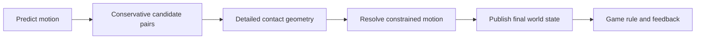
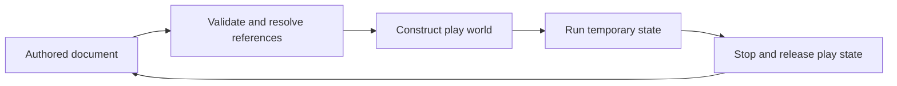

# 42 — From cartridge bytes to a reproducible machine

[[Chapter Edition/03 - Game Engine/00 - Reading Map|Reading map]] · [[Chapter Edition/03 - Game Engine/41 - Evidence, tools, and revisable design|Previous chapter]] · [[Chapter Edition/03 - Game Engine/43 - Compiling renderer intent into backend work|Next chapter]]

A deterministic machine gives each byte meaning through address decoding, state transitions, and timing. This chapter follows an emulator through storage, I/O, replay, files, networking, and rendering while naming each boundary’s evidence.

**By the end:** Trace a stateful system from bytes to reproducible execution and identify what must be serialized or synchronized for replay.

**Recall question:** Which hidden state, input order, or clock must be recorded so that another run reproduces the same machine state?

<!-- Derived from Continuous Notes/Game Engine - From First Frame to Living Worlds.md; source lines 101303–102535; source-span SHA256 0d5668a9156c7f1e8e04d3708764ee1937b220109a963d67bb32bfa35f43cf8f. -->

<!-- CHAPTER-SOURCE-BEGIN -->
# Systems: From Cartridge Bytes to a Reproducible Machine

A saved game state is not just a file, and a functioning emulator is not just a switch statement. The same intellectual task connects a bytecode interpreter, a GPU command stream, an operating-system file, and a remote game server: define an observable machine, preserve its state and ownership, and explain why a given sequence of bytes causes precisely the observed transition.

This new subject volume opens Phase 28, the original 2701–2800 interval, at the real boundary after graphics and engine implementation. It begins with M163–M164 (Parts 2701–2744): CPU/6502 emulation and NES cartridge/PPU/APU timing foundations. Later M165–M168 (OS, file systems, networking, cryptography and trusted low-level systems) belong to the same volume rather than to 56 disconnected notes. Original part numbers remain recorded in [[Supplementary/Foundations#Phase 28 M163–M168 — Parts 2701–2800 deterministic and trusted low-level systems|the coverage ledger]]. The fully documented [[tools/labs/phase28_emulator_core_lab.cpp|CPU/bus reference]] is an executable teaching witness, not a complete NES emulator or a source audit of an existing NESEmulator repository.

## An executable byte acquires meaning only inside a machine

Imagine the user selecting a cartridge image. The file begins with identifying header bytes and some ROM banks. When the emulator is started, the CPU reads an instruction from the address indicated by its program counter. That byte has no meaning by itself: it becomes an instruction only under the chosen instruction-set specification and the device map that determines which memory owns the address. The state-transition view is

$$
S_{t+1}=T(S_t,\mathrm{input}_t).
$$

where the architectural state may contain the accumulator A, index registers X and Y, stack pointer SP, program counter PC, processor flags P, CPU memory, device registers, mapper state, cycle counters, interrupt requests and controller state. Determinism means that *all machine-observable state* plus the same input sequence produces the same observable transition, under a fixed machine implementation. Saving A and PC while omitting the mapper's currently selected ROM bank does not preserve the machine state.

The Nintendo Entertainment System CPU is derived from the 6502 family. A, X, Y, SP and P are 8-bit registers, while PC is 16-bit. A fetch normally reads at PC and advances PC. Decode identifies the instruction and its addressing mode, execution reads or writes operands, updates registers and flags, and assigns timing. A straightforward interpreter can implement this with a switch. A dispatch table can map opcode values to handlers. A generated micro-operation interpreter can model individual bus reads and writes. The implementation style does not guarantee accuracy; the contract is that the resulting effects and timing match the specified CPU variant. In particular, a generic 6502 and the NES Ricoh 2A03 are not interchangeable for decimal arithmetic.

A reset vector is an excellent first test of whether we understand the bus. The CPU constructs PC from the two bytes visible at addresses `$FFFC` and `$FFFD`, low byte first. Those addresses are mapped by the cartridge. On an NROM cartridge with one 16-KiB PRG bank, the bank appears twice in CPU space from `$8000` to `$FFFF`. The reset vector stored near the end of that bank can direct execution to `$8000`. A test that always hard-codes PC=`$8000` could appear to work on a toy ROM while being architecturally wrong for a cartridge whose reset vector points elsewhere.

A stack pointer does not magically reference host language call frames. The 6502 stack lives on CPU page `$0100`–`$01FF` and grows downward as SP changes. Subroutine call JSR stores a return address using the emulated stack and jumps to the callee; RTS pulls the saved address and adds one to resume after the call. This differs from a typical high-level program's description of calling a function. Interrupt entry similarly saves a return context and jumps to an interrupt vector. The saved status byte must respect the 6502-specific break/unused-bit conventions; they are not simply independent physical flags that can be blindly copied.

### Addressing is an algorithm for finding a value, not a suffix

Immediate addressing obtains the operand directly from the instruction stream. Zero-page addressing takes an 8-bit address from the stream and reads at that address within `$0000`–`$00FF`. Absolute addressing combines two operand bytes into a 16-bit little-endian address. Zero-page-indexed addressing adds X or Y with 8-bit wraparound, while absolute-indexed modes add to a 16-bit base and may cross a 256-byte page. Indexed-indirect means the index is applied to a zero-page pointer location *before* fetching the target address. Indirect-indexed obtains the pointer first and adds the index to the fetched address. Confusing these yields a program that may execute correctly for one set of values and fail as soon as a pointer crosses a page.

Relative branches interpret an 8-bit displacement as signed. The displacement is added to PC *after* fetching the branch operand. A taken conditional branch normally adds a cycle over the two-cycle not-taken path, and crossing a 256-byte page adds another. Returning the correct resulting PC is not the whole execution contract when an instruction interacts with a device that changes every cycle. For each opcode, an implementation should record its instruction bytes, addressing mode, conditional cycle penalties, bus reads/writes and changed status bits. A complete cycle-accurate emulator also needs correct ordering of the individual memory accesses; a total-cycle counter is useful but is not sufficient to reproduce all hardware behavior.

### Unsigned carry is not signed overflow

For ADC, let A be the accumulator's original 8-bit unsigned value, M the operand and C the incoming carry bit. Form the full integer sum $u=A+M+C$ and the 8-bit result $r=u\bmod256$. Set carry if $u>255$, zero if $r=0$, and negative from result bit 7. Signed overflow is a different condition: the sum of two same-sign two's-complement operands cannot be represented in the signed 8-bit range. One bitwise expression for overflow is


$$
V= ((\neg(A\oplus M))\mathbin{\&}(A\oplus r)\mathbin{\&}0x80)\ne0.
$$


A=`$7F`, M=`$01`, C=0 produces `$80`: signed overflow V=1, N=1, and unsigned carry C=0. By contrast `$FF`+`$01` produces `$00` with C=1 and Z=1 but V=0. These two independently testable cases prove why a CPU interpreter must not use one generic overflow boolean for both flags. The NES 2A03 does not perform BCD decimal ADC even if the decimal-status bit is set. An apparently minor misunderstanding here breaks arithmetic, conditional branches and some game logic.

The CPU status also includes interrupt disable I and decimal D; B and the always-set status bit have nuanced behavior when a byte is pushed or pulled. Branches read flags generated by earlier instructions. Therefore a bug in a flag update can remain latent until a much later branch, making deterministic instruction traces invaluable. A useful trace row contains old PC, opcode and operands, old/new registers, old/new P, bus side effects and consumed cycles, not just the mnemonic.

## The memory bus is a device router, not one enormous RAM array

An NES CPU address is a request to the bus, and the address decoder decides which hardware responds. The 2 KiB internal RAM occupies `$0000`–`$07FF`, mirrored through `$1FFF`. CPU addresses `$2000`–`$2007` correspond to PPU registers, mirrored across `$2008`–`$3FFF`. Selected APU and controller registers occur around `$4000`–`$4017`, while cartridge-controlled space usually includes `$4020`–`$FFFF` and, on common NROM boards, PRG ROM from `$8000` upward.

This matters because a read can have effects. Reading a controller register can advance its shift position. Reading PPU status can clear or otherwise affect status/latch state under hardware timing rules. Writing a mapper register can change what later CPU ROM reads mean at the same address. Writing `$4014` requests a DMA transfer into PPU sprite OAM; an actual transfer and CPU stall must obey the hardware cycle schedule. Representing every device register as a plain mutable byte array cannot reproduce those observable behaviors.

The reference CPU bus intentionally implements only 2-KiB RAM mirroring, NROM PRG read mapping, a controller serial interface and a simplified OAM copy. Reads from the unimplemented PPU registers return a placeholder; mapper/APU/open-bus behavior is not simulated. This is an explicit boundary, not an accidental omission hidden behind a broad claim of NES support. The CPU code increments total CPU cycles and a notional three PPU dots per CPU cycle. Such a counter can help explain relative timebases, but it cannot itself model device events at each dot.

A controller is itself a small state machine. With strobe asserted, reads return the current first-button state. After the appropriate strobe transition, reads return successive button bits, with defined behavior after the eighth read. An emulator that samples host keyboard state on every CPU read rather than latching at the prescribed event can produce non-deterministic playback even when the recorded button presses were identical.

### An iNES file describes cartridge memory; it is not executable code itself

The iNES header occupies 16 bytes and begins with the bytes `$4E` `$45` `$53` `$1A`. A classic header records PRG ROM size in 16-KiB units, CHR ROM size in 8-KiB units and flags encoding mapper number, mirroring and optional features. A 16-KiB PRG NROM bank mirrors in CPU space; a 32-KiB bank maps directly. CHR size zero commonly selects CHR RAM, not necessarily an error. The mapper determines how cartridge circuitry maps CPU and PPU addresses, including bank switching. NROM or mapper 0 is only the simplest case; a real emulator cannot accept every mapper value and treat it as NROM.

A robust parser first validates the header and supported format, then performs checked size/offset arithmetic before copying or mapping any data. If a trainer is present, its 512 bytes shift subsequent bank offsets. NES 2.0 headers encode some metadata differently from iNES 1.0, and treating one as the other can misinterpret bank size or mapper IDs. The lab deliberately rejects NES 2.0, nonzero mappers and trainers instead of guessing; it supports one or two PRG banks and zero or one CHR bank. That behavior is far preferable to silently loading a malformed image whose pointer arithmetic could exceed the file.

A parser should also distinguish content validation from ROM compatibility. Passing its supported-format checks proves that the byte layout can be interpreted as the selected subset, not that the ROM will execute under the few opcodes the test interpreter understands. The executable test uses a tiny synthetic PRG, sets its reset vector and confirms that `$C000` aliases `$8000` for a one-bank NROM fixture.

## Rendering time is not the same clock as CPU time

The PPU is a separate video-processing machine. Pattern tables supply graphics patterns; nametables refer to tile placements and attribute regions; cartridge mirroring determines how logical nametable addresses map to physical memory. Object attribute memory (OAM) describes sprites. During visible scanlines the PPU fetches background and sprite data in an order that influences pixels and can trigger status conditions. A simplified framebuffer routine cannot reproduce the same mid-frame register effects as a dot-based emulator.

For NTSC operation, a PPU scanline has 341 dots and a nominal frame has 262 scanlines. The PPU runs three dots per CPU clock, but rendering-enabled odd frames have a documented skipped PPU clock. VBlank is a precisely timed condition, and an enabled NMI can arrive near its start. Reads of PPU status near this boundary can produce edge cases that cannot be modeled by sending one event every 16.67 milliseconds from the host application.

Sprite evaluation examines OAM during specific dot windows, selects sprites intersecting the relevant scanline and has behavior such as sprite limits, overflow and sprite-zero interactions. OAM DMA transfers 256 bytes from a CPU memory page and stalls the CPU for a phase-dependent interval commonly described as 513/514 CPU cycles, with further bus arbitration nuance. The test bus copies 256 bytes but does not emulate its stall; the CPU clock counter therefore cannot be used as a real timing reference for OAM DMA. APU channels similarly derive timing from emulated CPU/APU clocks and hardware state. Merely producing audio samples at the host device's sample rate does not emulate those channels.

An accurate PPU/APU is a substantial further implementation project, with visual test ROMs, traces and timing regressions. Nothing in the CPU-only test should imply that a commercial game can render or play audio. The distinction between reference teaching and completed software is part of the curriculum's research discipline.

## Deterministic replay requires an explicit state contract

An emulator save-state is not safe to write by copying the native bytes of a C++ object. A struct may contain padding, references, pointers, compiler-dependent alignment or host-endian values. Restoring those bytes on another executable or after a code change can corrupt state or silently change meaning.

Define a durable format with signature and version, explicit byte order, validated lengths, known field order, device-state versioning and cartridge identity. A snapshot must include **every state element that affects subsequent transitions**: CPU registers, memory, mapper banks, pending interrupt state, PPU timing/latches, APU phases, controller shift position, DMA state and synchronized input history as relevant. Recording only memory and CPU registers is insufficient when the program later touches an omitted device.

The reference laboratory demonstrates a limited but inspectable step. It writes a versioned little-endian sequence containing CPU registers, PC, cycle counters, RAM and OAM. It rejects an invalid version before mutating the target CPU. It saves a state, executes another instruction, restores, repeats the instruction and checks identical PC/cycle behavior. That is reproducibility for the modeled subset; the controller, PPU, APU, mapper and interrupt state are not fully serialized, so the result must **not** be marketed as a general NES save-state implementation.

A higher-integrity replay system would include exact cartridge content hash, emulator implementation version and feature support, a monotonic input-event stream with tick timestamps, deterministic startup state, selected architecture policies, and golden traces. Compare not just the final score or one screenshot but architectural registers, RAM mutations, bus transactions, frame hashes and audio checksums at known boundaries. Most importantly, identify whether differences are expected due to an explicitly different model or are evidence of a bug.

## Reference implementation and evidence gate

The standalone [[tools/labs/phase28_emulator_core_lab.cpp|C++20 machine oracle]] executes selected instructions (LDA, ADC, STA, INX, conditional BNE, CLC/SEC, CMP, JMP, JSR, RTS and NOP), reads the reset vector, tracks nominal instruction cycle costs, tests arithmetic flags, mirrors RAM/PRG, decodes a small iNES NROM fixture, latches/shifts controller input, copies a simple OAM page and serializes a narrow versioned snapshot. It is automatically picked up by the existing C++20 multi-compiler laboratory CI because its filename ends in _lab.cpp. Tests use active throwing checks, so GCC optimized -DNDEBUG does not silently disable them.

What it does **not** implement is equally important: most 6502 opcodes, interrupt entry/RTI, precise bus-cycle sequencing, other mapper types, PPU rendering, accurate sprite evaluation, APU generation, DMA stalls, open-bus electrical behavior, full save-state completeness or commercial ROM compatibility. The original curriculum references the user's NESEmulator sources; that external repository has not been fetched or audited here.

For authoritative technical distinctions, the original source route is [NESdev CPU memory map](https://www.nesdev.org/wiki/CPU_memory_map), [CPU addressing modes](https://www.nesdev.org/wiki/Addressing_modes), [status flags](https://www.nesdev.org/wiki/Status_flag), [iNES format](https://www.nesdev.org/wiki/INES), [PPU frame timing](https://www.nesdev.org/wiki/PPU_frame_timing) and [PPU sprite evaluation](https://www.nesdev.org/wiki/PPU_sprite_evaluation). This chapter records them as current documentary references, not a claim that their every example was reproduced in code. The next systems chapters extend this same state-and-byte contract to OS files, networks and security. Their existence is not silently inferred from the first emulator laboratory.


## From a deterministic emulator state to an operating-system file

The CPU program can now produce a versioned snapshot. To retain the snapshot after the interpreter exits, we must make a stronger promise: bytes become durable state even if a process terminates during writing. This continues the exact same problem rather than introducing an unrelated operating-systems glossary.

A process runs in its own virtual address space and operating-system resource context. Threads in the same process share that address space but each has its own execution stack and scheduling state. A system call crosses the user/kernel boundary to request services such as opening a file or allocating mappings. A file descriptor is a process-local reference to an open file description or resource, not a universal stable identity for a pathname. Duplicated descriptors may share file offsets; two separate opens of a path need not. Closing a descriptor releases that process reference but does not necessarily remove the named file or invalidate another process's open descriptor.

Suppose our emulator snapshot is 2,324 bytes. A low-level write may transfer fewer bytes than requested. Repeating a write operation requires accounting for how many were actually consumed, with explicit treatment of interrupted calls, zero progress, errors and cancellation. Buffered standard-library streams may accumulate bytes before sending them to the kernel; unbuffered system calls can reduce intermediate buffering but increase syscall count. Neither the presence of a buffer nor the successful return of a single write guarantees that the bytes survive sudden power loss.

Random access involves an explicit offset. A seek changes the offset used for subsequent reads/writes on certain open-file descriptions; positional I/O can name the offset per operation. File offsets and file size must be checked in types wide enough to represent the full range. Memory mapping connects a file region to process virtual memory. It can avoid an explicit copy but introduces page-fault costs, alignment requirements, mapping lifetime and risks when files are truncated or replaced. An mmap view is borrowed and must not be mistaken for an owning vector; dereferencing it after unmapping is invalid. A mapped file should not be written by arbitrary raw pointer mutation if the application assumes transactional semantics.

For a published save state, use a temporary file in the target filesystem and an explicit **commit point**. Prepare and validate the entire versioned state first; open a unique temporary path with collision-safe creation and appropriate permissions; write and handle partial writes; flush user buffers; synchronize file content if required; close or otherwise establish the chosen durability preconditions; atomically rename/replace in the supported filesystem; and, on systems that require it for crash durability, synchronize the containing directory. Atomic rename provides a visibility property under particular filesystems. It is not automatically equivalent to durable persistence after power loss.

A loader should read a completed file, never a partially published temporary. It verifies magic, format version, declared lengths and integrity before mutating the live world. If parsing fails, keep the current world unchanged. The same transactional publication idea appeared in the C++ asset registry: prepare before changing the visible owner. Here the failure boundary is a crash, not just a thrown exception.

Directory traversal is another trust boundary. A save or archive that includes paths such as parent-directory components cannot be allowed to escape a designated root. String prefix comparisons alone are insufficient when symlinks, case folding, canonicalization and concurrent filesystem changes exist. Directory-relative, handle-based operations and appropriate no-follow policies can reduce race windows, but must be matched to the target OS. File locks can coordinate cooperating writers yet may be advisory and have filesystem-specific rules; they are not a substitute for atomic publication.

This section develops Parts 2745–2755, including processes, threads, system calls, descriptors, buffered/unbuffered I/O, mmap, offsets, directory traversal, atomic rename, temporary publication and locking. No filesystem fault injection has been executed in the CPU emulator lab, so these are architectural, specification-grounded teaching claims awaiting an independent OS laboratory.

## From a file to a message on an unreliable network

A remote editor or emulator cannot transmit a pointer to its local C++ object and expect it to identify equivalent memory on another machine. It must serialize a message with a precisely stated binary format. An IP address identifies a network-layer endpoint; a transport port identifies a service endpoint within the host's networking stack. A socket is a process-facing interface whose lifetime and errors are managed separately from any application messages.

A UDP send produces a datagram, preserving a message boundary in the receiving interface, but UDP provides no general guarantee that the packet is delivered exactly once, in order or at all. Packet loss, duplication, delay and reordering must be considered if the application wants ordered reliable state updates. TCP provides an ordered reliable byte stream while the connection remains healthy; it does not preserve application message boundaries. One send of 1,000 bytes may arrive through several reads, and multiple sends may be coalesced into one read.

A practical protocol therefore defines its own framing. For example, a frame could contain a four-byte big-endian payload length followed by a versioned message body. The receiver reads the entire length field, validates the bound before allocating memory, and then repeatedly reads until the declared body length has arrived or the stream fails. Never trust an attacker-controlled length that could overflow arithmetic or allocate gigabytes. Declare the maximum frame size, permitted message types, byte order, header validation, deadline and cancellation semantics. A disconnected peer in the middle of a frame is not a valid empty message.

Network byte order conventionally means big-endian for the relevant transport header fields; application formats must still declare their own endianness. Packet serialization must avoid copying host struct padding or raw pointers. A transport checksum can detect certain accidental corruption but does not authenticate the sender or prevent an attacker from altering data and recomputing the checksum. Any integrity and authenticity requirement must be addressed separately.

Latency and bandwidth measure different things. For payload size B and sustainable throughput R, B/R is a lower-bound transfer component, while round-trip delay, queueing, flow control, sender/receiver CPU work and serialization all contribute. A 1-KiB control message can feel slow on a high-bandwidth network if it must wait for multiple round trips. A giant snapshot can take substantial transfer time on a low-bandwidth connection despite low propagation latency. Benchmark end-to-end response under representative network conditions, not just a link's nominal speed.

When networking an interactive simulation, the client may predict local motion to hide round-trip delay. The server's authoritative state can later differ from the client's prediction. Reconciliation requires a common tick counter, acknowledgment of processed inputs, a retained input history, restoration of the authoritative state and replay of unacknowledged inputs. Physics solver ordering, floating-point modes, source revisions and time step become visible networking design choices. Smooth visual interpolation can hide corrections, but cannot make inconsistent state transitions mathematically identical.

Parts 2756–2770 therefore emerge from the need to transfer and reconcile an emulator or world snapshot. There is no tested socket, UDP-loss harness or TCP partial-read implementation in the current lab; those have been authored as contracts, not certified as completed network code.

## From received bytes to a trust decision

Once a remote peer sends a snapshot, parser validity alone is insufficient. We must answer whether the bytes were altered, whether the sender is authorized, whether the snapshot may be replayed, and whether the application should expose its contents. Cryptography helps with some of these questions, but secure system design also depends on identities, access policies and key custody.

A cryptographic hash deterministically maps an input byte sequence to a fixed-length digest. SHA-256 produces 256 bits, but different security properties should not be collapsed into one vague 'secure hash' label. **Preimage resistance** concerns finding an input for a given digest, **second-preimage resistance** concerns finding another message matching a given message's digest, and **collision resistance** concerns finding any pair of messages with the same digest. A random accidental collision estimate is not itself a proof against a targeted cryptanalytic attack. A bare SHA-256 checksum of a downloaded file does not authenticate the file if an attacker can replace both the file and its expected checksum.

An HMAC uses a secret key with an underlying hash to authenticate a message. It does not hide message contents. A key derivation function turns suitable initial key material into new keys for defined purposes. HKDF, specified by RFC 5869, separates an extract stage from an expand stage. Given input key material IKM and a salt, it derives PRK using HMAC. To expand, it generates blocks

$$
\begin{aligned}
T(0)&=\epsilon,\\
T(i)&=\operatorname{HMAC}_{\mathrm{PRK}}
\bigl(T(i-1)\parallel\mathrm{info}\parallel\operatorname{byte}(i)\bigr).
\end{aligned}
$$

then concatenates blocks until reaching the requested length. Here epsilon denotes the empty byte string, and byte(i) is one counter octet for i from 1 through 255, not the decimal text of i. RFC 5869 limits the requested output to 255 times the hash-output length in bytes. [HKDF expansion specification](https://www.rfc-editor.org/rfc/rfc5869.html#section-2.3). The information string helps separate cryptographic contexts, so a key intended for snapshot authentication need not coincide with one intended for a different protocol purpose. This is not a substitute for a password-hardening KDF or sufficient entropy in initial key material.

A symmetric encryption key protects confidentiality under an appropriate scheme. AES is a block cipher, while GCM defines authenticated encryption using counter-mode encryption and a polynomial tag. An AES-GCM application must ensure nonce uniqueness for a given key, validate authentication tags and apply the associated authenticated data (AAD) consistently. Reusing the same nonce under the same GCM key can expose relationships between plaintexts and undermine authenticity. A process-local nonce counter reset to zero at every restart is unsafe unless rekeying and global uniqueness are properly designed. AAD can authenticate metadata such as protocol version, message type or resource identifier even when those fields are not encrypted.

Authenticated decryption must not be turned into 'decrypt, parse, execute, then check the tag.' The appropriate API's authentication success must be established before untrusted plaintext is treated as authoritative. Error paths must not disclose keys or sensitive payloads in logs, and nonce/key lifecycle must survive crashes. Established cryptographic libraries and protocols are required; writing a fresh AES-GCM algorithm inside an educational game-engine repository would create unnecessary security risk.

Public-key methods solve different problems. A verified signature can authenticate a message relative to a trusted public key; key exchange can establish shared secrets to feed through a KDF; public-key encryption can provide confidentiality under a recipient's key. None automatically proves that the public key itself belongs to the claimed person. Trust establishment, certificate identity, revocation, replay prevention and authorization remain separate.

A Shamir secret-sharing threshold scheme places a secret s as the constant term in a random degree-(t−1) polynomial over a finite field:

$$
f(x)=s+a_1x+\cdots+a_{t-1}x^{t-1}\pmod p.
$$

Each share is a distinct pair (x_i,f(x_i)). Any t valid shares can reconstruct s by polynomial interpolation; under the ideal model fewer than t reveal no information about the secret. This requires secure random coefficients, distinct nonzero x values, a suitable field and correct encoding. Authentication of shares and handling of dishonest participants are additional system concerns. Floating-point polynomial fitting is not a substitute for finite-field threshold cryptography.

A Merkle tree recursively hashes encoded leaves and internal nodes to commit to a set or ordered sequence of records. An inclusion proof contains the necessary sibling hashes and left/right positions to recompute the root. Verifying the proof establishes membership *relative to a trusted root*, not that the root was issued by the right authority, is current, or contains truthful records. Append-only audit logs need further protection against rollback and split-view attacks.

A token vault maps sensitive values to surrogates under explicit authorization and retention policies. Format-preserving encryption retains syntactic structure under its own security assumptions but can leak structural information through permitted domains. Redaction must propagate through all views and storage that expose the sensitive value; hiding characters in a UI while retaining the value in logs or search indexes is not comprehensive redaction. A trust engine can return allow, redact or deny with an auditable reason, a default policy and a clear identity boundary.

The last interface is often between implementation languages. Rust-to-Python FFI through PyO3 changes who may borrow memory, which interpreter state must be held, how errors cross the boundary and whether a panic may unwind through foreign code. A Rust raw pointer crossing into Python or C++ does not automatically inherit Rust's ordinary borrow-checker protections. Define allocation/free responsibility, string encoding, object lifetime, thread rules and exception conversion. A Python wrapper can be memory-safe on its own side while still calling a native library after the referenced buffer has been freed.

Security threat modeling ties the pieces together. Identify attackers, assets, entry points and trust boundaries. A correct cryptographic primitive does not prevent arbitrary path traversal, bad access control, unsafe plugin loading, unbounded allocation, replayed authorization or accidental logging of secrets. Conversely, a safe parser does not by itself authenticate a received packet.

Parts 2771–2800 cover SHA-256/HMAC/HKDF, AES/GCM and nonce discipline, public keys, Shamir shares, Merkle proofs, tokenization, FFI, trust policy and a deterministic low-level-systems capstone. **Their present state is fully connected authored explanation, not a tested encryption engine or a security certification.** The CPU-only C++ lab does not claim those operations were executed.


---

# XR inside an engine — runtime ownership, frame pacing and hybrid rendering

XR becomes an engine topic when perception acquires object lifetime, GPU queues, platform APIs, asset ownership and testable subsystem boundaries.

## OpenXR belongs in the platform layer

The OpenXR application/runtime boundary maps naturally to an engine module that owns instance/system/session lifetime, reference spaces, action sets, swapchains, extension negotiation and frame submission. Higher layers should consume semantic services such as left-hand grip pose or predicted view set rather than raw vendor handles.

Do not render merely because the game loop wants another frame. Render because the runtime scheduled one. Predicted display time becomes a first-class clock used by view location, simulation interpolation and rendering.

## Build around view families, not two hard-coded eyes

A runtime may request two views, four views or asymmetric view configurations. Varjo quad views are a concrete example.

Represent each view as data:

\[
V_i=\{\text{pose},\text{projection},\text{viewport},
\text{color},\text{depth},\text{quality policy}\}.
\]

The render graph can share view-independent work and instance view-dependent work when the backend supports multiview.

## Late update needs an ownership boundary

Tracking continues while simulation and rendering proceed. Some data can be updated late, such as view constants or head-relative UI, but authoritative gameplay state cannot be rewritten after physics and gameplay already consumed it.

Separate authoritative simulation state, predicted render state and compositor correction.

## Submitted depth is a contract

Depth can support positional reprojection, composition and MR occlusion only if near/far conventions, depth range, projection and pose match. Treat color, depth, pose and projection as one submission record.

## Foveation needs a policy layer above VRS

Compute a desired quality field from gaze, uncertainty, motion and content, then translate it to Vulkan fragment shading rate, Metal rasterization-rate maps, runtime foveation, quad views, dynamic resolution or a software fallback.

Record gaze timestamp, predicted gaze, confidence, angular radii, requested shading rates, safety margin, fallback state and frame ID. Without that provenance an artifact cannot be assigned to gaze prediction, mapping or GPU mechanism.

## Mixed reality needs an explicit composition graph

Distinguish real-world color, real depth, static spatial mesh, dynamic person/object masks, virtual opaque geometry, virtual transparent layers and UI.

A spatial mesh updated slowly must not be treated as live per-pixel depth. Composition rules must say which source owns occlusion and what happens when it is stale.

## Hands and anchors need state machines

A hand skeleton is not an always-valid animation rig. States such as absent, acquired, tracked, low-confidence and lost prevent noisy joints from entering physics blindly.

Anchors need identity and relocalization semantics: existing-but-unlocalized, localized with confidence, refined after loop closure, expired or deleted. Identity should survive pose updates.

## XR audio should share the transform graph

World-stable sound uses the same world/head transform semantics as visual content. A separate inconsistent pose path can make supposedly fixed sound rotate with the head.

## Neural graphics should enter the engine through capability contracts

A captured-scene backend might use triangles, voxels, NeRF-like fields, Gaussian splats or hybrids. Its interface should state whether it can provide depth, normals, relighting, local editing, secondary rays, deformation, stable picking IDs, memory footprint and update/render latency.

This prevents treating a view synthesizer as automatically equivalent to a game-world asset.

A robust interactive architecture often keeps explicit geometry for collision, navigation, anchors and near-field interaction while learned or Gaussian representations supply captured appearance. The hard problem is authority: which representation owns depth, normals, collision and edits.

## Neural shading is a shader-system problem

A neural material needs weight/model versioning, tensor layout and precision, device capability checks, fallback material, LOD behavior, residency policy, profiling hooks and validation against a reference path.

A network executing in a shader is not an external AI service. It is code with memory traffic, register pressure, precision constraints and scheduling cost.

## Python should own offline automation and research tooling

Blender Python, NumPy, pandas, PyTorch and scientific tooling are excellent for asset processing, reconstruction, training, result analysis and plotting. Keep the latency-critical runtime in compiled/native paths unless embedded scripting is explicitly required.

A clean boundary is native runtime plus Python tooling plus stable file/CLI/FFI contracts. Test malformed inputs, version skew, shape mismatch, NaNs and partial outputs at that boundary.

## An XR benchmark harness should replay time

A trace can contain

\[
(timestamp,\ head\ pose,\ gaze,\ input,\ view\ config,\ scene\ event).
\]

Replay under a controlled clock should measure predicted-versus-truth pose error, gaze error in degrees, fovea miss rate, CPU/GPU stage durations, frame misses/reprojection mode, image metrics and memory/bandwidth counters when available.

Software replay validates algorithms and repeatability. Physical HMD tests validate optical, sensor and real hardware behavior. Do not collapse those evidence levels.


## Remote XR turns frame pacing into a networked control problem

Cloud rendering moves some or all graphics work to a remote GPU, encodes the resulting views, sends them across a network, decodes them on the client and still has to react to current head and input state.

The end-to-end motion-to-photon path becomes roughly

\[
T =
T_{sensor}
+T_{uplink}
+T_{server}
+T_{encode}
+T_{network}
+T_{decode}
+T_{client-compose}
+T_{scanout}.
\]

These terms overlap in real pipelines, so the equation is an accounting model rather than a claim that every stage runs strictly serially. It is still valuable because moving rendering to a server adds latency and jitter sources that a local engine does not have.

NVIDIA CloudXR 6.x is one current example. Its 2026 runtime is OpenXR-facing on the server side and streams head/controller/hand state from clients while returning encoded visual output. Current releases expose network latency and packet-loss reporting, adaptive bitrate/foveated streaming, WebRTC paths, hand input and haptics.

A remote-XR engine therefore needs more than a conventional video streamer:

- pose prediction must account for network delay;
- bitrate and resolution changes must not destabilize the foveal region;
- packet loss can create age-of-information spikes rather than merely lower visual quality;
- input and haptics travel in the opposite direction from video;
- encoder queues can add hidden latency even when GPU rendering is fast;
- the client compositor may still need late reprojection using a newer pose than the server saw.

This also changes benchmarking. Report not only server render time but glass-to-glass latency, pose age, encode/decode time, packet loss, bitrate, frame drops, reprojection rate and tail latency. A 10 ms average network delay with 80 ms spikes is a different XR experience from a stable 15 ms path.

## WebXR and platform runtimes are different deployment layers

OpenXR standardizes native application-to-runtime interaction across many XR systems. WebXR exposes immersive devices to web applications through browser security and lifecycle rules. Cloud streaming can place an OpenXR application on the server while a browser/WebXR client acts as the device endpoint.

These layers should not be collapsed into one abstraction. The engine's portable spatial concepts can be shared, but session creation, graphics binding, permission model, input exposure and compositor ownership differ.


## The deterministic system capstone and its evidence boundary

The conceptual capstone is a single pipeline: a validated cartridge file enters a deterministic CPU interpreter; a complete versioned state snapshot is constructed; a temporary filesystem object is atomically published with an explicitly chosen crash-durability contract; the state is length-framed for transport; received bytes are authenticated and authorized; a trusted snapshot is restored; and time-stamped input is replayed to reproduce the same program behavior. Any stage can fail, and the complete application must preserve the previous valid state or report a safe, diagnosable error.

For the moment, only the CPU/iNES subset of that system has an executable witness. A complete implementation additionally requires an OS fault-injection lab, socket framing/partial-I/O tests, vetted crypto-library known-answer and tamper tests, nonce persistence tests, Rust/Python FFI ownership tests, and threat-model review. Real NESEmulator, ReliQuary and Memory Retrieval Cue code have not been inspected in this pass, regardless of paths named in the curriculum.

The relevant primary-source routes are the platform's POSIX/Windows syscall specifications for file durability, TCP/UDP and IP RFCs for transport semantics, RFC 5869 for HKDF, and NIST SP 800-38D for authenticated GCM. This narrative is original teaching informed by those standards; no claim is made to have implemented a secure network/cryptographic stack. The source/coverage ledger explicitly separates these narrative entries from the running emulator oracle.


## Reconstruct the working loop and test its contracts

The complete small program below gives several of these ideas one inspectable executable. Then use the milestone sequences as reconstruction exercises rather than a mandate to copy a single engine.

### Rebuild the idea in a small executable laboratory

The following original C++20 program isolates four contracts: constant simulation ticks, presentation interpolation, generation-checked identity, and deferred removal. It deliberately uses a tiny fixed-capacity one-dimensional world so a reader can inspect every transition. It is a runnable teaching model, not a windowed renderer or a complete engine.

Two different partitions of one real second produce sixty simulation ticks and the same final position in this model. That test does not establish cross-platform bitwise determinism for a complete physics engine. The overload policy discards time and reports it; use a different policy when the application's timeline cannot permit that loss. The slot-retirement guard avoids generation wrap, while ordinary tests exercise stale-handle rejection after reuse.

```cpp
#include <algorithm>
#include <array>
#include <cassert>
#include <cmath>
#include <cstdint>
#include <iostream>
#include <limits>
#include <optional>
#include <stdexcept>
#include <vector>

struct Handle {
    std::size_t slot;
    std::uint32_t generation;
};

struct Body {
    double previous = 0.0;
    double position = 0.0;
    double velocity = 1.0;
};

class World {
    struct Slot {
        Body body{};
        std::uint32_t generation = 1;
        bool alive = false;
        bool retired = false;
    };
    std::array<Slot, 4> slots_{};
    std::vector<Handle> removals_;

public:
    std::optional<Handle> create(Body body) {
        for (std::size_t i = 0; i < slots_.size(); ++i) {
            auto& s = slots_[i];
            if (!s.alive && !s.retired) {
                s.body = body;
                s.alive = true;
                return Handle{i, s.generation};
            }
        }
        return std::nullopt;
    }

    Body* get(Handle h) {
        if (h.slot >= slots_.size()) return nullptr;
        auto& s = slots_[h.slot];
        return s.alive && s.generation == h.generation ? &s.body : nullptr;
    }

    void request_remove(Handle h) { removals_.push_back(h); }

    void step(double dt) {
        for (auto& s : slots_) {
            if (!s.alive) continue;
            s.body.previous = s.body.position;
            s.body.position += s.body.velocity * dt;
        }
        // Structural changes occur after the iteration, at an agreed boundary.
        for (auto h : removals_) {
            if (!get(h)) continue;
            auto& s = slots_[h.slot];
            s.alive = false;
            if (s.generation == std::numeric_limits<std::uint32_t>::max()) {
                s.retired = true; // Never wrap into an old valid generation.
            } else {
                ++s.generation;
            }
        }
        removals_.clear();
    }
};

class Clock {
    double pending_ = 0.0;
    static constexpr double fixed_ = 1.0 / 60.0;
public:
    std::uint64_t ticks = 0;
    double discarded = 0.0;

    template<class Step>
    void advance(double wall_dt, Step step) {
        if (!std::isfinite(wall_dt) || wall_dt < 0.0)
            throw std::invalid_argument("invalid frame duration");
        const double accepted = std::min(wall_dt, 0.25);
        discarded += wall_dt - accepted;
        pending_ += accepted;
        unsigned work = 0;
        while (pending_ + 1e-12 >= fixed_ && work < 8) {
            step(fixed_);
            pending_ = std::max(0.0, pending_ - fixed_);
            ++ticks;
            ++work;
        }
        if (pending_ + 1e-12 >= fixed_) {
            const auto skipped = std::floor((pending_ + 1e-12) / fixed_);
            const auto amount = skipped * fixed_;
            discarded += amount;
            pending_ = std::max(0.0, pending_ - amount);
        }
    }

    double alpha() const { return std::clamp(pending_ / fixed_, 0.0, 1.0); }
};

double rendered_position(const Body& body, double alpha) {
    return body.previous * (1.0 - alpha) + body.position * alpha;
}

bool near(double a, double b) { return std::abs(a - b) < 1e-9; }

int main() {
    World first, second;
    auto a = first.create({0, 0, 2});
    auto b = second.create({0, 0, 2});
    assert(a && b);
    Clock c1, c2;
    for (int i = 0; i < 60; ++i)
        c1.advance(1.0 / 60.0, [&](double dt) { first.step(dt); });
    for (int i = 0; i < 10; ++i)
        c2.advance(0.1, [&](double dt) { second.step(dt); });
    assert(c1.ticks == 60 && c2.ticks == 60);
    assert(near(first.get(*a)->position, second.get(*b)->position));
    assert(near(first.get(*a)->position, 2.0));
    assert(near(rendered_position(*first.get(*a), 0.5), 2.0 - 1.0 / 60.0));

    first.request_remove(*a);
    first.request_remove(*a); // Duplicate removal is harmless in this model.
    first.step(0.0);
    assert(first.get(*a) == nullptr);
    auto replacement = first.create({10, 10, 0});
    assert(replacement && replacement->slot == a->slot);
    assert(replacement->generation != a->generation);
    assert(first.get(*a) == nullptr && first.get(*replacement));
    assert(first.get({999, 1}) == nullptr);
    for (int i = 0; i < 3; ++i) assert(first.create({0, 0, 0}));
    assert(!first.create({0, 0, 0}));

    Clock overloaded;
    overloaded.advance(1.0, [](double) {});
    assert(overloaded.ticks == 8);
    assert(overloaded.discarded > 0.8);
    assert(overloaded.alpha() >= 0.0 && overloaded.alpha() <= 1.0);
    bool rejected = false;
    try {
        overloaded.advance(std::numeric_limits<double>::quiet_NaN(), [](double) {});
    } catch (const std::invalid_argument&) { rejected = true; }
    assert(rejected);
    std::cout << "PASS: time partition, interpolation, stale handles, deferred removal, capacity, overload, invalid duration\n";
}
```

Compile with `clang++ -std=c++20 -Wall -Wextra -Wpedantic -Werror runtime_lab.cpp -o runtime_lab`, then run `./runtime_lab`. The same saved body was also built and run with Apple Clang 21.0.0 using AddressSanitizer and UndefinedBehaviorSanitizer. Those instrument this CPU model; they do not validate GPU synchronization, a platform window, multithreaded access, or audio deadlines.

**Reconstruction exercises:** change the accepted frame interval and demonstrate its effect on overload; request deletion from within a simulated interaction and verify that it is applied at the safe boundary; add a second component while preserving identity; attempt a save/reload format using stable IDs rather than raw pointers; and specify a deterministic input-to-tick assignment. Each exercise should retain a test that fails when its contract is violated.

### Iterate through narrow, testable milestones

The series’ progression is strongest when each stage creates a checkable result: platform build, logged startup, window and input, clear screen, triangle, textured geometry, material, camera movement, scene load. A milestone should state what it proves and what it does not. “The screen clears” proves a working path through device, swapchain and submission for the exercised setup; it does not prove that resize, multiple frames in flight, all drivers or asset loading work. “A texture renders” proves one image and binding path; it does not prove a general importer or hot reload.

When a step fails, reduce variables. First confirm the build. Then confirm platform startup and logging. Then validate the API object chain. Then check the immediate resource contract. Use API validation and engine logs. Avoid simultaneously rewriting the renderer, allocator and scene model during a bug fix. The separate buffer correction episode is an example of making a focused follow-up once users identify a reproducible issue.

The present repository retrospective also gives an honest view of refactoring: the engine has usable features and stable cross-platform support, but its authors still identify scene, resource, rendergraph and legacy systems for redesign or removal. A durable engine is not one whose first architecture is perfect. It is one where boundaries make it possible to change a system without rewriting every caller, where ownership is explicit enough to find leaks and stale references, and where a known-good result can be re-established after each change.

The broad principle is to keep the next abstraction close to the demonstrated need. Use a platform interface because the operating systems differ. Use normalized input because gameplay should not consume native key codes. Use specialized allocators because lifetimes and alignment differ. Use a renderer frontend because game code should not speak directly to one graphics API. Use an asset system because files, imports, runtime resources and reloads have different jobs. Revisit each abstraction when the maintenance cost becomes visible. Kohi’s own retrospective models that willingness to revise.

### A compact study sequence for readers implementing their own engine

A learner can reproduce the dependency logic without copying every feature. First create a cross-platform build that logs startup and shutdown. Add a window and close event. Normalize one key and prove one press/release transition. Add a main loop with a measured delta time. Initialize one graphics backend and clear the screen. Add one triangle, then a transform and a camera. Add an indexed mesh, one texture and a simple material. Add an explicit resource lifetime. Only after these paths are stable should a larger scene loader, editor, asynchronous asset pipeline or rendergraph be considered.

At every checkpoint, write down the contract in plain language. “The platform layer reports a close request as an engine event.” “The renderer frontend accepts a mesh and material without exposing Vulkan types.” “A texture request either returns a ready resource or a result that will later become ready.” “The scene releases its resource references on unload.” If the contract cannot be stated simply, the implementation likely has unclear ownership or hidden states.

Keep a small set of diagnostics visible while learning: startup logs, API validation, resource names, allocation failures and frame timing. A frame timer tells how long one update/render iteration takes, but it should be interpreted carefully. A long frame may come from CPU work, GPU waiting, asset I/O, shader compilation or a synchronization stall. Measurement is a prompt to isolate, not proof of a cause.

Prefer adding one layer at a time. A platform-specific input path can be verified before introducing an action mapping editor. A Vulkan buffer upload can be verified before making a general resource manager. A scene file can be loaded synchronously before adding hot reload. This does not mean the simple design must remain forever; it means the more complex design is introduced with a working baseline and an explicit reason.

The series’ videos and later code show a real engine changing over time. Some decisions in the early tutorial are teaching scaffolds; later livestreams revisit, extend or replace them. That temporal quality matters. Treat a tutorial episode as evidence of what was built and taught at that point, and treat the current repository as evidence of a later code state. Do not silently combine both into a fictional single snapshot. When a later revision changes an API, document the revision and reason.

### A step-by-step build order for a small Hazel-like engine

The following sequence collects the architecture into one continuous implementation path. It is not a claim that every detail follows the exact release order of every video. It is a design-led order grounded in the reviewed opening episodes and public code structures.

#### Step 1: Establish a reproducible project

Create a repository, document the compiler and generator version, define the engine library and one client application, and verify a clean checkout can build. Keep third-party dependencies visible and record how they are obtained. Add a basic log before the system grows. The goal is a repeatable empty application, not a sophisticated installer.

#### Step 2: Own the window and application lifetime

Create a window through an interface so platform-specific details are contained. Give the application one clear owner for startup, run, close, and shutdown. Install the native event callback once. At this point, the program should open, remain responsive, and exit cleanly.

#### Step 3: Create a timestep loop

Measure elapsed time, pass it as a timestep to update code, and make minimized behavior explicit. Document whether simulation is variable-step or fixed-step. Add a simple test behavior that moves at a known rate, so the timing convention is visible.

#### Step 4: Add typed events and propagation

Start with close, resize, key, and mouse events. Give each event a concrete payload and a stable category. Decide whether dispatch is immediate or queued. Specify what the handled flag means. Test that a UI overlay can consume a key while an unhandled event reaches the game layer.

#### Step 5: Add layers for lifecycle-managed features

Create one game layer, one UI/editor overlay, and one diagnostic overlay. Define ownership and attach/detach callbacks. Keep independent services outside the layer stack when their lifecycle does not fit it. Make event order and rendering order agree.

#### Step 6: Draw a triangle, then a sprite

Initialize a graphics context and clear the window. Build a small backend abstraction around only the operations the client uses. Draw a triangle with explicit vertex layout, then draw a textured quad with a camera and transform. Keep the initial backend singular and well tested before promising portability.

#### Step 7: Turn game objects into scene data

Introduce entity handles and components. Add stable scene IDs separately from registry handles. Implement create, destroy, duplicate, and query operations. Keep component defaults explicit. Use a few systems—rendering, camera, and perhaps simple movement—to demonstrate how composition works.

#### Step 8: Make the scene editable

Add a hierarchy panel, inspector, viewport, and content browser. Connect each visible control to real scene or project state. Implement selection, resize-aware camera projection, and scene saving. Avoid accepting UI mockups as completed interaction.

#### Step 9: Separate authoring and runtime

Copy or otherwise isolate authored scene state before Play. Define edit, simulation, runtime, pause, and step behavior. Add a clean stop path that restores the editor’s view. Make source-scene saves explicit and keep player save data separate.

#### Step 10: Add assets, scripting, and physics as independent integrations

Use stable asset references and reproducible import steps. Add a small scripting boundary with explicit handles and diagnostics. Integrate 2D physics through components and define transform authority and update timing. Test each system through a representative scene rather than only compiling its classes.

#### Step 11: Add compatibility and performance work when the project demands it

Version serialized data, add migrations when schemas change, and test round trips. Profile representative scenes before optimizing. Consider extra render backends, 3D, audio, networking, or job scheduling when a real game or user needs them. Record what is implemented, what is planned, and what is still private or unavailable.


## Source map, remaining reading, and future additions

This volume will keep growing in this same file. New curriculum lessons should supply a source/part record, then deepen the relevant explanation, example, code, or failure case. Link a new concept to its actual explanation; do not leave essential definitions for an unrelated future lesson. The detailed per-video and per-book ledger is [[Supplementary/Game Engine - Sources and Coverage]].

### Evidence boundary and route through the material

This source study uses the acquired English captions for selected episodes of Travis Vroman’s Kohi Game Engine series and the public Kohi source tree at revision `05a5193d5ed4890703cfcbbeb5c5e947feefecf6` (GitHub `main`, retrieved 2026-11-05). Caption acquisition was partial: the first batch produced 49 files before HTTP 429, a later en-only probe succeeded, and the resumed batch added files before 429 recurred. The initial pass had 85 retrieved files; the per-video ledger records exact counts and review state. Current exact counts and per-video states are in the merged `work/source-audit.json`; channel-local status files retain earlier snapshots. The video inventory records 426 selected unique engine-building videos across the Kohi tutorial, Kohi implementation streams/devlogs and TypeScript Engine series, with channel-feed metadata for 573 unique IDs total. Do not read this as full transcript coverage. Captions are evidence for the videos linked below; the repository and retrospective are separate primary evidence about the later project. The code archive transfer itself truncated, but the root roadmap, retrospective and relevant source files were available. This is a source-led teaching narrative, not a transcript replacement.

The useful organizing question is not “what subsystem comes next?” but “what concrete failure or missing capability forces the next boundary?” A window cannot be opened without platform calls; input cannot be reasoned about if the platform’s key codes leak into gameplay; a renderer cannot be swapped if game code speaks Vulkan directly; a texture cannot be sampled until the application has a repeatable route from file to image, image to GPU memory, and image to shader binding. The sequence below follows those dependencies.

#### What a one-prompt engine demo can and cannot prove

The AI-engine experiment asks two models to build a cross-platform 3D engine from one short brief. That brief names a technology stack and desired capabilities, including an editor, runtime export, scripting, physics, glTF assets, and AI-controllable authoring. The models choose different names and work for very different durations. The narrator then walks through visible UI behavior and a few sample games.

The captions support a narrow account of that demonstration: Forge shows an editor/runtime, a 3D scene, some lighting and physics, and an export smoke test, while several controls are missing or ineffective. Basalt is shown with a fuller editor, asset browser, undo/redo, scripting properties, physics, audio, particles, and sample Tetris/Marble Run scenes. The narrator reports a passing Marble Run export smoke test.

This is not a code review or a controlled benchmark. The narrator explicitly says source quality, provenance, and production readiness need review, and notes that existing code and training examples may have contributed. The runs differ in duration, usage, and configuration. Describe the visible demo and reported smoke tests; do not generalize them into proof of production quality, broad test coverage, or comparative model capability.
#### Separate implementation evidence from design discussion

Several sources mix a working change with an idea for later. The layer episode describes groups and a future transform stack; the font episode leaves default-font and missing-size behavior open while developing a manager; the physics simulation episode shows an editor-camera simulation mode, then fixes state transitions and update wiring; and the maintenance episode reports file-read timing from a small local workload rather than a general performance law. Preserve these distinctions when learning from a tutorial: an observed build, a demonstrated interaction, a proposed architecture, and a measured result are different kinds of evidence. [Layers, 00:06:20–00:09:21; fonts, 00:22:12–00:32:09; Physics Simulation Mode, 00:03:16–00:16:21 and 00:29:48–00:35:00; maintenance, 00:14:45–00:18:01]

The setup episode is also historical: it installs Visual Studio Community 2013 on Windows and demonstrates a minimal program. Use it as a record of how that series began, not as present-day installation guidance. Likewise, the sample UUID implementation chooses a 64-bit random value for its engine's practical scope while noting the conventional 128-bit UUID form; do not silently treat those representations as interchangeable. [Sparky setup, 00:01:20–00:07:44; UUID/GUID, 00:10:00–00:16:08]

#### Scope and evidence

This addition covers only the assigned 48 PDF pages. PyPDF2 extracted the text layer. Rendered pages 189, 193, and 195 of the physics book were visually inspected for homogeneous-coordinate, matrix-composition, and inverse formulas; PDF page 702 of *Game Engine Architecture* was checked for Figure 12.37. The matrix example is a constructed illustration of the source’s convention. No full-book claim, current SDK guarantee, or independent visual claim is made for the textual interview and Rules of Play passages.

### Source map and evidence limits

Caption evidence acquired and read at least in part includes #000–#007 and #009–#011, sampled in both opening and middle segments; #012, #014, #016, and #018–#020; #022–#030 for files actually present; texture/material/shader episodes #032–#048 where retrieved; selected allocator videos; and selected implementation livestreams. Catalog titles were used to locate episodes but not treated as evidence of their technical explanation. The exact retrieved IDs and statuses are in `scope_ledger.json` and `caption_status.json`; caption files are in the user-specified source cache. Since HTTP 429 curtailed the batch, do not claim all 426 selected videos have transcripts. The initial pass had six full Kohi caption reads; current full and partial reading counts are in the merged source audit and the legend below. Specific transcript claims above are limited to captions and timed ranges recorded in the read ledger; links to later numbered videos identify relevant catalog entries and should be followed up before making detailed claims about their contents.

The repository facts above refer to the GitHub mirror commit `05a5193d5ed4890703cfcbbeb5c5e947feefecf6` (`Mirror SVN revision r96`), not the SVN trunk that the README identifies as the source of truth. The README describes Kohi as a learning tool that is not production-ready. Reviewed files and evidence links are listed in `repo_reviewed_files.md`; source inspection covered the allocator files, the inspected portion of `platform_nix.c`, and the inspected portion of `vulkan_device.c`. The archive was incomplete, so this module does not claim exhaustive code review, successful build, or validation of the current repository. The retrospective and TODO files express project author judgments and plans at that revision, not objective judgments about all engines.

### Closing perspective

The most transferable lesson from Kohi is a style of engineering rather than a fixed subsystem checklist. Start from a visible need. Place platform variance behind a narrow seam. Make ownership and lifetime explicit. Use a graphics milestone to validate the entire path in small pieces. Keep diagnostics close to the operation that can fail. Add specialized systems when real usage justifies them. Revisit abstractions when their costs become concrete. The project’s own retrospective makes clear that successful implementation and critical reassessment can coexist.

### Evidence, scope, and how to use this chapter

A useful way to learn engine architecture is to follow one small project from an empty window to a place where someone can build, save, run, and inspect a game. That path forces the important questions to appear at the moment they matter. What owns the window? Who receives input? Where does update code live? How does a scene become pixels? How does an artist or designer change a scene without editing C++? What does “Play” mean inside an editor? Hazel is a good case study because The Cherno’s public Game Engine series repeatedly turns these questions into implementation work and the public repository exposes a corresponding, inspectable slice of code.

This chapter treats “engine” as a working arrangement of reusable runtime systems and authoring tools. The word does not describe one universal feature list. A tiny library that opens a window, advances a loop, and draws sprites can be an engine for a narrow kind of game. A large editor with asset importing, physics, scripting, animation, and deployment tools is also an engine. The deciding question is practical: can the project creator use the systems to make and run a game without having to rebuild those systems for every game? The early public Game Engine episodes make the scope question explicit before committing to architecture. Their first videos define the intended subject, sketch the series’ scope, create the Hazel project, and plan the event system before implementing it. That order is a useful engineering habit: name the job first, then build the smallest shared mechanism that will do it.

The source boundary matters. The initial Hazel explanations were drafted from the opening episodes and public source code. The later source pass also reviewed sampled beginning, middle, and ending caption ranges across the other retrieved videos. The aggregate ledger distinguishes full-caption reads from sampled reviews; neither status claims visual inspection of all on-screen code. Those opening episodes introduce defining an engine, choosing scope, project setup, an entry point, logging, build/project generation, planning events, implementing events, and precompiled headers. The transcript for the new 3D series announcement was also retrieved and read. The broad acquisition ledger contains 320 unique channel videos: 234 entries in six engine-related playlists plus 86 additional channel-video candidates identified by title. Captions were attempted sequentially for English, with age-gated videos and some network or unavailable cases marked as access problems rather than as material reviewed. A title is only an index to a source; it cannot be used as proof of what the speaker explained. Reading status and per-video notes are in `reading_status.json` and `ledger.json` alongside this chapter.

Public source code provides a second, distinct kind of evidence. The cloned Hazel repository is pinned to commit `1feb70572fa87fa1c4ba784a2cfeada5b4a500db`, dated 2023-10-27. Its README describes the repository as an early-stage educational engine for Windows and says a more advanced Hazel-dev version exists in a private repository for supporters. This snapshot therefore gives concrete examples of public Hazel’s application loop, events, layers, renderer, scenes, serialization, scripting, and editor. It does not demonstrate the implementation of later 2025/2026 work, nor does it grant access to Hazel-dev or paid material. The newer “Introducing the NEW 3D Game Engine Series” video is a public announcement that frames a new effort and speaks in a 2026 context; it should not be read as if the 2023 repository already contains that future work. Claims below are labeled by their evidence: “in the reviewed opening captions” for directly reviewed teaching, “in the 2023 public snapshot” for repository behavior, and “design guidance” for general lessons drawn from those examples.

The aim is to teach architecture, not to copy Hazel wholesale. Code names are used when they help orient you to an inspectable source. Any code shown here is short, original pseudocode, not Hazel source. Hazel is MIT licensed in the inspected repository; code reuse must retain the license and attribution requirements in that repository’s `LICENSE`. This chapter is educational prose and does not imply an endorsement or a promise that the public repository builds on every platform.

#### Reading boundary

These additions cover only Game Engine Architecture PDF pp. 760–771 / printed pp. 738–749, and Game Physics Engine Development PDF pp. 244–255 / printed pp. 221–232. Every assigned page’s extracted text was read. Visual inspection was limited to GEA PDF pp. 764–766 and Physics PDF pp. 244–250; the exact inspected page integers are recorded in the receipt. Matrices on printed p. 221, the buoyancy diagram and excerpt, the `AngledAero` listing, and the sailing demo image were visually checked. The chapter’s APIs, allocator examples, Halo/Uncharted references, memory-card constraints, and Cyclone code are historical source material. No code, demo, or collision pipeline was executed, and no claim is made about a current commercial engine.

### What a learner should inspect next

The best next step is to open the public code paths that match the feature being studied and trace one operation end to end. To understand a close request, follow the native window callback into `Window`, then `Application::OnEvent`, `EventDispatcher`, and `OnWindowClose`. To understand UI priority, follow the reverse layer traversal and inspect which layer sets `Handled`. To understand scene rendering, follow a component through `Scene::RenderScene`, `Renderer2D`, the renderer API, and the OpenGL implementation. To understand “Play,” follow the editor action into the scene runtime lifecycle and compare runtime and editor update paths. To understand persistence, follow a scene from entity creation through UUID assignment and serialization, then load it into a fresh scene.

Trace one behavior at a time. Keep a notebook with four columns: what the video says, what the public code does, what you inferred, and what remains unverified. This protects you from treating the latest public code as if it were the same version shown in an older episode. It also makes disagreements useful: a video can show an intermediate design that changed before the repository snapshot, and the ledger should preserve both facts with their dates.

A robust learning project should reproduce the behavior at the same layer it claims. A source file compiling proves compilation, not a running editor. A scene serializer writing bytes proves output, not a correct round trip. A renderer interface proves a seam, not portability. A UI button drawing proves presentation, not that it changed game state. For each claim, decide what observable evidence would settle it: build, launch, interaction, saved file, reload, or measurements.

### Closing: build the smallest complete loop

An engine becomes understandable when one feature can travel from authored data to a running result and back again. Start from the first game’s needs. Make the build repeatable. Give the application a clear owner and clock. Route events through defined handlers. Organize lifecycle-bound features into layers. Separate a game’s rendering requests from the graphics backend. Store scenes as stable data and make runtime state distinct from editing. Add tools that change real state. Integrate assets, scripts, and physics through explicit boundaries. Save data in a format that can evolve. Measure before optimizing. Expand scope when the game demonstrates why.

Hazel’s public teaching sequence supports a strong habit: explain the reason for an architectural decision before treating it as a reusable pattern. The public repository then lets us inspect what one stage of that educational engine actually implemented. Together, those sources teach a more durable lesson than any feature checklist: architecture is a set of choices about ownership, timing, identity, and change. Keep those choices visible, build a complete path through them, and the engine can grow without becoming a mystery.

### Source notes

The directly reviewed caption excerpts in this chapter come from English caption files for the opening Game Engine sequence: [JxIZbV_XjAs](https://www.youtube.com/watch?v=JxIZbV_XjAs) (series announcement), [vtWdgtMo1T4](https://www.youtube.com/watch?v=vtWdgtMo1T4) (what an engine is), [etdSXlVjXss](https://www.youtube.com/watch?v=etdSXlVjXss) and [KG8cAGvn9d4](https://www.youtube.com/watch?v=KG8cAGvn9d4) (scope/planning), [meARMOmTLgE](https://www.youtube.com/watch?v=meARMOmTLgE) (entry point), [dZr-53LAlOw](https://www.youtube.com/watch?v=dZr-53LAlOw) (logging), [sULV3aB2qeU](https://www.youtube.com/watch?v=sULV3aB2qeU) (Premake), [5mlziHwq90k](https://www.youtube.com/watch?v=5mlziHwq90k) (event planning), [xnopUoZbMEk](https://www.youtube.com/watch?v=xnopUoZbMEk) (event implementation), and [UQ718BrbQ5E](https://www.youtube.com/watch?v=UQ718BrbQ5E) (precompiled headers). The standalone newer-series announcement is [-paLdjChPxo](https://www.youtube.com/watch?v=-paLdjChPxo); it was read as an announcement, not as evidence of unobserved implementation details. These IDs and all playlist positions are in `ledger.json`.

Repository facts were inspected at TheCherno/Hazel commit `1feb70572fa87fa1c4ba784a2cfeada5b4a500db`. Relevant public files include `README.md`, `LICENSE`, `Hazel/src/Hazel/Core/EntryPoint.h`, `Application.h/.cpp`, `Layer.h`, `LayerStack.h/.cpp`, `Events/Event.h`, `Renderer/RendererAPI.h`, `Renderer/RenderCommand.h/.cpp`, `Renderer/Renderer2D.h/.cpp`, `Scene/Scene.h/.cpp`, `Scene/Components.h`, `Scene/SceneSerializer.h/.cpp`, `Scripting/ScriptEngine.h/.cpp`, `Hazelnut/src/EditorLayer.cpp`, and `Hazelnut/src/Panels/SceneHierarchyPanel.cpp` plus `ContentBrowserPanel.cpp`. Verify line-level details against the pinned snapshot before quoting these implementation specifics elsewhere.

### What to study next

The books provide broader foundations than these selected passages. Follow Gregory’s Chapters 5–7 for memory, resources, and time; Chapter 9 for debugging; Chapters 10–12 for rendering and collision; Chapters 13–14 for world and gameplay foundations. Follow Millington from the particle integrator through rigid-body integration, then study Chs. 12–16 for collision detection, contact generation, resolution, friction, and stability. The contents give precise chapter starts (inventoried in `inventory.md`). This module has not inspected all those chapters in depth, so it treats those references as a reading path, not as proof that every design alternative has been evaluated.

### Reading boundary and further work

The source reading here covered Rouse’s player-expectation discussion (PDF pp. 33–40), selected gameplay feedback pages (PDF p.33), the iterative design chapter from Salen and Zimmerman (PDF pp. 31–32), their meaningful-play account (PDF pp. 48–52), and Rouse’s playtesting discussion (PDF pp. 509–524). The four books’ complete contents and chapter ranges are inventoried separately. I have not read every chapter or validated every example in the supplied PDFs. Use the contents inventory as a study route: Rouse Chapters 5, 7, 15, 17, 19, 21, 23 and 25; Salen and Zimmerman’s systems, interactivity, rules, emergence, uncertainty, information, and play chapters; Gregory Chapters 9 and 13–14 for diagnostics and gameplay foundations. Read those sections directly before treating any broader interpretation as exhaustive.

### Follow a collision all the way back to player feedback



The ordering is a conceptual dependency, not a demand that every physics engine use one global pass in this exact form. A continuous collision method may repeatedly advance to intermediate impacts. A game can also use nonphysical trigger volumes. The important promise is that a confirmed rule outcome agrees with the state the simulation accepts. A temporary predicted overlap should not automatically award a pickup that later collision resolution rejects.

For the workshop, distinguish entering the plate, remaining on it, and leaving it. These are **transitions** versus **state**. Opening the door on every “still overlapping” report can retrigger sound and animation continuously; opening on the change from empty to occupied can produce one well-defined action. When two crates occupy the plate, count or otherwise identify the occupants rather than treating the first departure as proof that the plate is empty.

**Trace:** tick 10 has no occupants; tick 11 adds crate A, so the door begins opening; tick 12 adds crate B, so it remains opening; tick 13 removes A, leaving B; tick 14 removes B, so a chosen close policy begins. Delete A during tick 12 and check that identity validation and the deferred-removal rule clean up its occupancy record. This one example joins events, handles, physics, gameplay, and presentation without requiring a large game.

### Keep the authoring and runtime boundary visible



The return arrow means returning to the document under an explicit editing policy; it does not mean silently copying every runtime mutation back. If an editor offers “Apply changes,” select which supported changes become commands against the document. A collision cache, native pointer, or in-flight GPU object is not an authored level property merely because it lived near one in memory.


## Current source legend

The following table records the earlier engine-reading checkpoint. New curriculum and manually reviewed source additions are recorded in [[Supplementary/Manual Integration - Sources and Verification]].

| Channel | Selected video candidates | YouTube captions retrieved | Full-caption reads | Full generated-ASR reads | Sampled reviews | Not reviewed |
|---|---:|---:|---:|---:|---:|---:|
| Travis Vroman | 426 | 156 | 156 | 6 | 0 | 264 |
| The Cherno | 320 | 292 | 292 | 2 | 0 | 26 |

These counts separate retrieval from reading. Sampled reviews cover recorded timestamp windows, not every minute or every on-screen code change. Selected book passages and inspected code revisions are separate sources. The per-video ledger retains every selected ID and its exact state; none of the missing sources is silently counted as learned.

The latest reading pass expands 23 source teaching sections across 20 concept destinations. Its per-video source list and page receipts are in [[Supplementary/Game Engine - Sources and Coverage#batch-008 — expanded reading and integration|the cumulative source ledger]].

Reading pass batch-009 expands 24 source teaching sections across 21 concept destinations. Its per-video source list and page receipts are in [[Supplementary/Game Engine - Sources and Coverage#batch-009 — expanded reading and integration|the cumulative source ledger]].

Reading pass batch-010 expands 8 source teaching sections across 8 concept destinations. Its per-video source list and page receipts are in [[Supplementary/Game Engine - Sources and Coverage#batch-010 — expanded reading and integration|the cumulative source ledger]].

Reading pass batch-011 expands 8 source teaching sections across 6 concept destinations. Its per-video source list and page receipts are in [[Supplementary/Game Engine - Sources and Coverage#batch-011 — expanded reading and integration|the cumulative source ledger]].

Reading pass batch-012 expands 7 source teaching sections across 7 concept destinations. Its per-video source list and page receipts are in [[Supplementary/Game Engine - Sources and Coverage#batch-012 — expanded reading and integration|the cumulative source ledger]].

Reading pass batch-013 expands 12 source teaching sections across 12 concept destinations. Its per-video source list and page receipts are in [[Supplementary/Game Engine - Sources and Coverage#batch-013 — expanded reading and integration|the cumulative source ledger]].

Reading pass batch-014 expands 15 source teaching sections across 12 concept destinations. Its per-video source list and page receipts are in [[Supplementary/Game Engine - Sources and Coverage#batch-014 — expanded reading and integration|the cumulative source ledger]].

Reading pass batch-015 expands 14 source teaching sections across 8 concept destinations. Its per-video source list and page receipts are in [[Supplementary/Game Engine - Sources and Coverage#batch-015 — expanded reading and integration|the cumulative source ledger]].

Reading pass batch-017 expands 1 source teaching sections across 1 concept destinations. Its per-video source list and page receipts are in [[Supplementary/Game Engine - Sources and Coverage#batch-017 — expanded reading and integration|the cumulative source ledger]].


## Source trail for the systems and mechanics expansion

The source-body preservation map, direct textbook reading, extracted-source review, uncertainty gates and performed checks are recorded in [[Supplementary/Manual Integration - Sources and Verification]].


---

## From declared rendering work to editable captured worlds

The following extension follows data from GPU work generation through explicit API execution, renderer planning, Gaussian images, lighting, and animated surfaces. Definitions and worked examples precede the retained detailed lessons. Source-project observations about Kairo, Maveb and Vulkax are supplied draft claims; they have not been independently certified against a current repository revision. API examples retained below include fragments and pseudocode. Their presence is not a claim that every snippet was compiled or every device path tested.
## 1. The renderer is a translator with an execution contract

A renderer sits between an engine's description of desired work and the device-specific commands that perform it. The engine may ask to draw an opaque mesh with a material, depth test, and camera. A backend turns that intention into the API's resource bindings, command encoding, synchronization, and submission. This separation is useful when it preserves a stable meaning across implementations. It becomes harmful when a “portable” operation hides essential differences or promises identical performance and capability.

A portable renderer therefore needs two things at once: a common semantic vocabulary and an explicit account of capabilities. A texture request can express dimensions, format class, sampling intent, usage, and lifetime. A backend can map that description onto native allocations, or reject it when the device cannot support the requested combination. A capability query is a statement about this device, configuration, and feature level, not a universal fact about an API name. If the scene requests a feature that cannot be supplied, policy chooses a fallback—lower precision, a different algorithm, or a deliberate error. Hiding the choice until a low-level allocation fails makes the failure harder to explain.

Backend-neutral handles must also name resources safely. A raw integer slot can be recycled; a stale value can then accidentally refer to an unrelated new object. A typical handle pairs an index with a generation. Resolution checks that the slot is occupied and that its stored generation equals the handle's generation. Destruction invalidates the old generation before the slot can be reused. Generations themselves are finite, so a complete design defines the wrap policy: retire a slot, widen the generation, use an epoch/indirection strategy, or accept a documented bound on stale-handle lifetime. No finite counter proves eternal uniqueness. This is the same identity problem that appears in ECS handles and asset registries; a render graph's temporary resource ID is only one more scoped identity.

The game-facing API should describe work and ownership, not leak arbitrary native pointers. Still, a backend extension is sometimes necessary. The extension should say which backend it targets, which resource lifetime it borrows, what synchronization it assumes, and how long the object remains valid. A “native handle” escape hatch without these terms simply moves the ownership bug to a less visible place.

## 2. Compile a render graph before executing it

A render graph is a directed graph of rendering passes and the resources they read or write. A **pass** is a unit of work such as depth prepass, opaque shading, temporal resolve, or tone mapping. A **logical resource** is the image or buffer named in the graph before physical memory has been assigned. The graph compiler examines declared accesses and constructs an execution order and resource plan; the backend later realizes that plan using API-specific barriers, layouts, queues, and memory.

The first compiler job is dependency construction. Suppose pass A writes a depth image and pass B samples it to shade visible objects. B must occur after A: this is a read-after-write dependency (RAW). If A reads an old image and B overwrites it, B must not destroy the value before A consumes it: write-after-read (WAR). If two passes both write the same version, their order matters unless the graph defines a combine operation: write-after-write (WAW). Two independent reads do not by themselves require an ordering edge. These are data hazards, not arbitrary API calls.

A resource version model makes the reasoning clearer. Each write creates a new logical version; a read names the version it consumes. In simplified static single assignment (SSA) style:

```text
Depth0 = DepthPass(scene)
Color0 = Shade(scene, Depth0)
History1 = Resolve(Color0, History0)
```

This notation exposes which value flows between passes. A real graph may support in-place access or imported resources, but the compiler still needs an unambiguous answer to “which contents does this read observe?” Load operations preserve an earlier value; clear/discard operations do not. Treating a load as discard can remove a necessary dependency. Declaring a shader read as if it were a write can hide a hazard. The graph is only as sound as the resource declarations supplied by pass authors.

A valid schedule is a **topological ordering**: if edge A→B exists, A appears earlier than B. There may be several valid schedules. A deterministic tie-breaker is useful for stable captures and tests, but determinism does not establish that the graph models the real hazards. A cycle indicates contradictory ordering constraints, commonly caused by feedback that should have used a separate history version or by incorrectly declared accesses. Report a cycle with the pass and resource chain that formed it; returning a generic “cycle” message is technically correct but poor diagnostics.

After ordering, the compiler can derive each transient resource's first and last use. If logical image X is used in passes 1 and 4, its lifetime spans the schedule interval from 1 through 4. Image Y used in passes 5 and 8 does not overlap X, so the two may potentially share one physical allocation. This is **aliasing**: distinct logical resources reuse the same storage at disjoint points in time. It is not automatically legal merely because the intervals do not overlap. The allocations must have compatible size, alignment, format class, usage, tiling or memory constraints, and any backend-specific alias rules. If async queues run passes concurrently, schedule positions alone are insufficient; lifetimes overlap until a synchronization edge proves one use completes before the other begins.

Think of alias selection as a constrained coloring problem. Each resource is a vertex; connect two vertices when their lifetimes overlap or when their allocation requirements cannot safely coexist. Connected vertices cannot share a color (allocation). A practical allocator may use greedy placement and leave some memory savings unrealized. Correctness comes first: conservative non-aliasing wastes memory, while incorrect aliasing creates intermittent corruption that often depends on GPU timing.

Barriers are also derived from the graph, but a dependency is not identical to one fixed barrier command. The backend translates producer and consumer access types, pipeline stages, queue ownership, layouts, and memory visibility rules into the native mechanism. A color attachment write followed by a texture sample needs the write to become visible to shader reads and may require an image-layout transition. A transfer write followed by vertex fetch has a different consumer scope. “Put a barrier here” is not a complete portable contract unless it states which writes become visible to which later operations. Queue changes add ownership transfer and semaphore/fence relationships as appropriate. A graph can infer these only when queue and access metadata are present.

Culling follows the dependency direction in reverse. Start from externally visible outputs—usually the acquired drawable plus explicitly preserved side effects—and walk backward through producers. Passes not contributing to a live output can be removed. But a pass with side effects such as readback, query writes, or externally observable storage updates must be marked so that culling does not erase it. Persistent history is another boundary: previous-frame data is an input; current-frame output becomes the next history version only after successful execution. Resize, camera cuts, asset changes, or incompatible render settings may invalidate history. Ping-pong resources prevent reading and writing the same history image accidentally in one pass.

The compiler metaphor helps organize diagnostics. “Parse” declarations, validate resource references, construct dependencies, find cycles, compute schedule and lifetimes, choose allocations, infer transitions, then execute. Keep the intermediate graph inspectable: show producer/consumer edges, resource versions, queue assignments, lifetime bars, alias groups, and inferred barriers. If a frame is wrong, this representation helps distinguish a bad declaration, a bad compiler decision, and a backend translation defect.

## 6. Asset publication connects files, runtime, and graph resources

The final connection is a lifetime chain. An authored file has a durable identity and version. Import decodes bytes, validates structure, applies any canonicalization, and creates derived artifacts keyed by source version plus importer settings. A runtime asset manager loads those artifacts and publishes an immutable or versioned resource to the scene. The renderer uploads GPU buffers and textures, then graph passes consume them. Hot reload should build a replacement off to the side, validate it, and publish atomically at a safe frame boundary. If import or upload fails, the old version remains active and the error is reported; partially populated tables must not look like a valid asset.

Retirement follows last use, not file replacement. CPU code may have released its mesh reference while a submitted GPU command still reads its vertex buffer. A frame fence, timeline value, or equivalent completion token associates the resource with its final GPU consumer. Only after that consumer completes can the backing allocation be freed or recycled. Descriptor slots, bindless indices, graph transient pools, and asset handles all share this same question: which consumers still hold a valid claim, and what event proves they are done?

This also suggests useful validation boundaries. Validate source structure before canonical mesh creation; validate canonical vertex/index ranges before upload; validate GPU layout against shader input declarations; validate graph dependencies before command execution; validate the resulting draw path with a capture and a minimal reference scene. Label evidence by layer. Reading a source note does not establish a current repository behavior. Seeing an interface does not establish that two backends work. A clean build does not prove the shader layout or resource retirement. A rendered image proves a visible path for that scene and configuration, not correctness for every malformed asset, device, or frame schedule.

## Primary references used for corrections and terminology

- [Khronos glTF 2.0.1 specification](https://registry.khronos.org/glTF/specs/2.0/glTF-2.0.html): accessor component types, offsets, stride, alignment and bounds; node TRS composition and animation target constraints; skin joint ordering and inverse-bind accessor; supported animation interpolation and its tangent layout; normalized integer decode rules. Checked as the normative format source.
- [Khronos glTF Tutorials: Skins](https://github.com/KhronosGroup/glTF-Tutorials/blob/main/gltfTutorial/gltfTutorial_020_Skins.md): explanatory derivation of joint-global transform multiplied by inverse bind matrix and the coordinate-space purpose of the inverse bind.
- [meshoptimizer documentation](https://meshoptimizer.org/): separate stages for vertex cache, overdraw, vertex fetch and compression. Used to avoid conflating file-size compression with runtime ordering optimizations.
- [A Survey of Temporal Antialiasing Techniques](https://diglib.eg.org/items/cfa6a05c-53b3-4ee1-979d-48abc6225f6b): frames TAA as sample accumulation plus history validation and catalogs implementation choices. The bridge's validation recommendations are teaching synthesis, not a claim that one validation scheme is mandatory.

## Rendering identity becomes world identity only through an explicit bridge

A projected ID helps answer “which draw record contributed here?” An engine editor asks “which persistent object is this, after sorting, compaction, saving, and loading?” These are different questions. A buffer index is temporary storage position; a persistent ID is a stable name resolved through an owning registry. If an ID readback arrives after an entity was destroyed or a scene replaced, the engine must validate a generation or scene revision before acting on it. Existing engine material already develops generation handles and GPU lifetime separation. That contract should be reused rather than treating a Gaussian source index as an entity.

For editable capture, use a mapping such as Gaussian ID → semantic entity ID → physical support. A room may have thousands of appearance kernels but one semantic owner; a cloth entity may map to many simulation particles; a rigid object may map to one rigid-body transform. Covariance and opacity do not supply mass, stiffness, collider topology, or material. An elongated Gaussian might explain image appearance without describing any valid collision surface. Preserve this separation in both types and teaching: appearance support is one representation, physical degrees of freedom another.

If local deformation near a Gaussian is approximated by affine map $x'=Fx+t$, then the mean and covariance update consistently:

$$
\mu'=F\mu+t,\qquad \Sigma'=F\Sigma F^T.
$$

The covariance rule follows from $\delta'=F\delta$ and $E[\delta'\delta'^T]=FE[\delta\delta^T]F^T$. It is exact for the affine map, not for arbitrary nonlinear deformation over a wide kernel. Uniform scale $s$ yields $\Sigma'=s^2\Sigma$, so log-scale values shift by $\log s$. A shear can change principal axes; merely changing three scale values and a quaternion may not represent it without recomputing the eigensystem. For repeated simulation updates, map from an authored rest covariance rather than multiplying noisy per-frame estimates forever.

A physical support map may assign weights $w_i$ from one appearance primitive to physical points $X_i$. If $\sum_iw_i=1$ and $\sum_iw_iX_i=\mu$, it reproduces affine motion. For $x_i=AX_i+b$,

$$
\sum_iw_ix_i=A\sum_iw_iX_i+b\sum_iw_i=A\mu+b.
$$

The same partition of unity conserves a transferred point force: $\sum_iw_if=f$. If forces act at $x_i$ and the weighted support reconstructs the Gaussian’s deformed location, then

$$
\sum_ix_i\times(w_if)=\left(\sum_iw_ix_i\right)\times f=\mu'\times f.
$$

These identities are algebraic; they do not prove the support solve is well-conditioned, that weights are physically admissible, or that the simulation conserves energy. Affine reproduction requires enough nondegenerate support points to span the affine basis. A rank-deficient neighborhood needs a stated fallback and a measured residual.

An edit should be staged. Resolve persistent IDs; determine semantic ownership; build or validate support; calculate candidate deformation; update mean/covariance/appearance under explicit policy; then publish a new world revision and GPU-visible data only after validation. A journal of changed records and byte ranges is useful only if it tracks resource versions and frame slots; in-flight GPU work may still consume the old version. Likewise, editing SH color under object rotation needs a convention: should its directional lobes rotate with the material, or remain fixed in the capture frame? Opacity under stretching has no universal conservation law because learned opacity is not optical mass density. Large edits may require local re-optimization.

The rendering mathematics can help bound what an edit should affect. Each changed Gaussian has a projected support region; their union is a first image-space candidate region. But alpha changes alter transmittance, revealing or hiding unchanged splats behind them. Therefore image difference is not simply the changed primitive’s own color. Report empirical RMSE, maximum error and changed-pixel fraction alongside any conservative per-pixel edit bound. A certificate must account for alpha propagation and early termination, and actual pixel error should be checked against its bound.

The platform implementation of this plan is developed in [[Chapter Edition/01 - Computing Foundations/11 - C++ Const, Borrowing, and CPU–GPU Buffering#Give one image an explicit path through the machine|the explicit execution narrative]]. Its covariance and compositing counterpart is in [[Chapter Edition/02 - Graphics Vision and XR/37 - Gaussian Splatting and Editable Captured Worlds#Local projection turns an ellipsoid into a screen ellipse|the Gaussian projection derivation]].


## From a list of render passes to a proved execution order

The workshop scene now has a G-buffer storing visible surface attributes, a shadow map describing light visibility, an HDR lighting image, an earlier-frame history image, a new history output, and a final display image. A naive renderer issues commands in a convenient sequence. That is not an implementation contract: after a material edit, a resized viewport or an extra view, another subsystem could overwrite a texture while a queued pass still needs its previous contents. A render graph exists to state **which pass produces and consumes which version of each resource** and to derive the required execution order before translating the work into Vulkan or Metal commands.

A *logical resource* is an identified array, texture or buffer with an agreed content and lifecycle; it is not yet necessarily a GPU allocation. A pass declares the logical resources it reads and writes. An *imported resource* has an initialized version outside the current graph, such as temporal history from a successfully completed earlier frame. A transient resource has no valid initial value and therefore cannot be read until a graph pass writes it. This distinction is part of the data contract, not a performance option.

### Derive all three resource hazards, not just producer–consumer arrows

Suppose pass A writes the HDR image and pass B reads it. B needs A's output, a **read-after-write** (RAW) ordering dependency. If B reads a prior image version and C later replaces it, C must wait until B has finished reading: this is **write-after-read** (WAR). If A clears a target and C then draws into that same target, the writes must follow the specified ordering: this is **write-after-write** (WAW). RAW protects the validity of a newly produced value; WAR protects access to an old value; WAW protects the chosen order of replacements. A diagram containing only “written here, read there” omits two of these important obligations.

Represent a dependency as a directed edge between pass indices: \(A\to B\) means A must precede B. The graph defines a *partial order*: independent passes may run in either order, but lighting must follow the passes that produce G-buffer attributes and shadow data. The compilation rule in the laboratory uses the submitted pass sequence as the required order for accesses to the **same** resource. It does not claim to infer an artist's intended ordering from arbitrary names. If the author wants to reorder two writes safely, they must specify the intended versions and dependencies.

Maintain, per resource, the last writer, the readers of its current version, and the imported-initialization flag. For each read, add a RAW dependency from the last writer or reject a transient read without a writer. For each write, add WAW from the previous writer and WAR from every outstanding reader, then clear that reader set and record the new writer. Deduplicate pass-to-pass adjacencies before computing indegrees: two separate RAW reasons between the same passes create one predecessor relationship, not two required predecessor executions. Finally, topologically sort by repeatedly scheduling a zero-indegree pass and deleting its outgoing constraints. If passes remain, a cycle makes the declared ordering impossible.

The test compiler deliberately rejects read-and-write access to one logical resource inside the *same pass*. In-place compute, attachment feedback, atomic access and Vulkan subpass self-dependencies are not inherently forbidden; they require a richer access contract than this whole-resource single-queue model. Silently accepting them here would teach an incorrect general guarantee.

<!-- Engine-resource-state-plan -->
### Plan subresource state before translating it to an API

A logical render graph describes which pass uses a resource. A backend planner has a second job: track each image mip and layer independently, including whether its contents exist, its current layout, its queue owner, and the stages that read or wrote it. A whole-image flag loses correctness when one mip is uploaded while another is sampled.

Its tests establish only the planner's CPU state contract. Native barrier translation still needs API validation and device execution.

The witness below turns those declarations into symbolic same-queue transitions and release/acquire obligations. The records explain the reason for each transition; they are not Vulkan barriers, Metal fences, or evidence of driver synchronization. The example rejects unknown subresources, duplicate image declarations, undefined reads, unsupported feedback, and illegal stage/layout combinations before returning a plan.

```cpp
/*
Teaching contract: each image mip/layer is independent logical state. A pass
access names its queue, pipeline stage, read/write intent, and required layout;
no GPU object or native barrier is created here. The planner carries whether a
subresource has initialized contents, its current layout/owner, and all readers
and writers needed to describe RAW, WAR, and WAW hazards. Release/acquire rows
are symbolic ownership-transfer obligations, not Vulkan/Metal synchronization
commands. Invalid ranges, duplicate declarations, undefined reads, feedback
inside one pass, and illegal stage/layout pairs are rejected before a plan is
returned. Tests inspect transitions and failure cases, not device execution.
*/
// C++20. Symbolic resource hazards: NOT valid Vulkan barrier emission.
// Run: c++ -std=c++20 -Wall -Wextra -Werror -pedantic -O2 resource_state_plan_lab.cpp -o planner && ./planner
#include <cstddef>
#include <iostream>
#include <map>
#include <set>
#include <stdexcept>
#include <string>
#include <tuple>
#include <utility>
#include <vector>

enum class Queue { Transfer, Graphics };
enum class Stage { Transfer, Compute, Fragment, ColorOutput };
enum class Access { Read, Write };
enum class Layout { Undefined, TransferDst, ShaderRead, ColorAttachment };

struct Key {
    std::string image;
    unsigned mip = 0, layer = 0;
    bool operator<(const Key& rhs) const {
        return std::tie(image, mip, layer) < std::tie(rhs.image, rhs.mip, rhs.layer);
    }
};
struct Image {
    std::string name;
    unsigned mips=1, layers=1;
    bool imported=false;
    Layout initial=Layout::Undefined;
    Queue owner=Queue::Graphics;
};
struct Use { Key key; Queue queue; Stage stage; Access access; Layout layout; };
struct Pass { std::string name; std::vector<Use> uses; };
enum class Kind { Initialize, SameQueue, Release, Acquire };
struct Transition {
    Kind kind;
    std::size_t before, after; Key key;
    Queue from, to; Layout oldLayout, newLayout;
    std::set<Stage> producerStages;
    Stage consumerStage;
    bool memoryWrite;
    unsigned handoff=0;
};
struct State {
    bool initialized=false;
    Layout layout=Layout::Undefined;
    Queue owner=Queue::Graphics;
    std::size_t previousPass=0;
    bool priorWrite=false;
    std::set<Stage> readers, writers;
};
void require(bool ok,const std::string& why) {
    if(!ok) throw std::runtime_error(why);
}
std::vector<Transition> plan(const std::vector<Image>& images,
                             const std::vector<Pass>& passes) {
    std::map<Key, State> states; // independent state for every mip/layer
    for(const Image& image:images) {
        require(!image.name.empty() && image.mips>0 && image.layers>0,
                "invalid image declaration");
        for(unsigned m=0;m<image.mips;++m) for(unsigned l=0;l<image.layers;++l) {
            Key key{image.name,m,l};
            State state;
            state.initialized=image.imported;
            state.layout=image.imported?image.initial:Layout::Undefined;
            state.owner=image.owner;
            require(states.emplace(key,state).second,"duplicate image");
        }
    }
    std::vector<Transition> result;
    unsigned nextHandoff=1;
    for(std::size_t i=0;i<passes.size();++i) {
        require(!passes[i].name.empty(),"unnamed pass");
        std::set<Key> inPass;
        for(const Use& use:passes[i].uses) {
            auto it=states.find(use.key);
            require(it!=states.end(),"unknown image, mip or layer");
            require(inPass.insert(use.key).second,
                    "same-subresource feedback needs richer pass declarations");
            require(use.layout!=Layout::Undefined,"cannot access undefined layout");
            if(use.layout==Layout::TransferDst)
                require(use.stage==Stage::Transfer && use.access==Access::Write,
                        "transfer destination misuse");
            if(use.layout==Layout::ColorAttachment)
                require(use.stage==Stage::ColorOutput && use.access==Access::Write,
                        "color output misuse");
            if(use.layout==Layout::ShaderRead)
                require(use.access==Access::Read &&
                       (use.stage==Stage::Fragment || use.stage==Stage::Compute),
                        "shader sampled read misuse");
            State& state=it->second;
            require(state.initialized || use.access==Access::Write,
                    "uninitialized read");
            std::set<Stage> producers=state.readers;
            producers.insert(state.writers.begin(),state.writers.end());
            if(!state.initialized) {
                // First write establishes one subresource's initialized state.
                result.push_back({Kind::Initialize,i,i,use.key,
                                  use.queue,use.queue,Layout::Undefined,
                                  use.layout,{},use.stage,false,0});
            } else if(state.owner!=use.queue) {
                // Queue change requires a paired ownership handoff; only the backend can encode it natively.
                const unsigned handoff=nextHandoff++;
                // Symbolic release/acquire pair. Real Vulkan requires actual
                // VkImageMemoryBarrier2 on each queue + matching submission
                // semaphore ordering and correct scope/layout legality.
                result.push_back({Kind::Release,state.previousPass,i,use.key,
                                  state.owner,use.queue,state.layout,use.layout,
                                  producers,use.stage,state.priorWrite,handoff});
                result.push_back({Kind::Acquire,state.previousPass,i,use.key,
                                  state.owner,use.queue,state.layout,use.layout,
                                  producers,use.stage,state.priorWrite,handoff});
            } else if(state.layout!=use.layout ||
                      state.priorWrite || use.access==Access::Write) {
                // Consecutive read-only operations at identical layout and
                // queue intentionally do not create a new transition.
                result.push_back({Kind::SameQueue,state.previousPass,i,use.key,
                                  state.owner,use.queue,state.layout,use.layout,
                                  producers,use.stage,state.priorWrite,0});
            }
            // Keep reader/writer stages per mip/layer so later transitions retain their producer scope.
            if(use.access==Access::Write) {
                state.readers.clear();
                state.writers={use.stage};
            } else {
                state.readers.insert(use.stage);
            }
            state.priorWrite=(use.access==Access::Write);
            state.previousPass=i;
            state.initialized=true;
            state.layout=use.layout;
            state.owner=use.queue;
        }
    }
    return result;
}
int main() {
    const Key mip0{"hdr",0,0},mip1{"hdr",1,0};
    const std::vector<Image> images{
        {"hdr",2,1,false,Layout::Undefined,Queue::Graphics}
    };
    const auto use=[](Key key,Queue q,Stage s,Access a,Layout l) {
        return Use{key,q,s,a,l};
    };
    const auto transitions=plan(images,{
        {"upload0",{use(mip0,Queue::Transfer,Stage::Transfer,Access::Write,Layout::TransferDst)}},
        {"sample0",{use(mip0,Queue::Graphics,Stage::Fragment,Access::Read,Layout::ShaderRead)}},
        {"sample0-again",{use(mip0,Queue::Graphics,Stage::Fragment,Access::Read,Layout::ShaderRead)}},
        {"overwrite0",{use(mip0,Queue::Graphics,Stage::ColorOutput,Access::Write,Layout::ColorAttachment)}},
        {"upload1",{use(mip1,Queue::Transfer,Stage::Transfer,Access::Write,Layout::TransferDst)}}
    });
    require(transitions.size()==5,"unexpected transition count");
    require(transitions[0].kind==Kind::Initialize,"missing first-write initialization");
    require(transitions[1].kind==Kind::Release &&
            transitions[2].kind==Kind::Acquire,"missing ownership pair");
    require(transitions[1].handoff==transitions[2].handoff,
            "release/acquire handoff IDs differ");
    require(transitions[3].kind==Kind::SameQueue &&
            transitions[3].after==3,"write-after-read transition missing");
    require(transitions[4].kind==Kind::Initialize &&
            transitions[4].key.mip==1,"mip isolation violated");
    bool rejected=false;
    try {
        (void)plan(images,{{"bad",{use(mip1,Queue::Graphics,Stage::Fragment,
                                     Access::Read,Layout::ShaderRead)}}});
    } catch(const std::runtime_error&) {rejected=true;}
    require(rejected,"read of uninitialized mip accepted");
    rejected=false;
    try {
        (void)plan(images,{{"feedback",{
            use(mip0,Queue::Graphics,Stage::Fragment,Access::Read,Layout::ShaderRead),
            use(mip0,Queue::Graphics,Stage::ColorOutput,Access::Write,Layout::ColorAttachment)
        }}});
    } catch(const std::runtime_error&) {rejected=true;}
    require(rejected,"ambiguous same-pass feedback accepted");
    std::cout<<"planned="<<transitions.size()
             <<" symbolic transitions; ownership pair, mip isolation and negatives PASS\n";
}
```

### Complete C++20 graph compiler, executable trace and negative cases

The following program is an independent reference implementation: it constructs a pass DAG, records every named RAW/WAR/WAW reason, produces a stable topological order, checks invalid inputs and prints the exact result. Unlike a high-level diagram it exposes the state transitions of the compiler, and unlike an untested snippet it contains active checks even when compiled with `-DNDEBUG`.

```cpp
// An inspectable single-queue render-graph dependency compiler, not a GPU barrier API.
#include <algorithm>
#include <cstddef>
#include <functional>
#include <iostream>
#include <map>
#include <optional>
#include <queue>
#include <set>
#include <stdexcept>
#include <string>
#include <tuple>
#include <utility>
#include <vector>

struct Resource {
    std::string name;
    bool imported = false; // Already initialized outside this graph, e.g. last frame's history.
};

struct Pass {
    std::string name;
    std::vector<std::string> reads;
    std::vector<std::string> writes;
};

struct Dependency {
    std::size_t before{};
    std::size_t after{};
    std::string resource;
    std::string reason; // RAW, WAR, WAW, or an explicit CONTROL ordering.
};

struct CompiledGraph {
    std::vector<std::size_t> order;
    std::vector<Dependency> dependencies;
};

void require(bool condition, const std::string& message) {
    if (!condition) throw std::runtime_error(message);
}

struct ResourceState {
    bool imported = false;
    std::optional<std::size_t> last_writer;
    std::set<std::size_t> readers_since_write;
};

CompiledGraph compile_graph(
    const std::vector<Resource>& resources,
    const std::vector<Pass>& passes,
    const std::vector<std::pair<std::size_t, std::size_t>>& explicit_edges = {}) {

    // This laboratory uses resource names as whole-resource IDs. For actual
    // images, a production engine must track mip/layer/aspect subresources.
    std::map<std::string, ResourceState> states;
    for (const auto& resource : resources) {
        require(!resource.name.empty(), "a resource needs a name");
        require(states.emplace(resource.name, ResourceState{resource.imported, {}, {}}).second,
                "duplicate resource: " + resource.name);
    }

    // Each pass name is an identity for diagnostics, not a GPU object handle.
    std::set<std::string> pass_names;
    std::set<std::tuple<std::size_t, std::size_t, std::string, std::string>> edges;
    for (std::size_t index = 0; index < passes.size(); ++index) {
        const Pass& pass = passes[index];
        require(!pass.name.empty() && pass_names.insert(pass.name).second,
                "pass names must be nonempty and unique");
        std::set<std::string> seen;
        for (const auto& name : pass.reads) {
            require(seen.insert(name).second, "duplicate or feedback access in " + pass.name);
            auto state_it = states.find(name);
            require(state_it != states.end(), "undeclared read resource: " + name);
            ResourceState& state = state_it->second;
            if (state.last_writer)
                edges.emplace(*state.last_writer, index, name, "RAW");
            else
                require(state.imported, "read before first write: " + name);
            state.readers_since_write.insert(index);
        }
        for (const auto& name : pass.writes) {
            require(seen.insert(name).second,
                    "read/write feedback or duplicate write in " + pass.name);
            auto state_it = states.find(name);
            require(state_it != states.end(), "undeclared write resource: " + name);
            ResourceState& state = state_it->second;
            if (state.last_writer)
                edges.emplace(*state.last_writer, index, name, "WAW");
            for (const std::size_t reader : state.readers_since_write)
                edges.emplace(reader, index, name, "WAR");
            state.readers_since_write.clear();
            state.last_writer = index;
        }
    }

    // Explicit ordering is for external side effects or constraints that
    // cannot be deduced from declared resource accesses alone.
    for (const auto& [before, after] : explicit_edges) {
        require(before < passes.size() && after < passes.size() && before != after,
                "invalid explicit dependency");
        edges.emplace(before, after, "<external>", "CONTROL");
    }

    std::vector<std::set<std::size_t>> outgoing(passes.size());
    std::vector<std::size_t> indegree(passes.size(), 0);
    CompiledGraph compiled;
    for (const auto& [before, after, resource, reason] : edges) {
        compiled.dependencies.push_back({before, after, resource, reason});
        if (outgoing[before].insert(after).second) ++indegree[after];
    }

    // The priority queue makes topological scheduling reproducible when
    // multiple independent passes are ready simultaneously.
    std::priority_queue<std::size_t, std::vector<std::size_t>, std::greater<>> ready;
    for (std::size_t i = 0; i < indegree.size(); ++i)
        if (indegree[i] == 0) ready.push(i);
    while (!ready.empty()) {
        const std::size_t chosen = ready.top();
        ready.pop();
        compiled.order.push_back(chosen);
        for (std::size_t dependent : outgoing[chosen])
            if (--indegree[dependent] == 0) ready.push(dependent);
    }
    require(compiled.order.size() == passes.size(), "cycle in pass dependencies");
    return compiled;
}

bool has_dependency(const CompiledGraph& graph, std::size_t before,
                    std::size_t after, const std::string& resource,
                    const std::string& reason) {
    return std::any_of(graph.dependencies.begin(), graph.dependencies.end(),
        [&](const Dependency& d) {
            return d.before == before && d.after == after &&
                   d.resource == resource && d.reason == reason;
        });
}

template<class Function>
void must_reject(Function&& function, const std::string& expected_message) {
    try {
        function();
    } catch (const std::runtime_error& error) {
        require(std::string(error.what()).find(expected_message) != std::string::npos,
                "rejected for the wrong reason: " + std::string(error.what()));
        return;
    }
    throw std::runtime_error("invalid graph was accepted: " + expected_message);
}

int main() {
    // The renderer declares logical resources; no Vulkan image, Metal texture,
    // memory allocation, or transition has been created by this compilation.
    const std::vector<Resource> resources{{"albedo"}, {"depth"}, {"shadow"},
        {"hdr"}, {"history", true}, {"history_next"}, {"ldr"}};
    const std::vector<Pass> passes{
        {"gbuffer", {}, {"albedo", "depth"}},
        {"shadow_map", {}, {"shadow"}},
        {"lighting", {"albedo", "depth", "shadow"}, {"hdr"}},
        {"temporal", {"hdr", "history"}, {"history_next"}},
        {"tonemap", {"history_next"}, {"ldr"}},
        {"present", {"ldr"}, {}},
    };
    const CompiledGraph compiled = compile_graph(resources, passes);
    require(compiled.order == std::vector<std::size_t>({0, 1, 2, 3, 4, 5}),
            "stable topological order changed");
    require(has_dependency(compiled, 0, 2, "albedo", "RAW"), "missing albedo RAW");
    require(has_dependency(compiled, 0, 2, "depth", "RAW"), "missing depth RAW");
    require(has_dependency(compiled, 1, 2, "shadow", "RAW"), "missing shadow RAW");
    require(has_dependency(compiled, 2, 3, "hdr", "RAW"), "missing HDR RAW");
    require(has_dependency(compiled, 3, 4, "history_next", "RAW"), "missing temporal RAW");
    require(has_dependency(compiled, 4, 5, "ldr", "RAW"), "missing present RAW");

    // First a reader uses imported history, then a later pass overwrites it.
    // Even with no earlier writer in this frame, the later writer must wait.
    const auto war = compile_graph({{"history", true}},
        {{"sample_old_history", {"history"}, {}},
         {"overwrite_history", {}, {"history"}}});
    require(has_dependency(war, 0, 1, "history", "WAR"), "missing WAR");

    const auto waw = compile_graph({{"target"}},
        {{"clear", {}, {"target"}}, {"draw", {}, {"target"}}});
    require(has_dependency(waw, 0, 1, "target", "WAW"), "missing WAW");

    must_reject([] {
        (void)compile_graph({{"transient"}}, {{"bad_read", {"transient"}, {}}});
    }, "read before first write");
    must_reject([] {
        (void)compile_graph({{"texture", true}},
                            {{"feedback", {"texture"}, {"texture"}}});
    }, "feedback");
    must_reject([] {
        (void)compile_graph({}, {{"a", {}, {}}, {"b", {}, {}}}, {{0, 1}, {1, 0}});
    }, "cycle");
    must_reject([] {
        (void)compile_graph({{"x"}, {"x"}}, {});
    }, "duplicate resource");

    std::cout << "PASS: graph hazards and cycle/initialization/feedback rejection\n";
    for (std::size_t index : compiled.order)
        std::cout << "pass[" << index << "]: " << passes[index].name << '\n';
    for (const auto& dependency : compiled.dependencies)
        std::cout << passes[dependency.before].name << " -> "
                  << passes[dependency.after].name << " : "
                  << dependency.reason << " " << dependency.resource << '\n';
}
```

Build and run with `g++ -std=c++20 -O2 -DNDEBUG -Wall -Wextra -Wpedantic -Werror tools/labs/render_graph_contract_lab.cpp -o /tmp/render_graph_contract_lab && /tmp/render_graph_contract_lab`. The same source also compiled and ran with Clang and GCC under strict warnings in both debug and release configurations before integration. It begins by printing `PASS: graph hazards and cycle/initialization/feedback rejection` and then lists the scheduled passes and dependency reasons. Throwing explicit errors rather than relying on `assert` is deliberate: the release build must still execute every test.

Trace the actual resource values. Pass 0 (G-buffer) writes `albedo` and `depth`. Pass 1 writes `shadow`. Pass 2 (lighting) reads all three and writes `hdr`. Pass 3 reads `hdr` and imported `history`, writing `history_next`. Pass 4 tone-maps the new history into `ldr`; pass 5 reads `ldr` for presentation. The compiler records 0→2 twice with distinct reasons (albedo RAW and depth RAW), 1→2 (shadow RAW), 2→3 (HDR RAW), 3→4 (history-next RAW), and 4→5 (display RAW). Passes 0 and 1 are independent, although the stable ready queue chooses 0 first. When `history` is marked non-imported, pass 3 becomes an illegal first read. A separate scenario reads an imported history before overwriting it, proving WAR; another scenario clears then writes a target, proving WAW. The remaining cases must reject a dependency cycle, same-pass feedback, duplicates and uninitialized resources.

With \(P\) passes and \(E\) unique pass-to-pass edges, a min-priority-queue topological sort costs \(O((P+E)\log P)\) as a conservative upper bound. The complete program also has ordered-map/set lookup costs, and generating WAR edges may be quadratic in the number of readers of one resource. Before optimizing, measure a representative workload and distinguish unique pass edges from multiple hazard reasons.

### The essential missing GPU contract, and how to implement it next

**A correct render-pass order does not by itself establish a valid GPU memory dependency.** Vulkan additionally requires compatible pipeline-stage scopes, access masks, memory availability/visibility, image layouts and sometimes queue-family ownership transitions. In particular, transitioning an attachment into shader-readable usage must preserve the correct image subresource and ensure prior writes are available and visible. This is explicitly specified by [Khronos Vulkan synchronization](https://docs.vulkan.org/spec/latest/chapters/synchronization.html). Metal provides different synchronization and encoder semantics; converting a Vulkan barrier structure directly into a Metal call is not portable abstraction.

A production implementation must therefore refine `Resource` into typed generational handles and versioned subresources (mip, layer, aspect, byte range where relevant), refine pass access into read/write usages with pipeline stages and layouts, and turn each dependency into a validated backend transition. Aliasing temporary GPU allocations needs a separate live-interval and format/usage analysis, plus synchronization; overlapping frames cannot share an allocation merely because their CPU-side source lines do not overlap. Likewise, valid temporal history depends on the producing frame, prior camera transform, jitter, resize state, and entity identity. A passed CPU graph compiler establishes **only logical ordering and rejection behavior**, not device-level synchronization, live Kairo/Maveb integration, multi-queue scheduling or alias safety.

A reconstruction exercise that exposes misunderstandings is to add a downsampled Hi-Z pyramid: track each mip as a separate logical version, construct a depth-read then mip-write chain, prove that every mip has a producer, compare the DAG schedule against serial execution, and then implement Vulkan synchronization2 image barriers for exactly the required subresource ranges. The independent GPU capture and result comparison, not merely successful compilation, become the acceptance test.


<!-- CHAPTER-SOURCE-END -->

---

[[Chapter Edition/03 - Game Engine/00 - Reading Map|Reading map]] · [[Chapter Edition/03 - Game Engine/41 - Evidence, tools, and revisable design|Previous chapter]] · [[Chapter Edition/03 - Game Engine/43 - Compiling renderer intent into backend work|Next chapter]]
