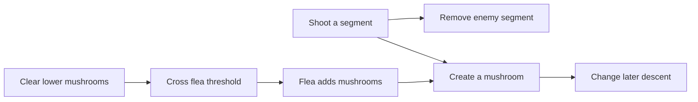

# 46 — Game design from mechanics to narrative interfaces

[[Chapter Edition/03 - Game Engine/00 - Reading Map|Reading map]] · [[Chapter Edition/03 - Game Engine/45 - Rasterizing kernels and connecting world identity|Previous chapter]] · [[Chapter Edition/03 - Game Engine/47 - Narrative, simulation, and AI in playable worlds|Next chapter]]

Engine capabilities become meaningful through the game’s rules, camera, actions, and feedback. This chapter treats design documents as working tools and tests how mechanics communicate without turning examples into universal prescriptions.

**By the end:** Connect formal rules, player experience, cultural context, and camera policy to a specific playable situation.

**Recall question:** Which action, feedback, and consequence make this rule legible, and what assumption about the player or culture remains untested?

<!-- Derived from Continuous Notes/Game Engine - From First Frame to Living Worlds.md; source lines 112055–113346; source-span SHA256 fead69b1ae18c7940f9d7c71c5b104eeba3eca1bece0b260277cbb277cef491d. -->

<!-- CHAPTER-SOURCE-BEGIN -->
## Turn a design document into a set of tools, not a single promise

A game team does not need one giant document to make a project understandable. Each document should answer a different question, have an owner, and remain consistent with the others. A **story bible** is a reference for the fictional world and its important characters: histories, motives, and details that artists, writers, actors, and later teams may need to interpret consistently. Rouse recommends readable prose organized with useful headings, optionally supported by timelines, event diagrams, or relationship trees. The key qualification is that the bible should contain material that helps make the game; documenting every character’s ancestry or every object’s history can waste effort when those details have no production use. Its purpose is continuity and shared context, including for a possible sequel, not completeness for its own sake. [Game Design Theory and Practice, Chapter 17, physical PDF pp. 337–338]

A **game script** contains dialogue and the staging information needed to create the spoken or written moment. The form should follow the event. A cinematic cut-scene may need action and camera cues; an in-game conversation should leave room for the player’s control and viewpoint; a branching exchange needs conditional structure. An `IF` or `SWITCH` outline can make dialogue paths legible, while an `OR` choice can communicate a set of interchangeable lines. These are authoring notations, not a universal game scripting language. Where the implementation already has a dialogue editor or runtime syntax, matching that syntax can reduce translation errors, but the source explicitly leaves the format to each team. Text found in missions, books, signs, posters, and off-screen instructions also belongs to the script inventory. The practical design warning is proportionality: dialogue should serve play, and long exposition can obstruct the activity the player started the game to do. [pp. 338–340]

An **art bible** gathers visual references and constraints that help artists build a coherent look. It can hold sketches, descriptions, style guidance, and technical limits such as polygon budgets or animation duration. It is usually led by art staff, but designers, writers, and producers must review it against the intended characters, story, and game rules. This lets visual specialists own the craft of the document without making it independent of the game’s overall direction. [pp. 340–341]

The **game minute** is an early, short prose walkthrough of a representative slice of play, often one to three pages. It can test whether a high concept becomes a plausible sequence of player actions before a playable build exists. Its exactness is also its danger: a carefully described route may be mistaken for the only allowed route. Choose an ordinary section of play rather than a spectacular exception, write alternatives where they matter, and consider several versions when the intended freedom is central. The document should be labeled as a sample path or design probe, not treated as a specification that removes other player choices. [p. 341]

A **storyboard** is strongest when image sequence and staging are the problem: for example, a noninteractive cut-scene, an early visual pitch, or a scene whose timing needs team feedback before rendering. Traditional boards express one linear sequence, so for an interactive space they can accidentally imply that only the pictured path is acceptable. A branching board or decision tree can communicate important alternatives. But visual planning cannot establish whether the mechanic is enjoyable; a prototype and playtest must expose the choices a player can actually make. [p. 342]

A **technical design document** explains how the intended player-facing behavior could be implemented: major structures, systems, rendering approach, AI, and pseudocode when useful. It should be shaped by the project rather than written as a huge speculative contract before the design is known. Rouse describes one workable progression: begin with an outline or framework, then write smaller technical specifications when each feature approaches implementation. Designers should review the technical description too, even if they cannot inspect every implementation detail, because algorithm and AI choices can change the promised play. Budgets, schedules, and marketing projections answer different questions and belong in separately owned planning materials. The book also observes that teams vary: some need a formal art bible or TDD, others do not; documentation level responds to project scale, experience, funding scrutiny, and how work is shared. Whatever the amount, designers remain responsible for consistency across gameplay, story, technical, and art descriptions. [pp. 342–344]

These are Rouse’s recommendations in a 2004-era chapter, not a universal modern production template. The transferable lesson is to distinguish a document’s audience and purpose, label its status, and state its limits. A prose playthrough proposes one route; a prototype tests whether routes work; a technical specification constrains implementation; an art reference aligns assets; and a story bible preserves shared fictional context. Confusion starts when a useful sketch is mistaken for the system it is meant to help the team build.

## An interview shows film techniques serving game actions

The next pages change authorship and evidence type: Chapter 18 is an interview with Jordan Mechner, edited by Richard Rouse. Mechner recounts a progression from early experiments, through the influence of *Choplifter*, into *Karateka*. The chapter’s introduction frames his work as combining film and game techniques while retaining game qualities; that is the editor’s assessment, while the specific creative motivations and anecdotes are Mechner’s recollections. In his account, rotoscoping movement from Super 8 footage helped produce more convincing animation; cinematic cross-cutting and scene transitions informed presentation; and the publisher proposed expanding a single palace fight into outside, palace, and underground sections. A useful design interpretation is that a film device can enrich a playable action when it clarifies timing, emotion, or movement, while presentation alone cannot substitute for interaction. [Chapter 18, physical PDF pp. 345–347]

Mechner also recounts a deliberately deceptive ending in *Karateka*: the player could approach the princess in the wrong stance and be kicked, despite having reached the apparent goal. He describes the disk-flip behavior as a joke and a support-call setup, and acknowledges that the ending was harsh. This is a historical anecdote, not a recommendation to hide essential controls or punish players with unreadable rules. For *Prince of Persia*, he names *The Castles of Doctor Creep* as an inspiration for linked switches and puzzle consequences, then describes combining that puzzle idea with the smoother animation of *Karateka* so that running, jumping, and falling conveyed weight. The reusable point is the source’s concrete synthesis: puzzle causality plus responsive character motion can make a game’s world feel consequential. These are interview claims and the author’s editorial framing, not an independently verified production history. [pp. 347–348]

## Two implementation records that need historical labels

Kohi Episode 109 extends the already-covered height-map import story with a useful debug distinction. The presenter first suspects the grid’s triangle winding, reverses an index order, and reports that the terrain orientation looks corrected in the test bed. This is evidence from a particular renderer’s configuration and view; “clockwise” versus “counterclockwise” depends on vertex order, coordinate handedness, and front-face convention. The extracted claim that the entire original six-index sequence was replaced by a particular six-index sequence overstates the raw narration: the checked cue gives the initial `0,1,2 / 2,1,3` pattern and says the presenter changes `2,1,0`; it does not unambiguously document the final full pair. The correct teaching is to reverse the winding of each triangle consistently and verify the configured culling convention, not to copy an uncertain index recipe. The session also distinguishes visible height variation from valid lighting: placeholder normals point upward and make the surface shade like a plane. Calling an in-place normal utility then exposes a C type mismatch between the terrain vertex structure and the helper’s expected vertex type. That mismatch is a data-layout/API issue separate from winding. The session later reports loading a 2048-by-2048 RGBA image, but finishes with only one unexpected triangle visible and no resolved cause. It is a work-in-progress debug trace, not a completed height-map importer. [Kohi Ep. 109, 00:06:29–00:09:03, 00:13:34–00:24:01, 01:15:46–01:25:53, 02:04:40–02:12:04]

Sparky Episode 18 is a separate, dated dependency-integration story rather than a rendering demonstration. The transcript records a difficult attempt to include FreeType’s source in a Visual Studio project, including confusion about which modules and files are compiled, then duplicate symbols when both individual C files and a grouped amalgamated file are compiled. A clean build eventually succeeds for FreeType; the video’s setup remains a project-specific experience with uncertain omissions and unfinished FreeType-GL integration at the point described. The useful engineering delta is to treat dependency integration as a build-system contract: identify supported modules and configuration, make each translation unit enter the target once, and validate a clean build from the chosen build definition. Do not copy this episode’s file lists, old library versions, platform macros, or manual project-file steps as current FreeType guidance. Its contemporary context and the presenter’s own frustration are part of the evidence. [Sparky Ep. 18, 00:27:19–00:27:40, 00:54:01–01:16:16]

Kohi Episode 84’s broad systems-manager story is already covered in the live engine note: a common lifecycle interface centralizes initialization, update, and shutdown but still requires dependency order and correct persistent state. The session explicitly excludes the memory system from ordinary registration because other systems depend on its allocation pool, then runs into state/configuration and platform-startup errors that remain unresolved at the end. These details support the existing caution that a manager does not remove ordering obligations; they do not establish that Kohi completed a correct dependency graph or rollback scheme. No extra narrative is warranted for this source slice beyond maintaining the existing historical/prototype qualification. [Kohi Ep. 84, 00:09:20–00:21:17, 01:38:33–02:00:34]

## Turn architecture advice into hostile, observable tests

Pages 25–33 of the supplied *Kohi / Source-Checked Technical Companion 2026* contain original exercises, later-source notes, and a source registry. The audit prompts are proposals, not actions performed in the videos. Their missing contribution is a compact way to convert vague architecture claims into adversarial tests with measurable outcomes.

For a **CPU/GPU lifetime audit**, draw CPU frame $n$, frame $n+1$, presentation image $k$, upload work, consuming draw, and destruction on one timeline. Reuse a frame slot only after the signal associated with its last GPU consumer has completed; do not assume the frame number equals the acquired image index. For a **memory-boundary audit**, request sizes around allocator alignment and capacity limits, verify pointer modulus and end offsets, and check overflow before changing the cursor. For a **transform audit**, choose one point with a hand-computable local position, rotation, translation, view transform, projection, and viewport; record the coordinate after each multiplication under one stated vector/matrix convention. These turn “the camera seems wrong” into an inspectable first divergence.

For a **shader-layout audit**, write the shader block and host structure side by side, derive each field offset and stride under the actual layout rules, then compare those values with reflection or generated assertions. For an **asset-corruption audit**, alter each header field, truncate the file at each region, reverse indices, remove a dependency, and assert both a useful failure and cleanup of partial allocations. For a **fixed-step audit**, feed time from a monotonic clock, run a nominal 60 Hz update with render interpolation, then inject a 500 ms pause and record the number of simulation steps and accumulated remainder. The outcome should distinguish bounded catch-up, discarded elapsed time, and an uncontrolled spiral; the test documents policy rather than assuming one loop is universally correct.

A **picking/readback audit** should render distinct integer IDs, use a render target that may differ in resolution from the editor widget, and test the coordinate conversion at corners and scale boundaries. Read one pixel asynchronously, then destroy and reuse the selected object’s ID before the callback returns. The callback must validate a generation or stable handle rather than confusing a recycled integer with the original object. A **job-shutdown audit** can queue many decode tasks, cancel a subset, hold one behind a test dependency, and request shutdown while the rest are active; run with several worker counts and assert that workers stop, waiters wake, and no task touches destroyed renderer or asset state.

A **text-pipeline audit** uses accented Latin, CJK, combining marks, and emoji to distinguish UTF-8 bytes, Unicode scalar values, grapheme clusters, and positioned glyphs. Text length is not glyph count; layout must consume shaped glyph advances rather than count input bytes. A **frustum audit** places bounds intersecting each plane, tests sphere and AABB rejection, and repeats at extreme aspect ratios to catch plane extraction and conservative-bound errors. A **render-graph audit** declares a small G-buffer-to-lighting-to-bloom-to-compose chain, prints inferred barriers and resource lifetimes, then compares the graph’s interpretation against a captured frame. A **cross-platform audit** compiles debug and release on each supported OS, checks required API extensions, imports resources, launches a test scene, and compares equivalent input/file/memory behaviors. These are reviewable test plans from the companion, not execution results or claims that Kohi currently passes them. [Kohi / Source-Checked Technical Companion 2026, physical PDF pp. 31–33]

The companion also makes a useful temporal point: an instructional engine’s old object graph is evidence about what was taught at that stage, not a promise about today’s architecture. Its cited retrospectives describe later modularization, typed resource handles, import pipelines, dynamic rendering, and terrain tooling, while acknowledging that earlier choices can become technical debt. Preserve the reasoning and date the implementation. Before teaching an API as current, inspect the exact primary source, version, and repository revision. The companion is itself explicit that its early-episode summaries and later creator claims are not a complete transcript or a guarantee that every referenced video is represented. [pp. 30–33]


These additions use the exact supplied book-page and caption units recorded in the continuation source ledger. Page labels above are physical PDF pages, not inferred chapter pagination. The exercises are proposed tests; no execution is implied.


---

## When players push against the frame

A game’s rules make a bounded world possible: they say which actions count, what outcomes follow, and where ordinary life is temporarily set aside. But players do not arrive as blank rule-followers. They bring habits, customs, social roles, and expectations that can support the game, bend it, or expose who the rules serve. The *Rules of Play* excerpt on Games as Cultural Resistance describes resistance as friction between free play and the structures that seek to contain it. That friction makes the boundary of play visible. The following chapter’s “games as cultural environment” lens complicates the idea that the game is fully sealed off from ordinary life: cultural meanings and real-world relationships can enter and leave the designed frame (PDF pp. 553–564; source `src-0eb31a9bb70184b984ce`, especially units `u-cd87286d9476644b6526e4ad`, `u-8b08a32a6fc80dfd1edcc3fa`, `u-a917ed7b0cb273d3005d9565`, `u-9fb67ea3b3be39ffb6172640`).

One useful consequence for designers is that a “rule violation” needs interpretation. A player may find an unintended strategy that remains legal under the operational rules; that differs from secretly breaking a rule, and both differ from rejecting the shared premise that makes play possible. The source’s account of implicit rules is important here: many expectations are unwritten and are inferred from custom, tradition, prior experience, and the social context. A system can enforce its formal checks perfectly while players still disagree about what conduct is fair, playful, or harmful. Designers therefore need to ask not only “Can the engine permit this?” but “What convention will players infer from the way the game responds?”

The book calls the accepted frame of play the **magic circle**: actions gain special game meanings because participants agree to treat the activity under its rules. It is an analytic idea, not a literal wall that prevents social consequences. Its distinction among three rule layers makes that clear. **Constitutive rules** describe the underlying logical structure; **operational rules** tell players what to do; **implicit rules** cover expectations that the printed instructions leave unstated. The software may implement a win condition exactly while players still disagree about whether exploiting a disconnect to avoid defeat is acceptable. A formal state transition and an accepted social outcome are different design questions.

Implicit expectations themselves have several sources. **Etiquette** covers manners such as celebrating, taunting or allowing a take-back. **Ethos** concerns how participants interpret and enforce the written rules in practice. **Convention** concerns broader expectations about competing and winning. **Context** includes consequences outside the match, such as a livelihood or a friendship. A competitive tournament and a parent's teaching game may use the same board and legal moves yet require different expectations about advice and retries. Make those expectations legible before punishing conduct that the interface appeared to permit.

The related term **lusory attitude**, borrowed by the authors from Bernard Suits, means willingly accepting artificial obstacles so that the activity can be played. In a jumping game, taking the obstacle course seriously is part of playing; simply editing the character's position to the finish line changes the activity. In a level editor, that same edit may be the intended action. The designer should therefore state the mode and the shared agreement before treating one action as clever play, authorized creation or cheating. These distinctions extend the book's cultural analysis into design review; they do not imply that telemetry can directly measure an attitude.

Modifications offer a spectrum of answers. The excerpt groups them into three overlapping forms: **alteration** changes a game’s representational or interactive structure; **juxtaposition** places elements together in an unexpected relation; **reinvention** redesigns the structure more radically. These are the book’s analytic categories, not a universal taxonomy every community must use. They are useful because they prompt distinct product questions. If a mod changes damage values, does the game identify the altered rules in multiplayer? If it pairs familiar systems in an unexpected way, does the interface explain the new relationship? If it reinvents progression, can players still tell which rules belong to the base game and which to the new experience?

This lens connects directly to engine architecture, but it does not dictate one implementation. A mod-capable engine might expose stable, versioned data and scripting hooks; it might sandbox code; it might distinguish authored content from runtime state; or it might deliberately keep a narrow extension boundary. Those are engineering choices. The design question comes first: which parts of the play frame should players be able to alter, who may distribute those alterations, and how will a player know what changed? Clear identifiers, compatibility versions, permission boundaries, and visible provenance can make modification legible. They cannot decide whether a particular modification is fair or culturally meaningful.

The same principle applies to emergent play. A surprising tactic is not automatically a defect. Sometimes it reveals a new way to inhabit the designed system; sometimes it removes meaningful choices from other players; sometimes the social meaning differs across communities. Instrumentation and telemetry can show where a tactic appears, but not what it means to the people using it. Pair system evidence with observation and feedback from the relevant players. Preserve the distinction between an engine invariant (“this resource handle must resolve to a live object”) and a negotiated play convention (“this conduct is acceptable in this community”).

For a practical design review, trace one boundary crossing from three perspectives. First, state the formal rule and the exact system response. Second, name the likely implicit convention a player brings and how the interface communicates the outcome. Third, ask what changes if the content is altered, juxtaposed, or reinvented by players. This prevents the team from treating every unexpected action as either a bug to suppress or a feature to celebrate. It also keeps engine extensibility in service of a chosen play experience rather than treating mod support as an abstract virtue.

The book’s examples and terminology belong to its cultural analysis. They should not be read as claims about any engine’s actual modding support, nor as proof that modification necessarily produces resistance or transformation. The useful bridge is a design responsibility: when the game allows players to change rules or carry play into other contexts, make the resulting boundaries and consequences understandable, then study how people actually use them.


---

## From one core action to a coupled play system: Centipede

A **core mechanic** is the repeated action pattern at the center of play: what the player does moment to moment and how those actions connect to input, system response, and the player's decisions. In Centipede, the surface description is simple: move a character along the lower part of the screen and fire upward. But the designers restrict both movement and firing in ways that turn those actions into decisions. Movement is confined to the bottom fifth of the playfield, keeping the player in a vulnerable lane beneath the incoming field. The fire button can be held, yet only one shot can be on screen at a time. A distant shot therefore ties up the weapon until it reaches its target or travels offscreen. The player manages firing time as a limited resource, even though the game does not display an ammunition counter. (*Rules of Play*, PDF pp. 320–321; source `src-05da0e605d74277e274a`, units `u-8119e17f4add2374f9e5e9d0`, `u-7d883240156ab38afb3384f8`.)

That single-shot rule interacts with a field of mushrooms and a segmented centipede. Mushrooms take four hits to destroy. A centipede drops when it reaches a mushroom; shooting a segment turns it into a mushroom, and shooting an interior segment splits the centipede into two moving threats. So firing has a double effect: it removes an immediate enemy segment, but may add an obstacle, accelerate the descent route, or multiply threats. Clearing mushrooms is also double-edged. Fewer mushrooms can slow the centipede, but clearing too many in the lower half triggers a flea. The flea descends and deposits a column of mushrooms, including in hard-to-reach upper areas. The source specifies a threshold but not its numerical value in this discussion, so the useful design model is relational rather than a made-up count. (PDF pp. 320–321; units `u-8119e17f4add2374f9e5e9d0`, `u-7864d288a8495a224edeb70f`.)

Two other creatures make the same objects matter in different ways. Spiders threaten the player's lane and eat mushrooms, creating a choice between allowing them to clear the field and risking collision. Scorpions cross above the player and poison mushrooms; when a centipede reaches a poisoned mushroom, it descends directly toward the player. Mushroom count, mushroom location, and mushroom state therefore affect enemy movement, threat timing, and the player's available firing opportunities. A static obstacle becomes part of an active rules network because each moving entity reads or changes it differently. (PDF p. 321; unit `u-7864d288a8495a224edeb70f`.)

A flea also changes behavior before it dies: the first hit speeds its descent, and the second destroys it. Progress toward removing a threat therefore increases the immediate danger. If a centipede reaches the player's lower region, additional heads can appear and crowd that space. These rules explain why “closer to success” and “safer right now” need not coincide. A useful playtest records both outcomes rather than measuring only how many enemies the player removed. (PDF p. 321; unit `u-7864d288a8495a224edeb70f`.)



The upper path links an immediate reward to a delayed change in threat routing. The lower path shows why removing obstacles cannot be evaluated independently: the rule system can replenish them. Read this as a rule-dependency diagram, not a claim about the original game's software architecture.

This is why a useful mechanic review asks more than “does the player shoot?” It traces the state changes and their later consequences. For example: a player fires at a central segment near the top; the segment becomes a mushroom and the centipede splits; the new obstacle changes subsequent descent, while the two resulting creatures create more simultaneous targets. A shot has made progress and increased danger at once. If the player instead waits until the centipede is near the bottom, there is less distance to travel before clearing the target, but the immediate chance of collision is greater. The player is solving a fast spatial puzzle under a constrained action rate, not merely accumulating hits. (PDF pp. 321–322; unit `u-7864d288a8495a224edeb70f`.)

The system also changes over time. The source describes mushrooms accumulating across levels, centipedes moving faster and sometimes beginning split, and spiders becoming faster and moving in tighter patterns. A completed level briefly releases pressure before the next one increases it. This creates overlapping timescales: the next shot produces immediate tension; the current level produces a short arc toward relief; the whole game gradually increases density and speed. A design document can capture this by listing each entity's rule, then drawing the cross-effects and timing: what it creates, removes, accelerates, blocks, or makes more dangerous. That map is more informative than a feature checklist because it exposes feedback and decision consequences. (PDF p. 322; unit `u-7864d288a8495a224edeb70f`.)

For an engine team, this analysis becomes a testable content contract. Each rule needs an owner and an observable result: the projectile system enforces one active shot; the collision/gameplay layer turns hit segments into mushrooms or split entities; the mushroom state influences descent; flea spawning checks a lower-field threshold; and the presentation communicates danger quickly enough for the player to react. These are proposed system boundaries inferred from the rules, not implementation claims about the arcade code. The lesson is to prototype the coupled loop and measure whether the choices are legible. A screenshot of each enemy or a successful projectile test would not demonstrate that the interactions create the intended pressure-and-relief rhythm.

## Interactive writing is a stateful interface

Steve Meretzky describes game writing as a distinct production task because the player does not necessarily encounter a finished passage in one fixed order. A location description, a response to an attempted action, a hint, and a line of character dialogue may be assembled from separate short pieces. Each piece must still be understandable when it appears, fit the local gameplay state, and avoid spoiling a puzzle. The player may revisit the same room or repeat an action, so a line that works once can become irritating when repeated. The author calls this a difficult tradeoff between making responses interesting and keeping them terse; that is his experience as a designer, not a measured universal law. (*Game Design Theory and Practice*, PDF pp. 221–222; source `src-76941f9eb29394c92fb2`, units `u-1a90d44661fa585ec4c2f32d`, `u-3e1b3d92edca40c1676ca93f`.)

This problem is better understood as an interface contract between authored text and runtime state. A response is selected by context: current room, target object, player action, puzzle flags, prior discoveries, and sometimes difficulty setting. If the game offers only one generic fallback—“that does not work”—it technically rejects an action but provides no useful explanation. Meretzky describes adding responses for reasonable-but-wrong attempts, including responses that explain the failure and hint at what to try next. He also describes varied default replies to common broad commands such as “take all.” In engine terms, that implies a response-selection order: specific authored rule first; then a context-sensitive explanatory response; then a general fallback. The engine should not invent these priorities on its own, but its authoring and dialogue systems need enough state and lookup structure to express them. (PDF p. 224; unit `u-568e1259270aa0ef093e1ed1`.)

The same interview connects nonlinear structure to repetition. If either of two lines can precede a later scene, each branch may need to convey context that a strictly linear story could state only once. That can produce duplicated information. A content system can help writers reuse a fact or phrase, but mechanical reuse is not always stylistically appropriate: the same line may sound natural on first encounter and stale on the fifth. One practical authoring check is to enumerate the state paths that reach each line, note what the player can already know on each path, and count how often the line can recur. This path audit is a proposed workflow derived from the interview, not a procedure the source says it used.

Meretzky also argues that designing with text and graphics changes how much can be revised after implementation begins. His account favors allowing a game to grow during implementation rather than completing a highly detailed plan first. The excerpt describes roughing out story, geography, characters, and puzzles, then revisiting them as the design takes shape. That is a first-person account, not a rule that all projects should avoid detailed preproduction. For an engine and tools team, the concrete implication is to make authored content cheap to inspect and revise: visible conditional state, reusable response data, localization-aware layout, validation for unreachable branches, and playtest capture of player actions can shorten iteration. The pages do not establish those tool features as existing systems; they are requirements inferred from the workflow and its stated difficulty. (PDF pp. 222–224; units `u-3e1b3d92edca40c1676ca93f`, `u-568e1259270aa0ef093e1ed1`.)

The source also resists a simple story-versus-play rule. The following pages say games need not tell stories, while story can strengthen a game when integrated with its play. This reinforces the production question: begin from the activity the player repeats, then decide what story structures make that activity more meaningful. Text cannot compensate for a mechanic that gives the player no consequential action, and a tightly specified mechanic does not require a linear plot. (*Game Design Theory and Practice*, PDF pp. 227–228; source `src-76941f9eb29394c92fb2`, units `u-435367b8190e0ad1d73e772a`, `u-c29662231a64f2683654e15c`.)

**Evidence boundary.** The book presents a design analysis of the arcade game, drawing on Richard Rouse III; it is not source code or an implementation trace. The mechanisms above follow the described rules. The proposed engine ownership and test suggestions are deductions for contemporary production, not claims about the original machine's internal software.


---

## Rules can carry cultural values; avoid turning an analytic lens into a label

The supplied *Rules of Play* pages 505–516 add an authoring question missing from the live engine volume: what values do the rules make actionable? A victory condition is a compact way to express priorities. “Accumulate the most” rewards a different relation to resources than “spend everything”; eliminating opponents says something different from coordinating a shared result. This does not mean a game has one fixed ideology or that a designer’s intent determines every player’s interpretation. It means that rules, materials, framing, and the surrounding culture can interact to produce meanings that deserve deliberate review.

The text presents Sutton-Smith’s seven rhetorics of play—progress, fate, power, identity, the imaginary, self, and frivolity—as persuasive cultural discourses, not neutral definitions of what play is. A useful design review asks which discourses a mechanic can support, which it challenges, and where they conflict. One game can evoke several at once; the meaning can change across players and settings. That warning matters because a category is a tool for asking questions, not a verdict that can be assigned mechanically to a game.

Here is what those names ask us to notice. A **progress** rhetoric frames play as growth, practice or learning; a **fate** rhetoric emphasizes fortune and forces outside individual control; a **power** rhetoric emphasizes contest and dominance. **Identity** asks how shared play expresses belonging to a group. The **imaginary** emphasizes invention and make-believe, while **self** emphasizes a person's own experience or fulfillment. **Frivolity** concerns play that disrupts seriousness or makes room for nonsense. These are simplified explanations of analytic lenses, not seven mutually exclusive genres. A cooperative expedition can support skill growth, group identity and invented fiction at once. A random reward can be read as fate by one player and as a progression mechanism by another. The practical question is what the rules and context make plausible, rather than which one label a designer prefers.

The book’s examples make this test concrete. Its account contrasts the Landlord’s Game with Monopoly: both share a board-game structure, but the former’s cited rules teach a critique of land monopoly while the latter’s stated goal rewards property accumulation. The point for an author is that the rule system and victory condition can reverse the meaning of familiar components. The source also uses Vampire: The Masquerade to discuss atmosphere, subculture, and low rules friction as a route for welcoming players beyond an established role-playing audience. These are the book’s historical and critical readings; this review did not independently verify its historical assertions about the games or their audiences.

The gender section is valuable chiefly for its refusal of a simple “good/bad representation” score. It presents Henry Jenkins’s reading of platform games as inheriting boy-adventure conventions, then considers Lara Croft as both an active player-controlled hero and a sexualized image. It also raises different examples—Samus Aran, Ms. Pac-Man, fighting-game characters, and SiSSYFiGHT—to show how a game can communicate through both appearance and the role the player inhabits. Preserve the book’s attribution and historical context; do not repeat its broad claims about what boys, girls, or women prefer as timeless empirical facts. A better authoring exercise is to inspect the concrete design: who can act, who is framed as an object, which actions are rewarded, what the camera emphasizes, and how marketing changes the reading.

The New Games Movement example pushes from representation to social practice. Its “play hard, play fair, nobody hurt” motto and Earthball anecdote describe cooperative play that changes how a group relates to winning. The example can inspire a prototype in which players may defect from a leading team to keep a shared activity alive. It does not prove that the game will transform society; the author’s account is a situated illustration of a designed experience and its interpretation.

For engine authors, this material belongs beside player-facing rules, feedback, narrative framing, and social play. It does not prescribe a subsystem. It offers a review loop: identify the values implied by the win/loss condition; inspect which actions the system makes easy or costly; observe what feedback teaches players to value; then test whether play actually supports the intended interpretation. Record disagreement as evidence about context, not as a failed “correct reading.” The directly read PDF physical pages are 505–516; the full page-unit IDs are in the checkpoint. Pages 511–515 explicitly frame the gender analysis as a debate and complexity demonstration rather than definitive conclusions.


## Meaning emerges from system and context, then loops through action

*Rules of Play* pages 361–370, “Games as the Play of Meaning,” add a companion concept. A game’s representation is not just a collection of labels and images. Rules establish relationships among signs, and players interpret those signs in context while taking actions. The source’s Virtua Fighter 4 health-bar example shows the same displayed value carrying different practical meanings depending on both players’ health, the time remaining, the arena’s ring-out condition, and the players’ skill. A UI element therefore communicates through its relation to state and available actions, not only through its visual design.

That relationship forms a loop: system and context shape a player’s interpretation; the interpretation guides an action; the action changes state and can change what the next display means. An author can use this as a UI test: show the same cue in several game states and ask what action a player would infer. If an unchanged red bar means “near death” in one situation but “safe lead” in another, provide enough comparative information or feedback for the player to understand why the action should change. This is a design application of the source’s example, not a claim that every game needs a health bar.

The chapter’s “magic circle” and cognitive-frame discussion describes how people understand that an action is part of play, with meanings shaped by rules and social context. Bateson’s “this is play” frame is illustrated through play-fighting: a nip resembles a bite while also communicating that it is not an ordinary attack. The book extends this to Cops and Robbers and Spin the Bottle. These are conceptual examples, not a guarantee that every participant shares the same interpretation or consents to every action. An engine can support boundaries and explicit player choices; the social meaning cannot be inferred from game state alone.

The resulting phrase “space of representational possibility” is useful if kept concrete: a rule set and its content permit a range of actions, outcomes, and interpretations; actual play explores some of them. It does not mean that every theoretical outcome is equally reachable or meaningful. Designer intent sets up conditions, player interaction realizes possibilities, and external context can alter the reading. The supplied pages then begin “Games as Narrative Play” on physical PDF pages 371–372. Those two pages introduce narrative dimensions and questions; they are only the opening of the next chapter, so this checkpoint makes no claim about that full chapter.

The nearest current engine passages—`### What rules promise and what a simulation can enforce` at line 688 and the broad magic-circle/cooperation discussion near line 561—do not teach this system/context account of signs, nor its representational feedback loop. Their headings and actual paragraphs were examined; the content differs. This material should be routed to the game rules, UI feedback, narrative, and social-play portion of the eventual engine volume rather than folded into rendering architecture.


## Hazel review: an instructive snapshot, not a current architecture guarantee

The Hazel code-review video gives one implementation snapshot that can deepen the generic engine lifecycle discussion. Its layer callbacks include attach/detach, update, UI drawing, and events; the described stack updates in push order but dispatches events in reverse so a top UI layer can consume a click or key first. The existing volume already teaches this general layer contract and reverse event propagation (line 13889, paragraph hash `8a9b34f7c14701b4ee4f0468817d0ed6f8f8ccaf5a8633c347b0948d0998d838`). The Hazel review’s own details are not a separate rule to copy: they are a code-review example of how the ordering was described in that project at that time.

The scene-state account is a more useful addition. In the narrated editor, Play creates a runtime copy so physics and scripts can mutate entities while the saved editor scene stays intact; Stop discards that copy. The presenter distinguishes editor, play, simulate, and pause paths, and explicitly points out duplicated render/update code as a source of drift: a rendering fix applied to one path can be missed in another. A copy-on-play design is one policy, not a universal requirement. It still needs explicit rules for what is saved, which identity survives the copy, and how references/resources are rebuilt. The general current note already advises a copy-on-play world or another explicit runtime-save policy (line 258, hash `4dd8f4dbc8c43e0cc468e7d336bc4bad5800ab772ca19d1501b324b66184bfc8`), and separately documents Hazel runtime scene teardown risks (lines 46708 and 46721, hashes in checkpoint). The new value is the historical trace from editor state into play, and the presenter’s own warning that duplicated update/render branches invite maintenance errors.

The same walkthrough narrates a phase chain: update the physics backend, synchronize simulated transforms back to entities, run script callbacks, process a post-update queue for mutations that cannot safely happen during entity iteration, then update animation/audio; rendering submits commands through a custom queue. It describes that queue as preallocating a hard-coded 10 MiB buffer for function pointers and copied parameters to avoid per-command allocation. At the time of recording, the presenter says the queue is processed on the main thread after update, while a separate render thread is a future architecture. That distinction should be preserved: a queue is not evidence of parallel execution. If a consumer needs results from a separate thread, dependencies, completion, and resource lifetime need additional contracts. The numerical capacity is one project configuration, not a suggested default.

The video also distinguishes Box2D work from a PhysX-backed 3D scene in that historical Hazel snapshot and describes a scene renderer passing mesh, debug, and 2D work through a static renderer facade into the queue. The presenter says some renderer and physics details will receive later videos; this is explicitly not a complete code review. These exact library choices and capacities are implementation-specific. The transferable teaching question is whether each update stage has a defined owner and when scene data becomes safe for the next stage. The supplied transcript’s file-size arguments (“large files are inevitable,” including roughly 3,000-line physics and 6,000-line script glue units) are the reviewer’s opinion about that codebase, not a measured compilation or maintainability result.

The current volume covers lifecycle separation and layer behavior in other episodes, but no inspected paragraph contained the Hazel review’s 10 MiB command-queue details or its explicitly sequential queue processing. The staged addition preserves these as a bounded historical example, not a recommendation. All 58 pending point texts were read; selected raw caption units for the adopted details and their timestamp ranges are listed in the checkpoint. No Hazel repository code, binary, rendering output, or build was independently inspected for this video.


## Let play become a replayable story

A play session and its retelling are different designed experiences. During play, camera position serves the player’s immediate task: see enough of the world to act. A replay can change that contract. It can slow the action, move to a spectator’s angle, emphasize a turning point, or expose telemetry that helps a player learn. The *Rules of Play* chapter on narrative play treats replay as a way to recast what happened, not simply repeat the original view. Its examples include sports replays with free camera and frame stepping, action-film-like cuts in *Wreckless*, and distinct modes in *Gran Turismo 3* for following a car, surveying a race, studying an ideal line, syncing footage to music, or reading driving telemetry (PDF p. 406; `src-3b3c65abf669eb490856`, unit `u-f4c9a67260d7723d1e42d8f5`). These examples are specific to the book’s argument and era; the design distinction remains useful.

A replay can serve at least three different goals. **Recall** lets someone see an event again. **Analysis** adds information that was not obvious during the moment, such as braking points or the sequence that caused a collision. **Retelling** selects shots, pace, sound, and framing so the event reads as a story. One mode may combine them, but the goals compete: a dramatic camera cut can obscure a precise timing error, while a telemetry overlay can interrupt a cinematic moment. Decide what the viewer should learn or feel before adding camera effects.

The book calls player-edited replays with altered camera positions and motion “recams.” Its historical examples begin with demos that recorded gameplay and could be edited, shared, or even altered into fictional movement. This moves the viewer from the player’s original first-person perspective toward a new authorial viewpoint. A recam is therefore not necessarily a trustworthy record of what a player saw. It can be a commentary, a fictional reconstruction, or a spectator’s composition. That distinction matters whenever replays are used for moderation, competition review, or evidence of a bug: preserve an authoritative event record separately from an edited presentation (PDF p. 407; `src-3b3c65abf669eb490856`, units `u-ae839bc751df382dd169f63e`, `u-27dab920e4890e2a5d679a17`).

An engine can support these goals through different representations. An **input replay** stores inputs and re-simulates from a recorded initial state; it can be compact, but reproducing the action requires compatible simulation/content versions, the same initial state, clocks and random streams, and control over relevant nondeterministic events. A seed alone does not make multithreaded floating-point simulation deterministic. A **snapshot replay** stores periodic world states and event data; it can tolerate some simulation differences, but costs storage and must define interpolation between snapshots. A **rendered capture** stores images or video and is straightforward to view, but offers limited camera freedom and weak access to underlying gameplay data. These are engineering options, not categories asserted by the book. The design intent should decide which representation to investigate.

For editable camera work, record stable actor identities, transforms, animation or pose references, and relevant event times. Keep the playback camera independent from the live gameplay camera so a replay can create a new point of view without changing the original action. Version the data that gives the record meaning: entity identity alone is not enough if a later build changes movement, physics, animation, or content. A recam editor also needs clear boundaries: which events may be cut, which data is authoritative, and when a camera move changes the recording from analysis into authored fiction.

Replays can shape the play that precedes them. The source observes that players sometimes make choices for how dramatic the replay will look, not only for the game’s internal objectives. That can be welcome, as in a racing photo finish, or disruptive if cinematic performance undermines a competitive goal. Treat this as a design hypothesis to test with players. Ask whether the replay makes the action more understandable, whether it changes incentives, and whether edited output is clearly distinguished from authoritative records. A tool for retelling can deepen engagement, but it can also change what players optimize for.

Source boundary: the book provides historical examples and a design lens, not specifications for deterministic simulation, event logs, network authority, or replay file formats. The engineering representations above are original extensions. Do not claim that the source’s cited games used any particular storage architecture unless that implementation is separately inspected.


#### Clarification on the FreeType dependency example

The earlier dependency-integration account distinguishes setting up FreeType-GL files from demonstrating combined on-screen text. Files and setup are underway in that episode; the speaker says the combined rendering integration is for the next episode. A library build and a working font-rendering path are separate verification layers. The original caption units and this clarification are recorded in the source review checkpoint.


### A scene's save path is part of its editor state

Imagine opening `workshop.scene`, then creating a blank scene. If the editor keeps the previous document's destination, the next ordinary Save can overwrite the workshop. Creating a new scene must therefore clear its file path as well as replace its entities. An opened scene can retain the path from which it was successfully loaded; a new scene begins without a destination. The save command decides policy, while serialization accepts an explicit scene and destination path.

For ordinary Save, use the current destination if one exists. Otherwise request Save As. A cancelled dialog changes neither document contents nor its destination. Selecting a filename is only a proposal: serialize and handle the actual write result before recording a successful save or clearing the dirty flag. If the write fails, retain the dirty document and report the error. After a successful Save As, associate the edited scene with the new destination. Whether overwriting an existing file needs confirmation is a product policy, distinct from whether the disk operation succeeded.

Play mode adds another question: which scene does Save describe? In a copy-on-play editor, the runtime scene can contain simulated transforms and transient objects that do not belong to the authored scene. Saving must explicitly select the authored scene or a deliberate runtime snapshot/export operation. A keyboard shortcut should not silently change that choice when the editor enters Play or Pause. Test new/open/save/save-as/cancel/write-failure paths, then repeat with play mode active. These are proposed checks for the contract, not claims that the tutorial executed them all.

The scene-reset tutorial supplies the empty-path/new-scene/Ctrl+S distinction. The write-success, dirty-state and explicit runtime-save rules above extend that example into a complete editor contract. The original caption unit IDs and exact source mapping are retained in the continuation source ledger.

### Distinguish updating a rotation from changing its representation

Applying a rotation increment can be useful for a gizmo, but an increment does not remove the singularities of an Euler-angle representation. The earlier tutorial's delta-rotation behavior should be read as its update policy. When a decomposition approaches an Euler singularity, different angle triples may represent the same orientation or become unstable to recover. Keep the authoritative orientation, displayed controls and decomposition policy separate; a quaternion state still needs a deliberate conversion policy when Euler controls are shown. The extracted claim that applying deltas itself prevents gimbal lock is too strong.

### Keep shader compilation, linking and activation separate

Compiling a shader stage translates and checks that stage. Linking assembles compatible stages and their interfaces into a program. Making a successfully linked program current selects it for later commands: `glUseProgram` does not perform the link. The existing shader lesson already distinguishes these steps; an extracted caption point that calls activation linking must not be reused as an API definition. [Khronos OpenGL specification, program use](https://registry.khronos.org/OpenGL/specs/gl/glspec46.compatibility.pdf).

The same historical file-loading lesson's claims about `fopen` outperforming `ifstream` are not a benchmark. File size, buffering, platform, build settings and surrounding work affect measurements. Likewise a compiler-specific warning and a proposed warning-suppression setting do not establish portable file-I/O correctness. Keep a shader loader's concrete contract visible: read the intended bytes, detect partial/failing reads, retain meaningful stage/link diagnostics and publish a replacement only after it is usable.


---


<!-- BEGIN IMPLEMENTABLE CONTACT WORLD STEP 2026-11-12 -->
### Implement one complete collision step and prove what every stage owns

The challenge is not collecting words such as *broadphase*, *narrowphase*, *CCD*, *solver* and *integration*. It is arranging their **data ownership and execution order** so that one frame produces a mathematically defensible next frame. This section connects the independent C++20 laboratories to a reconstructable CPU-world step. It is a learning implementation and verification standard, not evidence that the current Kairo physics runtime already uses these exact files.

Consider a scene of two circular rigid bodies. The current state stores a stable identity, centre in metres, linear velocity in metres per second, radius in metres, inverse mass in inverse kilograms, and—when rotation is supported—angular velocity in radians per second and inverse moment of inertia. A *body* owns its persistent motion state. A *collision candidate* is a temporary unordered pair of body handles. A *narrow-phase contact* owns a measured geometric event: time, normal direction, representative point, separation status, and feature key. A *solver row* owns the effective inverse mass and accumulated normal/tangent impulses for one prepared constraint. The *contact cache* owns the last accepted feature-keyed multipliers across frames and must expire invalid entries. Confusing any of these lifetimes permits stale pointers, duplicate contacts, or impulses applied to the wrong bodies.

A minimal event pipeline can be written as a state machine:

1. Validate every body (finite state, positive radius, nonnegative inverse mass, stable unique handle) and requested $\Delta t\ge0$. Decide what happens if validation fails before mutating any state.
2. Establish the remaining horizon $h=\Delta t$. Build conservative *swept* bounds for that horizon using the present velocities, then query candidate pairs. Rebuild or update those bounds after **every** velocity-changing event; a pair discarded under old velocities might collide under new velocities.
3. For each candidate, compute the exact analytic constant-velocity disk TOI. A result may be no contact, first contact in $[0,h]$, initial overlap or an invalid numerical case. Never reinterpret a deep overlap as a new impact with a made-up normal.
4. Choose the earliest event. If none exists, advance every centre by velocity multiplied by $h$ and finish. If one exists, collect contacts whose times are equal under the declared event-time tolerance and advance **all** bodies to that time.
5. For the batch, build correctly oriented A-to-B normals, evaluate pre-solve relative normal velocities, and **freeze** each restitution target $b=-e u_n^{\mathrm{before}}$ once per impact. A resting contact would need a different target policy.
6. Solve the coupled rows using accumulated unilateral impulses. Apply only each iteration's change in multiplier. Iterate at a fixed, documented budget or converge under a declared residual tolerance. A simultaneous batch sharing one body is a coupled system, not independent pairwise elastic collisions.
7. Subtract the consumed time and re-query the future interval with the *new* velocities. Continue until the frame interval is exhausted. If a bounded event budget expires, return a visible failure and **do not silently accept the partially integrated scene as a completed frame**.

The reason for re-querying is concrete. Imagine disks A, B and C in a line. A first strikes B, transferring its momentum. B can then strike C *inside the same frame* despite having zero velocity at the frame start. A broadphase query performed only once at the start can miss that later event because its swept bounds were computed from velocities that no longer describe the future. Conversely, re-querying the entire scene after every event is slower but makes a small CPU reference comparatively easy to reason about.

#### The exact central-disk collision in memory and on the timeline

Let disk A be fixed at centre $x_A=0$, radius 1 m. Let dynamic disk B start at $x_B=10$ m, radius 1 m, velocity $v_B=-100$ m/s, inverse mass $m_B^{-1}=1$ kg$^{-1}$. Ask for a frame $\Delta t=0.10$ s with restitution $e=1$.

The geometry query constructs relative position $p=10$ m, relative velocity $v=-100$ m/s, combined radius $R=2$ m and quadratic coefficients $a=10000$, $b=-2000$, $c=96$. The first collision occurs at $t=0.08$ s. Before solving, the world updates B's centre from 10 m to 2 m, and decrements remaining time from 0.10 s to 0.02 s. Its A-to-B normal is +x. Relative normal velocity is $u_n=-100$ m/s, so the frozen outgoing target is $+100$ m/s. The inverse effective mass is $k=0+1=1$ kg$^{-1}$, giving contact impulse increment $(100-(-100))/1=200$ kg·m/s. Applying the change to B increases its x velocity by +200 m/s, from -100 to +100 m/s. A remains unchanged because its inverse mass is zero. After the remaining 0.02 s, B's centre is $2+100(0.02)=4$ m. This state is an exact oracle for the idealized one-dimensional model, not a statement about a finite-thickness arbitrary mesh wall.

Here is the same sequence as an explicit state trace:

| State | B position (m) | B velocity (m/s) | Remaining frame (s) | Meaning |
|---|---:|---:|---:|---|
| Enter step | 10 | -100 | 0.10 | Validate and create swept search horizon |
| First TOI located | 10 | -100 | 0.10 | Query only; no state mutation |
| Advance to impact | 2 | -100 | 0.02 | Geometry has reached contact |
| Apply impulse | 2 | +100 | 0.02 | Linear velocity changed; position unchanged |
| Advance remainder | 4 | +100 | 0 | Complete frame |

In an isolated pair of *two dynamic bodies*, equal-and-opposite impulses conserve total linear momentum. An impulse against an externally fixed body should not be tested as conservation of momentum of only the moving disk: the fixed environment has accepted the reaction. With $e=1$ and a frictionless isolated central impact, kinetic energy should also be conserved. With $e<1$, energy loss is part of the model, not integration drift. With multiple simultaneous contacts, a finite row-iteration budget introduces approximation and the separate invariants must be measured rather than assumed.

#### Contact cache ownership and frame validity

Persistent contacts are not a free optimization. To reuse last frame's impulse, identify the same pair of *generated body handles* and stable geometric features, with the same declared orientation. An indexed array position does not identify a feature, because clipping and sorting can reorder contacts. A generation number protects against accidentally attaching an old impulse to a new body that reuses a storage slot.

The cache must decide whether an old normal still agrees with the new normal. Its tangential impulse is a world-space vector represented by a scalar relative to the old tangent, so on a rotated normal it should be projected onto the new tangent basis. The standalone \`contact_cache_lab.cpp\` applies a threshold for excessive normal change, bounds timestep-ratio scaling, and rejects duplicates. These particular thresholds are laboratory policies, not universal physical laws. Reused cached multipliers must be **warm-started exactly once** on the pre-solve velocities before row iteration, not repeatedly added every solver sweep. A changed contact point changes the lever arm and effective mass, and a sufficiently changed manifold must invalidate or transform its cache rather than blindly retaining it.

The C++20 \`persistent_contact_lab.cpp\` explicitly models two simultaneous contact rows sharing one velocity state. The row \`make_row\` computes lever arms, the normal and tangent basis, and scalar inverse effective masses. \`warm_start\` changes body velocities once using cached impulses. \`solve_one\` computes the *current* relative speed, adjusts the accumulated multiplier under the nonnegative and Coulomb bounds, and applies the **difference**. \`sweep\` repeats over the rows. To implement this in a real engine, move the prepared row data into a frame-owned contact arena with stable references and never let a pointer survive its arena lifetime. Contacts should be grouped by constraint island if they share bodies; independent islands can be processed separately, but changing row order may affect a finite-iteration result.

#### Refresh neighboring penetrations after position correction

A best-first positional solver cannot safely sort its contacts once and process that fixed order. [[Concepts/Incremental contact penetration refresh]] supplies the local update needed between corrections. Correcting one contact moves one or two bodies, which changes the measured penetration at every other contact sharing those bodies. Recomputing the collision geometry after every correction can refresh the measurements but is expensive; the inspected rigid-body method instead updates the affected existing contact records from the known linear and angular changes. (Millington, *Game Physics Engine Development*, §14.4, physical PDF pp. 364–366, printed pp. 341–343; source `src-e9c732c351283ecf3011`, units `u-a79db7bbba95c1fd8f355511`, `u-aa21fd9ee687ea248b10c8dc`, `u-6770636f1f499cd172407cb8`.)

Use a declared convention for this update. Let the contact normal $\mathbf n$ point from body A toward body B, and let positive $d$ mean penetration. If the solver’s position correction changes a point on A by $\Delta\mathbf p_A$ and a point on B by $\Delta\mathbf p_B$, then, for the current feature pair and a small correction,

$$
\Delta d\approx \mathbf n\cdot(\Delta\mathbf p_A-\Delta\mathbf p_B).
$$

For rigid motion, estimate each point shift from the body translation and small rotation:

$$
\Delta\mathbf p_i\approx \Delta\mathbf x_i+\Delta\boldsymbol\theta_i\times\mathbf r_i,
$$

where $\mathbf r_i$ is the pre-correction world-space lever arm from that body’s chosen correction origin to the contact point. The small rotation vector and translations must use that same world frame; hold the current normal fixed for this linearization. The projection changes only the penetration component along the contact normal; sideways movement does not change this scalar contact depth in the approximation. If a codebase stores the opposite normal convention, the signs must reverse consistently.

A concrete 2D trace shows why the next “worst contact” search must happen after this update. A crate has left and right support points at $x=-1\,\mathrm m$ and $x=+1\,\mathrm m$, with initial penetrations $12\,\mathrm{mm}$ and $8\,\mathrm{mm}$. Suppose resolving the left contact moves the crate upward by $2.5\,\mathrm{mm}$ and rotates it clockwise by $0.0075\,\mathrm{rad}$. For small rotation, $\Delta y\approx\theta x$: the left point moves upward by another $7.5\,\mathrm{mm}$, so its penetration falls to $2\,\mathrm{mm}$. The right point rotates downward by $7.5\,\mathrm{mm}$; after the same translation its net motion is $5\,\mathrm{mm}$ downward, so its penetration rises to $13\,\mathrm{mm}$. Add an unrelated contact with penetration $10\,\mathrm{mm}$ on another body; it does not change. Initially the ranking was left 12, unrelated 10, right 8. It is now right 13, unrelated 10, left 2. A stale one-time list that removes the corrected left contact would next choose the unrelated contact, rather than the now-worst right contact. This third contact makes the scheduling failure explicit.

The loop is therefore: select the current deepest penetration above the positional tolerance; compute and apply that correction; record the bodies’ linear and angular changes; update only other contacts involving either moved body; then search again. This is a first-order refresh of known contact points, not a new collision query. The book’s method assumes each stored contact point remains the point used for that contact, so the approximation can become poor under large rotation or a feature change. It cannot discover a contact that did not exist in the current set. Refresh or regenerate contact geometry at the normal collision-detection boundary, and use a robust fallback when a correction changes the feature relationship too much. (PDF pp. 364–367; units `u-a79db7bbba95c1fd8f355511`, `u-aa21fd9ee687ea248b10c8dc`, `u-6770636f1f499cd172407cb8`, `u-2cb912a28bdf89e5ebc9f21d`.)

This position refresh is distinct from velocity impulses and warm-start caches. It updates a local depth estimate; it does not by itself provide a new manifold or an impulse solution. This historical algorithm is not evidence of the current Kairo or Maveb solver implementation.

For dense contact sets, the same source sketches a sorted doubly linked list of contacts, plus per-body adjacency links. After a correction, visit only contacts attached to the moved bodies, update their penetration values, and reinsert changed contacts into severity order. This can avoid rescanning all contacts for both the worst candidate and its neighbors, but it adds pointers, reordering logic, and cache-maintenance work. Finding a new insertion position in an ordinary sorted linked list can still require a linear scan; adjacency does not make the whole update constant time. The author reports the alternative losing on small contact sets and helping only as tightly packed sets grow, then recommends profiling before keeping the added complexity. Treat that as a workload-specific experiment, not an asymptotic promise for a modern engine. (Millington, physical PDF pp. 369–372, units `u-259ad1641d6a0607c9f0ee70`, `u-80a460165059584268f5777c`, `u-ca45b36dc14588c15b05862f`, `u-1be1625a4e825313312eece1`.)


##### A planar penetration refresh witness

The complete reference below chooses body A as the fixed floor, body B as the crate, and the A-to-B normal upward. Swapping the body labels also reverses the normal and swaps the point deltas, so the depth change is unchanged. The 2D rotation angle is positive counter-clockwise; the clockwise correction is therefore negative.

Each correction describes only the movement just applied in this iteration. Refresh a contact once for that correction; carrying an old correction into the next iteration would count movement twice. The reference scans its three contacts for clarity. A larger engine can use body-to-contact adjacency to visit only affected records. Contact pointers borrow the correction objects, which must remain alive and at stable addresses; normals must already be unit vectors in the same world frame as the lever arms. This is a frozen-feature, first-order updater, not collision detection or a complete rigid-body solver.

```cpp
// First-order contact penetration refresh; planar correction and ordering witness.
#include <array>
#include <cmath>
#include <cstdlib>
#include <iostream>
#include <stdexcept>
#include <string>

namespace {

struct Vec2 {
    double x;
    double y;
};

Vec2 operator+(Vec2 a, Vec2 b) { return {a.x + b.x, a.y + b.y}; }
Vec2 operator-(Vec2 a, Vec2 b) { return {a.x - b.x, a.y - b.y}; }

double dot(Vec2 a, Vec2 b) { return a.x * b.x + a.y * b.y; }

// Signed delta is positive counter-clockwise. This is the first-order point
// displacement theta x r in 2D; large rotations require refreshed geometry.
Vec2 small_rotation_displacement(double delta_angle, Vec2 r) {
    return {-delta_angle * r.y, delta_angle * r.x};
}

struct BodyCorrection {
    Vec2 translation;
    double delta_angle;
};

struct Contact {
    std::string name;
    const BodyCorrection* body_a;
    const BodyCorrection* body_b;
    Vec2 normal_a_to_b;
    Vec2 r_a;
    Vec2 r_b;
    double penetration;
};

Vec2 point_delta(const BodyCorrection& body, Vec2 r) {
    return body.translation + small_rotation_displacement(body.delta_angle, r);
}

// Positive penetration means overlap. With n from A to B, d = -n·(pB-pA),
// so the first-order depth change is n·(delta_pA-delta_pB).
void refresh_penetration(Contact& contact) {
    const Vec2 delta_a = point_delta(*contact.body_a, contact.r_a);
    const Vec2 delta_b = point_delta(*contact.body_b, contact.r_b);
    contact.penetration += dot(contact.normal_a_to_b, delta_a - delta_b);
}

void require(bool condition, const std::string& message) {
    if (!condition) {
        throw std::runtime_error(message);
    }
}

bool near(double actual, double expected, double tolerance = 1.0e-12) {
    return std::fabs(actual - expected) <= tolerance;
}

std::size_t deepest_index(const std::array<Contact, 3>& contacts) {
    std::size_t result = 0;
    for (std::size_t i = 1; i < contacts.size(); ++i) {
        if (contacts[i].penetration > contacts[result].penetration) {
            result = i;
        }
    }
    return result;
}

void three_contact_trace() {
    constexpr Vec2 up{0.0, 1.0};
    const BodyCorrection fixed_floor{{0.0, 0.0}, 0.0};
    const BodyCorrection fixed_wall{{0.0, 0.0}, 0.0};

    // A is the floor, B is the crate. Contact points are +/-1 m from the
    // crate's correction origin. The unrelated pair does not include the crate.
    BodyCorrection crate_correction{{0.0, 0.0025}, -0.0075};
    std::array<Contact, 3> contacts{{
        {"left", &fixed_floor, &crate_correction, up, {0.0, 0.0}, {-1.0, 0.0}, 0.012},
        {"unrelated", &fixed_floor, &fixed_wall, up, {0.0, 0.0}, {0.0, 0.0}, 0.010},
        {"right", &fixed_floor, &crate_correction, up, {0.0, 0.0}, {1.0, 0.0}, 0.008},
    }};

    require(deepest_index(contacts) == 0, "initial deepest contact should be left");

    // Refresh every existing contact after applying the crate's one correction.
    // The selected feature can change depth too; the unrelated pair has no moved
    // body and therefore remains unchanged.
    for (Contact& contact : contacts) {
        refresh_penetration(contact);
    }

    require(near(contacts[0].penetration, 0.002), "left contact should fall to 2 mm");
    require(near(contacts[1].penetration, 0.010), "unrelated contact should stay at 10 mm");
    require(near(contacts[2].penetration, 0.013), "right contact should rise to 13 mm");
    require(deepest_index(contacts) == 2, "right contact should become the next worst");

    std::cout << "three-contact refresh: ";
    for (const Contact& contact : contacts) {
        std::cout << contact.name << '=' << contact.penetration * 1000.0 << " mm ";
    }
    std::cout << "next=" << contacts[deepest_index(contacts)].name << '\n';
}

void both_body_sign_case() {
    constexpr Vec2 right{1.0, 0.0};
    const BodyCorrection a{{0.002, 0.0}, 0.0};
    const BodyCorrection b{{-0.003, 0.0}, 0.0};
    Contact contact{"both-bodies", &a, &b, right, {0.0, 0.0}, {0.0, 0.0}, 0.004};

    refresh_penetration(contact);
    // A moves 2 mm toward B; B moves 3 mm toward A. The gap closes by 5 mm.
    require(near(contact.penetration, 0.009), "both-body sign should add 5 mm penetration");
    std::cout << "both-body sign: " << contact.penetration * 1000.0 << " mm\n";
}

void unrelated_contact_and_tangent_case() {
    constexpr Vec2 up{0.0, 1.0};
    const BodyCorrection still_a{{0.0, 0.0}, 0.0};
    const BodyCorrection still_b{{0.0, 0.0}, 0.0};
    Contact unrelated{"unrelated", &still_a, &still_b, up, {0.0, 0.0}, {0.0, 0.0}, 0.010};
    refresh_penetration(unrelated);
    require(near(unrelated.penetration, 0.010), "unrelated contact must not change");

    // A 3 mm horizontal shift has zero projection on the vertical normal.
    const BodyCorrection tangent_body{{0.003, 0.0}, 0.0};
    Contact tangent{"tangent-only", &still_a, &tangent_body, up,
                    {0.0, 0.0}, {0.0, 0.0}, 0.006};
    refresh_penetration(tangent);
    require(near(tangent.penetration, 0.006), "tangent shift must not change depth");
    std::cout << "unrelated/tangent: 10 mm and 6 mm unchanged\n";
}

} // namespace

int main() {
    try {
        three_contact_trace();
        both_body_sign_case();
        unrelated_contact_and_tangent_case();
        std::cout << "all contact-refresh checks passed\n";
    } catch (const std::exception& error) {
        std::cerr << "contact-refresh witness failed: " << error.what() << '\n';
        return EXIT_FAILURE;
    }
}
```

#### Complete persistent-contact implementation and cache policy

An event stepper solves fresh impacts, but a box resting on the floor requires contact constraints that persist and act at spatially offset points. The following complete C++20 laboratory gives the prepared contact row, effective normal and tangent inverse masses, projected accumulated normal and Coulomb tangent impulses, frozen restitution target, repeated sequential solving, and a two-point shared-body manifold. Observe that the updated multiplier is *not* itself the impulse applied each iteration: only the increment from its old value is applied. Observe also that `warm_start` applies the saved impulse once before iteration; doing this every sweep double-counts historical state.

```cpp
// C++20 sequential-impulse witness. Normal points A->B; units: m, s, kg, radians.
// Build: c++ -std=c++20 -O2 -Wall -Wextra -Wpedantic -Werror tools/labs/persistent_contact_lab.cpp -o /tmp/persistent_contact && /tmp/persistent_contact
#include <algorithm>
#include <cmath>
#include <cstdint>
#include <iostream>
#include <limits>
#include <stdexcept>
#include <vector>
struct Vec2 { double x{},y{}; };
constexpr Vec2 operator+(Vec2 a,Vec2 b){return {a.x+b.x,a.y+b.y};}
constexpr Vec2 operator-(Vec2 a,Vec2 b){return {a.x-b.x,a.y-b.y};}
constexpr Vec2 operator*(Vec2 a,double k){return {a.x*k,a.y*k};}
constexpr double dot(Vec2 a,Vec2 b){return a.x*b.x+a.y*b.y;}
constexpr double cross(Vec2 a,Vec2 b){return a.x*b.y-a.y*b.x;}
constexpr Vec2 spin(double w,Vec2 r){return {-w*r.y,w*r.x};}
void ensure(bool p,const char* s){if(!p)throw std::runtime_error(s);}
void near(double a,double b,double eps=1e-9){
 if(!(std::isfinite(a)&&std::isfinite(b)&&std::abs(a-b)<=eps))
  throw std::runtime_error("unexpected numerical result");
}
void validate(Vec2 v){ensure(std::isfinite(v.x)&&std::isfinite(v.y),"nonfinite vector");}
struct Body{Vec2 center{},linear{};double omega{},invMass{},invInertia{};};
void validate(const Body& b){
 validate(b.center);validate(b.linear);
 ensure(std::isfinite(b.omega)&&std::isfinite(b.invMass)&&std::isfinite(b.invInertia),"nonfinite body");
 ensure(b.invMass>=0&&b.invInertia>=0,"negative inverse mass/inertia");
}
struct Contact{
 std::uint64_t featureId{}; // Cache valid only while bodies, feature and orientation match.
 Vec2 worldPoint{},normal{0,1};
 double friction{},restitution{},normalImpulse{},tangentImpulse{},targetNormalSpeed{};
};
Vec2 unit(Vec2 v){
 validate(v);const double m=std::hypot(v.x,v.y);
 ensure(std::isfinite(m)&&m>std::numeric_limits<double>::min(),"invalid normal");
 return v*(1/m);
}
void validate(const Contact& c){
 validate(c.worldPoint);validate(c.normal);
 ensure(std::isfinite(c.friction)&&c.friction>=0&&std::isfinite(c.restitution)
  &&c.restitution>=0&&c.restitution<=1,"invalid material");
 ensure(std::isfinite(c.normalImpulse)&&c.normalImpulse>=0
  &&std::isfinite(c.tangentImpulse)&&std::isfinite(c.targetNormalSpeed),"invalid impulse cache");
}
struct Row{Body* a{};Body* b{};Contact* c{};Vec2 ra{},rb{},n{},t{};double kn{},kt{};};
Vec2 relative_velocity(const Row& r){
 return r.b->linear+spin(r.b->omega,r.rb)-r.a->linear-spin(r.a->omega,r.ra);
}
double inverse_effective_mass(const Row& r,Vec2 d){
 const double ca=cross(r.ra,d),cb=cross(r.rb,d);
 return r.a->invMass+r.b->invMass+r.a->invInertia*ca*ca+r.b->invInertia*cb*cb;
}
void apply(const Row& r,Vec2 p){
 r.a->linear=r.a->linear-p*r.a->invMass;
 r.b->linear=r.b->linear+p*r.b->invMass;
 r.a->omega-=r.a->invInertia*cross(r.ra,p);
 r.b->omega+=r.b->invInertia*cross(r.rb,p);
}
Row make_row(Body& a,Body& b,Contact& c,double threshold=0.5,bool newImpact=true){
 validate(a);validate(b);validate(c);
 ensure(std::isfinite(threshold)&&threshold>=0,"invalid bounce threshold");
 Row r{&a,&b,&c,c.worldPoint-a.center,c.worldPoint-b.center,unit(c.normal)};
 r.t={-r.n.y,r.n.x};
 r.kn=inverse_effective_mass(r,r.n);r.kt=inverse_effective_mass(r,r.t);
 ensure(std::isfinite(r.kn)&&std::isfinite(r.kt)&&r.kn>=0&&r.kt>=0,"invalid effective mass");
 // Sample and freeze restitution before applying impulses. No new bounce on persistent rest contact.
 if(newImpact){
  const double vn=dot(relative_velocity(r),r.n);
  c.targetNormalSpeed=vn< -threshold?-c.restitution*vn:0;
 }else c.targetNormalSpeed=0;
 ensure(std::abs(c.tangentImpulse)<=c.friction*c.normalImpulse+1e-9,"invalid friction cache");
 return r;
}
void warm_start(const Row& r){
 if(r.kn>0)apply(r,r.n*r.c->normalImpulse+r.t*r.c->tangentImpulse);
}
void solve_one(const Row& r){
 if(r.kn==0)return; // static/static, or locked in this direction
 Contact& c=*r.c;
 const double vn=dot(relative_velocity(r),r.n),oldN=c.normalImpulse;
 c.normalImpulse=std::max(0.0,oldN+(c.targetNormalSpeed-vn)/r.kn);
 apply(r,r.n*(c.normalImpulse-oldN));
 if(r.kt==0)return;
 const double vt=dot(relative_velocity(r),r.t),oldT=c.tangentImpulse;
 const double frictionBound=c.friction*c.normalImpulse;
 c.tangentImpulse=std::clamp(oldT-vt/r.kt,-frictionBound,frictionBound);
 apply(r,r.t*(c.tangentImpulse-oldT));
}
void sweep(std::vector<Row>& rows,int iterations){
 ensure(iterations>=0&&iterations<=10000,"invalid iteration count");
 for(int i=0;i<iterations;++i)for(const Row& r:rows)solve_one(r);
}
int main(){
 { // Equal masses: coefficient of restitution one conserves kinetic energy and momentum.
  Body a{{0,0},{2,0},0,1,1},b{{1,0},{0,0},0,1,1};
  Contact c{11,{0.5,0},{1,0},0,1};
  Row r=make_row(a,b,c);std::vector<Row> rows{r};sweep(rows,8);
  near(a.linear.x,0);near(b.linear.x,2);near(c.normalImpulse,2);
  near(a.linear.x+b.linear.x,2);near((dot(a.linear,a.linear)+dot(b.linear,b.linear))/2,2);
  sweep(rows,8);near(c.normalImpulse,2); // Restitution target was not regenerated.
 }
 { // Tangent = (-1,0) for upward normal; +1 tangent impulse opposes +x sliding.
  Body ground{{0,0},{0,0},0,0,0},box{{0,1},{3,-2},0,1,1};
  Contact c{12,{0,1},{0,1},0.5,0};
  Row r=make_row(ground,box,c);std::vector<Row> rows{r};sweep(rows,5);
  near(box.linear.y,0);near(box.linear.x,2);
  near(c.normalImpulse,2);near(c.tangentImpulse,1);
 }
 { // Off-center normal impulse produces angular velocity through r cross P.
  Body wall{{0,0},{0,0},0,0,0},box{{1,0},{-2,0},0,1,1};
  Contact c{13,{1,1},{1,0},0,0};
  Row r=make_row(wall,box,c);std::vector<Row> rows{r};sweep(rows,8);
  near(box.linear.x,-1);near(box.omega,-1);
 }
 { // Separating velocity and zero effective mass cannot generate attractive impulse.
  Body a{{0,0},{1,0},0,1,1},b{{1,0},{2,0},0,1,1};
  Contact c{14,{0.5,0},{1,0},0,0};
  Row r=make_row(a,b,c);std::vector<Row> rows{r};sweep(rows,2);
  near(c.normalImpulse,0);near(a.linear.x,1);near(b.linear.x,2);
  a.invMass=a.invInertia=b.invMass=b.invInertia=0;
  rows={make_row(a,b,c)};sweep(rows,2);near(c.normalImpulse,0);
 }
 { // Coupled two-point manifold, then warm-start with the preserved feature cache.
  Body ground{{0,0},{0,0},0,0,0},box{{0,1},{0,-2},0,1,1};
  Contact left{15,{-1,1},{0,1},0,0},right{16,{1,1},{0,1},0,0};
  std::vector<Row> rows{make_row(ground,box,left),make_row(ground,box,right)};
  sweep(rows,20);near(box.linear.y,0,1e-6);near(box.omega,0,1e-6);
  ensure(left.normalImpulse>=0&&right.normalImpulse>=0,"unilateral impulse");
  // Rebuilt velocities are *pre-warm-start*, otherwise the cached impulse is double-applied.
  box.linear={0,-2};box.omega=0;
  Row l=make_row(ground,box,left,0.5,false),r=make_row(ground,box,right,0.5,false);
  warm_start(l);warm_start(r);rows={l,r};sweep(rows,20);
  near(box.linear.y,0,1e-6);near(box.omega,0,1e-6);
 }
 { // A corrupted normal or NaN friction must be rejected rather than poison an island.
  Body a{},b{};Contact bad{17,{0,0},{0,0},0,0};bool rejected=false;
  try{(void)make_row(a,b,bad);}catch(const std::runtime_error&){rejected=true;}
  ensure(rejected,"zero normal accepted");bad.normal={1,0};
  bad.friction=std::numeric_limits<double>::quiet_NaN();rejected=false;
  try{(void)make_row(a,b,bad);}catch(const std::runtime_error&){rejected=true;}
  ensure(rejected,"NaN friction accepted");
 }
 std::cout<<"persistent-contact witness: 6 suites PASS\n";
}
```

The solver does not automatically know whether a contact in frame N is the same physical contact in frame N+1. That is a geometric and lifetime question. The following independently runnable cache laboratory defines canonical ordered body/feature keys and tests whether impulses may be reused. Its normal-angle threshold, timestep-ratio window and friction-edit behavior are deliberately explicit policies, not universal constants. In a real engine, generation-counted body handles, geometric feature construction, and contact-point motion must be validated before using those keys.

```cpp
// Standalone C++20 contact cache policy witness; no dependency on Kairo runtime.
// Build: c++ -std=c++20 -O2 -Wall -Wextra -Wpedantic -Werror contact_cache_lab.cpp -o /tmp/contact_cache && /tmp/contact_cache
#include <algorithm>
#include <cmath>
#include <cstdint>
#include <iostream>
#include <limits>
#include <map>
#include <stdexcept>
#include <vector>

struct Vec2 { double x{}, y{}; };
constexpr Vec2 operator*(Vec2 a, double s) { return {a.x*s, a.y*s}; }
constexpr double dot(Vec2 a, Vec2 b) { return a.x*b.x+a.y*b.y; }
constexpr Vec2 tangent(Vec2 n) { return {-n.y, n.x}; }
void require(bool b, const char* msg) { if (!b) throw std::runtime_error(msg); }
void near(double a, double b, double eps=1e-10) {
    require(std::isfinite(a) && std::isfinite(b) && std::abs(a-b)<=eps, "unexpected numeric result");
}
Vec2 unit(Vec2 n) {
    require(std::isfinite(n.x) && std::isfinite(n.y), "nonfinite normal");
    const double length=std::hypot(n.x,n.y);
    require(length>1e-12 && std::isfinite(length), "degenerate normal");
    return n*(1.0/length);
}
// Feature indices come from a *narrowphase* feature matcher. They are not array indices.
// Pair orientation is canonical; swapping bodies is not interchangeable with reusing this cache.
struct Key {
    std::uint64_t bodyA{},bodyB{},featureA{},featureB{};
    auto operator<=>(const Key&) const = default;
};
struct ContactInput {
    Key key{};
    Vec2 normal{0,1};
    double friction{}, timeStep{};
};
struct CachedImpulse {
    Vec2 normal{0,1};
    double normalMagnitude{}, tangentMagnitude{}, friction{},timeStep{};
    std::uint64_t lastSeenFrame{};
};
struct Seed { double normal{}, tangent{}; bool reused{}; };
class ContactCache {
    std::map<Key,CachedImpulse> entries_;
    std::uint64_t frame_{};
    static constexpr double minimumNormalCosine=0.9659258262890683; // 15 deg
    static constexpr double maxStepRatio=2.0;
    static void validate(const ContactInput& in) {
        require(in.key.bodyA<in.key.bodyB, "body pair must have canonical orientation");
        require(std::isfinite(in.friction) && in.friction>=0, "invalid friction");
        require(std::isfinite(in.timeStep) && in.timeStep>0, "invalid timestep");
        (void)unit(in.normal);
    }
public:
    void begin_frame(std::uint64_t id) {
        require(id>frame_, "frame ids must increase"); frame_=id;
    }
    Seed lookup(const ContactInput& in) const {
        require(frame_>0, "begin_frame required"); validate(in);
        const auto it=entries_.find(in.key);
        if(it==entries_.end()) return {};
        const auto& old=it->second;
        // Only the immediately previous frame may warm start. Missing a frame invalidates state.
        if(old.lastSeenFrame!=frame_-1) return {};
        const Vec2 previous=unit(old.normal),current=unit(in.normal);
        const double alignment=dot(previous,current);
        if(alignment<minimumNormalCosine) return {};
        const double ratio=in.timeStep/old.timeStep;
        if(!std::isfinite(ratio) || ratio<1/maxStepRatio || ratio>maxStepRatio) return {};
        // A material edit invalidates the tangential cache, not the physical normal reaction.
        // Project the previous world-space tangential impulse onto the current tangent.
        const Vec2 previousTangentImpulse=tangent(previous)*old.tangentMagnitude;
        const double normal=old.normalMagnitude*ratio;
        const double tangentValue=(old.friction==in.friction)
            ? dot(previousTangentImpulse,tangent(current))*ratio : 0;
        return {normal,std::clamp(tangentValue,-in.friction*normal,in.friction*normal),true};
    }
    void store(const ContactInput& in,double normalImpulse,double tangentImpulse) {
        require(frame_>0,"begin_frame required"); validate(in);
        require(std::isfinite(normalImpulse) && normalImpulse>=0,"invalid normal impulse");
        require(std::isfinite(tangentImpulse),"invalid tangent impulse");
        require(std::abs(tangentImpulse)<=in.friction*normalImpulse+1e-9,"friction cone exceeded");
        // A repeated write for the same feature in one frame indicates a duplicate manifold row.
        const auto it=entries_.find(in.key);
        require(it==entries_.end() || it->second.lastSeenFrame!=frame_,"duplicate feature key");
        entries_[in.key]={unit(in.normal),normalImpulse,tangentImpulse,in.friction,in.timeStep,frame_};
    }
    void prune() {
        for(auto it=entries_.begin();it!=entries_.end();) {
            if(it->second.lastSeenFrame!=frame_)it=entries_.erase(it); else ++it;
        }
    }
    std::size_t size() const { return entries_.size(); }
};
int main() {
    const Key id{4,9,2,7};
    ContactCache cache; ContactInput in{id,{0,1},0.5,1.0/60.0};
    cache.begin_frame(1);
    require(!cache.lookup(in).reused,"new feature had cache");
    cache.store(in,2,0.5);
    cache.begin_frame(2);
    auto seed=cache.lookup(in);
    require(seed.reused,"persistent identity not reused"); near(seed.normal,2);near(seed.tangent,0.5);
    // Rotating the tangent frame changes the scalar, but preserves the projection.
    const double a=10*3.14159265358979323846/180;
    ContactInput rotated=in;rotated.normal={-std::sin(a),std::cos(a)};
    seed=cache.lookup(rotated);require(seed.reused,"small normal drift invalidated");
    near(seed.tangent,0.5*std::cos(a));
    ContactInput sharp=in;sharp.normal={-0.5,std::sqrt(0.75)};
    require(!cache.lookup(sharp).reused,"large normal drift accepted");
    ContactInput swapped=in;swapped.key={9,4,7,2};
    bool rejected=false;try{(void)cache.lookup(swapped);}catch(const std::runtime_error&){rejected=true;}
    require(rejected,"reversed body order accepted");
    ContactInput changedFeature=in;changedFeature.key.featureB=8;
    require(!cache.lookup(changedFeature).reused,"different geometry feature reused");
    ContactInput halfStep=in;halfStep.timeStep*=0.5;
    seed=cache.lookup(halfStep);require(seed.reused,"bounded timestep change rejected");
    near(seed.normal,1);near(seed.tangent,0.25);
    ContactInput jumpStep=in;jumpStep.timeStep*=4;
    require(!cache.lookup(jumpStep).reused,"large timestep jump accepted");
    ContactInput changedFriction=in;changedFriction.friction=0.1;
    seed=cache.lookup(changedFriction);require(seed.reused,"material edit erased normal cache");
    near(seed.normal,2);near(seed.tangent,0);
    cache.store(in,1,0.25);
    rejected=false;try{cache.store(in,1,0.25);}catch(const std::runtime_error&){rejected=true;}
    require(rejected,"duplicate feature admitted");
    cache.prune();require(cache.size()==1,"prune failure");
    cache.begin_frame(4);require(!cache.lookup(in).reused,"skipped frame reused");
    cache.prune();require(cache.size()==0,"stale feature survived prune");
    ContactInput bad=in;bad.normal={0,0};
    rejected=false;try{(void)cache.lookup(bad);}catch(const std::runtime_error&){rejected=true;}
    require(rejected,"degenerate normal accepted");
    std::cout<<"contact cache: identity, tangent transport, timestep, invalidation PASS\n";
}
```

Do not concatenate these two files into one translation unit: they intentionally have distinct small teaching types and independent main functions. The implementation exercise is to unify them under one engine-owned body representation and one collision-manifold representation. Only then may a stable feature ID obtained from polygon clipping choose a cached impulse; only after row construction may the cached impulse be warm-started. The next frame must invalidate vanished features and handle changed normals, material, timestep and body generation before returning a warm-start guess. Record numerical residuals and accumulated multipliers at each iteration; a visually stationary body is not evidence that the constraint residuals are small.


#### Resolve a contact in its own frame, then transform the answer back

For a single rigid-body contact, world coordinates contain more information than the normal collision rule needs. Millington constructs a **contact coordinate frame** whose origin is the contact point and whose first axis follows the contact normal; two perpendicular tangent axes complete an orthonormal basis. The point is not cosmetic. In that frame, the frictionless impulse has only a normal component, while friction lives in the tangent plane. A basis change lets the solver express the rule in coordinates aligned with the constraint, then transform the resulting impulse back to world space for application.

The complete impulse calculation must include both translation and rotation. An impulse \(\mathbf{J}\) changes linear velocity by \(m^{-1}\mathbf{J}\). Applied at a world-space offset \(\mathbf{r}\) from the center of mass, it changes angular velocity through the world inverse-inertia tensor and the torque impulse \(\mathbf{r}\times\mathbf{J}\). Therefore the velocity of the actual contact point changes by a combination of the linear response and the angular response. A light object struck near its center and the same object struck near its edge can require different impulses to achieve the same normal separating-velocity target because the edge strike spends part of the response on rotation.

A useful way to reconstruct Millington’s six-stage logic is: build and validate the contact basis; compute how a unit impulse changes each body’s contact-point velocity including angular response; combine the two bodies into an effective contact response; compute the desired change in relative contact velocity from current closing velocity, restitution, and resting-contact policy; solve for the contact-space impulse, adding bounded tangential components when friction is enabled; then transform the impulse to world space and apply equal-and-opposite linear/angular changes to the participating dynamic bodies.

This sequence exposes several debugging invariants. Swapping body order must consistently reverse the normal and relative-velocity convention. A zero inverse mass removes linear response but does not justify reading an invalid inertia tensor. The contact basis must be finite and orthonormal enough for the intended tolerance. The effective mass must not become a hidden division by a near-zero value. Friction limits should be applied to the solved normal impulse, not to an unrelated world-axis component.

Most importantly, **velocity resolution and penetration resolution are separate jobs**. A normal impulse can make the contact points stop closing while two shapes remain geometrically overlapped. Position correction can remove overlap while leaving an incorrect incoming velocity that immediately recreates it. Millington explores nonlinear projection to distribute positional correction between linear and angular motion while limiting excessive rotation. Modern engines may instead use split impulses, Baumgarte-like bias, compliant constraints, XPBD-style projection, or other schemes. Whatever the method, document which quantity it corrects and prevent restitution from becoming a disguised penetration fix.

Source basis: Millington, *Game Physics Engine Development*, Chapter 14, especially §§14.2–14.4 on contact coordinates, velocity change per impulse, desired velocity change, impulse calculation/application, and interpenetration resolution.

#### Resting penetration and failures are different physics problems

A velocity-level contact solver makes normal relative speed nonclosing; it does **not**, by itself, erase a positive existing penetration depth. If two disks start overlapped, a separate position-level correction, split impulse, constraint projection or compliant response policy is required. A high restitution target is not a position-correction policy. Similarly, the analytic CCD assumption of constant velocity during an interval cannot safely be applied unchanged to high-acceleration, rotating convex bodies.

An event budget serves as an explicit failure boundary. If the CPU reference throws after partially advancing positions, its input vector has already been mutated. Callers must either treat that state as invalid and restore a saved snapshot, or implement a transactional step in which a working copy is committed only when all events succeed. A production engine should decide whether simulation failure crashes, aborts the frame, isolates a problematic island or degrades to a documented fallback. It must never report a partially updated world as a fully successful deterministic step without a policy.

#### Complete, inspectable C++20 event-step implementation

The explanation above becomes directly reconstructable when every state mutation and decision is visible. The following is the complete current stand-alone event-step laboratory, included here rather than hiding essential code behind a link. Read its `Disk` record first: the identity, position, velocity, radius and inverse mass represent different physical quantities and must not be mixed. The time-of-impact function is a query and must not modify a disk; the `simulate` function is the world-state owner and is permitted to update positions and velocities. The optional swept broad phase changes **which pairs are queried**, not the narrow-phase or impulse equations. Whenever a collision changes a velocity, the event loop recomputes candidate pairs for the remaining horizon. The exhaustive mode is preserved as an oracle for differential testing.

Compile the program as C++20 using strict warnings. The mathematical and finite-precision assumptions are in the comments and the preceding derivation. This is an independent CPU program, not Kairo engine source.

```cpp
// Independent C++20 disk event-pipeline laboratory, not the Kairo production solver.
// Units: metres, seconds, kilograms; 2D non-spinning disks moving at constant
// velocity between instantaneous, frictionless, normal impulses.
// Build: c++ -std=c++20 -O2 -Wall -Wextra -Wpedantic -Werror disk_event_pipeline_lab.cpp -o /tmp/disk_events && /tmp/disk_events
#include <algorithm>
#include <cmath>
#include <cstdint>
#include <iostream>
#include <limits>
#include <optional>
#include <utility>
#include <stdexcept>
#include <vector>

struct Vec2 { double x{}, y{}; };
constexpr Vec2 operator+(Vec2 a, Vec2 b) { return {a.x+b.x,a.y+b.y}; }
constexpr Vec2 operator-(Vec2 a, Vec2 b) { return {a.x-b.x,a.y-b.y}; }
constexpr Vec2 operator*(Vec2 a, double s) { return {a.x*s,a.y*s}; }
constexpr double dot(Vec2 a, Vec2 b) { return a.x*b.x+a.y*b.y; }
void check(bool b, const char* msg) { if (!b) throw std::runtime_error(msg); }
void near(double a,double b,double epsilon=1e-8) {
    check(std::isfinite(a)&&std::isfinite(b)&&std::abs(a-b)<=epsilon,"numerical invariant failed");
}
struct Disk {
    std::uint64_t id{};
    Vec2 centre{},velocity{};
    double radius{}, inverseMass{};
};
void validate(const Disk& d) {
    check(std::isfinite(d.centre.x)&&std::isfinite(d.centre.y)&&
          std::isfinite(d.velocity.x)&&std::isfinite(d.velocity.y)&&
          std::isfinite(d.radius)&&d.radius>0&&
          std::isfinite(d.inverseMass)&&d.inverseMass>=0,"invalid disk");
}
Vec2 unit(Vec2 v) {
    const double length=std::hypot(v.x,v.y);
    check(std::isfinite(length)&&length>0,"contact has undefined normal");
    return v*(1.0/length);
}
// All inputs are checked by simulate(). This root is stable in the approaching case.
// An initial overlap is rejected by the caller: this witness solves *new impacts*,
// not position stabilization. Touching disks are considered only if closing.
std::optional<double> time_of_impact(const Disk& a,const Disk& b,double duration) {
    const Vec2 p=b.centre-a.centre, v=b.velocity-a.velocity;
    const double radius=a.radius+b.radius;
    const double c=dot(p,p)-radius*radius;
    const double aa=dot(v,v),bb=2*dot(p,v);
    check(std::isfinite(c)&&std::isfinite(aa)&&std::isfinite(bb),"nonfinite geometry");
    // Relative tolerance addresses near-touch floating error in successive events.
    // The subtraction of world-space centres can lose bits at large translations.
    // Compare a *linear* surface gap against a length-scale error budget, not
    // squared-distance error against a fixed radius-scale tolerance.
    const double distance=std::hypot(p.x,p.y);
    const double coordinateScale=std::max({1.0,radius,
        std::hypot(a.centre.x,a.centre.y),std::hypot(b.centre.x,b.centre.y)});
    const double tolerance=128*std::numeric_limits<double>::epsilon()*coordinateScale;
    check(std::isfinite(distance)&&std::isfinite(tolerance),"nonfinite contact distance");
    check(distance>=radius-tolerance,"pre-existing geometric overlap; stabilization required");
    if(distance<=radius+tolerance) {
        if(bb>=0)return std::nullopt;
        return 0.0;
    }
    if(aa==0||bb>=0)return std::nullopt;
    const double discriminant=std::fma(bb,bb,-4*aa*c);
    if(discriminant<0)return std::nullopt;
    const double root=std::sqrt(discriminant);
    const double q=-0.5*(bb-root); // bb<0 means q>0.
    if(!(q>0))return std::nullopt;
    const double t=c/q;
    if(!std::isfinite(t)||t<0||t>duration)return std::nullopt;
    // A grazing contact has zero closing normal velocity and needs no impulse.
    const Vec2 atImpact=p+v*t;
    if(dot(v,atImpact)>=0)return std::nullopt;
    return t;
}
struct Event { std::size_t a{},b{}; double t{}; Vec2 normal{}; double targetSpeed{},impulse{}; };
struct Result { std::size_t events{},batches{}; double simulated{}; };
// The event cap is a safety boundary: hitting it raises an error, never silently
// advances through unresolved contacts. All simultaneous candidates are collected
// deterministically by pair order and their initial restitution targets are frozen.
// Build swept-AABB candidate pairs for the *current* remaining interval.
// The reference all-pairs mode is retained for differential testing.
// A broadphase false positive is allowed; a false negative is not.
using DiskPair = std::pair<std::size_t,std::size_t>;
std::vector<DiskPair> candidate_pairs_for_step(const std::vector<Disk>& disks,
                                                double remaining, bool swept) {
    std::vector<DiskPair> pairs;
    if(!swept) {
        for(std::size_t i=0;i<disks.size();++i)
            for(std::size_t j=i+1;j<disks.size();++j)
                pairs.emplace_back(i,j);
        return pairs;
    }
    struct SweptBox {
        double minX,maxX,minY,maxY;
        std::size_t index;
    };
    std::vector<SweptBox> boxes;
    boxes.reserve(disks.size());
    for(std::size_t i=0;i<disks.size();++i) {
        const auto& d=disks[i];
        const double xEnd=std::fma(d.velocity.x,remaining,d.centre.x);
        const double yEnd=std::fma(d.velocity.y,remaining,d.centre.y);
        check(std::isfinite(xEnd)&&std::isfinite(yEnd),"swept endpoint overflow");
        const double negative=-std::numeric_limits<double>::infinity();
        const double positive=std::numeric_limits<double>::infinity();
        SweptBox b{
            std::nextafter(std::min(d.centre.x,xEnd)-d.radius,negative),
            std::nextafter(std::max(d.centre.x,xEnd)+d.radius,positive),
            std::nextafter(std::min(d.centre.y,yEnd)-d.radius,negative),
            std::nextafter(std::max(d.centre.y,yEnd)+d.radius,positive),i
        };
        check(std::isfinite(b.minX)&&std::isfinite(b.maxX)&&
              std::isfinite(b.minY)&&std::isfinite(b.maxY),"invalid swept box");
        boxes.push_back(b);
    }
    // Stable body IDs break ties so the sweep itself is repeatable.
    std::sort(boxes.begin(),boxes.end(),[&](const SweptBox& a,const SweptBox& b) {
        if(a.minX!=b.minX)return a.minX<b.minX;
        return disks[a.index].id<disks[b.index].id;
    });
    std::vector<SweptBox> active;
    for(const SweptBox& b:boxes) {
        active.erase(std::remove_if(active.begin(),active.end(),[&](const SweptBox& a) {
            return a.maxX<b.minX;
        }),active.end());
        for(const auto& a:active) {
            if(a.minY<=b.maxY && b.minY<=a.maxY)
                pairs.emplace_back(std::min(a.index,b.index),std::max(a.index,b.index));
        }
        active.push_back(b);
    }
    // Crucial for deterministic comparison: TOI queries must execute in the
    // same original index-pair order as the exhaustive reference implementation.
    std::sort(pairs.begin(),pairs.end());
    check(std::adjacent_find(pairs.begin(),pairs.end())==pairs.end(),
          "duplicate swept pair");
    return pairs;
}

Result simulate(std::vector<Disk>& disks,double dt,double restitution=1,
                std::size_t maxEvents=256,bool useSweptBroadphase=false) {
    check(std::isfinite(dt)&&dt>=0&&std::isfinite(restitution)&&
          restitution>=0&&restitution<=1,"invalid time or restitution");
    for(const auto& disk:disks)validate(disk);
    for(std::size_t i=0;i<disks.size();++i)
        for(std::size_t j=i+1;j<disks.size();++j)
            check(disks[i].id!=disks[j].id,"duplicate stable body id");
    double remaining=dt;
    Result result{};
    while(remaining>0) {
        double first=std::numeric_limits<double>::infinity();
        std::vector<Event> candidates;
        // Recompute broadphase candidates after every impact because velocities change.
        // The all-pairs mode remains the independent reference.
        for(const auto& [i,j] : candidate_pairs_for_step(disks,remaining,useSweptBroadphase)) {
            const auto hit=time_of_impact(disks[i],disks[j],remaining);
            if(!hit)continue;
            if(*hit<first)first=*hit;
            candidates.push_back({i,j,*hit});
        }
        if(!std::isfinite(first)) {
            for(auto& d:disks)d.centre=d.centre+d.velocity*remaining;
            result.simulated+=remaining;
            break;
        }
        // Include simultaneous impacts within the declared time tolerance.
        const double epsTime=64*std::numeric_limits<double>::epsilon()*std::max(1.0,dt);
        std::vector<Event> batch;
        for(auto e:candidates)if(std::abs(e.t-first)<=epsTime)batch.push_back(e);
        check(!batch.empty(),"event collection failure");
        check(batch.size()<=maxEvents-result.events,"event budget exhausted");
        for(auto& d:disks)d.centre=d.centre+d.velocity*first;
        remaining-=first;
        result.simulated+=first;
        for(auto& e:batch) {
            auto& a=disks[e.a];auto& b=disks[e.b];
            e.normal=unit(b.centre-a.centre);
            const double speed=dot(b.velocity-a.velocity,e.normal);
            check(speed<0,"non-closing event selected");
            e.targetSpeed=-restitution*speed; // frozen pre-solve value
        }
        // Projected iterative normal impulses: handles simultaneous shared bodies.
        for(int iteration=0;iteration<32;++iteration)for(auto& e:batch) {
            auto& a=disks[e.a];auto& b=disks[e.b];
            const double inverseMass=a.inverseMass+b.inverseMass;
            if(inverseMass==0)continue;
            const double vn=dot(b.velocity-a.velocity,e.normal);
            const double updated=std::max(0.0,e.impulse+(e.targetSpeed-vn)/inverseMass);
            const double delta=updated-e.impulse;
            e.impulse=updated;
            a.velocity=a.velocity-e.normal*(delta*a.inverseMass);
            b.velocity=b.velocity+e.normal*(delta*b.inverseMass);
        }
        result.events+=batch.size();
        ++result.batches;
        // At t=0 a resolved separating/tangent pair must be skipped by the next TOI.
        // If it remains closing due to insufficient convergence, cap catches the loop.
    }
    return result;
}
Vec2 momentum(const std::vector<Disk>& ds) {
    Vec2 p{};
    for(const auto& d:ds)if(d.inverseMass>0)p=p+d.velocity*(1/d.inverseMass);
    return p;
}
double energy(const std::vector<Disk>& ds) {
    double e=0;
    for(const auto& d:ds)if(d.inverseMass>0)e+=dot(d.velocity,d.velocity)/(2*d.inverseMass);
    return e;
}
#ifndef ALLMIGHT_EVENT_PIPELINE_NO_MAIN
int main() {
    {
        std::vector<Disk> ds{{1,{0,0},{0,0},1,0},{2,{10,0},{-100,0},1,1}};
        const auto r=simulate(ds,0.1,1);
        check(r.events==1&&r.batches==1,"fast wall event missing");
        near(ds[1].centre.x,4);near(ds[1].velocity.x,100);
        near(r.simulated,0.1);
    }
    {
        std::vector<Disk> ds{{1,{-4,0},{2,0},1,1},{2,{4,0},{-2,0},1,1}};
        const auto p=momentum(ds);const auto k=energy(ds);
        const auto r=simulate(ds,2,1);
        check(r.events==1,"two disk collision count");
        near(ds[0].velocity.x,-2);near(ds[1].velocity.x,2);
        near(momentum(ds).x,p.x);near(energy(ds),k);
    }
    {
        // Three disks arrive simultaneously: both constraint rows share the middle mass.
        std::vector<Disk> ds{{1,{-4,0},{1,0},1,1},{2,{0,0},{0,0},1,1},
                             {3,{4,0},{-1,0},1,1}};
        const auto before=momentum(ds); const double k=energy(ds);
        const auto r=simulate(ds,3,1);
        check(r.events==2&&r.batches==1,"simultaneous batch missed");
        near(ds[0].velocity.x,-1,1e-7);near(ds[1].velocity.x,0,1e-7);
        near(ds[2].velocity.x,1,1e-7);
        near(momentum(ds).x,before.x);near(energy(ds),k,1e-7);
    }
    {
        std::vector<Disk> ds{{1,{0,0},{1,0},1,1},{2,{10,0},{2,0},1,1}};
        const auto r=simulate(ds,2);
        check(r.events==0,"separating contacts should not collide");
        near(ds[0].centre.x,2);near(ds[1].centre.x,14);
    }
    {
        // No implicit correction of pre-existing deep overlap.
        std::vector<Disk> ds{{1,{0,0},{0,0},1,1},{2,{1,0},{0,0},1,1}};
        bool rejected=false;
        try{(void)simulate(ds,0.5);}catch(const std::runtime_error&){rejected=true;}
        check(rejected,"initial overlap was not rejected");
    }
    {
        std::vector<Disk> ds{{1,{-4,0},{2,0},1,1},{2,{4,0},{-2,0},1,1}};
        bool rejected=false;
        try{(void)simulate(ds,2,1,0);}catch(const std::runtime_error&){rejected=true;}
        check(rejected,"event budget failure was silent");
    }
    {
        // The first impact starts a second event later in the same frame.
        std::vector<Disk> ds{{1,{-6,0},{4,0},1,1},{2,{0,0},{0,0},1,1},
                             {3,{6,0},{0,0},1,1}};
        const auto r=simulate(ds,3,1);
        check(r.events==2&&r.batches==2,"sequential event rescheduling failed");
        near(ds[0].velocity.x,0);near(ds[1].velocity.x,0);
        near(ds[2].velocity.x,4);near(momentum(ds).x,4);
    }
    {
        // Perfectly inelastic velocity-level impact preserves momentum but loses energy.
        std::vector<Disk> ds{{1,{-3,0},{2,0},1,1},{2,{3,0},{0,0},1,1}};
        const auto originalMomentum=momentum(ds).x;
        const auto initialEnergy=energy(ds);
        const auto r=simulate(ds,2,0);
        check(r.events==1,"inelastic impact not detected");
        near(ds[0].velocity.x,1);near(ds[1].velocity.x,1);
        near(momentum(ds).x,originalMomentum);
        check(energy(ds)<initialEnergy,"inelastic impact gained energy");
    }
    {
        // Stable IDs must not alias; zero-duration steps must not mutate velocities.
        std::vector<Disk> ds{{1,{0,0},{1,0},1,1},{2,{10,0},{0,0},1,1}};
        const auto r=simulate(ds,0);
        check(r.events==0,"zero duration generated event");
        near(ds[0].centre.x,0);
        ds[1].id=1;
        bool rejected=false;
        try{(void)simulate(ds,1);}catch(const std::runtime_error&){rejected=true;}
        check(rejected,"duplicate stable identities accepted");
    }
    std::cout << "disk event pipeline: 9 scene suites PASS\n";
}
#endif // ALLMIGHT_EVENT_PIPELINE_NO_MAIN
```

After reproducing the nine fixed scenes, compare the original exhaustive branch with the swept-candidate branch. The separate `disk_event_broadphase_equivalence_lab.cpp` uses both modes on four structured cases and one thousand seeded scenes, testing event counts, batches, elapsed simulated time and per-body positions and velocities. Those checks were committed to GitHub CI, but **a successful hosted CI run has not yet been observed**; a saved test source is not proof of a passing executable. The first important experiment is to verify both modes using the same toolchain and record any failing seed before measuring performance. Worst-case complexity is still quadratic when the active rectangle set is dense.

#### How to reproduce and test the independent laboratories

Execute the tools in increasing order of coupling, following their implementation rather than treating their names as coverage badges:

- \`tools/labs/rigid_contact_lab.cpp\` derives one planar contact impulse and its friction limit. It is a small sanity witness.
- \`tools/labs/persistent_contact_lab.cpp\` demonstrates accumulated sequential impulses, off-centre torque, restitution freezing and two-point warm-start semantics.
- \`tools/labs/contact_cache_lab.cpp\` demonstrates key ownership, invalidation, rotated tangent projection, timestep changes and stale pruning; it assumes stable features have been generated externally.
- \`tools/labs/disk_ccd_lab.cpp\` solves analytic disk time-of-impact without mutating the world.
- \`tools/labs/disk_event_pipeline_lab.cpp\` integrates earliest impact, simultaneous constraints and remaining time; its simple pair search is deliberately exhaustive.
- \`tools/labs/disk_event_property_lab.cpp\` replays 10,000 seeded two-body impacts and checks restitution, momentum and energy expectations. Its failure is reproducible from the seed.
- \`tools/labs/swept_broadphase_lab.cpp\` tests swept-AABB candidates against a separate exact disk oracle across deterministic and 200 seeded 35-disk scenes, covering 119,000 unordered comparisons.

All of these are **independent CPU examples**, not automatically compiled into Kairo. A strict compiler build proves that the checked source is well-formed on that toolchain; a sanitizer run probes particular memory and undefined-behaviour faults; an invariant test checks its mathematical observations in covered scenarios. None is by itself a proof of a correct general 3D engine. The event stepper now contains the optional swept broadphase candidate generator, invoked with the current remaining horizon; the exhaustive pair mode remains its reference. A differential test compares full output states from the two modes on identical initial scenes and parameters. Its source is committed, but its successful hosted execution has not yet been independently confirmed. Recompute swept bounds after each impulse. Do **not** claim acceleration merely from removing lines of code: measure candidate counts, wall time, allocations and correctness under sparse and dense motion.

A direct implementation plan has a clear acceptance gate. First require matching pair IDs and impact times between the reference all-pairs and accelerated paths; then matching post-impact velocities and positions within a declared numerical tolerance; then long-sequence replay and error metrics; then benchmark candidate count and latency at equal accuracy. Include dense interacting scenes, exact simultaneous contacts, near-grazing paths, static bodies, large coordinate translations, invalid inputs and changed timesteps. Repeat with different fixed seeds and preserve the failing seeds. The no-false-negative broadphase contract is necessary but not sufficient: the event scheduler may still choose the wrong earliest time or handle simultaneous events differently.

**Reconstruction challenge.** Implement a 2D body record, all-pairs disk TOI, scene time advancement, the projected normal impulse and a bounded collision-event loop without looking at the stored code. Explain in prose which function may mutate persistent body state and which may only return geometry. Add the broadphase with a no-false-negative property test, then add contact-cache warm-starting for a resting two-point manifold. Finally justify all failure policies and measure the residual gap, momentum, energy and total simulated time; if a result cannot be observed, it is not yet verified.
#### Prove the accelerated step is the same world step, not merely a faster-looking loop

The event-step implementation above has two candidate-generation modes: the exhaustive mode checks all unordered disk pairs, and the swept mode first rejects pairs whose conservative motion rectangles cannot overlap over the **remaining** time. Both modes subsequently use the same time-of-impact equation, event selection, frozen restitution target and projected impulse solver. This separation is a valuable architectural choice because it lets us test one optimization while holding the physics definition fixed. The optimization is not correct just because it compiles or because its candidate list usually seems reasonable; it must preserve the world evolution under the same initial conditions.

The implementation owns a mutable array of disks for the *duration of a step*. A caller passes the initial scene by value into each test path, so the exhaustive pass cannot mutate the swept pass's input. Both scenes are advanced by the same time interval, with the same restitution coefficient and iteration/event budgets. After the runs, the test compares the number of impact events, number of event batches, simulated duration, stable body identities, positions and velocities. The comparisons use a declared numerical tolerance rather than requiring bitwise equality; the two paths can evaluate candidate pairs in different but deterministic orders, and coupled iterative solvers may then have small order-dependent rounding differences. A discrepancy larger than tolerance is a failure requiring an execution trace, not permission to widen tolerance until it passes.

The next code is a **complete standalone regression** against the already-shown event stepper. It includes that source with its demonstration `main` disabled, constructs four explicit scenes, then generates 2,000 seeded isolated impact scenes spanning masses, closing speeds and restitution. The RNG seed makes failures reproducible. It is intentionally kept in the continuous teaching volume, with the checked repository source at [the differential laboratory](../../tools/labs/disk_event_broadphase_differential_lab.cpp); the reader should be able to compile it without hunting through a supplementary explanation.

```sh
c++ -std=c++20 -O2 -Wall -Wextra -Wpedantic -Werror tools/labs/disk_event_broadphase_differential_lab.cpp -o /tmp/disk_diff
/tmp/disk_diff
```

```cpp
// Compare exhaustive and swept candidate generation through the SAME event solver.
// This tests source-level behavior but does not replace native Kairo integration.
// c++ -std=c++20 -O2 -Wall -Wextra -Wpedantic -Werror tools/labs/disk_event_broadphase_differential_lab.cpp -o /tmp/disk_diff && /tmp/disk_diff
#define ALLMIGHT_EVENT_PIPELINE_NO_MAIN
#include "disk_event_pipeline_lab.cpp"
#undef ALLMIGHT_EVENT_PIPELINE_NO_MAIN
#include <random>
#include <string>

void compare_world(const std::vector<Disk>& initial,double h,double e,const char* name) {
    auto exhaustive=initial,swept=initial;
    const auto reference=simulate(exhaustive,h,e,256,false);
    const auto accelerated=simulate(swept,h,e,256,true);
    if(reference.events!=accelerated.events || reference.batches!=accelerated.batches) {
        std::cerr<<name<<": event/batch mismatch\n";
        throw std::runtime_error("broadphase changed event sequence");
    }
    near(reference.simulated,accelerated.simulated,1e-9);
    check(exhaustive.size()==swept.size(),"body count changed");
    for(std::size_t i=0;i<exhaustive.size();++i) {
        check(exhaustive[i].id==swept[i].id,"body identity changed");
        near(exhaustive[i].centre.x,swept[i].centre.x,1e-8);
        near(exhaustive[i].centre.y,swept[i].centre.y,1e-8);
        near(exhaustive[i].velocity.x,swept[i].velocity.x,1e-8);
        near(exhaustive[i].velocity.y,swept[i].velocity.y,1e-8);
    }
}
int main() {
    // Disjoint, close, high-speed and simultaneous cases exercise ordering as well as pairing.
    compare_world({{1,{0,0},{0,0},1,0},{2,{10,0},{-100,0},1,1}},0.1,1,"wall");
    compare_world({{1,{-4,0},{1,0},1,1},{2,{0,0},{0,0},1,1},
                   {3,{4,0},{-1,0},1,1}},3,1,"simultaneous");
    compare_world({{1,{-6,0},{4,0},1,1},{2,{0,0},{0,0},1,1},
                   {3,{6,0},{0,0},1,1}},3,1,"chained");
    compare_world({{1,{0,0},{0,0},1,1},{2,{30,30},{0,0},1,1}},0.5,0,"disjoint");

    std::mt19937_64 generator(0xA118A11u);
    std::uniform_real_distribution<double> separation(3.0,18.0);
    std::uniform_real_distribution<double> speed(0.2,20.0);
    std::uniform_real_distribution<double> mass(0.3,6.0);
    std::uniform_real_distribution<double> restitution(0,1);
    for(int trial=0;trial<2000;++trial) {
        const double d=separation(generator),v=speed(generator);
        // An isolated one-dimensional impact is guaranteed and numerically checkable.
        const std::vector<Disk> world{
            {1,{0,0},{v,0},1,1/mass(generator)},
            {2,{d,0},{0,0},1,1/mass(generator)}
        };
        compare_world(world,(d-2)/v+0.1,restitution(generator),"seeded pair");
    }
    std::cout<<"event broadphase differential: 4 scenes + 2000 seeded pairs PASS\n";
}
```

**Execution trace for the case that matters most.** For the three-disk chain, A initially moves right toward B, while B and C start stationary. The first event transfers speed from A to B. The simulation then computes another broadphase *for the remaining interval*, so B's newly nonzero velocity creates a future candidate against C. If the broadphase was cached from the first frame state, that pair could be missing because B had no prior swept distance. The exhaustive and swept simulation outcomes should therefore agree on the two event batches and on the final velocities, not just on the initial pair A–B.

The finite-precision invariants need deliberate boundaries. A disk that is geometrically tangent can have a tiny negative calculated gap after advancing to its impact time; the reference's linear surface-gap tolerance avoids falsely treating this tiny roundoff as deep penetration, but does not offer a general guarantee for arbitrary coordinate scales. An initial overlap deeper than the numeric threshold still triggers a visible failure because velocity-level impulses are not position recovery. A resting stack is another case entirely: it needs persistent manifold points, friction and warm-started constraints rather than repeated fresh impacts. The earlier [persistent contact witness](../../tools/labs/persistent_contact_lab.cpp) shows its row mathematics; [the feature cache witness](../../tools/labs/contact_cache_lab.cpp) shows key validity and tangent-basis transport, but these two systems have **not** been welded into this disk-only event stepper.

Before claiming a production-quality Kairo integration, change the boundary from an array of toy disks to generation-checked engine handles and world-owned bodies, provide a real narrow phase that returns feature IDs and world-space contact points, and define who owns intermediate candidate buffers, contact rows and cache entries. Treat event-budget exhaustion and invalid geometry as a **transactional step failure**: compute on a temporary snapshot and commit the state only after the step succeeds, or maintain explicit rollback information. Without this, throwing an exception can leave part of a frame applied to the real world. Add fixed-step replay with input and seed capture; test static/kinematic/dynamic interaction, angular impulses, friction, simultaneous contacts, deep penetration, long-time drift, broadphase acceleration and invalid handle reuse. Record actual frame time, candidate counts, solver iterations, memory allocations and numerical residuals under equal quality settings. Only after those tests can the teaching claim transfer from an independent CPU oracle to a verified engine feature.

**Repository evidence distinction:** the source code for this new differential test and its CI configuration are inspectable, but their existence is not a claim that a GitHub-hosted workflow has successfully executed or that Kairo's production runtime is using it. The reusable solver explanation, the mathematical derivation and the exact-source verification must remain connected to this chapter; a later source-ledger entry is not a substitute for the conceptual explanation above.

<!-- END IMPLEMENTABLE CONTACT WORLD STEP 2026-11-12 -->

## Contact forces form a coupled system

A contact solver asks how an action at one contact changes motion at every contact sharing the affected bodies. A stack cannot generally be solved as unrelated point collisions: pushing one body changes the gaps on both sides of it. The supplied physics chapter motivates a simultaneous force formulation while warning about its numerical difficulty. Start with the mechanics before naming a particular solver.

A free rigid body has six **configuration degrees of freedom**: three for position and three for orientation. Linear and angular velocity add six independent instantaneous state components. The resulting local phase state has dimension twelve; this does not make the configuration twelve-dimensional. Storing orientation as a unit quaternion uses four scalar slots subject to a norm constraint, so a common position/quaternion/velocity representation stores thirteen numbers while retaining twelve independent state dimensions. The book's wording on physical PDF p. 451 counts velocity when saying twelve degrees of freedom; keep configuration, phase state and storage size distinct.

The usual **constraint Jacobian**, written here as $G$, maps generalized velocity to constraint velocity. For one-dimensional bodies A and B, define gap $g=x_B-x_A-d$, where $d$ is their required separation. Then $G=[-1,1]$ and $\dot g=Gv$. A positive contact reaction $\lambda$ produces generalized body forces $G^T\lambda=(-\lambda,+\lambda)^T$, pushing the bodies apart under this sign convention. With mass matrix $M$, their acceleration response is $M^{-1}G^T\lambda$. Projecting back into gap acceleration gives

$$
\ddot g=G M^{-1}G^T\lambda+b,
\qquad W=G M^{-1}G^T.
$$

The known term $b$ includes external-force acceleration and, for changing geometry, the relevant Jacobian-rate term. $W$ is the contact-space response, often called the **Delassus operator**. It is not the same matrix as the kinematic constraint Jacobian. The supplied book uses a Jacobian-like symbol for its force-to-contact-acceleration relation; explain that mapping rather than silently equating different conventions.

For two translating masses, $W=1/m_A+1/m_B$. If both masses are 2 kg, a 3 N reaction changes relative acceleration by $3\,\mathrm{m/s^2}$: each body accelerates by $1.5\,\mathrm{m/s^2}$ in an opposite direction. This scalar is an inverse effective mass along the contact direction, not either body's ordinary mass.

Now put three translating bodies in a chain with two contact gaps. The two rows of $G$ are $[-1,1,0]$ and $[0,-1,1]$. Their response matrix is

$$
W=\begin{bmatrix}
1/m_1+1/m_2 & -1/m_2\\
-1/m_2 & 1/m_2+1/m_3
\end{bmatrix}.
$$

The off-diagonal terms are the coupling. Increasing the first contact's force changes the middle body's acceleration and therefore the second gap's acceleration. For three 2 kg masses, the matrix is $\begin{bmatrix}1&-0.5\\-0.5&1\end{bmatrix}$ in inverse kilograms. A solver that updates one contact and then another must account for that interaction; one pass generally leaves residual error. Iterative solvers trade residual accuracy against bounded execution cost, while a simultaneous formulation still needs a numerical method and degeneracy policy.

For a closed, resting normal contact in a simplified acceleration-level model, let $w=W\lambda+b$ denote normal separation acceleration. The unilateral conditions are

$$
\lambda\ge0,\qquad w\ge0,\qquad \lambda_i w_i=0\text{ for every contact }i.
$$

“Unilateral” means a contact may push but cannot pull the bodies together. Either a reaction is zero and separation can occur, or an active reaction holds the constrained normal motion at its boundary. These conditions alone are not a complete time-stepping contact algorithm: closing impacts require an impact/impulse policy, and existing penetration requires an explicit stabilization or position-correction policy. Friction adds tangential limits and further coupling. Solving the unrestricted linear equations and then accepting negative reactions would change the physical problem.

Here are two complete small solves using the three-mass response matrix above. If the known separation accelerations are $b=(-1,-1)^T\,\mathrm{m/s^2}$, choose $\lambda=(2,2)^T\,\mathrm N$. Then $w=W\lambda+b=0$: both contacts remain active and both reactions are nonnegative. If instead $b=(-1,1)^T\,\mathrm{m/s^2}$, blindly solving $W\lambda=-b$ gives $(2/3,-2/3)^T\,\mathrm N$. The negative second reaction would pull a contact together. The unilateral solution is $\lambda=(1,0)^T\,\mathrm N$, giving $w=(0,0.5)^T\,\mathrm{m/s^2}$. The first contact is active; the second exerts no force and is allowed to separate. Check nonnegativity and each product $\lambda_iw_i=0$ explicitly. This tiny example shows what the inequality conditions add to a linear solve.

The supplied chapter discusses linear complementarity problems and pivot methods such as Lemke's method, while explicitly warning about assumptions, impossible configurations and numerical failure. That motivates termination criteria, tolerances, fallback behavior and tests; it does not provide a universal convergence guarantee for an arbitrary game contact system. Many real-time engines use iterative approximations because predictable cost and acceptable residual error matter.

Previous-frame contacts can provide a warm start or collision-search hint. They must be revalidated after motion, teleports, edits or topology changes. A **reduced-coordinate** formulation removes constrained motion from the chosen coordinates; a **full-coordinate** formulation keeps each body's ordinary coordinates and imposes constraints through forces or impulses. Fixed mechanisms can benefit from reduced coordinates, whereas changing contacts make their structure harder to maintain. This is a representation tradeoff, not a claim that one formulation is always superior.

The source basis is *Game Physics Engine Development*, selected physical PDF pp. 447 and 449–451 (printed pp. 424 and 426–428), recorded as `src-f12bb33ee7673a6978ca`. The two- and three-mass witnesses and the explicit $G$/$W$ distinction are explanatory extensions. They are CPU algebra checks, not evidence that an unseen engine's contact solver is correct.


### A contact solver needs a stability policy, not only correct equations

A contact equation can be correct and a game simulation can still be unusable. Millington separates **stability and optimization** from the basic collision equations because discrete simulation accumulates error. Quaternion orientation can drift from unit length. Bodies can creep down slopes. Stacks can inject or lose energy. A collision that was not overlapping at the beginning of the step can pass through before the next discrete test. Tiny penetrations and tiny relative velocities can keep an otherwise resting island awake forever. These failures require explicit tolerances and policies rather than the hope that more floating-point precision will solve everything.

One such policy is **pessimistic collision detection**: use conservative margins or assumptions so a near contact is treated as potentially relevant before a mathematically exact overlap is obvious. This can reduce tunneling or missed contacts, but expands the set of candidates and can create false positives that narrow phase must reject. The idea belongs beside broad-phase fat bounds, speculative contacts, and CCD; it is not permission to resolve every nearby pair as if already colliding.

Another policy is a **resting tolerance**. If the normal separating velocity is only a tiny negative value produced by numerical noise, applying full restitution every frame creates chatter. If penetration is below a small slop, correcting all of it immediately can create jitter. The solver needs thresholds whose units and scale are understood, plus tests showing what happens just below and just above them. Those thresholds are numerical policy, not new material properties. A friction coefficient should not change because the frame rate changed; a stabilization bias may.

**Sleeping** is an optimization with semantic consequences. A body or island that has remained below motion thresholds for long enough can stop integrating until a relevant event wakes it. The wake graph matters: a collision with one member of a sleeping stack may require waking the connected island so impulses can propagate. Teleporting a support, editing a collider, changing a kinematic target, or applying an external force also needs an explicit wake rule. Sleeping should be observable in debugging because a body that “mysteriously ignores force” may simply never have been woken.

Millington also discusses **contact grouping** and the limitations of sequential resolution. Independent contact sets can be solved separately, which offers parallelism and keeps unrelated errors from interacting. Within one connected island, however, contacts are coupled. Resolving A–B changes B’s velocity and therefore changes B–C. A sequential iterative method intentionally revisits constraints until its residual is acceptable or its iteration budget ends. Order therefore influences intermediate and finite-iteration results. Randomization, graph coloring, warm starts, shock propagation, block solves, or simultaneous formulations are different ways to manage that coupling; none makes the underlying dependency disappear.

This is why the later Jacobian/LCP discussion should be read as a **solver family**, not a magical exact mode. A simultaneous formulation can encode many coupled constraints compactly, but real systems still face degeneracy, contradictory constraints, finite precision, convergence/termination criteria, and fallback behavior. Reduced-coordinate systems avoid some constraints by eliminating forbidden degrees of freedom, which can be attractive for stable articulated mechanisms but awkward for contacts that appear and disappear. Full-coordinate iterative solvers are flexible for dynamic contact graphs but carry residual error and stabilization policy. Choose the representation and solver from the kinds of constraints the game actually creates.

A production diagnostic should therefore report more than “physics step took 2 ms.” Track island sizes, contact count, solver iterations, maximum constraint residual, penetration distribution, sleeping/wake transitions, warm-start hit rate, CCD/speculative-contact count, and rejected invalid manifolds. Performance and stability are coupled: an iteration cap is both a budget and an accuracy decision. The correct engineering question is which residuals remain when the budget ends and whether those residuals are acceptable for the game.

Source basis: Millington, *Game Physics Engine Development*, Chapters 15–16 on resting contacts, friction, stability, pessimistic collision detection, sleeping, tolerances, and contact grouping; and Chapter 18 on simultaneous contact resolution, Jacobians/LCPs, and reduced-coordinate approaches.

## Design a game system that can be continued by players

A game can invite participation at more than one depth. A player may simply play the supplied rules, tell a story about a play session, create an object or character that enters the game, or build a new ruleset from shared components. These are different capabilities. A screenshot or story album carries interpretation outward from play; a character model or object carries authored material inward; a mod can change the structures and rules themselves. *Rules of Play* uses The Sims Family Album and player-made character models to show how modest features, when combined with community sharing, can support kinds of production the designers did not script. Its Icehouse example moves farther upstream: the physical set is a platform for multiple games, so players are also designers of the rulesets played on it. These cases come from a particular cultural/design analysis; they are prompts for design, not a universal claim that open systems always make better games (PDF pp. 529–535; source `src-a7aca6a0bed848445473`, units `u-633235004acd721fa1af6823`, `u-9427a0b93660366182bfcb02`, `u-e7b512db8a5004e94cdb2685`, `u-cb04cb81b90f1a3c999c0e44`, `u-1b7155d27fd862d61d3690f0`).

The important architectural question is not “Is the game open?” in the abstract. Ask what boundary is open and what a participant can do across it. Changing a character's surface appearance changes an attribute. Adding a new object changes the system's elements. A new object can also change relationships by enabling actions that did not previously exist. An album that exports a story changes neither simulation rules nor the object model, but gives play a shareable interpretation outside the running game. These operations ask for distinct contracts: asset formats and validation for new objects; stable identifiers and compatibility rules for references; versioned schemas when old content must load after an update; and a clear boundary between recorded events and a player's later retelling.

This suggests a useful capability ladder for a design review. First, can players express a meaning about play without altering the runtime? Second, can they configure or recombine shipped elements? Third, can they author new elements? Fourth, can they define rules that change the simulation? Fifth, can they distribute and maintain those creations with a community? Each level adds obligations. A color palette needs a modest import path. A new object may need collision, animation, localization, and save compatibility. A ruleset that changes progression may need an explicit multiplayer compatibility identity, because two clients cannot safely assume that identically named content has identical behavior.

The Icehouse discussion makes the design tradeoff concrete: a system needs enough specificity to suggest meaningful possibilities and enough flexibility to permit alternatives. If every component has only one valid use, there is little material for a new ruleset. If components have no legible attributes or affordances, players must invent too much before they can begin. Digital engines face the same tension in data and tools. An extension point should expose meaningful capabilities while keeping invariants explicit. For example, an item schema might let a mod author define name, icon, mass, and permitted actions, but preserve engine-owned object identity and serialization rules. A script hook might permit a custom effect while restricting access to unsafe memory and requiring deterministic behavior in a replay or network session.

There is also a social boundary. “Players can modify it” does not answer who may publish, whose work is credited, how a derivative is identified, or whether players consent to seeing a modified ruleset in a shared session. The book’s open-source analogy highlights broad access, modification, and redistribution as cultural values. Translating those values into a product requires concrete choices: license and attribution, moderation and discovery, version compatibility, sandboxing, and user control over which content is installed. These mechanisms support participation; they do not guarantee that contributions are inclusive or that a community will interpret them as intended.

A practical design exercise is to trace one creation from author to recipient. Identify the authored data, the tools and constraints used to make it, the compatibility version, the permissions and attribution attached to it, the point at which it enters simulation, and the way the recipient sees that it changed the experience. Then test the same path after a save/load cycle and after an update. This trace connects the player-as-producer idea to implementation without reducing the source's cultural claim to a list of engine features: the architecture makes participation possible, while players and communities supply meanings the engine cannot infer.


### Metagame is part of the designed context even when it is not directly controllable

Play does not begin exactly when the simulation starts or end exactly when a match result appears. Players discuss strategies, form groups, trade knowledge or items, choose opponents, create house rules, watch streams, compare rankings, build reputations, and carry stories from one session into the next. *Rules of Play* uses **metagame** for this larger context around play. Much of it emerges from communities rather than from formal rules, which means a designer cannot specify it as directly as damage or movement. The designer can nevertheless cultivate conditions under which particular kinds of metagame are easier to form.

This distinction prevents a common architecture mistake: assuming a social feature has value merely because it exists. Chat, guilds, replays, spectator tools, trading, matchmaking, leaderboards, mod browsers, and shareable builds each change what players can do **around** the core rules. Their design should begin with the desired relationship. If cooperation between sessions matters, persistent groups and shared planning information may help. If the game depends on discovery, unrestricted public solution hints may collapse part of the intended uncertainty. If competitive integrity matters, replay and spectator systems need information-delay policies so they do not leak hidden state into a live match.

Metagame also changes the meaning of persistence and identity. A temporary avatar can be enough for one local session, while a long-lived community may attach reputation, authorship, moderation history, ranking, or social relationships to an account or character. Those records need explicit ownership and privacy policies; they should not be smuggled into gameplay state simply because both use the word player. Similarly, a rules patch can alter not only balance inside the match but also strategies, community norms, stored replays, competitive records, and player-created guides outside it.

The **player-as-producer** case extends the metagame farther. When players create levels, mods, stories, skins, rulesets, or recordings, they generate new contexts in which other people play. Salen and Zimmerman call attention to this as open culture and transformative play. The current player-production section already traces asset formats, schemas, distribution, and compatibility. The missing design point is that the producer’s output can become somebody else’s input to play, so tooling quality, discoverability, attribution, versioning, moderation, and safe execution affect the eventual play community even though they are not core combat or movement rules.

Because metagame is only indirectly designable, **observe outside the formal session** during testing. Ask what players discuss before starting, what they record or teach afterward, which unofficial conventions appear, where newcomers learn norms, and what tools people invent because the game does not provide them. Those observations can reveal a valuable emergent practice worth supporting or a harmful incentive worth constraining. The goal is not to annex every community behavior into the product. Sometimes leaving a practice community-owned is healthier than formalizing it.

Source basis: Salen and Zimmerman, *Rules of Play*, Chapter 28 on social play and metagame and Chapter 31 on open culture/player-as-producer. The product/architecture implications are synthesis from those design concepts.

## What a simulation chooses to represent

A game represents its subject through more than pictures and dialogue. It can also represent a relationship by making it a rule that players must act through. In *Diplomacy*, for example, negotiation is not merely described in text: players form alliances, issue orders, and can betray one another under the game's turn structure. A map can carry representational meaning too. *Rules of Play* calls this **procedural representation**: the overall subject emerges from internal representations and the rules governing their interactions. The term belongs to the book's design vocabulary, but it offers a useful question for any simulation: what aspects of the subject are encoded as state and rules, what aspects are communicated by presentation, and what is left for players to infer? (PDF pp. 421–432; source `src-b09b9ffba43d01960978`, units `u-d3cc4fdfc9bbd8432f570f09`, `u-22b2f046b3c7811a2b46922f`, `u-a9a5ca4b471496a7d545c64b`, `u-8c3cb69b191278cca5406961`, `u-4953056cf46aa840725de2b2`).

Consider a city simulation about scarcity. If the game stores only a global food total, then hunger can affect a district only through whatever aggregate rule consumes that total. If it stores household inventories, transport links, and local markets, shortages can arise from distribution failures even while the city has enough food overall. The additional state is not automatically more realistic or more fun. It commits the game to a different set of possible explanations and interventions. Players can now change roads or trade policy and observe local consequences, but the simulation must also define those mechanics, surface the relevant information, and keep their interactions comprehensible.

This is why a simulation model is a designed abstraction. An engineer chooses entities, state variables, transition rules, and time steps. A designer chooses which distinctions matter to play. A renderer chooses which outcomes are visible, and a player forms a mental model from all three. If the player cannot tell whether a citizen is hungry because the district has no food, a road is blocked, or the model simply does not represent local supply, the system's behavior may be mechanically consistent yet hard to learn. A useful design trace therefore pairs each authored concept with a state variable or rule, an observable cue, and an action that can affect it.

Procedural representation also explains why character behavior is not a neutral detail. A non-player character who follows a small set of legible rules communicates a particular kind of world. If civilians avoid danger only when their personal threat meter crosses a threshold, the simulation represents safety as a local response to perceived threat. If they also warn neighbors, create crowd movement, and affect services, the represented social system is richer but harder to predict and validate. The choice is not a contest between “realistic” and “unrealistic.” It is a choice about which relationships the game asks the player to reason about.

For a design review, select one theme—trust, scarcity, risk, cooperation—and draw the chain from state to rule to consequence to presentation. List the information the player needs to predict the consequence, then try a counterexample: can the same visible state lead to different outcomes because of hidden variables? If so, decide whether the hiddenness is an intentional mystery or an accidental gap in communication. This turns the book's term into an actionable method for aligning model scope, player learning, and the claims the game makes through its procedures.


## A camera controller is a policy object, not a projection matrix

A camera's view and projection describe how the world reaches the image; a controller decides how input changes the camera state. The *Camera Controllers* episode separates those roles, then extracts a small 2D controller from a sandbox layer so movement, optional rotation, zoom, and bounds can be tuned in one place. The recorded implementation is exploratory: it discovers an uninitialized aspect ratio during debugging, clamps zoom to 0.25 after scrolling can flip the view, scales movement with zoom, and leaves resize behavior unfinished. These are observations about the tutorial's snapshot, not general defaults or proof about a current engine (source `src-739dff35dade6f0568ad`, cue units `u-19a2859ef46c3538a6d5af16`, `u-834bb7417c9b9a0c64139084`, `u-01bf96e48838b40c3f63a9a1`, `u-9fba05789198d5b87500f592`, `u-8df577e6b71640582e729278`).

The reusable lesson is to state each camera policy separately. For a 2D orthographic camera, let $z$ be zoom and $a=w/h$ be the drawable aspect ratio. A common policy keeps vertical world span proportional to $z$ and derives horizontal span as $az$. A controller must define what scrolling does to $z$, whether zoom is clamped, whether movement speed scales with $z$, and how a resize changes the visible world. These are coupled user-facing choices: scaling translation speed with zoom can make navigation feel consistent across scales, while a hard lower zoom bound prevents a camera from inverting or entering an unusable range. Neither choice is mathematically forced.

The video’s debugging sequence is a compact example of how to improve a control loop: observe a symptom, inspect initialization, change one policy, run the interaction again, and record what remains broken. Its resize test matters because changing the window viewport alone does not update an orthographic projection. A controller may need a resize event to recompute bounds, or a different policy such as fixed world width, fixed world height, letterboxing, or stretching. The episode does not finish this work, so teach the failure as a boundary: movement and zoom can be demonstrated while resize correctness is still unresolved.


## Write a development focus that can expose contradictions early

A short development focus can act as a consistency check for a game idea. State the intended player experience first; then give separate, smaller commitments for audience, visuals, mechanics, and technology only where they support that experience. For example, the book’s fictional *Winter Carnival Whirlwind* pairs accessible controls and low difficulty with high-contrast characters against snow, a variable-zoom 3D camera for viewing both a manager and the whole carnival, and simple slippery-ice physics. The value of the example is the relationship among decisions: if the game is for new players, visual readability and simple controls reinforce that promise; if the player must manage the whole park and a central character, the camera must make both scales legible. A technology choice is useful in this brief when it enables the promised experience, not because it sounds impressive. (The example is a proposed design exercise in the source, not a shipped game.)

Keep the focus brief enough that it directs the team without trying to replace the design document. Read the main statement and sub-focuses together and look for contradictions before expanding the document: a difficult control scheme would conflict with the stated novice audience; a camera that cannot expose park-wide events would conflict with the management premise. Treat the focus as a revisable working instrument, not a marketing blurb or a binding promise. This is one practical design-document technique from the assigned pages, not a claim that every project must use this exact format. [*Game Design: Theory and Practice*, physical PDF pp. 109–111]


---

## A design document is a working reference, not a frozen game

A game design document has to help somebody make a decision. The *Game Design Theory and Practice* excerpt argues that a team document should let a programmer find how an enemy behaves or an artist find what a location needs without reading the whole file front to back. That changes how we write: group information by the question a team member will ask, use headings and an index, keep the current version easy to retrieve, and replace stale descriptions as the design changes. The excerpt contrasts useful gameplay description with three common failures: a thin pitch that leaves the actual rules unspecified, a long lore document that omits the mechanics, and a “pie in the sky” plan that promises more than the team can build. These are the author’s polemical categories, not a measured industry taxonomy (PDF pp. 399–406; source `src-71d23d060884f271ed8d`, units `u-f08a8bae1cd529a5eba011d0`, `u-3f02543f132472cc7309cf74`, `u-23996fa20a12d165df43d9a7`, `u-8b34fd03476e0cc3f60cdbb7`, `u-bcc9671e20baabdf558855c3`, `u-d8b24f5378f9838c00e9d1ef`).

The practical test is retrieval plus action. Ask a teammate to find one gameplay rule, one exception, and one feedback cue. If they cannot find it quickly, the issue may be structure or missing detail. If they find an exact damage number but cannot tell what experience it should produce, the issue may be premature precision. The book recommends describing the qualities a weapon should have and balancing numeric values while the game is playable. That is not a ban on data tables: once tested values become implementation inputs, store them in a versioned source of truth and link the document to them rather than allowing prose and runtime data to drift apart.

Documentation also has an ownership and time dimension. The excerpt argues that the designer remains involved while levels, controls, AI, and balance change, because the document is a springboard for the team’s work rather than the finished game. A useful modern workflow can make that loop visible: each design claim has a status (proposal, prototype observation, approved rule, or superseded), an owner, and a place where implementation evidence lives. Keep art-bible material, technical API contracts, and player-facing design intent distinct, then connect them where a feature crosses boundaries. This avoids asking a single document to serve every audience while preserving a coherent view of the game.

A compact review loop follows: identify the decision the page supports; write the rule, exceptions, and observable result; mark what is still an assumption; try it in a playable build; update the record and notify its readers. This keeps a design document useful as the game changes, rather than treating a large specification as proof that the game already works.


<!-- CHAPTER-SOURCE-END -->

---

[[Chapter Edition/03 - Game Engine/00 - Reading Map|Reading map]] · [[Chapter Edition/03 - Game Engine/45 - Rasterizing kernels and connecting world identity|Previous chapter]] · [[Chapter Edition/03 - Game Engine/47 - Narrative, simulation, and AI in playable worlds|Next chapter]]
