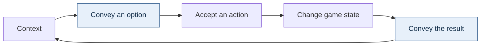

# 47 — Narrative, simulation, and AI in playable worlds

[[Chapter Edition/03 - Game Engine/00 - Reading Map|Reading map]] · [[Chapter Edition/03 - Game Engine/46 - Game design from mechanics to narrative interfaces|Previous chapter]]

The design route now extends from authored story into spaces, companions, and decisions that operate during play. This chapter ties narrative intent to navigation and runtime contracts, then closes with the evidence required for a complete system.

**By the end:** Explain how story constraints and AI decisions enter simulation while preserving player agency, navigation correctness, and observable outcomes.

**Recall question:** How does an AI action change the world in a way the player can interpret, and which movement-versus-decision contract must hold?

<!-- Derived from Continuous Notes/Game Engine - From First Frame to Living Worlds.md; source lines 113347–114800; source-span SHA256 ed585a63c67558834ef4d51a1f8e0682ed93ec5f1b719384150bc14d9dc11c45. -->

<!-- CHAPTER-SOURCE-BEGIN -->
## Narrative can be authored, played, and retold

A useful design discussion does not have to settle whether games “are narratives.” *Rules of Play* presents that binary as a poor starting point: a game can be examined through a narrative lens, and the useful question is how its rules, content, and play create narrative experience. The chapter distinguishes **embedded narrative**, the material designed before play (setting, characters, missions, scripted events), from **emergent narrative**, the sequence and meaning that arise as players interact with rules. Many games mix both: a mission supplies a frame and goal, while each player’s route, timing, conflict, and outcome vary. These are the book’s analytic terms, not mutually exclusive product categories (PDF pp. 373–380; source `src-2d00777ffb7d550fdb6c`, units `u-f82310dff4359ccfbffa0ba8`, `u-0bdbb23e17eb5c5f1a03069c`, `u-53206bad1dd58690974b0032`, `u-686fb11d8a3cec5daa2a016d`, `u-d02f3ea482267434e120c533`).

A small dice game makes the distinction tangible. The rules set the shared premise and the storm’s approach; each die roll changes the house being built and the risk that lightning destroys it. The dramatic rhythm is not delivered by a cutscene alone. It comes from the visible state changes, the order of turns, and how each player compares their own position with everyone else’s. In a strategy game, a trade can be both a resource decision and a social act: help an opponent now, or preserve a relationship that may matter later. The mechanics do not force every player to tell the same story, but they shape which stories are easy to recognize and share.

Designers can trace that relationship through four questions: what does the player know before acting; what can the rules change; what information does presentation expose; and what can players infer or tell afterward? A scripted event can establish context, while a systemic outcome can complicate it. If the player’s actions have no perceptible consequence, an intended narrative choice may feel cosmetic. If the system produces a surprising consequence without a readable cue, an emergent story may be difficult to understand. Narrative design therefore includes affordances, feedback, pacing, and spatial structure as well as authored text.

The excerpt’s “narrative space” links an overarching frame to a space of possible actions and consequences. A room layout can stage a choice; a route through connected rooms can pace discovery; a social map can turn movement and resource placement into relationships. This idea need not imply that every possible outcome is a story or that spatial design can replace authored narrative. It asks whether the game’s spaces and rules create meaningful opportunities for action, and whether the resulting changes are legible enough for players to interpret.

For a prototype, write a two-column trace. In one column, record the designed frame: premise, goal, characters, location, and scripted information. In the other, record two plausible play histories: actions, state changes, feedback, and the story a player might tell about them. Where the same rule yields different experiences, identify which variation is intended and which needs better feedback. This lets a team tune authored content and systemic possibility together without claiming that the game can control every player’s interpretation.


## Constraints can carry story when consequences stay visible

The *Game Design Theory and Practice* discussion of *The Last Express* describes a mystery organized around one train journey. Its limited setting and constrained movement give the designers a repeated social space: passengers share compartments and corridors, actions can be seen or overheard, and time advances while the player considers what to do. In the example, disposing of a body outside the train avoids one immediate problem but creates another when police board at a later stop; a child’s remark can expose the act. The design lesson is not that fewer choices always make better stories. A constraint works when it channels attention toward consequential decisions and the game lets the player perceive how one action changes later possibilities (PDF pp. 361–363; source `src-0e4e96cb9aa5b4eed033`, units `u-b279328066d554a9b4b67080`, `u-9005a2056f905583f8a03484`).

Sound can be part of that information design. The excerpt presents the train’s movement and environmental sounds as active cues, with music responding to events rather than filling every interval as a continuous score. If quiet stretches let a player notice footsteps, a door, or a distant conversation, reducing music can preserve useful signals. But silence is not automatically suspenseful: it needs a readable relation to the environment, and critical cues need enough salience for the player to hear them under different listening conditions. Treat the specific audio history and production details as a case study from the book, not a current audio-engine specification.

This example also clarifies why a save system is a design mechanic. The book describes color-coded “eggs” as persistent return points intended for different household players, challenging the assumption that a conventional named save file is the only meaningful model. A save interface expresses assumptions about who plays, how they resume, and what progress means. A technical design therefore starts with player contexts—shared device, multiple profiles, branching story, or replay—then chooses a representation that preserves the needed identity and state. Storage implementation follows the contract; it does not define it.

The interview's videotape analogy adds an important distinction: a player profile is not merely one latest save point. Its egg can contain a history that supports returning to earlier moments, without asking the player to name every checkpoint. The source says rewind can usually return within three to five real-time minutes of the desired point. That is a reported user-facing resolution, not evidence about whether the program stores inputs, snapshots or a different history representation. An engine implementing a similar idea must define history retention, reachable rewind points, identity and version compatibility, and the treatment of events outside the saved simulation.

The audio example is equally concrete. Opening a door can make the train louder; a distant door closing or the train slowing at a station changes what the player hears. Those are state-dependent cues. A continuously repeating score could mask them, whereas music reserved for selected situations can become a more salient event. This explains a production choice in terms of information the player can use, rather than treating silence as an automatically dramatic effect.

For each constrained action, document the immediate result, the delayed consequence, the cue that reveals the consequence, and any recovery path. Then play through it from a fresh save and ask whether the outcome feels caused by the player’s choice rather than by hidden designer fiat. This connects authored narrative, simulation state, sound, and persistence while leaving room for different games to choose different levels of freedom.


## Theme and structure become meaningful through play

A theme is not merely decoration placed on top of rules. In the *Rules of Play* design reflection on *Ironclad*, the author describes beginning with philosophical images but finding that the first game structure did not carry either theme well. A new structure—pieces occupying both grid squares and intersections, with the two layers influencing one another—made the theme and mechanics feel connected. The lesson is not that every mechanic must literally depict its subject. It is that representation can help players understand a complex relationship, while a rule can make the represented idea actionable. The relationship is reciprocal: theme suggests actions and relationships; structure determines which of them play can express (PDF pp. 289–293; source `src-b7bb9a7016640ab322f8`, units `u-d363557a6b6336d1b6d3fe21`, `u-8d15cd63ffef7ef8fcd664fd`, `u-d5327d181b7884ddb9ddc23d`).

The chapter then shifts from rules as a formal specification to play as the experience those rules enable. “Play is free movement within a more rigid structure” is the book’s broad design formulation. In a game, rules establish boundaries and state changes; players explore the choices those boundaries permit. A strong rule set can still produce lifeless play if it offers no useful decisions, while a player’s playful expression often appears in spaces the formal rules do not prescribe exactly. This distinction helps a team ask two different questions: is the rule system coherent, and does interacting with it produce the intended experience?

Use the idea in a prototype review by pairing each important rule with the player behavior it is meant to invite. Then observe what players actually do. If a theme promises interdependence but the best strategy is to ignore other players, the structure and representation are pulling apart. If a two-layer board makes the relationship visible and choices require attending to both layers, the design uses representation as a guide into complexity. The fix may be a rule change, stronger feedback, different framing, or a simpler theme; do not assume a story label can repair mechanics that teach a contradictory lesson.

The source distinguishes **gameplay**, play within a game's rules; **ludic activities**, a broader range of play such as informal chasing or tossing a ball; and **being playful**, an attitude that can be brought to activities outside a game. Here “ludic” simply means concerned with play. These are the authors’ analytic distinctions, not engine object types. A playful attitude toward organizing a workspace need not create a formal game, while a competitive match adds specific rules and outcomes. Other design traditions define these differently. The transferable method is to check how a player experiences a system in action and whether the represented meaning survives contact with the decisions the game actually supports.


## Space is part of the rule for what can happen

A game space does more than contain objects. Its layout determines what can be seen, reached, protected, or hidden, and those possibilities shape both tactics and interpretation. *Rules of Play* calls attention to narrative space: the spatial arrangement of a game can create contexts in which actions acquire meaning. A volleyball net divides allies from opponents; a circle in Mafia makes each participant both observer and subject of observation; a corridor in a maze constrains escape and makes pursuit legible. In a digital action game, a wall may block sight while a power-up’s location and timing create uncertainty. These examples are the book’s design analysis, not a universal claim that every player reads the same story from a layout (PDF pp. 385–390; source `src-a18d9cb026ac631c4d77`, units `u-9731ef69edd9bb796bc0edfb`, `u-14275c2abd3f1afa27a69f05`, `u-524c1eb62ed83ea774a45ffd`).

A useful spatial review separates three questions. What does the geometry physically permit? What does the represented setting suggest should happen there? What can the player perceive from a particular camera or position? If an arena is meant to encourage ambush, sightlines and cover should enable concealment, but the interface must also give players enough information to learn how concealment works. If a room is meant to feel safe, the rules and soundscape should not repeatedly punish ordinary exploration there. Navigation, collision, camera framing, audio, and narrative descriptors all contribute to the player's working interpretation of a place.

Narrative descriptors—images, text, sound, and object behavior—help identify what a space means and which actions fit its frame. The same simple collision layout can suggest different play when described as a tennis court, a prison, or an asteroid field. Yet labels cannot carry the whole design: if the rules contradict the setting in a way that players cannot interpret as intentional, the frame becomes confusing. Conversely, familiar genre conventions can help players predict likely affordances before reading a manual. Those expectations can be used, challenged, or subverted, but the result should remain learnable enough to support purposeful action.

For a level blockout, annotate each region with intended relationships, not only dimensions: who can see whom, where information is hidden, which routes are available, what changes when the player crosses a boundary, and what sounds or visuals signal the change. Then walk the space using the actual camera and movement rules. This ties geometry to player agency and story while keeping the claim modest: designers shape a field of possible interpretations; players realize particular ones through play.


## Let a game enter real life with a clear way back out

Most games announce their frame: players sit down, open a menu, or enter a match. *Rules of Play* examines live games that deliberately make this boundary less obvious. In *Seasons of Darkness*, players keep both the fictional vampire activity and the existence of the game secret from bystanders; a gesture can mean a supernatural ability inside the fiction while remaining ordinary-looking outside it. In *Suspicion*, the workplace itself becomes play space, and participants use familiar offices, invitations, and social roles to stage hidden alliances and accusations. These examples show how context can become part of a game’s materials, while also showing that a frame still needs rules, time boundaries, and some way for participants to know when play begins or ends (PDF pp. 565–570; source `src-068dcc8eb09139d505ba`, units `u-4c0a56d6edca068842a0ef7e`, `u-36bf494ca633cbd88703bbfb`, `u-eb83d867220003e0369f7081`, `u-3782ac49fd9d9775ccc22f81`, `u-2b8c1c1df59a4ed73bbde998`).

This design territory has a distinct safety and trust problem. A participant may know the fictional rules but not know whether a colleague is role-playing, whether a boss is in on the game, or whether an accusation is part of the fiction. Real institutions also have power differences that can make nominally voluntary participation feel compulsory. The source treats those blurred boundaries as a way to make culture visible; that interpretation does not establish that every participant felt safe or consented to the consequences. A contemporary design review should test those questions directly.

Before moving play into a shared workplace, campus, street, or online community, specify who can invite whom, how participation is signaled, what outsiders can reasonably infer, what conduct is out of bounds, and how anyone can pause or leave without penalty. Give moderators a way to distinguish in-game accusation from real reporting, and decide what happens to game state when a participant opts out. A short entry ritual can establish the frame for players; an equally explicit exit ritual can return them to ordinary roles and let people raise a concern outside the fiction. Concealment can be a mechanic among consenting players, but it should not conceal the possibility of opting out.

This makes the game’s boundary an authored interface. Rules and props shape how play unfolds; local context supplies meanings and risks the designers cannot fully predict. Teams should therefore prototype with the people who will inhabit that context, observe whether the invitation and exit remain legible, and revise the design when the frame creates unwanted social pressure. Cultural transgression is a design intention in the source’s examples, not a guarantee of beneficial resistance or safe play.


The [[Visual Recall/Game Engine - Visual Recall|engine retrieval card]] collects short mechanisms and direct returns to these teaching sections, including the bounds figure and the shared footprint/order/lifetime visual.


---


## AI is a player-experience system before it is an intelligence benchmark

A game AI should be judged against what the game needs the player to experience, not against an abstract goal of behaving as much like an unconstrained human as possible. Rouse gives several overlapping goals: provide challenge, avoid conspicuously foolish behavior, create enough unpredictability that the player cannot reduce every encounter to a trivial script, support storytelling where appropriate, and help the world feel inhabited. Different games weight those goals differently. A puzzle opponent, stealth guard, racing rival, ambient pedestrian, squad companion, and social simulation therefore do not share one sensible definition of “smart.”

This matters because greater model complexity can reduce the quality of play. An opponent with perfect tactical search may be unbeatable but boring. A fully symmetric agent restricted to exactly the player’s information and physical capabilities may require enormous engineering effort merely to become competent. Conversely, a simple enemy with carefully chosen abilities, numbers, positioning, and readable reactions can create an excellent challenge. Rouse calls attention to the **sloped playing field**: games often give AI agents advantages or constraints different from the player. The design question is not whether asymmetry exists; it is whether the resulting challenge feels coherent with the rules the player can learn.

That does not license invisible cheating without consequence. If an enemy can see through walls despite a game built around line of sight, the player’s learned model collapses. Asymmetry should be either part of the fiction/rule set or bounded so that it preserves the decisions the game asks the player to make. A boss may have ten times the health of the player because endurance is the challenge. A strategy AI may receive a resource bonus at a high difficulty level if the game communicates difficulty as an asymmetric handicap. An ordinary stealth guard secretly reading the player’s exact position while pretending to search may destroy the information game. “Fair” therefore needs to be evaluated at the level of meaningful opportunity and learnable causality, not only identical numbers.

**Artificial stupidity** is equally important. An agent may need to refrain from using every available advantage. A racing opponent can avoid perfect lines so a human can compete. A squadmate can delay a shot so the player remains the protagonist. An enemy can expose intent before a dangerous attack. These are controlled limitations that create room for human decision-making. They should be explicit design policies so engineers do not repeatedly “fix” behavior that is intentionally imperfect.

Ambient AI has another purpose: to make a world feel alive. Birds, pedestrians, workers, wildlife, or background conversations can establish setting and continuity even when they are not tactical opponents. Their value depends on cost and interaction. A hundred expensive agents running full combat planners while off-screen are wasteful if the player only needs believable local activity. Level-of-detail thinking can therefore apply to behavior as well as graphics: full decision-making for nearby relevant agents, cheaper schedules or aggregate simulation for distant populations, and explicit rules for what happens when an agent changes representation. This is an engine synthesis of Rouse’s “living world” goal, not a specific algorithm prescribed by the book.

The phrase **how good is good enough?** should become a production question with evidence. Define the behaviors the player must be able to infer, the mistakes that would break the fantasy or challenge, and the performance/content budget. Build representative encounters and observe players. If a technically sophisticated planner produces no noticeable improvement, complexity may be misplaced. If players repeatedly exploit a simple blind spot that trivializes the core mechanic, the AI or level rules need revision. The companion example that follows shows the same principle from the opposite direction: sometimes the right response to an AI limitation is to change level design rather than indefinitely increase the agent’s complexity.

Source basis: Rouse, *Game Design: Theory & Practice*, Chapter 9 on AI goals, the sloped playing field, “how real is too real,” “how good is good enough,” scripting, artificial stupidity, and creating a living world.

<!-- Bible-final-pass: AI decision layer -->
## Navigation answers how to move; the decision layer answers what to do

The navigation chapter already teaches graphs, A*, navmeshes, funnels, dynamic obstacles, and path queries. Those systems answer a geometric question:

> Given a destination, how can this agent reach it?

They do not decide whether the agent should attack, heal, investigate, retreat, reload, guard, or choose a different goal. That belongs to a decision layer.

Behavior trees, utility systems, and goal-oriented action planning solve related decision problems with different tradeoffs.

### Behavior trees expose authored control structure

A sequence usually means:

~~~text
try child 1
if it succeeds, try child 2
fail on the first failure
succeed if all succeed
~~~

A selector usually means:

~~~text
try child 1
if it fails, try child 2
succeed on the first success
fail if all fail
~~~

Leaves commonly return Success, Failure, or Running. Running matters because movement or animation can take many ticks.

A small combat tree might be:

~~~text
Selector
  Sequence
    IsHealthLow
    MoveToCover
  Sequence
    CanAttack
    Attack
  SearchForEnemy
~~~

Priority is visible in the structure. The tradeoff is that large trees can accumulate repeated conditions and hidden priority interactions.

A running node also needs interruption policy. Does the tree reevaluate higher-priority branches each tick, or stay committed until the current task finishes? Both are valid and produce different behavior.

### Utility AI scores alternatives

Utility AI computes a score for each candidate action:

~~~text
score(action, state) -> real number
choose the highest acceptable score
~~~

For example, cover score can rise as health falls, attack score can be high only when a visible target can be attacked, and search score can rise when no target is visible.

This makes continuous tradeoffs easy to tune, but it adds contracts: normalize inputs, define response curves, prevent tiny score changes from causing rapid action switching, expose scores in debug tools, and use deterministic tie-breaking when replay matters.

Numbers do not automatically make an AI smarter. Bad utility curves can be less readable than a small tree.

### GOAP searches over preconditions and effects

Goal-Oriented Action Planning represents actions with symbolic preconditions, effects, and costs.

Suppose the goal is enemy_defeated=true. Actions might be:

~~~text
find_weapon:
  pre: no weapon
  effect: has weapon
  cost: 2

find_ammo:
  pre: has weapon and no ammo
  effect: has ammo
  cost: 2

find_enemy:
  pre: enemy not visible
  effect: enemy visible
  cost: 1

attack:
  pre: weapon + ammo + visible enemy
  effect: enemy defeated
  cost: 1
~~~

The planner searches the symbolic state graph for a low-cost sequence that reaches the goal.

The symbolic action find_enemy does not specify pathfinding, animation, or perception implementation. It says what subgoal should occur. Lower systems execute it.

### A plan must survive a changing world

Another agent may take the ammo before this agent arrives. Therefore each action must verify its preconditions when it begins and often while it runs. If they fail, repair or replan.

Replanning every frame can waste CPU and make behavior unstable. Useful triggers include action failure, important fact changes, goal changes, invalidated plans, or periodic low-frequency reconsideration.

Planning work must also be bounded. A large symbolic state space can explode just like an unbounded path search.

### Keep perception, memory, decision, navigation, and action separate

A useful pipeline is:

~~~text
sensors / perception
  -> interpreted facts
  -> memory with age/confidence
  -> decision system
  -> chosen goal/action
  -> navigation or task executor
  -> animation/physics/gameplay command
  -> changed world
  -> new perception
~~~

This prevents one opaque AI leaf from raycasting, pathfinding, changing animation, and directly editing physics velocity without clear ownership.

### AI needs observability

For one selected agent, a debug view should show perceived facts, remembered targets and their age, active goal, active behavior-tree branch or utility scores, current plan, path result, action status, and reason for failure/replan.

"Enemy acted stupid" becomes useful only after the engine can show which fact or decision produced the action.

A real game can combine them: utility chooses fight versus flee, a behavior tree executes the mode, GOAP handles a special multistep task, and navigation moves toward requested destinations.

The executable witness below sends small world states through all three models. The behavior tree exposes authored priority, utility AI scores alternatives, and GOAP searches action preconditions/effects. It is a comparison of semantics, not a declaration that one architecture wins.


~~~cpp
/*
Teaching contract: World is a snapshot of interpreted facts, not raw sensing.
The same facts are fed to three distinct decision semantics: a behavior tree
applies explicit branch priority and Success/Failure/Running status; utility AI
scores available actions and needs stable tie/threshold policy; GOAP searches a
bounded symbolic state graph using action preconditions, effects, and costs.
Action names are intentions, not movement or combat implementations. Tests
compare choices on fixtures and failure states; they do not establish that one
model is universally better or that the world facts are accurate.
*/
#include <algorithm>
#include <array>
#include <functional>
#include <iostream>
#include <limits>
#include <optional>
#include <queue>
#include <stdexcept>
#include <string>
#include <unordered_map>
#include <vector>

struct World {
    int health = 100;
    int ammo = 0;
    bool enemy_visible = false;
    bool has_weapon = false;
    bool enemy_defeated = false;
};

void require(bool condition, const char* message) {
    if (!condition) throw std::runtime_error(message);
}

// ---- Behavior tree: authored control structure ----
enum class Status { Success, Failure, Running };

// Ordered branches make authored priority the selection rule.
Status behavior_tree_decide(const World& w, std::string& action) {
    // Selector priority is explicit: survive first, then attack, then search.
    if (w.health < 30) {
        action = "seek_cover";
        return Status::Success;
    }
    if (w.enemy_visible && w.has_weapon && w.ammo > 0) {
        action = "attack";
        return Status::Success;
    }
    action = "search";
    return Status::Success;
}

// ---- Utility AI: score alternatives from current facts ----
// Utility compares scored candidates; stable ties avoid nondeterministic choices.
std::string utility_decide(const World& w) {
    struct Candidate { std::string name; double score; };
    std::vector<Candidate> c{
        {"seek_cover", std::clamp((50.0 - w.health) / 30.0, 0.0, 1.0)},
        {"attack", (w.enemy_visible && w.has_weapon && w.ammo > 0) ? 0.85 : 0.0},
        {"search", w.enemy_visible ? 0.1 : 0.55},
    };
    return std::max_element(c.begin(), c.end(),
        [](const Candidate& a, const Candidate& b) {
            if (a.score != b.score) return a.score < b.score;
            return a.name > b.name; // deterministic tie-break
        })->name;
}

// ---- GOAP: search over symbolic actions and effects ----
struct Facts {
    bool has_weapon = false;
    bool has_ammo = false;
    bool enemy_visible = false;
    bool enemy_defeated = false;
    friend bool operator==(const Facts&, const Facts&) = default;
};

struct Action {
    std::string name;
    int cost;
    std::function<bool(const Facts&)> pre;
    std::function<Facts(Facts)> apply;
};

int encode(const Facts& f) {
    return (f.has_weapon ? 1 : 0)
         | (f.has_ammo ? 2 : 0)
         | (f.enemy_visible ? 4 : 0)
         | (f.enemy_defeated ? 8 : 0);
}

// Expand applicable symbolic actions; this plan names intent, not navigation execution.
std::optional<std::vector<std::string>> goap_plan(Facts start) {
    const std::vector<Action> actions{
        {"find_weapon", 2,
            [](const Facts& f){ return !f.has_weapon; },
            [](Facts f){ f.has_weapon=true; return f; }},
        {"find_ammo", 2,
            [](const Facts& f){ return f.has_weapon && !f.has_ammo; },
            [](Facts f){ f.has_ammo=true; return f; }},
        {"find_enemy", 1,
            [](const Facts& f){ return !f.enemy_visible; },
            [](Facts f){ f.enemy_visible=true; return f; }},
        {"attack", 1,
            [](const Facts& f){
                return f.has_weapon && f.has_ammo && f.enemy_visible && !f.enemy_defeated;
            },
            [](Facts f){ f.enemy_defeated=true; f.has_ammo=false; return f; }},
    };

    struct Node {
        int cost;
        Facts facts;
        std::vector<std::string> plan;
    };
    struct Greater {
        bool operator()(const Node& a, const Node& b) const {
            if (a.cost != b.cost) return a.cost > b.cost;
            return a.plan > b.plan; // deterministic queue tie-break
        }
    };

    std::priority_queue<Node,std::vector<Node>,Greater> q;
    std::array<int,16> best;
    best.fill(std::numeric_limits<int>::max());
    best[encode(start)] = 0;
    q.push({0,start,{}});

    while(!q.empty()) {
        Node n=q.top(); q.pop();
        if(n.facts.enemy_defeated) return n.plan;
        if(n.cost != best[encode(n.facts)]) continue;

        for(const auto& a:actions) {
            if(!a.pre(n.facts)) continue;
            Facts next=a.apply(n.facts);
            int cost=n.cost+a.cost;
            int key=encode(next);
            if(cost >= best[key]) continue;
            best[key]=cost;
            auto plan=n.plan;
            plan.push_back(a.name);
            q.push({cost,next,std::move(plan)});
        }
    }
    return std::nullopt;
}

int main() {
    {
        World w{20,10,true,true,false};
        std::string bt;
        require(behavior_tree_decide(w,bt)==Status::Success && bt=="seek_cover",
                "behavior-tree priority should choose survival branch");
        require(utility_decide(w)=="seek_cover",
                "utility score should also favor cover at very low health");
    }

    {
        World w{80,10,true,true,false};
        std::string bt;
        behavior_tree_decide(w,bt);
        require(bt=="attack" && utility_decide(w)=="attack",
                "both models should attack when attack is clearly useful");
    }

    {
        Facts start{};
        auto plan=goap_plan(start);
        require(plan.has_value(), "planner should find a plan");
        // Several equal-cost orderings can be logically valid. Verify the plan
        // reaches the goal and has the expected total number of required steps.
        require(plan->size()==4, "planner should need four prerequisite/action steps");
        Facts f=start;
        const std::unordered_map<std::string,Action> table{
            {"find_weapon",{"find_weapon",2,[](const Facts& x){return !x.has_weapon;},
                [](Facts x){x.has_weapon=true;return x;}}},
            {"find_ammo",{"find_ammo",2,[](const Facts& x){return x.has_weapon&&!x.has_ammo;},
                [](Facts x){x.has_ammo=true;return x;}}},
            {"find_enemy",{"find_enemy",1,[](const Facts& x){return !x.enemy_visible;},
                [](Facts x){x.enemy_visible=true;return x;}}},
            {"attack",{"attack",1,[](const Facts& x){return x.has_weapon&&x.has_ammo&&x.enemy_visible&&!x.enemy_defeated;},
                [](Facts x){x.enemy_defeated=true;x.has_ammo=false;return x;}}},
        };
        for(const auto& name:*plan) {
            const auto& a=table.at(name);
            require(a.pre(f), "GOAP action precondition must hold when executed");
            f=a.apply(f);
        }
        require(f.enemy_defeated, "GOAP plan must actually establish the goal");
    }

    {
        Facts impossible{false,false,false,true};
        auto plan=goap_plan(impossible);
        require(plan.has_value() && plan->empty(),
                "already-satisfied goal should produce an empty plan");
    }

    std::cout << "AI decision models: 4 suites PASS\n";
}
~~~


**Reconstruct without reading:** explain what A* answers that a behavior tree does not. Write one selector, one utility score, and one GOAP action. Then state when replanning should occur and which AI state the editor must expose.

## Let companion AI and level geometry share one contract

A companion that follows the player is not only a navigation feature. It is part of the level’s reachable-state design. In the *Damage Incorporated* example, a rudimentary teammate AI was built before substantial level design. That early version could not jump or swim, and it struggled in tight spaces where companions collided or blocked the player. The author reports that this discovery changed level design: routes had to remain traversable by the follower, and constrained spaces had to be reconsidered. (*Game Design: Theory and Practice*, supplied PDF p. 191, source `src-f508b5433ab08ffd2964`, unit `u-4274992395bc43b21d421cf2`.)

This is a useful engineering dependency. The level asks an agent to reach a goal through a sequence of spaces and transitions. A jump, swim, ladder, or door is a transition type, and the agent must either implement that transition or the level must not require it. A corridor also has capacity: if the follower’s turning and avoidance behavior cannot handle a narrow passage, a route that is connected in the level graph may still fail in movement. So “the path exists” and “this agent can traverse it” are different claims. Test the actual controller on representative spaces before authoring many dependent levels.

A practical prototype can therefore include one player, one companion, and a small route containing the game’s difficult transitions. Record each segment’s requirement—walk, turn, jump, swim, open door—and observe whether the agent reaches the same goal, obstructs the player, or loses formation. When it fails, separate a missing action capability from a path-planning error, collision/avoidance behavior, or a level constraint. That classification tells the team whether to extend the agent, alter the route, or change the companion role. It also gives level designers concrete requirements instead of a vague promise that “the AI will work.”

The book gives a particular production ratio of roughly one quarter code fixes and three quarters level rework for one project. Treat that as the author’s retrospective about that game, not a planning estimate for other teams. The reusable lesson is the sequencing: get a representative behavior prototype running before a large body of dependent level content accumulates, then revise both sides of the contract as evidence arrives. This connects to the book’s separate advice to make a small piece of gameplay work before building the rest (source `src-38b424a735fb2ff45aa0`, supplied PDF p. 308, unit `u-f102e1ff3037239dfbdcf837`).

## Diagnose choices as a five-stage loop

A player action becomes meaningful through a sequence, not merely because input code receives a button. *Rules of Play* describes a choice as: the context before the choice; how the possible choice is conveyed; the mechanism by which the player chooses; the choice’s effect on game state; and how the result is conveyed back. It distinguishes internal stages (context, action processing, state effect) from external stages (showing options and showing results), and describes the result as the context for the next choice. (Supplied PDF pp. 75–78, 82; source `src-13b9f7885ad00561b1b6`, units `u-6eed545c74820be6c499f9b3`, `u-a38c1ea79e016b57769b1e4b`, `u-91dae07d3c354e0ff40d92e3`, `u-35ec59a7f849c8f61bf005e4`, `u-e6592a502e29ad5b23c0982b`.)

Trace a door interaction. First, the door is locked and the player holds a key: that is context. Next, a nearby prompt or visible lock communicates that interaction is possible. The player presses the interact control, the input mechanism identifies the target, and the game rule changes the door from locked to open. Finally, animation, sound, and changed traversal communicate the result. The new open-door state then changes which routes are available. If the player says “I did not know what I could do,” inspect option conveyance. If the button press appears ignored, inspect target selection and input acceptance. If the prompt disappears but the door remains shut, inspect the state transition. If the door opens silently or the passage remains blocked, inspect result presentation and collision synchronization.

The point is not that every game needs a prompt, a sound, or five separate software modules. The five stages are a diagnostic lens for connecting internal state to player-visible possibility and consequence. A single system may own several stages; what matters is that the contract makes each one testable. The supplied *Rules of Play* pages identify these stages and use failures such as arbitrary-feeling decisions or invisible outcomes to explain why the sequence matters. The door example and its engineering checks are an original application of that framework. It extends the current discussion of readable cause and consequence by giving teams a systematic place to look when an action feels confusing.

### Figure E-choice - From opportunity to consequence



The blue stages communicate with the player; the other stages describe context and the accepted state change. The diagram is a diagnostic route, not a requirement for five software modules. Reconstruct the locked-door example through each stage before debugging a whole interaction system.


## Make a runtime debug control observe one owner at a time

A live debug control can make a game parameter easier to tune: expose a labeled value, let a slider change it while the scene runs, and observe the visual effect without rebuilding. The Sparky development-log example adds a shader intensity parameter and a slider, then narrows the edit from a shared material to one cube material instance. That scope change matters: if the control alters every object sharing a material, the screen may look different but it becomes harder to tell which object’s data caused the result. A good tuning experiment changes one owner and one variable while holding the others steady. The same episode reports a fixed-width label overflow and treats font metrics and menu organization as unfinished work. These are details of this early tool, not a recommendation to expose raw memory addresses as a production UI contract. [Sparky Engine Dev Log #1, 00:24:08–00:34:19]

## Put the theme in the objective, then bound the choices

In an interview, Chris Crawford describes *Balance of Power* as an “un-wargame”: war means failure. The useful design point is that a theme can be carried by the victory and loss conditions themselves. If a game is meant to express the cost of escalation, a rule that treats military victory as success may contradict the intended subject even if the dialogue says otherwise. Crawford’s description is his account of a particular project, not independent history or a rule every political game should follow. (*Game Design: Theory and Practice*, physical PDF p. 291 / printed p. 266; the assigned interview continues through physical PDF pp. 291–300.)

The same interview describes an interactive-story design with a stable dramatic endpoint and choices whose accumulated effects determine the route into that endpoint: characters’ prior responses shape which side they take when the conflict arrives. It calls this a “skeletal plot” and argues for dramatically reasonable choices rather than unlimited actions. As a design exercise, write one fixed event the player cannot remove, list the choices that can change who is prepared for it, and trace how each choice changes the final state. Then ask whether the restriction supports the drama or merely blocks a plausible action without explanation. The account is a proposal discussed in an interview, not evidence that the described tool or story was completed. [PDF pp. 298–300]

A separate idea from Crawford’s description of *Siboot* is a non-transitive combat relation: instead of A beating B, B beating C, and C beating A being merely a novelty, a designer can treat the cycle as a space for readable tactical choices. If using it, state the relationship in the interface or through play feedback so players can infer why a matchup changed. Crawford presents this as a design opportunity; the assigned pages do not establish that any one ring size or implementation is balanced. [PDF pp. 292–293]

## Design for interaction patterns, then tune what players discover

A set of local rules can create a larger play pattern the designer did not specify as a named mechanic. In the book’s *Populous: The Beginning* example, preachers convert nearby enemy warriors, while warriors that are already fighting cannot be converted. The first wave may join the player; the next may encounter those converted fighters and start a battle. That new context means the player has to return and move converted warriors behind the preachers. The design lesson is concrete: conversion radius, time to convert, movement speed, and immunity while fighting shape whether the pattern appears. Change one value too far and the interaction can collapse. This is a case from the authors’ analysis, not a claim that every interaction produces desirable emergence. [*Rules of Play*, physical PDF pp. 175–176]

The *Gearheads* example makes the pattern easier to see. Individual wind-up toys have simple abilities, but players combine them into small “engines.” For instance, a Handy toy can wind a nearby Crush Kringle; the Kringle’s stomp reverses movement, sending Handy toward another Kringle to wind it in turn. The toy interaction becomes a repeatable scoring pattern that the player can discover and intentionally assemble. Designers later tuned the pieces and taught the computer opponent to recognize some advantageous combinations. The useful workflow is therefore: define a few interacting rules, instrument their values, play the combinations, record patterns that appear, then tune whether those patterns are readable, balanced, and interesting. The designer directly authors rules and only indirectly shapes the play that emerges from them. [PDF pp. 176–178]

## Keep the draft history that explains why rules changed

James Ernest’s *Caribbean Star* design notes show how a playable rule set evolves from a theme and a rough draft. The author starts with a two-player cruise-ship premise and ordinary playing cards, writes an initial rulebook to expose missing decisions, then tests it with one playtester. The early draft uses a 30-minute show and a Five that discards a hand. Testing reveals two separate problems: discarding burns through the deck and lets a player avoid bad cards; an all-mistake practice pile has no satisfying way to clear. The revisions swap hands on a Five and add a zero-point Comedy Show. The author then revises the Ace effect to preserve round count, clarifies score order, changes terminology that overloaded “rehearsal,” and halves the target show length to make the numbers easier to explain. These are not universal rules for card games; they are a compact example of recording an observed problem, a candidate change, and the resulting tradeoff.

The notes also explain why simultaneous card selection and a precedence order were chosen: hidden simultaneous choices reduce the first-player concern, while precedence gives the pair a deterministic resolution sequence. The exact Caribbean Star rules are only the final snapshot of a longer iteration. When teaching from a design case, keep the early and final rules separate, and preserve the “why” beside each revision so a future designer can see which playtest observation the change was meant to address. [*Rules of Play*, physical PDF pp. 578–584; final scoring example pp. 577–578]


## Multiplayer is a gameplay and operations commitment

A multiplayer mode is not a networking switch applied after the single-player game is complete. The supplied *Game Design: Theory and Practice* pages recount a project where multiplayer was added without being part of the original design plan. The author says it functioned as a short diversion but did not strengthen the game enough to justify the time, and that the team did not want to compromise the single-player experience to support it (PDF p. 277; `src-0898be31835566d45f2a`, unit `u-fa867ea850f6aa70165c4825`). This is a production recollection, not a rule that multiplayer must always be designed first. It does show why the decision changes mechanics and staffing: players can surprise each other in ways a designer cannot script, so maps, rules, pacing, fairness and social interaction need their own playtests.

Treat the earliest prototype as a question about the game’s intended shared activity. If players compete, does the core action stay understandable when another human can interrupt it? If they cooperate, what information and tools let them coordinate? A client/server architecture can decide who owns a simulation value, but it cannot decide whether the interaction is fun, fair or readable. The current networking notes already explain authority and message flow; the additional design implication is to validate those rules in an actual small multiplayer loop before a single-player experience becomes difficult to change.

The same production chapter warns that beta testers may be unusually invested players and may not represent casual audiences; it also notes that some testers can benefit from keeping an exploit undisclosed. Its later discussion recommends community managers to interpret and communicate player feedback and describes player metrics as another source of evidence (PDF pp. 279–280; units `u-e3e73c42b9ad8eb3140f355a`, `u-a4de81035bbfc7ebaf2b8750`). These are the authors’ observations, not a guarantee about every beta cohort. More generally, measurements record selected actions under a particular build and sampling setup; they do not explain why a player acted or whether an outcome felt fair. Combine telemetry with representative playtests, observation, and a clear design question. When a change may alter a valued mechanic, test the consequence with players before treating a metric movement as proof that the design improved.

The system boundary therefore extends past networking code: it includes the intended player relationship, the content and test setup that exercise it, and the post-launch capacity to interpret reports and maintain the experience. That is a design and operations implication drawn from this historical production discussion, not a prescribed live-service architecture.

<!-- Bible-final-pass: rollback netcode -->
### Prediction hides latency; rollback repairs a wrong prediction

The earlier networking sections correctly start from authority, identity, packet validation, and bounded work. A fast action game still has one practical question: what should the local machine do before a remote input or server correction arrives?

If the client waits for every remote input before simulating, network delay becomes control delay. Prediction avoids that wait by simulating with the best information currently available. Prediction creates a second problem: it can be wrong. Rollback is the repair mechanism.

Keep the simulation on integer ticks. Write one tick as:

~~~text
S_(k+1) = F(S_k, I_k)
~~~

S_k is the complete gameplay state needed to continue the simulation. I_k is the complete input set for that tick.

For a two-player rollback peer:

~~~text
known local input    -> use it
known remote input   -> use it
missing remote input -> predict it
simulate tick
store resulting state
~~~

A common prediction rule is to repeat the last known remote input. It is simple and often useful for held movement. It is not a universal rule. A fighting game might repeat a direction while predicting one-shot attack buttons as unpressed. Prediction policy affects game feel.

Suppose the peer has simulated through tick 105 while the remote input for tick 101 was predicted. The real tick-101 input later arrives.

If it matches the prediction, no repair is needed.

If it differs:

~~~text
restore S_100
replace predicted I_101 with real I_101
resimulate 101, 102, 103, 104, 105
continue from corrected S_105
~~~

The player normally sees the newest corrected state, not the temporary historical replay.

#### Rollback requires reproducible simulation

Rollback assumes that the same starting state plus the same input sequence produces the same result. That requirement reaches beyond networking. It affects update order, random-number generation, physics ordering, unordered-container iteration, script side effects, spawning and stable IDs, event delivery, and any system that reads wall-clock time or other mutable external state.

The witness uses integer gameplay state so this requirement is visible. A production engine can use floating point, but supported platforms still need a tested determinism policy instead of an assumption.

A useful diagnostic is a state hash:

~~~text
hash(tick, gameplay state that should agree)
~~~

Comparing hashes can reveal the first divergent tick. A hash says that state differs; it does not say why. Serious replay tooling should also expose subsystem or component traces so the first differing value can be found.

#### Rollback history is finite

To repair an input from N ticks ago, the engine needs a state from before that input and enough input history to replay forward.

A rollback buffer therefore has a finite window:

~~~text
oldest retained state ... current speculative state
~~~

The window costs memory and resimulation CPU. If a correction arrives older than retained history, the engine needs a declared recovery policy: request an authoritative snapshot, hard-correct, pause/disconnect, or another explicit rule. Missing history must not become silent state corruption.

#### Prediction, rollback, interpolation, and reconciliation are different tools

Local prediction makes the local player's own controls feel immediate.

Rollback repairs speculative simulation when late input disagrees.

Snapshot interpolation intentionally renders remote objects a little in the past so two received snapshots are usually available for smooth interpolation.

A server-authoritative client can use server reconciliation. The client predicts numbered local inputs. The server later sends an authoritative state and the last processed input number. The client installs the server state, discards acknowledged inputs, and reapplies newer inputs:

~~~text
client predicts input 80
client predicts input 81

server replies with state after input 80 and ack=80

client:
  install server state
  discard history through 80
  replay input 81 and later
~~~

Lag compensation is different again. A server may evaluate a shot against a reconstructed historical world near the shooter's command time. That requires policy: maximum rewind, which objects rewind, interpolation rules, and what happens when the shooter's past view conflicts with another player's present view.

#### Presentation does not have to expose every correction

A corrected gameplay state may jump. Rendering that correction directly can look harsh. Keep simulation truth separate from visual smoothing. The gameplay state can become correct immediately while a presentation transform eases toward it, provided the smoothed value never becomes authoritative collision or gameplay state.

This witness does not implement transport, congestion control, authentication, packet redundancy, anti-cheat, floating-point cross-platform determinism, snapshot compression, or lag-compensated hit validation. It makes the simulation/history contract reconstructable before those layers are added.

The executable witness below predicts missing remote input, stores state history, detects a late mismatch, restores the previous state, resimulates to the present, and verifies that the final state equals a direct authoritative simulation. It also checks duplicate packets and a correction older than retained history.


~~~cpp
/*
Teaching contract: State is the complete deterministic gameplay state for this
tiny two-player example; tick is an integer simulation step and positions are
integer cells. Input is the command assigned to one tick. The peer predicts a
missing remote command by repeating the latest known one, stores the state
before each tick plus inputs used, and when a late command differs restores the
preceding state and replays through the present. Capacity bounds memory and
resimulation age; a correction outside retained history is rejected. State
hashes are diagnostic only. This integer witness avoids floating-point drift;
it does not prove determinism for a real engine or implement packet transport.
*/
#include <algorithm>
#include <array>
#include <cstdint>
#include <cstdlib>
#include <deque>
#include <iostream>
#include <map>
#include <stdexcept>
#include <string>

struct Input {
    int move = 0;   // -1, 0, +1
    bool fire = false;
    friend bool operator==(const Input&, const Input&) = default;
};

struct State {
    std::int64_t tick = 0;
    std::int64_t p0 = 0;
    std::int64_t p1 = 0;
    std::int64_t score0 = 0;
    std::int64_t score1 = 0;
    friend bool operator==(const State&, const State&) = default;
};

State step(State s, Input a, Input b) {
    ++s.tick;
    s.p0 += a.move;
    s.p1 += b.move;

    // Deterministic toy hit rule: firing scores when players are at most one
    // integer cell apart after movement. Integer state avoids floating-point
    // cross-platform drift in this teaching witness.
    if (a.fire && std::llabs(s.p0 - s.p1) <= 1) ++s.score0;
    if (b.fire && std::llabs(s.p0 - s.p1) <= 1) ++s.score1;
    return s;
}

std::uint64_t hash_state(const State& s) {
    // A tiny deterministic diagnostic hash, not a cryptographic hash.
    std::uint64_t h = 1469598103934665603ull;
    auto mix = [&](std::int64_t v) {
        std::uint64_t x = static_cast<std::uint64_t>(v);
        for (int i = 0; i < 8; ++i) {
            h ^= (x >> (i * 8)) & 0xffu;
            h *= 1099511628211ull;
        }
    };
    mix(s.tick); mix(s.p0); mix(s.p1); mix(s.score0); mix(s.score1);
    return h;
}

void require(bool condition, const char* message) {
    if (!condition) throw std::runtime_error(message);
}

class RollbackPeer {
public:
    explicit RollbackPeer(std::size_t history_capacity)
        : capacity_(history_capacity) {
        if (capacity_ < 2) throw std::invalid_argument("history must hold at least two states");
        states_[0] = State{};
    }

    void set_local_input(std::int64_t tick, Input in) {
        local_[tick] = in;
    }

    // Returns true when the new remote input changed a past prediction and a
    // rollback/resimulation was performed.
    bool receive_remote_input(std::int64_t tick, Input in) {
        if (tick <= confirmed_before_) return false; // duplicate/ancient confirmed packet
        if (tick <= current_.tick && !states_.contains(tick - 1))
            throw std::runtime_error("correction is older than retained rollback history");
        auto old = remote_.find(tick);
        if (old != remote_.end() && old->second == in) return false; // idempotent duplicate

        remote_[tick] = in;

        const auto predicted = remote_used_.find(tick);
        // Only an already-consumed prediction mismatch requires history repair.
        if (predicted != remote_used_.end() && predicted->second != in) {
            if (!states_.contains(tick - 1))
                throw std::runtime_error("misprediction is older than retained rollback history");
            rollback_from(tick);
            return true;
        }
        return false;
    }

    void advance_to(std::int64_t target_tick) {
        while (current_.tick < target_tick) simulate_one(current_.tick + 1);
    }

    const State& state() const { return current_; }
    std::uint64_t state_hash() const { return hash_state(current_); }

    void confirm_through(std::int64_t tick) {
        confirmed_before_ = std::max(confirmed_before_, tick);
        trim_history();
    }

private:
    Input local_for(std::int64_t tick) const {
        if (auto it = local_.find(tick); it != local_.end()) return it->second;
        return {};
    }

    Input remote_for(std::int64_t tick) const {
        if (auto it = remote_.find(tick); it != remote_.end()) return it->second;

        // Common rollback prediction policy: repeat the last known remote input.
        Input last{};
        auto it = remote_.upper_bound(tick);
        if (it != remote_.begin()) {
            --it;
            last = it->second;
        }
        return last;
    }

    void simulate_one(std::int64_t tick) {
        const Input a = local_for(tick);
        const Input b = remote_for(tick);
        remote_used_[tick] = b;
        current_ = step(current_, a, b);
        states_[current_.tick] = current_;
        trim_history();
    }

    // Restore the pre-tick snapshot and replay retained commands to the old present.
    void rollback_from(std::int64_t tick) {
        const std::int64_t previous_target = current_.tick;
        current_ = states_.at(tick - 1);

        for (auto it = states_.lower_bound(tick); it != states_.end(); )
            it = states_.erase(it);
        for (auto it = remote_used_.lower_bound(tick); it != remote_used_.end(); )
            it = remote_used_.erase(it);

        while (current_.tick < previous_target) simulate_one(current_.tick + 1);
    }

    void trim_history() {
        while (states_.size() > capacity_) states_.erase(states_.begin());

        // Inputs older than the oldest retained transition are no longer useful.
        if (!states_.empty()) {
            const std::int64_t oldest_state = states_.begin()->first;
            for (auto it = remote_used_.begin(); it != remote_used_.end() && it->first <= oldest_state; )
                it = remote_used_.erase(it);
        }
    }

    std::size_t capacity_;
    State current_{};
    std::map<std::int64_t, State> states_;
    std::map<std::int64_t, Input> local_;
    std::map<std::int64_t, Input> remote_;
    std::map<std::int64_t, Input> remote_used_;
    std::int64_t confirmed_before_ = -1;
};

State authoritative_run(
    std::int64_t ticks,
    const std::map<std::int64_t, Input>& a,
    const std::map<std::int64_t, Input>& b
) {
    State s{};
    for (std::int64_t t = 1; t <= ticks; ++t) {
        const Input ia = a.contains(t) ? a.at(t) : Input{};
        const Input ib = b.contains(t) ? b.at(t) : Input{};
        s = step(s, ia, ib);
    }
    return s;
}

int main() {
    std::map<std::int64_t, Input> local{
        {1,{1,false}}, {2,{1,false}}, {3,{0,true}}, {4,{-1,false}}, {5,{0,true}}
    };
    std::map<std::int64_t, Input> remote_truth{
        {1,{-1,false}}, {2,{-1,false}}, {3,{1,false}}, {4,{1,true}}, {5,{0,false}}
    };

    const State truth = authoritative_run(5, local, remote_truth);

    RollbackPeer peer(16);
    for (const auto& [t,in] : local) peer.set_local_input(t,in);

    // Tick 1 remote input arrives in time. Ticks 2..5 are initially predicted
    // by repeating that last known input.
    peer.receive_remote_input(1, remote_truth.at(1));
    peer.advance_to(5);
    const auto speculative_hash = peer.state_hash();
    require(!(peer.state() == truth), "prediction should differ before late packets arrive");

    // A late authoritative tick 2 happens to match the repeated prediction.
    require(!peer.receive_remote_input(2, remote_truth.at(2)),
            "matching late input should not require rollback");

    // Tick 3 differs from prediction, so the peer restores tick 2 and resimulates.
    require(peer.receive_remote_input(3, remote_truth.at(3)),
            "mispredicted past input must trigger rollback");
    require(peer.state_hash() != speculative_hash,
            "rollback should change the speculative result in this scenario");

    // Later authoritative inputs can trigger further resimulation.
    require(peer.receive_remote_input(4, remote_truth.at(4)),
            "tick 4 mismatch must trigger rollback");
    require(peer.receive_remote_input(5, remote_truth.at(5)),
            "tick 5 mismatch must trigger rollback");

    require(peer.state() == truth,
            "after all authoritative inputs arrive, rollback state must equal direct simulation");
    require(peer.state_hash() == hash_state(truth),
            "deterministic state hash must agree with authoritative run");

    // Duplicate packet: application layer remains idempotent.
    require(!peer.receive_remote_input(5, remote_truth.at(5)),
            "duplicate authoritative input must be harmless");

    // History overflow is an explicit policy, not silent corruption.
    RollbackPeer tiny(3);
    tiny.set_local_input(1,{1,false});
    tiny.receive_remote_input(1,{0,false});
    tiny.advance_to(8);
    bool rejected_old = false;
    try {
        tiny.receive_remote_input(2,{1,false});
    } catch (const std::runtime_error&) {
        rejected_old = true;
    }
    require(rejected_old, "too-old correction must fail visibly when history is gone");

    std::cout << "rollback netcode: 7 suites PASS\n";
}
~~~


**Reconstruct without reading:** if a wrong tick-101 prediction is discovered after simulating tick 105, name the snapshot restored and every tick replayed. Then distinguish local prediction, rollback, server reconciliation, snapshot interpolation, and lag compensation.

### A reconnect window needs an ownership policy

A multiplayer dropout is both a connection failure and a game rule. The connection says whether messages can currently arrive; the player seat says who still belongs to the match; the avatar stores the participant’s game state. These identities overlap, but they are not the same object. Deleting an avatar whenever its socket closes can make a brief network interruption count as a forfeit. Reusing its seat immediately can let a late packet affect the next person who occupies that seat.

The supplied *Game Design: Theory and Practice* chapter recommends handling network dropouts so the match can continue, with a possible short opportunity for a player to reclaim a slot after reconnecting. That is a design suggestion in a 2005 book, not evidence that every game should offer the same grace period. The engineering example below turns the choice into an explicit policy. Source location: source `src-a4de9e1680075fe88eb6`, point `p-000012`, raw unit `u-b727c797a8e28a1d429d8f99`; physical PDF page 269, visible footer *Chapter 13: Multi-Player*, p. 244.

For a small cooperative match, let a server-owned player seat move through three states:


`Connected` means a live transport is bound to the seat. `Reconnecting` means the seat and avatar remain owned by that participant, but the server accepts no gameplay commands from the broken transport. `Forfeited` is a terminal match decision for this example: the avatar is removed from active play and its seat cannot be reclaimed in this match. A competitive game could choose a different rule, such as leaving the avatar vulnerable, invoking a bot, or allowing a teammate to take over. Pick one rule and show it to players before a connection drops.

Assume a fixed simulation rate of 60 ticks per second and a 300-tick reconnect window, which is five seconds. At tick 1200 the transport disconnects. The server changes the seat from `Connected` to `Reconnecting`, records deadline tick 1500, preserves the existing player identity and avatar, and rejects commands from the old connection generation. At tick 1430 an authenticated reconnect arrives with the same match and seat token. Because 1430 is before the deadline, the server binds a new transport generation to the existing seat. The avatar continues from its saved authoritative state; the server does not spawn a second avatar or replay the previous move. A command queued on the old generation arrives after reconnect and is rejected. The new connection resumes with the next valid input sequence.

The clock is part of the rule. At exactly 60 simulation ticks per elapsed second, 300 ticks take five seconds. If simulation pauses or the server stalls without advancing ticks, that is five seconds of simulation time, not necessarily five seconds on a player’s clock. A live competitive service may instead use an authoritative monotonic elapsed-time deadline and serialize its expiry into the simulation. Declare the pause and overload policy rather than silently promising wall-clock forgiveness from a tick counter. The trace here intentionally uses simulation ticks.

This boundary needs more than a seat number. Store a stable player or seat identity, a monotonically increasing connection generation, a deadline, and the last accepted input sequence. Keep that sequence history across reconnects for this policy; the client resumes after the last acknowledged command rather than resetting the same logical stream to zero. A bounded generation counter must fail or retire its identity before wraparound. A generation is an identity guard, not authentication: bind it to the authenticated match and participant on the server, rather than trusting a packet’s seat field. On receipt, validate that the match is still active, the authenticated participant owns the seat, the packet’s connection generation is current, and its sequence number is new. A duplicate command can then be ignored, and a delayed command from an earlier connection cannot be mistaken for the first command on a new connection. The reliable/ordered transport may simplify delivery, but it does not remove the need to define application-level ownership when reconnect creates a fresh stream.

The failure trace is an immediate slot reuse. Player A disconnects from seat 3; the server erases A and assigns seat 3 to player B. A delayed packet from A contains only `seat=3` and `move=left`. The receiver looks up the current seat owner and moves B’s avatar. The packet may be validly encoded and still mutate the wrong game state. Stable identity plus a connection generation prevents this aliasing. A second failure is to resume A by constructing a new avatar while the old one remains in the world, producing duplicated inventory, collision, or score state. Rebind the seat’s existing player record rather than rerunning match-entry side effects.

At the deadline, process forfeiture at a defined simulation boundary. First mark the seat terminal, then apply the match’s avatar and score rules once, then publish the transition to clients. Reconnect requests processed after that boundary receive an explicit “match seat expired” response or enter spectator mode. Do not let arrival order across separate network and simulation threads decide whether the player was still eligible. Queue the request for the owning simulation thread and compare it with the authoritative tick and deadline there.

A repeatable test uses a fake clock and a deterministic packet queue: disconnect at tick 1200; accept reconnect at 1499; reject at 1500 under an exclusive deadline rule; deliver one old-generation movement packet; duplicate one new-generation command; and confirm one seat, one avatar, and one accepted move. Then repeat with out-of-order timeout and reconnect events. A saved Python witness executed these deadline, wrong-owner, stale-generation, duplicate-command and stale-timer cases successfully. It validates the stated single-thread state-machine transitions and message guards in that model. It does not prove the policy is fair or fun, and it does not test real network conditions. Playtests must decide whether five seconds is appropriate, whether the avatar should remain in place, and how the match communicates the interruption.

The source motivation is the supplied *Game Design: Theory and Practice*, physical PDF page 269, printed page 244: tolerate unavoidable dropouts and consider allowing a quick return. The concrete state machine, clock, authentication precondition and generation policy here are original engineering development. The identity guard connects to [[Concepts/Object identity and generation handles]]; retaining a seat number alone is insufficient.

This extends the existing networking note’s instruction to define disconnect handling and test reconnects with one worked policy. The seat transition and generation checks are an original synthesis, not behavior shown in the book or a claim about any inspected engine implementation.


## A game's interface can carry both its accessibility and its puzzles

The *Loom* analysis offers a useful design bridge between input engineering and authored experience. The interface is not merely the mechanism that maps a mouse event to an action. It decides which kinds of difficulty belong to the player. The book contrasts text parsers (interfaces that interpret typed commands), verb menus, and icon menus with *Loom*'s double-click interaction: one click moves Bobbin to a visible object; a double-click asks the game to perform the contextually useful action. This removes a layer of commands that often repeated an obvious choice. The author argues that this shifts challenge away from remembering a control vocabulary and toward interpreting the world. Treat that as the book's design argument, illustrated by *Loom*, rather than a rule that every game should minimize inputs. A tactical interface may intentionally demand command selection; the question is whether that burden supports the intended play.

The game then gives the simplified interaction a rich second layer. A player hears a short sequence of musical tones while inspecting an object, learns the matching notes on Bobbin's distaff, his staff-like magical instrument, and repeats them to cast a “draft,” the game’s name for a spell. The visible notation teaches the sequence; the expert mode removes that display and asks the player to hear it. For the reversible drafts described, reverse order produces an opposite effect, and a draft learned in one situation may solve a related later puzzle. The same input surface therefore serves movement, contextual interaction, memory, music, and inference. It is simple at the motor level but expressive at the rule level.

For an engine or tools team, this is a reminder to keep three questions separate. First, what input event did the platform report? Second, how does the game interpret that event in the current context? Third, what feedback teaches the player the interpretation? A double-click is not inherently intuitive: the object needs a readable affordance, timing must tolerate real users, and the response must confirm what occurred. A sound sequence is not just an audio asset either; the game must encode its notes, present optional visual scaffolding, accept replay, and preserve the relation between learned drafts and later puzzle targets. Those are authored rules and content relationships built on top of input infrastructure.

The source also identifies the cost of a strong authored structure. Long non-interactive conversations can make the player feel temporarily powerless; a fixed story and puzzles may limit replay after solutions are known; attractive landscapes can obscure navigation. It praises integration between story and mechanics while recognizing that the result remains linear. The useful review is therefore not “simple interface is better,” but: which effort is removed, which cognitive effort is intentionally added, and when does the presentation take control away? A test should observe first-time learning, error recovery, discoverability, and the player's ability to connect a learned rule to a later use. The extracted pages describe a historical adventure game and the author's evaluation; they are not a user study or a general accessibility standard. (*Game Design Theory and Practice*, PDF pp. 256–261; source `src-ffe773c44d6f4eb4af9a`, units `u-5a0a5b34083ad8e00f045d26`, `u-87fc99c0a91edf2291182aa3`, `u-c0616676980f89515bde864c`.)


## A setback needs a legible cause and a possible recovery

Rouse's “what players want” chapter frames failure as useful only when it teaches. A player may accept losing to a challenge they could understand and overcome; repeated failure caused by an invisible rule, an arbitrary one-shot obstacle, or a permanently unwinnable state feels like the game has withheld the terms of success. The chapter's recommendation is normative and broad, so an engine team should translate it into a concrete content contract rather than treating it as a measured universal law.

For each high-cost failure, write down the cue that precedes it, the player action that could avoid it, the feedback that explains the result, and a route to continue. In a platforming pit, test that a recovery path exists or that the game ends the trapped state promptly and fairly. For a boss attack, expose a readable wind-up and enough time for the intended response. For a long mission, checkpoints and player-requested saves address different needs: an automatic checkpoint protects progress at authored boundaries; an explicit save lets the player choose when to stop. Rouse argues that automatic saves should complement rather than replace manual saving, and that no player should remain alive in an unwinnable space. These are design recommendations from the cited edition, not platform policy or contemporary user research.

This lens complements state-machine thinking. A save system must specify the captured state and restore behavior; a level rule must specify whether failure resets, branches, or permits recovery. The player-facing promise is only sound when the engine can preserve the corresponding state. A useful test therefore pairs an authored failure with an engine trace: trigger the obstacle, observe the feedback, follow the recovery route, save or checkpoint, reload, and verify that the world returns to a playable state. This connection is a proposed testing method derived from the design claims, not something the source says the cited games implement uniformly. (*Game Design Theory and Practice*, PDF pp. 39–41; source `src-a78b9fc4a709c27d61c4`, units `u-29934507f9b87b5f724583ed`, `u-573371d338b25d622dff2c75`.)


## “Game” and “play” change scope with the question

The definition chapter ends with a useful warning against turning a taxonomy into a universal fact. It offers two compatible ways to relate the words. In ordinary classification, games are one subset inside the wider phenomenon of play: children can play without engaging in a bounded game. In the book's analytical framework, however, a game is a complex phenomenon that can be studied through three lenses—rules, play, and culture—so “play” is one aspect inside the larger game being analyzed. The chapter explicitly presents both relations as useful. They are not rival set-theory claims about a single fixed universe; the first compares categories of activity, while the second describes components of a designed game phenomenon. (*Rules of Play*, PDF p. 96 / printed Chapter 7, p. 14; source `src-a3ca4c0db79b24a55daa`, unit `u-db65536d4c9a2e992e11cf35`.)

The authors then settle on an operational definition for the rest of their book: a game is a system in which players engage in artificial conflict, shaped by rules, with a quantifiable outcome. They acknowledge that this deliberately excludes or complicates borderline cases. A cooperative activity can still contain conflict between players and a system; an open-ended role-playing campaign may have many local outcomes without one final score; a city-building sandbox can acquire quantifiable goals because the player chooses them. The value of the definition is not that it resolves every philosophical case. It gives a team a vocabulary for asking what the rules constrain, what state changes, what success means, and whose goal is being counted.

This distinction is useful in tools and architecture reviews. A rule editor can represent formal constraints; an in-game session can expose player activity; a community or modding layer can change the culture around the same rules. These are related views, but the editor's data schema does not fully describe the play experience or the social context. When an authoring tool asks for a “win condition,” it should allow the project to express that a particular mode has several local goals, no fixed winner, or a player-selected target. A rigid single-score field might be a deliberate scope choice, but it should not be mistaken for a universal property of games.

The source also compares definitions by Parlett, Abt, Huizinga, Caillois, Suits, Costikyan, and others. Each definition serves a context. Rules recur across many of them, while voluntary participation, inefficiency, social bonding, make-believe, and a single final outcome do not receive equal support from every author. The lesson is methodological: when importing a definition into design or code, name whose framework is being used and what cases it leaves out. The extracted claim “play is a subset of games” is not a contradiction of “games are a subset of play”; the chapter itself explains the two different analytic scopes. (PDF pp. 85–96; selected raw unit `u-4c897a456424a2f3cb7bb2ef` gives the authors' synthesized definition and caveats.)

## Let players control narrative pacing as well as branching

A game can place story material in different relationships to play. In the supplied *Game Design: Theory and Practice* excerpt, the author distinguishes material delivered outside active play, narrative that unfolds while the player is acting, and materials carried beyond the game (such as a manual, map, or collectible). The categories describe contexts, not competing technologies: one story may use all three. The same excerpt contrasts the designer’s authored story with the sequence the player experiences and later recounts through decisions and play (PDF pp. 229–230; source `src-b2905119c4899f0890b6`, units `u-9a1ae26ae760a13ff036c9e1`, `u-55a0d6a644a743004dde0c60`).

That distinction makes presentation controls part of the interaction contract. A cut-scene fixes timing and viewpoint for a moment; a player may want to skip it, pause it, replay a detail, or return to a prior moment. The book discusses examples ranging from simple skipping to brief rewind and interactive mission briefings (PDF pp. 233–235; units `u-570eeb672ea7daa1fc6b6e65`, `u-ab11ae1be35f19c6e6ba4c67`). Those are examples and the author’s critique of a purely passive presentation style, not a universal requirement that every scene offer every control. A game may intentionally protect a dramatic reveal, but it should make the reason and the player’s available choices clear.

A practical authoring record can name each story element’s context, required player attention, available interruption/replay controls, and whether it changes persistent state. For example, a mission briefing might pause simulation while allowing pause, rewind, and resume; a note found during exploration might leave the world active and remain available later in an archive; a pre-rendered scene may offer skip but not rewind. Then test the transition: when playback ends or is skipped, resume at a defined gameplay state, avoid duplicate one-shot events, and preserve the same mission flags. This implementation trace is an original application of the source’s presentation categories and examples.

A natural ending and a Skip button may both call the same scene finalizer. Guard against applying a one-shot quest change or reward twice when both paths fire. Rewinding presentation also needs a policy for previously committed gameplay events: replaying a sound is different from granting the same item again. These are proposed engine checks derived from the pacing contract, not claims about the cited games' implementations.

The source’s examples are period-specific and do not prove that any one interface improves every game. The useful design question is whether players can receive story at the pace and level of attention the activity supports, and whether controlling presentation leaves the underlying state coherent. This supplements the volume’s embedded/emergent narrative distinction with a separate axis: where information is delivered and how much control the player has over its timing.


## Count identity collisions without promising uniqueness

Stable identity supports that lifecycle, but the UUID episode demonstrates why names matter. A display name is useful to a person and can be duplicated or changed; persistent references need a stable identity. A transient registry slot or entity handle is useful for fast lookup in a running process, but it may not be valid after destruction or reload. A serialized scene therefore needs a defined mapping between its stable ID and the current runtime entity. The episode’s implementation uses a random 64-bit value and calls it UUID-like. That size is a project choice; it is not interchangeable with the 128-bit UUID representation used in another part of this volume. For uniformly random 64-bit IDs, the approximate chance of at least one collision after $n$ generated IDs is $n(n-1)/(2\cdot 2^{64})$ while the chance remains small: roughly $2.7\times10^{-8}$ at one million IDs, but about $2.7\%$ at one billion. Collision probability depends on both width and count. If IDs are imported, merged across projects, or must be adversarially hard to guess, those requirements need their own design and collision-handling policy. The source’s statement that collisions are unlikely is not a uniqueness proof. [The Cherno, “Universally Unique Identifiers (UUID/GUID),” implementation discussion and 64-bit collision discussion; caption source units u-64be8a20cbd6b3d8b11b3ec3 and u-25f6b2adda4c6e0864b8213c.]

Uniform draws make each bit pattern equally likely; independent draws do not change distribution because earlier values occurred. There are $n(n-1)/2$ pairs among $n$ generated IDs. With $b$ random bits, one pair matches with probability $2^{-b}$. The expected number of matching pairs is therefore $\lambda=n(n-1)/(2\cdot2^b)$. For rare collisions this is also the first-order probability estimate; a common approximation over a wider range is $P\approx1-e^{-\lambda}$. The union bound $P\le\min(1,\lambda)$ is a separate rigorous upper bound under the stated pairwise probability model. An approximation and an upper bound are not interchangeable claims.

### Figure E-ID - Birthday collision risk

![[Visual Recall/Game Engine/identity-birthday-risk.png]]

The curves use independent uniform random IDs and the stated birthday approximation. A logarithmic vertical scale makes very small probabilities visible; a low curve is not zero. Biased generators, reused seeds, imports and adversarially chosen values can violate the model. Persist a collision-detection/resolution policy where identity must be unique within a project. This calculation does not audit a real generator or establish unpredictability.

## Dragging an asset is a typed request, not a pointer gesture

A content browser bridges filesystem organization and scene authoring. A user may drag a scene file into a viewport, but the editor must decide what that gesture means: open a scene, instantiate an asset, replace a component’s reference, or reject the drop. The drag source and drop target form a small protocol. On the source side, the UI starts a drag only while its item is active, attaches a payload with a stable type tag and the item’s path or asset identifier, then closes the source scope. The target accepts only the expected payload type and validates its contents before changing scene state.

The Hazel tutorial walks through ImGui’s begin-source, set-payload, end-source pattern and a matching target. It encounters null or unstable payload observations, duplicate image IDs when multiple entries share a texture, and path conversion concerns. It suggests assigning unique UI identifiers, such as an entry path, to distinguish same-looking items. These are observations in that tutorial’s code, not guarantees that a path is always a safe identity. Payload data must have an explicit length and lifetime; if the UI library copies it only for the duration of a drag, a consumer should copy or resolve it before retaining it. Do not assume a wide path can be losslessly narrowed to `char*`: filesystem path encoding differs by platform. Prefer carrying a project-relative normalized path or stable asset ID, then resolve it through the project’s asset layer. On drop, validate that the reference belongs to the active project, names an allowed asset kind, and still resolves. The editor should report rejection rather than silently opening arbitrary or stale content. [The Cherno, “Content Browser Panel - ImGui Drag Drop,” 00:00–end; claims checked against caption units u-b978ea24c5f555d7ef8d00e7, u-2a5f8a6c7b4367e2f26616f6, and related path/payload units. Exact ImGui API names should be checked against the engine’s pinned library version.]

## Debug geometry makes invisible state inspectable

A physics debugger cannot rely on the game’s final shaded image to reveal collider geometry, raycasts, or contact state. A line-rendering path gives tools a cheap way to draw bounds and diagnostic rays. One simple CPU-facing record contains two endpoints $p_0,p_1$, color, and optionally an entity identifier. The renderer converts each record into the backend’s supported primitive or expands it into triangles. Lines should be batched separately from ordinary sprites when they use a different vertex format or draw mode; starting a batch clears its count and write pointer, and flushing should do nothing for an empty batch. Each submitted segment contributes two endpoints, so a batch of $N$ independent segments has $2N$ endpoint vertices unless a different indexed or connected representation is used.

The line episode starts with a deliberately small 2D/debug implementation and discusses OpenGL line width and smoothing. Its note that line antialiasing may vary with drivers and hardware is a useful portability warning; its tentative “possibly 10” width limit is not a portable contract. Native line behavior differs by API and target. Where consistent thickness, joins, or antialiasing matter, expanding a line to a camera-facing quad gives the engine explicit geometry and a width policy. That expansion introduces edge cases: zero-length segments have no direction, joins can crack, and screen-space thickness differs from world-space thickness. For simple collider overlays those costs may be unnecessary; for production vector-like strokes they must be handled. The debugging path should carry entity identity only if picking or selection uses it, and prefer an integer-format ID attachment. A packed color encoding instead needs its own validated unfiltered, unblended, lossless read/write contract. [The Cherno, “Rendering Lines in a Game Engine,” 00:19:43–00:20:27 and 00:32:07–00:33:01; the note’s API portability caveat is already stated at “Treat vertex data as an agreement between CPU and GPU.”]

## Tell the player through choices the system permits

Engine architecture helps shape interactive storytelling, but it cannot dictate a single theory of good game writing. The assigned *Game Design: Theory and Practice* excerpt argues that game story is strongest when players participate through actions, and contrasts this with presenting the plot as a passive sequence. Its phrase “do, don’t show” is a design position from the author, not a universal rule: cutscenes, dialogue, manuals, and environmental detail can all serve a game when they fit the experience. The practical engine-facing question is whether authored information is connected to an action or decision the player can make, and whether the consequences are legible.

The excerpt also describes a character-design tradeoff. A minimally characterized avatar may leave room for player projection; a strongly authored protagonist can create a more specific designer-authored story, but may make a player feel they are guiding someone else rather than acting as themselves. This is not a simple mute-character rule, and the source’s comparisons among contemporary games should be read as historical examples and authorial interpretation. A prototype can test the intended balance: give players one consequential choice, then observe whether they attribute the outcome to their own decision, to the avatar’s established motives, or to hidden authored constraints.

Nonlinearity also has distinct forms. Branching changes what happens after a choice; allowing the player to choose the order of story pieces changes when information arrives without necessarily creating separate endings. Both can increase agency, but branching content costs production and ordering freedom can disrupt difficulty progression or causal clarity. The source’s claim that nonlinear story can improve popularity or profitability is an argument, not a guarantee. In an engine, expose the state needed to implement the chosen structure—flags, discovered facts, relationship changes, route availability—and make conditions inspectable in authoring and debugging tools. Treat narrative consistency and production cost as design constraints to test, rather than expecting a branching framework to solve them automatically. The excerpt includes only PDF pp. 241–252; p. 252 begins its next chapter on *Loom*, so no larger book section is claimed. [Game Design: Theory and Practice, PDF pp. 241–252, excerpt by author; source unit IDs u-6dfd609fdf7485fd6c879796 through u-8ec557edc60f1c4474c5f6a3.]

## Check units and signs in the buoyancy example before reusing it

The assigned *Game Physics Engine Development* pages explain buoyancy and spring stability, but the printed buoyancy example contains a factor-of-1000 unit error. Pure water has density $\rho=1000\,\mathrm{kg/m^3}$. A block displacing $0.001\,\mathrm{m^3}$ displaces $\rho V=1\,\mathrm{kg}$ of water. With the book's approximation $g=10\,\mathrm{m/s^2}$, the weight of that displaced water is $F_b=\rho Vg=10\,\mathrm{N}$, not $10\,\mathrm{kN}$. Half the volume gives $5\,\mathrm{N}$, not $5\,\mathrm{kN}$. A $0.5\,\mathrm{kg}$ block weighs $5\,\mathrm{N}$ under the same approximation, so half-submergence balances its weight. The book correctly distinguishes mass from weight nearby, but its unit labels are wrong (physical PDF p. 113 / printed p. 90; source `src-5e24b94aa3c73cfcfc58`, unit `u-f4dfc60e5aa8d945d94b371e`).

There is a second issue in the supplied buoyancy expression. The text defines a submerged fraction that is zero when an object is out of the water and one when fully submerged, but the printed expression and code do not consistently meet those conditions. The code's `depth - maxDepth - waterHeight` is negative in the partially submerged range and its multiplication by `maxDepth` rather than division by `2*maxDepth` has the wrong dimensions. The displayed formula also omits $g$ if force is meant to be in newtons. This is visible in the directly read physical PDF pp. 114–115 / printed pp. 91–92 units `u-0021ccb6f7c04486887f68dc` and `u-a30fa5371de291e4e20ae52e`; do not copy that code as written without resolving its sign, scaling, and unit conventions.

For a clearly stated alternative, let $y$ increase upward, let the water plane be at height $y_w$, and let $s>0$ be the vertical half-extent used by this simplified particle model. For an upright box of constant horizontal cross-section, the height fraction equals the displaced-volume fraction. A sphere or irregular hull needs its own volume calculation. Define the submersion fraction

$$
d=\operatorname{clamp}\!\left(\frac{y_w+s-y_o}{2s},0,1\right),
$$

where $y_o$ is the object's center height. Above water ($y_o\ge y_w+s$), $d=0$; below the fully submerged threshold ($y_o\le y_w-s$), $d=1$. Then the upward force is

$$
\mathbf F_b=(0,\rho V g d,0).
$$

For $V=0.001\,\mathrm{m^3}$, $\rho=1000\,\mathrm{kg/m^3}$ and $g=10\,\mathrm{m/s^2}$, full submersion gives $10\,\mathrm{N}$ and half submersion gives $5\,\mathrm{N}$. A $0.5\,\mathrm{kg}$ body therefore has zero net vertical force at half depth in this idealized example. This is an original unit-consistent alternative under the stated axis and geometry convention, not a silent correction to the cited source code and not an arbitrary-hull solver.


### Figure E-B - Balance force before stepping the state

![[Visual Recall/Game Engine/box-buoyancy-force.png]]

The water plane is at zero, the box's vertical half-height is $0.1\,\mathrm m$, and its volume is one liter. Full submersion gives $10\,\mathrm N$ upward; its weight is $5\,\mathrm N$ downward. At half submersion the net force is zero. Raising the center reduces displaced volume and produces a downward net force; lowering it increases buoyancy and produces an upward net force. The clipped straight line follows the declared box geometry and constant water density. Arbitrary hulls need displaced-volume geometry and force-application points to produce the corresponding torques.

### A restoring force still needs a stable numerical step

Inside the partially submerged range, the change in buoyancy with center height acts like a spring. With half-height $s$, its stiffness is $k=\rho Vg/(2s)$. For this box, $k=50\,\mathrm{N/m}$. For mass $m=0.5\,\mathrm{kg}$, the small vertical displacement $x$ from equilibrium obeys $\ddot x=-\omega^2x$ with $\omega=\sqrt{k/m}=10\,\mathrm{s^{-1}}$ under this local, undamped model.

Semi-implicit Euler updates velocity before position:

$$
v_{next}=v-h\omega^2x,\qquad x_{next}=x+h v_{next}.
$$

Its amplification matrix on $(x,v)^T$ is

$$
A_h=\begin{bmatrix}1-h^2\omega^2&h\\-h\omega^2&1\end{bmatrix}.
$$

The determinant is one and the trace is $2-h^2\omega^2$. For this undamped oscillator the eigenvalues lie on the unit circle when $0<h\omega<2$; the endpoint needs care and is excluded from this bounded-oscillation statement. At $h=0.05\,\mathrm s$, the spectral radius is one. At $h=0.25\,\mathrm s$, it is four, so an unstable mode grows geometrically. Stable stepping also has phase and energy error: bounded does not mean exact. Damping, switching out of partial submersion and other constraints change the model and require their own analysis. The growing linearized trajectory would leave the region where this spring approximation describes the box; it is an integration witness, not a predicted full fluid simulation.

### Standalone box-force laboratory

The following complete C++20 program checks the force values, endpoint clipping, translation invariance and invalid inputs. It was compiled and executed with warnings as errors plus address and undefined-behavior sanitizers. Its function returns the upward buoyancy component; the caller must add weight and any other forces separately.

```cpp
#include <algorithm>
#include <cassert>
#include <cmath>
#include <initializer_list>
#include <limits>
#include <stdexcept>

// SI units. y increases upward; gravity is a nonnegative magnitude.
// Exact height-to-volume fraction for an upright constant-cross-section box.
double buoyancyY(double y, double surface, double halfHeight,
                 double volume, double density, double gravity) {
    for (double x : {y, surface, halfHeight, volume, density, gravity})
        if (!std::isfinite(x)) throw std::invalid_argument("non-finite input");
    if (halfHeight <= 0 || volume < 0 || density < 0 || gravity < 0)
        throw std::invalid_argument("invalid extent or physical coefficient");
    const double numerator = surface + halfHeight - y;
    const double denominator = 2 * halfHeight;
    if (!std::isfinite(numerator) || !std::isfinite(denominator))
        throw std::overflow_error("submersion arithmetic overflow");
    const double fraction = std::clamp(numerator / denominator, 0.0, 1.0);
    const double force = density * volume * gravity * fraction;
    if (!std::isfinite(force)) throw std::overflow_error("force overflow");
    return force;
}

int main() {
    auto force = [](double y, double surface = 0) {
        return buoyancyY(y, surface, .1, .001, 1000, 10);
    };
    assert(force(.2) == 0);
    assert(force(.1) == 0);
    assert(force(0) == 5);
    assert(force(-.1) == 10);
    assert(force(-.2) == 10);
    assert(std::abs(force(.03) - 3.5) < 1e-12);
    assert(std::abs(force(-.03) - 6.5) < 1e-12);
    assert(std::abs(force(10.03, 10) - force(.03)) < 1e-10);
    bool rejected = false;
    try { buoyancyY(0, 0, 0, .001, 1000, 10); }
    catch (const std::invalid_argument&) { rejected = true; }
    assert(rejected);
    rejected = false;
    try { force(std::numeric_limits<double>::quiet_NaN()); }
    catch (const std::invalid_argument&) { rejected = true; }
    assert(rejected);
}
```

### A spring law is signed, not just a magnitude

A force generator evaluates the simulation state and contributes a force to one or more bodies. For a particle at position $\mathbf{x}$ connected to an endpoint $\mathbf{a}$, choose the displacement

$$
\mathbf{r}=\mathbf{x}-\mathbf{a},\qquad
L=\|\mathbf r\|,\qquad
\mathbf n=\frac{\mathbf r}{L}\quad(L>0).
$$

This convention makes $\mathbf n$ point from the endpoint toward the particle. Let $L_0$ denote the rest length and $k_s$ the stiffness, measured in newtons per metre. The ideal [[Concepts/Spring forces and numerical integration|linear spring force]] **on this particle** is

$$
\mathbf F=-k_s(L-L_0)\mathbf n.
$$

The extension $L-L_0$ must keep its sign. If the spring is stretched, $L>L_0$, so the leading minus sign makes the force point opposite $\mathbf n$, toward the endpoint. If it is compressed, $L<L_0$, the extension is negative, so the force points along $\mathbf n$, pushing the particle away from the endpoint. At rest length the force is zero. For two movable endpoints, apply the equal and opposite force to the other particle; an anchored spring instead has a fixed endpoint that receives no simulated reaction. The missing reaction belongs to the external support; the simulated particle alone is not an isolated momentum-conserving system.

The sign also follows from stored potential energy. For this ideal spring, $U(L)=\tfrac12k_s(L-L_0)^2$, measured in joules. For $L>0$, moving the particle changes its length with gradient $\nabla_{\mathbf x}L=\mathbf n$. Applying the chain rule gives

$$
\mathbf F=-\nabla_{\mathbf x}U=-k_s(L-L_0)\mathbf n.
$$

The [[Concepts/Partial derivatives and gradients|gradient]] records how the stored energy changes with a small displacement; the force points in the direction of decreasing potential energy. The particle may still travel outward because of its current velocity: force determines acceleration rather than changing position instantaneously. With $k_s=8\,\mathrm{N/m}$ and rest length $1\,\mathrm m$, lengths $0.5\,\mathrm m$ and $1.5\,\mathrm m$ both store $1\,\mathrm J$, yet their restoring force directions differ. Checking energy or force magnitude alone therefore cannot catch the printed sign mistake.

A bungee or elastic cord is a different rule because it cannot push while slack. It produces zero force at and below rest length, and uses the ordinary restoring law only while stretched:

$$
\mathbf F_b=
\begin{cases}
\mathbf 0,&L\le L_0,\\
-k_s(L-L_0)\mathbf n,&L>L_0.
\end{cases}
$$

At $L=0$, normalization has no direction. A production generator must define a policy for that case (for example, return zero, reuse a previous valid direction, or use a deterministic fallback). The accompanying test program chooses zero force there; that is an explicit policy for the witness, not a rule stated by the source. For a nonzero rest length there is no unique direction at coincident endpoints; the zero policy can leave that configuration stuck until another effect separates it.

The book’s anchored-spring listing on PDF p. 110 (printed p. 87) constructs particle-minus-anchor displacement and then replaces the signed extension with its absolute value before applying the negative direction. This returns an inward force both when stretched and when compressed. For the simple one-dimensional case with anchor $0$, rest length $1\,\mathrm m$, and $k_s=8\,\mathrm{N/m}$, a particle at $x=0.5\,\mathrm m$ should be pushed right by $+4\,\mathrm N$, but the printed listing produces $-4\,\mathrm N$. The bungee listing (PDF pp. 111–112, printed pp. 88–89) correctly returns while $L\le L_0$; when taut, its scalar $k_s(L_0-L)$ is negative and the code multiplies it by the negative normalized displacement. Under the listing’s displacement convention the resulting force points outward. At $x=1.5\,\mathrm m$ in the same example it produces $+4\,\mathrm N$, while a restoring bungee should pull left with $-4\,\mathrm N$. These are discrepancies between the printed listings and their intended physical behaviors; the book code was inspected, not compiled as a project. (Source src-5e24b94aa3c73cfcfc58, units u-9389df2a50771b5f6c1d446f, u-3d72f6a9103ab182e8902b5b, u-a8d542b6e4e1270193a371af.)

The transferable test is directional. Test a stretched spring and require a force toward the endpoint; test a compressed ordinary spring and require a force away; test a slack bungee and require exactly zero. A magnitude-only assertion can pass even when a sign mistake makes the simulation diverge.

![[Visual Recall/Game Engine/spring-force-law.png]]

**Figure —** With outward radial direction positive, the spring gives +4 N at L = 0.5 m and −4 N at L = 1.5 m. The bungee is slack at L = 0.5 m, so its force is 0 N, and pulls inward with −4 N at L = 1.5 m. Both have zero force at the 1 m rest length.

### Stiffness couples the force law to the time integrator

A penalty spring used to imitate a rigid connection or contact is not just “a strong force.” A force-based integrator samples forces at a particular point in time and uses them to update state across a finite interval $h$. When the spring is stiff, its force can change substantially during that interval. The force sampled at the start may accelerate the body through the rest position; the next sample then points sharply the other way. Large steps can overshoot repeatedly. Smaller steps or substeps can help, but a very stiff penalty contact may require impractically small intervals for the surrounding simulation. The source presents this as a limitation of its framework, not a universal numeric timestep bound. (PDF pp. 116–118 / printed pp. 93–95; source units u-17cb64fdca5feba411224813, u-7b7bc339be18c7931df2347e, u-f3ada0049be8dc7468b74a93.)

A spring force, an update rule, and a stability claim are separate things. The canonical Engine volume already derives the semi-implicit Euler oscillator update for its buoyancy example and gives the bounded undamped regime $0<h\omega<2$. That result belongs to the velocity-first, then position update. The supplied book’s Particle::integrate listing instead advances position from the old velocity and then updates velocity from acceleration (PDF pp. 93–94 / printed pp. 70–71). That order is forward Euler. For $\ddot{x}=-\omega^2x$, let $\omega=\sqrt{k_s/m}$ be the undamped angular frequency in inverse seconds. Its state matrix is

$$
A_{FE}=\begin{bmatrix}1&h\\-\omega^2h&1\end{bmatrix},
\qquad |\lambda|=\sqrt{1+(\omega h)^2}>1\quad(h>0).
$$

The matrix’s two eigenvalues, its mode multipliers, are $1\pm i\omega h$, where $i^2=-1$. Their magnitude is the per-step envelope factor shown above. Thus the ideal undamped oscillator’s amplitude grows under forward Euler at every positive step size; reducing $h\omega$ reduces the per-step growth but does not make that method bounded. Do not transfer the semi-implicit $h\omega<2$ criterion to this listing.

### The analytic “fake stiff spring” has two separate caveats

The book describes a shortcut for predicting a stiff spring’s endpoint. Restrict this prediction to motion along one fixed axis. The signed displacement from equilibrium follows the ideal undamped oscillator

$$
\ddot p=-\chi^2p,\qquad \chi=\sqrt{\frac{k_s}{m}},
$$

where $m>0$ is mass and $k_s>0$. A general three-dimensional spring with nonzero rest length is not three independent copies of this equation because its radial direction changes. For zero stiffness, use the free-motion limit rather than dividing by a zero frequency. Given initial relative displacement $p_0$ and velocity $v_0$, the analytic oscillator predicts

$$
p_t=p_0\cos(\chi h)+\frac{v_0}{\chi}\sin(\chi h).
$$

These equations assume a linear spring, constant mass and stiffness, no damping, no changing constraints, and no omitted external forces. The motion must remain in that linear force-law regime: a bungee switching between slack and taut states, or a finite-length radial spring reversing through its anchor, needs its own piecewise or geometric treatment. This endpoint is a prediction of the ideal continuous oscillator, not automatically a state that a chosen discrete integrator can reach by adding a force.

First, the book’s printed conversion from the target endpoint to acceleration is dimensionally inconsistent. On PDF p. 119 (printed p. 96), rewritten in the notation here, printed Eq. 6.5 amounts to $\ddot p=(p_t-p_0)/h^2-v_0$: the first term is acceleration, while the second is velocity. Under an explicitly assumed constant-acceleration trajectory,

$$
p_t=p_0+v_0h+\tfrac12 ah^2,
\qquad
a=\frac{2(p_t-p_0-v_0h)}{h^2},
\qquad F=ma.
$$

This reaches the target position in that constant-acceleration model when $h>0$, but generally does not reproduce the oscillator’s target velocity. The source itself notes the velocity mismatch just after the printed equation. The corrected equation here is a dimensional and kinematic derivation, not a claim that the book prints it correctly. (Source units u-f3ada0049be8dc7468b74a93, u-86a1c555363233f1247d3b0d.)

Second, the target-to-force conversion depends on the actual integrator. In the book’s position-first forward Euler listing, the next position is $p_1=p_0+v_0h$. A force calculated now changes the next velocity, but that updated velocity is not used for the same step’s position. Therefore no current-step force can make that listed position update land at the predicted $p_t$, except by coincidence. For a velocity-first semi-implicit update, $p_1=p_0+(v_0+ah)h$, so a same-step endpoint solve would instead use $a=(p_t-p_0-v_0h)/h^2$. That solves the discrete position equation but still does not guarantee the analytic endpoint velocity or stability for interactions among several springs. These are different assumptions and formulae; name the integrator before deriving a force.

The source calls this a restricted “fake implicit” method and warns about interactions and chains (PDF p. 118 / printed p. 95, source unit u-f3ada0049be8dc7468b74a93). Treat it as a specialized approximation, not as an implicit solver, constraint solver, or general contact method. The excerpt gives no general stability guarantee.

### Damping and coefficient units

The damped closed form on PDF p. 120 (printed p. 97) is an oscillatory solution for a linear velocity-damped system. Written dimensionally as

$$
\ddot p+\delta\dot p+\kappa p=0,
$$

the coefficients are $\kappa=k_s/m$ in $\mathrm{s^{-2}}$ and $\delta=c/m$ in $\mathrm{s^{-1}}$, where $c\geq0$ is a linear damping coefficient measured in $\mathrm{N\,s/m}$. The sine-and-cosine form with an exponential envelope applies only in the underdamped regime $\delta^2<4\kappa$. Critical damping has a different limiting form, and the overdamped roots are real; the oscillatory formula cannot be used for those cases. The book excerpt excludes quadratic drag. A dimensionless velocity-retention multiplier used by an engine is not itself the coefficient $\delta$, which has units of inverse time. Because the source reuses k while moving between physical spring stiffness and mass-normalized oscillator coefficients, state the normalization explicitly before using the expression. (Source unit u-b7fad713c6af82cc7cc90aa2.)


#### Solve each linear damping regime with its own form

For the one-dimensional equation above, assume positive mass and stiffness and nonnegative linear damping. Write $\alpha=\delta/2$, let $p_0$ and $v_0$ be the initial displacement and velocity, and measure time $t$ from that initial state. Substituting a trial solution $e^{\rho t}$ gives $\rho^2+\delta\rho+\kappa=0$. Its two roots explain the three cases.

In the underdamped case, $\alpha^2<\kappa$. Define the damped angular frequency $\omega_d=\sqrt{\kappa-\alpha^2}$. The displacement is

$$
p(t)=e^{-\alpha t}\left[p_0\cos(\omega_d t)
+\frac{v_0+\alpha p_0}{\omega_d}\sin(\omega_d t)\right].
$$

The bracket oscillates while the exponential scales its envelope. With no damping, $\alpha=0$, this reduces to the earlier undamped solution. At critical damping, $\alpha^2=\kappa$, the roots coincide and the limit is

$$
p(t)=e^{-\alpha t}\bigl[p_0+(v_0+\alpha p_0)t\bigr].
$$

In the overdamped case, $\alpha^2>\kappa$, use two real roots and their initial-condition coefficients:

$$
\rho_\pm=-\alpha\pm\sqrt{\alpha^2-\kappa},\qquad
C_+=\frac{v_0-\rho_-p_0}{\rho_+-\rho_-},\qquad C_-=p_0-C_+,
$$

$$
p(t)=C_+e^{\rho_+t}+C_-e^{\rho_-t}.
$$

These are solutions of the same declared linear model, not interchangeable approximations. Every case gives $p(0)=p_0$ and $\dot p(0)=v_0$. The roots, $\alpha$ and $\omega_d$ have units of inverse seconds; the coefficients $C_\pm$ have units of displacement. As $\omega_d$ approaches zero, $\sin(\omega_d t)/\omega_d$ approaches $t$, which explains the critical limit without dividing by zero. Near repeated roots, a numerical implementation needs limit-aware evaluation because direct subtraction can lose precision. The source excerpt presents the oscillatory branch; this three-case derivation supplies the missing domain and limiting explanation.

### Standalone spring-direction and integration-order laboratory

This complete C++20 reference uses throwing checks that remain active under NDEBUG. It checks the intended laws against scalar reductions of the printed sign patterns, rest and coincident states, invalid inputs, overflow rejection and tiny-vector direction. It also demonstrates that the current force cannot change a position-first step’s new position. Its oscillator experiment stores displacement from equilibrium; that scalar is a different coordinate from the absolute endpoint distance used by the force-law experiment. It is not the book’s Cyclone program or a general spring/contact solver.

```cpp
// Signed spring and bungee laws; source-sign and integration-order witnesses.
#include <algorithm>
#include <cmath>
#include <iostream>
#include <limits>
#include <stdexcept>
#include <string>

struct Vec3 {
    double x{}, y{}, z{};
};

static double length(const Vec3& v) {
    const double scale = std::max({std::abs(v.x), std::abs(v.y), std::abs(v.z)});
    if (scale == 0.0) return 0.0;
    const double sx = v.x / scale, sy = v.y / scale, sz = v.z / scale;
    return scale * std::sqrt(sx * sx + sy * sy + sz * sz);
}
static bool finite(const Vec3& v) {
    return std::isfinite(v.x) && std::isfinite(v.y) && std::isfinite(v.z);
}
static bool near(double a, double b, double eps = 1e-12) {
    return std::abs(a - b) <= eps;
}
static void require(bool condition, const char* message) {
    if (!condition) throw std::runtime_error(message);
}
static void validate(Vec3 position, Vec3 endpoint, double stiffness,
                     double restLength) {
    if (!finite(position) || !finite(endpoint) || !std::isfinite(stiffness) ||
        !std::isfinite(restLength) || stiffness < 0.0 || restLength < 0.0)
        throw std::invalid_argument("invalid spring input");
}
static Vec3 springForceFromLength(Vec3 r, double L, double stiffness,
                                  double restLength) {
    if (!std::isfinite(L)) throw std::overflow_error("spring length overflow");
    if (L == 0.0) return {}; // Witness policy: no direction, so choose zero force.
    // Normalize scaled components so a rounded subnormal length does not
    // materially change the direction or require an overflowing reciprocal.
    const double scale = std::max({std::abs(r.x), std::abs(r.y), std::abs(r.z)});
    const double sx = r.x / scale, sy = r.y / scale, sz = r.z / scale;
    const double scaledLength = std::sqrt(sx * sx + sy * sy + sz * sz);
    const Vec3 n{sx / scaledLength, sy / scaledLength, sz / scaledLength};
    const double magnitude = -stiffness * (L - restLength);
    if (!std::isfinite(magnitude))
        throw std::overflow_error("spring force magnitude overflow");
    const Vec3 force{magnitude * n.x, magnitude * n.y, magnitude * n.z};
    if (!finite(force)) throw std::overflow_error("spring force component overflow");
    return force;
}
// Returns force ON the particle. n points outward from endpoint to particle.
// Stiffness is N/m; positions and rest length are m.
static Vec3 springForce(Vec3 position, Vec3 endpoint, double stiffness,
                        double restLength) {
    validate(position, endpoint, stiffness, restLength);
    const Vec3 r{position.x - endpoint.x, position.y - endpoint.y,
                 position.z - endpoint.z};
    if (!finite(r)) throw std::overflow_error("spring displacement overflow");
    const double L = length(r);
    return springForceFromLength(r, L, stiffness, restLength);
}
// A bungee exerts no force while slack, including exactly at rest length.
static Vec3 bungeeForce(Vec3 position, Vec3 endpoint, double stiffness,
                        double restLength) {
    validate(position, endpoint, stiffness, restLength);
    const Vec3 r{position.x - endpoint.x, position.y - endpoint.y,
                 position.z - endpoint.z};
    if (!finite(r)) throw std::overflow_error("bungee displacement overflow");
    const double L = length(r);
    if (!std::isfinite(L)) throw std::overflow_error("bungee length overflow");
    if (L <= restLength) return {};
    return springForceFromLength(r, L, stiffness, restLength);
}
// Scalar reductions of the two printed sign patterns, solely for comparison.
static double printedAnchoredForce1D(double x, double stiffness, double restLength) {
    const double L = std::abs(x);
    if (L == 0.0) return 0.0;
    const double magnitude = std::abs(L - restLength) * stiffness;
    return -(x / L) * magnitude;
}
static double printedBungeeForce1D(double x, double stiffness, double restLength) {
    const double L = std::abs(x);
    if (L <= restLength) return 0.0;
    const double magnitude = stiffness * (restLength - L);
    return -(x / L) * magnitude;
}
struct ParticleState { double x, v; };
// Position-first forward Euler ordering from PDF pp. 93-94 / printed pp. 70-71.
static ParticleState integrateForwardEuler(ParticleState s, double force,
                                           double mass, double h) {
    if (!std::isfinite(s.x) || !std::isfinite(s.v) || !std::isfinite(force) ||
        !std::isfinite(mass) || mass <= 0.0 || !std::isfinite(h) || h <= 0.0)
        throw std::invalid_argument("state, force, mass and duration must be finite; mass and duration positive");
    const double nextX = s.x + s.v * h;
    const double acceleration = force / mass;
    const double nextV = s.v + acceleration * h;
    if (!std::isfinite(nextX) || !std::isfinite(acceleration) ||
        !std::isfinite(nextV))
        throw std::overflow_error("forward-Euler state overflow");
    return {nextX, nextV};
}
template<class Exception, class F>
static void expectThrow(F&& f, const char* message) {
    bool threw = false;
    try { f(); }
    catch (const Exception&) { threw = true; }
    require(threw, message);
}

int main() {
    constexpr double k = 8.0;       // N/m
    constexpr double rest = 1.0;    // m
    const Vec3 anchor{};

    const Vec3 stretched = springForce({1.5, 0, 0}, anchor, k, rest);
    const Vec3 compressed = springForce({0.5, 0, 0}, anchor, k, rest);
    const Vec3 negativeStretched = springForce({-1.5, 0, 0}, anchor, k, rest);
    const Vec3 negativeCompressed = springForce({-0.5, 0, 0}, anchor, k, rest);
    const Vec3 atRest = springForce({1.0, 0, 0}, anchor, k, rest);
    const Vec3 coincident = springForce(anchor, anchor, k, rest);
    const Vec3 tautBungee = bungeeForce({1.5, 0, 0}, anchor, k, rest);
    const Vec3 slackBungee = bungeeForce({0.5, 0, 0}, anchor, k, rest);
    const Vec3 boundaryBungee = bungeeForce({1.0, 0, 0}, anchor, k, rest);

    require(near(stretched.x, -4.0), "positive stretched spring direction");
    require(near(compressed.x, 4.0), "positive compressed spring direction");
    require(near(negativeStretched.x, 4.0), "negative stretched spring direction");
    require(near(negativeCompressed.x, -4.0), "negative compressed spring direction");
    require(near(atRest.x, 0.0), "spring at rest");
    require(near(coincident.x, 0.0), "coincident-point zero-force policy");
    require(near(tautBungee.x, -4.0), "taut bungee direction");
    require(near(slackBungee.x, 0.0), "slack bungee");
    require(near(boundaryBungee.x, 0.0), "bungee at rest-length boundary");
    require(near(printedAnchoredForce1D(0.5, k, rest), -4.0),
            "printed anchored-sign reduction");
    require(near(printedBungeeForce1D(1.5, k, rest), 4.0),
            "printed bungee-sign reduction");

    expectThrow<std::invalid_argument>(
        [&] { (void)springForce({0,0,0}, anchor, -1.0, rest); },
        "negative stiffness must be rejected");
    expectThrow<std::invalid_argument>(
        [&] { (void)springForce({std::numeric_limits<double>::quiet_NaN(),0,0}, anchor, k, rest); },
        "nonfinite position must be rejected");
    expectThrow<std::overflow_error>(
        [&] { (void)springForce({2,0,0}, anchor, std::numeric_limits<double>::max(), 0.0); },
        "nonfinite force magnitude must be rejected");
    const double tiny = std::numeric_limits<double>::denorm_min();
    const Vec3 tinySeparation = springForce({tiny,0,0}, anchor, 1.0, 0.0);
    require(tinySeparation.x == -tiny && tinySeparation.y == 0.0 &&
            tinySeparation.z == 0.0,
            "subnormal separation normalization");

    const Vec3 tinyDiagonal = springForce({tiny, tiny, tiny}, anchor, 1.0, 1.0);
    require(near(tinyDiagonal.x, 1.0 / std::sqrt(3.0)),
            "subnormal diagonal retains its direction");
    require(near(length(tinyDiagonal), 1.0), "subnormal force has unit magnitude");

    std::cout << "force law, anchor=0 m, rest=1 m, k=8 N/m\n"
              << "stretched spring: intended=" << stretched.x
              << " N, printed anchored listing="
              << printedAnchoredForce1D(1.5, k, rest) << " N\n"
              << "compressed spring: intended=" << compressed.x
              << " N, printed anchored listing="
              << printedAnchoredForce1D(0.5, k, rest) << " N\n"
              << "taut bungee: intended=" << tautBungee.x
              << " N, printed listing="
              << printedBungeeForce1D(1.5, k, rest) << " N\n"
              << "slack bungee: intended=" << slackBungee.x << " N\n";

    constexpr double mass = 2.0;       // kg
    constexpr double springK = 8.0;    // N/m
    constexpr double x0 = 0.5;         // m from natural length
    constexpr double v0 = 0.4;         // m/s
    constexpr double h = 0.25;         // s
    const double omega = std::sqrt(springK / mass);
    const double target = x0 * std::cos(omega * h) +
                          (v0 / omega) * std::sin(omega * h);
    const double xForwardEuler =
        integrateForwardEuler({x0, v0}, -4.0, mass, h).x;
    require(near(xForwardEuler, x0 + v0 * h), "position-first Euler update");
    require(!near(xForwardEuler, target, 1e-6),
            "current force cannot set this step's position");
    std::cout << "\nundamped endpoint example: omega=" << omega
              << " 1/s, analytic target=" << target
              << " m, listed forward-Euler next position=" << xForwardEuler
              << " m (current force affects velocity first)\n";
}
```


### A friction coefficient describes a pair, not a timestep

The Coulomb model describes friction as a bounded response between contacting surfaces. For an isolated crate at rest on a stationary horizontal floor, take its weight to be $100\,\mathrm N$, apply the horizontal push through its center of mass, and exclude rotation and tipping. With no other vertical load, the floor supplies an upward normal reaction of $N=100\,\mathrm N$. With static coefficient $\mu_s=0.6$, the maximum friction force is $\mu_sN=60\,\mathrm N$: a $45\,\mathrm N$ horizontal push is fully canceled, while a $65\,\mathrm N$ push exceeds the static limit and starts sliding. This force example connects to the bounded tangent impulse already derived in [[Chapter Edition/03 - Game Engine/33 - Versioned scenes and transactional loading#Friction lives in the contact plane|Friction lives in the contact plane]]. (Millington, *Game Physics Engine Development*, physical PDF pp. 382–383 / printed pp. 359–360.)

In this elementary model, $\mu_s$ is a dimensionless empirical parameter for the contacting material pair. An engine may store values per surface and choose a mixing rule, but physics supplies no universal rule that says to add them. The basic Coulomb limit also does not depend on apparent contact area; deformable tire and surface models need additional state. Keep the material coefficient distinct from numerical solver choices such as timestep, iteration budget, or stabilization. Those choices can change how accurately a discrete solver satisfies the model, but they do not change the units or definition of $\mu_s$.

Once sliding begins, kinetic friction opposes the relative tangential velocity. A kinetic coefficient $\mu_k=0.4$ with the same normal reaction gives $40\,\mathrm N$ of sliding resistance. Static friction adjusts to the required value within its bound; it is not always equal to its maximum. Kinetic and static coefficients need not match. The earlier contact-plane chapter converts this force-level idea into the bounded tangential impulse used by a discrete solver.


#### Friction can be directional, so one scalar coefficient is not always enough

The common Coulomb model above is **isotropic** when the same tangential limit applies in every direction along the contact surface. Millington explicitly distinguishes this from **anisotropic friction**, where resistance depends on tangent direction. Real examples include a tire that strongly resists sideways sliding while allowing rolling, brushed or grooved materials, skis, conveyor-like surfaces, or game mechanics that deliberately make travel easier along one axis.

In a three-dimensional contact, choose two orthogonal tangent directions \(\mathbf{t}_1,\mathbf{t}_2\). An isotropic friction cone bounds the tangential impulse magnitude by a circular condition such as \(\|\boldsymbol{\lambda}_t\|\le\mu\lambda_n\). Directional friction can instead use different limits along the tangent axes, producing an elliptical admissible region in the simplest model. If \(\mu_1\) and \(\mu_2\) are the directional coefficients, an explanatory normalized form is \((\lambda_{t1}/(\mu_1\lambda_n))^2+(\lambda_{t2}/(\mu_2\lambda_n))^2\le1\) for positive normal impulse and nonzero limits. This is a teaching model, not a claim that every engine should implement an ellipse. A tire model may need slip ratio, load, wheel angular speed, suspension, and a nonlinear force curve rather than a Coulomb ellipse.

Directional friction introduces a representation question absent from scalar materials: **which frame defines the preferred direction?** A wood grain direction may belong to the surface local frame. A tire’s longitudinal/lateral directions belong to the wheel orientation projected into the contact plane. If tangent axes are reconstructed arbitrarily every frame, merely rotating that basis can change the apparent material response. Store or derive a meaningful material direction and transform it consistently into the current contact frame.

The gameplay implication is equally important. If directional friction affects steering, sliding, climbing, or traversal, players need cues that let them learn it. Surface texture, wheel orientation, skid sound, particles, controller feedback, or predictable motion can communicate the rule. Otherwise a mathematically correct anisotropic solver may feel like random loss of control.

Source basis: Millington, *Game Physics Engine Development*, Chapter 15’s distinction between static/dynamic and isotropic/anisotropic friction. The friction-ellipse model and engine-frame discussion are teaching extensions consistent with that distinction.

### Slow a projectile only after choosing what to preserve

A game-scale projectile can preserve one physical quantity while changing another. Millington gives a 5-gram projectile at $500\,\mathrm{m/s}$ and slows it to $25\,\mathrm{m/s}$ so its travel can be seen in a human-scale game. Kinetic energy is $K=\tfrac12mv^2$. Preserving the original $625\,\mathrm J$ requires multiplying the mass by the square of the speed ratio: $m'=0.005(500/25)^2=2\,\mathrm{kg}$. But momentum changes from $mv=2.5\,\mathrm{kg\,m/s}$ to $50\,\mathrm{kg\,m/s}$, a factor of twenty. Preserving momentum instead would require a $0.1\,\mathrm{kg}$ proxy, whose kinetic energy at $25\,\mathrm{m/s}$ is only $31.25\,\mathrm J$. A slower proxy therefore cannot preserve both quantities. Decide whether the game needs a visible flight time, a chosen target impulse, or a chosen energy scale, then test the resulting collision; matching kinetic energy alone does not make the impact physically equivalent. (Millington, *Game Physics Engine Development*, physical PDF p. 79 / printed p. 56.)

Projectile gravity is a separate per-body rule; the engine volume defines that policy at [[Chapter Edition/03 - Game Engine/38 - Integrator choices and energy drift#Why body gravity scale is not mass|Why body gravity scale is not mass]]. It should not be inferred from the energy-preserving mass adjustment.

The same source suggests reducing a bullet's downward acceleration from $10\,\mathrm{m/s^2}$ to $0.5\,\mathrm{m/s^2}$ when slowing its speed by twenty (physical PDF pp. 79–80 / printed pp. 56–57). Treat this as a game-tuning recipe. To see what it preserves, consider a horizontal launch with no drag, constant horizontal speed $v>0$, and constant downward acceleration $g$. At horizontal range $d$, flight time is $t=d/v$, so the downward drop is

$$
y=\tfrac12g t^2=\frac{g d^2}{2v^2}.
$$

Reducing $v$ by twenty increases flight time by twenty and its square by four hundred. Reducing $g$ by twenty then leaves twenty times the original drop at the same range. Matching that range-based drop would instead require $g'=g/400$. This would preserve the ideal trajectory shape under the stated assumptions, while still changing flight time and impact behavior. Choose the intended invariant explicitly rather than assuming that a plausible-looking acceleration value preserves the old shot.

## A tool's feature list should follow the game it is meant to enable

In a Hazel question-and-answer session, the developer contrasts open-ended game design with the engine team's feature backlog. A graphics capability such as global illumination is not inherently necessary: whether it matters depends on the game being made. The developer then identifies scripting as the engine system that has caused the most trouble in their own project. This is a report about one team's priorities and experience, not a ranking of engine subsystems or a claim that global illumination is unnecessary in general. (Source `src-c280ad6d2af6ef132653`, units `u-c6e5a4ebd2566c9bdfeb02ca`, `u-774bc088441066bad719e9e5`.)

That distinction gives a practical way to sort a backlog. Start by naming the game or authoring task the engine must support. For a small 2D puzzle game, a dependable scene editor, input path, save/load, and readable scripting boundary may be more valuable than a high-end lighting system. For a large outdoor 3D game, lighting, terrain, streaming, and tools for managing content could move near the front. Then test each proposed engine feature against a playable workflow: what action can a designer or player perform after this feature exists, and what evidence shows that the workflow is improved?

The interview also uses an anecdote about children playing longer with fewer toys to suggest that constraints may invite creative reuse. The speaker says they will link an article or paper but this excerpt does not identify it. Treat the analogy as a hypothesis for tool design, not as developmental research. A minimal tool can still be frustrating if it removes necessary control; a large tool can still be coherent if its features all serve the same creative loop. The useful test is whether the available choices let the intended user make, inspect, revise, and experience a complete small result without fighting unrelated setup.

For an engine team, this turns “simple versus powerful” into an explicit scope decision. Make the first loop complete, then add options when observed projects expose a real limit. Keep the evidence class visible: a developer's personal priority can guide a prototype, while playtests, production data, and external research would be needed to support broader claims about users. This connects engine planning to game design without pretending that an interview excerpt proves the best feature set for every project.

## Describe the interaction before judging the game

The introduction to *Rules of Play* argues that game design has an aesthetic dimension distinct from visual appearance. Here, “aesthetic” means qualities of the play experience, including timing, tension, control and social relationships. A game can have sparse graphics and still shape a rich experience through its rules, feedback, timing, and social arrangement. The authors use *Pong* as a compact example: players move paddles, predict a ball's path, and attempt to return it; a point is scored when one misses. That small system makes the transition from watching a television to acting on it immediately legible, and a two-player match gives the outcome a social audience. The introduction calls this meaningful play despite the game's minimal presentation (PDF pp. 13–24 / printed pages from the Preface and opening; source `src-e893f2660cc9ce34f5d1`, units `u-ff3e3d7f2354d52f5beeb02b`, `u-2b9ceea198a0bb7f6fffa4c6`).

For an engine and design team, the useful distinction is between the visible asset and the interactive relation it participates in. A paddle sprite may be primitive; the important questions include whether input reliably changes paddle position, whether the ball's response can be perceived, whether the players can predict and influence its path, and how a miss changes the score and next serve. Those claims can be tested separately: input latency and collision response can be measured in the implementation; player understanding and satisfaction require play observation. Visual polish cannot substitute for either.

The chapter also calls for a critical vocabulary shared by designers, developers, and readers. That is practical when a review moves from “it feels bad” to an account of what players can do, what rules constrain them, what state changes, what feedback appears, and whose goals the system serves. Naming the interaction makes disagreement concrete: one reviewer may value strategic control, another spectacle, another accessibility. The vocabulary helps expose those values instead of hiding them behind the word “quality.”

The source's claims that this is the “first serious attempt” at an aesthetic theory of interactive systems and that mainstream games are too conservative are its authors' argument about the field at that time, not neutral field surveys. Preserve the useful design lens while attributing those judgments. The pages introduce a program for critical analysis; they do not establish that one aesthetic standard fits every game. (*Rules of Play*, PDF pp. 13–24, source `src-e893f2660cc9ce34f5d1`.)

---

## Depth-repair checkpoint — runtime systems now have executable boundary witnesses

Several engine mechanisms that previously existed mostly as narrative now have independent reference witnesses.

`tools/labs/ecs_scheduler_hierarchy_lab.cpp` adds component read/write conflict classification, deterministic conflict-free system batches, parent-first world-transform evaluation and subtree-only dirty invalidation to the earlier generational/sparse/archetype reconstruction. This still does not claim lock-free structural mutation or current KairoECS parity.

`tools/labs/bvh_sah_refit_lab.cpp` continues the median-BVH query oracle with surface-area split costs, Morton interleaving and parent-bound refit after motion. A true binned SAH builder, LBVH range construction, dynamic-tree rotations and measured production workload selection remain separate gates.

`tools/labs/constraint_friction_island_lab.cpp` extends contact response through unilateral normal impulses, a Coulomb tangent clamp, repeated sequential sweeps in a tiny stack and union-find contact islands. Rotational Jacobians, warm starting, multidirectional friction, large 3D stack stability and production parity are not silently inferred.

The native backend gate is stronger as well. Vulkan now has both the basic synchronization2 smoke and a resource-specific buffer/timeline witness; Metal has a compiled MSL artifact plus a runtime compute witness that executes when the CI host exposes a Metal device. A host without a Metal device reports a skip, not fabricated native proof. Image layouts, queue-family transfers, heap aliasing, capture-derived hazards and live Kairo/Maveb backend parity remain explicit future evidence.

<!-- CHAPTER-SOURCE-END -->

---

[[Chapter Edition/03 - Game Engine/00 - Reading Map|Reading map]] · [[Chapter Edition/03 - Game Engine/46 - Game design from mechanics to narrative interfaces|Previous chapter]]
